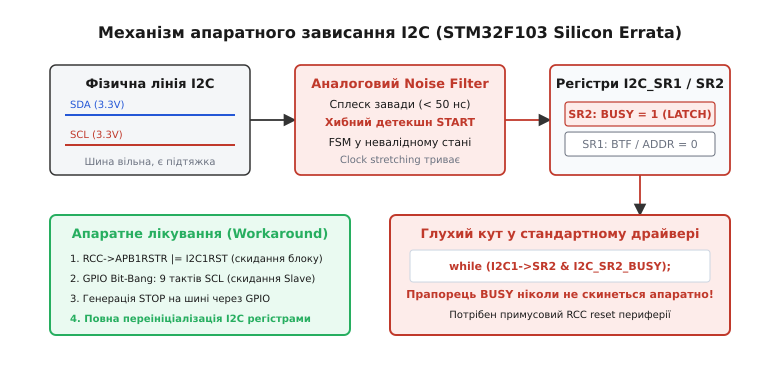
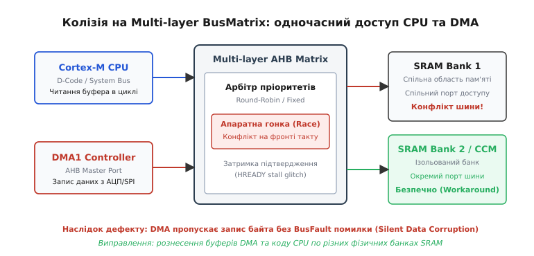
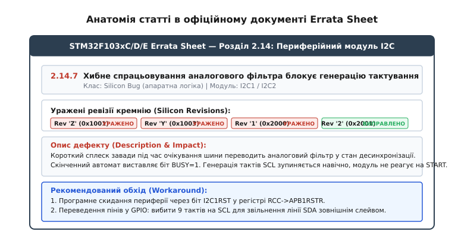
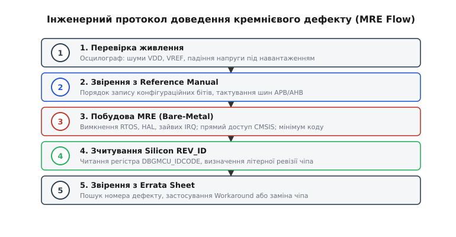

# Errata: коли винен чип, а не ти

<preknowlist>
- [Шина I2C](root:com-devices/i2c) — протокол з відкритим колектором, формування станів START/STOP та тактування SCL.
- [Контролер DMA](root:hw-arch/dma) — прямий доступ периферії до пам'яті в обхід процесора та арбітраж шин.
- [Логічний аналізатор](root:hw-sensing/logic-analyzer) — захоплення цифрових сигналів на лініях для виявлення апаратних часових збоїв.
- [Дерево тактування STM32](root:hw-arch/stm32-clock-tree) — джерела частоти (HSI/HSE), PLL та поділ тактових сигналів на шини APB/AHB.
</preknowlist>

О другій годині ночі під час тестування партії пристроїв зв'язку інженер стикається з містичною поведінкою: після десяти годин бездоганної роботи периферійний модуль I2C намертво блокує шину, хоча осцилограф показує ідеальні 3.3 В на обох підтягнутих лініях. Регістр стану контролера стверджує, що шина зайнята (`BUSY = 1`), але жоден пристрій не генерує сигнал. Код перевірено до останнього байта, конфігурацію вивірено за офіційним посібником користувача (Reference Manual), а компілятор зібрав чистий двійковий файл без жодного попередження. У цей момент розробник стикається з межею між ідеальною програмною моделлю та фізичною реальністю кремнієвого кристала: помилка знаходиться не в прошивці, а викарбувана в металі всередині мікросхеми.

Документ, який описує всі невідповідності між заявленою в документації поведінкою та реальним кремнієм, має назву **Errata Sheet** (лат. *errata* — помилки, друкарські огріхи). Для кожного мікроконтролера на ринку існує такий перелік апаратних вад, і розуміння природи кремнієвих дефектів відокремлює початківця від досвідченого системного інженера.

---

## 1. Реальність недосконалого кремнію: чому кожен чип має апаратні дефекти

Сучасний мікроконтролер — це складна система на кристалі (SoC, англ. *System-on-Chip*), яка поєднує процесорне ядро, багатошарові матриці шин, блоки пам'яті SRAM і Flash та десятки периферійних модулів (від таймерів до радіотрансиверів і USB-контролерів). Кількість логічних транзисторів на такому кристалі становить від кількох мільйонів до сотень мільйонів.

```
+-------------------------------------------------------------+
|                  СИСТЕМА НА КРИСТАЛІ (SoC)                  |
|                                                             |
|  +----------------+  +----------------+  +---------------+  |
|  | Core Cortex-M  |  | DMA Controller |  | USB Core (IP) |  |
|  +--------+-------+  +--------+-------+  +-------+-------+  |
|           |                   |                  |          |
|  =========v===================v==================v========  |
|               Багатошарова матриця шин (AHB/AXI)            |
|  =========+===================+==================+========  |
|           |                   |                  |          |
|  +--------v-------+  +--------v-------+  +-------v-------+  |
|  | SRAM Bank 1/2  |  |  Flash Memory |  | APB Bridges   |  |
|  +----------------+  +----------------+  +-------+-------+  |
|                                                  |          |
|                                          +-------v-------+  |
|   CDC (Перетин тактових доменів) ------> | I2C / SPI IP  |  |
|                                          +---------------+  |
+-------------------------------------------------------------+
```

Існує п'ять фізичних та інженерних причин, через які неможливо випустити абсолютно бездоганний чип:

1. **Інтеграція різнорідних IP-блоків (Intellectual Property).** Виробник мікроконтролера рідко проектує всі периферійні блоки самостійно. Ядро купується в ARM або Synopsys, USB-контролер — у стороннього постачальника, контролер CAN — у Bosch, а аналогові блоки АЦП розробляються власним відділом. Об'єднання цих модулів на спільній цифровій шині породжує крайові конфлікти протоколів обміну та узгодження станів.
2. **Перетин асинхронних тактових доменів (CDC, англ. *Clock Domain Crossing*).** Процесорне ядро працює на частоті 72–480 МГц, шина периферії APB — на 36–120 МГц, а інтерфейс I2C чи USB має власні внутрішні генератори. Передача керуючих сигналів між різними доменами тактування через черги синхронізаторів створює ризик метастабільності тригерів і часових гонок при збігу фронтів.
3. **Паразитні фізичні ефекти кремнієвого процесу.** Нанометрові провідники мають паразитні ємності та індуктивності. При різкому одночасному перемиканні сотень тисяч логічних вентилів виникає локальне просідання напруги живлення (*VDD droop*) та коливання потенціалу цифрової землі (*ground bounce*), що спотворює пороги спрацьовування сусідніх аналогових компараторів.
4. **Людський фактор та помилки в RTL-описі (Verilog/VHDL).** Скінченні автомати (FSM, англ. *Finite State Machine*) периферійних модулів містять тисячі взаємних переходів між станами. Неврахована в логічному коді послідовність скидання прапорця чи приходу зовнішнього переривання блокує автомат у тупиковому стані.
5. **Економіка виробництва напівпровідників.** Виготовлення одного комплекту фотолітографічних масок (mask set) для кремнієвої пластини коштує від кількох сотень тисяч до мільйонів доларів, а цикл вирощування кристалів займає 3–5 місяців. Якщо виявлена помилка блокує лише один екзотичний режим роботи периферії або може бути компенсована трьома рядками коду в драйвері, фабрика не відкликає кремній і не переробляє маски: дефект описується в документі Errata Sheet.

Детальніше про те, як виникла культура публікації відкритих звітів про дефекти чіпів, можна дізнатися в нарисі [історії найвідоміших кремнієвих збоїв](root:embedded/errata-koly-vynen-chyp/hist-famous-silicon-bugs.md).

---

## 2. Топ-5 легендарних кремнієвих дефектів у мікроконтролерах

Розглянемо найвідоміші апаратні помилки, з якими стикалися мільйони розробників по всьому світу.

### 1. Апаратний лок-ап модуля I2C в STM32F103

Модуль I2C у популярному мікроконтролері STM32F103 (та перших ревізіях STM32F4) став хрестоматійним прикладом складного скінченного автомата з кремнієвою вадою.


*Механізм апаратного блокування модуля I2C: спотворення в аналоговому фільтрі викликає постійний біт BUSY та застрягання тактування SCL*

Фізичний механізм збою розвивається двома шляхами:
- **Збій аналогового фільтра шумів.** Вхідні каскади SCL/SDA містять аналоговий фільтр для придушення коротких завад (тривалістю менше 50 нс). Якщо під час стану спокою шини (коли обидві лінії знаходяться на рівні 3.3 В) на лінії виникає крихітний шум або перепад напруги під час перемикання сусіднього GPIO, фільтр детектує хибний фронт спаду. Скінченний автомат I2C фіксує перехід у стан «шина зайнята» і виставляє біт `BUSY` в регістрі `I2C_SR2`. Оскільки фізична шина вільна, ніякого сигналу STOP не надходить, і біт `BUSY` залишається виставленим назавжди.
- **Гонка переривань при прийомі передостаннього байта.** Під час прийому пакета мастер повинен відправити сигнал `NACK` на останньому байті, щоб повідомити ведений пристрій про завершення зв'язку. Для цього біт `POS` або `ACK` у регістрі `I2C_CR1` має бути змінений точно до того, як зсувний регістр завершить зчитування передостаннього біта. Якщо обробник переривання затримується через вищий пріоритет іншого переривання або затримку конвеєра, контролер автоматично відправляє `ACK`, приймає зайвий байт, виставляє прапорець переповнення буфера (`BTF = 1`) і блокує лінію SCL у нулі (апаратне розтягування тактування — *clock stretching*).

Звичайне програмне скидання біта `PE` (Peripheral Enable) у регістрі `I2C_CR1` не скидає внутрішній автомат аналогового фільтра. Єдине надійне вирішення — повне вимикання тактування модуля та скидання через блок скидання периферії RCC, поєднане з вибиванням 9 імпульсів на лінії SCL у режимі GPIO. Робочий код драйвера наведено в інструкції з [відновлення шини I2C](root:embedded/errata-koly-vynen-chyp/proj-i2c-recovery.md).

### 2. Колізії на BusMatrix та гонки DMA при паралельному доступі

У високопродуктивних мікроконтролерах ядро процесора та контролери прямого доступу до пам'яті (DMA) підключені до пам'яті через багатошарову матрицю шин Multi-layer AHB BusMatrix.


*Конфлікт арбітражу на матриці шин AHB: одночасне звернення DMA та процесорного ядра до одного банку SRAM викликає пропуск транзакцій*

У ранніх ревізіях мікроконтролерів (наприклад, STM32F2/F4 ревізії A та NXP LPC17xx) виявлено дефект арбітражу [матриці шин](root:hw-arch/bus-matrix):
Коли контролер DMA виконує швидкісний запис потоку даних від АЦП або SPI в пам'ять SRAM1, а процесорне ядро через шину даних (D-Code) намагається одночасно зчитати змінну з того самого фізичного банку пам'яті, арбітр шини формує сигнал паузи конвеєра (`HREADY = 0`). Через помилку логіки синхронізації внутрішнього буфера DMA один цикл запису втрачається: контролер переходить до наступної адреси, а попередній байт не записується в SRAM. При цьому апаратний прапорець помилки шини (`TEIF` — Transfer Error) не виставляється, що призводить до непомітного спотворення даних (*Silent Data Corruption*).

**Спосіб обходу:** фізичне рознесення буферів DMA та системних змінних ядра по різних банках пам'яті (наприклад, розміщення буферів DMA в пам'яті SRAM2, а стека ядра — в SRAM1 або CCM RAM / DTCM RAM), куди процесор не звертається під час активної передачі.

### 3. АЦП: перехресні завади та збої інжектованих каналів

Блок аналого-цифрового перетворювача (АЦП) містить один спільний модуль вибірки-зберігання (Sample and Hold) та ємнісний ЦАП порозрядного наближення (SAR). У більшості мікроконтролерів канали діляться на:
- **Регулярні (Regular):** опитуються послідовно в неперервному циклі або за запитом DMA.
- **Інжектовані (Injected):** пріоритетні канали, що запускаються миттєво за подією таймера (наприклад, для вимірювання струму обмотки мотора в момент відкриття ключів ШІМ).

Кремнієвий дефект полягає в наступному: якщо апаратний тригер інжектованого перетворення спрацьовує точно в момент, коли АЦП перебуває у фазі перемикання розрядів ЦАП регулярного каналу, внутрішній аналоговий комутатор перемикає вхід на інжектований пін без достатнього часу на перезаряд внутрішнього конденсатора вибірки.
**Наслідок:** виникає значне зміщення результату вимірювання (до 15–20 LSB), а в деяких ревізіях регулярне перетворення повністю зупиняється без встановлення прапорця завершення `EOC` (End of Conversion).

**Спосіб обходу:** програмна заборона одночасного використання регулярної та інжектованої груп на одному фізичному ядрі АЦП або використання режиму з двома незалежними блоками (ADC1 для регулярних каналів, ADC2 — для інжектованих).

### 4. Збої вбудованого ROM Bootloader (USB DFU)

Системна пам'ять завантажувача (System Memory ROM) прошивається масочним способом на заводі під час виробництва кремнієвої пластини. Її код є незмінним.

У мікроконтролерах серій STM32F405/407 ревізії A вбудований завантажувач USB DFU (Device Firmware Upgrade) містив помилку конфігурації фазового автопідлаштування частоти (PLL). Алгоритм автоматичного визначення частоти зовнішнього кварцового резонатора (HSE) розраховував коефіцієнти ділення лише для кварців 8, 14.7456 та 25 МГц. Якщо на платі було встановлено поширений кварц на 12 МГц або 24 МГц, завантажувач налаштовував дільник USB на частоту 36 МГц замість обов'язкових для стандарту USB Full-Speed 48 МГц.
**Наслідок:** комп'ютер визначав підключений мікроконтролер як несправний пристрій (*Unknown USB Device / Device Descriptor Request Failed*), що унеможливлювало прошивку по USB на платах із кварцом 12 МГц.

**Спосіб обходу:** використання зовнішнього завантажувача в користувацькій флеш-пам'яті або встановлення суворо рекомендованих номіналів кварців (8 МГц).

### 5. Фазовий джитер і зрив синхронізації PLL при перемиканні джерел тактування

Генератор PLL містить фазовий детектор, фільтр низьких частот та генератор, керований напругою (VCO). При зміні джерела вхідного тактування (наприклад, переході з внутрішнього RC-генератора HSI 16 МГц на зовнішній кварц HSE 8 МГц) вимагається обов'язкове дотримання стадій блокування.

Якщо прошивка змінює біти конфігурації дільників PLL без повного вимкнення контуру (`PLLON = 0`), на виході VCO виникає високочастотний сплеск (*glitch*) тривалістю менше 1 нс. Цей паразитний імпульс поширюється по системній шині та порушує час встановлення даних (*setup time*) тригерів конвеєра процесорного ядра. Процесор миттєво потрапляє в обробник фатальної помилки `HardFault` із прапорцем некоректного стану інструкції `INVSTATE`.

**Спосіб обходу:** сувора послідовність зміни тактування: переведення системи на HSI -> вимкнення PLL -> очікування скидання прапорця `PLLRDY` -> зміна дільників -> увімкнення PLL -> очікування `PLLRDY = 1` -> перемикання системного тактування назад на PLL.

---

## 3. Як читати та розуміти документ Errata Sheet

Посібник користувача (Reference Manual) та технічний опис (Datasheet) описують **ідеальний** чип, яким його задумували архітектори. Документ **Errata Sheet** описує **реальний** кристал, який лежить на вашому столі.


*Структура статті в офіційному Errata Sheet: номер дефекту, таблиця ревізій, механізм відмови та алгоритм обходу*

### Ідентифікація ревізії кристала (Silicon Revision ID)

Мікроконтролери однієї і тієї ж моделі (наприклад, `STM32F407VGT6`), випущені в різні роки, мають різні апаратні виправлення. Кожна модифікація кремнієвих масок позначається ревізією (Revision / Stepping).

Ідентифікувати ревізію можна двома способами:

1. **Лазерне маркування на корпусі мікросхеми.** На корпусі чипа під назвою моделі викарбувано службовий рядок. Зазвичай третій або четвертий символ містить літеру ревізії кремнію (наприклад, `Y`, `Z`, `1`, `B`).
2. **Програмне зчитування службових регістрів.** Процесорні ядра та периферія налагодження містять фіксовані регістри ідентифікації. Наприклад, у контролерах STM32 регістр `DBGMCU_IDCODE` (адреса `0xE0042000`) містить два поля:

```
Регістр DBGMCU_IDCODE:
[31 ................. 16] [15 ... 12] [11 ............ 0]
      REV_ID (16 біт)       Зарезервовано     DEV_ID (12 біт)
```

- **`DEV_ID` (біти 0–11):** числовий ідентифікатор сімейства (наприклад, `0x414` для STM32F405/407).
- **`REV_ID` (біти 16–31):** код апаратної ревізії кремнію.

Таблиця відповідності ревізій для STM32F405/407 з Errata Sheet:

| Значення `REV_ID` у регістрі | Літера ревізії на корпусі | Статус кремнію |
|---|---|---|
| `0x1000` | Ревізія "A" | Перша партія: понад 30 задокументованих помилок (I2C, USB DFU, DMA, FSMC) |
| `0x1001` | Ревізія "Z" | Виправлено помилки тактування таймерів, I2C частково оптимізовано |
| `0x1003` | Ревізія "Y" | Виправлено дефекти арбітражу шини Ethernet та помилки читання Flash |
| `0x1007` | Ревізія "1" | Стабільний комерційний степінг: виправлено критичні дефекти шини DMA |

> 🔧 **Навіщо це.**
> Знання точної ревізії чіпа критично важливе при аналізі польових відмов: якщо на новій партії пристроїв зв'язок працює стабільно, а на пристроях трирічної давнини виникають спорадичні зависання, першим кроком перевіряється `REV_ID`. Різні партії часто містять чипи різних степінгів, які вимагають специфічних програмних патчів.

### Анатомія опису дефекту в Errata Sheet

Кожен запис у документі містить чотири обов'язкові поля:
1. **Reference & Module:** числовий класифікатор (наприклад, `2.1.3`) та назва периферійного блоку (`DMA`, `I2C`, `RTC`).
2. **Title:** стисла суть дефекту (наприклад, *Wrong data sampling in I2C master mode*).
3. **Applicability / Affected Revisions:** перелік ревізій, де дефект існує (Rev A — Present, Rev Z — Present, Rev 1 — Fixed).
4. **Description & Impact:** точний опис фізичних умов виникнення проблеми та наслідків для системи.
5. **Workaround:** детальні рекомендації виробника щодо програмного або схемотехнічного обходу дефекту. Якщо у графі Workaround зазначено *None*, даний режим роботи є непрацездатним і не повинен використовуватися в проекті.

---

## 4. Інженерний протокол ізоляції: як довести, що винен чип

Стверджувати, що в збої винен кремній — це надзвичайна заява. У 99.9% випадків причиною є помилка в коді, неврахування часу очікування прапорця, стан гонки в RTOS або шум по живленню на платі. Перш ніж відкривати Errata Sheet, інженер зобов'язаний пройти 5-кроковий протокол ізоляції.


*5-кроковий протокол ізоляції дефекту: послідовний перехід від перевірки заліза до створення мінімального репродуктивного прикладу*

### Крок 1. Апаратний аудит живлення та ліній зв'язку
- Підключити осцилограф безпосередньо до виводів `VDD` та `VSS` мікроконтролера в режимі закритого входу (AC Coupling). Перевірити, що амплітуда високочастотних шумів живлення не перевищує 50 мВ.
- Перевірити лінії сигналу на наявність дзвону (*ringing*), повільних фронтів через завеликий опір підтяжки або перехресних наведень від ліній ШІМ.

### Крок 2. Звірення послідовності ініціалізації з Reference Manual
- Перевірити, чи ввімкнено тактування модуля в регістрі RCC **до** першого звернення до його конфігураційних регістрів. Запис у регістри периферії без тактування ігнорується або викликає `BusFault`.
- Перевірити вставку затримок після ввімкнення тактування: для поширення сигналу тактування через мости шин APB потрібна затримка щонайменше у два такти шини (`__DSB()` або читання регістра назад).

### Крок 3. Створення мінімального репродуктивного прикладу (MRE)
Створюється повністю автономний проект (Bare-Metal):
- Видаляється операційна система реального часу (FreeRTOS, RT-Thread), вимикаються всі сторонні потоки.
- Вимикаються всі непов'язані апаратні переривання (SysTick, таймери, інші інтерфейси).
- Високорівневі бібліотеки (HAL/LL) замінюються на прямий запис у структури регістрів CMSIS.
- Створюється циклічний тест, який автоматично фіксує кількість успішних операцій до моменту зависання. Якщо збій відтворюється на 10 рядках чистого регістрового коду — це переконливий кандидат на кремнієвий дефект.

### Крок 4. Тестування на різних партіях та ревізіях
- Прошити підготовлений MRE на кілька плат з однієї партії.
- Прошити той самий бінарний файл на плати з чипами іншої ревізії (`REV_ID`) або іншої дати виробництва (*Date Code*).
- Якщо на чипах ревізії "A" код стабільно зависає на 10 000-й ітерації, а на ревізії "1" працює мільйони циклів без збоїв — ви маєте неспростовний доказ наявності апаратного дефекту.

### Крок 5. Апаратний моніторинг без втручання в таймінги
Не можна налагоджувати часові гонки за допомогою викликів `printf()` або встановлення точок зупинки (breakpoints) у налагоджувачі: вони змінюють часові інтервали на тисячі тактів і маскують проблему (ефект Гайзенберга).
Використовуйте [логічний аналізатор](root:hw-sensing/logic-analyzer) або апаратне трасування ITM/SWO через налагоджувальний інтерфейс ARM Cortex-M.

---

## 5. Програмні обходи (Workarounds) та патчі вендорських бібліотек

Коли апаратний дефект підтверджено, завдання інженера — написати код, стійкий до недосконалості кремнію.

### Як вендорські бібліотеки (STM32 HAL / CMSIS) компенсують Errata

Якщо відкрити вихідний код офіційної бібліотеки `stm32f1xx_hal_i2c.c`, можна знайти численні нестандартні конструкції, створені виключно для обходу апаратних дефектів.

Приклад фрагмента обходу Errata при читанні останнього байта в I2C:

:::tabs
:::code errata-koly-vynen-chyp-d/c/iak-vendorski-biblioteky.c
:::code errata-koly-vynen-chyp-d/cpp/iak-vendorski-biblioteky.hpp
:::

Без тимчасового вимкнення переривань (`__disable_irq()`) будь-яке стороннє переривання в цей момент затримає скидання біта `ACK`, і модуль згенерує зайвий такт на шині, перейшовши в стан апаратного блокування.

### Патерн захисного програмування: нескінченні цикли під забороною

Головне правило розробки драйверів під реальний кремній: **жоден цикл очікування апаратного прапорця не повинен бути нескінченним**.

Нижче наведено порівняння небезпечного та захищеного підходу до опитування апаратного регістра.

:::tabs
:::code errata-koly-vynen-chyp-d/c/patern-zakhysnoho.c
:::code errata-koly-vynen-chyp-d/cpp/patern-zakhysnoho.cpp
:::

### Патч ревізій у процесі виконання (Runtime Silicon Patching)

Якщо прошивка створюється для роботи на пристроях різних років випуску, програмні обходи дефектів можна вмикати динамічно залежно від зчитаного ідентифікатора кремнію:

:::tabs
:::code errata-koly-vynen-chyp-d/c/patch-revizii-u-protsesi.c
:::code errata-koly-vynen-chyp-d/cpp/patch-revizii-u-protsesi.cpp
:::

---

## 6. Зведена таблиця стратегій захисту від апаратних дефектів

| Категорія підсистеми | Характерний кремнієвий дефект | Інженерне рішення (Workaround) |
|---|---|---|
| **Шина I2C** | Застрягання автомата в `BUSY=1`, блокування SCL у нулі | Апаратне скидання через RCC + генерація 9 тактів SCL у режимі GPIO |
| **Контролер DMA** | Пропуск транзакцій при конфлікті з CPU на одному банку SRAM | Рознесення буферів DMA та пам'яті ядра по різних фізичних банках SRAM |
| **Модуль АЦП** | Зсув нуля та збій черги при одночасній роботі Regular/Injected | Розділення завдань між різними блоками (ADC1/ADC2) або часове розведення |
| **Системний PLL** | Джитер і HardFault при перемиканні джерел тактування | Переведення системи на HSI перед будь-якою зміною дільників PLL |
| **ROM Bootloader** | Некоректний поділ частоти USB DFU при нестандартних кварцах | Використання рекомендованих номіналів кварцу (8 МГц) або власного завантажувача |

Вбудовані системи працюють у реальному фізичному світі, де кремній має обмеження та дефекти. Професіоналізм розробника полягає не в надії на ідеальну мікросхему, а у вмінні швидко локалізувати дефект за допомогою інженерного протоколу, знайти його опис в Errata Sheet та побудувати надійний програмний бар'єр, що забезпечить стабільну роботу пристрою за будь-яких обставин.
