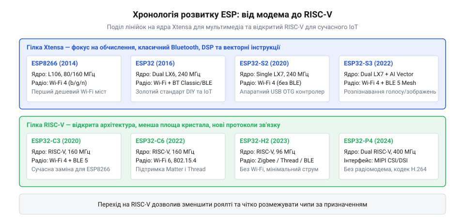

# Сімейство ESP32

<preknowlist>
- [ESP32 проти 8-біт](root:embedded/esp32-vs-8bit) — різниця обчислювальних можливостей і споживання
- [RISC і CISC](root:embedded/risc-cisc) — чому компанія перейшла на відкриту архітектуру команд RISC-V
</preknowlist>

## Початок бездротового кремнію Espressif: ESP8266

У травні 2014 року шанхайська напівпровідникова компанія Espressif Systems вивела на ринок невелику мікросхему під маркуванням ESP8266EX. Виробник позиціонував її не як автономний програмований мікроконтролер, а як гранично дешевий послідовний мережевий адаптер (англ. *serial Wi-Fi bridge*). Головним завданням чипа було надати звичайним 8-бітним мікроконтролерам — зокрема популярним тоді платам Arduino на базі ATmega328P — доступ до локальної бездротової мережі за допомогою стандартних текстових AT-команд через інтерфейс UART.

Модуль ESP-01 з кристалом ESP8266, друкованою антеною та мінімальним обв'язуванням коштував на ринку менше двох доларів, тоді як наявні на той час фірмові Wi-Fi-шипувальні модулі від відомих брендів коштували від двадцяти до сорока доларів. Така різниця в ціні привернула колосальну увагу світової інженерної спільноти та мейкерів. Дуже швидко ентузіасти виявили, що всередині крихітної мікросхеми схований повноцінний 32-бітний процесор архітектури Xtensa L106 Diamond Standard від компанії Tensilica, що працював на тактовій частоті 80 або 160 МГц і мав понад 36 кілобайтів доступної оперативної пам'яті (SRAM). Цей процесор перевершував за потужністю керівний мікроконтролер Arduino у десятки разів.

Розкриття неофіційного SDK та подальший випуск офіційного пакета підтримки для Arduino IDE перетворили ESP8266 на справжній каталізатор буму інтернету речей (англ. *Internet of Things, IoT*). Розробники викинули зовнішні мікроконтролери та почали писати логіку сенсорів, вебсерверів і реле безпосередньо всередині самого бездротового чипа. Проте архітектура кристала мала суттєві обмеження: лише один аналого-цифровий перетворювач (АЦП) із вузьким діапазоном, мінімальна кількість ліній введення-виведення загального призначення (GPIO), а головне — спільне монопольне використання єдиного процесорного ядра як для обслуговування прикладного коду користувача, так і для жорстких часових інтервалів мережевого стека Wi-Fi 802.11 b/g/n. Будь-яка затримка у коді користувача викликала скидання сторожового таймера та падіння зв'язку.

> 🔧 **Навіщо це.**
> Історія появи ESP8266 наочно демонструє, як компроміс ціни та відкритість архітектури можуть змінити глобальний ринок і чому подальша еволюція вимагала фізичного розділення ядер.

## Стрибок до повноцінного SoC: класичний ESP32

Усвідомивши, що розробники використовують їхній чип не як периферійний модем, а як мозок усього пристрою, у вересні 2016 року Espressif представила принципово новий кристал — ESP32. Це був не косметичний редизайн попередника, а спроєктована з нуля повноцінна система-на-кристалі (англ. *System-on-Chip, SoC*), що усувала всі «дитячі хвороби» першого покоління.

*Хронологічна лінія поколінь ESP з роками випуску, поділом на гілки Xtensa і RISC-V та ключовими апаратними відмінностями.*

Ключовим архітектурним рішенням став перехід на два 32-бітних ядра Xtensa LX6 із тактовою частотою до 240 МГц. Така конфігурація дозволила безкомпромісно розвести задачі: одне ядро (PRO CPU) повністю брало на себе обробку складних стеків бездротового зв'язку та шифрування, тоді як друге ядро (APP CPU) цілком віддавалося під код користувача в межах операційної системи реального часу FreeRTOS. Обсяг внутрішньої SRAM зріс до 520 кілобайтів, з'явилася підтримка зовнішньої псевдостатичної пам'яті (PSRAM) до 8 мегабайтів, а крихітне співпроцесорне ядро наднизького споживання (ULP) отримало здатність опитувати датчики при вимкнених основних ядрах.

Радіочастина отримала унікальну рису, яка вирізняє класичний ESP32 навіть сьогодні: одночасну підтримку не лише Wi-Fi 4, а й класичного Bluetooth 4.2 (BR/EDR) разом із Bluetooth Low Energy (BLE). Це зробило його універсальним шлюзом для аудіопотоків, зв'язку зі смартфонами та промисловими мережами датчиків. Набір периферії поповнився апаратними модулями CAN (TWAI), генераторами ШІМ для керування двигунами (MCPWM), ємнісними сенсорними кнопками (touch pins) та апаратними криптографічними прискорювачами AES, SHA і RSA, перетворивши ESP32 на індустріальний стандарт для комерційних бездротових вузлів.

## Розгалуження лінійки Xtensa: серія S

З розвитком ринку інтернету речей класичний ESP32 виявився занадто універсальним: для простих датчиків два ядра були надлишковими за ціною та струмом споживання, а для сучасних мультимедійних пристроїв бракувало апаратного USB та обчислювальної потужності для обробки звуку. У відповідь на це Espressif у 2020 році започаткувала серію S (Security / Specialized).

Першим представником став ESP32-S2 — одноядерний чип на оновленому ядрі Xtensa LX7 з тактовою частотою 240 МГц. З нього прибрали енергоємний модуль Bluetooth Classic і зосередилися на двох речах: безпеці та периферії. S2 отримав надійний апаратний блок шифрування eFuse, захист від атак на пам'ять (Secure Boot та Flash Encryption) і повношвидкісний контролер USB OTG, що дозволило чипу емулювати клавіатури, миші та віртуальні COM-порти без зовнішніх мікросхем-перетворювачів на кшталт CH340 або CP2102.

У 2022 році з'явився флагман лінійки — ESP32-S3. Він повернув двоядерну конфігурацію LX7, додав новітній стандарт Bluetooth 5.0 (BLE Mesh), але головною інновацією стала інтеграція векторних інструкцій (англ. *vector instructions / SIMD*). Спеціалізовані команди ядра дозволили прискорити операції множення матриць та обчислення згорткових нейромереж (CNN). Це перетворило ESP32-S3 на лідера для задач локального штучного інтелекту на краю мережі (Edge AI): розпізнавання голосових команд (wake-word detection), обробки зображень із камер та виведення графіки на кольорові сенсорні дисплеї.

> 🔧 **Навіщо це.**
> Серія S розділила завдання: ESP32-S2 зайняв нішу захищених USB-пристроїв, а ESP32-S3 став стандартом для локальних нейромережевих моделей та голосових помічників.

## Стратегічний перехід на RISC-V: серія C

Паралельно з розвитком лінійки Xtensa керівництво Espressif ухвалило стратегічне рішення щодо відмови від пропрієтарних ядер компанії Cadence/Tensilica. Ліцензування ядер Xtensa вимагало виплати значних роялті з кожного випущеного чипа, а закрита архітектура ускладнювала підтримку стандартного відкритого компілятора GCC та налагоджувача GDB.

У листопаді 2020 року компанія анонсувала революційний для себе кристал — ESP32-C3. Це був перший чип Espressif, побудований на відкритій архітектурі набору команд RISC-V (32-бітне ядро RV32IMC із частотою 160 МГц). За своїм призначенням C3 став прямою, повноцінною та дешевою заміною застарілого ESP8266: він зберіг простоту одноядерної структури, але отримав сучасний Wi-Fi 4, повноцінний Bluetooth 5 (BLE), вбудовані апаратні криптографічні блоки та сумісність за виводами (pin-to-pin) із популярними модулями.

Успіх відкритого ядра закріпив чип ESP32-C6, випущений у 2022 році. Він став першим рішенням компанії з підтримкою сучасного стандарту Wi-Fi 6 (802.11ax) у діапазоні 2.4 ГГц. Завдяки механізмам OFDMA та Target Wake Time (TWT) чип навчився працювати в перевантажених міських мережах із наднизьким енергоспоживанням, а інтеграція радіотракту стандарту IEEE 802.15.4 відкрила підтримку протоколів розумного дому майбутнього — Thread, Zigbee та стандарту Matter.

## Спеціалізовані ніші без компромісів: H2 та P4

Остаточне дозрівання сімейства ESP32 продемонструвало відмову від концепції «один чип для всього». Espressif пішла на радикальні кроки, випустивши кристали для вузьких, але критично важливих ринкових сегментів.

Першим несподіваним рішенням став ESP32-H2 (2023 рік). У цьому чипі виробник уперше в історії сімейства повністю вимкнув трансивер Wi-Fi! Залишився лише радіомодуль IEEE 802.15.4 та Bluetooth 5.2 LE, керовані енергоефективним ядром RISC-V на частоті 96 МГц. Відмова від енергоємного Wi-Fi дозволила знизити струм у режимі сну та передавання до значень, які зробили можливим багаторічну роботу розумних кнопок, термостатів та дверних датчиків від крихітної дискової батарейки CR2032 у мережах Zigbee та Matter.

Діаметрально протилежним полюсом став ESP32-P4, представлений у 2024 році. Це потужний мультимедійний процесор, який, навпаки, не має жодного власного бездротового радіотракту. Чип отримав два високопродуктивних ядра RISC-V із частотою до 400 МГц, розширеннями цифрової обробки сигналів (DSP), апаратним кодеком відео H.264 та швидкісними інтерфейсами MIPI-CSI (для камер) і MIPI-DSI (для дисплеїв високої роздільної здатності). За потреби бездротовий зв'язок додається підключенням сусіднього чипа C3 або C6 як веденого модема через швидкісну шину SDIO. Так родовід ESP замкнув своє коло: від примітивного модема для чужих процесорів у 2014 році до потужного обчислювального процесора, який сам керує зовнішніми модемами.
