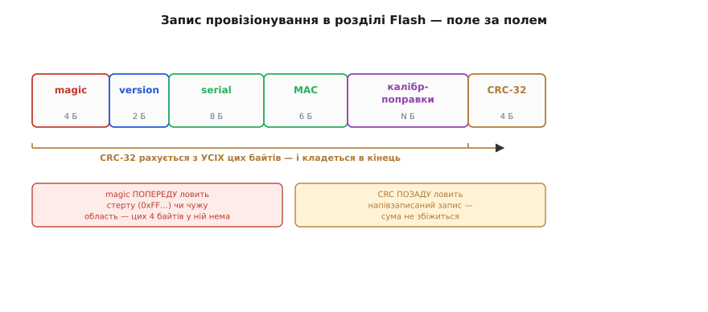
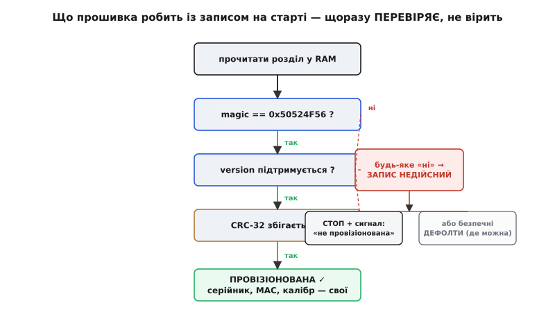

# ⚙️ Запис провізіонування: як плата на старті впізнає саму себе

Ми домовилися, що особистість плати живе в **окремому розділі Flash** — не в коді, щоб пережити оновлення. Але сказати «кладемо серійник у розділ даних» — це ще не інженерія, а лише напрямок. Розділ — це просто відведений шмат Flash за якоюсь адресою; що саме в тих байтах лежить і як прошивка на старті розуміє, чи то дійсна особистість, чи порожнеча, чи мотлох, — окрема ланка, і саме її ми зараз викуємо в коді.

Задача розпадається надвоє, і обидві половини мусять зійтися на **однаковому форматі байтів**. З боку прошивки: на кожному ввімкненні прочитати розділ і **не повірити**, а перевірити — це справді наш запис, він цілий, він нашої версії? І залежно від відповіді повестися по-різному: працювати як провізіонований виріб або впіймати біду. З боку заводської станції: сформувати рівно ці байти на хості й **залити** їх у розділ так, щоб плата їх упізнала. Дві програми, дві мови, одна структура посередині — і найтонше тут те, що вони пишуться й читаються в **різний час різними людьми**, тож формат між ними має бути прибитий цвяхами, а не «ну, приблизно так».

> 🔧 **Навіщо це.** Без цієї ланки провізіонування — акт віри: станція «щось залила», прошивка «якось прочитала», і поки все нове й ціле — воно ніби працює. А тоді розділ виявляється **порожнім** (станція не дійшла до цієї плати), або **напівзаписаним** (живлення на станції моргнуло посеред заливання), або в ньому **старий формат** з іншої версії прошивки — і код, що сліпо вірить байтам, бере мотлох за серійник і калібрування. Виріб іде до замовника з чужою або сміттєвою особистістю, і ловиться це вже в полі. Запис із магічним числом і контрольною сумою робить цю ланку не вірою, а **перевіркою**: плата на старті сама каже, провізіонована вона чи ні, — і бракує саму себе, поки ще на конвеєрі.

## Задача

Окреслимо рівно те, що ця ланка має вміти, і те, чого свідомо не робить.

- **Тримати в розділі даних одну структуру** з усім пер-юнітним: магічне число (мітка «це наш запис»), версія формату, серійний номер, MAC-адреса, калібрувальні поправки давача, і контрольна сума в кінці. Компактно, з фіксованим порядком полів.
- **На старті прошивки прочитати розділ і винести вирок**: провізіонована плата чи ні. Вирок спирається на три перевірки поспіль — магічне число на місці, версія підтримувана, контрольна сума збігається. Провалилась хоч одна — запис недійсний.
- **Дати одну чесну функцію `is_provisioned()`**, якою решта прошивки питає «мені можна довіряти своїм даним?» — і навколо неї безпечне читання, що ніколи не віддає невалідований запис назовні.
- **Правильно повестися при відсутньому чи побитому записі** — і тут два різні шляхи залежно від того, що це за виріб: або **стоп** із гучним сигналом «я не провізіонована», або тихі **безпечні дефолти**, де недостача особистості не смертельна. Розберемо, коли який.
- **З боку хоста — сформувати ці самі байти й залити в розділ** заводською станцією: порахувати CRC на комп'ютері, скласти образ розділу, записати його [тим самим esptool, яким шиємо на столі](root:embedded/esptool-workflow), за адресою розділу; а секрети, яким не місце в звичайному Flash, пропалити в eFuse.

Чого ланка **не** робить. Не шифрує сам запис — серійник, MAC і калібрування відкриті за задумом (шифрування Flash — окремий рівень, ключ до нього в eFuse, не тут). Не веде кілька версій запису з відкотом — розділ малий і пишеться раз на заводі, тож [вирівнювання зносу з кільцем слотів](root:embedded/eeprom-fram/proj-wear-leveling.md) тут ні до чого: це не часто оновлюване значення, а одноразова печатка. Не зберігає приватний ключ у структурі — його місце в захищеній комірці, куди прошивка не заглядає.

## Ідея

Уся конструкція виростає з одного питання: **як шмат байтів довести, що він — наш дійсний запис, а не випадковість?** Порожній, ще не писаний розділ Flash — це не нулі, а суцільні одиниці: стерта комірка NOR-Flash читається як `0xFF`. Напівзаписаний розділ — мішанина зі свіжих байтів на початку й старих `0xFF` у хвості. Чужий образ, залитий не за тією адресою, — просто інші байти. Треба відрізнити наш дійсний запис від усіх трьох бід, і робимо це **двома вартовими на протилежних кінцях структури**.

Перший вартовий — на початку — **магічне число** (англ. *magic number*): наперед обране, ні на що не схоже 4-байтове значення, яким кожен наш запис починається. Прошивка читає перші чотири байти й порівнює з відомою константою. Стерта область дасть `0xFFFFFFFF` — не наше магічне, вибракувано. Чужий образ дасть щось інше — теж вибракувано. Магічне число ловить **порожнечу й підміну** одним дешевим порівнянням: якщо його немає, далі можна навіть не дивитися.

Але магічне число безсиле проти тоншої біди — **напівзаписаного** запису. Уяви: станція почала лити наш образ, магічне число вже лягло на початок, а тоді живлення моргнуло — і хвіст розділу лишився старим сміттям або `0xFF`. Перші чотири байти правильні, магічне на місці, а серійник і калібрування в хвості — покруч. Тут потрібен другий вартовий, і він на **протилежному кінці** — **контрольна сума** (англ. *checksum*), коротке число, обчислене з **усіх** попередніх байтів запису й покладене останнім полем. Читаючи запис, прошивка перераховує суму з прочитаних даних і звіряє із записаною. Збіглися — весь запис цілий байт-у-байт; розійшлися — десь усередині спотворення, запис недійсний. Напівзаписаний образ майже напевно не збіжиться сумою, бо його хвіст не той, з якого суму рахували на заводі.


*Два вартові стоять на протилежних кінцях запису невипадково. Магічне число попереду ловить найгрубші біди — стертий (усі 0xFF) або чужий розділ: цих чотирьох байтів у них просто нема. Контрольна сума позаду ловить тоншу — напівзаписаний запис, у якого початок уже наш, а хвіст ще ні: сума, порахована з усього тіла, не збіжиться. Разом вони закривають усі три способи, якими розділ буває несправжнім.*

Чому саме на протилежних кінцях, а не поруч? Бо вони ловлять **різні класи** біди, і рознесеність не випадкова. Магічне на самому початку відсіює порожнечу негайно, ще до будь-яких обчислень, — найдешевша перевірка стоїть першою. Сума в самому кінці дає ще й приємний побічний закон: **доки останній байт суми не ліг, запис недійсний за визначенням**. Якщо станція заливає розділ від початку до кінця, то поки заливання не добігло до останнього байта, сума ще не на місці — і напівзаписаний розділ автоматично читається як недійсний. Це та сама думка, що рятувала нас у [кільці слотів EEPROM](root:embedded/eeprom-fram/proj-wear-leveling.md): межа між «ще не записано» й «уже записано» — це поява **цілого** запису з правильною сумою в кінці, а не якийсь окремий прапорець, що сам міг би обірватися на півдорозі.

Між двома вартовими — ще й **версія формату**: маленьке число, що каже, за якою розкладкою складено цей запис. Навіщо, якщо магічне вже підтвердило «наше»? Бо формат **житиме роками** й змінюватиметься: сьогодні калібрування давача — три коефіцієнти, за рік додасться четвертий, поле поїде, розмір зміниться. Стара плата з першої партії несе запис версії 1, нова прошивка знає вже версію 2 — і без поля версії вона прочитала б старий запис за новою розкладкою, зсунувши всі поля. Версія дає прошивці розвилку: «версію 1 читаю за старою схемою, версію 2 — за новою, а версію 99, якої не знаю, — вважаю недійсною». Це страховка від майбутнього себе, і коштує вона два байти.

> 🔧 **Навіщо це.** Магічне число, версія й CRC — не церемоніальні прикраси структури, а три різні відповіді на три різні «а раптом». Магічне: а раптом розділ порожній або чужий? Версія: а раптом запис нашого формату, але старого? CRC: а раптом запис нашого формату й версії, але **побитий**? Викинь будь-яке з трьох — і відповідна біда пройде повз перевірку тихо, аж поки не вилізе в полі спотвореним серійником чи зсунутим калібруванням. Ці три поля перетворюють «прочитати розділ» на «прочитати й **довести**, що прочитане справжнє».

## Робочий код

Зберемо прошивковий бік у модуль. Він читає розділ, валідує його трьома перевірками й віддає решті прошивки одну чесну відповідь. Код — реальний C для мікроконтролера; за приклад беремо ESP32, де розділ даних оголошено в таблиці розділів, а дістаємося ми до нього штатним API розділів ESP-IDF.

### Структура запису

Спершу — самі байти. Оголошуємо структуру з фіксованим порядком полів і, найважливіше, **упаковуємо** її (`__attribute__((packed))`), щоб компілятор не встромляв між полями невидимих байтів вирівнювання: розкладка в пам'яті мусить точно збігтися з тим, що заллє станція, інакше CRC не зійдеться.

:::code proj-provision-record/c/struktura-zapysu.c

Порядок полів не косметичний. Магічне — **перше**, щоб перевіряти його, не читаючи решти. CRC — **останнє**, бо воно накриває все, що перед ним, і бо його поява останнім байтом і є та межа «недійсно/дійсно», про яку ми говорили. Проміжні поля — за спаданням «твердості»: те, що ніколи не змінюється (серійник, MAC), ближче до початку; калібрування, яке з версіями формату найімовірніше розбухне, — ближче до кінця, щоб додавання коефіцієнтів зсувало лише CRC, а не серійник із MAC.

### Контрольна сума: CRC-32

Для суми беремо **CRC-32** — 32-бітну циклічну надлишкову перевірку, ту саму, що стереже кадри Ethernet, файли ZIP і PNG. Чому саме її, а не простішу [CRC-8, якою ми крили дрібні слоти EEPROM](root:embedded/eeprom-fram/proj-wear-leveling.md)? Бо там слот був 13 байтів і суперник — рідкісний обірваний запис, а восьми бітів (шанс хибно прийняти покруч ≈ 1/256) вистачало з головою. Тут запис більший, і головне — ціна помилки інша: хибно прийнятий покруч тут означає **виріб із чужою особистістю в полі**, а не одне зіпсоване нарощення лічильника. Тридцять два біти дають шанс випадкового збігу ≈ 1/2³² (близько однієї на чотири мільярди) — і заразом це той самий CRC-32, що вміє порахувати `zlib` на хості, тож станція рахуватиме суму тією самою математикою, не саморобкою.

Конкретно — стандартний **CRC-32/ISO-HDLC** (він же CRC-32 IEEE 802.3, він же `zlib.crc32`): многочлен 0x04C11DB7, у побітово-відображеній формі 0xEDB88320, початкове значення 0xFFFFFFFF, з відображенням входу й виходу та фінальним XOR 0xFFFFFFFF. Ці параметри — не наш вибір смаку, а закріплений стандарт; контрольне значення для рядка `123456789` при них — 0xCBF43926, і ним перевіряють будь-яку реалізацію. (Це усталений факт, зафіксований у IEEE 802.3 і повторений у незліченних реалізаціях; звіряльне значення `123456789` → 0xCBF43926 — канонічний тест-вектор цього CRC.)

:::code proj-provision-record/c/kontrolna-suma-crc-32.c

Восьми проходів на байт достатньо: запис читається раз на старті, це мікросекунди навіть без таблиці. Якби суму треба було рахувати в гарячому циклі — узяли б таблицю на 256 записів (той самий алгоритм, лише байт за прохід замість біта), але для одноразової перевірки старту це зайвий кілобайт Flash задарма.

### Читання й валідація: `is_provisioned()`

Ось серце модуля. Читаємо розділ даних у структуру, проганяємо три перевірки поспіль — магічне, версія, CRC — і лише якщо всі три пройшли, кажемо «провізіонована». Тримаємо прочитаний запис у статичній змінній і прапорець валідності при ній, щоб решта прошивки не читала Flash повторно й не діставала невалідований запис.

:::code proj-provision-record/c/chytannia-i-validatsiia-is.c

Три перевірки стоять саме в цьому порядку невипадково: від найдешевшої й найгрубшої до найдорожчої й найтоншої. Магічне — одне порівняння `uint32_t`, відсіює порожнечу негайно. Версія — ще одне порівняння, відсіює чужий формат. CRC — прохід по всіх байтах, найдорожча, тож остання: до неї доходять лише записи, що вже пройшли перші два сита. І `s_valid` при `s_record` — не оптимізація заради швидкості, а **захист від необережності**: рештa прошивки бере поля лише через геттери нижче, які мовчать, поки запис не валідований, тож жоден код не витягне серійник із невалідованого запису випадково.


*Прошивка не вірить, що особистість на місці, — вона щоразу проходить драбину з трьох перевірок згори вниз. Провалилась будь-яка — запис недійсний, і далі два можливі шляхи залежно від того, наскільки виробу смертельна відсутність особистості: гучний стоп із сигналом «не провізіонована» або тихі безпечні дефолти там, де недостача не фатальна. Який шлях обрати — рішення не коду, а призначення виробу.*

### Безпечне читання полів

Решта прошивки не мацає `s_record` напряму — вона питає через геттери, що віддають поле лише коли запис валідний. Так «прочитати серійник» фізично не може повернути сміття з невалідованого запису: якщо `is_provisioned()` дало `false`, геттери теж мовчать.

:::code proj-provision-record/c/bezpechne-chytannia-poliv.c

### Поведінка при відсутньому чи побитому записі

І головне рішення теми: `prov_init()` повернув `false` — що робити далі? Тут немає одної відповіді на всі випадки; є **розвилка за призначенням виробу**, і плутати її гілки небезпечно.

Перша гілка — **стоп**. Для виробу, якому особистість **життєво потрібна**, — вузол, що без серійника й ключів не має права виходити в мережу, медичний чи промисловий пристрій, будь-що, де безлика робота гірша за відмову, — правильна відповідь категорична: **не працювати**. Не тихцем прикинутися робочим на дефолтах, а голосно повідомити «я не провізіонована» — блимнути аварійним кодом світлодіода, застрягти в безпечному стані, віддати діагностику по діагностичному порту. Це не поразка, а **риса безпеки**: краще, щоб непровізіонована плата впіймалася на конвеєрі гучним стопом, ніж поїхала до замовника мовчазним напівфабрикатом.

:::code proj-provision-record/c/povedinka-pry-vidsutnomu.c

Друга гілка — **безпечні дефолти**. Для виробу, якому відсутність особистості **не смертельна** — простий давач, іграшка, пристрій, що й без калібрування дасть грубий, але притомний результат, — категоричний стоп був би надмірним: краще працювати гірше, ніж не працювати зовсім. Тоді на невалідному записі беруть завідомо безпечні типові значення: калібрування — нейтральне (нульове зміщення, одиничний масштаб), серійник — позначку «не провізіонований». Ключове слово — **безпечні**: дефолт не має прикидатися дійсними даними, він має бути свідомо консервативним і, де можливо, помітним, щоб «невідкалібрований» стан було видно, а не сплутано з відкаліброваним.

```c
// Гілка «дефолти»: виріб терпить відсутність особистості — працює консервативно.
void app_main_lenient(void) {
    if (!prov_init()) {
        // Запису нема або він побитий — беремо безпечні нейтральні поправки.
        load_default_calibration();   // зміщення 0, масштаб 1 — грубо, але не бреше
        mark_uncalibrated();          // лишити слід: цей примірник НЕ провізіонований
    }
    normal_operation();
}
```

Що обрати — вирішує **не код, а призначення виробу**, і це рішення свідоме. Питання просте: чи гірша безлика робота за відмову? Так — стоп; ні — дефолти. Одного правильного варіанта на всіх немає, є правильний для цього виробу; помилка тут — не в синтаксисі, а в тому, що взяли не ту гілку для не того пристрою.

## Хостовий бік: як станція формує й заливає запис

Досі ми дивилися з боку плати. Але байти в розділі беруться не з повітря — їх **формує заводська станція на хості** й заливає в розділ. Половина формату існує рівно для того, щоб ці дві сторони зійшлися; гляньмо на другу сторону.

Станція під кожну плату збирає той самий запис на комп'ютері — беручи наступний серійник із лічильника, MAC (свій, якщо треба, — інакше чип уже має заводський), поправки з [обряду калібрування](root:embedded/calibration-procedure) — і рахує **ту саму CRC-32 тією самою математикою**, що й прошивка. Ось чому ми обрали стандартний CRC-32, а не саморобку: на хості він уже готовий у `zlib`, тож обидві сторони точно рахують однаково.

:::code proj-provision-record/py/main.py

Тут криється тонка, але дорога пастка: формат `struct.pack` на хості мусить **байт-у-байт** збігтися з `packed`-структурою в C. `<` фіксує порядок байтів (little-endian, як в ESP32) і забороняє Python-у вставляти вирівнювання — точний відповідник `__attribute__((packed))`. Забудеш `<`, полишиш вирівнювання хоч на одному боці — і поля роз'їдуться, CRC на платі не збіжиться, кожна плата вважатиметься непровізіонованою. Обидві сторони описують **одну** розкладку; розійшлися на один байт — і вся партія падає на CRC.

Готовий образ станція заливає в розділ [тим самим `esptool`, яким ми шиємо на столі](root:embedded/esptool-workflow), тільки не за адресою прошивки, а **за адресою розділу даних** із таблиці розділів:

```bash
# Адреса 0x9000 — приклад зсуву розділу "prov" із partitions.csv (має збігтися!).
# Записуємо образ запису рівно за цим зсувом, не чіпаючи інших розділів.
esptool.py --chip esp32 --port /dev/ttyUSB0 write_flash 0x9000 prov_0x41.bin
```

Секрети сюди не кладуть. Приватний ключ і ключ шифрування Flash не мають лежати у звичайному розділі, звідки їх вичитає будь-хто, — їх пропалюють в однобічні комірки **eFuse** окремим інструментом. `espefuse.py` пропалює 256-бітний ключ шифрування у блок BLK1, звідки програмно його вже не прочитати; він же пропалює власний MAC у BLOCK3, якщо потрібен фірмовий, а не заводський:

```bash
# Пропалити ключ шифрування Flash у BLK1 — НЕОБОРОТНО, робиться в останню чергу.
espefuse.py --port /dev/ttyUSB0 burn_key flash_encryption key_0x41.bin

# За потреби — власний MAC із купленого OUI (заводський MAC пропалено вже на фабриці Espressif).
espefuse.py --port /dev/ttyUSB0 burn_custom_mac A1:B2:C3:D4:E5:F6
```

(Розкладка eFuse ESP32 — ключ шифрування Flash у BLK1, власний MAC у BLOCK3, заводський MAC у незмінному блоці `MAC` — підтверджена документацією Espressif та довідкою `espefuse`; заводський MAC цим інструментом змінити не можна.)

## Складність і пастки

Модуль короткий, а пасток у ньому — на цілу зміну заводу. Розберімо ті, об які спотикаються найчастіше.

### Пастка перша: esptool «підтверджує запис», але це не те підтвердження

Найпідступніше непорозуміння. `esptool` після кожного `write_flash` **сам звіряє записане** й перешиває файл, якщо звірка не зійшлася. Спокуса вирішити: «раз esptool підтвердив запис, магічне число й CRC на платі зайві — байти ж гарантовано лягли». Це хибно, і різниця тут життєва. Звірка esptool підтверджує лише те, що **передача з хоста в Flash пройшла без спотворення** — байти в чипі збігаються з файлом на диску. Вона нічого не знає про те, чи файл був **правильний**, чи станція взагалі **дійшла** до цієї плати, чи живлення трималося після того, як esptool від'єднався.

Магічне й CRC на платі ловлять рівно те, що esptool впіймати не може: розділ, у який **ніхто нічого не заливав** (порожній `0xFF` — esptool до нього не торкався, тож і не звіряв); запис, залитий, а тоді **затертий** збоєм; образ, зібраний із **роз'їханим форматом** (esptool чесно залив биті байти — вони ж збігаються з битим файлом). Звірка передачі й перевірка сенсу — різні рубежі оборони: esptool стереже **дорогу**, а магічне з CRC — **вантаж**. Прибереш перевірку на платі, поклавшись на esptool, — і перша ж плата, яку станція пропустила, поїде до замовника з порожнім розділом, бо на платі ніхто не спитав «а мене взагалі провізіонували?».

### Пастка друга: CRC мусить накривати рівно тіло — не саму себе й не хвіст розділу

Дрібниця на один рядок, а гробить усю перевірку. CRC рахують з **тіла** запису — усього, що **перед** полем `crc32`, — і ані байтом більше. Дві типові помилки. Перша: включити саме поле `crc32` у власне обчислення — логічна пастка (сума від даних, що містять цю ж суму, ще не відому в мить рахунку); тому в коді ми беремо `sizeof(prov_record_t) − sizeof(crc32)`, відрізаючи останні чотири байти. Друга, тонша: порахувати CRC не по структурі, а по **всьому розділу** — а розділ у Flash більший за запис, і хвіст його — стерті `0xFF`. Тоді сума залежала б від сміття за записом, і однаковий запис у розділах різного розміру давав би різну суму. Правило залізне: **CRC накриває фіксоване тіло структури, від першого байта магічного до останнього байта перед CRC** — не саму CRC і не хвіст розділу. Хост і плата мусять різати тіло **однаково**, до байта.

### Пастка третя: packed і порядок байтів мусять збігтися на обох боках

Ми вже торкнулися цього, але воно варте окремого прапорця, бо ламається тихо. Структура в C **упакована**, образ на хості зібрано `struct.pack("<…")` — і ці два описи однієї розкладки легко непомітно розсунути. Компілятор без `packed` встромить байти вирівнювання перед `float`-масивом (щоб він ліг на межу 4 байтів) — і структура в пам'яті стане на кілька байтів довша, ніж образ із хоста; CRC не зійдеться, хоч логічно поля ті самі. Або хост забуде `<` і вставить власне вирівнювання чи візьме інший порядок байтів. Симптом однаковий і оманливий: **уся партія читається як непровізіонована**, хоча заливалося ніби правильно. Ліки — тримати опис розкладки в **одному** місці правдою (наприклад, згенерувати і `struct.pack`-рядок, і C-структуру з одного опису) і **звірити `sizeof(prov_record_t)` з довжиною хостового образу** ще на першій платі: не збіглися розміри — формати роз'їхалися, далі шити не можна.

### Пастка четверта: eFuse — в останню чергу, і тільки звіривши все інше

Найдорожча пастка, бо необоротна. Запис у розділ даних можна перезалити скільки завгодно — Flash перезаписуваний. Пропалювання eFuse (ключ шифрування, secure boot) — **однобічне й назавжди**: пропалив біт — не відкотиш. Звідси порядок кроків станції, який ми вивели ще в темі: спершу все **оборотне** — залити прошивку, записати й **прочитати назад** запис провізіонування, дати платі стартувати й підтвердити `is_provisioned()`, — і лише переконавшись, що все зійшлося, робити **необоротний** крок пропалювання. Пропалиш eFuse першим, а тоді виявиш, що запис роз'їхався форматом, — і плата, можливо, вже зачинена захистом, а виправити нічим. Правило: необоротне — **останнім** і **тільки після** зеленої звірки всього оборотного.

---

Отже, ланка «плата впізнає себе» — це не «прочитати розділ», а **прочитати й довести справжність**, і доказ будують два вартові на кінцях запису плюс версія між ними. Магічне число попереду ловить стертий і чужий розділ одним дешевим порівнянням; CRC-32 позаду ловить напівзаписаний і побитий — і, лягаючи останнім байтом, сама стає межею між «ще недійсно» і «вже дійсно»; версія посередині боронить від майбутньої зміни формату. Функція `is_provisioned()` зводить усе це до однієї чесної відповіді, а геттери навколо неї фізично не віддають невалідований запис. При недійсному записі — свідома розвилка за призначенням виробу: **стоп** там, де безлика робота гірша за відмову, **безпечні дефолти** там, де ні; помилка тут не в коді, а у виборі гілки. Хостовий бік формує ті самі байти тим самим CRC і заливає їх [esptool-ом за адресою розділу](root:embedded/esptool-workflow), а секрети пропалює в eFuse — необоротно й останнім кроком. І наскрізний урок, що переживе конкретний чип: **звірка передачі (esptool) і перевірка сенсу (магічне + CRC на платі) — різні рубежі**; хто покладеться лише на перший, той відправить порожню плату замовникові, бо на самій платі ніхто не спитав, чи вона взагалі знає, хто вона.
