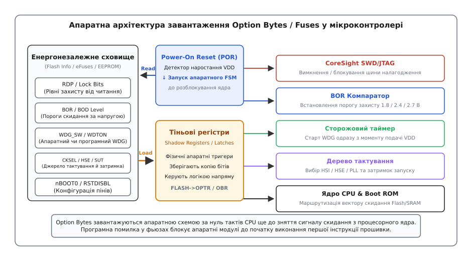
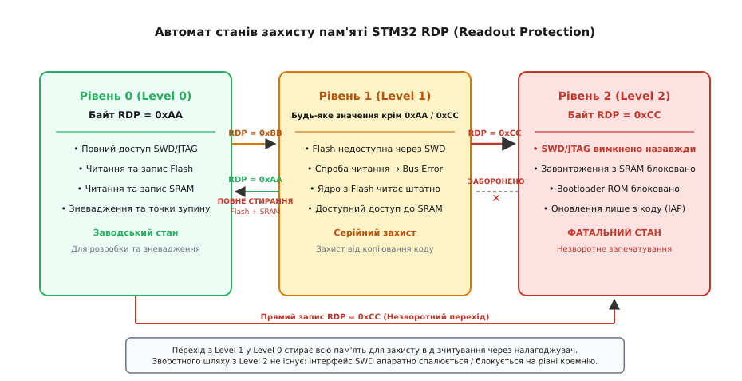
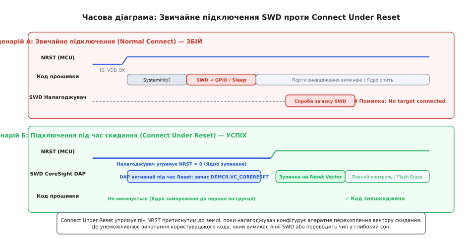
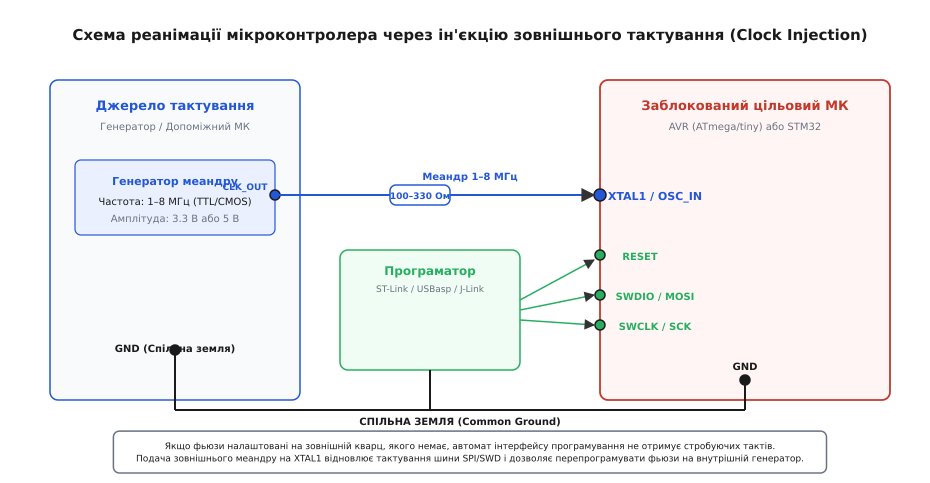

# Фьюзи, option bytes і як не зробити цеглинку

<preknowlist>
- [Послідовність скидання мікроконтролера](root:embedded/reset-sequence) — апаратні стадії виходу з Reset, вектори переривань і початкова ініціалізація ядра.
- [Інструменти зневадження JTAG та SWD](root:embedded/jtag-swd-tools) — апаратні лінії налагодження, пакети керування та протокол налагоджувача.
- [Сторожовий таймер](root:sf-devices/watchdog) — принцип апаратного контролю зависання коду та періодичне скидання лічильника.
- [Детектор просідання напруги (BOR / Brownout)](root:hw-arch/brownout) — захист цифрової логіки та флеш-пам'яті від роботи на нестабільних рівнях напруги.
- [Комірка NOR Flash](root:hw-components/nor-flash-cell) — механізм інжекції гарячих електронів і тунелювання Фаулера-Нордгейма для енергонезалежного збереження бітів.
</preknowlist>

Уявіть типову виробничу катастрофу під час монтажу серійної партії пристроїв: ви зібрали партію з п'ятисот плат на базі сучасного 32-бітного мікроконтролера. Прошивка протестована на стенді, але для фінального випуску інженер вирішує увімкнути захист від зчитування коду, призначити пін скидання як звичайний цифровий вхід для додаткової кнопки й перемкнути тактування на зовнішній кварцовий резонатор. Програматор відправляє команду запису конфігураційних бітів, подається живлення — і вся партія перестає виходити на зв'язок. Налагоджувач видає фатальну помилку «No target connected», перепрошити чипи через стандартний інтерфейс неможливо, а пристрої перетворилися на дорогі шматки склотекстоліту — так звані «цеглинки» (англ. *brick*).

Причина цієї проблеми полягає в парадоксі початкового запуску обчислювальної системи: перш ніж процесорне ядро зможе виконати хоча б одну інструкцію з флеш-пам'яті, цифрова логіка мікроконтролера вже повинна знати базові правила свого фізичного існування. Вона зобов'язана знати, від якого джерела брати тактові імпульси, який рівень напруги живлення вважати аварійним, чи дозволено зовнішньому налагоджувачу зупиняти ядро та яку функцію виконує фізичний вивід скидання на корпусі мікросхеми.

Якщо конфігурувати ці параметри звичайним кодом у функції `main()`, виникає замкнене коло: щоб виконати код налаштування генератора, ядро вже має тактуватися; щоб увімкнути захист пам'яті, код уже має завантажитися. Для вирішення цього протиріччя в напівпровідниковій індустрії було створено механізм апаратної енергонезалежної конфігурації (лат. *configurare* — надавати форму). Залежно від архітектури чипа ці комірки називають **фьюзами** (англ. *fuses* або *fuse bits* у мікроконтролерах AVR), **байтами опцій** (англ. *Option Bytes* у родинах STM32) або **електронними запобіжниками** (англ. *eFuses* у сімействах ESP32).

Розберімо фізичну природу цих бітів, механізми їхнього завантаження цифровою логікою під час увімкнення живлення, типові інженерні пастки перетворення чипів на «цеглинку» та протоколи апаратної реанімації заблокованих мікроконтролерів.

## Природа нелеткої конфігурації: фьюзи, Option Bytes та eFuses

Конфігураційні байти принципово відрізняються від звичайної флеш-пам'яті програм і оперативної пам'яті (SRAM). Вони інтегровані безпосередньо в систему живлення, скидання та тактування мікроконтролера.


*Апаратна архітектура завантаження Option Bytes / Fuses у мікроконтролері. Схема Power-On Reset (POR) запускає внутрішній кінцевий автомат, який зчитує конфігурацію з виділеного енергонезалежного блоку в тіньові регістри-засувки за нуль тактів CPU до розблокування процесорного ядра.*

Коли напруга живлення `V_DD` подається на ніжки чипа, внутрішня аналогова схема [Power-On Reset](root:embedded/reset-sequence) (POR) утримує лінію внутрішнього скидання процесорного ядра в активному стані. У цей проміжок часу — задовго до вибірки першого вектора переривання — спеціалізований апаратний кінцевий автомат зчитує конфігураційні байти з енергонезалежного масиву й записує їх у **тіньові регістри-засувки** (англ. *shadow registers* або *latches*). Виходи цих засувок безпосередньо керують логічними вентилями мультиплексорів тактування, компараторами напруги, детекторами налагоджувального порту та дешифраторами шин.

У мікроконтролерній схемотехніці склалися три основні технологічні підходи до реалізації цієї пам'яті:

### 1. Фьюзи AVR (Fuse Bits)

У класичних 8-бітних мікроконтролерах Microchip/Atmel AVR (ATmega328P, ATtiny85) конфігурація реалізована у вигляді кількох байтів [EEPROM](root:hw-components/nor-flash-cell) (зазвичай `Low Fuse`, `High Fuse` та `Extended Fuse`). 

Головна історична особливість AVR Fuses — **інверсна логіка**:
- Біт зі значенням `0` вважається **запрограмованим** (англ. *programmed / active*).
- Біт зі значенням `1` вважається **незапрограмованим** (англ. *unprogrammed / disabled*).

Ця інверсія бере свій початок від технології стирання пам'яті: під час повного циклу стирання кристала (англ. *Chip Erase*) плаваючий затвор комірок очищається від електронів, і всі біти перетворюються на логічні одиниці `0xFF`. Тому для увімкнення будь-якої спеціальної апаратної функції (наприклад, увімкнення сторожового таймера або вимкнення лінії скидання) у відповідний розряд необхідно записати фізичний нуль `0`. Помилка в розумінні цієї інверсії є найчастішою причиною блокування чипів початківцями.

### 2. Option Bytes у STM32

У 32-бітних мікроконтролерах ARM Cortex-M компанії STMicroelectronics конфігурація винесена в окремий службовий інформаційний блок флеш-пам'яті (англ. *Information Block / Option Bytes*). Ці байти доступні в адресному просторі мікроконтролера через спеціалізовані регістри контролера Flash (`FLASH->OPTR`, `FLASH->OBR` тощо).

Для захисту від випадкового пошкодження або електромагнітних завад багато родин STM32 (наприклад, STM32F1, STM32F3, STM32L0) використовують апаратну **надлишковість із порозрядним інверсним контролем**: кожен байт опцій зберігається в парі зі своїм порозрядним інверсним двійником.

```
Структура Option Bytes у пам'яті Flash:
[Byte 0: Data] [Byte 1: ~Data] [Byte 2: Data] [Byte 3: ~Data] ...
```

Під час запуску апаратний автомат перевіряє умову цілісності кожного байта:

```
Data XOR (~Data) = 0xFF   [перевірка комплементарності бітів]
```

Якщо внаслідок збою живлення, деградації заряду чи некоректного запису прямий і інверсний байти не є комплементарними, контролер Flash фіксує помилку `OPTERR` (Option Byte Error). У цьому стані чип автоматично переходить у найжорсткіший режим захисту від читання, блокуючи виконання користувацького коду та доступ до шини SWD.

### 3. Одноразові eFuses (ESP32)

У мікроконтролерах компанії Espressif (ESP32, ESP32-S3, ESP32-C3) використовується технологія фізичних електричних запобіжників (англ. *electronic fuses*, eFuses). Це мікроскопічні полікремнієві або металеві провідники на кристалі.

На заводі всі eFuses перебувають у стані логічного нуля `0`. Для запису одиниці `1` внутрішній перетворювач напруги (англ. *charge pump*) або зовнішнє джерело подає на обраний запобіжник високовольтний імпульс струму. Провідник фізично випаровується (розмикається), незворотно фіксуючи стан `1`.

> ⚠️ **Фізична незворотність eFuses.** Запис у eFuse — це односпрямований квантовий і термічний процес: перевести розряд `1` назад у `0` фізично неможливо. Якщо ви помилково спалили конфігураційний біт напруги живлення внутрішньої Flash-пам'яті чи заблокували завантажувач, чип втрачає працездатність назавжди без жодної можливості відновлення.

## Що насправді конфігурують апаратні байти

Конфігураційні байти керують критичними вузлами мікроконтролера. Розгляньмо структуру цих налаштувань та їхній апаратний вплив на запуск системи.

```
┌────────────────────────────────────────────────────────────────────────────────────────┐
│                              ГОЛОВНІ ФУНКЦІЇ OPTION BYTES                              │
├─────────────────────────┬──────────────────────────┬───────────────────────────────────┤
│ Вузол керування         │ Параметри конфігурації   │ Апаратний наслідок помилки        │
├─────────────────────────┼──────────────────────────┼───────────────────────────────────┤
│ 1. Джерело тактування   │ HSI / HSE / LSE / PLL,   │ Зупинка шинних автоматів SPI/SWD; │
│                         │ затримка запуску SUT     │ повна втрата зв'язку з програматором│
├─────────────────────────┼──────────────────────────┼───────────────────────────────────┤
│ 2. Сторожовий таймер    │ WDG_SW (апаратний чи     │ Нескінченний цикл скидання (reboot│
│                         │ програмний старт WDG)    │ loop) до входу у функцію main()   │
├─────────────────────────┼──────────────────────────┼───────────────────────────────────┤
│ 3. Детектор напруги     │ BOR Level / BOD Level    │ Постійне утримання чипа в Reset   │
│                         │ (пороги 1.8 ... 2.7 В)   │ за нормальної робочої напруги     │
├─────────────────────────┼──────────────────────────┼───────────────────────────────────┤
│ 4. Захист пам'яті       │ RDP Level 0 / 1 / 2,     │ Повна апаратна деактивація шини   │
│                         │ AVR Lock Bits (LB1, LB2) │ зневадження SWD/JTAG на кристалі  │
├─────────────────────────┼──────────────────────────┼───────────────────────────────────┤
│ 5. Розподіл пінів       │ RSTDISBL (Reset as GPIO),│ Втрата можливості подати апаратне │
│                         │ nBOOT0, nSWBOOT0         │ скидання для прошивки через ISP   │
└─────────────────────────┴──────────────────────────┴───────────────────────────────────┘
```

### 1. Тактування та час стабілізації генератора (Clock Selection & SUT)

Для старту ядра потрібні стабільні тактові імпульси. У фьюзах обирається первинне джерело частоти:
- **Внутрішній RC-генератор** (HSI — High Speed Internal): запускається майже миттєво (за 1–5 мікросекунд), не потребує зовнішніх компонентів, але має низьку термостабільність (похибка ±1–2%).
- **Зовнішній кварцовий резонатор** (HSE — High Speed External): забезпечує високу стабільність частоти (похибка 10–50 ppm), але вимагає тривалого часу на розгойдування механічних коливань кварцової пластини (від 1 до 50 мілісекунд).

У мікроконтролерах AVR конфігураційні біти `CKSEL[3:0]` обирають джерело, а біти `SUT[1:0]` (англ. *Start-up Time*) задають апаратну затримку в циклах тактування (наприклад, `65 ms + 14CK`). Ця затримка гарантує, що лінія скидання ядра буде відпущена лише тоді, коли амплітуда коливань на ніжках `XTAL1`/`XTAL2` досягне стабільного логічного рівня CMOS.

### 2. Апаратний сторожовий таймер (Hardware Watchdog)

За замовчуванням [сторожовий таймер](root:sf-devices/watchdog) (WDG/WDT) є програмним: після старту процесор сам ініціалізує лічильник і вмикає тактування таймера у відповідному регістрі периферії.

Проте в критичних індустріальних застосуваннях (автомобільна електроніка, медичні прилади) існує ризик того, що через збій живлення чи електростатичний розряд процесор зависне ще на етапі виконання startup-коду до виклику `main()`. Для таких систем у фьюзах передбачено біт апаратного WDG:
- В AVR: біт `WDTON` (Watchdog Timer Always On).
- У STM32: біт `WDG_SW` у регістрі `FLASH->OPTR` (0 = апаратний старт, 1 = програмний старт).

Якщо активовано апаратний WDG, незалежний внутрішній низькочастотний генератор (LSI ~32 кГц) запускає відлік сторожового таймера **з першого наносекундного такту після подачі живлення**. Якщо ваша прошивка містить довгу процедуру ініціалізації зовнішньої SDRAM, копіювання масивів даних або калібрування сенсорів і не скидає лічильник WDG кожні кілька мілісекунд, процесор буде апаратно перезавантажуватися кожні 15–30 мс, ніколи не доходячи до основної програми.

### 3. Детектор падіння напруги (BOR / Brown-Out Reset)

[Детектор Brown-Out](root:hw-arch/brownout) постійно вимірює напругу живлення `V_DD` за допомогою внутрішнього джерела опорної напруги (Bandgap Reference) та аналогового компаратора. Якщо напруга просідає нижче критичного порогу, логічні вентилі всередині ядра починають працювати з неприпустимими затримками розповсюдження сигналів, що призводить до руйнування даних у регістрах та випадкового запису сміття у Flash.

Бітами `BOR_LEV[2:0]` (у STM32) або `BODLEVEL[2:0]` (в AVR) розробник задає апаратний поріг примусового утримання чипа в стані Reset:
- **BOR Level 0 / Disabled**: скидання відбувається лише за повної втрати живлення (поріг POR ~1.4–1.7 В).
- **BOR Level 1**: поріг спрацьовування ~2.1 В.
- **BOR Level 2**: поріг спрацьовування ~2.4 В.
- **BOR Level 3**: поріг спрацьовування ~2.7 В.

**Worked-приклад. Вибір порогу BOR для високошвидкісного мікроконтролера.**

Розглянемо вибір порогу для чипа, що працює на максимальній тактовій частоті 168 МГц і використовує вбудовану флеш-пам'ять.

```
Параметри системи:
  Номінальна напруга живлення: VDD_nom = 3.30 В
  Мінімальна напруга Flash для 168 МГц: VDD_min_flash = 2.70 В
  Діапазон допустимого шуму живлення: ΔV_ripple = ±0.15 В
  
Аналіз рівнів BOR:
  1. Поріг BOR Level 3:
     VBOR3_min = 2.70 В, VBOR3_typ = 2.80 В, VBOR3_max = 2.90 В
     Захист спрацьовує ДО того, як Flash почне збоїти.
     
  2. Поріг BOR Level 1:
     VBOR1_typ = 2.10 В
     При просіданні напруги до 2.30 В Flash вже дає помилки читання інструкцій,
     але BOR все ще не утримує чип у скиданні.
     
Висновок:
  Для роботи на 168 МГц необхідно обрати BOR Level 3 (2.7–2.9 В).
  Якщо ж пристрій живиться від Li-Ion акумулятора без стабілізатора (розряд до 3.0 В),
  BOR Level 3 викличе передчасне блокування чипа при просіданні заряду.
```

### 4. Рівні захисту від зчитування пам'яті (RDP / Readout Protection)

Для захисту інтелектуальної власності від несанкціонованого копіювання прошивки через налагоджувальний інтерфейс [SWD/JTAG](root:embedded/jtag-swd-tools) компанія STMicroelectronics впровадила трирівневу систему захисту Flash — **RDP (Readout Protection)**.


*Автомат станів захисту пам'яті STM32 RDP. Перехід з Level 1 у Level 0 стирає всю Flash та SRAM пам'ять для захисту від викрадення прошивки. Зворотного шляху з Level 2 не існує: інтерфейс SWD апаратно блокується на кристалі.*

- **Рівень 0 (Level 0, значення байта `0xAA`)**: режим відкритого доступу (заводський стан). Зовнішній налагоджувач має повні права на читання та запис усіх ділянок пам'яті (Flash, SRAM, периферійні регістри), встановлення апаратних точок зупину (Hardware Breakpoints) та покрокове виконання інструкцій.
- **Рівень 1 (Level 1, будь-яке значення, крім `0xAA` та `0xCC`, типово `0xBB` або `0x00`)**: режим захисту прошивки. Зовнішній налагоджувач може підключитися до чипа, але будь-яка спроба читання або запису простору Flash-пам'яті апаратно блокується шинним мостом CoreSight і генерує виняток `Bus Fault`. Проте саме ядро мікроконтролера, виконуючи код із Flash, має повний доступ до всіх ресурсів.
  > 💡 **Механізм пониження з Level 1 до Level 0.** Виробник передбачив можливість розблокування чипа для повторного використання. Якщо через програматор записати в байт RDP значення `0xAA`, контролер Flash зафіксує запит на зняття захисту і перед відкриттям доступу **автоматично виконає повне апаратне стирання всієї флеш-пам'яті (Mass Erase) та очищення SRAM**. У результаті зловмисник отримує порожній чип, а бінарний код прошивки залишається захищеним.
- **Рівень 2 (Level 2, значення байта `0xCC`)**: незворотне апаратне блокування кристала (англ. *Chip Protection permanently sealed*). У цьому режимі інтерфейс зневадження CoreSight (SWD та JTAG) фізично вимикається внутрішніми логічними вентилями. Також повністю блокується завантаження з внутрішньої системної пам'яті (System ROM Bootloader) та з оперативної пам'яті SRAM.

> ⛔ **Фатальність RDP Level 2.** Після запису `0xCC` мікроконтролер більше ніколи не відповість на жодну команду програматора ST-Link, J-Link чи OpenOCD. Навіть повне стирання кристала стає неможливим. Оновити прошивку на такому чипі можна буде винятково за допомогою спеціально закладеного у вашу програму користувацького завантажувача (In-Application Programming, IAP). Якщо в коді IAP є баг — плату доведеться утилізувати.

> 🔧 **Навіщо це.** Захист RDP Level 1 є стандартним інженерним компромісом для комерційних серійних пристроїв: він унеможливлює зчитування прошивки китайськими клонерами через тестові контакти SWD на платі, але залишає сервісному центру можливість перепрошити чип новою версією ПЗ через стирання. Рівень 2 використовують лише у високозахищених пристроях (банківські термінали, криптографічні ключі), де фізичне втручання повинно повністю позбавляти сенсу спроби реверс-інжинірингу.

## Анатомія катастрофи: як мікроконтролер перетворюється на «цеглинку»

Втрата контролю над мікроконтролером завжди є наслідком порушення ланцюга зв'язку між апаратним автоматом програмування та зовнішнім налагоджувачем. Розгляньмо п'ять класичних інженерних помилок.

### Сценарій 1. Відключення виводу скидання (RSTDISBL / Reset as GPIO)

У корпусах із малою кількістю виводів (наприклад, у 8-вивідних [мікроконтролерах AVR](root:hw-arch/avr) ATtiny85 або 28-вивідних ATmega328P) розробнику часто не вистачає одного виводу для підключення світлодіода чи кнопки. В описі чипа зазначено, що ніжка `RESET` може бути переналаштована як звичайний цифровий вхід/вихід (`PB5` або `PC6`).

Розробник програмує фьюз `RSTDISBL` (Reset Disable = 0):
1. Пін скидання миттєво втрачає функцію апаратного скидання і стає звичайним GPIO.
2. Стандартне внутрішньосхемне програмування AVR (ISP — In-System Programming) побудоване на послідовному [протоколі SPI](root:com-devices/spi-bus), який вимагає обов'язкового притискання лінії `RESET` до нуля для переведення процесора в режим підпорядкованого пристрою (SPI Slave).
3. Оскільки лінія `RESET` більше не реагує на нуль, мікроконтролер не входить у режим ISP. Звичайний програматор (USBasp, AVRISP mkII) більше не може зв'язатися з чипом.

### Сценарій 2. Деактивація SWD/JTAG або миттєвий глибокий сон у коді

У мікроконтролерах STM32 виводи інтерфейсу SWD (`PA13 = SWDIO`, `PA14 = SWCLK`) за замовчуванням після скидання налаштовані як альтернативні функції налагодження. Проте розробник може переналаштувати їх як звичайні GPIO або повністю вимкнути тактування порту A.

Інший варіант тієї ж катастрофи: у перших рядках функції `main()` прошивка одразу переводить мікроконтролер у [режим низького споживання (Standby або Deep Sleep)](root:hw-arch/sleep-modes) за допомогою інструкції `__WFI()` (Wait For Interrupt):

```
Хронологія невдалого підключення налагоджувача:
t = 0 мкс:   Зняття сигналу Reset. Ядро стартує.
t = 15 мкс:  Виконується main(): GPIO_Init() перемикає PA13/PA14 у режим аналогових входів
             АБО виконується інструкція __WFI(), яка вимикає тактування шини зневадження.
t = 500 мкс: Зовнішній ST-Link надсилає стартовий SWD-пакет перемикання JTAG-to-SWD.
             Ніжки PA13/PA14 не слухають лінію → відповіді немає → помилка «No target connected».
```

### Сценарій 3. Вибір неіснуючого або несправного тактового генератора

Якщо у фьюзах чи Option Bytes вказати джерело тактування «Зовнішній кварц високої частоти» (HSE), а на друкованій платі кварцовий резонатор не розпаяний, відсутні навантажувальні конденсатори або пошкоджені доріжки, виникає повна зупинка системи:
- У мікроконтролерах AVR інтерфейс програмування ISP є повністю синхронним із тактовою частотою ядра процесора: частота програмування повинна бути не більшою ніж `f_cpu / 4`. Якщо `f_cpu = 0 Гц`, апаратний автомат SPI всередині кристала ніколи не сформує жодного стробуючого імпульсу.
- У STM32 без увімкненої системи [захисту тактування](root:hw-arch/stm32-clock-tree) (Clock Security System, CSS) ядро просто зависає в очікуванні готовності біта `HSERDY`.

### Сценарій 4. Помилкове спалювання eFuses у ESP32

У модулях ESP32 лінія живлення вбудованої мікросхеми Flash-пам'яті `VDD_SDIO` може працювати з двома різними рівнями напруги: 3.3 В або 1.8 В. Це контролюється внутрішнім стабілізатором LDO, стан якого налаштовується через eFuse `SDIO_TIEH`.

Якщо розробник помилково запише команду випалювання запобіжника напруги 1.8 В на платі, де встановлена звичайна 3.3-вольтова Flash-пам'ять, при кожному наступному ввімкненні Flash не зможе ініціалізуватися через брак напруги. Завантажувач ROM Bootloader видаватиме в UART повідомлення про помилку `flash read err, 1000` і йтиме в постійний ребут. Оскільки eFuse не можна повернути в початковий стан, чип відновленню не підлягає.

### Сценарій 5. Просідання напруги живлення під час оновлення Option Bytes

Операція запису в службову Flash-пам'ять вимагає високої напруги (12–18 В), яку генерує внутрішній помножувач напруги (Charge Pump). Якщо під час виконання циклу запису напруга живлення `V_DD` на платі просідає нижче 2.0 В (наприклад, через слабкий USB-порт або розряджений акумулятор), зарядова помпа не здатна проштовхнути достатню кількість електронів через діелектрик затвора комірки NOR Flash.

У результаті комірка залишається в проміжному «метастабільному» стані. Під час наступного скидання апаратний автомат виявляє помилку комплементарності бітів `OPTERR` або невідповідність коду корекції помилок ([ECC](root:hw-arch/ecc-flash)) і блокує роботу мікроконтролера.

## Безпечний алгоритм запису Option Bytes

Оновлення конфігураційних регістрів у коді працюючого пристрою (In-Application Programming) повинно виконуватися за суворим протоколом із перевіркою апаратних блокувань і живильних напруг.

### Апаратний механізм розблокування Flash (Key Locking FSM)

Регістри керування Flash захищені від випадкового запису «здичавілим» кодом (наприклад, за порушення вказівників або переповнення стека). За замовчуванням після скидання біт `LOCK` у регістрі `FLASH->CR` встановлений в `1`.

Щоб розблокувати запис Option Bytes у STM32, необхідно виконати послідовний двохетапний запис спеціальних 32-бітних магічних констант у два різні регістри:

1. **Розблокування основного контролера Flash:**
   - Запис `KEY1 = 0x45670123` у регістр `FLASH->KEYR`.
   - Запис `KEY2 = 0xCDEF89AB` у регістр `FLASH->KEYR`.
2. **Розблокування сектору Option Bytes:**
   - Запис `OPTKEY1 = 0x08192A3B` у регістр `FLASH->OPTKEYR`.
   - Запис `OPTKEY2 = 0x4C5D6E7F` у регістр `FLASH->OPTKEYR`.

Будь-яке порушення порядку запису констант або спроба прямого запису в `FLASH->CR` без проходження процедури ключів призводить до апаратного блокування контролера Flash до наступного повного перезавантаження чипа.

Нижче наведено повноцінну реалізацію безпечного оновлення Option Bytes на мовах C та C++.

:::tabs
:::code fiuzy-option-bytes-i-iak-ne-zrobyty-tsehlynku-d/c/main.c
:::code fiuzy-option-bytes-i-iak-ne-zrobyty-tsehlynku-d/cpp/main.cpp
:::

## Інженерна реанімація заблокованих чипів (Unbricking)

Коли мікроконтролер перестав відповідати на запити програматора, вибір методу відновлення залежить від конкретної причини блокування. Нижче наведено чотири перевірені інженерні методи реанімації.

```
┌────────────────────────────────────────────────────────────────────────────────────────┐
│                          МАТРИЦЯ МЕТОДІВ РЕАНІМАЦІЇ ЧИПІВ                              │
├──────────────────────────────┬────────────────────────────┬────────────────────────────┤
│ Проблема / Симптом           │ Непридатний метод          │ Ефективний метод порятунку │
├──────────────────────────────┼────────────────────────────┼────────────────────────────┤
│ 1. SWD вимкнено в main()     │ Звичайний SWD Connect      │ Connect Under Reset        │
│    або чип спить (__WFI)     │ (програматор запізнюється) │ (апаратне утримання NRST)  │
├──────────────────────────────┼────────────────────────────┼────────────────────────────┤
│ 2. Вибрано відсутній кварц   │ Звичайне програмування     │ External Clock Injection   │
│    (f_cpu = 0 Гц)            │ (SPI/SWD не тактуються)    │ (меандр 1–8 МГц на XTAL1)  │
├──────────────────────────────┼────────────────────────────┼────────────────────────────┤
│ 3. В AVR вимкнено Reset      │ Стандартний ISP (SPI)      │ High-Voltage Programming   │
│    (фьюз RSTDISBL = 0)       │ (потрібен нуль на Reset)   │ (+12 В на пін Reset)       │
├──────────────────────────────┼────────────────────────────┼────────────────────────────┤
│ 4. Збій користувацького Flash│ SWD за наявності помилок   │ Bootloader Strapping Pins  │
│    або RDP Level 1           │ шини пам'яті               │ (BOOT0 = 1, DFU / UART)    │
└──────────────────────────────┴────────────────────────────┴────────────────────────────┘
```

### 1. Метод «Connect Under Reset» (Апаратне скидання під час підключення SWD)

Це головний метод порятунку чипів ARM Cortex-M (STM32, NXP LPC, SAMD), у яких прошивка вимикає лінії `SWDIO`/`SWCLK` або переводить ядро в режим `Standby` в перші мікросекунди роботи.


*Часова діаграма: Звичайне підключення SWD проти Connect Under Reset. Утримання апаратного сигналу NRST у нулі дозволяє зневаджувальному блоку CoreSight DAP перехопити керування до того, як ядро виконає інструкцію відключення ліній SWD у функції main().*

**Фізичний принцип:**
Інтерфейс налагодження ARM CoreSight розділений на два незалежні домени:
1. **Debug Access Port (DAP)** — апаратний міст, який живиться від зовнішнього джерела і працює навіть тоді, коли ядро перебуває в стані Reset.
2. **CPU Core** — процесорне ядро, виконання коду якого блокується нульовим рівнем на піні `NRST`.

Коли налагоджувач використовує режим **Connect Under Reset**:
1. Програматор притискає фізичну лінію `NRST` до землі `0 В`. Процесорне ядро повністю заморожується і не може виконати жодної інструкції.
2. Поки `NRST = 0`, налагоджувач через виводи `SWDIO`/`SWCLK` звертається до регістрів DAP і записує біт перехоплення вектору скидання `VC_CORERESET = 1` у службовий регістр `DEMCR` (Debug Exception and Monitor Control Register).
3. Програматор відпускає лінію `NRST`.
4. Апаратне ядро Cortex-M виходить зі скидання, але завдяки прапорцю `VC_CORERESET` зупиняється на нульовій інструкції ще до зчитування першого значення покажчика стека. Користувацький код не встигає виконатися.
5. Програматор відправляє команду повного стирання Flash (Mass Erase) або скидання RDP у Level 0.

**Реалізація в OpenOCD:**
```bash
# Підключення до заблокованого STM32F4 з апаратним утриманням Reset
openocd -f interface/stlink.cfg \
        -c "reset_config srst_only srst_nogate connect_assert_srst" \
        -f target/stm32f4x.cfg \
        -c "init; reset halt; stm32f4x mass_erase 0; reset run; shutdown"
```

**Реалізація в утиліті STM32CubeProgrammer CLI:**
```bash
# Підключення у режимі HotPlug / Under Reset зі скиданням RDP на Level 0
STM32_Programmer_CLI -c port=SWD mode=UR -ob rdp=0xAA
```

### 2. Ін'єкція зовнішнього тактування (External Clock Injection)

Якщо мікроконтролер AVR або STM32 було випадково сконфігуровано на роботу від зовнішнього кварцового генератора, якого немає на платі, тактовий генератор зупиняється, а інтерфейс програмування стає «глухим».


*Схема реанімації мікроконтролера через ін'єкцію зовнішнього тактування (Clock Injection). Зовнішній меандр частотою 1–8 МГц подається на вивід XTAL1 через обмежувальний резистор 100–330 Ом, відновлюючи роботу внутрішнього автомата програмування.*

**Покроковий протокол реанімації:**
1. Зберіть джерело меандру: лабораторний генератор сигналів, плату Arduino (з таймером у режимі CTC / Fast PWM на частоті 1–8 МГц) або генератор на мікросхемі 555/74HC14.
2. З'єднайте землю (`GND`) генератора, цільової плати та програматора.
3. Подайте прямокутний сигнал амплітудою 3.3 В або 5 В (відповідно до напруги живлення чипа) на вхідний вивід кварцу:
   - Для AVR: пін `XTAL1` (вивід `XTAL2` залишається вільним).
   - Для STM32: пін `OSC_IN` (вивід `OSC_OUT` вільний).
4. Підключіть стандартний програматор ISP (USBasp) або SWD (ST-Link).
5. Встановіть занижену частоту шини програмування в утиліті прошивки (наприклад, `avrdude -B 10` або `100 kHz` у ST-Link).
6. Зчитайте та перепрограмуйте конфігураційні байти на внутрішній RC-генератор:

```bash
# Скидання фьюзів ATmega328P на заводський внутрішній генератор 8 МГц через avrdude
avrdude -c usbasp -p m328p -B 10 -U lfuse:w:0x62:m -U hfuse:w:0xd9:m -U efuse:w:0xff:m
```

### 3. Високовольтне програмування AVR (High-Voltage Programming)

Якщо на мікроконтролері AVR було запрограмовано фьюз `RSTDISBL = 0` або вимкнено інтерфейс SPI (`SPIEN = 1`), стандартні цифрові протоколи не зможуть достукатися до кристала.

Єдиним способом порятунку є використання спеціального **високовольтного режиму**:
- **HVPP (High-Voltage Parallel Programming)** для 28/40-вивідних чипів (ATmega328P, ATmega16).
- **HVSP (High-Voltage Serial Programming)** для 8/14-вивідних чипів (ATtiny85, ATtiny13).

**Фізичний механізм:**
На вивід `RESET` подається імпульс напруги `+12.0 В` (допустимий діапазон 11.5–12.5 В). Спеціальний високовольтний транзистор на кристалі пробиває захисний діод і відкриває доступ до апаратного дешифратора службових інструкцій в обхід усіх призначень GPIO. Після цього конфігураційні байти відновлюються за спеціальним паралельним або спрощеним послідовним протоколом. Пристрої для реалізації цього методу в радіоаматорській практиці називають «AVR Fuse Doctor».

### 4. Апаратні піни конфігурації завантаження (Bootloader Strapping Pins)

Якщо прошивка мікроконтролера пошкоджена, містить фатальну помилку в обробнику переривань `HardFault_Handler` або циклічно скидає чип, обійти виконання цього коду можна апаратним перемиканням джерела завантаження.

- **У STM32**: підтягніть пін `BOOT0` до шини живлення `V_DD` (`BOOT0 = 1`, а `BOOT1 = 0` за наявності). Під час скидання внутрішній дешифратор адрес змапує за адресою `0x00000000` вбудовану пам'ять System ROM Bootloader (заводський завантажувач STMicroelectronics). Чип запуститься в режимі очікування прошивки через UART1, USB DFU або I2C, не виконуючи жодної строчки пошкодженого коду користувача з Flash.
- **У ESP32**: притисніть пін `GPIO0` до землі під час перепаду напруги на лінії `EN` (Reset). Модуль увійде в режим завантаження ROM Bootloader і дозволить виконати команду повного стирання `esptool.py erase_flash`.

Знання цих апаратних механізмів та дотримання правил оновлення Option Bytes гарантує, що жодна помилка у прошивці не перетворить ваш пристрій на бездиханний шматок кремнію.
