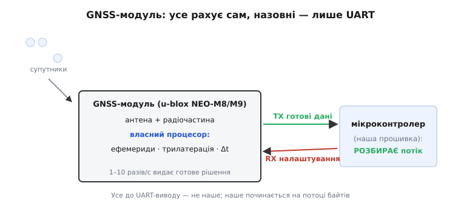
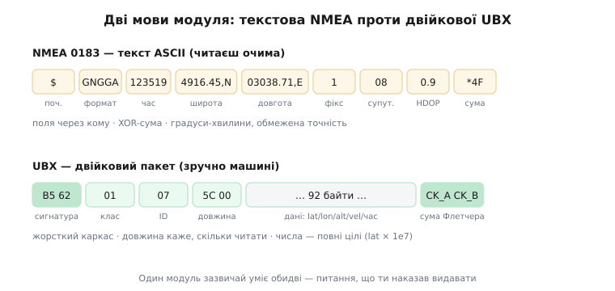
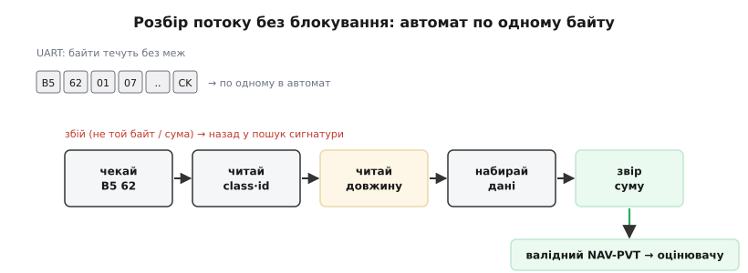

# GNSS-приймач у прошивці: NMEA і UBX

Ми вже знаємо, **звідки** береться положення: [супутникова навігація](root:hw-sensing/gnss) перетворює точно виміряний час польоту сигналів на координати, розв'язуючи заразом і похибку власного годинника приймача. І ми бачили GNSS у [загальній карті давачів](root:embedded/onboard-sensors) — той єдиний, що дає абсолютну прив'язку до Землі. Але між «десь на платі є GNSS-приймач» і рядком `lat, lon` у нашій прошивці лежить проміжок, який досі лишався порожнім. Приймач — це **окрема мікросхема**, і поговорити з нею наш мікроконтролер мусить сам, байт за байтом, по дроту. Ось цей проміжок ми зараз і заповнимо: як приймач віддає результат, якими двома мовами він говорить і як розібрати його потік у робочому C.

## Приймач — це чорна скринька на одному дроті

Найважливіше усвідомити відразу: усю ту складну роботу з попереднього кроку — ловіння слабких сигналів, завантаження ефемерид, трилатерацію, розв'язання Δt — робить **сам модуль**, усередині свого чипа. Наш мікроконтролер не бачить ні супутників, ні псевдодальностей. Він бачить лише готову **відповідь**, яку модуль виштовхує назовні звичайним послідовним потоком — тим самим [UART](root:com-devices/uart-frame), яким ми вже під'єднували купу периферії.

Це принципова межа поділу праці. GNSS-модуль (скажімо, знайомий за платами u-blox NEO-M8 чи M9) — самодостатній обчислювач: антена, радіочастина, власний процесор із прошивкою, який раз чи кілька разів на секунду видає нове рішення. Назовні від нього йдуть, по суті, чотири дроти: живлення, земля, **TX** (модуль → мікроконтролер, готові дані) і **RX** (мікроконтролер → модуль, налаштування). За замовчуванням майже всі такі модулі говорять на **9600 бод, 8 біт, без парності, 1 стоп-біт** — тому перше під'єднання зазвичай «просто працює», варто лише вгадати швидкість.


*Поділ праці між модулем і прошивкою. Уся радіочастина, завантаження орбіт і трилатерація живуть усередині GNSS-чипа; мікроконтролер бачить лише готове рішення, що приходить по TX як послідовний потік. По RX прошивка може надіслати налаштування. Наше завдання — не рахувати координати, а **розібрати** те, що модуль уже порахував.*

Отже, задача звузилася до звичного: на UART приходить потік байтів, і його треба розкласти на осмислені поля. Питання лише в тому, **у якому форматі** ті байти. Тут і починається головна розвилка: історично склалося дві мови — стара текстова **NMEA** і сучасна двійкова **UBX**. Розберімо обидві, бо в реальному апараті ти неодмінно зустрінеш і ту, і ту.


*Та сама відповідь, дві мови. Угорі — текстове NMEA-речення: людина читає його очима, але поля в форматі «градуси-хвилини» обмежені в точності, а числа треба розбирати з тексту. Унизу — двійковий UBX-пакет: жорсткий каркас, де довжина сама каже, скільки байтів читати, а координати лежать повними цілими. Один модуль зазвичай уміє обидві; наказ, що видавати, — за прошивкою.*

> 🔧 **Навіщо це.** Ця межа «модуль рахує — прошивка розбирає» рятує від типової помилки новачка: шукати в даташиті модуля, «як налаштувати трилатерацію». Ніяк — вона вже налаштована й захована. Твоя робота починається на UART-виводі: обрати швидкість, обрати формат, розібрати потік. Усе, що до виводу, — не твоє.

## NMEA: рядки тексту, які можна прочитати очима

Найстаріший спосіб — і досі найпоширеніший «за замовчуванням» — це **NMEA 0183**, стандарт, який ще 1983 року ухвалила [Національна асоціація морської електроніки США](root:embedded/gnss-receiver-integration/hist-nmea-ublox.md) (*National Marine Electronics Association*), щоб різні морські прилади — ехолоти, гірокомпаси, перші GPS — могли обмінюватися даними одним спільним «діалектом». Спроєктований він був для епохи, коли на морі панувала швидкість 4800 бод, тож усе в ньому — простий **текст ASCII**, який людина читає без жодного інструмента.

Одиниця даних у NMEA — **речення** (*sentence*): рядок тексту, що починається з `$`, несе поля через кому й закінчується контрольною сумою після `*`. Ось як виглядає найголовніше речення — **GGA** (*Global positioning system fix data*, дані фікса):

```
$GNGGA,123519.00,4916.4590,N,03038.7120,E,1,08,0.9,412.3,M, ... *4F
   │       │          │          │        │ │   │    │
   │       │          │          │        │ │   │    └─ висота над рівнем моря, м
   │       │          │          │        │ │   └─ HDOP (геометрія)
   │       │          │          │        │ └─ супутників у розв'язку
   │       │          │          │        └─ якість фікса: 0=немає, 1=GPS, 4=RTK
   │       │          │          └─ довгота 30°38.7120′ сх.
   │       │          └─ широта 49°16.4590′ пн.
   │       └─ час UTC 12:35:19
   └─ талкер GN (кілька сузір'їв) + формат GGA
```

Прочитаймо його як прошивка. Перші два символи після `$` — **талкер** (*talker ID*): `GP` — лише GPS, `GN` — мішанка сузір'їв, `GL` — ГЛОНАСС і так далі. Наступні три — **формат речення**, тут `GGA`. Далі — поля через кому. Модуль зазвичай сипле пачку різних речень: `GGA` (положення + якість фікса), `RMC` (*Recommended Minimum* — мінімальний набір: положення, швидкість, курс і дата в одному рядку), `GSV` (які супутники видно), `VTG` (швидкість і курс) та інші. Кожне — окремий рядок, що закінчується переходом на новий рядок.

Останній штрих — **контрольна сума** після `*`: дві шістнадцяткові цифри. Рахується вона до сміховинного просто: береться побітове **виключне АБО** (XOR) усіх байтів **між** `$` і `*`. Якщо перерахована сума не збіглася з тими двома цифрами — рядок побився в дорозі, його викидають. Ось цей чек у реальному C:

:::code gnss-receiver-integration/c/nmea-riadky-tekstu-iaki.c

Далі рядок ділять на поля по комах і читають потрібні. Найважливіше правило розбору GGA: **спочатку глянь на поле якості фікса** (тут `1`), і якщо там `0` — координати сміттєві, брати їх не можна, хоч би що стояло в полях широти й довготи. Це той самий урок, що ми винесли з фізики: без валідного фікса числа не значать нічого.

Приваба NMEA очевидна: увімкнув термінал, під'єднав модуль — і бачиш живі рядки, які читаєш очима. Для першого знайомства й діагностики це безцінно. Але щойно доходить до серйозної прошивки, вилазять три вади, і всі три — родом із того, що це **текст**.

По-перше, **марнотратність**: широту `4916.4590` модуль шле дев'ятьма символами-байтами, тоді як те саме число в двійковому вигляді вмістилося б у чотири байти. На повільному UART зайві байти — це зайнятий канал і затримка. По-друге, **втрата точності**: у рядку широта подана в форматі «градуси й хвилини» з чотирма знаками після коми — для сантиметрової точності цього замало, а сам текстовий формат жорстко обмежує розрядність. По-третє, **робота для мікроконтролера**: кожне число доводиться розбирати з тексту (`strtol`, `atof`), а це і час процесора, і пастки з локаллю та комами. Текст, зручний людині, — незручний машині.

## UBX: двійкові пакети, зроблені для машини

Коли ці вади починають муляти, на сцену виходить друга мова — **двійковий протокол UBX**, що його розробила швейцарська [u-blox](root:embedded/gnss-receiver-integration/hist-nmea-ublox.md), провідний виробник GNSS-модулів. Ідея протилежна NMEA: жодного тексту, лише сирі байти, укладені так, щоб машині було **зручно й дешево** їх читати.

Пакет UBX має жорсткий каркас, той самий для будь-якого повідомлення:

```
0xB5 0x62 │ class │ id │ length(2) │ ... payload ... │ CK_A CK_B
  сигнатура   клас    ID   довжина       корисні дані     контрольна
  (два байти)              (LE, 2 б)     (length байтів)   сума (2 б)
```

Читається каркас так. Спершу — два **сигнатурні байти** `0xB5 0x62`: рідкісна пара, за якою парсер упізнає початок пакета в потоці. Далі **клас** і **ID** — разом вони кажуть, що це за повідомлення (клас — група, ID — конкретне повідомлення в групі). Потім **довжина** корисної частини — два байти в порядку «молодший перший» (*little-endian*), тож парсер одразу знає, скільки саме байтів даних читати далі. Потім самі **дані**. І наприкінці — **дві контрольні суми**.

Найкорисніше повідомлення для нашого діла — **NAV-PVT** (*Navigation Position-Velocity-Time*, клас `0x01`, ID `0x07`). Одне це повідомлення несе **все, що треба апарату**: час, широту, довготу, висоту, швидкість по осях, курс, якість фікса, кількість супутників, оцінки похибок — усього близько 92 байтів корисних даних. Замість пачки текстових рядків — один охайний двійковий блок. І, що важливо, числа в ньому подані **повноцінними цілими**: широта й довгота — 32-бітні цілі в одиницях 10⁻⁷ градуса, тобто точність аж до сантиметрів, без утрат текстового формату.

Читати таке повідомлення — це просто **накласти структуру** на прийняті байти й дістати поля за їхніми зсувами:

:::code gnss-receiver-integration/c/ubx-dviikovi-pakety.c

Порівняй із NMEA: там ми розбирали рядок, тут просто **читаємо поля структури**. Жодного парсингу тексту, жодних `atof`, точність повна. Ось чому в прошивці серйозних апаратів — політних контролерах ArduPilot і PX4 — з модулем говорять саме двійковим UBX, а NMEA лишають хіба для дешевих модулів, що іншого не вміють.

Лишилася контрольна сума. UBX рахує її **8-бітним алгоритмом Флетчера** — трохи хитрішим за XOR, зате чутливішим до перестановки байтів. Два байти-акумулятори проходять по всіх байтах від `class` до кінця даних:

:::code gnss-receiver-integration/c/ubx-dviikovi-pakety-2.c

> 🔧 **Навіщо це.** Вибір «NMEA чи UBX» — це вибір «зручно людині чи зручно машині». На етапі «під'єднав, хочу побачити, що воно живе» бери NMEA й дивись очима в терміналі. У бойовій прошивці, де важать канал, точність і такт процесора, — перемикай модуль на UBX-NAV-PVT і читай структуру. Той самий фізичний модуль зазвичай уміє обидві мови; питання лише в тому, що ти йому наказав видавати.

## Байти течуть — читати їх треба автоматом

І NMEA, і UBX об'єднує одна незручна правда UART: дані приходять **потоком байтів без меж**. Мікроконтролер отримує їх по одному (чи маленькими пачками з буфера) у перерваннях, і в момент кожного окремого байта ще невідомо, де початок повідомлення, а де кінець. Спокуса «зчитати рядок цілком, а тоді розібрати» тут згубна: зупинити керуючий цикл апарата й **чекати**, поки набіжить увесь пакет, не можна — за ці мілісекунди дрон може завалитися.

Тому обидва протоколи розбирають однаково — [автоматом розбору потоку](root:com-protocol/stream-parser) (*stream parser*): скінченним автоматом, що з'їдає **по одному байту** й посувається станами, ніде не блокуючи. Прийшов байт — оновив стан, повернувся; повідомлення зібралося — віддав його нагору.


*Розбір потоку без блокування. Кожен байт із UART посуває автомат одним кроком: чекаємо сигнатуру → читаємо довжину → набираємо стільки байтів даних → звіряємо контрольну суму → віддаємо готове повідомлення. Автомат ніколи не «чекає» решти пакета в циклі — між байтами мікроконтролер вільний робити свою основну роботу.*

Для UBX стани очевидні з каркаса пакета: чекаємо перший сигнатурний байт `0xB5`; прийшов — чекаємо `0x62`; далі беремо `class`, `id`, два байти довжини (тепер знаємо, скільки даних набирати); набираємо рівно `length` байтів у буфер; приймаємо два байти суми; звіряємо — і якщо збіглося, повідомлення готове. Збій на будь-якому кроці (не той байт, не та сума) — скидаємо автомат у початковий стан і чекаємо нову сигнатуру. Ось серце такого автомата:

:::code gnss-receiver-integration/c/baity-techut-chytaty-ikh.c

Помітно, як довжина рятує: прочитавши два байти `length`, автомат **точно знає**, скільки байтів даних набирати, — не треба шукати кінець за якимось роздільником (у двійкових даних будь-який байт може випадково збігтися з роздільником, тож розділяти ними не можна). NMEA-парсер простіший — його роздільники видимі (`$` — початок, перехід рядка — кінець), але принцип той самий: неблокуючий автомат, що годується по байту й ніколи не спиняє основний цикл.

## Наказати модулю: що видавати і як часто

Досі ми лише **слухали**. Але дріт RX веде в модуль, і по ньому прошивка може модуль **налаштувати** — це другий бік розмови. За замовчуванням модуль сипле пачку NMEA-речень на 9600 бод кілька разів на секунду; для апарата це майже завжди не те, що треба.

Налаштовують модуль u-blox тими самими UBX-пакетами, лише з класу **CFG** (*configuration*). Типовий стартовий ритуал прошивки такий:

- **підняти швидкість UART** з 9600 до 115200 чи вище — інакше на 9600 бод швидкі оновлення просто не влізуть у канал;
- **вимкнути всі NMEA-речення** й **увімкнути одне UBX-NAV-PVT** — щоб не марнувати канал на текст, який ми не читаємо;
- **задати темп** оновлення — скажімо, 5 чи 10 разів на секунду замість стандартного одного;
- за потреби — **обрати сузір'я** (GPS + Galileo + ГЛОНАСС + BeiDou разом), бо, як ми пам'ятаємо з фізики, більше видимих супутників із різних систем — краща геометрія, менший HDOP.

Тонкість, на якій спотикаються всі: **порядок і швидкість**. Якщо прошивка наказала модулю перейти на 115200 бод, то далі вона й сама мусить говорити з ним на 115200 — інакше зв'язок обірветься на півслові. А ще зміну конфігурації добре **зберегти в пам'ять модуля**, щоб після перезапуску не налаштовувати все наново. Тому реальний код первинного налаштування — це послідовність CFG-пакетів із перевіркою, що модуль кожен **підтвердив** (UBX відповідає `ACK-ACK` на прийняту команду й `ACK-NAK` на відкинуту — той самий принцип «не стріляй наосліп, дочекайся підтвердження», що ми бачили в [командах MAVLink](root:embedded/mavlink-commands)).

> 🔧 **Навіщо це.** Коли чужий апарат «бачить супутники, але позиція оновлюється раз на секунду й смикається» — причина майже завжди в конфігурації, а не в залізі: модуль лишили на заводських NMEA + 1 Гц. Один правильний стартовий ритуал (UBX-only, 115200, 10 Гц, усі сузір'я) — і той самий модуль оживає. Тому в серйозній прошивці драйвер GNSS завжди **сам** переналаштовує модуль під себе на старті, а не сподівається на заводські значення.

## Як це лягає в контур керування

Зберімо все докупи. Драйвер GNSS у прошивці апарата робить рівно чотири речі, і всі вони — те, що ми щойно розібрали. На старті **налаштовує** модуль (UBX-only, потрібний темп і сузір'я). У перерванні UART **годує** по байту автомат розбору. Зібравши валідний NAV-PVT, **перевіряє якість** — є 3D-фікс, супутників досить, HDOP прийнятний — і лише тоді бере координати. І, нарешті, **віддає** їх оцінювачу стану, тому самому [поєднанню давачів](root:com-signal/sensor-fusion), де повільне абсолютне положення від GNSS прив'язує швидкий, але спливаючий IMU.

Ця перевірка якості — не формальність, а запобіжник. Ми знаємо з фізики, що GNSS вразливий: [глушіння](root:hw-sensing/gnss) заливає діапазон шумом, підміна тихо веде в хибне місце, у дворі-колодязі геометрія псується. Драйвер, який сліпо бере будь-які координати з модуля, зробить апарат заручником першого-ліпшого збою сигналу. Тому валідний фікс — це не «прийшов пакет», а «прийшов пакет **і** якість його полів каже, що координатам можна вірити». Байти на UART — то лише транспорт; довіру до положення прошивка вирішує сама.

## Підсумок

Між супутниковою фізикою й рядком координат у прошивці стоїть GNSS-модуль — самодостатня чорна скринька, що всю складну роботу робить усередині й віддає готове рішення звичайним UART-потоком, зазвичай на 9600 бод. Говорить модуль двома мовами. Стара текстова **NMEA 0183** — рядки `$…*HH` із полями через кому й XOR-сумою; її легко прочитати очима в терміналі, але вона марнотратна, обмежена в точності й вимагає розбору тексту. Сучасна двійкова **UBX** від u-blox — жорсткі пакети з сигнатурою `0xB5 0x62`, класом, ID, довжиною й сумою Флетчера; одне повідомлення NAV-PVT несе положення, швидкість, час і якість фікса повноцінними цілими, тож у бойовій прошивці беруть саме її. Обидві мови приходять потоком байтів без меж, тож розбирають їх однаково — неблокуючим автоматом, що годується по байту й ніде не спиняє керуючий цикл. По дроту RX прошивка сама налаштовує модуль (UBX-only, вища швидкість, потрібний темп, усі сузір'я), а зібравши пакет — перевіряє якість фікса, перш ніж довірити координати оцінювачу. Модуль рахує положення; прошивка його розбирає, перевіряє й вплітає в загальне відчуття апарата.
