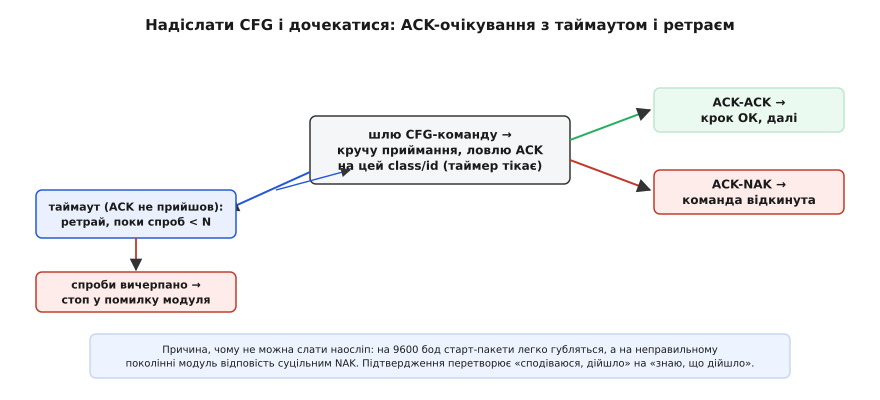

# ⚙️ Драйвер GNSS у прошивці: цілісний UBX-модуль

Ми вже розібрали кожну частину поодинці — неблокуючий автомат, суму Флетчера, зсуви полів NAV-PVT, два покоління конфіг-інтерфейсу, ворота здоров'я фікса. Кожна з тих частин жила у власному фрагменті коду, ізольовано. Але між «зрозумів кожен шматок» і «маю драйвер, що не завалить апарат за три години польоту» лежить те, чого окремі фрагменти не показують: **як вони зшиваються в один модуль, де стан одного шматка переживає між викликами іншого, де збій у будь-якій ланці не валить сусідні, і де ховаються пастки, видимі лише коли все працює разом**. Зберімо тепер повний робочий драйвер — такий, який справді кладуть у прошивку політного контролера, — і на кожній пастці зупинимося прямо в коментарі коду.

## Задача: один модуль, що переживає брудний потік і брудне залізо

Сформулюймо чесно, що драйвер мусить робити, бо саме з вимог випливе його форма.

Він приймає **сирий потік байтів** з UART — по одному в перерванні або пачками з DMA, у будь-який момент, дробленими як завгодно. Він **ніде не блокує** керуючий цикл: жодного `while (немає байта);`, жодного очікування цілого пакета — бо кожна мілісекунда паузи для дрона в повітрі може бути фатальною. Він **сам** приводить модуль у робочий режим на старті (UBX-only, потрібний темп, усі сузір'я), упізнавши, з яким **поколінням** заліза говорить. Він **переживає збої**: биті байти, брехливі довжини, обірвані посеред пакета пачки, перезавантаження модуля — і завжди має чистий шлях назад у синхронізацію. І він **не віддає нагору жодної координати, поки не переконався**, що фіксу можна вірити й що він свіжий.

Ключове слово тут — **стан, що живе між викликами**. Автомат розбору не може щоразу починати з нуля: пакет приходить упродовж багатьох перерувань, і між ними його напівзібраний стан мусить зберігатися. Сума Флетчера копиться байт за байтом і теж переживає між викликами. Очікування ACK триває, поки крутиться приймання інших повідомлень. Свіжість фікса вимірюється відносно часу останнього валідного пакета. Драйвер — це не функція, а **машина зі станом**, і саме тому його природна форма — модуль із власними статичними полями, а не купка вільних функцій.

## Ідея: конвеєр шарів, кожен зі своєю відповідальністю

Замість монолітної «функції, що все робить», зберімо драйвер як **конвеєр**, де кожен шар має рівно одну роботу й нічого не знає про нутрощі сусідів. Це не естетика — це живучість: коли шар декодування зіпсується на кривому пакеті, він не має змоги затерти буфер приймача чи збити конфіг-логіку, бо просто не має до них доступу.


*Драйвер не як одна функція, а як конвеєр шарів. Знизу вгору: перервання складає прийняте в кільцевий буфер; цикл згодовує байти автомату (сума Флетчера копиться на льоту); декодер дістає кожне поле NAV-PVT за його зсувом через memcpy; ворота здоров'я пускають далі лише валідний і свіжий фікс. Ліворуч — окремий канал старту: по дроту RX драйвер упізнає покоління модуля й надсилає конфіг, чекаючи на кожен ACK. Довіру до координат дає тільки верхній шар — усе нижче лише транспорт.*

Пройдімо шари знизу вгору, кожен — робочим кодом.

## Спільний фундамент: константи протоколу

Перш ніж писати логіку, закладімо словник протоколу — усі магічні числа в одному місці, з іменами, щоб далі жодне `0x07` не висіло в коді без пояснення. Ці значення я звірив з офіційним інтерфейс-описом u-blox та з бойовими драйверами PX4 і SparkFun — вони точні.

:::code proj-ubx-driver/c/spilnyi-fundament.c

> 🔧 **Навіщо це.** Один блок констант — це не «чистота заради чистоти». Коли за півроку доведеться додати читання ще одного поля (скажімо, `velN` на зсуві 48), ти правиш один рядок, а не полюєш по всьому коду за розкиданими `0x…`. І головне: помилка в зсуві `PVT_year` (два байти замість одного) зсуне всю подальшу структуру й перетворить координати на нісенітницю — тримати ці числа в одному впорядкованому місці з коментарем «ДВА байти» рятує від найпідступнішого класу помилок цього драйвера.

## Шар 1: приймання без блокування

Найнижчий шар — місток між залізом UART і рештою драйвера. Залізо складає прийняті байти у **кільцевий буфер** (щоб швидкий потік не губився, поки основний цикл зайнятий іншим), а драйвер у зручний момент вичерпує накопичене.

Тут головна дисципліна: перервання має бути **коротким**. Воно робить рівно одне — кладе байт у кільце й посуває вказівник. Уся розумна робота (розбір, декодування) — уже поза перерванням, у головному циклі. Якщо запхати розбір у перервання, довгий обробник заблокує інші перервання й розхитає весь тайминг апарата.

:::code proj-ubx-driver/c/shar-1-pryimannia-bez.c

Пастка, яку легко проґавити: `rx_head` **обов'язково** `volatile`, бо його змінює перервання, а читає цикл, і без `volatile` компілятор може закешувати старе значення в регістрі й «не побачити» нових байтів. А `rx_tail` — навпаки, чіпає лише цикл, тож volatile йому шкідливий (зайві перечитування з пам'яті). Ця асиметрична дисципліна volatile — типове місце тонких помилок у драйверах з перерваннями.

Байти з кільця драйвер вичерпує в головному циклі, згодовуючи їх автомату розбору по одному:

:::code proj-ubx-driver/c/shar-1-pryimannia-bez-2.c

Помітно: `gnss_poll` не чекає ні на що. Прийшло три байти — з'їв три й вийшов; прийшло сорок — з'їв сорок. Керуючий цикл викликає його між своїми справами, і драйвер жодного разу не спиняє апарат. `now_ms` — поточний час у мілісекундах (від системного таймера); він потрібен нижнім шарам для таймерів простою й свіжості.

## Шар 2: автомат розбору із сумою Флетчера на льоту

Це серце драйвера. Автомат приймає по байту, посувається станами каркаса UBX і, коли зібрав валідний пакет, кличе обробник. Ключова оптимізація проти базового начерку: **сума Флетчера рахується інкрементально**, прямо в автоматі, — кожен байт `class..payload` одразу підмішується в акумулятори. Тоді коли надійдуть два байти переданої суми, лишається порівняти їх із уже готовими `ck_a`, `ck_b`, і окремий прохід по буферу не потрібен. Це той самий прийом інкрементальної контрольної суми, що й у загальному [автоматі розбору потоку](root:com-protocol/stream-parser): скінченний автомат годується по одному байту, ніде не спиняє основний цикл, а суму нарощує на льоту разом із прийомом.

:::code proj-ubx-driver/c/shar-2-avtomat-rozboru-iz.c

Три речі варто підкреслити, бо саме вони роблять цей автомат живучим, а не просто робочим.

**Перше — облік довжини як захист коректності.** У стані `UST_PAYLOAD` автомат **не шукає сигнатуру взагалі** — він лічить рівно `P.len` байтів, хоч би що в них було, зокрема й випадкову пару `B5 62` посеред даних. Пара сигнатурних байтів має значення лише у станах очікування; усередині payload вона — звичайні байти. Без обліку довжини двійковий потік у принципі не розібрати надійно.

**Друге — перевірка стелі буфера.** Рядок `else if (P.len <= UBX_BUF_MAX)` — не косметика. Якби шум зіпсував два байти довжини й автомат прочитав, скажімо, 60000, то без цієї перевірки він спробував би набрати 60 тисяч байтів у 128-байтовий `buf` і затер би сусідню пам'ять — класичне переповнення буфера, через яке падають і зламуються прошивки. Один рядок закриває цілий клас аварій.

**Третє — єдиний чистий вихід.** Будь-який збій — не та сума, задовга довжина, обірвана пачка — веде в `ubx_reset()`, який обнуляє стан, суму й лічильник. Немає жодного шляху, де напівзаповнений буфер чи недорахована сума просочилися б у наступний пакет. Ця дисципліна «збій → чистий відкат» і є різниця між драйвером, що витримує години польоту, і тим, що розсипається на першому просіданні живлення.

Лишився таймер простою — рятунок від обірваної пачки. Якщо модуль перезавантажився посеред пакета, решта байтів не прийде ніколи, і автомат застрягне в `UST_PAYLOAD`, чекаючи на те, чого немає. Тут облік довжини вже не поможе (байти просто не течуть) — рятує час:

:::code proj-ubx-driver/c/shar-2-avtomat-rozboru-iz-2.c

Зверни увагу на `(uint32_t)(now_ms - P.last_byte_ms)` — віднімання беззнакових із приведенням коректно працює навіть тоді, коли лічильник мілісекунд **переповнюється** (раз на ~49 діб для 32-бітного). Наївне `now_ms > P.last_byte_ms + UBX_IDLE_MS` зламалося б на переповненні; беззнакова різниця — ні. Це стандартний прийом роботи з таймерами в прошивці, і забути його — джерело багів, що вилазять раз на пів- місяця роботи.

## Шар 3: переносне декодування NAV-PVT

Автомат зібрав валідний пакет і передав `class/id/buf/len` у `ubx_dispatch`. Тепер треба дістати з `buf` осмислені поля. Базово ми накладали структуру на буфер — і чесно назвали дві пастки: **порядок байтів** і **пакування/вирівнювання структури**, плюс порушення правил псевдонімів типів (*strict aliasing*). Тут напишемо декодування **переносно**: кожне поле дістаємо явно за його зсувом через `memcpy`, який не порушує aliasing і не залежить від пакування.

:::code proj-ubx-driver/c/shar-3-perenosne.c

Читаються ці поля коректно тому, що числа в UBX лежать молодшим байтом уперед, а цільове ядро (ARM, ESP32) теж little-endian, — байти вже в потрібному порядку; на протилежному [порядку байтів](root:sf-algorithms/bits-bytes-endianness) тут була б потрібна явна перестановка. Чому саме `memcpy`, а не `*(uint32_t*)(b + off)`? Пряме приведення вказівника й розіменування — це подвійне порушення. По-перше, **вирівнювання**: `b + 24` може не лежати на межі чотирьох байтів, і на деяких ядрах (Cortex-M0 без апаратної підтримки невирівняного доступу) таке читання дає **hard fault** — прошивка просто падає. По-друге, **strict aliasing**: стандарт C забороняє читати байтовий буфер через вказівник іншого типу, і компілятор з увімкненою оптимізацією має право згенерувати код, що робить не те, що ти думав. `memcpy` вільний від обох гріхів: він копіює байти незалежно від вирівнювання, і компілятор чудово розпізнає й **вставляє** його вбудовано (на практиці — те саме одне-два інструкції завантаження, коли адреса вирівняна), тож ціна нульова. Акуратні драйвери GNSS роблять саме так. А перерахунок масштабів спирається на те, що цілі тут — [числа з фіксованою комою](root:hw-arch/fixed-point): `lat` в одиницях 10⁻⁷ градуса несе дробове значення без плаваючої коми, і повернути його в градуси можна лише діленням у `double`, бо `int32`, помножений назад, переповниться.

> 🔧 **Навіщо це.** Ти пишеш драйвер на STM32 (little-endian, Cortex-M4 з невирівняним доступом) — і накладання структури «просто працює». Через рік той самий код переносять на дешевший Cortex-M0+ чи компілюють з агресивнішою оптимізацією — і драйвер починає падати в hard fault або тихо видавати сміттєві координати. `memcpy`-декодування коштує рівно нуль на швидкому ядрі, зате не має цих мін узагалі. Це той випадок, коли «переносно» не абстрактна чеснота, а страховка від багів, які інакше вилізуть у найгірший момент.

## Шар 4: ворота здоров'я й свіжості

`ubx_dispatch` викликає `decode_pvt`, дістаючи зручний `gnss_fix_t`. Але **розібраний ще не означає довірений**. Останній шар — ворота, що пускають координати нагору лише тоді, коли сукупність полів каже: фіксу можна вірити, і він свіжий.

Валідність — це **кон'юнкція** кількох умов, а не одна галочка. Кожна відсіює свій клас брехні:

:::code proj-ubx-driver/c/shar-4-vorota-zdorovia-i.c

Дві тонкощі цього шару варті окремого слова.

**Свіжість — окрема від валідності перевірка.** Навіть бездоганний фікс старіє: якщо NAV-PVT перестали приходити (антену заступило, дріт відпав, модуль завис), останнє відоме положення з кожною секундою дедалі менш правдиве. `gnss_get_fix` тому дивиться на `stamp_ms` і відмовляє, якщо свіжого пакета немає довше за поріг. Оцінювач мусить знати не лише «де ми», а й «наскільки свіже це де» — інакше він довірятиме мертвим координатам і не переходитиме вчасно на числення по IMU. Саме звідси `gnss_fix_t` бере готовий вхід у [поєднання давачів](root:com-signal/sensor-fusion): фільтр між рідкими фіксами інтегрує швидкий IMU, а свіжий валідний фікс підтягує накопичену оцінку до абсолютної істини — тож протухлий чи хибний фікс, підсунутий у мить корекції, не виправив би спливання, а вкинув би у стан викид.

**Нездоровий фікс не затирає добрий.** Коли приходить пакет з поганою геометрією чи без `gnssFixOK`, ми **не** пишемо його в `g_last_fix`. Логіка тонка: краще віддати оцінювачу останній *добрий* фікс, поки він не протух за таймером, ніж підсунути свіже, але сміттєве значення. Свіжість і валідність працюють у парі — старий добрий фікс живе рівно до порога протухання, а потім драйвер чесно каже «немає».

Чому ворота такі строгі? Бо GNSS вразливий, і ми знаємо це з фізики. Глушіння заливає діапазон шумом — модуль або втратить фікс, або видасть хибний із роздутим `pDOP`. Міський каньйон лишає видимою вузьку смугу неба — геометрія псується, і навіть за формально валідного фікса реальна похибка в рази більша. Драйвер, що бере будь-які координати «бо пакет прийшов», зробить апарат заручником першого-ліпшого збою сигналу. Тому валідний фікс — це не «прийшов валідний за сумою пакет», а «прийшов пакет **і** сукупність його полів якості каже, що координатам можна вірити».

## Стартовий ритуал: упізнати покоління й налаштувати

Досі все було про **слухання**. Тепер — про дріт RX, яким драйвер сам приводить модуль у робочий режим. Без цього модуль лишиться на заводських NMEA + 1 Гц, і апарат «бачитиме супутники, але позиція смикатиметься раз на секунду».

Тут головна глибша правда: **конфіг-інтерфейс u-blox змінився між поколіннями**. Модулі M8 і раніше налаштовують набором окремих CFG-повідомлень (CFG-PRT для порту, CFG-MSG для темпу повідомлень, CFG-RATE для темпу навігації, CFG-GNSS для сузір'їв). Модулі M9/M10 відмовилися від цього зоопарку й ввели єдину систему «ключ-значення»: один `CFG-VALSET` задає пачку пар «32-бітний ключ = значення» одразу, ще й у вибрані шари пам'яті (RAM — діє зараз, Flash — переживає перезапуск). Драйвер під M8, застосований до M10, отримає суцільний NAK на невідомі повідомлення — і нічого не налаштує. Тому універсальний драйвер **спершу впізнає модуль**.

Почнімо зі спільного інструмента — складання й надсилання будь-якого UBX-пакета з правильною сумою. Той самий Флетчер, що звіряє вхідні пакети, тепер рахуємо для вихідних — це один із класу [контрольних сум](root:com-modulation/checksums), дешевший за CRC, зате чутливий до перестановки байтів, чого XOR не вміє:

:::code proj-ubx-driver/c/startovyi-rytual-upiznaty.c

Тепер — очікування ACK, без якого конфіг перетворюється на постріл наосліп. Це той самий принцип «дочекайся підтвердження», що ми бачили в [командах MAVLink](root:embedded/mavlink-commands): критичну зміну стану підтверджують квитанцією, а не сподіваються, що вона дійшла. Кожну CFG-команду треба **дочекатися**: модуль відповідає `ACK-ACK` на прийняту й `ACK-NAK` на відкинуту. Драйвер шле команду й крутить приймання, шукаючи квитанцію саме на цей `class/id`, поки не збіжить таймаут; якщо ACK немає — ретрай, а вичерпав спроби — помилка.


*Чому конфіг — не «вистрелив і забув». Драйвер надсилає CFG-команду й крутить приймання, шукаючи квитанцію саме на її class/id, поки тікає таймер. ACK-ACK — крок пройдено, йдемо далі; ACK-NAK — команду відкинуто (часто ознака, що покоління вгадано хибно); таймаут — ретрай, поки лічильник спроб не вичерпано, а тоді чесна помилка модуля. Підтвердження перетворює «сподіваюся, дійшло» на «знаю, що дійшло».*

:::code proj-ubx-driver/c/startovyi-rytual-upiznaty-2.c

Цикл `while` тут не порушує принципу неблокування фатально: він обмежений `timeout_ms` зверху й **усередині крутить `gnss_poll`**, тож автомат живе, а ACK приходить звичайним шляхом через `dispatch`. Стартовий ритуал виконується **один раз** на ініціалізації, коли апарат ще на землі й нікуди не летить, — тут коротке очікування прийнятне, на відміну від польотного циклу, де його не можна допустити.

Тепер саме впізнання й розгалуження. Драйвер питає версію `MON-VER`, з відповіді витягує покоління й обирає гілку налаштування:

:::code proj-ubx-driver/c/startovyi-rytual-upiznaty-3.c

Далі — дві гілки конфігурації. **Нова (M9/M10)** будує один `CFG-VALSET`: заголовок (версія 0, шар, два резервні байти), тоді пари «ключ + значення». Ширину значення підказує сам ключ — поле бітів 28-30 у ньому кодує розмір, і кодує **не числом байтів**: `0x1`→1 біт (у пакеті — 1 байт), `0x2`→1 байт, `0x3`→2 байти, `0x4`→4 байти, `0x5`→8 байтів. Тобто ключ `0x2091…` (темп PVT) несе один байт, а `0x3021…` (темпи вимірювання й навігації) — по два; сплутати цю таблицю означає записати кожне значення не тієї ширини й **зсунути весь потік «ключ-значення»**, після чого модуль не второпає жодної пари:

:::code proj-ubx-driver/c/startovyi-rytual-upiznaty-4.c

**Стара гілка (M8)** шле окремі повідомлення. Наведу тут ключове — CFG-RATE (темп) — як зразок форми; CFG-MSG, CFG-PRT, CFG-GNSS будуються так само зі своїх payload за інтерфейс-описом:

:::code proj-ubx-driver/c/startovyi-rytual-upiznaty-5.c

І, нарешті, точка входу — публічна ініціалізація, що зшиває впізнання з гілками. Тонкість: **на старті ми не знаємо швидкості модуля** (заводська 9600 або вже переставлена 115200 з минулого запуску), тож упізнання пробуємо на обох:

:::code proj-ubx-driver/c/startovyi-rytual-upiznaty-6.c

(Щоб `dispatch` викликав `detect_from_monver`, у нього додається гілка `if (cls == UBX_CLS_MON && id == UBX_MON_VER) detect_from_monver(buf, len);` — я лишив головний `dispatch` вище стислим, але ця гілка потрібна.)

> 🔧 **Навіщо це.** Найчастіша скарга на «мертвий GNSS» — не биті дроти, а конфіг: модуль лишили на заводських NMEA + 1 Гц. І дуже часта версія тієї самої біди — драйвер під старий M8, застосований до нового M9/M10: він шле CFG-PRT/MSG, модуль відповідає суцільним NAK, налаштування не застосовується. Тому серйозний драйвер **сам** упізнає покоління, налаштовує модуль під себе, чекає на кожен ACK і зберігає результат у Flash — а не сподівається на заводські значення. Ця гілка `detect → configure` і є те, що відрізняє драйвер, який «працює на моєму столі з моїм модулем», від того, що працює на будь-якому модулі з коробки.

## Пастка порядку: чому зміну швидкості лишають наостанок

Одну пастку варто виокремити, бо на ній спотикаються всі, і в коді вище вона захована в порядку рядків. **Зміна швидкості UART розриває розмову навпіл.** Коли драйвер наказав модулю перейти на 115200 бод, модуль **негайно** починає і слухати, і говорити на новій швидкості. Якщо драйвер після цього надішле бодай ще один байт на старій 9600 — модуль його не зрозуміє, і зв'язок обірветься на півслові.

Звідси три правила, вплетені в `configure_*`:

```
1. Усі команди, крім зміни швидкості, шлемо на СТАРІЙ швидкості —
   поки розмова ще спільна.
2. Зміну швидкості шлемо ОСТАННЬОЮ й БЕЗ очікування ACK: квитанція
   прийшла б уже на новій швидкості, а ми ще на старій — не почули б.
3. Одразу після відсилання: uart_flush() (дочекатися, поки байти
   фізично пішли) → uart_set_baud(нова) → далі говоримо на новій.
```

Помилка тут дає рівно той симптом, за яким її впізнають: «модуль замовк одразу після налаштування», і новачок винуватить залізо. Насправді драйвер сам себе оглушив, лишившись на старій швидкості після того, як переставив модуль на нову. Тому `configure_m9_m10` вище робить швидкість **окремим останнім** VALSET з негайним `uart_set_baud` — не в спільній пачці з рештою ключів.

## Складність і пастки: що робить цей драйвер бойовим

Зберімо в одному місці всі міни, на яких підривається наївна реалізація, — саме їх обходить код вище, і саме їх варто тримати в голові, читаючи чужий драйвер.

**Стан мусить пережити між викликами.** Автомат, сума Флетчера, очікувач ACK, останній фікс — усе це статичні поля, а не локальні змінні. Пакет збирається впродовж багатьох викликів `gnss_poll`; якби стан скидався щоразу, жоден пакет не зібрався б. Це фундамент, з якого випливає форма «модуль зі станом».

**volatile рівно там, де треба.** `rx_head` пише перервання, читає цикл — `volatile` обов'язковий, інакше цикл не побачить нових байтів. `rx_tail` чіпає лише цикл — `volatile` шкідливий (зайві звернення до пам'яті). Плутанина тут дає баги, що зникають під час налагодження й вилазять на швидкому потоці.

**Беззнакова арифметика таймерів.** Скрізь, де порівнюємо час — таймер простою, таймаут ACK, свіжість фікса — різниця береться як `(uint32_t)(now - then) > поріг`, а не `now > then + поріг`. Перше коректне на переповненні лічильника (раз на ~49 діб), друге — ламається. Баг, що вилазить раз на пів- місяця безперервної роботи, — найгірший для пошуку.

**Облік довжини — не зручність, а коректність.** У стані набору payload автомат не шукає сигнатуру взагалі, бо `B5 62` може випадково трапитися в даних. Без обліку довжини двійковий потік у принципі не розібрати надійно — це не оптимізація, а необхідність.

**Перевірка стелі буфера — обов'язкова.** Брехлива довжина від шуму без перевірки `len <= UBX_BUF_MAX` дає переповнення буфера — аварію або вразливість. Один рядок закриває цілий клас катастроф.

**Таймер простою рятує від зависання.** Обірвана посеред пакета пачка (модуль перезавантажився) лишила б автомат вічно чекати. Таймер міжбайтового простою примусово синхронізує наново — драйвер відновлюється сам, без перезапуску прошивки.

**memcpy замість накладання структури.** Пряме приведення вказівника ризикує hard fault'ом на невирівняному доступі й порушує strict aliasing. `memcpy` вільний від обох, а коштує нуль на швидкому ядрі. Переносність тут — страховка, не абстракція.

**Масштаби перераховувати у double.** `lat × 1e-7`, `headMot × 1e-5`, `hMSL / 1000`, `pDOP × 0.01` — кожне поле має свій масштаб, і читати «як ціле» без перерахунку — тиха помилка. Ділити конче у `double`: `int32`, помножений назад, переповниться.

**Валідність — кон'юнкція, не галочка.** `fixType >= 3` **і** `gnssFixOK` **і** `numSV` **і** `pDOP` **і** `hAcc` — усі разом. Кожна умова відсіює свій клас брехні (нема 3D, модуль не певен, крихкий розв'язок, погана геометрія, завелика похибка). Пропустиш одну — впустиш відповідний клас сміття.

**Свіжість окремо від валідності.** Бездоганний фікс старіє. `stamp_ms` і поріг протухання відділяють «валідний колись» від «валідний зараз». Без цього оцінювач довірятиме мертвим координатам.

**Покоління конфіг-інтерфейсу.** M8 — окремі CFG-повідомлення; M9/M10 — ключ-значення VALSET із шарами. Драйвер під одне покоління мовчки не налаштує інше. Упізнання через MON-VER — умова універсальності.

**Порядок зміни швидкості.** Швидкість — остання команда, без очікування ACK, з негайним переходом власного UART. Порушиш порядок — оглушиш себе.

**ACK, а не постріл наосліп.** Кожну CFG-команду чекаємо з таймаутом і ретраєм. На 9600 бод старт-пакети легко губляться; підтвердження перетворює «сподіваюся, дійшло» на «знаю, що дійшло».

Складність цього драйвера не в жодному окремому шматку — кожен простий. Складність у тому, що всі шматки мусять бути правильні **водночас**, бо помилка в будь-якому вилазить не одразу, а через години роботи, у польоті, коли її найважче ловити. Саме тому реальний драйвер GNSS у прошивці політного контролера виглядає саме так: конвеєр шарів із чистим станом, суворими воротами й самовідновленням — машина, що перетворює брудний потік байтів із брудного заліза на координати, яким апарат може довірити своє відчуття власного місця у світі.
