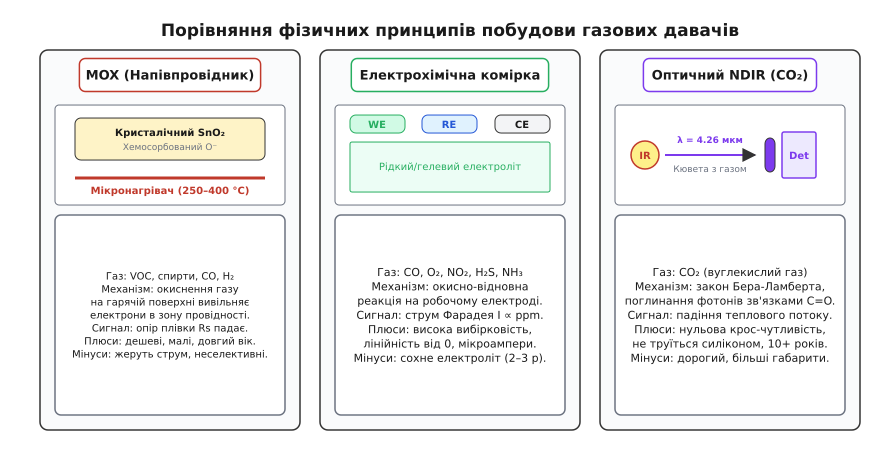
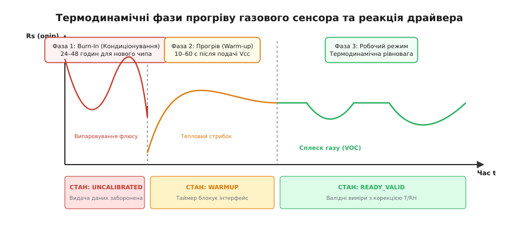
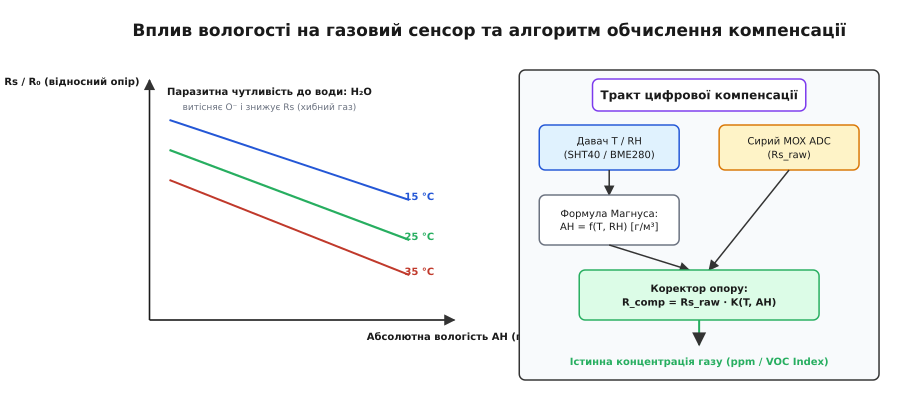
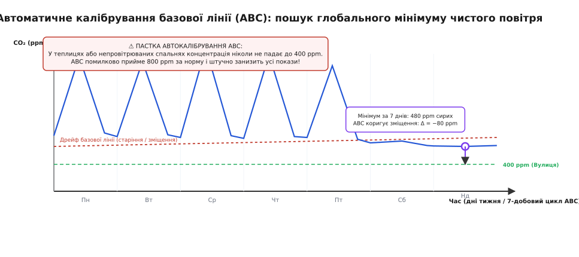

# Газовий давач у виробі: прогрів, деградація, вологість, калібрування

<preknowlist>
* [Що таке давач](root:hw-sensing/what-is-a-sensor)
* [MOX-давач](root:hw-sensing/mox-gas-sensor)
* [NDIR-давач газу](root:hw-sensing/ndir-sensor)
* [Електрохімічна комірка](root:hw-sensing/electrochemical-cell)
* [Крос-чутливість і температурна поправка](root:hw-sensing/cross-sensitivity-compensation)
</preknowlist>

Свіжозапаяна плата монітора якості повітря після першого ввімкнення на конвеєрі замість очікуваних 400 ppm CO₂ чи фонового нуля летких сполук видає зашкальні 2800 ppm, споживає 160 мА від шини 3.3 В, розігріває корпус приладу на 8 °C, а через два тижні роботи в офісі починає занижувати покази на третину, бо поруч протерли стіл ізопропіловим спиртом або прилад зібрали з використанням силіконового герметика. Газовий тракт — найпримхливіший вузол у вбудованій системі: тут чутливий елемент контактує не з ізольованим електричним потенціалом чи механічним важелем, а з відкритою, хімічно агресивною та динамічною газовою сумішшю реальної атмосфери.

Кожен вимір концентрації газу — це результат взаємодії термодинаміки нагрівача, адсорбційної кінетики на межі розділу фаз, перехресної чутливості до вологи та незворотного хімічного старіння поверхні. Щоб побудувати надійний серійний прилад, інженер мусить розв'язати повний ланцюг задач: від стабілізації теплового поля кристала до компенсації парів води й алгоритмічного автокалібрування базової лінії.

## Три фізичні принципи: що саме відбувається на межі газу й детектора

Газові сенсори не вимірюють газ «узагалі». Вони реєструють конкретний фізичний або хімічний наслідок взаємодії цільових молекул із чутливим матеріалом. У серійній електроніці закріпилися три головні технології: металооксидні напівпровідники (MOX), електрохімічні комірки та оптичні недисперсійні інфрачервоні детектори (NDIR). Кожна технологія має свою природу сигналу, джерела деградації та межі застосування.


*Порівняння фізичних принципів побудови газових давачів: металооксидний напівпровідник MOX (зміна провідності нагрітого шару), триелектродна електрохімічна комірка (струм окисно-відновної реакції) та оптичний NDIR-тракт (поглинання інфрачервоного світла).*

### Металооксидні напівпровідникові сенсори (MOX)

Основою MOX-сенсорів (класичні MQ-2/MQ-135, сучасні Sensirion SGP40/SGPC3, Bosch BME680/BME688) є тонкоплівковий або пористий шар напівпровідникового оксиду металу n-типу — найчастіше діоксиду олова SnO₂, діоксиду титану TiO₂ або оксиду вольфраму WO₃.

Коли оксид олова нагрівається в повітрі до температури 250–400 °C, молекули кисню адсорбуються на його поверхні. Захоплюючи електрони з зони провідності кристала, кисень іонізується до негативних форм (O₂⁻, O⁻ або O²⁻). Цей процес утворює приповерхневий збіднений шар (depletion layer), де концентрація вільних електронів різко падає. Оскільки напівпровідник складається з безлічі спечених нанозерен, на границях між сусідніми зернами виникають енергетичні бар'єри Шотткі. Висота цього потенційного бар'єру q·Vs визначає опір усього шару: чим товщий збіднений шар, тим важче електронам перескакувати між зернами, і тим вищий електричний опір плівки Rs.

Коли в навколишньому повітрі з'являється відновлювальний газ — леткі органічні сполуки (VOC), монооксид вуглецю CO, водень H₂, спирти чи метан, — його молекули реагують із хемосорбованим киснем, окиснюючись до CO₂ та води H₂O:

```
CO + O- (хемосорб) -> CO2 (газ) + e- (у зону провідності)
```

Вивільнений у реакції електрон повертається назад у зону провідності напівпровідника. Висота бар'єрів між зернами падає, а загальний електричний опір плівки Rs різко знижується.

Головна перевага MOX — колосальна чутливість (частки ppb для окремих VOC), мініатюрність та низька собівартість у кремнієвому MEMS-виконанні. Головна вада — **повна відсутність селективності**: сенсор реагує на будь-яку сполуку, здатну окиснюватися на гарячій поверхні.

Саме звідси випливає концепція **eCO₂ (еквівалент CO₂)**. Молекула діоксиду вуглецю CO₂ термодинамічно стабільна й повністю окиснена; на гарячому SnO₂ вона не вступає в реакцію окиснення, тому MOX-сенсор фізично сліпий до чистого CO₂. Замість цього прошивка бере загальний рівень летких органічних сполук людського видиху (суміш етанолу, ацетону, альдегідів та ізопрену) і через емпіричну статистичну модель перераховує його в розрахунковий «еквівалент CO₂». Якщо в закритій кімнаті сидять люди, рівень VOC зростає пропорційно до видихуваного CO₂, і формула видає правдоподібні цифри. Але якщо в чистій кімнаті відкрити флакон дезінфектора для рук або почистити апельсин, eCO₂ миттєво злетить до 5000 ppm при реальній концентрації CO₂ в 420 ppm. Використовувати eCO₂ для керування вентиляцією чи оцінки безпеки життєдіяльності категорично не можна.

### Електрохімічні комірки

Для контролю токсичних концентрацій небезпечних газів (монооксид вуглецю CO, оксид азоту NO₂, сірководень H₂S, аміак NH₃) та моніторингу кисню O₂ використовують триелектродні амперометричні комірки.

Комірка містить герметичний резервуар із рідким або гелевим електролітом (найчастіше розчин сірчаної кислоти H₂SO₄ або органічні солі), в який занурені три електроди:
1. **Робочий електрод (Working Electrode, WE)** — каталітична пориста мембрана (платинова або золота чернь на пористому PTFE-носії), на якій відбувається реакція.
2. **Електрод порівняння (Reference Electrode, RE)** — підтримує стабільний термодинамічний потенціал, не проводячи струму.
3. **Допоміжний електрод (Counter Electrode, CE)** — замикає струмовий ланцюг в електроліті.

Цільовий газ дифундує крізь капілярний бар'єр і газопроникну гідрофобну мембрану до межі трьох фаз «газ — електроліт — твердий каталізатор». На робочому електроді відбувається окиснення, наприклад, монооксиду вуглецю:

```
CO + H2O -> CO2 + 2H+ + 2e-
```

Утворені іони водню H⁺ мігрують через електроліт до допоміжного електрода, де вступають у відновну реакцію з розчиненим киснем:

```
(1/2) O2 + 2H+ + 2e- -> H2O
```

Електрони перетікають через зовнішній електричний ланцюг, утворюючи струм Фарадея I_gas. Спеціальна аналогова схема — **потенціостат** — за допомогою операційного підсилювача змінює потенціал допоміжного електрода так, щоб різниця потенціалів між робочим електродом і електродом порівняння лишалася суворо незмінною. За умов дифузійного обмеження потоку струм комірки строго лінійний відносно концентрації газу:

```
         n · F · A · D
I_gas = ─────────────── · C
             delta
```

де n — число електронів на молекулу (для CO: n = 2), F — стала Фарадея (96485.3 Кл/моль), A — площа дифузійного вікна, D — коефіцієнт дифузії газу крізь капіляр мембрани, delta — довжина дифузійного тракту, C — об'ємна концентрація газу (моль/м³).

Струм електрохімічної комірки становить лише десятки наноамперів на кожен ppm концентрації (наприклад, для типового датчика CO чутливість становить 40–100 нА/ppm). Головні переваги електрохімії — висока вибірковість, сувора лінійність характеристики від самого нуля та нульове енергоспоживання (струм генерується самою реакцією). Недолік — обмежений хімічний ресурс: електроліт повільно випаровується через мікропори мембрани або окиснює електроди, обмежуючи термін служби комірки двома-чотирма роками.

### Оптичні детектори NDIR

Для прямого й селективного вимірювання справжнього вуглекислого газу CO₂ стандартом є оптичний недисперсійний інфрачервоний метод (NDIR — Non-Dispersive Infrared).

Молекула CO₂ має асиметричну триатомну лінійну будову O=C=O. Її зв'язки резонують на характерній довжині хвилі інфрачервоного спектра lambda = 4.26 мкм (асиметричне валентне коливання). Жоден інший типовий атмосферний газ (азот, кисень, аргон, пари води чи метан) не має смуг поглинання у цьому вузькому оптичному вікні.

Конструкція NDIR-модуля (Sensirion SCD30, Cubic CM1106, Winsen MH-Z19) складається з оптичної кювети з внутрішнім дзеркальним покриттям (часто напилення золота для високого відбиття в ІЧ-діапазоні), джерела інфрачервоного випромінювання (мініатюрна нитка розжарення або швидкодіючий термостійкий MEMS-емітер), вузькосмугового інтерференційного оптичного фільтра з центральною смугою пропускання 4.26 мкм (ширина смуги напіввисоти FWHM близько 150 нм) та детектора потоку світла (піроелектричний елемент або термобатарея thermopile).

Послаблення інфрачервоного потоку описується законом Бера-Ламберта:

```
I = I_0 · exp(-alpha · C · L)
```

де I — інтенсивність світла, що досягла детектора, I_0 — початкова інтенсивність джерела без поглинання, alpha — коефіцієнт питомого оптичного поглинання CO₂ на 4.26 мкм, C — молярна концентрація газу, L — довжина оптичного шляху світлового променя всередині кювети.

Оскільки довжина оптичного шляху L фіксована геометрією кювети (від 10 до 50 мм у компактних сенсорах), виміряне падіння амплітуди сигналу однозначно відповідає справжній концентрації молекул CO₂. NDIR повністю стійкий до спиртів, розчинників та пилу, але коштує дорожче, має більші габарити та чутливий до старіння джерела випромінювання.

---

## Нагрівач і тепловий режим: від «кип'ятильника» MQ до мікромембран MEMS

Термодинаміка поверхні — критичний фактор працездатності напівпровідникових та оптичних датчиків. Для MOX-сенсорів температура чутливого шару визначає сам факт виникнення аналітичного сигналу.

Без розігріву до 250–400 °C кінетика поверхневих реакцій на SnO₂ практично заморожена. За кімнатної температури кисень адсорбується лише у слабко зв'язаній молекулярній формі O₂⁻ з високою енергією активації для окиснення вуглеводнів. Лише за температур понад 200 °C молекули кисню дисоціюють на активні іонні радикали O⁻ та O²⁻, які миттєво вступають у взаємодію з газами-відновниками.


*Термодинамічні фази прогріву газового сенсора: заводське тренування нового чипа (Burn-in 24–48 год), швидкий вихід на термодинамічну рівновагу після ввімкнення (Warm-up 10–60 с) та перехід у стан валідних вимірювань.*

### Енергетичний бюджет і теплове забруднення приладу

У класичних датчиках сімейства MQ нагрівач виконано у вигляді ніхромової спіралі, протягнутої крізь мікроскопічну керамічну трубку з оксиду алюмінію, на зовнішню поверхню якої напечено шар SnO₂. Опір такого нагрівача становить 30–35 Ом. При робочій напрузі 5 В постійний струм нагрівача становить:

```
I_heater = 5 В / 33 Ом ≈ 150 мА
P_heater = 5 В · 150 мА = 750 мВт
```

Майже один ват потужності безперервно розсіюється у вигляді тепла на платі площею в кілька квадратних сантиметрів. Живити такий сенсор від акумулятора чи батареї неможливо: елемент 18650 ємністю 2500 мА·год буде висаджено в нуль менш ніж за 16 годин. Крім того, такий нагрівач працює як локальна пічка всередині закритого корпусу приладу, піднімаючи внутрішню температуру плати на 6–12 °C вище кімнатної. Це повністю руйнує покази розташованих поруч цифрових датчиків температури, тиску й вологості (SHT40, BME280), якщо між ними не передбачено глибоких фрезерованих теплових пропилів у текстоліті плати.

Сучасні газові чипи (Sensirion SGP40, Bosch BME688) перенесли нагрівач у кремнієву технологію MEMS. Чутливий оксидний острівець площею 100×100 мкм нанесено на тонку діелектричну мембрану з нітриду та діоксиду кремнію завтовшки менше 1 мкм, підвішену над витравленою пустотою в кремнієвій підкладці. Оскільки діелектрична мембрана має мізерну теплоємність і майже не віддає тепло масивному кремнієвому кристалу за рахунок теплопровідності, для утримання температури 350 °C потрібно всього 15–25 мВт потужності.

Мала теплова маса MEMS-мембрани скоротила час розігріву до робочої температури до **15–30 мілісекунд**. Це дозволило реалізувати режим імпульсного опитування (duty cycling):
1. Драйвер подає команду на розігрів мембрани (30 мс).
2. Протягом 10 мс АЦП зчитує стабілізований опір шару Rs.
3. Нагрівач вимикається на 960 мс до наступного секундного відліку.

При такому профілі середнє споживання датчика падає до сотень мікроват (середній струм менше 45 мкА при 3.3 В), що відкриває шлях до багаторічної автономної роботи від однієї дискової літієвої батарейки CR2477.

### Дві фази входження в режим: Burn-in та Warm-up

Поведінка чутливого шару в часі ділиться на два строго розділені процеси стабілізації, які вбудоване програмне забезпечення зобов'язане розрізняти:

**1. Заводське кондиціонування нового чипа (Burn-in).** Новий сенсор, щойно запаяний на виробничій лінії, містить у порах кристалічного шару адсорбовані молекули промивних флюсів, залишки органічних розчинників із пакувальної стрічки та нестабільні кисневі вакансії на поверхні щойно синтезованого SnO₂. Перше ввімкнення супроводжується бурхливим випаровуванням цих домішок та реструктуризацією поверхневих центрів захоплення електронів. Цей процес триває від 24 до 48 годин безперервного живлення нагрівача. До завершення фази Burn-in опір чистого повітря R₀ може плавати на 30–50%. Будь-які спроби відкалібрувати сенсор на конвеєрі до закінчення 24-годинного burn-in є грубою інженерною помилкою.

**2. Фаза прогріву після кожного холодного старту (Warm-up).** Коли готовий пристрій вмикається в полі після знеструмлення, нагрівачу та шару адсорбованих газів потрібен час на встановлення термодинамічної та хімічної рівноваги. Протягом перших 10–60 секунд після старту опір шару Rs хаотично просідає вниз і здійснює коливальні рухи, імітуючи присутність високої концентрації газу.

Драйвер газового тракту **категорично не має права** транслювати ці перехідні відліки у верхні шари системи. У прошивці реалізується програмний таймер стану прогріву (Warmup Guard). Поки таймер не спливе, API драйвера повертає прапорець недійсності даних (`DATA_INVALID_WARMUP`), а прикладний код не оновлює дисплей і не надсилає телеметрію в мережу.

---

## Вологість і температура: як вода підробляє газ і як її відняти

Водяна пара — головний завадовий фактор для будь-якого напівпровідникового газового детектора. Молекула води H₂O на розігрітій поверхні напівпровідника поводиться як активний відновлювальний агент.

За температури понад 200 °C молекули води піддаються дисоціативній хемосорбції на поверхні SnO₂, взаємодіючи з поверхневими атомами олова Sn та киснем ґратки O_lat:

```
H2O (газ) + Sn + O_lat  <-->  (Sn-OH) + (O_lat-H) + e-
```

Утворені гідроксильні групи OH блокують активні центри хемосорбції кисню й вивільняють електрон у зону провідності. У результаті опір сенсора Rs стрімко падає при зростанні вологості — точно так само, як він падає при появі токсичного газу чи парів спирту. Якщо в кімнаті з чистою атмосферою відносна вологість зросте від 30% до 70% (наприклад, увімкнули ультразвуковий зволожувач або пішов дощ), некомпенсований MOX-сенсор покаже уявний сплеск забруднення в 3–5 разів.


*Тракт цифрової компенсації вологості: перетворення відносної вологості RH та температури T у справжній вміст молекул води AH (г/м³) за формулою Магнуса й динамічне коригування сирого опору сенсора.*

### Пастка відносної вологості: чому потрібна абсолютна вологість AH

Поширена помилка початківців — спроба компенсувати вихід газового сенсора безпосередньо за значенням **відносної вологості (RH, %)**, зчитаної з цифрового гігрометра.

Відносна вологість виражає лише ступінь насичення повітря вологою відносно точки конденсації за даної температури. Але хімічна кінетика на поверхні гарячого оксиду підпорядковується закону діючих мас і визначається **густиною молекул води в одиниці об'єму**, тобто **абсолютною вологістю (AH, г/м³)** або парціальним тиском водяної пари.

При температурі +15 °C і вологості 60% RH в одному кубічному метрі повітря міститься близько 7.7 г води. Але якщо повітря нагріється до +30 °C при тих самих 60% RH, у кубічному метрі буде вже 18.2 г водяної пари — у 2.36 раза більше молекул H₂O. Якщо компенсувати за RH, прилад катастрофічно помилятиметься під час будь-яких температурних коливань.

### Математичний тракт обчислення абсолютної вологості

Щоб правильно компенсувати дрейф, мікроконтролер обчислює абсолютну вологість за рівнянням стану реального газу та наближенням Магнуса-Тетенса.

1. Обчислюємо тиск насиченої водяної пари P_sat (гПа або мбар) за температури T (°C):

```
                       17.62 · T
P_sat(T) = 6.112 · exp(─────────)
                       243.12 + T
```

2. Знаходимо парціальний тиск водяної пари P_v (гПа) за поточної відносної вологості RH (%):

```
       P_sat(T) · RH
P_v = ───────────────
            100
```

3. Обчислюємо абсолютну вологість AH (г/м³) через питому газову сталу водяної пари R_v = 461.5 Дж/(кг·К):

```
             P_v · 100 Па/гПа            216.7 · P_v
AH = ───────────────────────────────── = ───────────
     461.5 Дж/(кг·К) · (T + 273.15) K     T + 273.15
```

### Моделі компенсації опору

Знаючи абсолютну вологість AH та температуру T, сирий виміряний опір сенсора R_raw приводять до стандартних калібрувальних умов (T_ref = 25 °C, AH_ref = 10.0 г/м³):

```
R_comp = R_raw · K_env(T, AH)
```

де мультиплікативний коригувальний коефіцієнт K_env описується плоским або білінійним калібрувальним поліномом, коефіцієнти якого визначаються під час характеризації сенсора в кліматичній камері:

```
K_env(T, AH) = 1 + alpha_T · (T - T_ref) + beta_AH · (AH - AH_ref)
```

Для більшості MOX-давачів коефіцієнти лежать у межах:
- alpha_T ≈ −0.008...−0.015 K⁻¹ (зростання температури знижує власний опір напівпровідника);
- beta_AH ≈ +0.025...+0.045 (г/м³)⁻¹ (зростання вологості штучно знижує сирий опір, тому скомпенсований опір R_comp мусить множитися на коефіцієнт, більший за одиницю).

---

## Отруєння, деградація та алгоритми автокалібрування базової лінії (ABC)

Навіть якщо прилад ідеально компенсує вологість і температуру, газовий тракт постійно деградує в часі. Причини деградації лежать як у незворотному хімічному отруєнні чутливого матеріалу, так і в оптичному чи механічному зносі компонентів.

### Силіконове отруєння (Siloxane Poisoning) — головний ворог MOX

Найбільш підступна загроза для напівпровідникових сенсорів — летючі кремнійорганічні сполуки (силоксани). Силоксани D4 (октаметилциклотетрасилоксан) та D5 (декаметилциклопентасилоксан) масово виділяються під час полімеризації силіконових герметиків, містяться в автомобільній косметиці, термопастах, мастилах для ущільнювальних кілець, лаках для волосся та антиперспірантах.

Потрапляючи на розігріту до 350 °C поверхню SnO₂, молекули силоксанів термічно розкладаються з утворенням твердого неорганічного діоксиду кремнію:

```
[(CH3)2SiO]n + O2 (гаряча поверхня SnO2) -> SiO2 (тверде аморфне скло) + CO2 + H2O
```

Тонка плівка аморфного скла SiO₂ незворотно запікається на поверхні нанозерен оксиду олова. Вона фізично закупорює пори шару, повністю блокуючи дифузію кисню та аналізованих газів до активних центрів. Чутливість датчика безповоротно падає до нуля за кілька днів або навіть годин. **Відновити отруєний силоксанами MOX-сенсор неможливо.**

*Виробниче правило:* під час конструювання приладів із газовими сенсорами діє абсолютна заборона на використання силіконових ущільнювачів, силіконових компаундів для заливки плати та силіконових термопаст. Корпуси слід виготовляти з нейтральних термопластів (ABS, полікарбонат, поліамід), а ущільнювальні прокладки — з EPDM або фторкаучуку (Viton).


*Механізм автоматичного калібрування базової лінії (ABC): щотижневе відстеження фону чистого повітря (400 ppm), компенсація дрейфу нуля оптики NDIR та попередження про пастку ABC у теплицях.*

### Алгоритм автоматичного калібрування базової лінії (ABC)

Оптичні NDIR-датчики CO₂ не піддаються отруєнню силоксанами, але страждають від повільного дрейфу базової лінії. З часом нитка розжарювання ІЧ-лампи випаровується (інтенсивність I_0 падає на 1–3% на рік), дзеркальне напилення кювети тьмяніє від мікропилу, а механічні напруження плати після монтажу трохи зміщують оптичну вісь відносно детектора. Згідно із законом Бера-Ламберта, будь-яке падіння I_0 виглядає для детектора як уявне зростання концентрації CO₂.

Щоб позбавити користувача необхідності щороку калібрувати побутовий датчик еталонним газом із балона, розроблено алгоритм **автоматичного калібрування базової лінії (Automatic Baseline Correction, ABC)**.

Алгоритм базується на **гіпотезі провітрюваного приміщення**:
1. У житлових, офісних чи навчальних приміщеннях люди не перебувають безперервно. Вночі, на вихідних або під час наскрізного провітрювання приміщення порожніє.
2. Концентрація CO₂ у добре провітреній порожній кімнаті неминуче спадає до рівня свіжого атмосферного повітря на вулиці, який сьогодні становить суворо визначену константу: **400–420 ppm**.
3. Прошивка записує виміряні значення концентрації у циклічний буфер протягом ковзного часового вікна тривалістю **7–14 діб** (168–336 годин).
4. Наприкінці кожного тижневого циклу алгоритм знаходить **абсолютний мінімум** концентрації C_min серед сотень тисяч зібраних відліків.
5. Якщо мінімум C_min відрізняється від 400 ppm (наприклад, C_min = 470 ppm через потьмяніння лампи), алгоритм вираховує зсув нуля:

```
Delta_offset = C_min - 400 ppm
```

6. Зсув записується в енергонезалежну пам'ять (Flash/EEPROM), і відтоді драйвер віднімає Delta_offset від кожного наступного виміру.

### Обмеження швидкості корекції (Slew-Rate Limiting)

Щоб випадковий апаратний збій, просадка живлення чи одиничний викид АЦП не збили калібрування приладу, корекція базової лінії виконується малими порціями. Максимальний крок зсуву за один 7-добовий цикл обмежують величиною не більше **20–30 ppm**:

```
                                      Delta_raw
Delta_applied = clamp(Delta_offset, -──────────, +Delta_max_step)
```

### Небезпека та пастки ABC: де автокалібрування заборонено

Автоматичне калібрування ABC є рятівним для офісних приладів, але стає катастрофою у специфічних застосуваннях:
- **Теплиці та гідропоніка.** Для прискорення росту рослин повітря в теплицях штучно збагачують вуглекислим газом до 900–1400 ppm цілодобово. Алгоритм ABC через 7 днів вирішить, що 1000 ppm — це нормальний вуличний фон (400 ppm), і зсуне калібрувальну характеристику вниз на 600 ppm. Прилад занижуватиме реальні покази, а автоматика не зупинить подачу газу, що призведе до отруєння персоналу та загибелі врожаю.
- **Цілодобово зайняті приміщення.** Лікарняні палати інтенсивної терапії, командні пункти, бомбосховища, шахти чи погано вентильовані спальні з постійно зачиненими вікнами, де рівень CO₂ ніколи не опускається нижче 700–800 ppm.

*Архітектурне правило:* прошивка промислового або універсального газового модуля зобов'язана надавати інтерфейсну команду (через CLI, Modbus-регістр або Bluetooth) для **повного вимкнення алгоритму ABC** та переходу в режим ручного двоточкового калібрування за еталонним газом.

---

## Повна реалізація вбудованого драйвера аналітичного газового модуля

Нижче наведено промисловий модуль аналітичного газового процесора, що об'єднує:
- автомат станів FSM з контролем фаз розігріву (Burn-in та Warm-up);
- цілочисельний або математично оптимізований розрахунок абсолютної вологості AH за формулою Магнуса;
- компенсацію крос-чутливості за вологістю й температурою;
- рушій автокалібрування базової лінії ABC із захистом від хибних мінімумів та збереженням у пам'ять.

:::tabs
:::code hazovyi-davach-u-vyrobi-d/c/gas_processor.h
:::code hazovyi-davach-u-vyrobi-d/cpp/GasProcessor.hpp
:::

---

## Виробничий цикл, монтаж і сервісне калібрування

Навіть бездоганний програмний алгоритм буде зведений нанівець, якщо порушено фізичні умови виготовлення та складання виробу. Серійне виробництво газоаналітичних плат вимагає дотримання суворих технологічних регламентів:

1. **Теплова розв'язка на друкованій платі.** Якщо газовий сенсор розсіює навіть 25–50 мВт тепла, його не можна розміщувати впритул до високоточного цифрового термометра-гігрометра. Зону сенсора відокремлюють наскрізними фрезерованими пазами (термобар'єрами) у текстоліті, залишаючи лише вузькі перемички для сигнальних доріжок I2C/SPI.
2. **Монтаж і відмивка флюсу.** Після проходження печі оплавлення паяльної пасти плата підлягає ретельному ультразвуковому відмиванню від залишків каніфолі та активаторів. Випаровування невідмитого флюсу під час нагрівання чипа призведе до хронічного хибного фону. Захисні конформні лаки (поліуретанові, акрилові) наносяться методом селективного розпилення: потрапляння лаку на захисну сітку чи мембрану сенсора повністю виводить його з ладу.
3. **Витримка перед упаковкою (Outgassing Period).** Свіжозібрані прилади перед фінальним калібруванням повинні пройти термотренування (Burn-in) у вентильованій кліматичній шафі щонайменше 24 години за температури +40 °C.
4. **Заводський калібрувальний стенд.** Фінальна перевірка здійснюється у герметичній проточній камері з подачею двох контрольних газових сумішей:
   - *Точка нуля:* синтетичне «нульове повітря» (80% N₂ + 20% O₂, вологість 50% RH, VOC < 5 ppb, CO₂ = 400 ppm). Зчитується базовий опір R_0 чи опорна амплітуда ІЧ-детектора.
   - *Точка шкали (Span):* калібрувальний газ із відомою концентрацією (наприклад, 1000 ppm CO₂ або 50 ppm CO). Прошивка розраховує персональний нахил характеристики чипа і зберігає конфігураційну структуру з контрольною сумою CRC16 у незалежну Flash-пам'ять пристрою.
