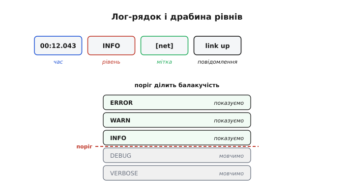
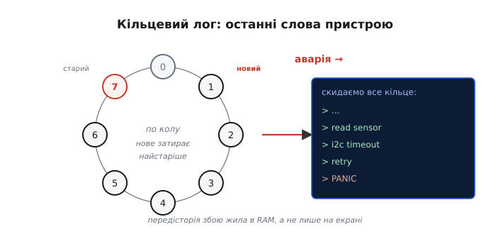

# ⚙️ Логування як інженерна система: рівні, мітки часу, кільцевий лог

Один друк «я тут» у порт налагодження — `Serial.println` в Arduino, `ESP_LOGI` в ESP-IDF, `HAL_UART_Transmit` на STM32 — рятує раз, але швидко перетворюється на хаос. Розберімо, як зробити з друку **систему**, що допомагає, а не заважає.

## Задача

Розкидані по коду `println("here")`, `println(x)` мають кілька вад: вони **зливаються** в нечитну стіну, їх **не відфільтрувати**, у них нема **часу** (а коли це сталося?), вони **гальмують** систему — і, найгірше, **зникають разом** із пристроєм, коли той падає в полі, де ніхто не дивиться в монітор. Перетворімо друк на систему, що цих вад позбавлена.

## Ідея: рівень, час, мітка — і кільце на чорний день

Добрий лог-рядок **структурований**: **час** (коли), **рівень** важливості, **мітка** модуля (хто), і саме **повідомлення**. Структура одразу дає те, чого бракувало голому друку: рядки можна **читати**, **фільтрувати** й **зіставляти в часі**.

Час тут — не прикраса. Будь-який МК має вільний лічильник, що росте від старту, і саме він тут найдешевший відлік: в Arduino це `millis()`, в ESP-IDF — `esp_timer_get_time()` (мікросекунди) чи готова мітка самого логу, у STM32 HAL — `HAL_GetTick()` (тики SysTick, звичайно мілісекунди). Ставлять саме такий лічильник, бо справжнього годинника (дати й часу доби) на голій платі звичайно нема. Така мітка не каже, о котрій годині сталася подія, зате точно каже **на скільки одна подія випередила іншу** — а для пошуку бага важить саме це: побачити, що між «почав читати давач» і «таймаут шини» минуло рівно 50 мс, варто більше за абсолютну дату.


*Угорі — анатомія рядка: час · рівень · мітка · повідомлення. Унизу — драбина рівнів (ERROR→VERBOSE) із порогом: що вище порога — показуємо, нижче — мовчимо. Крутиш поріг — регулюєш балакучість, а низькі рівні в релізі взагалі компілюють геть, тож вони нічого не коштують.*

Ключова ідея — **рівні** (ERROR, WARN, INFO, DEBUG, VERBOSE). Кожен лог має рівень, а в системи є **поріг**: видно лише те, що важливіше за поріг. Так одним перемикачем робиш лог то докладним (ловиш баг), то тихим (реліз). А якщо поріг — **константа часу компіляції**, то відкинуті рівні зникають із коду зовсім: нуль витрат на DEBUG-логи у фінальній прошивці. Хитрість тут у тому, що рішення «показувати чи ні» ховають у **макрос**: компілятор бачить умову `level <= LOG_LEVEL` з двох констант, обчислює її ще під час збірки й, якщо вона хибна, просто **викидає весь виклик** разом із рядком-шаблоном. У прошивку не потрапляє ні код друку, ні текст — наче ви того рядка й не писали.

Чому саме рівні, а не просто «вмикач логу»? Бо балакучість потрібна **різна для різних місць**. Помилку мережі хочеться бачити завжди; кожен крок обміну по шині — лише коли саме цю шину й ловиш. Рівень робить це одним числом на повідомлення: підняв поріг — і відкрилися дрібниці, опустив — лишилася суть. А **мітка** модуля додає другий вимір: коли логів багато, фільтр за міткою («покажи лише `i2c`») рятує не гірше за рівень. Разом вони перетворюють стіну тексту на те, що можна **запитувати**, а не вичитувати очима.

Друга ідея рятує там, де наживо ніхто не дивиться, — **кільцевий лог**: тримаємо останні N рядків у **кільцевому буфері** (англ. *ring buffer*) у RAM, де новий запис **затирає найстаріший**. Поки все гаразд, кільце просто крутиться. А коли стається аварія чи помилка — **скидаємо все кільце** в порт. Ось вони, «останні слова» пристрою: що саме він робив у секунди перед падінням, навіть якщо це сталося вночі в полі. Сенс кільця саме в тому, що воно **обмежене**: пам'яті на МК мало, тримати весь лог від старту неможливо, а от останні кілька десятків рядків — саме та передісторія, якої досить, щоб зрозуміти збій.


*Кільце на N рядків крутиться в RAM, новий запис затирає найстаріший. При аварії все кільце скидають у порт — і видно передісторію збою, бо лог жив у пам'яті, а не лише «на екрані».*

## Робочий код: рівні + кільце

Зберемо мінімальну, але справжню систему. Рівні — це `enum`; поріг видимості — константа; кільце — масив фіксованих рядків зі вказівником голови по колу. Серце — макрос `LOG`, що відкидає зайве ще на компіляції. Вкладки різняться лише двома речами — звідки береться час і куди йде готовий рядок; у ESP-IDF же цю роботу вже робить штатний `ESP_LOG*`, тож там лишається підчепити кільце до готового потоку логу.

:::tabs
:::code proj-logging/c/arduino/main.ino
:::code proj-logging/c/esp-idf/main.c
:::code proj-logging/c/stm32/main.c
:::

Користуються цим звичайно, а рівень керує і видимістю, і вартістю (в ESP-IDF ті самі три рядки — це `ESP_LOGI` / `ESP_LOGD` / `ESP_LOGV` з тим самим порогом):

```cpp
LOG(INFO,  "net", "link up");      // видно (INFO <= DEBUG)
LOG(DEBUG, "i2c", "ack 0x40");     // видно (DEBUG <= DEBUG)
LOG(VERBOSE,"adc", "raw=2731");    // зникне зовсім: VERBOSE > DEBUG
```

Рядки `VERBOSE` не просто мовчать — їх **узагалі немає** у зібраній прошивці: ні виклику, ні тексту `"raw=2731"` у Flash. Підняв `LOG_LEVEL` до `VERBOSE` під час пошуку бага — вони повернулися; опустив назад для релізу — знову зникли, без жодної правки самих рядків.

## Як підібрати розмір

Два числа в коді — `N` (скільки рядків у кільці) і ширина рядка (тут 80) — це прямий розмін **пам'яті на глибину пам'яті подій**. Кільце з прикладу займає `32 × 80 = 2560` байтів RAM — дрібниця навіть для скромного МК. Хочеш бачити довшу передісторію перед аварією — збільшуй `N`, але пам'ятай, що це сталий шматок RAM, відрізаний назавжди, як би рідко аварія не ставалася. Ширину рядка тримай тісною: довгі повідомлення «з'їдають» кільце вшир, тож краще короткі мітки й числа, ніж розлогі речення.

Окреме рішення — **поріг компіляції чи виконання**. Компіляційний (як вище) найдешевший: відкинуте зникає з прошивки разом із текстом, нуль витрат. Але змінити балакучість можна лише **перезбіркою** — у полі, на готовому пристрої, це незручно. Виконанний поріг (звичайна змінна замість `#define`) дозволяє крутити рівень на ходу, наприклад командою з того ж порту, — ціною того, що весь код і всі рядки лишаються в образі назавжди. Практичний компроміс: компіляційний поріг ставлять **нижче** (скажімо, `DEBUG`), щоб дрібний `VERBOSE` усе ж зникав, а в межах того, що лишилось, балакучістю керують уже на ходу.

## Куди писати лог

Порт налагодження — лише один із виходів, і код навмисно відокремлює **збір** рядка від його **видачі**: спочатку рядок лягає в кільце, а вже потім кудись друкується. Замінити сам рядок видачі (`Serial.println`, `HAL_UART_Transmit`, штатний вивід `ESP_LOG*`) можна на будь-що: запис у [файл на Flash](root:hw-components/why-persist), щоб лог пережив перезавантаження; відправку по мережі на сервер; чи той-таки слід по SWO, якщо є зонд. Кільце при цьому лишається незмінним — воно живе в RAM і потрібне саме на випадок, коли видати лог нормальним шляхом уже не вийде, бо пристрій валиться. Тому правило просте: **у кільце — завжди й дешево, на зовнішній вихід — як вийде**.

## Складність і пастки на МК

- **Лог повільний.** Вивід у порт блокує, поки байти підуть (`Serial.println`, `HAL_UART_Transmit` з таймаутом — однаково); **не логуй у перериванні** чи в гарячому циклі — зб'єш тайминг. У ISR лиш постав прапорець, а друкуй у головному циклі.
- **Переповнення кільця** — це нормально: воно **на те й кільце**, щоб тримати лише свіже. Просто пам'ятай, що старіше за N рядків уже стерто.
- **Мітка часу переповнюється.** [32-бітний лічильник мілісекунд колись завернеться](root:sf-devices/millis-micros) — байдуже, `millis()` це чи `HAL_GetTick()`; для різниць це байдуже, але абсолютний відлік це треба враховувати.
- **Скидання при аварії** має статися **до** перезапуску — вивантаж кільце в обробнику помилки, інакше «останні слова» загубляться. На ESP32 для цього є гачок вимкнення (`esp_register_shutdown_handler`), на STM32 — власний `HardFault_Handler`: саме туди й вішають `dump_ring`.
- **Рядки — фіксовані, не з купи.** Кільце з `char[N][80]` навмисне без `String` і динамічної пам'яті: лог мусить працювати й тоді, коли купа вже зіпсована (а часто саме це й валить пристрій). Динамічний рядок в обробнику аварії — найкоротший шлях до другої аварії всередині першої.
