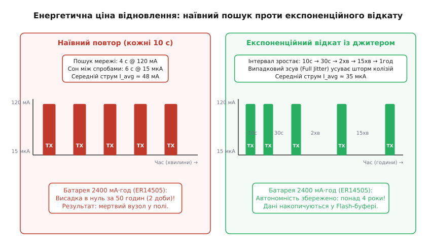
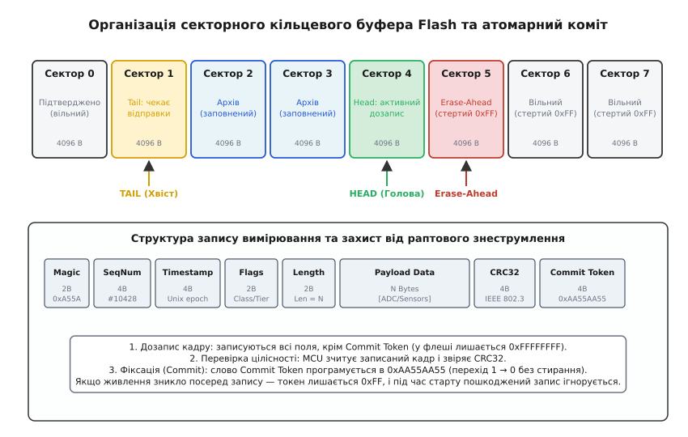
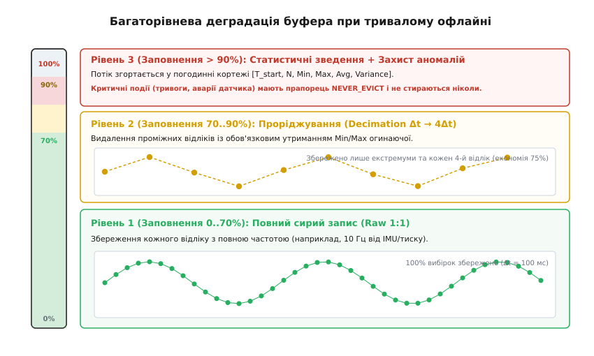
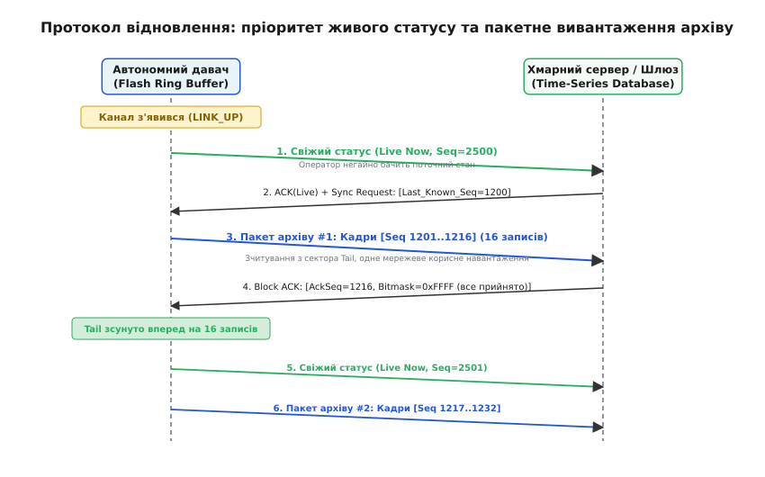

# Канал зник: що робити давачу (буфер, проріджування, скидання)

<preknowlist>
- [Стан з'єднання як автомат](root:embedded/stan-ziednannia-iak-avtomat-vid-nemaie-zhyvlennia) — фази життєвого циклу підключення від пошуку несучої до активної сесії.
- [Енергетичний бюджет вузла](root:embedded/power-budget) — розподіл міліампер-годин між сном, обчисленнями та передавачем.
- [NOR проти NAND](root:embedded/nor-vs-nand) — фізичні відмінності організації сторінок, блоків та ціна стирання у флеш-пам'яті.
- [Проріджування сигналів](root:com-signal/decimation) — зниження частоти дискретизації без втрати спектральної форми та амплітудних піків.
- [Керування потоком і надійний обмін](root:embedded/keruvannia-potokom-i-nadiinyi-obmin) — механізми підтвердження доставки, ковзного вікна та захисту від переповнення приймача.
</preknowlist>

Автономний вимірювальний вузол — вібромонітор підшипника магістрального насоса, агрогідрологічний зонд у ґрунті чи лісовий давач диму — працює від невеликої неперезаряджуваної літій-тіонілхлоридної батареї (Li-SOCl₂ типорозміру AA на 2400 мА·год), розрахованої на п'ять-сім років безперервної служби. У штатному режимі мікроконтролер спить 99.9% часу зі споживанням 10–15 мкА, прокидається за таймером RTC раз на хвилину, за кілька мілісекунд знімає покази з АЦП і через радіомодуль (NB-IoT, LTE-M, LoRaWAN або Wi-Fi) відправляє короткий кадр у хмару. Проте в польових умовах радіоефір нестабільний: базову станцію стільникового оператора знеструмило аварією, ретранслятор залило зливою, або навантажувач у цеху заблокував металевим контейнером лінію прямої видимості до шлюзу.

Коли радіоканал зникає, перед пристроєм миттєво постають дві смертельні загрози. Перша — **енергетичний колапс**: якщо модем почне гарячково сканувати всі частотні канали щохвилини, піковий струм передавача 120–250 мА висадить усю багаторічну ємність батареї менш ніж за дві доби. Друга — **переповнення пам'яті**: фізичні процеси не зупиняються разом зі зв'язком, виміри продовжують генеруватися, а внутрішнє статичне ОЗП (RAM) мікроконтролера обсягом 32–64 КіБ вичерпується за кілька секунд або хвилин. Щоб пристрій не перетворився на безповоротну «цеглину» і не втратив критичні дані аварії, його прошивка повинна реалізовувати триетапну стратегію виживання: енергоефективний експоненційний відступ під час пошуку зв'язку, атомарну буферизацію в зовнішню енергонезалежну пам'ять та багаторівневу деградацію архіву з адаптивним проріджуванням.

---

### Енергетична ціна відновлення: експоненційний відкат із випадковим тремтінням

Головний споживач енергії в будь-якому бездротовому вимірювальному вузлі — це радіотракт. Для порівняння, мікроконтролер класу ARM Cortex-M4 в активному обчислювальному режимі на частоті 48 МГц споживає близько 4–8 мА, а в режимі глибокого сну (Deep Sleep) із збереженням регістрів та увімкненим годинником реального часу — лише 10–18 мкА. Водночас вихідний каскад підсилювача потужності передавача (PA, *Power Amplifier*) та схема фазового автопідстроювання частоти (PLL) радіотрансивера споживають від 80 до 250 мА залежно від діапазону та випромінюваної потужності (+14..+23 дБм).

У штатному стані пристрій передає дані за кілька сотень мілісекунд і негайно вимикає радіо. Середній струм розраховується через інтеграл шпаруватості:

```
I_avg = (T_active · I_active + T_sleep · I_sleep) / (T_active + T_sleep)
```

Підставивши типові значення для сесії тривалістю 0.5 с з передачею раз на 60 секунд:

```
I_avg = (0.5 · 120 мА + 59.5 · 0.015 мА) / 60 ≈ (60 + 0.89) / 60 ≈ 1.01 мА
```

За інтервалу відправки раз на 15 хвилин середній струм падає до 80 мкА, забезпечуючи понад 3.4 роки роботи від елемента ємністю 2400 мА·год.

Щойно шлюз перестає відповідати пакетами підтвердження (ACK), наївний алгоритм повторює спробу передачі через той самий короткий інтервал (наприклад, кожні 10 секунд), сподіваючись, що збій був короткочасним. У режимі постійного сканування ефіру, синхронізації з базовою станцією та очікування відповіді (RX Window) модем залишається активним 4–5 секунд із кожних 10 секунд. Середній струм стрибає до 48–60 мА.

```
Час висадки = 2400 мА·год / 48 мА = 50 годин = 2.08 доби
```

За два дні відсутності зв'язку автономний вузол повністю знищує свій запас живлення, навіть якщо фізичний датчик не зафіксував жодної аномалії.


*Порівняння профілів струму та тривалості життя автономного вузла. Ліворуч: наївні спроби підключення з постійним коротким періодом спустошують літієву батарею за 50 годин. Праворуч: алгоритм експоненційного відкату з випадковим тремтінням збільшує паузи між спробами до кількох годин, знижуючи середній струм до мікроамперного рівня і продовжуючи термін автономії до кількох років.*

Єдиний спосіб врятувати батарею — застосування алгоритму **експоненційного відкату** (англ. *Exponential Backoff*, від лат. *exponere* — виставляти, нарощувати). Суть алгоритму полягає в тому, що після кожної невдалої спроби встановити зв'язок тривалість наступного інтервалу сну подвоюється:

```
T_interval = min(T_max, T_base · 2^attempt)
```

Де:
- `T_base` — початкова затримка першої повторної спроби (наприклад, 10 секунд);
- `attempt` — лічильник поспіль невдалих сесій зв'язку (0, 1, 2...);
- `T_max` — верхня стеля періоду опитування (наприклад, 1 година або 4 години), вище якої інтервал не зростає, щоб вузол не пропустив появу мережі на занадто довгий час.

#### Небезпека синхронного шторму та рятівний джитер

Якщо сотня однакових давачів одночасно втратять зв'язок через перезавантаження базової станції, чистий експоненційний відкат спричинить вторинну аварію — **проблему синхронного шторму** (англ. *Thundering Herd Problem*). Оскільки всі вузли зафіксували втрату зв'язку в один момент часу `t_0`, їхні внутрішні таймери відкату спрацюють строго синхронно: через 10 с, потім через 20 с, 40 с, 80 с.

Коли базова станція відновить живлення, сотня пристроїв одночасно увімкне свої передавачі в одну й ту саму мілісекунду. Взаємні радіоколізії зруйнують усі пакети, жоден вузол не отримає ACK, кожен з них збільшить лічильник `attempt` і синхронно піде спати на наступний подвоєний інтервал. Система потрапляє в замкнене коло штучного взаємного глушіння.

Щоб розбити синхронізацію, до експоненційного інтервалу обов'язково додають псевдовипадкове тремтіння — **джитер** (англ. *Jitter*, тремтіння). Застосовують два основні математичні варіанти джитера:

1. **Повний джитер (Full Jitter):** Випадкова рівномірна вибірка інтервалу сну від нуля до поточного експоненційного максимуму:
   ```
   T_sleep = random_uniform(0, min(T_max, T_base · 2^attempt))
   ```
   Цей метод забезпечує найкраще розсіювання навантаження в часі, хоча середня затримка повтору становить половину від розрахункового значення.

2. **Декорельований джитер (Decorrelated Jitter):** Наступний інтервал генерується на основі попереднього реального часу сну `T_prev`, що запобігає занадто коротким випадковим відкатам:
   ```
   T_sleep = min(T_max, random_uniform(T_base, T_prev · 3))
   ```

Завдяки додаванню джитера спроби сотень пристроїв рівномірно «розмазуються» по часовій осі. Щойно базова станція відновлює роботу, перший випадковий давач успішно проходить реєстрацію, за ним наступний, і мережа плавно повертається в штатний режим без пікових перевантажень ефіру.

---

### Організація сховища: секторний кільцевий буфер на NOR Flash

Оскільки внутрішнє ОЗП мікроконтролера не здатне довго зберігати накопичені дані в умовах відсутності каналу, єдиним надійним притулком для часових рядів стає зовнішня енергонезалежна пам'ять. У портативних пристроях домінують дві технології: послідовна пам'ять **SPI NOR Flash** (наприклад, мікросхеми серії Winbond W25Q32 або Macronix MX25R обсягом 4–16 Мегабайтів) та сегнетоелектрична пам'ять **FRAM** (наприклад, Fujitsu MB85RS64).

Пам'ять FRAM ідеальна для черг: вона витримує 10¹⁴ циклів запису, пише байти на повній швидкості шини SPI без затримок і споживає мінімальну енергію. Проте вартість та обмежена щільність FRAM (зазвичай до 256–512 КіБ) роблять її непридатною для тривалого багатодобового архівування. Масовим стандартом для автономних логерів залишається дешева та містка пам'ять NOR Flash.

Робота з NOR Flash має жорсткі кремнієві обмеження:

1. **Асиметрія запису та стирання:** Запис даних (англ. *Page Program*) здійснюється окремими байтами або сторінками по 256 байтів і здатний змінювати біти лише в один бік — з одиниці в нуль (1 → 0).
2. **Поблокове стирання:** Повернути нулі в одиничний стан (0 → 1) неможливо для окремого байта чи слова. Для цього необхідно виконати операцію стирання цілого неподільного масиву комірок — **сектора** розміром 4096 байтів (4 КіБ) або **блоку** розміром 32/64 КіБ.
3. **Часова затримка стирання:** Операція стирання сектора `Sector Erase (4KB)` на NOR Flash триває від 45 до 300 мілісекунд. Протягом цього часу мікросхема споживає підвищений струм 15–25 мА і повністю блокує шину SPI для читання.
4. **Обмежений ресурс зносу:** Кожен сектор гарантовано витримує близько 100 000 циклів стирання.

#### Архітектура секторного логу (Append-Only Ring Buffer)

Спроба встановити на Flash-пам'ять класичну файлову систему з таблицями розміщення (FATFS) швидко руйнує ресурс мікросхеми через часте перезаписування секторів каталогу. Правильна інженерна організація автономного сховища базується на **секційному кільцевому буфері** (англ. *Sector-based Ring Buffer*) безпосередньо над сирими адресами Flash.

Уся область пам'яті (наприклад, 4 МіБ = 1024 сектори по 4096 байтів) розглядається як кільце фіксованих блоків:


*Архітектура кільцевого сховища на SPI NOR Flash. Запис ведеться послідовно в сектор Head. Покажчик Tail утримує найстаріший непідтверджений сектор. Сектор перед головою Erase-Ahead очищується заздалегідь, щоб уникнути затримок опитування давачів. Внизу показано структуру кадру та двокроковий атомарний коміт, що захищає журнал від пошкодження при раптовому падінні напруги.*

Керування кільцем базується на чотирьох правилах:

1. **Покажчик голови (Head):** Вказує на поточний сектор та зміщення всередині нього, куди записуються свіжі звіти. Нові виміри дозаписуються строго вперед (англ. *Append-Only*).
2. **Покажчик хвоста (Tail):** Вказує на найстаріший сектор, що містить дані, які ще не були підтверджені сервером після відновлення зв'язку.
3. **Випереджальне стирання (Erase-Ahead):** Коли активний сектор `Head` заповнюється на 90%, мікроконтролер у фоновому режимі (між вимірами) ініціює команду асинхронного стирання наступного сектора `(Head + 1) mod N`. Завдяки цьому, коли голова перетинає межу сектора, новий простір уже заповнений байтами `0xFF`, і запис чергового виміру займає типові 150–300 мкс замість очікування 100 мс на стирання.
4. **Рівномірний знос (Wear Leveling):** Завдяки кільцевому обходу всі 1024 сектори мікросхеми стираються строго по черзі. Якщо за добу генерується 4 МіБ телеметрії, весь масив перезапишеться один раз на добу, а ресурсу 100 000 циклів вистачить на 270 років безперервної роботи.

#### Формат кадру та захист від раптового знеструмлення (Power-Cut Safety)

Якщо під час операції запису виміру в Flash-пам'ять напруга батареї просяде нижче порогу скидання мікроконтролера (англ. *Brownout Reset*), запис виявиться обірваним на середині. Після перезавантаження прошивка повинна однозначно відрізнити цілісні кадри від «сміття».

Кожен запис у сховищі упаковується у стандартизований бінарний контейнер із суворим порядком полів:

```
+---------------+----------------+-------------------+-----------------+
| Magic (2B)    | SeqNum (4B)    | Timestamp (4B)    | Flags/Type (2B) |
+---------------+----------------+-------------------+-----------------+
| Length (2B)   | Payload (N B)  | CRC32 (4B)        | Commit (4B)     |
+---------------+----------------+-------------------+-----------------+
```

- `Magic (0xA55A)` — унікальна сигнатура початку кадру, що дозволяє сканеру пам'яті швидко знайти наступний запис.
- `SeqNum` — 32-бітний монотонно зростаючий лічильник вимірів, що дозволяє виявляти пропуски кадрів.
- `Timestamp` — абсолютний час за стандартом Unix epoch (секунди з 1970 року) або локальний тік апаратного таймера.
- `Flags/Type` — бітова маска класу пріоритету та типу даних (аварія, нормальний вимір, агрегований блок).
- `Length` — точна довжина корисного навантаження `Payload`.
- `CRC32` — контрольна сума IEEE 802.3 від усіх попередніх полів кадру.
- `Commit Token` — спеціальне слово фіксації, початково залишене стертим (`0xFFFFFFFF`).

Механізм атомарного збереження працює у три кроки:

1. **Тіло запису:** Мікроконтролер записує у відкритий сектор усі поля від `Magic` до `CRC32`. Останнє 4-байтне слово `Commit Token` залишається недоторканим у стані `0xFFFFFFFF`.
2. **Верифікація:** Мікроконтролер виконує зворотне зчитування записаного блоку з Flash і перевіряє відповідність апаратного розрахунку CRC32.
3. **Фіксація (Commit):** Якщо контрольна сума зійшлася, мікроконтролер посилає команду `Page Program` на адресу поля токена і записує туди значення `0xAA55AA55`. Оскільки перехід `0xFFFFFFFF → 0xAA55AA55` змінює біти виключно з 1 на 0, операція не потребує стирання сектора і триває лічені мікросекунди.

Якщо під час кроку 1 сталася аварія живлення, під час наступного сканування пам'яті прошивка побачить, що слово коміту містить `0xFFFFFFFF` або CRC32 не сходиться. Такий незавершений кадр негайно відкидається, а покажчик `Head` зупиняється на останньому підтвердженому записі.

---

### Що робити при переповненні: стратегії деградації сховища

Якщо радіоканал відсутній тижнями, виділені 4 чи 16 Мегабайтів Flash-пам'яті неминуче вичерпаються: покажчик голови впреться в покажчик хвоста (`(Head + 1) mod N == Tail`). Зберігати новий запис нікуди, доки не буде звільнено хоча б один сектор.

Перед розробником постає фундаментальна дилема: що саме можна видалити без непоправної шкоди для аналітики?

#### Пастка сліпого FIFO (First-In, First-Out Drop Oldest)

Найпростіше рішення — за принципом кільцевої черги зсувати покажчик `Tail` уперед, стираючи найстаріший сектор пам'яті заради нового запису. У вимірювальних системах сліпий FIFO веде до катастрофи.

Уявімо автономний монітор вібрації газової турбіни. О 02:00 ночі турбіна зазнала гідроудару: датчик зафіксував піковий сплеск вібрації 80 g та стрибок температури підшипника до 115 °C. Після цього автоматика зупинила агрегат, але радіозв'язок був відсутній через пошкодження кабелю базової станції. Наступні три доби зупинений агрегат повільно холонув, а датчик щосекунди методично записував у Flash однаковий шум температури навколишнього середовища.

Якщо в системі діє сліпий FIFO, до моменту приїзду ремонтників найстаріший сектор із даними гідроудару та перегріву о 02:00 буде стертий і переписаний тисячами однакових точок фонової температури мертвого насоса. Інженери отримають ідеально збережені дані за останню годину перед підключенням, але причина катастрофи буде втрачена назавжди.

#### Каскадна піраміда деградації

Щоб зберегти критичні інциденти та утримати макротренд процесів, у сховищі розгортають трирівневу систему пріоритетів та адаптивного проріджування (англ. *Multi-Tier Downsampling*):


*Каскадна деградація сховища залежно від відсотка заповнення. У зоні 0..70% усі виміри зберігаються з максимальною частотою 1:1. У зоні 70..90% вмикається проріджування зі збільшенням інтервалу в 4 рази при обов'язковому збереженні огинаючої Min/Max. При заповненні > 90% потік стискається у статистичні кортежі, а записи аварій захищаються правилом NEVER_EVICT.*

Поведінка системи динамічно змінюється залежно від заповненості буфера:

1. **Рівень 1 (Заповнення 0..70% — Нормальний потік):**
   Усі виміри зберігаються у вихідному вигляді з базовою частотою (наприклад, 10 Гц для тиску або вібрації). Кожен відлік потрапляє в лог без спотворень.

2. **Рівень 2 (Заповнення 70..90% — Проріджування зі збереженням екстремумів):**
   Коли вільний простір падає нижче 30%, потік нових даних піддається [децимації](root:com-signal/decimation) — крок збереження збільшується в 4 або 8 разів (`Δt → 4Δt`). Проте просте викидання 3 відліків із 4 неприпустиме, оскільки у вилучених точках може знаходитися короткочасний пік тиску або амплітудний удар.
   Застосовують алгоритм **пікоутримувального проріджування (Peak-Preserving Decimation)**: із вікна у 2K відліків формується пара значень:
   ```
   Point_1 = Min(Sample_0 .. Sample_K)
   Point_2 = Max(Sample_0 .. Sample_K)
   ```
   Це зберігає як верхню, так і нижню огинаючу коливального сигналу, гарантуючи, що жоден імпульсний сплеск не зникне з історії спостережень.

3. **Рівень 3 (Заповнення 90..100% — Статистична агрегація та захист подій):**
   - **Захист аномалій (Never-Evict Events):** Усі кадри, помічені прапорцем `CLASS_ALARM` (перевищення порогів, спрацювання датчика удару, системні перезавантаження), ізолюються в пам'яті або отримують найвищий пріоритет утримання. Вони ніколи не стираються за принципом FIFO.
   - **Стиснення в статистичні кортежі:** Замість запису сотень сирих точок система обчислює компактне зведення за годинне вікно спостереження:
     ```
     Summary = { Start_Time, Duration, Sample_Count, Min, Max, Mean, Variance }
     ```
     Замість 3600 точок по 8 байтів (28.8 КіБ) у Flash записується один дескриптор розміром 32 байти. Коефіцієнт компресії перевищує 900:1, дозволяючи вузлу утримувати макроеволюцію фізичного процесу протягом місяців ізоляції.

---

### Відновлення каналу: пакетна вивантаження та контроль потоку

Коли комунікаційний автомат фіксує успішне проходження процедури реєстрації в мережі (`LINK_UP`), у флеш-пам'яті вузла накопичено сотні кілобайтів або мегабайтів архіву. Як правильно передати ці дані на сервер?

#### Пріоритет свіжого статусу (Live First)

Найбільш поширена помилка — негайно розпочати передачу з найстарішого сектора хвоста (`Tail`). Якщо в черзі накопичено 50 000 звітів, передача через вузькосмуговий канал LoRaWAN або NB-IoT займе кілька годин. Протягом усього цього часу оператор у диспетчерській бачитиме застарілий стан вузла двотижневої давнини і не знатиме, чи живий об'єкт просто зараз.

Правильний протокол базується на **двоканальному інтерлівінгу (Interleaving)**:


*Часова діаграма відновлення зв'язку. Вузол негайно надсилає поточний живий статус Telemetry(Now), щоб оператор бачив реальний стан системи. Далі у фоні запускається пакетне вивантаження архіву блоками по 16 кадрів із підтвердженням бітовою маскою Block ACK. Записи чергуються зі свіжими вимірами.*

1. **Крок 1 — Живий кадр (Live Telemetry):** Вузол негайно знімає свіжий вимір і транслює його позачергово з прапорцем `LIVE_STREAM`. Диспетчер бачить: «Пристрій у мережі, тиск 4.2 бар, батарея 3.55 В, час 14:00:00».
2. **Крок 2 — Рукостискання синхронізації:** Сервер у відповідь на живий кадр підтверджує прийом і повертає службовий дескриптор `Sync_Request { Last_Server_Seq: 14200 }`. Вузол звіряє отриманий номер із покажчиком `Tail` і точно визначає, з якої позиції починати вивантаження.
3. **Крок 3 — Пакетне викачування (Bulk Batch Transfer):** Вузол зчитує з Flash пачку з `M = 8..16` послідовних кадрів, пакує їх у єдиний транспортний пакет і відправляє в канал.
4. **Крок 4 — Блокове підтвердження (Block ACK):** Сервер приймає пакет і повертає бітову маску доставлених номерів:
   ```
   Block_ACK { Base_Seq: 14201, Ack_Mask: 0xFFFF }
   ```
   Бітова маска `0xFFFF` означає, що всі 16 кадрів прийнято успішно. Тільки після отримання цієї маски покажчик `Tail` у Flash зсувається вперед на 16 записів.
5. **Крок 5 — Інтерлівінг:** Якщо надходить час чергового виміру (наприклад, щохвилинний такт), вузол призупиняє викачування архіву, відправляє свіжий кадр, і знову повертається до пакетної передачі історії.

Якщо через перешкоди в ефірі біт у масці дорівнює нулю (наприклад, `0xFFF7` — втрачено 4-й кадр пачки), вузол не пересилає всю пачку заново: під час наступної ітерації він повторно відправляє виключно пропущений індекс.

---

### Скінченний автомат буферизації та синхронізації на C та C++

Об'єднаємо всі викладені механізми — експоненційний відкат із джитером, секторне кільце Flash, пікоутримувальне проріджування та пакетну реплікацію — у єдиний детермінований скінченний автомат (FSM).

Автомат оперує п'ятьма базовими станами:
- `STATE_ONLINE_STREAMING`: штатний режим прямої передачі;
- `STATE_BACKOFF_SLEEP`: зв'язок втрачено, глибокий сон із розрахованим джитером;
- `STATE_PROBE_LINK`: короткий зондувальний імпульс перевірки наявності шлюзу;
- `STATE_SEND_LIVE`: передача актуального стану після повернення в мережу;
- `STATE_BULK_SYNC`: пакетне вивантаження накопичених секторів Flash.

Нижче наведено робочу реалізацію ядра автомата на мові C та його ідіоматичний еквівалент на сучасному C++20 із застосуванням `std::span`, `std::expected` та типізованих станів на базі `std::variant`.

:::tabs
:::code kanal-znyk-d/c/main.c
:::code kanal-znyk-d/cpp/main.cpp
:::

---

### Чекліст проектування: підводні камені автономного буфера

> 🔧 **Навіщо це.** Втрата зв'язку в польових умовах — це не аварійна виняткова ситуація, а штатний робочий режим автономного вузла. Грамотна організація Flash-буфера з випереджальним стиранням та адаптивним проріджуванням гарантує, що пристрій переживе тижні радіомовчання без втрати першопричин аварій і висадки акумулятора.

1. **Ефект пасивації літієвих батарей (Li-SOCl₂):**
   При тривалому сні вузла зі споживанням 10 мкА на поверхні літієвого анода елементів ER14505 формується плівка хлориду літію (LiCl), яка підвищує внутрішній опір. Коли модем раптово вмикається для передачі пачки архіву (струм 150 мА), напруга на клемах миттєво просідає нижче 2.5 В, спричиняючи циклічний перезапуск процесора (*Brownout Loop*). Щоб цього уникнути, паралельно батареї встановлюють комбінований суперконденсатор або гібридний літієвий шар (HLC / іоністор на 10–50 мФ).
2. **Стрибки часової шкали при відновленні зв'язку:**
   Поки вузол перебуває в офлайні, його внутрішній RTC дрейфує (до ±2..5 секунд на добу залежно від температури кварцу). Після появи зв'язку сервер надсилає точний час за NTP. Заборонено різко переводити системний час назад, якщо годинник поспішав: це порушить монотонність лічильника `Timestamp` у збережених записах. Синхронізацію виконують поступовим плавним регулюванням швидкості таймера (*Slewing*).
3. **Пошук покажчиків Head/Tail під час старту без зношування пам'яті:**
   Категорично заборонено зберігати поточні адреси `Head` та `Tail` у фіксованому нульовому секторі Flash: 100 000 записів вичерпаються за пару місяців. Під час завантаження прошивка виконує швидкий бінарний пошук по масиву секторів: зчитує лише перші 16 байтів кожного сектора, знаходить межу між заповненими записами та чистими байтами `0xFF`, і автоматично відновлює положення голови та хвоста без жодного зайвого циклу запису.
