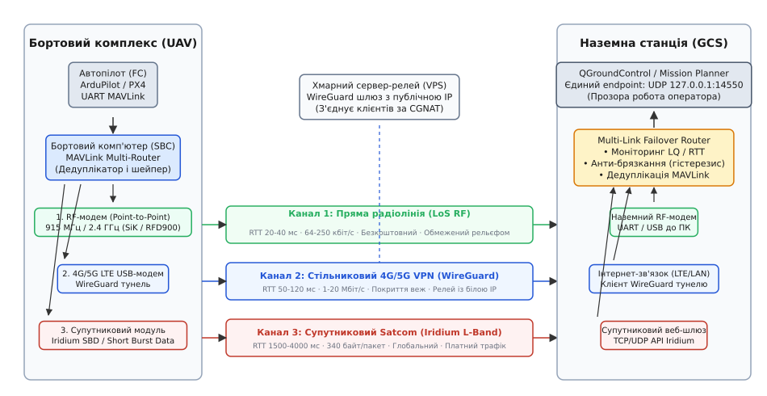
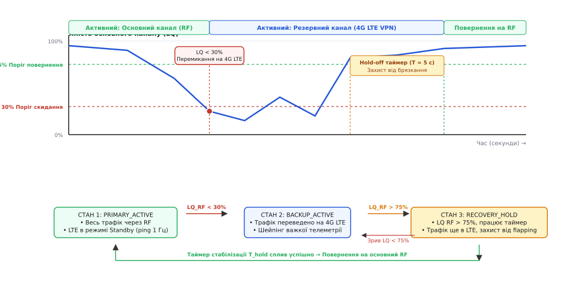
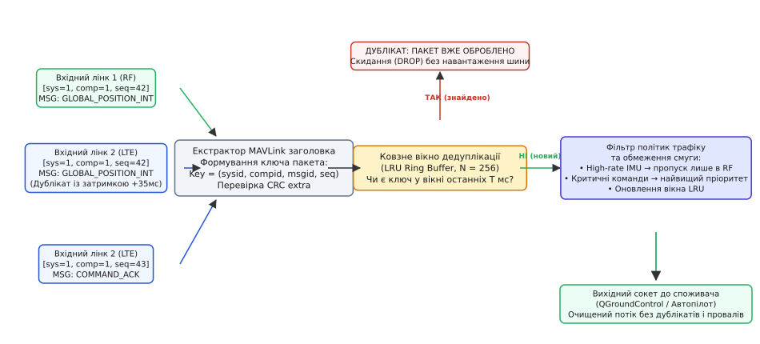

# Кілька шляхів до апарата: резерв і перемикання

<preknowlist>
- [Менеджер каналів](root:sys-dron/link-manager) — життєвий цикл з'єднань, конфігурація послідовних портів та UDP-сокетів у наземній станції.
- [Пакет MAVLink](root:sys-dron/mavlink-packet) — будова кадру, послідовні номери `seq`, адресація `sysid`/`compid` та контроль цілісності CRC.
- [HEARTBEAT: як апарат оголошує себе](root:sys-dron/mavlink-heartbeat) — періодичний пульс системи, визначення присутності вузла й таймаути втрати зв'язку.
- [Маршрутизація за sysid і compid](root:sys-dron/message-routing) — правила спрямування повідомлень між бортовими підсистемами та станцією.
- [WireGuard](root:sys-unix/wireguard-kernel-architecture) — побудова зашифрованих L3 UDP-тунелів із фіксованим оверхедом через ненадійні публічні мережі.
</preknowlist>

Безпілотний апарат іде маршрутом на відстані двадцяти кілометрів від оператора. На шостій хвилині польоту пряма радіолінія 915 МГц ховається за пагорбом: рівень сигналу падає з -75 dBm нижче порога чутливості приймача -110 dBm, і потік пакетів телеметрії обривається. Якщо наземна станція тримає єдиний послідовний порт, через три секунди автопілот фіксує таймаут зв'язку й активує аварійний режим повернення на базу (Return to Launch, RTL), перериваючи виконання завдання. Проте на борту встановлено стільниковий 4G-модем із стабільним покриттям вежі за три кілометри та супутниковий прийомопередавач Iridium. Якщо станція та бортовий комп'ютер не вміють непомітно для оператора перенаправити потік MAVLink у резервний тунель, це додаткове залізо залишається мертвим вантажем.

Один фізичний канал зв'язку (англ. *single point of failure*, єдина точка відмови) робить систему беззахисною перед трьома природними ворогами: радіогоризонтом, рельєфом місцевості та навмисними завадами. Щоб апарат залишався керованим у будь-якій точці маршруту, зв'язок будують як мультиплексовану надлишкову систему з кількох фізично незалежних ліній (Multi-Bearer Redundant Link). Для побудови такого каналу потрібно вирішити три взаємопов'язані задачі: узгодити несумісні фізичні середовища, навчити систему розпізнавати деградацію лінка за мілісекунди без хибних перемикань і зшити кілька потоків у єдиний віртуальний інтерфейс без дублювання команд автопілота.

### Фізика і топологія трьох ліній: від прямої видимості до орбіти

Жоден окремий тип бездротового зв'язку не поєднує високу швидкість, нульову вартість, низьку затримку й необмежену дальність. Надійний зв'язок досягається поєднанням трьох принципово різних фізичних середовищ, кожне з яких компенсує слабкості інших.


*Архітектура мультиплексованого зв'язку. Бортовий комп'ютер агрегує прямий RF-модем, стільниковий 4G/5G модем із тунелем WireGuard та супутниковий термінал Iridium. Наземний маршрутизатор веде безперервний моніторинг якості лінків, усуває дублікати MAVLink-пакетів і надає програмі керування (QGroundControl) єдиний стабільний локальний UDP-порт.*

Перша лінія — **локальний радіомодем прямої видимості (Point-to-Point RF)**, що працює в неліцензованих ISM-діапазонах 433 МГц, 868/915 МГц або 2.4 ГГц (наприклад, кремнієві трансивери Si1000 у модемах SiK Radio, чи потужніші платформи RFD900 і Microhard).
- *Переваги:* нульова абонентська плата, мінімальна кругова затримка (Round-Trip Time, RTT 15–35 мс) і прямий контроль над залізом без сторонніх провайдерів.
- *Фізичні обмеження:* сигнал підпорядковується закону поширення у вільному просторі, де потужність згасає пропорційно квадрату відстані (`1/R²`), а біля поверхні землі через багатопроменеве згасання (multipath fading) — як `1/R⁴`. Для стабільного зв'язку потрібна чиста перша зона Френеля (еліпсоїд об'єму простору між антенами). Будь-яка перешкода (ліс, забудова, пагорб) вносить додаткове затухання 20–40 dB, що обриває зв'язок.

Друга лінія — **стільниковий інтернет 4G/5G (Cellular LTE VPN)** через бортовий модем категорій Cat-1, Cat-4 або 5G RedCap, підключений до бортового комп'ютера (SBC) через USB або UART.
- *Переваги:* широка смуга пропускання (від 1 до 50 Мбіт/с, що дозволяє паралельно передавати телеметрію й стиснене відео H.264/H.265), низька вартість передачі гігабайта даних і відсутність прив'язки до позиції антени наземної станції — апарат може літати за десятки кілометрів за межами прямої видимості оператора (BVLOS, Beyond Visual Line of Sight).
- *Фізичні обмеження:* діаграми спрямованості антен стільникових веж розраховані на наземних абонентів і нахилені донизу (електричний та механічний down-tilt від 2° до 8°). На висотах понад 150–200 метрів апарат потрапляє в бічні пелюстки діаграми або бачить одночасно десятки сусідніх базових станцій на однаковому рівні сигналу. Це викликає постійні міжстільникові перемикання (handover ping-pong) і різке падіння відношення сигнал/шум (SINR). Крім того, стільникові оператори використовують трансляцію адрес операторського рівня (Carrier-Grade NAT, CGNAT), що блокує прямі вхідні підключення між станцією та бортом без зовнішнього релея.

Третя лінія — **супутниковий зв'язок (Satcom)** на базі низькоорбітальних (LEO, наприклад Iridium) або геостаціонарних угруповань (Inmarsat / Thuraya).
- *Переваги:* 100% глобальне покриття поверхні Землі, незалежність від наземної інфраструктури, лісів, рельєфу та державних кордонів.
- *Фізичні обмеження:* ультранизька пропускна здатність і висока ціна. Сервіс коротких повідомлень Iridium SBD (Short Burst Data) передає пакети корисного навантаження розміром лише до 340 байт із затримкою від 1.5 до 5 секунд за транзакцію, а кожен кілобайт тарифікується окремо. Повноцінні термінали класу Iridium Certus 100 дають смугу до 22–88 кбіт/с, але вимагають масивних антен, високого енергоспоживання (10–25 Вт) і дорогої щомісячної підписки.

Порівняння фізичних характеристик ліній наведено в таблиці:

| Характеристика | Прямий RF (915 МГц / 2.4 ГГц) | Стільниковий 4G/5G LTE | Супутниковий Iridium SBD / Certus |
|---|---|---|---|
| **Типова смуга (Downlink)** | 64 – 250 кбіт/с | 1 – 30 Мбіт/с | 0.3 – 22 кбіт/с |
| **Кругова затримка (RTT)** | 15 – 40 мс | 45 – 150 мс | 1200 – 4500 мс |
| **Дальність дії** | 5 – 40 км (пряма видимість) | Вся зона покриття веж | Глобально (вся планета) |
| **Ціна за 1 МБ трафіку** | Безкоштовно | $0.005 – $0.02 | $5.00 – $15.00 |
| **Енергоспоживання** | 1 – 3 Вт | 2 – 6 Вт | 5 – 25 Вт |
| **Вразливість до рельєфу** | Критична (блокування горизонтом) | Середня (наявність веж у низинах) | Нульова (відкрите небо) |

> 🔧 **Навіщо це.** Спроба побудувати резервований зв'язок простим дублюванням усіх пакетів у всі три канали миттєво знищить бюджет проєкту через рахунки за супутниковий трафік і заб'є вузькі буфери RF-модема відеопотоками. Розумний маршрутизатор повинен чітко розділяти канали на «основний безкоштовний», «швидкий резервний» та «аварійний вузькосмуговий».

---

### Критерії та алгоритми перемикання лінків

Найпростіший підхід до резервування — перемикатися на інший канал лише тоді, коли з поточного перестають надходити повідомлення `HEARTBEAT` (таймаут 2–3 секунди). Але в реальному польоті це призводить до аварійних ситуацій. На швидкості 25 м/с за три секунди повної тиші апарат пролітає 75 метрів, а якщо канал деградував поступово (пакетні втрати зросли до 90%), формальний таймаут взагалі не спрацьовує: один випадковий пакет на секунду оновлює таймер життєдіяльності, але передати команду керування чи прийняти критичне сповіщення вже неможливо.

Стійкий алгоритм перемикання (Failover Engine) спирається на безперервний розрахунок комплексної метрики якості каналу (Link Quality, LQ), затримки RTT та їхньої дисперсії (Jitter).

#### 1. Оцінка якості каналу (Link Quality, LQ)
Заголовок кожного MAVLink-кадру містить 8-бітне поле `seq` (послідовний номер пакета від 0 до 255). Якщо приймач отримує послідовність `seq: 12, 13, 14, 17, 18`, він фіксує пропуск двох пакетів (15 і 16).

Якість зв'язку розраховується на ковзному вікні з останніх `N` очікуваних пакетів (типово `N = 50` або `N = 100`):

```
LQ_inst = (N_received / N_expected) · 100%
```

Оскільки миттєве значення `LQ_inst` схильне до випадкових сплесків через поодинокі завади в ефірі, для прийняття рішень застосовують експоненційне згладжування (EWMA, Exponentially Weighted Moving Average):

```
LQ_smooth(t) = α · LQ_inst + (1 - α) · LQ_smooth(t - 1)
```
де коефіцієнт згладжування `α ∈ [0.1, 0.3]` задає баланс між швидкістю реакції та фільтрацією шумів.

#### 2. Оцінка RTT і джиттеру
Наземна станція періодично (раз на 1–2 секунди) відправляє повідомлення `TIMESYNC` (msgid 111) із таймштампом відправки `t₁`. Автопілот записує час прийому й миттєво відсилає відповідь назад. При отриманні відповіді у момент `t₂` станція обчислює кругову затримку:

```
RTT = t2 - t1
RTT_smooth(t) = β · RTT_inst + (1 - β) · RTT_smooth(t - 1)
Jitter(t) = γ · |RTT_inst - RTT_smooth| + (1 - γ) · Jitter(t - 1)
```

Якщо RTT прямого радіоканалу перевищує 300 мс або джиттер стає більшим за 150 мс, це свідчить про переповнення внутрішніх черг ретрансляторів або роботу механізму повторних відправок апаратного рівня (ARQ), що є раннім сигналом неминучого обриву зв'язку.

#### 3. Апаратні звіти `RADIO_STATUS` та `CELLULAR_STATUS`
Крім лічильника втрат MAVLink, драйвери каналів зчитують прямі апаратні метрики:
- Радіомодеми SiK/RFD900 транслюють у потік системне повідомлення `RADIO_STATUS` (msgid 109), де передають рівень сигналу локального та віддаленого приймачів (`rssi`, `remrssi`), рівень шуму (`noise`, `remnoise`) і лічильник переповнень буфера (`txbuf`). Співвідношення сигнал/шум обчислюється як `SNR = RSSI - Noise`. Падіння `SNR < 6 dB` означає, що зв'язок перебуває на межі зриву модуляції.
- Модеми 4G/5G передають `CELLULAR_STATUS` (msgid 334), де фіксуються параметри `RSRP` (Reference Signal Received Power), `RSRQ` (Reference Signal Received Quality) та тип мережі (LTE, UMTS, EDGE).


*Керування перемиканням із гістерезисом. Коли якість основного каналу падає нижче 30%, FSM негайно перемикає активний потік на резервний 4G LTE. Коли зв'язок на прямому каналі знову з'являється, повернення блокується доти, доки якість не перевищить поріг відновлення 75% і не протримається стабільно впродовж таймера стабілізації (Hold-off time = 5 с), що повністю ліквідує брязкання маршрутів.*

#### 4. Гістерезис і захист від брязкання маршрутів (Anti-Flapping)
Найнебезпечніший стан системи зв'язку виникає, коли апарат летить на граничній відстані радіовидимості. Рівень сигналу хаотично коливається довкола порога перемикання. Без спеціального захисту система впадає в режим «мережевого тремтіння» (route flapping): вона починає перемикати канали по 5–10 разів на секунду. Це призводить до переповнення сокетів, втрати сесій, розсинхронізації послідовностей MAVLink і повної неможливості передати хоч одну команду.

Для подолання цієї проблеми застосовують подвійний поріг (гістерезис) разом із таймером стабілізації (Hold-off Timer):
1. **Поріг скидання (Drop Threshold):** перемикання з основного дешевого RF-каналу на резервний стільниковий відбувається швидко, якщо `LQ_RF < 30%` упродовж часу `T_drop ≥ 400 мс` або за повної відсутності пакетів протягом 800 мс.
2. **Поріг повернення (Recovery Threshold):** зворотне перемикання з резервного на основний канал дозволяється лише тоді, коли `LQ_RF ≥ 75%`.
3. **Таймер витримки (Hold-off Time):** навіть якщо якість основного каналу перевищила 75%, трафік залишається на резервному каналі ще протягом фіксованого інтервалу `T_hold = 5…10 с`. Якщо за цей час відбудеться бодай одне просідання сигналу нижче 75%, таймер скидається в нуль.

---

### Маршрутизація MAVLink: дедуплікація, агрегація та проріджування

У класичних IP-мережах об'єднання каналів (bonding) здійснюється на рівні L2/L3 (наприклад, Linux bonding driver чи протокол MPTCP). Але для MAVLink пряме L3-дублювання пакетів не підходить через специфіку протоколу:
- Якщо відправити один і той самий MAVLink-пакет `COMMAND_LONG` (наприклад, зміна режиму польоту на `LAND`) одночасно через два канали без дедуплікації, автопілот отримає дві ідентичні команди. Другу команду автопілот може сприйняти як повторний запит або відкинути з помилкою зайнятості, а для команд із відносними переміщеннями (наприклад, «скинути висоту на 5 метрів») подвійне виконання призведе до катастрофи.
- Якщо апарат перемикається на вузький резервний канал (супутник або слабкий RF), передача стандартного телеметричного потоку частотою 50 Гц миттєво заб'є канал і створить гігантську затримку буферизації.

Тому маршрутизація резервованих каналів для дронів повинна бути **протокольно-орієнтованою (MAVLink-Aware Routing)**.


*Конвеєр інтелектуальної обробки трафіку. Пакети, отримані з усіх активних інтерфейсів, проходять через екстрактор ключа `(sysid, compid, msgid, seq)`. Унікальні пакети негайно передаються автопілоту чи наземній станції, а дублікати, що прийшли повільнішим каналом, безшумно знищуються. Фільтр політик обмежує частоту важких повідомлень відповідно до пропускної здатності лінка.*

#### Алгоритм дедуплікації (MAVLink Deduplication)
Щоб реалізувати режим гарячого дублювання (Active-Active) для наднадійних команд без ризику подвійного спрацьовування, маршрутизатор на приймальному боці веде ковзне вікно нещодавно оброблених пакетів.

Ключ унікальності пакета формується з чотирьох полів заголовка MAVLink:
```
PacketKey = { sysid, compid, msgid, seq }
```

Дедуплікатор підтримує кільцевий буфер (Ring Buffer) або хеш-таблицю на `K = 256…512` останніх унікальних ключів разом із міткою часу прийому `T_arrival`.
1. При надходженні кадру витягується кортеж `(sysid, compid, msgid, seq)`.
2. Відбувається пошук ключа у вікні.
3. Якщо ключ знайдено і час із моменту першого прийому `t - T_arrival < T_window` (де `T_window = 2000 мс`):
   - Лічильник відкинутих дублікатів збільшується на одиницю;
   - Пакет негайно знищується (DROP).
4. Якщо ключ новий:
   - Ключ записується у кільцевий буфер із поточним таймштампом;
   - Пакет передається далі в чергу обробки.

> ⚠️ **Важлива деталь:** не можна будувати дедуплікацію лише за парою `(sysid, seq)`. Бортовий комп'ютер (compid 191), камера (compid 100) та автопілот (compid 1) мають однаковий `sysid`, але генерують **незалежні** послідовності `seq`. Порівняння без урахування `compid` призведе до того, що пакети камери випадково знищуватимуть пакети автопілота з тим самим порядковим номером!

#### Адаптивне проріджування та MAVLink High Latency
Коли зв'язок перемикається з широкосмугового LTE (10 Мбіт/с) на резервний радіомодем (64 кбіт/с) або супутниковий термінал (340 байт на транзакцію), маршрутизатор активує фільтр політик трафіку (Traffic Shaping Engine):

1. **Повне блокування сирих сенсорних потоків:** повідомлення високої частоти (`HIGHRES_IMU`, `RAW_IMU`, `SCALED_PRESSURE`, `OPTICAL_FLOW`, `DEBUG_VECT`) повністю відсікаються на виході у вузький канал.
2. **Проріджування навігаційної телеметрії:**
   - Повідомлення просторової орієнтації `ATTITUDE` (msgid 30) проріджується з 20–50 Гц до 2 Гц;
   - Координати `GLOBAL_POSITION_INT` (msgid 33) проріджуються з 10 Гц до 1–2 Гц;
   - Стан батареї та системи `SYS_STATUS` (msgid 1) передається з частотою 0.5 Гц.
3. **Пріоритетний пропуск команд і статусів:**
   - Повідомлення критичного рівня (`COMMAND_LONG`, `COMMAND_ACK`, `MISSION_ITEM_INT`, `STATUSTEXT`, `MANUAL_CONTROL`) отримують найвищий пріоритет у черзі відправки (Queue Priority 0) і ніколи не відкидаються.
4. **Перехід у режим `HIGH_LATENCY2` (для супутникового каналу):**
   - Замість десятків окремих телеметричних повідомлень бортовий маршрутизатор генерує єдиний агрегований кадр `HIGH_LATENCY2` (msgid 235). У всього 42 байти корисного навантаження упаковуються: широта, довгота, висота, швидкість, курс, заряд батареї, температура, стан автопілота та активний номер польотної місії. Цей кадр транслюється раз на 5–10 секунд, забезпечуючи мінімальний нагляд за бортом навіть через найдорожчий супутниковий канал.

---

### Архітектура тунелювання: демони маршрутизації та безпека

Для інтеграції різнорідних каналів у наземній станції та на борту застосовують спеціалізовані фонові служби (демони маршрутизації MAVLink), поверх яких розгортається захищений транспортний шар.

```
+--------------------------------------------------------------------+
|                QGroundControl / Mission Planner                    |
|                UDP 127.0.0.1:14550 (Virtual GCS Endpoint)          |
+---------------------------------+----------------------------------+
                                  |
                                  v
+--------------------------------------------------------------------+
|        Наземний мультиплексор (Multi-Link Failover Router)         |
|   • Моніторинг LQ/RTT   • Дедуплікація   • Пріоритетний селектор   |
+-----------+---------------------+--------------------+-------------+
            |                     |                    |
            v                     v                    v
     [UART /dev/ttyUSB0]   [UDP 10.100.0.1]    [TCP/REST Gateway]
      Прямий RF-модем        WireGuard VPN       Iridium Cloud API
            |                     |                    |
      ((( Ефір 915 МГц )))        |                    |
            |              [Інтернет/LTE]       [Супутник L-Band]
            |                     |                    |
            v                     v                    v
     [UART /dev/ttyS1]     [UDP 10.100.0.2]     [UART /dev/ttyS2]
      Бортовий RF-модем      WireGuard VPN       Iridium SBD Модем
+-----------+---------------------+--------------------+-------------+
|        Бортовий мультиплексор (Onboard MAVLink Router)            |
|   • Фільтрація трафіку  • Агрегація телеметрії • Дедуплікація       |
+---------------------------------+----------------------------------+
                                  |
                                  v
+--------------------------------------------------------------------+
|               Автопілот (Pixhawk / ArduPilot / PX4)                |
|                    UART TELEM1 (/dev/ttyS0)                        |
+--------------------------------------------------------------------+
```

#### Проксі-демони та їхні ролі
У сучасних безпілотних комплексах рутинну комутацію MAVLink-пакетів довіряють перевіреним утилітам:
- **`mavlink-router`** (написаний на C++): високопродуктивний системний демон, розроблений Intel. Працює на неблокуючих сокетах і системному виклику Linux `epoll`. Вміє маршрутизувати пакети між кількома UART-портами, UDP-клієнтами/серверами та TCP-з'єднаннями на основі `sysid`/`compid`. Споживає мінімум пам'яті (до 5 МБ RAM) і є стандартом для бортових Linux-комп'ютерів.
- **`mavp2p`** (написаний на Rust): шлюз, орієнтований на пряме з'єднання вузлів через інтернет без виділеного сервера. Підтримує технології пробиття NAT (STUN/ICE hole-punching) та WebRTC/UDP тунелювання.
- **`MAVProxy`** (написаний на Python): модульний інструмент розробника. Має плагіни для роботи з кількома лінками (`module load link`), але через інтерпретовану природу створює помітне навантаження на слабких процесорах при інтенсивному потоці даних (понад 500 пакетів/с).

#### Безпека та тунелювання: WireGuard поверх стільникових мереж
Передавати відкритий MAVLink 1 або навіть MAVLink 2 без шифрування через публічні стільникові мережі — неприпустимий ризик. Зловмисник може перехопити телеметрію або надіслати підроблену команду `MAV_CMD_DO_SET_MODE` з підміненим `sysid`.

Найефективнішим рішенням для захисту каналу LTE є **WireGuard**:
1. **Низький оверхед:** WireGuard працює в просторі ядра Linux і додає лише 32 байти заголовка (плюс 28 байт UDP/IPv4), на відміну від важких протоколів OpenVPN чи IPsec.
2. **Безперервність з'єднання (Roaming / Handover):** WireGuard прив'язується до криптографічного ключа сесії, а не до IP-адреси. Якщо бортовий 4G-модем переходить на іншу базову станцію й отримує нову динамічну IP-адресу, тунель не рветься: перший же зашифрований пакет оновлює маршрут у ядрі.
3. **Обхід CGNAT через хмарний релей:**
   Оскільки борт і наземна станція часто мають ізольовані «сірі» IP-адреси стільникових операторів, у хмарі (на дешевому VPS із фіксованою публічною білою IP) піднімається центральний релей WireGuard. Борт отримує віртуальну IP `10.100.0.2`, наземна станція — `10.100.0.1`, а сервер `10.100.0.254` прозоро ретранслює UDP-пакети MAVLink між ними.

> 🔧 **Навіщо це.** Станція керування (QGroundControl) взагалі не повинна знати про перемикання між 915 МГц, LTE та Iridium. Вона підключається до єдиного локального UDP-порту `127.0.0.1:14550`. Усі перемикання, оцінку затримок, шифрування та боротьбу з дублікатами бере на себе проміжний демон-маршрутизатор. Оператор бачить безперервний потік даних без зависань інтерфейсу.

---

### Модуль інтелектуального маршрутизатора резервних каналів

Нижче наведено робочий модуль інтелектуального маршрутизатора резервних каналів (Multi-Link Failover Router). Він реалізує:
- Моніторинг метрик для довільної кількості лінків (LQ, RTT, час останнього пакету);
- Дедуплікатор вхідних повідомлень на базі кільцевого буфера хешів MAVLink-кадрів;
- FSM перемикання каналів із гістерезисом та таймером витримки (Hold-off Timer);
- Вибіркове дублювання критичних команд (`COMMAND_LONG`, `MISSION_ITEM_INT`).

:::tabs
:::code kilka-shliakhiv-do-aparata-d/c/router_c.c
:::code kilka-shliakhiv-do-aparata-d/cpp/router_cpp.cpp
:::

---

### Підводні камені та типові аварії

Побудова резервованого зв'язку містить кілька неочевидних інженерних пасток, які не проявляються під час лабораторних тестів за столом, але гарантовано ламають керування в польових умовах.

#### 1. Зависання застарілої телеметрії (Buffer Bloat у TCP-сокетах)
Найпоширеніша помилка новачків — підняття резервного зв'язку через надійний TCP-протокол або стандартний блокуючий UDP-сокет із гігантськими системними буферами (`SO_SNDBUF` за замовчуванням у Linux становить понад 200 КБ).
- *Як виникає збій:* коли зв'язок слабшає, операційна система починає накопичувати пакети в буфері відправки. Коли зв'язок нарешті відновлюється, станція отримує лавину пакетів півхвилинної давнини. Оператор на екрані бачить дрон, що нібито летить над полем, тоді як у реальності апарат уже 30 секунд тому відхилився від курсу.
- *Правильне рішення:* телеметрію передають виключно через неблокуючі UDP-сокети (`O_NONBLOCK` або прапорець `MSG_DONTWAIT` у викликах `sendto`). Системний буфер `SO_SNDBUF` примусово зменшують до 4–8 КБ: якщо сокет не може відправити пакет негайно, старий пакет **повинен бути скинутий** (Drop on Congestion), звільняючи місце для свіжої мітки часу.

#### 2. Проблема MTU Clamping у тунелях WireGuard
Стандартний розмір максимального блоку передачі (MTU) для Ethernet становить 1500 байтів. Однак стільникові оператори часто обмежують MTU на рівні 1420–1440 байтів через власні тунельні заголовки GTP/LTE.
- Додавання тунелю WireGuard забирає ще 60 байтів (20 байт IPv4 + 8 байт UDP + 32 байти заголовка WireGuard).
- Якщо на інтерфейсі віртуального тунелю залишити дефолтний MTU 1500, великі MAVLink-пакети (наприклад, завантаження польотної місії `MISSION_ITEM_INT` батчами чи блоки MAVLink FTP) призведуть до фрагментації IP-пакетів. Оскільки багато стільникових фаєрволів блокують IP-фрагменти або скидають пакети з прапорцем `DF` (Don't Fragment), завантаження місії чи списку параметрів зависне на 99%.
- *Правильне рішення:* явно фіксувати MTU віртуального мережевого інтерфейсу `wg0` на рівні не більше 1360–1400 байтів, а в конфігурації фаєрвола активувати затискання розміру сегмента (MSS Clamping):
```
iptables -t mangle -A FORWARD -p tcp --tcp-flags SYN,RST SYN -j TCPMSS --clamp-mss-to-pmtu
```

#### 3. Асиметричні затримки й переплутані підтвердження команд
У схемі з гарячим резервом прямий канал може мати затримку 20 мс, а стільниковий тунель — 120 мс. Якщо наземна станція відправила команду через RF-модем, а автопілот через тимчасове падіння сигналу відповів квитанцією `COMMAND_ACK` через стільник, станція може не дочекатися відповіді за внутрішнім коротким таймаутом і послати повторну команду.
- *Правильне рішення:* таймаут очікування квитанції `COMMAND_ACK` у наземній станції повинен динамічно підлаштовуватися під найповільніший із активних лінків (`T_ack ≥ 2 · RTT_max + 200 мс`).

#### 4. Неузгодженість системного часу та джерел пакетів
Якщо на борту встановлено компаньйон-комп'ютер, який генерує власні MAVLink-повідомлення (наприклад, розпізнавання об'єктів або статус нейромережі), він повинен мати чітко призначений унікальний `compid` (наприклад, `MAV_COMP_ID_ONBOARD_COMPUTER = 191`). Використання нульового або основного ідентифікатора автопілота (`compid = 1`) для повідомлень від комп'ютера змішує лічильники послідовностей `seq` і призводить до того, що дедуплікатор почне викидати реальні пакети автопілота.

---

### Підсумкова архітектурна парадигма

Надійність безпілотної системи ніколи не досягається пошуком однієї «ідеальної» радіоантени чи «найкращого» оператора зв'язку. Справжня живучість апарата у складному рельєфі, завадовому середовищі та на великих дистанціях будується на трьох принципах:
1. **Гетерогенність фізичного рівня:** поєднання прямого RF-модема прямої видимості, широкосмугового захищеного стільникового LTE-тунелю та вузькосмугового супутникового каналу.
2. **Метричний контроль без брязкання:** швидке перемикання на резерв при перших ознаках деградації (LQ < 30%) і повільне, стабілізоване таймером витримки повернення на основний канал (LQ > 75%, Hold-off 5 с).
3. **Протокольна ізоляція через проксі-демон:** повна дедуплікація пакетів за четвіркою `(sysid, compid, msgid, seq)`, адаптивне проріджування важкої телеметрії та надання операторові єдиного локального віртуального порту.
