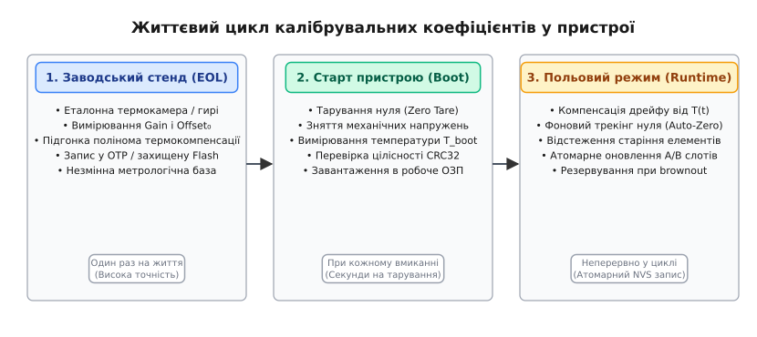
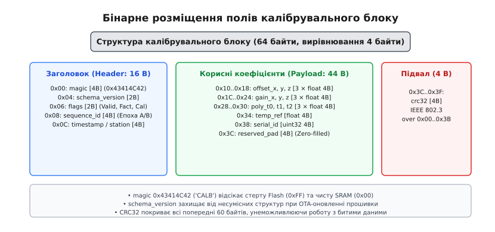
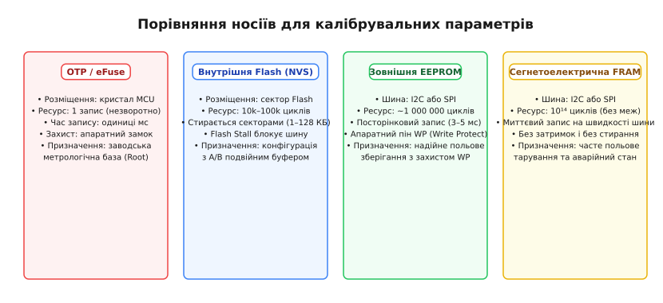
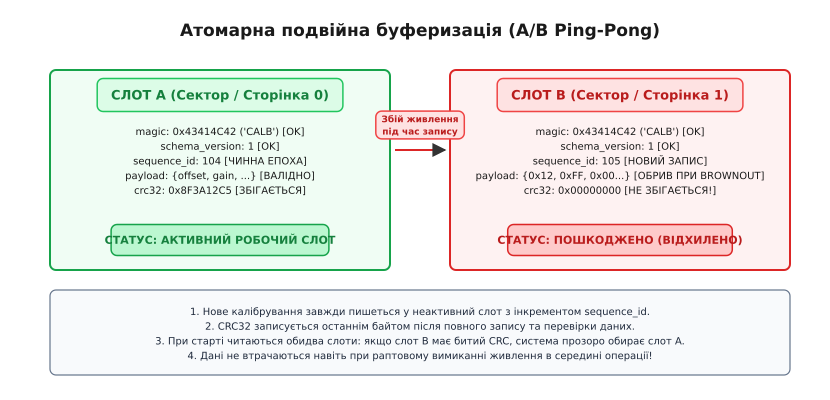
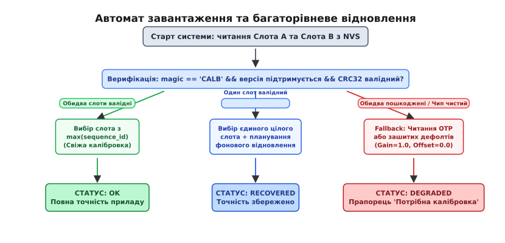

# Коефіцієнти в пристрої: де їх узяти, де зберігати, коли перевіряти

<preknowlist>
- [Процедура калібрування давача](root:embedded/calibration-procedure) — вимірювання похибки проти еталона, обчислення коефіцієнтів зсуву й нахилу.
- [EEPROM і FRAM](root:embedded/eeprom-fram) — енергонезалежна пам'ять мікроконтролера, побайтовий доступ, ресурс циклів запису.
- [Контроль цілісності даних CRC-32](root:com-modulation/crc-algorithm) — перевірка неушкодженості бінарних блоків за поліномом.
- [Заводське прошивання та ідентифікація](root:embedded/factory-provisioning) — внесення унікальних параметрів плати на виробничому стенді.
</preknowlist>

Серійний прилад збирають із компонентів, кожен із яких має виробничий розкид: опір тензорезистора відхиляється на відсоток, напруга зсуву операційного підсилювача плаває на мікровольти, а опорне джерело АЦП відрізняється від номіналу на кілька мілівольтів. На калібрувальному стенді за допомогою прецизійних еталонів і кліматичної камери ці відхилення вимірюють і зводять у набір чисел — коефіцієнти зсуву нуля, масштабу та поліноми термокомпенсації. Якщо зашити ці константи безпосередньо в бінарний образ прошивки, кожен екземпляр плати вимагатиме індивідуальної компіляції коду, а перше ж оновлення прошивки по повітрю (OTA) безповоротно зітре заводські налаштування.

Якщо ж зберегти коефіцієнти у виділеній пам'яті наївно — прямим записом за фіксованою адресою поверх старих байтів, — пристрій стає вразливим до першого випадкового збою живлення. Раптове вимкнення батареї або просідання напруги (англ. *brownout*) під час запису сектора Flash залишає в пам'яті напівстертий блок зі сміттям. При наступному запуску прошивка прочитає спотворені числа, почне множити сирі відліки на випадкові коефіцієнти й транслювати хибні вимірювання в контур керування або систему безпеки.

Стійка архітектура вбудованого пристрою розглядає калібрувальні дані не як набір змінних, а як самостійну підсистему з чітким життєвим циклом: розділенням коефіцієнтів за часом і місцем походження (заводський стенд, старт пристрою, польова робота), суворим бінарним форматом із захистом від несумісності версій, вибором фізичного носія під конкретний профіль зносу, атомарною буферизацією запису та гарантованим переходом у безпечний аварійний режим при фатальному пошкодженні даних.

## Життєвий цикл коефіцієнтів: заводський стенд, старт і поле

Калібрувальні константи не з'являються одночасно. У житті будь-якого вимірювального приладу існують три принципово різні моменти, коли система змушена вимірювати та оновлювати параметри свого вимірювального тракту.

```
       ┌────────────────────────────────────────────────────────┐
       │             1. ЗАВОДСЬКИЙ СТЕНД (EOL)                  │
       │  Термокамера, еталони → Gain, Offset₀, Поліноми T(t)   │
       └──────────────────────────┬─────────────────────────────┘
                                  │ Запис у OTP / Flash A
                                  ▼
       ┌────────────────────────────────────────────────────────┐
       │             2. СТАРТ ПРИСТРОЮ (POWER-ON)               │
       │  Тарування нуля (Tare) → Компенсація напружень корпусу │
       └──────────────────────────┬─────────────────────────────┘
                                  │ Завантаження в ОЗП / NVS
                                  ▼
       ┌────────────────────────────────────────────────────────┐
       │             3. ПОЛЬОВИЙ РЕЖИМ (RUNTIME)                │
       │  Auto-Zero трекінг, старіння → Ping-Pong оновлення NVS │
       └────────────────────────────────────────────────────────┘
```

**1. Заводське калібрування на виробничій лінії (Factory / EOL Calibration).** Це найбільш ресурсомісткий і точний етап, що виконується на фінальному тестуванні пристрою (англ. *End-of-Line testing*). Тут прилад поміщають у контрольоване середовище: термобарокамеру, позиціонер із прецизійними кутами або камеру з поверочними газовими сумішами. На заводському стенді визначають фундаментальні характеристики кристала й аналогового тракту:
* Чутливість (англ. *gain*, нахил характеристики) по кожній із осей;
* Первинний апаратний зсув нуля при еталонній температурі (`25 °C`);
* Коефіцієнти полінома термокомпенсації (поліном 2-го або 3-го порядку, що описує вигин нуля і чутливості від температури кристала);
* Матрицю неколінеарності осей (для багатоосьових інерціальних модулів IMU або магнітометрів).

Ці параметри є базовим метрологічним паспортом пристрою. Їх обчислюють один раз на весь життєвий цикл плати. Вони вимагають максимального рівня захисту: випадковий збій прошивки або некоректна команда користувача ніколи не повинні мати можливості затерти ці числа.

**2. Самокалібрування та тарування при старті (Power-on Zero Offset / Tare).** Коли друковану плату вкручують у корпус приладу, механічний натяг гвинтів і деформація компаунду створюють механічні напруження в кремнії давачів. Крім того, прилад може вмикатися на морозі `-20 °C` або в спеку `+45 °C`. Первинний нуль неминуче зміщується відносно заводського стану.

Для компенсації цього ефекту прошивка реалізує процедуру тарування (від араб. *ṭarḥa* через франц. *tare* — «відрахування ваги порожньої тари»):
* Під час старту, поки привід знеструмлений, клапани перекриті, а акселерометр перебуває у стані спокою, система знімає серію з 100–1000 відліків і обчислює їхнє середнє арифметичне;
* Отриманий зсув порівнюють із допустимим діапазоном безпеки (англ. *sanity check*). Якщо зсув укладається в допуск (наприклад, не перевищує `±5%` від повної шкали), він приймається як поточний нульовий базис;
* Це значення зберігається в оперативній пам'яті як адитивна дельта або записується в робочу енергонезалежну пам'ять як свіжа польова уставка.

> 🔧 **Навіщо це.** Без стартового тарування ваги покажуть вагу порожньої чаші, барометричний висотомір дрона вважатиме рівень підлоги висотою `+12 м`, а давач диференційного тиску зафіксує витік газу там, де просто охолонув аналоговий тракт.

**3. Періодичне польове підстроювання в процесі експлуатації (Runtime / Field Recalibration).** Протягом місяців і років експлуатації властивості компонентів деградують: оксидні шари напівпровідників захоплюють паразитрні заряди, електролітичні комірки газових сенсорів втрачають чутливість, а механічні пружинні елементи зазнають пластичної втоми.

Для компенсації повільного дрейфу застосовують фонові алгоритми польового автопідстроювання:
* Алгоритм автоматичного базового рівня (англ. *Automatic Baseline Correction*, ABC) в оптичних давачах вуглекислого газу: раз на 24 години алгоритм шукає мінімальну зафіксовану концентрацію газу і прирівнює її до концентрації свіжого повітря (`400 ppm`);
* Коригування гіроскопа в паузах між рухами: якщо дисперсія сигналу падає нижче порогу шуму протягом 2 секунд, система вважає пристрій нерухомим і підправляє інтегратор кутової швидкості;
* Користувацьке сервісне калібрування за місцем монтажу через зовнішній інтерфейс (CLI, сервісний Bluetooth/CAN протокол).


*Життєвий цикл калібрувальних коефіцієнтів: заводський стенд фіксує незмінну метрологічну базу, старт пристрою компенсує монтажні напруження, а польовий цикл відстежує старіння.*

## Фізика дрейфу: нелінійність і температурні поліноми

У більшості прецизійних давачів (п'єзорезистивних давачах тиску, кремнієвих тензомостах, інерціальних MEMS-гіроскопах) дрейф нуля і чутливості від температури не є строго лінійним. Зміна температури одночасно змінює рухливість носіїв заряду в кремнії, викликає термічне розширення підкладки та породжує термоелектрорушійну силу на границях металів (ефект Зеєбека).

Якщо описати температурну поправку лише лінійним коефіцієнтом `k_t · (T − T_ref)`, залишковий температурний дрейф на краях робочого діапазону (наприклад, при `-40 °C` та `+85 °C`) залишається неприпустимо високим. Тому на виробничому стенді знімають характеристику давача у 3–5 температурних точках і апроксимують криву поліномом другого або третього порядку.

```
       offset(T) = offset_0 + a·(T − T_ref)² + b·(T − T_ref) + c
```

де `T_ref` — температура, при якій проводилося первинне калібрування (зазвичай `25.0 °C`), `offset_0` — базовий зсув при кімнатній температурі, а `a, b, c` — емпіричні коефіцієнти полінома.

Для швидкого обчислення полінома на мікроконтролері застосовують схему Горнера (англ. *Horner's method*), яка мінімізує кількість операцій множення та запобігає втраті значущих розрядів:

```
dt = T - T_ref
offset_drift = (a · dt + b) · dt + c
```

У мікроконтролерах із ядром ARM Cortex-M0/M0+/M3 без апаратного модуля чисел із плаваючою комою (FPU) програмне виконання операцій `float` через софтверну бібліотеку займає сотні тактів процесора на кожен виклик. Якщо відліки АЦП надходять із частотою `10 кГц`, такий розрахунок перевантажує процесор. 

У таких системах коефіцієнти зберігають у форматі цілих чисел із фіксованою комою (англ. *fixed-point*), наприклад `Q16.16` (16 бітів на цілу частину, 16 бітів на дрібну):
* Число `1.0` зберігається як ціле `65536` (`1 << 16`);
* Множення двох чисел `Q16.16` виконується через 64-бітне проміжне множення: `(int32_t)(((int64_t)x * y) >> 16)`;
* Це дозволяє зберегти високу роздільну здатність і виконати повну температурну компенсацію за лічені такти процесора без звернення до FPU.

## Бінарна анатомія калібрувального блоку: версії, вирівнювання та CRC-32

Збереження калібрувальних даних як простого сирого масиву чисел з плаваючою комою у пам'яті — типова архітектурна помилка початківців. Така схема ламається при першому ж оновленні прошивки або зміні налаштувань компілятора. 

Щоб калібрувальний блок залишався надійним і самодостатнім, його загортають у сувору бінарну структуру фіксованого розміру з вирівнюванням полів.


*Бінарне розташування полів у калібрувальному блоці: магічне число magic, версія схеми, лічильник епохи, коефіцієнти з вирівнюванням на 4 байти та контрольна сума CRC32.*

### Поля заголовка (Header)

1. **Магічна сигнатура (Magic Number, 4 байти).** Фіксоване 32-бітне число (наприклад, `0x43414C42`, що у таблиці ASCII відповідає символам `'C'`, `'A'`, `'L'`, `'B'`). Його призначення — миттєво відкинути неініціалізовану пам'ять. Якщо мікроконтролер щойно вийшов із заводу, витертий сектор Flash містить усі байти `0xFF`, а неініціалізована SRAM — випадкові байти чи нулі `0x00`. Якщо перші 4 байти не дорівнюють `MAGIC`, драйвер навіть не намагається розбирати наступні поля.
2. **Версія схеми даних (Schema Version, 2 байти).** Калібрувальна структура розвивається разом із пристроєм. У прошивці версії `1.0` використовувалася лінійна модель зсуву й масштабу (8 байтів на вісь). У версії `2.0` додали квадратичний поліном термокомпенсації (ще 12 байтів). Якщо завантажити прошивку `2.0` у пристрій зі старим калібрувальним блоком без поля версії, новий код прочитає старі байти за зміщеними адресами, інтерпретуючи сміття як коефіцієнти полінома. Поле `schema_version` дозволяє або автоматично виконати міграцію формату, або явно зафіксувати застарілу версію та відновити відсутні параметри за замовчуванням.
3. **Прапорці статусу (Flags, 2 байти).** Бітова маска, що описує стан блоку:
   * `BIT 0`: `FLAG_FACTORY_VALID` — чи містить блок валідні заводські дані;
   * `BIT 1`: `FLAG_USER_CALIBRATED` — чи виконувалося польове коригування;
   * `BIT 2`: `FLAG_DEGRADED` — чи працює прилад на аварійних константах;
   * `BIT 3`: `FLAG_THERMO_ENABLED` — чи активна температурна компенсація.
4. **Лічильник послідовності / епохи (Sequence ID, 4 байти).** Монотонно зростаюче 32-бітне ціле число. Кожен успішний запис нової калібровки збільшує цей лічильник на одиницю (`seq_id++`). Це поле є фундаментом для вибору активного слота в механізмах подвійної буферизації (A/B Ping-Pong).
5. **Ідентифікатор калібрувального стенда та мітка часу (Timestamp / Station ID, 4 байти).** UNIX-час або числовий ID заводського стенда. Забезпечує метрологічну простежуваність (англ. *traceability*): у разі рекламації чи браку партії завжди можна з'ясувати, на якому стенді та коли саме калібрували даний виріб.

### Корисне навантаження (Payload)

Корисне навантаження містить безпосередньо фізичні константи. Кожне поле має фіксований тип і розмір:
* Зсуви нуля: `offset_x`, `offset_y`, `offset_z` (по 4 байти `float` у стандарті IEEE 754 або 32-бітні цілі з фіксованою комою `Q16.16`);
* Коефіцієнти чутливості: `gain_x`, `gain_y`, `gain_z` (відносний коефіцієнт масштабу, номінально рівний `1.0f`);
* Поліноміальні температурні коефіцієнти: `poly_a`, `poly_b`, `poly_c` для розрахунку поправки термодрейфу;
* Опорна температура калібрування: `temp_ref` (зазвичай `25.0 °C`);
* Серійний номер давача: `sensor_uid` (унікальний ідентифікатор мікросхеми сенсора, щоб переконатися, що плату не замінили окремо від пам'яті).

### Підвал і контроль цілісності (Footer & CRC-32)

Останні 4 байти структури відведено під контрольну суму `crc32` (поліном IEEE 802.3 `0xEDB88320`). Вона розраховується над усіма попередніми байтами блоку (від нульового байта заголовка до останнього байта корисного навантаження).

Чому саме CRC-32, а не простий 8-бітний XOR чи сума за модулем 256? 
У напівпровідниковій пам'яті Flash та EEPROM поширені специфічні фізичні дефекти:
* **Частковий запис при просіданні живлення:** старші байти записуються успішно, а молодші залишаються у стані `0xFF`. Простий XOR може випадково збігтися, якщо кількість змінених бітів парна;
* **Витік заряду з плаваючого затвора (Charge Leakage):** поодинокі біти самовільно перекидаються з `0` в `1` через старіння оксиду. 

CRC-32 має мінімальну кодову відстань Хеммінга, що гарантує 100% виявлення будь-яких поодиноких, подвійних, потрійних інверсій бітів і будь-яких серійних помилок (англ. *burst errors*) довжиною до 32 бітів у блоках розміром до кількох кілобайтів.

```
+-----------------------------------------------------------------------+
| Header: Magic (4B) | Ver (2B) | Flags (2B) | Seq (4B) | Timestamp (4B)|
+-----------------------------------------------------------------------+
| Payload: Offset[3] (12B) | Gain[3] (12B) | Poly[3] (12B) | Meta (8B)  |
+-----------------------------------------------------------------------+
| Footer: CRC-32 (4 байти) [Обчислюється над Header + Payload]          |
+-----------------------------------------------------------------------+
```

## Промисловий протокол обміну зі стендом

Під час виробничого тестування взаємодія між калібрувальним комп'ютером і пристроєм будується за суворим транзакційним протоколом поверх фізичного інтерфейсу (UART, USB-CDC або CAN). Щоб випадкова передача сміття по лінії зв'язку не змінила параметри, процес захищають автоматом станів із паролем доступу (англ. *Security Unlock Key*).

```
   СТЕНД                                             ПРИСТРІЙ
     │                                                   │
     │── 1. CMD_CAL_UNLOCK (Пароль доступу) ────────────>│  Перевірка пароля
     │<── RESP_OK ───────────────────────────────────────│  Перехід у режим CAL
     │                                                   │
     │── 2. CMD_CAPTURE_POINT (Точка 1: 0.0 N, 25°C) ───>│  Усереднення 1000 відліків
     │<── RESP_POINT_DATA (raw = 1840) ──────────────────│
     │                                                   │
     │── 3. CMD_CAPTURE_POINT (Точка 2: 100.0 N, 25°C) ──>│  Усереднення 1000 відліків
     │<── RESP_POINT_DATA (raw = 18450) ─────────────────│
     │                                                   │
     │── 4. CMD_WRITE_COEFFS (Gain, Offset, Poly, CRC) ─>│  Запис у буфер-чернетку
     │<── RESP_VERIFY_OK ────────────────────────────────│  Верифікація в ОЗП
     │                                                   │
     │── 5. CMD_COMMIT_FLASH ───────────────────────────>│  Атомарний запис у NVS
     │<── RESP_COMMIT_SUCCESS ───────────────────────────│  Перемикання слота
     │                                                   │
     │── 6. CMD_LOCK_CAL_MODE ──────────────────────────>│  Фіксація стану, вихід
```

1. **Команда розблокування (Unlock):** стенд надсилає криптографічний токен або фіксований ключ виробника. Без цього кроку будь-які команди запису коефіцієнтів ігноруються прошивкою.
2. **Зняття опорних точок (Point Capture):** стенд задає точну фізичну величину (наприклад, вагу `0.0 Н`, а згодом `100.0 Н`), чекає стабілізації механіки й надсилає команду фіксації точки. Прошивка знімає масив відліків, фільтрує випадковий шум і повертає сире усереднене значення.
3. **Обчислення на хості:** калібрувальна програма на комп'ютері вирішує систему рівнянь або виконує метод найменших квадратів, формує готову бінарну структуру з коректним `magic`, `schema_version` і `crc32`.
4. **Фіксація та верифікація (Commit):** стенд завантажує структуру в пристрій. Прошивка проводить зворотну перевірку (Sanity Check і CRC) і лише після цього переносить блок у постійну пам'ять із перемиканням активного слота.

## Де зберігати: битва носіїв (Flash, EEPROM, FRAM, OTP)

Вибір фізичного місця під калібрувальні коефіцієнти визначається компромісом між чотирма технічними факторами: собівартістю апаратної частини, гранулярністю запису, ресурсом перезапису комірок і стійкістю до блокування процесорної шини під час виконання коду.


*Порівняння носіїв: одноразова пам'ять OTP гарантує незмінність заводської бази, FRAM забезпечує миттєвий запис польових поправок, а подвійний сектор Flash — надійність без додаткових мікросхем.*

### 1. Внутрішня Flash-пам'ять мікроконтролера (Flash Sector Emulation / NVS)

Найбільш привабливий варіант з погляду собівартості: не потребує жодної додаткової мікросхеми на друкованій платі. Під збереження конфігурації виділяють один або два останні сектори вбудованої Flash.

Проте внутрішня Flash має фундаментальні апаратні обмеження:
* **Величезний розмір сектора стирання.** У Flash-пам'яті не можна переписати окремий байт з `0` в `1` — для цього треба повністю стерти сектор (заповнити його одиницями `0xFF`). У мікроконтролерах STM32G4 або STM32F1 розмір сторінки становить 2 КБ. У потужніших STM32F4 або STM32H7 сектори досягають 128–256 КБ! Щоб оновити блок калібрування розміром 64 байти, контролер змушений стерти весь сектор у 128 КБ.
* **Заморожування шини (Flash Stall).** Операція апаратного стирання сектора триває довго: від 20 до 2000 мілісекунд залежно від технологічного процесу. Якщо мікроконтролер має пам'ять із єдиним банком (Single-Bank Flash), на час стирання шина пам'яті програм повністю блокується. Процесор не може вибирати інструкції з Flash — виконання коду зупиняється. Якщо в цей момент надходить критичне переривання (ШІМ керування силовими транзисторами двигуна або таймер розгортки), система пропускає дедлайн. Щоб обійти це, обробники переривань доводиться переносити в оперативну пам'ять (`RAMFUNC`), що ускладнює компонування проєкту.
* **Обмежений ресурс зносу.** Ресурс вбудованої Flash становить від 10 000 до 100 000 циклів стирання. Для заводських параметрів цього більш ніж достатньо, але регулярне збереження поточного нуля вб'є комірки за кілька місяців.

### 2. Зовнішня пам'ять EEPROM (I2C / SPI, наприклад 24LCxx, AT25xxx)

Класичне рішення для промислової електроніки середнього класу:
* **Побайтова та посторінкова адресація.** Дозволяє оновлювати компактні блоки від 1 до 64 байтів без необхідності попереднього стирання великих секторів.
* **Ресурс циклів:** гарантовано витримує понад `1 000 000` операцій запису на кожну сторінку.
* **Апаратний захист від запису (Write Protect, пін WP).** Критично важлива лінія безпеки. Пін `WP` підключають до GPIO мікроконтролера. У нормальному робочому стані прошивка утримує пін `WP` у високому рівні (активний захист): мікросхема фізично блокує будь-які команди запису на рівні внутрішньої кремнієвої логіки. Лише перед оновленням параметрів мікроконтролер опускає `WP` в нуль, передає байти по I2C/SPI, чекає завершення циклу запису (`3–5 мс`) і негайно повертає `WP` у стан блокування. Навіть якщо прошивка зависне, процесор потрапить у HardFault або почнеться падіння напруги живлення, випадковий шум на шині не зможе пошкодити збережені коефіцієнти.

### 3. Сегнетоелектрична пам'ять FRAM (I2C / SPI, наприклад MB85RCxx, CY15Bxxx)

Найвищий рівень надійності та швидкодії для систем реального часу:
* **Миттєвий запис без затримки (Zero Bus Wait).** Запис у комірку пам'яті здійснюється поляризацією кристалічної решітки цирконату-титанату свинцю (PZT) за наносекунди. Мікроконтролеру не потрібно чекати `5 мс` (як в EEPROM) чи сотні мілісекунд (як у Flash). Байт зберігається на повній швидкості шини SPI (до 40 МГц).
* **Практично нескінченний ресурс:** `10¹⁴` (сто трильйонів) циклів перезапису. У FRAM можна писати новий нульовий зсув хоч щосекунди.
* **Ідеальна реакція на знеструмлення (Power-Fail Resilience).** Коли детектора падіння напруги (BOD) фіксує просідання вхідної лінії `3.3 В`, у конденсаторів фільтра залишається запас енергії на `1–2 мс`. У цей мікроінтервал часу неможливо стерти Flash чи записати сторінку EEPROM, але у FRAM контролер устигає зберегти стан і коефіцієнти повністю.

### 4. Апаратна пам'ять OTP / eFuse (One-Time Programmable)

Спеціальна область постійної пам'яті всередині кристала мікроконтролера (наприклад, блок `eFuse` в ESP32 або виділені `OTP-блоки` в STM32):
* Фізично складається з мікроскопічних полікремнієвих або металевих перемичок, які під дією струмового імпульсу випалюються назавжди.
* **Незворотність:** після запису біта його неможливо стерти жодною командою прошивки, зміною напруги чи перепрошиванням чіпа через SWD/JTAG.
* **Роль у системі:** ідеальне апаратне сховище для незмінної первинної заводської метрології (Root of Calibration Trust). Навіть якщо користувач повністю витре зовнішню EEPROM або зітре сектор NVS у Flash, прилад завжди зможе прочитати первинні заводські константи прямо з кристала.

| Носій | Гранулярність | Час запису блоку | Ресурс циклів | Вплив на процесор | Головне призначення |
| :--- | :--- | :--- | :--- | :--- | :--- |
| **Flash (NVS)** | Сектор (2–128 КБ) | 20–2000 мс | 10k–100k | Flash Stall (блокує шину) | Базова конфігурація з A/B слотами |
| **EEPROM** | Сторінка (16–64 Б) | 3–5 мс | 1 000 000 | Немає (передача по I2C/SPI) | Надійні польові уставки з апаратним WP |
| **FRAM** | Побайтово | 0 мс (швидкість шини) | 10¹⁴ (трильйони)| Немає | Високочастотне тарування, аварійний лог |
| **OTP / eFuse** | Побайтово (1 раз) | Одиниці мс | 1 (незворотно) | Немає | Незмінна заводська метрологічна база |

## Атомарність запису та політика стійкості: подвійна буферизація A/B

Головна небезпека при роботі з енергонезалежною пам'яттю — випадкове вимкнення живлення посеред виконання команди запису. 

Якщо записувати нові калібрувальні коефіцієнти на те саме фіксоване місце (англ. *in-place overwrite*), послідовність дій виглядає так:
1. Стерти старий блок у пам'яті (усі байти стають `0xFF`);
2. Почати запис нових байтів: `offset_x`, `offset_y`...
3. **Раптове знеструмлення (Power Cut / Brownout)!**
4. Процесор вимикається на середині структури.

Результат: старі валідні коефіцієнти вже знищені, а нові записані лише частково. При наступному вмиканні контрольна сума не зійдеться, магічне число буде пошкоджене, і пристрій втратить працездатність.

### Алгоритм подвійної буферизації (A/B Ping-Pong Double Buffering)

Щоб унеможливити подібну аварію, застосовують техніку подвійної буферизації (Ping-Pong). У пам'яті виділяють два повністю незалежні слоти однакового розміру: **Слот A** і **Слот B** (рознесені по різних сторінках або секторах).


*Механізм Ping-Pong буферизації: оновлення завжди записується у неактивний слот із новим sequence id; обрив живлення пошкоджує лише чернетку, зберігаючи чинний попередній стан.*

Процедура оновлення параметрів суворо дотримується протоколу:
1. **Визначення активного слота:** прошивка читає обидва слоти, перевіряє їхні сигнатури та CRC-32. Активним вважається той слот, чий CRC-32 зійшовся і чий `sequence_id` є більшим (скажімо, Слот A має `seq_id = 42`).
2. **Підготовка в оперативній пам'яті:** новий набір коефіцієнтів формується в буфері-чернетці в ОЗП. У заголовок записується інкрементований лічильник: `seq_id = 42 + 1 = 43`.
3. **Розрахунок CRC-32:** контрольна сума обчислюється над усім буфером-чернеткою і записується в поле `crc32`.
4. **Запис у неактивний слот:** сформований блок цілком записується у **протилежний** слот (Слот B).
5. **Верифікація після запису:** прошивка читає записаний Слот B назад, повторно розраховує його CRC-32 і порівнює з еталоном. Якщо все успішно — операція завершена. Тепер активним автоматично стає Слот B (`seq_id = 43`).

Що відбувається, якщо живлення зникає на кроці 4?
Слот B виявляється записаним наполовину. При наступному старті перевірка CRC-32 для Слота B провалюється. Драйвер фіксує пошкодження Слота B, ігнорує його і без жодних втрат завантажує попередній неушкоджений стан зі Слота A (`seq_id = 42`). Система відновлює роботу без стороннього втручання.

### Багаторівневий автомат завантаження та аварійний Fallback

При старті системи ініціалізація підсистеми калібрування проходить через автомат станів, який відпрацьовує всі можливі комбінації стану пам'яті.


*Алгоритм ініціалізації при старті: паралельна перевірка CRC обох слотів, вибір свіжішої епохи або безпечний відкат до апаратного OTP/дефолтних констант із виставленням прапорця деградації.*

1. **Сценарій 1: Обидва слоти валідні (CRC_A == OK, CRC_B == OK).**
   * Порівнюються лічильники `seq_id`. Слот із більшим значенням обирається як поточний робочий;
   * Якщо лічильники рівні (крайовий випадок після заводського клонування), обирається Слот A;
   * Статус системи: `CAL_STATUS_OK`. Повна паспортна точність.
2. **Сценарій 2: Тільки один слот валідний (CRC_A == OK, CRC_B == FAIL або навпаки).**
   * Обирається єдиний неушкоджений слот;
   * Пошкоджений слот позначається прапорцем потреби регенерації: у фоновому режимі (коли спаде пікове навантаження) прошивка скопіює валідний блок у пошкоджений слот, відновивши дублювання;
   * Статус системи: `CAL_STATUS_RECOVERED`. Робота триває у штатному режимі.
3. **Сценарій 3: Обидва слоти пошкоджені або порожні (катастрофа NVS або перший запуск чіпа).**
   * Спрацьовує ланцюг аварійного захисту (Fallback):
     * *Крок 3.1:* Спроба прочитати апаратну фабричну область `OTP / eFuse`. Якщо там записані валідні коефіцієнти стенда — завантажуємо їх;
     * *Крок 3.2:* Якщо OTP порожній або відсутній — завантажуємо жорстко зашиті в Flash номінальні дефолтні константи (`gain = 1.0f`, `offset = 0.0f`, `poly = 0.0f`);
   * **Дія:** Виставляється системний статус `CAL_STATUS_DEGRADED_UNCALIBRATED`;
   * Усі вихідні повідомлення та пакети телеметрії позначаються прапорцем недостовірності даних;
   * На панелі приладу вмикається попереджувальна світлодіодна індикація (або тривожний прапорець у CAN/MODBUS реєстрі);
   * Блокуються критичні автоматичні функції, що несуть ризик для людей (автопілот відмовляється злітати, силовий реле-регулятор переходить у безпечний розімкнений стан).

## Повний сервісний менеджер калібрувальних параметрів на C та C++

Нижче наведено закінчену виробничу реалізацію менеджера калібрування з підтримкою двоетапного вибору слотів Ping-Pong, розрахунком контрольної суми CRC-32 за стандартом IEEE 802.3, санітарною перевіркою діапазонів значень (Sanity Check) та аварійним відкатом до номінальних констант.

:::tabs
:::code koefitsiienty-v-prystroi-d/c/main.c
:::code koefitsiienty-v-prystroi-d/cpp/main.cpp
:::

## Інженерний чеклист калібрувальної підсистеми

Перед передачею приладу в серійне виробництво перевірте архітектуру збереження коефіцієнтів за контрольним списком:

1. **Апаратна ізоляція:**
   * Чи підключено пін `WP` зовнішньої EEPROM/FRAM до керованого GPIO, і чи блокується він за замовчуванням при старті?
   * Якщо використовується внутрішня Flash — чи виділено під дані окремі фізичні сектори, не зайняті кодом програми?
2. **Бінарна структура та сумісність:**
   * Чи зафіксовано вирівнювання структури (`alignas(4)` або `__attribute__((packed, aligned(4)))`), щоб уникнути різного набивання компілятором?
   * Чи присутні поля `magic` і `schema_version` для безпечного OTA-оновлення прошивки?
   * Чи захищено весь блок поліномом CRC-32?
3. **Стійкість до знеструмлення:**
   * Чи реалізовано схему подвійної буферизації A/B Ping-Pong з монотонним лічильником `sequence_id`?
   * Що робить прилад при збої живлення під час запису? (Перевірено на стенді з генератором просідань живлення).
4. **Аварійний Fallback і сигналізація:**
   * Чи переходить прилад у безпечний режим `DEGRADED_UNCALIBRATED` при повному пошкодженні NVS?
   * Чи блокує система небезпечні дії (пуск двигунів, відкриття клапанів) до підтвердження валідності калібровки?
   * Чи забезпечено санітарну перевірку меж значень (`is_sane()`), щоб запобігти діленню на нуль або нереалістичному підсиленню?
