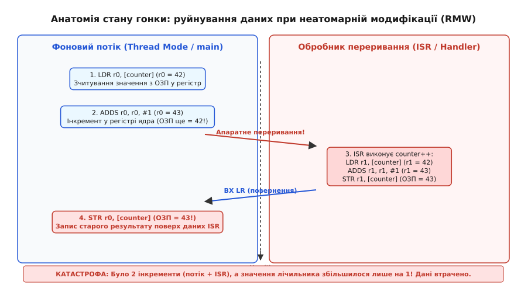
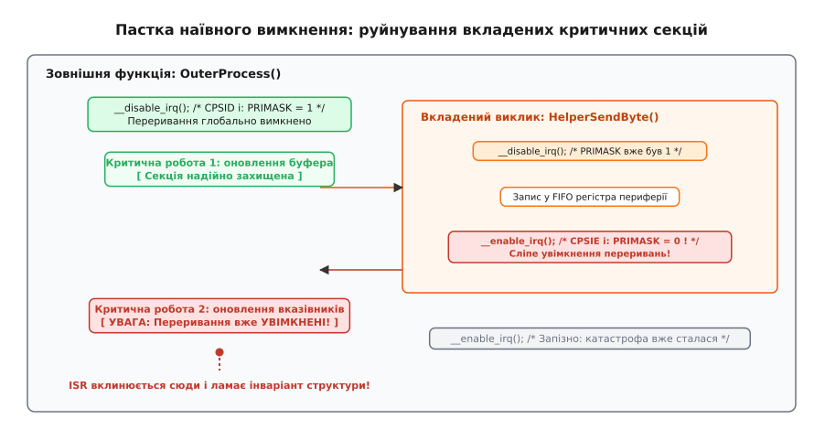
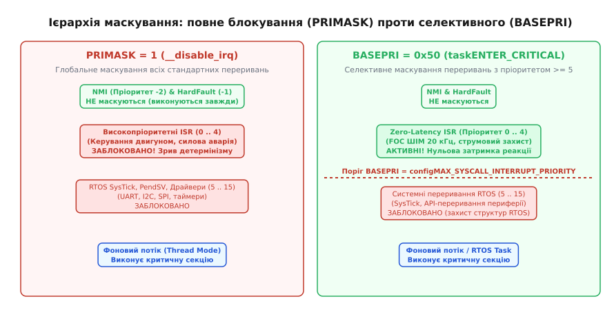
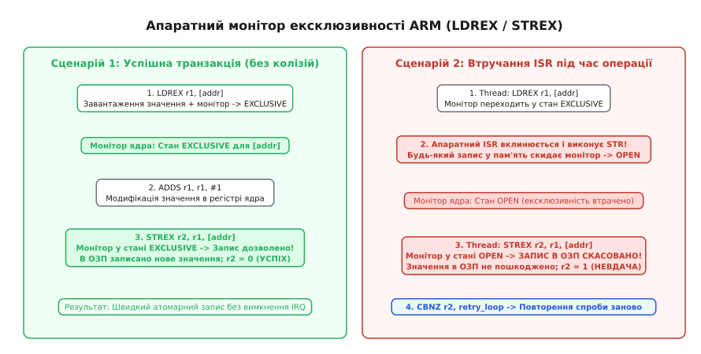

# Критична секція на МК: як правильно вимкнути переривання

<preknowlist>
- [Апаратні переривання](root:hw-arch/interrupts) — механізм апаратного призупинення нормального потоку виконання коду.
- [Пріоритети переривань](root:hw-arch/interrupt-priorities) — правила субординації та витіснення обробників у контролері переривань.
- [Атомарність і гонки](root:sf-tasks/atomicity-races) — природа конфліктів при спільному доступі до пам'яті без синхронізації.
- [volatile, бар'єри й доступ до регістрів з C](root:sf-tasks/volatile-register) — правила оптимізації доступу до пам'яті та апаратних регістрів.
</preknowlist>

Коли промисловий контролер керує силовими транзисторами трифазного інвертора на частоті 20 кГц, фоновий потік у головному циклі програми формує координати для наступного кроку траєкторії й оновлює 64-бітну часову мітку. Одночасно апаратний таймер кожні 50 мікросекунд генерує переривання АЦП, обробник якого зчитує виміряні струми фаз, коригує інтегральну складову ПІД-регулятора та інкрементує лічильник відпрацьованих циклів ШІМ. Якщо посеред оновлення багатобайтової структури координат або під час виконання банального інкременту лічильника процесор раптово перемикається на обробник переривання, система стикається з пошкодженням пам'яті: фоновий код перезаписує нові дані старим значенням або обчислює вектор напруги за розірваними координатами, де старші 32 біти відповідають новому положенню, а молодші 32 біти — старому. Інвертор генерує струмовий удар, і апаратний захист аварійно вимикає привід.

Такий збій є класичним проявом стану гонки даних (англ. *Race Condition*). Оскільки мікроконтролер одночасно виконує фоновий потік (Thread Mode) та асинхронні обробники переривань (Handler Mode), будь-яка спільна ділянка пам'яті стає зоною потенційного конфлікту. Для захисту таких ділянок код оформлюють у вигляді **критичної секції** — неподільного фрагмента програми, під час виконання якого втручання сторонніх асинхронних подій тимчасово блокується. Проте наївне вимкнення переривань через стандартні макроси часто створює ще важчі приховані помилки, ніж сама гонка даних.

## Анатомія стану гонки: зчитування-модифікація-запис на рівні інструкцій

У мовах високого рівня C та C++ операція інкременту змінної або встановлення бітового прапорця виглядає як один лаконічний вираз:

:::tabs
:::code krytychna-sektsiia-d/c/race_demo.c
:::code krytychna-sektsiia-d/cpp/src/race_demo.cpp
:::

Проте архітектура процесорів зі скороченим набором інструкцій (RISC, зокрема ARM Cortex-M) базується на моделі «завантаження-збереження» (англ. *Load-Store Architecture*). Арифметико-логічний пристрій (АЛП) ядра процесора не здатний модифікувати значення безпосередньо в комірці оперативної пам'яті (ОЗП). Будь-яка модифікація змінної в пам'яті неминуче розпадається на три окремі машинних інструкції — послідовність «зчитування-модифікація-запис» (англ. *Read-Modify-Write*, RMW):

```asm
; Трансляція g_packet_counter++ в інструкції ARM Thumb-2:
LDR   r0, [r1]      ; 1. READ:   завантажити поточне значення з ОЗП [r1] у регістр ядра r0
ADDS  r0, r0, #1    ; 2. MODIFY: збільшити значення в регістрі r0 на 1 (ОЗП ще не змінено!)
STR   r0, [r1]      ; 3. WRITE:  записати обчислений результат із r0 назад в ОЗП [r1]
```

Якщо апаратне переривання виникає між інструкціями `LDR` та `STR`, виникає катастрофічне руйнування даних.

```
Час (t)   Фоновий потік (Thread Mode)        Обробник переривання (ISR)           ОЗП (g_packet_counter)
  │                                                                                        42
  ├────── 1. LDR r0, [counter] (r0 = 42)                                                   42
  ├────── 2. ADDS r0, r0, #1   (r0 = 43)                                                   42
  │                  ⚡ АПАРТНЕ ПЕРЕРИВАННЯ (вхід в ISR) ⚡
  ├───────────────────────────────────────── 3. LDR  r1, [counter] (r1 = 42)               42
  ├───────────────────────────────────────── 4. ADDS r1, r1, #1    (r1 = 43)               42
  ├───────────────────────────────────────── 5. STR  r1, [counter] (запис в ОЗП)           43
  │                  ↩ ПОВЕРНЕННЯ З ПЕРЕРИВАННЯ (вихід з ISR) ↩
  ├────── 6. STR r0, [counter] (запис r0=43)                                               43
  ▼
```


*При асинхронному перериванні між інструкціями зчитування та запису фоновий потік перезаписує зміни, внесені обробником переривання.*

Розглянемо послідовність подій у часі:
1. Фоновий потік зчитує поточне значення лічильника з пам'яті (`42`) у внутрішній регістр ядра `r0`.
2. АЛП збільшує значення в регістрі `r0` до `43`. У пам'яті все ще зберігається старе число `42`.
3. У цей момент виникає апаратне переривання таймера чи мережевого інтерфейсу. Процесор зберігає регістри потоку в стек і переходить до виконання функції ISR.
4. Обробник переривання виконує власний інкремент `g_packet_counter++`: зчитує з пам'яті `42`, збільшує до `43` і записує `43` в ОЗП.
5. Обробник переривання завершується. Процесор відновлює стан регістрів фонового потоку (де `r0` дорівнює `43`) і продовжує перервану інструкцію.
6. Фоновий потік виконує свою третю інструкцію: записує значення `r0` (`43`) в ОЗП поверх числа `43`.

У результаті двох виконаних інкрементів значення лічильника збільшилося лише на одиницю замість двох: результат роботи обробника переривання безповоротно стерто фоновим кодом. У реальній системі це призводить до втрачених пакетів протоколу, збитих тайм-аутів або невірних розрахунків пройденого шляху одометра.

Ще небезпечнішою є проблема **розірваного читання та запису** (англ. *Torn Read / Torn Write*) для 64-бітних змінних (`uint64_t`, `double`), покажчиків у зв'язних списках або складених структур даних. Оскільки 32-бітне ядро Cortex-M передає дані шиною порціями по 32 біти, 64-бітне значення записується двома окремими машинними інструкціями (`STR` або парою регістрів `STRD`). Якщо переривання виникає після запису молодших 32 бітів, але до запису старших 32 бітів, обробник переривання зчитає «гібридне» число: половину з минулого значення, а половину з нового. Якщо часова мітка змінювалася з `0x00000000_FFFFFFFF` на `0x00000001_00000000`, зчитане обробником значення складе `0x00000000_00000000` або `0x00000001_FFFFFFFF`, що викличе стрибок системного часу на 4,29 мільярда мікросекунд вперед або назад.

Аналогічно, якщо функція оновлює вузол зв'язного списку (чергу пакетів чи буфер драйвера), розрив операції оновлення покажчиків `head` і `tail` перетворює список на зациклену структуру або призводить до розіменування нульового покажчика, викликаючи апаратний збій `HardFault`.

## Пастка наївного вимкнення: чому __enable_irq() ламає код

Найпростіший спосіб запобігти перемиканню контексту на рівні мікроконтролера — повністю вимкнути апаратні переривання перед зверненням до спільної пам'яті й увімкнути їх одразу після завершення роботи. Більшість розробників-початківців використовують для цього стандартні функції CMSIS:

:::tabs
```c
/* Наївна реалізація критичної секції */
void update_system_state(uint32_t flags) {
    __disable_irq(); // Вимикаємо всі переривання
    g_system_flags |= flags;
    __enable_irq();  // Вмикаємо переривання назад
}
```
:::code krytychna-sektsiia-d/cpp/src/naive_flags.cpp
:::

Функція `__disable_irq()` транслюється в асемблерну інструкцію `CPSID i` (англ. *Change Processor State, Interrupt Disable*), яка встановлює біт маски в спеціальному регістрі ядра `PRIMASK`. Відповідно, `__enable_irq()` генерує інструкцію `CPSIE i` (*Change Processor State, Interrupt Enable*), яка безумовно скидає біт маски в нуль і дозволяє обробку переривань.

Фатальна вада цього підходу виникає тоді, коли функції починають **вкладатися одна в одну** (англ. *Nested Calls*). У модульному вбудованому ПЗ низькорівневі драйвери периферії (наприклад, SPI, UART або I2C) містять власні критичні секції всередині допоміжних функцій для захисту апаратних регістрів.

Розглянемо типовий ланцюжок викликів:

:::tabs
:::code krytychna-sektsiia-d/c/naive_trap.c
:::code krytychna-sektsiia-d/cpp/src/naive_uart_trap.cpp
:::


*Сліпий виклик __enable_irq() у вкладеній допоміжній функції знімає захист раніше, ніж завершиться зовнішня критична секція.*

Коли `telemetry_send_packet()` викликає `uart_send_byte()`, остання сліпо виконує інструкцію `CPSIE i`. У результаті прапорець `PRIMASK` обнуляється, і ядро відновлює обробку переривань прямо посеред циклу передачі пакету. Апаратний ISR вклинюється в середину пакету, змінює конфігурацію передавача або модифікує буфер, руйнуючи цілісність даних.

Прямі виклики `__disable_irq()` та `__enable_irq()` припустимі лише на етапі ранньої ініціалізації ядра (до старту першого завдання чи таймера), коли вкладеність відсутня за визначенням. У будь-якому робочому коді прямий виклик `__enable_irq()` є грубою архітектурною помилкою.

## Архітектурний шаблон збереження PRIMASK

Для забезпечення коректної вкладеності критичних секцій довільної глибини застосовується фундаментальний інженерний шаблон: **збереження попереднього стану маски при вході та точне відновлення цього стану при виході**.

В архітектурі ARM Cortex-M стан маскування переривань зберігається в 32-бітному спеціальному регістрі `PRIMASK`. Якщо біт `0` регістра `PRIMASK` дорівнює `0`, переривання дозволені; якщо він дорівнює `1` — масковані переривання вимкнені.

Стандартний заголовок CMSIS надає пару вбудованих функцій:
- `__get_PRIMASK()`: зчитує поточне значення регістра за допомогою інструкції `MRS rX, PRIMASK`.
- `__set_PRIMASK(val)`: відновлює значення регістра за допомогою інструкції `MSR PRIMASK, rX`.

Правильний патерн критичної секції виглядає так:

:::tabs
:::code krytychna-sektsiia-d/c/event_log.c
:::code krytychna-sektsiia-d/cpp/include/mcu/primask_lock.hpp
:::

Чому цей шаблон повністю усуває проблему вкладеності? Розглянемо два сценарії:

1. **Виклик із незахищеного коду:** До входу в критичну секцію `PRIMASK` дорівнював `0`. Функція зберігає `saved_primask = 0`, вимикає переривання (`PRIMASK = 1`), виконує корисну роботу, а на виході записує `0` у `PRIMASK`. Переривання успішно відновлюються.
2. **Виклик із іншої (зовнішньої) критичної секції:** До моменту виклику зовнішня функція вже встановила `PRIMASK = 1`. Вкладена функція зчитує `saved_primask = 1`. Після виконання власної роботи вкладена функція записує `1` у `PRIMASK`. Переривання **залишаються вимкненими**, і зовнішня критична секція зберігає абсолютний захист до власного завершення.

### Бар'єр компілятора: чому асемблерний порядок відрізняється від коду C

Зверніть увагу на рядок `__asm volatile("" ::: "memory")`. Це так званий **компіляторний бар'єр пам'яті** (англ. *Compiler Memory Barrier* або *Clobber Barrier*). 

Сучасні оптимізуючі компілятори (GCC, Clang, IAR) з рівнями оптимізації `-O2`, `-O3` або `-Os` активно переставляють інструкції місцями (англ. *Instruction Reordering*), якщо аналіз графу залежностей показує, що операції не впливають одна на одну. Оскільки інструкція `CPSID i` змінює лише регістр стану процесора, а не змінну `g_shared_buffer`, оптимізатор вважає їх повністю незалежними й заради економії регістрів може згенерувати інструкцію запису `STR` **до** інструкції вимкнення переривань `CPSID` або **після** інструкції відновлення `MSR`.

Клоббер `"memory"` прямо наказує компілятору: *«Ця вставка може прочитати або змінити будь-яку комірку пам'яті; заборонено зберігати кешовані значення в регістрах і заборонено переносити читання чи запис через цю межу»*. Усі операції з пам'яттю гарантовано залишаються суворо всередині критичної секції.

Повний перелік регістрів та інструкцій процесора дивіться у вставці [Довідник інструкцій та регістрів маскування Cortex-M](root:embedded/krytychna-sektsiia/api-cortexm-interrupt-control.md).

## Селективне маскування через BASEPRI: збереження Zero-Latency ISR

Незважаючи на надійність шаблону `PRIMASK`, повне вимкнення переривань має важкий зворотний бік: воно вбиває детермінізм системи реального часу.

Якщо система керує безколекторним двигуном або високочастотним імпульсним перетворювачем напруги, переривання ШІМ виникає кожні 20–50 мікросекунд. Обробник має обчислити вектор струму та оновити регістри порівняння таймера за строго визначений часовий інтервал (максимум 2–3 мікросекунди). Якщо фоновий потік увійде в критичну секцію через `PRIMASK` для оновлення важкого графічного дисплея чи форматування рядка у файлову систему і затримає переривання на 15 мікросекунд, контур керування втратить синхронізацію фаз, транзистори інвертора відкриються в режимі наскрізного струму (англ. *Shoot-Through*), і силовий каскад вийде з ладу.

Для вирішення цього протиріччя в ядрах **ARM Cortex-M3, M4, M7 та M33** реалізовано регістр селективного маскування **`BASEPRI`** (англ. *Base Priority Mask Register*).

### Принцип роботи BASEPRI

Регістр `BASEPRI` визначає поріг пріоритету: він маскує (блокує) лише ті переривання, чий пріоритет є чисельно **більшим або рівним** за встановлене значення.

Нагадаємо правило пріоритетів ARM NVIC: **менше число означає вищий пріоритет**. Пріоритет `0` — найвищий можливий; пріоритет `15` (при 4 бітах конфігурації NVIC) — найнижчий.

```
Чисельний пріоритет NVIC:
   0 (Найвищий)  ───► [ Zero-Latency ISR: Аварія струму, FOC ШІМ ]  ── НЕ МАСКУЮТЬСЯ (завжди активні)
   1               ───► [ Zero-Latency ISR: Оптичний енкодер ]       ── НЕ МАСКУЮТЬСЯ
   2               ───► [ Швидкий вимір АЦП ]                        ── НЕ МАСКУЮТЬСЯ
  ─────────────────────────────────────────────────────────────────── ◄── Поріг BASEPRI = 0x50 (пріоритет 5)
   5               ───► [ Системний таймер RTOS SysTick ]            ── МАСКУЮТЬСЯ
   6               ───► [ Обробник пакетів UART ]                     ── МАСКУЮТЬСЯ
   7               ───► [ Драйвер шини I2C ]                          ── МАСКУЮТЬСЯ
  15 (Найнижчий) ───► [ Програмне переривання PendSV (планувальник) ] ── МАСКУЮТЬСЯ
```


*Маскування через BASEPRI дозволяє критичним за часом обробникам (Zero-Latency ISR) працювати без затримок навіть під час виконання критичних секцій ядра операційної системи.*

Якщо записати в `BASEPRI` значення, що відповідає пріоритету `5`, процесор заблокує обробку переривань із пріоритетами 5, 6, 7 ... 15. Проте високопріоритетні переривання з рівнями 0, 1, 2, 3, 4 будуть витісняти будь-яку критичну секцію фонового потоку й виконуватися з абсолютно **нульовою затримкою** (англ. *Zero-Latency Interrupts*).

### Модель критичних секцій у FreeRTOS

Саме на механізмі `BASEPRI` побудована підсистема синхронізації операційної системи FreeRTOS. У конфігураційному файлі `FreeRTOSConfig.h` розробник визначає константу:

:::tabs
```c
#define configMAX_SYSCALL_INTERRUPT_PRIORITY  ( 5 << (8 - __NVIC_PRIO_BITS) )
```
```cpp
constexpr std::uint32_t kMaxSyscallInterruptPriority = (5U << (8U - __NVIC_PRIO_BITS));
```
:::

Коли операційна система або прикладне завдання входить у критичну секцію через макрос `taskENTER_CRITICAL()`, FreeRTOS записує це значення в `BASEPRI`. 

В системі утворюються два непересічні світи:

1. **Переривання, керовані ОС (пріоритети 5..15):** Можуть безпечно викликати системні функції FreeRTOS із суфіксом `...FromISR` (черги, семафори, нотифікації). Під час виконання системних критичних секцій вони тимчасово блокуються для збереження цілісності списків завдань ОС.
2. **Абсолютні переривання нульової латентності (пріоритети 0..4):** Ніколи не блокуються операційною системою. Вони гарантують мікросекундний детермінізм для моторного керування або радіопротоколів. Єдине обмеження: їм суворо заборонено викликати будь-які функції FreeRTOS API, оскільки ядро ОС не може гарантувати атомарність своїх структур для переривань, які вищі за поріг `configMAX_SYSCALL_INTERRUPT_PRIORITY`.

Шаблон збереження та відновлення для `BASEPRI` виглядає так:

:::tabs
:::code krytychna-sektsiia-d/c/rtos_section.c
:::code krytychna-sektsiia-d/cpp/include/mcu/basepri_lock.hpp
:::

Зверніть увагу: ядро **Cortex-M0 / Cortex-M0+ не має регістра BASEPRI**. На цих процесорах будь-яка критична секція змушена використовувати `PRIMASK`, повністю зупиняючи всі апаратні переривання.

## C++ RAII-вартові: автоматизація та безпека виходів

У мові C ручне відновлення маски переривань вимагає крайньої дисципліни. Якщо функція містить складну бізнес-логіку з перевіркою помилок, розробник може випадково вийти з функції через достроковий `return`, забувши викликати `__set_PRIMASK()`.

:::tabs
:::code krytychna-sektsiia-d/c/sensor_frame_leak.c
:::code krytychna-sektsiia-d/cpp/src/sensor_frame.cpp
:::

У сучасному C++ ця проблема повністю вирішується ідіомою **RAII** (англ. *Resource Acquisition Is Initialization* — захоплення ресурсу є ініціалізацією). Ми створюємо легкий об'єкт-вартовий на стеку: його конструктор зберігає маску й вимикає переривання, а деструктор автоматично відновлює збережений стан під час знищення стекового фрейму — незалежно від того, як саме завершилася функція (звичайний вихід, достроковий `return` чи генерація виключення).

### Реалізація CriticalSectionGuard

:::tabs
:::code krytychna-sektsiia-d/c/sensor_frame.c
:::code krytychna-sektsiia-d/cpp/include/mcu/critical_section.hpp
:::

Використання атрибута `[[nodiscard]]` є критично важливим: якщо програміст випадково напише `CriticalSectionGuard();` замість `CriticalSectionGuard lock;`, компілятор згенерує попередження про невикористаний результат. Без цього атрибута безіменний тимчасовий об'єкт створиться і знищиться в тому ж самому рядку коду, знявши блокування ще до початку виконання тіла функції.

Готовий до використання драйвер із підтримкою як `PRIMASK`, так і `BASEPRI` та адаптером під стандартний `std::lock_guard` наведено у вставці [Практична реалізація RAII-вартового критичної секції](root:embedded/krytychna-sektsiia/proj-raii-critical-section.md).

## Апаратні атомарні інструкції: LDREX / STREX та Lock-Free альтернативи

Вимкнення переривань (навіть селективне через BASEPRI) є «важким молотом». Якщо все, що потрібно зробити програмі, — це безпечно інкрементувати спільний лічильник або атомарно оновити покажчик у списку, вимикати переривання взагалі не потрібно.

Починаючи з архітектури ARMv7-M (Cortex-M3, M4, M7, M33), процесори ARM містять апаратний **монітор ексклюзивного доступу** (англ. *Exclusive Monitor*) та спеціальну пару інструкцій:
- **`LDREX` (Load Register Exclusive):** зчитує значення з пам'яті в регістр і переводить локальний монітор ексклюзивності процесора для цієї адреси в стан `Exclusive`.
- **`STREX` (Store Register Exclusive):** перевіряє стан монітора. Якщо монітор все ще перебуває в стані `Exclusive`, інструкція записує нове значення в ОЗП і повертає `0` (успіх). Якщо ж між `LDREX` та `STREX` відбулося апаратне переривання або інше ядро процесора здійснило запис у пам'ять, монітор скидається в стан `Open`, інструкція `STREX` **скасовує запис в ОЗП** і повертає `1` (невдача).

```
Сценарій 1: Успішна транзакція                      Сценарій 2: Колізія з перериванням
───────────────────────────────                      ───────────────────────────────────
1. LDREX r1, [addr]                                  1. LDREX r1, [addr]
   [ Монітор -> EXCLUSIVE ]                             [ Монітор -> EXCLUSIVE ]
2. ADDS  r1, r1, #1                                        ⚡ ISR вклинюється та робить STR ⚡
3. STREX r2, r1, [addr]                                    [ Будь-який запис скидає монітор -> OPEN ]
   [ Монітор = EXCLUSIVE ]                           2. STREX r2, r1, [addr]
   -> ЗАПИС В ОЗП ВИКОНАНО                              [ Монітор = OPEN ]
   -> r2 = 0 (Успіх)                                    -> ЗАПИС В ОЗП СКАСОВАНО!
                                                        -> r2 = 1 (Невдача)
                                                     3. CBNZ r2, loop (Повторити спробу)
```


*Апаратний монітор ядра відстежує стан ексклюзивного доступу за фізичною адресою й автоматично скасовує запис STREX у разі втручання переривання або іншого ядра.*

### Lock-Free інкремент на C та C++

На основі `LDREX`/`STREX` будуються алгоритми без блокувань (англ. *Lock-Free*), що використовують цикл оптимістичного повторення:

:::tabs
:::code krytychna-sektsiia-d/c/atomic_arm.h
:::code krytychna-sektsiia-d/cpp/include/mcu/atomic_counter.hpp
:::

Перевага підходу Lock-Free полягає в тому, що переривання взагалі не маскуються: жоден обробник не зазнає додаткової латентності. Якщо переривання вклиниться в середину операції, воно виконається миттєво; після повернення фоновий потік просто зафіксує невдачу `STREX` і повторить одну арифметичну операцію ще раз.

### Lock-Free кільцеві буфери (SPSC)

Для передачі потоку даних (наприклад, пакетів UART або вибірок АЦП) між одним перериванням-виробником (Producer) та фоновим споживачем (Consumer) критичні секції також не потрібні, якщо застосувати кільцевий буфер SPSC (Single Producer Single Consumer). 

Оскільки виробник модифікує виключно покажчик запису `head`, а споживач — покажчик читання `tail`, гонка даних відсутня за визначенням. Єдина вимога — використання специфікатора `volatile` або `std::atomic` із бар'єром пам'яті для запобігання випереджального читання буфера до оновлення індексу.

### Багатоядерні системи (Dual-Core Cortex-M): межі застосування PRIMASK

У сучасних гетерогенних мікроконтролерах із двома ядрами (наприклад, STM32H747 із ядрами Cortex-M7 + Cortex-M4 або RP2040 із двома ядрами Cortex-M0+) вимкнення переривань через `PRIMASK` або `BASEPRI` діє **виключно на тому ядрі, яке виконало інструкцію**.

Інструкція `CPSID i` на ядрі M7 жодним чином не зупиняє виконання коду на ядрі M4. Якщо обидва ядра мають доступ до спільної області пам'яті SRAM, звичайна критична секція не захищає від гонки даних між ядрами.

Для між'ядерної синхронізації застосовують комбінований підхід:
1. **Локальна критична секція:** вимикає локальні переривання поточного ядра (`PRIMASK`/`BASEPRI`), щоб запобігти витісненню всередині процесора.
2. **Апаратний семафор (Hardware Semaphore / Mutex):** захоплює спільний апаратний блок блокування мікроконтролера (наприклад, модуль HSEM на STM32 або апаратні спінлоки SIO на RP2040).

:::tabs
:::code krytychna-sektsiia-d/c/dualcore.c
:::code krytychna-sektsiia-d/cpp/src/dual_core.cpp
:::

### Порівняльна таблиця методів синхронізації

| Критерій | Наївне вимкнення (`CPSID`/`CPSIE`) | Шаблон `PRIMASK` (RAII) | Селективний `BASEPRI` | Атомарні інструкції (`LDREX`/`STREX`) |
| :--- | :--- | :--- | :--- | :--- |
| **Безпека вкладеності** | ❌ Ламає зовнішній контекст | ✔️ Повна підтримка | ✔️ Повна підтримка | ✔️ Повна (без блокувань) |
| **Вплив на швидкі ISR** | Катастрофічний (блокує всі) | Блокує всі масковані | ✔️ Zero-Latency ISR активні | ✔️ Не впливає взагалі |
| **Підтримка архітектур** | Усі Cortex-M | Усі Cortex-M | Cortex-M3/M4/M7/M33 | Cortex-M3/M4/M7/M33 |
| **Накладні витрати (такти)** | 2 такти | 3–4 такти | 3–5 тактів | 4–10 тактів (залежить від колізій) |
| **Сфера застосування** | Лише старт системи до ініціалізації | Короткі структури даних, черги, M0/M0+ | RTOS-системи, змішані пріоритети | Окремі лічильники, прапорці, покажчики |

## Інженерний чекліст проектування критичних секцій

Перед створенням критичної секції у прошивці мікроконтролера перевірте свій код за наступним алгоритмом:

1. **Мінімальний обсяг:** Критична секція має тривати лічені такти процесора (максимум кілька десятків тактів: копіювання кількох байтів, зміна вказівників буфера). 
2. **Ніякого блокуючого коду:** Усередині критичної секції **суворо заборонено** викликати цикли очікування прапорців периферії (`while (!(SPI1->SR & TXE))`), затримки `delay()`, форматований вивід `printf()` або важкі обчислення.
3. **Пріоритетна сегрегація:** Якщо в системі присутні обробники з жорсткими часовими рамками (FOC двигуна, захист за струмом), на ядрах Cortex-M3/M4/M7/M33 використовуйте виключно `BASEPRI`, залишивши моторні переривання в діапазоні Zero-Latency (пріоритети вищі за `configMAX_SYSCALL_INTERRUPT_PRIORITY`).
4. **Обов'язковий компіляторний бар'єр:** Кожен блок критичної секції повинен містити клоббер `__asm volatile("" ::: "memory")` на вході та на виході, щоб запобігти винесенню інструкцій оптимізатором.
5. **C++ RAII замість ручного керування:** У коді C++ завжди використовуйте вартових на кшталт `CriticalSectionGuard` з атрибутом `[[nodiscard]]`, щоб унеможливити зависання системи через випадковий `return`.
6. **Оцінка Lock-Free альтернатив:** Для одиночних лічильників і прапорців надавайте перевагу `std::atomic` або інструкціям `LDREX`/`STREX`, уникаючи вимкнення переривань узагалі.
