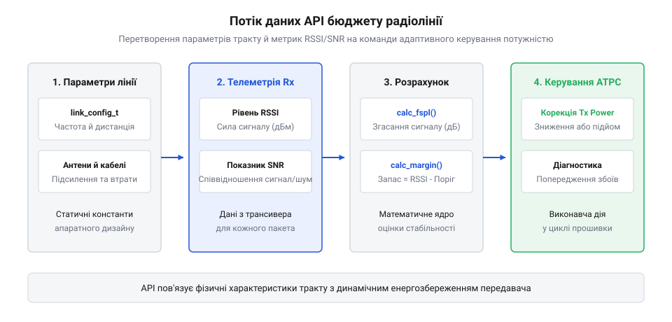

# Чутливість, шум, запас: бюджет лінка як число

## Призначення й архітектура бібліотеки бюджету лінка

У бездротових вбудованих системах зв'язок ніколи не буває абсолютно стабільним: перешкоди рельєфу, погодні умови, розрядження акумулятора та зміна просторової орієнтації пристрою постійно змінюють рівень сигналу на антені приймача. Якщо прошивка працює зі сталими параметрами трансивера «наосліп», розробник неминуче стикається з двома крайнощами: або передавач завжди випромінює на максимальній потужності (швидко виснажуючи батарею та перевантажуючи радіоефір), або за найменшого погіршення умов зв'язок повністю обривається.

Бібліотека бюджету лінка надає програмний інтерфейс (API) для аналітичного моделювання та динамічного моніторингу енергетичного стану радіоканалу. Її призначення — замкнути апаратні вимірювання фізичного рівня (RSSI та SNR) у математичний контур, який дозволяє мікроконтролеру самостійно оцінювати стабільність каналу та адаптивно змінювати параметри радіотракту.

Архітектура бібліотеки побудована за модульним принципом без жорсткої прив'язки до конкретного заліза:

1. **Конфігураційний шар:** містить описи стаціонарних параметрів радіотракту (підсилення антен, кабельні втрати, робоча частота та чутливість приймача). Ці дані задаються один раз під час ініціалізації або завантажуються з енергонезалежної конфігурації пристрою.
2. **Аналітичне ядро:** чисті математичні функції, що розраховують теоретичні втрати у вільному просторі (FSPL) за рівнянням Фріїса та визначають граничну дальність зв'язку.
3. **Діагностичний адаптер:** шар обробки динамічної телеметрії, який приймає фактичні апаратні показники з драйвера радіомодема (наприклад, Semtech SX1262 або TI CC1101) та вираховує поточний запас на завмирання сигналу (англ. *fade margin*).
4. **Модуль адаптивного керування потужністю (ATPC):** алгоритмічний автомат, що на основі розрахованої маржі видає рекомендації драйверу: підвищити потужність передавання для запобігання втраті пакетів або знизити її для заощадження заряду акумулятора.

> 🔧 **Навіщо це.**
> API бюджету лінка дозволяє відійти від емпіричного підбору параметрів і реалізувати в прошивці інтелектуальне керування потужністю передавача (англ. *Adaptive Power Control*), подовжуючи автономну роботу сенсора від батареї у кілька разів.

## Базові структури параметрів радіотракту

Основою програмного інтерфейсу є типізовані структури мови C, що однозначно описують енергетичні складові радіолінії. У радіоінженерії всі розрахунки ведуться у логарифмічних одиницях: децибелах (дБ) для втрат і підсилення та децибел-міліватах (дБм) для абсолютних потужностей. Це дозволяє замінити операції множення та ділення на просте додавання та віднімання цілих чисел або чисел із плаваючою комою.

Основними структурами бібліотеки є:

- link_rf_tx_params_t: параметри передавача. Включає вихідну потужність підсилювача потужності tx_power_dbm (типово від 0 до +22 дБм для IoT), коефіцієнт підсилення передавальної антени antenna_gain_dbi та сумарні втрати у з'єднувальному коаксіальному кабелі та роз'ємах плати cable_loss_db.
- link_rf_rx_params_t: параметри приймальної сторони. Містить коефіцієнт підсилення антени приймача antenna_gain_dbi, втрати у вхідному антенному тракті cable_loss_db та поріг чутливості демодулятора sensitivity_dbm (наприклад, -120 дБм для FSK або -137 дБм для далекобійного LoRa).
- link_channel_config_t: властивості каналу зв'язку. Задає центральну частоту випромінювання freq_mhz (наприклад, 433.0, 868.0 чи 2400.0 МГц) та очікувану або виміряну дистанцію distance_meters.
- link_telemetry_t: динамічні дані, отримані від приймача разом із черговим прийнятим пакетом. Містить виміряний індикатор рівня потужності rssi_dbm (англ. *Received Signal Strength Indicator*) та співвідношення сигнал/шум snr_db.


*Схема потоку даних API: передача параметрів радіолінії та поточних вимірювань RSSI/SNR у розрахункові функції для обчислення маржі та корекції Tx Power.*

У системах на базі молодших мікроконтролерів (зокрема ARM Cortex-M0/M0+, Cortex-M3 або недорогих ядер RISC-V без апаратного блоку роботи з дійсними числами FPU) використання типу `float` або `double` є вкрай небажаним. За відсутності апаратного співпроцесора компілятор змушений підключати програмну бібліотеку емуляції плаваючої коми (`soft-fp`), яка додає від 4 до 12 кілобайтів зайвого коду до прошивки. Кожна базова операція ділення чи множення дійсних чисел займає десятки й сотні тактів процесора замість одного, спричиняючи значні затримки в обробниках переривань і збільшуючи споживання струму батареї.

Для подолання цієї проблеми виробниче API радіобюджету надає паралельний цілочисельний набір структур на основі арифметики з фіксованою крапкою (англ. *fixed-point arithmetic*). Усі логарифмічні величини (дБм, дБ, дБі) зберігаються як стандартні знакові 32-бітні цілі числа `int32_t`, масштабовані у сотих частках децибела (формат centi-dB, де 1 дБ дорівнює 100 цілим одиницям). Наприклад, потужність передавача +14.25 дБм записується цілим числом `1425`, а чутливість приймача -120.5 дБм подається як `-12050`. 

Така роздільна здатність у 0.01 дБ суттєво перевершує фізичну точність вимірювання радіочастотних трактів, де апаратна похибка вимірювання RSSI сучасних трансиверів зазвичай становить від ±1 до ±2 дБ. При цьому розрахунок підсумкового запасу лінії (Fade Margin) зводиться до звичайного цілочисельного додавання та віднімання, що виконується ядрами Cortex-M за один машинний такт інструкціями `ADD` та `SUB`, забезпечуючи максимальну детермінованість часу виконання та компактність коду в енергоефективних автономних маяках.

Використання строго типізованих структур усуває типові помилки під час розробки прошивки, коли інженери випадково додають підсилення антени у лінійних разах до потужності у міліватах. Усі структури даних у бібліотеці передаються у розрахункові функції через константні вказівники, що унеможливлює випадкову модифікацію конфігурації під час виконання фонових задач.

## Розрахункові функції енергетичного бюджету

Математичне ядро API надає набір детермінованих функцій без побічних ефектів (англ. *pure functions*), які не виконують операцій введення-виведення і можуть безпечно викликатися з будь-якого потоку FreeRTOS або навіть з обробників переривань.

Центральною розрахунковою функцією є link_budget_calc_fspl():

```c
double link_budget_calc_fspl(double freq_mhz, double distance_meters);
```

Вона реалізує логарифмічну форму формули Фріїса для поширення у вільному просторі. Для мікроконтролерів без апаратного блоку дій із плаваючою комою (FPU) бібліотека надає цілочисельний еквівалент link_budget_calc_fspl_fp(), що оперує значеннями з фіксованою крапкою у сотих частках децибела.

Наступним рівнем виступає комплексна функція розрахунку очікуваного бюджету:

```c
link_status_t link_budget_evaluate(const link_rf_tx_params_t *tx,
                                   const link_channel_config_t *channel,
                                   const link_rf_rx_params_t *rx,
                                   link_budget_result_t *out_result);
```

Функція обчислює повний енергетичний ланцюг:

    Prx = (Tx_Power + Tx_Antenna_Gain - Tx_Cable_Loss) - FSPL + (Rx_Antenna_Gain - Rx_Cable_Loss)

Отримане значення out_result->prx_dbm порівнюється з чутливістю демодулятора rx->sensitivity_dbm. Різниця між ними утворює теоретичний запас зв'язку:

    Link_Margin = Prx - Sensitivity

Якщо розрахований запас становить менше ніж +10 дБ, функція повертає статус попередження LINK_WARN_LOW_MARGIN, вказуючи, що в реальному середовищі з'єднання буде схильне до частих втрат через завмирання та дифракцію на перешкодах.

Для чіткої індикації стану розрахунку та контролю фізичних обмежень радіоканалу функція повертає перелічуваний тип `link_status_t`. Кожен код однозначно повідомляє прикладну логіку про фізичний стан лінії або характер помилки конфігурації:

| Код повернення | Значення | Опис фізичного стану | Рекомендована дія прошивки |
| :--- | :--- | :--- | :--- |
| `LINK_OK` | 0 | Розрахунок успішний, запас Link Margin ≥ +10 дБ | Дозволити штатну передачу пакетів із поточними параметрами |
| `LINK_WARN_LOW_MARGIN` | 1 | Запас зв'язку граничний (0 дБ ≤ Margin < +10 дБ) | Підняти потужність Tx, знизити бітрейт або збільшити коефіцієнт розширення |
| `LINK_ERR_NO_LINK` | -1 | Сигнал нижчий за чутливість (Margin < 0 дБ) | Заблокувати марне випромінювання в ефір, сповістити користувача про розрив |
| `LINK_ERR_INVALID_PARAM` | -2 | Некоректні параметри (дистанція ≤ 0, нульовий вказівник) | Перевірити конфігурацію, виправити значення перед повторним викликом |
| `LINK_ERR_OUT_OF_BAND` | -3 | Частота виходить за допустимі межі підтримуваного діапазону | Відхилити конфігурацію, повернути частоту до дозволеного діапазону ISM |
| `LINK_ERR_RX_SATURATION` | -4 | Потужність на вході Rx перевищує поріг перевантаження каскаду | Увімкнути вхідний атенюатор або зменшити вихідну потужність Tx Power |

Аналіз кодів повернення дозволяє реалізувати в прошивці адаптивне керування радіотрактом (ADR, англ. *Adaptive Data Rate*). Якщо утиліта повертає `LINK_WARN_LOW_MARGIN`, вбудована система не скидає зв'язок аварійно, а намагається скомпенсувати втрати: збільшує шпаруватість випромінювання, перемикає трансивер на максимальну потужність передавача або переходить на більш стійку модуляцію зі збільшеним часом передачі символу. Якщо ж зафіксовано статус `LINK_ERR_RX_SATURATION` (наприклад, коли два пристрої опинилися впритул один до одного на відстані кількох сантиметрів), система захищає вхідні змішувачі приймача від виходу з ладу, зменшуючи потужність випромінювання до мінімально можливої.

> 🔧 **Навіщо це.**
> Функції аналітичного розрахунку дозволяють прошивці ще до початку передачі визначити, чи достатньо поточної потужності для подолання заданої дистанції, уникаючи спроб передачі в порожнечу.

## Функції діагностики за даними телеметрії

Теоретичний розрахунок дає орієнтир для проектування, але в польових умовах реальний радіоефір живе за своїми законами. Раптовий дощ, мокрий сніг на листі дерев або поява вантажівки в зоні прямої видимості викликають різке завмирання сигналу (англ. *fading*). Щоб контролювати стан каналу в режимі реального часу, бібліотека надає діагностичні функції аналізу фактичної телеметрії.

Коли бездротовий приймач детектує та успішно приймає пакет, апаратний радіотракт вимірює два ключові фізичні показники:
1. RSSI (англ. *Received Signal Strength Indicator*) — сумарна потужність електромагнітного випромінювання в робочій смузі каналу (у дБм).
2. SNR (англ. *Signal-to-Noise Ratio*) — відношення потужності корисного сигналу до рівня фонового шуму та завад (у дБ).

Функція діагностики link_budget_diagnose_packet() приймає ці вимірювання разом із поточною конфігурацією:

```c
link_health_t link_budget_diagnose_packet(const link_telemetry_t *telemetry,
                                          const link_rf_rx_params_t *rx);
```

Вона вираховує поточний фактичний запас зв'язку:

    Actual_Margin = RSSI - Sensitivity

Також аналізується показник SNR. Якщо в протоколах FSK сигнал завжди має бути вищим за рівень шуму (SNR > 0 дБ), то в модуляціях із розширенням спектра (LoRa) зв'язок надійно працює навіть при SNR до -20 дБ. Бібліотека враховує специфіку модуляції: якщо запас опускається нижче порогу аварійного згасання (Fade Margin < 6 дБ) або SNR стрімко деградує протягом останніх кількох пакетів, функція повертає прапорець небезпеки деградації лінії LINK_HEALTH_CRITICAL.

> 🔧 **Навіщо це.**
> Постійний моніторинг фактичної маржі дозволяє виявити початок руйнування лінка заздалегідь — до того, як зв'язок обірветься повністю і пристрій втратить контакт із мережею.

## Приклад інтеграції: алгоритм адаптивного керування потужністю (ATPC)

Найбільш енерговитратною операцією будь-якого бездротового сенсорного вузла є робота передавача (Tx). Наприклад, випромінювання на максимальній потужності +20 дБм споживає струм близько 120 мА, тоді як на потужності +2 дБм споживання падає до 25 мА. Якщо датчик розташований близько до шлюзу і має надлишковий запас зв'язку в +40 дБ, робота на максимумі є марнотратством батареї.

Алгоритм адаптивного автоматичного контролю потужності (англ. *Automatic Transmit Power Control, ATPC*) використовує API бюджету лінка для динамічної корекції передавача:

```c
void app_radio_process_packet(const link_telemetry_t *rx_telem) {
    link_rf_rx_params_t rx_cfg = { .sensitivity_dbm = -125.0 };
    link_health_t health = link_budget_diagnose_packet(rx_telem, &rx_cfg);

    int8_t current_tx_power = radio_driver_get_tx_power();

    if (health.actual_margin_db > 20.0 && current_tx_power > 2) {
        /* Запас надлишковий — знижуємо потужність для економії заряду */
        radio_driver_set_tx_power(current_tx_power - 3);
    } else if (health.actual_margin_db < 10.0 && current_tx_power < 20) {
        /* Запас небезпечно малий — піднімаємо потужність для надійності */
        radio_driver_set_tx_power(current_tx_power + 3);
    }
}
```

Такий адаптивний цикл викликається після кожного сеансу зв'язку при отриманні квитанції підтвердження (ACK). Завдяки цьому пристрій самостійно знаходить оптимальну точку рівноваги між стабільністю каналу та тривалістю життя батареї, збільшуючи термін автономної експлуатації в польових умовах у рази.
