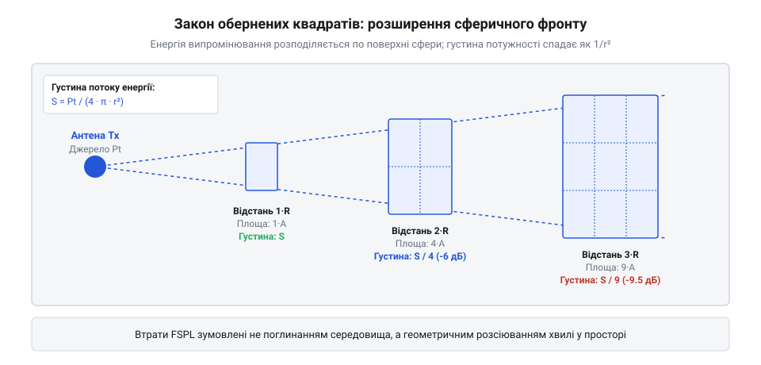

# Чутливість, шум, запас: бюджет лінка як число

## Чому лінійні вати незручні: шкала децибел

У радіотракті потужності передавача та сигналу, що доходить до приймача, відрізняються у мільярди та трильйони разів. Якщо передавач випромінює потужність 0.025 Вт (25 міліватів), то на вході приймача на відстані кількох кілометрів потужність коливається біля 0.0000000000001 Вт (0.1 піковата). Оперувати такими числами у лінійній формі вкрай незручно: довгі ланцюжки нулів після коми ускладнюють інженерні оцінки та провокують грубі помилки в порядках величин.

Більше того, фізичний ланцюг проходження радіохвилі складається з численних множників і дільників: підсилення антени помножує сигнал у 1.6 раза, роз'єм послаблює у 1.12 раза, середовище поширення послаблює в 10 000 000 разів. Щоб замінити трудомістке множення та ділення на швидке додавання й віднімання, радіоінженерія використовує логарифмічну шкалу — децибели (дБ).

Для вираження абсолютного рівня потужності відносно одного мілівата (1 мВт) введено одиницю дБм:

    P [дБм] = 10 · log₁₀(P [мВт] / 1 мВт)

Перетворення працює в обидва боки:

    25 мВт
    = 10 · log₁₀(25)            [за означенням дБм]
    ≈ 10 · 1.398                [обчислення десяткового логарифма]
    ≈ +14 дБм                   [вихідна потужність типового передавача LoRa]

Потужність у 1 міліват відповідає 0 дБм. Потужності, менші за 1 мВт, мають від'ємні значення у дБм: наприклад, 0.001 мВт (1 мікроват) — це -30 дБм, а типова чутливість сучасного трансивера становить -120 дБм (що відповідає 10⁻¹⁵ Вт або 1 фемтовату). Завдяки логарифмічній шкалі будь-яке подвоєння потужності виражається додаванням +3 дБ, а десятикратне зростання — додаванням +10 дБ.

> 🔧 **Навіщо це.**
> Логарифмічна шкала дБм перетворює розрахунок радіоканалу на просту арифметику третього класу: додавання підсилень та віднімання втрат замість роботи з дробами з дванадцятьма нулями.

## Геометрія сферичної хвилі та формула Фріїса

Розглянемо поширення електромагнітної хвилі у вакуумі або чистому повітрі від точкового джерела — ізотропної антени (англ. *isotropic radiator*). Ізотропний випромінювач випромінює потужність передавача P_tx абсолютно рівномірно в усіх напрямках у формі сфери, що безперервно розширюється.

На відстані d від передавача вся випромінена енергія рівномірно розподілена по площі сфери радіуса d, яка дорівнює 4 · π · d². Відповідно, густина потоку потужності S (кількість ватів на квадратний метр) на цій дистанції визначається законом обернених квадратів:

    S = P_tx / (4 · π · d²)

*Сферичне розширення хвильового фронту: спадання густини потужності сигналу зі збільшенням радіуса сфери.*

Антена приймача здатна захопити лише ту енергію хвильового фронту, яка припадає на її ефективну площу розкриву (англ. *effective aperture*) A_rx. В електродинаміці ефективна площа ідеальної антени з коефіцієнтом підсилення G_rx на довжині хвилі λ дорівнює:

    A_rx = (G_rx · λ²) / (4 · π)

Помноживши густину потоку потужності S на ефективну площу антени A_rx, отримуємо прийняту потужність P_rx:

    P_rx
    = S · A_rx                              [означення потужності через густину та площу]
    = (P_tx / (4 · π · d²)) · ((G_rx · λ²) / (4 · π))  [підстановка S та A_rx]
    = P_tx · G_rx · (λ / (4 · π · d))²      [зведення дробів]

Якщо врахувати підсилення передавальної антени G_tx, отримуємо класичне рівняння передачі Фріїса для прийнятої потужності:

    P_rx = P_tx · G_tx · G_rx · (λ / (4 · π · d))²

Співвідношення ((4 · π · d) / λ)² називають втратами у вільному просторі (англ. *Free Space Path Loss, FSPL*). Якщо підставити частоту f = c / λ і перейти до децибел із дистанцією в кілометрах та частотою в мегагерцах, формула набуває компактного інженерного вигляду:

    FSPL [дБ] = 20 · log₁₀(d [км]) + 20 · log₁₀(f [МГц]) + 32.44

## Нижня фізична межа: тепловий шум і поріг чутливості

Чому приймач не може розрізнити нескінченно малий сигнал? Фундаментальною межею виступає тепловий шум Джонсона-Найквіста (англ. *thermal noise*), спричинений хаотичним броунівським рухом електронів у провідниках та вхідних каскадах радіоприймача за температури вище абсолютного нуля.

Спектральна густина потужності теплового шуму N₀ залежить лише від постійної Больцмана k (приблизно 1.38 · 10⁻²³ Дж/К) та термодинамічної температури T у кельвінах:

    N₀ = k · T

За стандартної кімнатної температури T = 290 К (приблизно +17 °C) спектральна густина теплового шуму становить:

    N₀
    = 1.38 · 10⁻²³ · 290        [підстановка значень k та T]
    ≈ 4.00 · 10⁻²¹ Вт/Гц        [лінійне значення густини]
    = -174 дБм/Гц               [логарифмічна шкала відносно 1 мВт]

Повна потужність шуму на вході приймача прямо пропорційна ширині смуги пропускання каналу BW (англ. *bandwidth*):

    P_noise [дБм] = -174 + 10 · log₁₀(BW [Гц])

Крім того, реальні електронні компоненти приймача (підсилювачі LNA, змішувачі) самі генерують додатковий шум, який враховується коефіцієнтом шуму NF (англ. *Noise Figure*, типово від 2 до 6 дБ для інтегральних трансиверів). Щоб надійно демодулювати байти, вхідний сигнал повинен перевищувати шумову підкладку на певне мінімальне відношення сигнал/шум SNR_min, яке диктується обраним типом модуляції.

У підсумку чутливість приймача (англ. *receiver sensitivity, S_rx*) визначається формулою:

    S_rx [дБм] = -174 + 10 · log₁₀(BW [Гц]) + NF [дБ] + SNR_min [дБ]

Звідси випливає найважливіший інженерний висновок: що вужча смуга сигналу BW, то менше теплового шуму потрапляє в тракт і то вища чутливість системи.

> 🔧 **Навіщо це.**
> Зменшення смуги пропускання з 250 кГц до 62.5 кГц покращує чутливість приймача на 6 дБ, що еквівалентно подвоєнню дальності зв'язку за тієї самої потужності передавача.

## Повне рівняння бюджету зв'язку та запас на завмирання

Маючи математичний опис втрат вільного простору та формулу повної потужності шуму, ми зводимо їх у єдине рівняння енергетичного бюджету радіолінії (англ. *Link Budget Equation*).

Рівняння виражає прийняту потужність P_rx у точці демодулятора через баланс випроміненої енергії та всіх проміжних втрат:

    P_rx = P_tx + G_tx - L_tx - FSPL + G_rx - L_rx

Різниця між розрахованим або виміряним рівнем сигналу P_rx та чутливістю приймача S_rx називається запасом на завмирання (англ. *Fade Margin*):

    Fade_Margin = P_rx - S_rx

Розглянемо реальний інженерний розрахунок каналу зв'язку LoRa на частоті 868 МГц на відстані 5 км:
- Потужність передавача P_tx = +14 дБм (25 мВт).
- Антени передавача та приймача: диполі з підсиленням G_tx = +2.15 дБі та G_rx = +2.15 дБі.
- Втрати в роз'ємах і кабелях: L_tx = 0.5 дБ, L_rx = 0.5 дБ.
- Смуга каналу BW = 125 кГц, чутливість за даташитом S_rx = -125 дБм.

Обчислюємо втрати вільного простору:

    FSPL
    = 20 · log₁₀(5) + 20 · log₁₀(868) + 32.44    [формула Фріїса]
    = 20 · 0.699 + 20 · 2.938 + 32.44            [логарифми дистанції та частоти]
    = 13.98 + 58.77 + 32.44
    ≈ 105.19 дБ                                  [сумарні втрати у просторі]

Обчислюємо рівень прийнятого сигналу:

    P_rx
    = 14 + 2.15 - 0.5 - 105.19 + 2.15 - 0.5      [додавання ланцюга дБ]
    = -87.89 дБм                                 [потужність на вході Rx]

Визначаємо фактичний запас зв'язку:

    Fade_Margin
    = -87.89 - (-125.0)                          [різниця з чутливістю]
    = +37.11 дБ                                  [інженерний запас каналу]

Оскільки запас 37 дБ значно перевищує мінімальний рекомендований поріг у 10–15 дБ, лінк на дистанції 5 км у зоні прямої видимості гарантовано працюватиме стабільно навіть за несприятливих погодних умов (дощ, туман) та температурного дрейфу компонентів.

## Межі моделі вільного простору та зона Френеля

Рівняння Фріїса для втрат у вільному просторі (FSPL) є базовою теоретичною моделлю, яка передбачає ідеальне поширення хвилі в абсолютно порожньому просторі без будь-яких перешкод, відбиттів чи поглинання. Проте на практиці радіохвиля поширюється не тонким геометричним променем, а займає значний об'єм довкола прямої лінії між антенами — так звану першу зону Френеля (англ. *first Fresnel zone*).

Перша зона Френеля являє собою витягнутий тривимірний еліпсоїд обертання, у фокусах якого розташовані антена передавача та антена приймача. Радіус цього еліпсоїда досягає максимального значення R_F1 рівно посередині між вузлами зв'язку і розраховується за формулою:

    R_F1 [м] = 0.5 · √( (c / f) · d )

де c — швидкість світла (3 · 10⁸ м/с), f — частота в герцах, а d — відстань у метрах.

Для інженерного розрахунку на частоті 868 МГц на дистанції 5 км:
- Довжина хвилі: λ = 0.345 м.
- Максимальний радіус еліпсоїда Френеля:

    R_F1
    = 0.5 · √(0.345 · 5000)
    = 0.5 · √(1725)
    ≈ 0.5 · 41.53
    ≈ 20.76 м

Щоб формула вільного простору залишалася справедливою, еліпсоїд першої зони Френеля має бути вільним від будь-яких фізичних перешкод щонайменше на 60% свого радіуса (правило 0.6 Fresnel Zone). Якщо верхівки дерев, пагорби або дахи будівель перетинають цей простір, виникає дифракція та деструктивна фазова інтерференція відбитих променів, яка може додатково послабити сигнал на 10–30 дБ понад розраховані втрати FSPL.

Крім того, при розташуванні антен близько до землі (на висоті 1–2 метри) виникає ефект дводзеркального поширення (модель площини землі), де пряма та відбита від землі хвилі приходять у протифазі, змушуючи сигнал спадати пропорційно четвертому степеню відстані (1 / d⁴). Саме тому закладення достатнього запасу на завмирання (Fade Margin не менше 15–20 дБ) та забезпечення достатньої висоти підвісу антен є критичною умовою збереження стабільного радіоканалу в польових умовах.

> 🔧 **Навіщо це.**
> [Розрахунок зони Френеля](root:com-medium/fresnel-zones) показує реальну геометрію радіоканалу: недостатня висота підвісу антени здатна звести нанівець навіть бездоганно розрахований за формулою Фріїса бюджет лінка.
