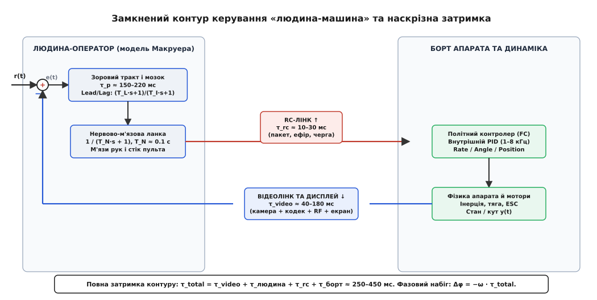
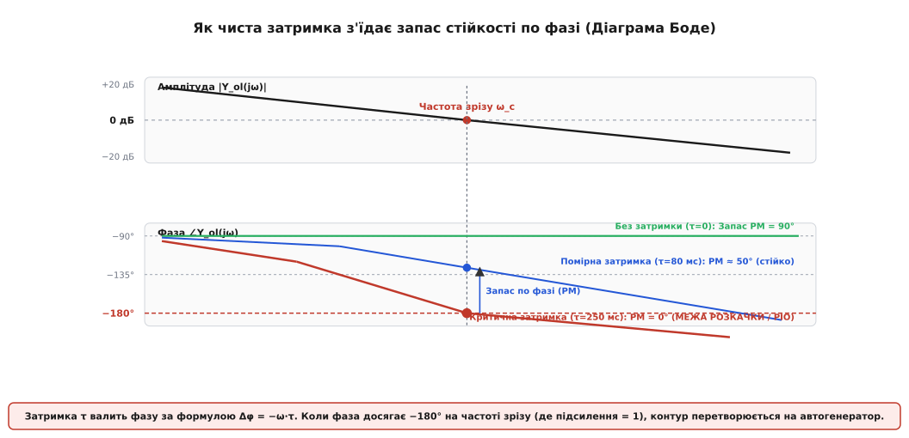
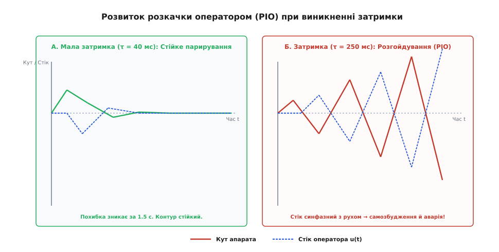
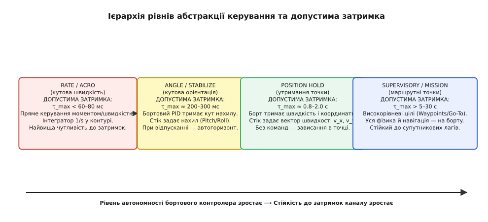

# Людина в контурі: чому затримка руйнує керування — детально

<preknowlist>
- [Телекерування: затримки, відеоканал, втрата лінка](root:embedded/teleoperation-latency) — сумарний бюджет затримки відеотракту, буфера джитера та радіолінка.
- [RC-лінк](root:sys-dron/rc-link) — пакетне керування, частоти оновлення пакетів та радіоінтерфейс.
- [Ручні й самостабілізовані режими](root:sys-dron/manual-stabilized-modes) — відмінність прямого керування кутовою швидкістю (Rate) від стабілізації кута (Angle).
- [Режими з позицією](root:sys-dron/position-modes) — утримання висоти та координат автопілотом.
</preknowlist>

Коли оператор веде швидкісний дрон або колісну платформу через цифровий чи стільниковий відеолінк, раптовий порив вітру відхиляє апарат на 12 градусів від курсу. Подія фіксується сенсором, проходить стиснення в кодеку, долає радіоефір і виводиться на екран пульта через 110 мс. Ще 180 мс витрачає зорово-моторний тракт людини на розпізнавання нахилу та рух великого пальця, а сформований пакет команди летить зворотним радіоканалом ще 20 мс. Доки бортові регулятори обертів змінюють тягу моторів, минає понад 310 мс: за цей час кутова швидкість уже розвернула корпус у протилежний бік. Команда пілота «виправити нахил вліво» приходить рівно тоді, коли апарат сам рухається вліво під дією аеродинаміки. Замість демпфування поштовху керуюче зусилля штовхає дрон ще сильніше. За дві секунди машина входить у некеровану розкачку з наростаючою амплітудою і розбивається об землю.

Це явище не є наслідком недосвідченості пілота чи апаратної несправності моторів. Воно зумовлене фундаментальними законами теорії автоматичного керування: **людина всередині замкненої петлі є динамічною ланкою зі власною передатною функцією**, а чиста затримка каналу зв'язку лінійно з'їдає фазовий запас стійкості, перетворюючи від'ємний зворотний зв'язок на додатний.

## Наскрізний ланцюг затримки: звідки беруться мілісекунди

У системі прямого дистанційного керування (Human-in-the-Loop) сигнал безперервно циркулює замкненим колом. Повна наскрізна затримка контуру `τ_total` складається з чотирьох незалежних фізичних етапів:

```
τ_total = τ_video + τ_human + τ_rc + τ_vehicle
```


*Замкнений контур телекерування: фізіологічний тракт оператора (модель Макруера) послідовно з'єднаний із радіоканалами, політним контролером та відеотрактом. Кожна ланка додає свій внесок у наскрізну затримку τ_total, зміщуючи фазу зворотного зв'язку.*

Розберімо фізичне походження затримки в кожному сегменті контуру:

1. **Відеотракт прямої передачі (`τ_video` = 35–180 мс):**
   - *Експозиція та зчитування матриці:* при зйомці 60 к/с кадрове вікно становить 16.7 мс; у середньому подія чекає половину періоду (8.3 мс), у гіршому випадку — повний кадр.
   - *Апаратне кодування:* компресія H.264/H.265 додає 5–20 мс залежно від розміру групи кадрів (GOP) та наявності B-кадрів.
   - *Транспорт ефіру та буферизація:* пакетизація та проліт радіоканалу займають 4–12 мс у прямих лінках або 30–80 мс у мережах 4G/5G.
   - *Буфер джитера на землі:* вирівнювання нерівномірності надходження пакетів додає ще 10–40 мс сталого очікування.
   - *Декодування GPU та скан-аут дисплея:* розгортання кадру й час реакції РК/OLED панелі займають 8–20 мс.

2. **Фізіологічний тракт оператора (`τ_human` = 200–350 мс):**
   - *Зорова латентність:* фотохімічні процеси в сітківці та передача імпульсу зоровим нервом до первинної зорової кори (V1) займають 40–60 мс.
   - *Когнітивна обробка:* розпізнавання просторової орієнтації, порівняння з бажаною траєкторією та вибір моторної програми в премоторній корі займають 70–120 мс.
   - *Нервова провідність:* проходження сигналу пірамідними шляхами спинного мозку до мотонейронів кисті руки триває 25–40 мс.
   - *Нервово-м'язова інерція:* активація м'язових волокон, подолання тертя суглобів і механічне зміщення стіка пульта займають 60–130 мс.

3. **Командний радіолінк (`τ_rc` = 8–35 мс):**
   - *Опитування АЦП стіка та формування пакету:* 2–5 мс.
   - *Пакетний період передавача:* протокол ExpressLRS (ELRS) на 250 Гц дає затримку 4 мс; Crossfire (CRSF) на 150 Гц — 6.7 мс; класичний SBUS на 50 Гц — 20–22 мс.
   - *Час у повітрі (Airtime) та повтори:* у завадовому середовищі втрачений кадр відкладає виконання команди до наступного слота.

4. **Бортовий контролер та виконавча механіка (`τ_vehicle` = 15–60 мс):**
   - *Декодування UART та цикл автопілота:* 1–3 мс.
   - *Протокол ESC (DShot300/600):* передача уставки на силові ключі регулятора займає 0.5–1 мс.
   - *Електромагнітна та механічна постійна часу мотора:* час наростання крутного моменту безколекторного двигуна та розкрутки пропелера через його момент інерції становить 15–50 мс.

У підсумку навіть на швидкому аналоговому відеолінку (25 мс) з протоколом ELRS 500Hz сумарна затримка контуру рідко опускається нижче 240 мс. На цифрових HD-системах або стільниковому керуванні цей показник становить 320–480 мс.

## Модель оператора Макруера: передатна функція людини

Людина не діє як сталий пропорційний регулятор. У 1957–1965 роках американський інженер Дуейн Макруер (Duane McRuer) провів дослідження динаміки пілотів і довів, що оператор адаптує власні динамічні властивості під керований об'єкт.

Повна квазілінійна передатна функція людини-оператора `Y_p(s)` у задачі стеження описується виразом:

```
Y_p(s) = K_p · [(T_L · s + 1) / (T_I · s + 1)] · exp(-τ_p · s) · [1 / (T_N · s + 1)]
```

Ланка складається з трьох ключових частин:

1. `exp(-τ_p · s)` — **чиста фізіологічна затримка** (`τ_p ≈ 0.15–0.22` с), яка не залежить від волі пілота й визначається швидкістю біохімічних реакцій та провідністю нервових тканин.
2. `1 / (T_N · s + 1)` — **нервово-м'язовий фільтр першого порядку** (`T_N ≈ 0.08–0.12` с), зумовлений в'язкопружними властивостями м'язів передпліччя та пальців.
3. `K_p · (T_L · s + 1) / (T_I · s + 1)` — **адаптивний інтелектуальний блок**, де:
   - `K_p` — коефіцієнт підсилення пілота (наскільки різко людина реагує на помічене відхилення);
   - `T_L` — постійна часу випередження (Lead), здатність мозку прогнозувати розвиток процесу за швидкістю зміни картинки (`T_L ≈ 0–2.5` с);
   - `T_I` — постійна часу інтегрування (Lag), яку людина застосовує для компенсації постійної похибки (`T_I ≈ 0–10` с).

### Закон перетину (Crossover Model Law)

Найважливішим відкриттям Макруера став закон перетину: **якою б складною не була динаміка керованого апарата `Y_c(s)`, людина підсвідомо налаштовує параметри `K_p`, `T_L`, `T_I` так, щоб результуючий розімкнений контур `Y_ol(s) = Y_p(s) · Y_c(s)` в околі частоти зрізу `ω_c` мав вигляд ідеального інтегратора з чистою затримкою**:

```
Y_ol(s) = Y_p(s) · Y_c(s) ≈ (ω_c / s) · exp(-τ_e · s)
```

де `τ_e ≈ τ_p + T_N + τ_link` — повна ефективна затримка розімкненої системи.

Цей закон демонструє ціну керування різними об'єктами:
- Якщо апарат поводиться як чиста кутова швидкість (`Y_c(s) = K / s`, режим Rate), людина працює просто як підсилювач (`T_L = 0, T_I = 0`). Керування дається легко.
- Якщо апарат поводиться як незгасаюче кутове прискорення (`Y_c(s) = K / s^2`, момент без демпфування), об'єкт вносить фазове відставання −180°. Щоб система не втратила стійкість, мозок змушений безперервно вираховувати похідну сигналу й генерувати диференціальну ланку (`T_L > 1` с). Людина відчуває екстремальне розумове навантаження, швидко втомлюється і починає допускати грубі фазові помилки.

Повне математичне виведення закону Макруера, аналіз передатних функцій та апроксимації Паде наведено у вставці [модель перетину Макруера: математичне виведення та фазові межі стійкості](root:embedded/liudyna-v-konturi/math-crossover-model.md).

## Фазовий набіг затримки: як час перетворюється на градуси

Чому саме транспортне запізнення руйнує стійкість системи значно агресивніше за будь-який фізичний фільтр?

Звичайний аналоговий чи цифровий фільтр нижніх частот першого порядку (наприклад, RC-ланцюг або ковзне середнє) при збільшенні частоти послаблює амплітуду сигналу зі швидкістю −20 дБ/декаду, а його фазове відставання асимптотично прямує до фіксованої межі −90°:

```
W_lpf(s) = 1 / (T · s + 1)
|W_lpf(j·ω)| = 1 / sqrt(1 + ω^2 · T^2)                  [амплітуда спадає до 0]
φ_lpf(ω) = -arctan(ω · T)                               [фаза обмежена межею -90°]
```

Чиста транспортна затримка `exp(-s · τ)` поводиться принципово інакше:
1. Вона **не послаблює амплітуду** взагалі: `|exp(-j · ω · τ)| = 1.0` (0 дБ на всіх частотах без винятку). Високочастотні коливання та шуми проходять крізь затримку з повним підсиленням.
2. Вона **необмежено обвалює фазу** пропорційно частоті коливань:

```
Δφ(ω) = -ω · τ                                          [фазовий зсув у радіанах]
Δφ_deg(ω) = -(180 / π) · ω · τ                          [фазовий зсув у градусах]
```


*Діаграма Боде розімкненого контуру: чиста затримка не послаблює амплітуду, але лінійно відбирає фазу Δφ = −ω·τ. Щойно фазове відставання на частоті зрізу ω_c досягає −180° (запас по фазі PM = 0°), від'ємний зворотний зв'язок стає додатним.*

### Запас стійкості по фазі (Phase Margin)

Стійкість замкненого контуру оцінюється запасом по фазі `PM` на частоті зрізу `ω_c` (частоті, де коефіцієнт підсилення розімкненої системи становить 0 дБ, тобто `|Y_ol(j·ω_c)| = 1`).

Запас по фазі показує, скільки градусів фазового відставання відділяє систему від порогу самозбудження −180°:

```
PM = 180° + ∠Y_ol(j·ω_c)
```

Для стійкого контуру без коливальності інженерна норма вимагає `PM ≥ 45°–60°`. Кожна мілісекунда затримки `τ_total` віднімає від цього запасу точну кількість градусів:

```
PM = PM_0 - (180 / π) · ω_c · τ_total
```

### Розрахунок граничної затримки для ровера та дрона

Розгляньмо конкретний практичний приклад:
1. **FPV-дрон у спортивному режимі (Rate):** робоча частота зрізу контуру пілота становить `ω_c = 5.0` рад/с (близько 0.8 Гц). Початковий запас по фазі системи без радіозатримок становить `PM_0 = 65°` (1.134 рад).
   Гранична додаткова затримка каналу до повної втрати стійкості (`PM = 0°`):

```
τ_crit = PM_0 / ω_c = 1.134 / 5.0 = 0.226 с = 226 мс
```

Якщо затримка перевищить 226 мс, дрон фізично неможливо втримати від розгойдування.

2. **Колісний робот на відкритій місцевості:** контур має помірну частоту зрізу `ω_c = 1.5` рад/с (~0.24 Гц), початковий запас `PM_0 = 60°` (1.047 рад).

```
τ_crit = PM_0 / ω_c = 1.047 / 1.5 = 0.698 с = 698 мс
```

Ровер витримує значно більший лаг (до ~700 мс) саме тому, що його робоча частота зрізу втричі нижча.

## Джитер: чому змінний лаг небезпечніший за сталий

У реальних радіоканалах і стільникових мережах затримка ніколи не є постійною величиною. Вона коливається через повторні передачі (ARQ), інтерференцію та перемикання між базовими станціями (Handover). Ця варіація називається **джитером (Jitter)**.

Для людини в контурі джитер у кілька разів небезпечніший за сталий лаг однакової середньої тривалості. Механізм цієї деградації полягає в руйнуванні внутрішньої моделі передбачення оператора:

1. **Руйнування Lead-компенсації:** Коли затримка стала (наприклад, рівно 100 мс), мозок досвідченого пілота адаптує постійну випередження `T_L`, прогнозуючи стан машини на 100 мс вперед. Візуальна картинка зсунута в часі, але її похідна залишається істинною. Коли затримка стрибає між 40 та 160 мс, похідна на екрані спотворюється: об'єкти то «прискорюються», то «застигають». Диференціатор оператора `T_L · s` починає множити випадковий джиттерний шум, генеруючи хаотичні ривки стіка.
2. **Парадокс буфера джитера:** Щоб картинка не смикалася, приймач змушений встановлювати буфер джитера. Але буфер перетворює випадковий розкид на **постійний максимальний лаг найгіршого випадку**. Тобто заради плавності відеопотоку інженер власноруч додає до фазового бюджету 30–60 мс постійного запізнення.

## Нелінійність пульта: експоненти (Expo) та зміна підсилення

Налаштування відгуку стіків пульта (криві Expo та SuperRate) безпосередньо впливають на динамічну стійкість замкненого контуру.

Експонента апроксимує команду стіка степеневою функцією:

```
u_cmd(x) = (1 - k_expo) · x + k_expo · x^3
```

де `x` — відхилення стіка від 0 до 1.0.

Диференціал цього відгуку визначає локальний коефіцієнт підсилення:

```
du_cmd / dx = (1 - k_expo) + 3 · k_expo · x^2
```

1. **Біля центру стіка (`x ≈ 0`):** коефіцієнт підсилення знижується до `1 - k_expo`. Це штучно зменшує частоту зрізу контуру `ω_c`, розширюючи запас по фазі `PM`. Біля центру дрон прощає помірну затримку відеолінка й поводиться стійко.
2. **На краю діапазону (`x ≈ 1`):** коефіцієнт підсилення підскакує до `1 + 2 · k_expo` (при `k_expo = 0.6` підсилення зростає у 2.2 раза порівняно з лінійним). Це миттєво підкидає частоту зрізу `ω_c` у високу зону. Якщо пілот під час маневру різко відхиляє стік убік, фазове відставання стрибкоподібно зростає, провокуючи миттєвий зрив у розкачку PIO Category II.

## Анатомія розкачки оператором (Pilot-Induced Oscillations / PIO)

Що відбувається на фізичному рівні, коли сумарне фазове відставання розімкненого контуру сягає −180°?

У класичній системі зворотний зв'язок є **від'ємним**: у суматорі сигнал датчика віднімається від бажаної уставки `e(t) = r(t) - y(t)`. Знак «мінус» за визначенням еквівалентний фазовому зсуву на −180° (`exp(-j·π) = -1`).

Коли фазовий набіг затримки `Δφ = -ω · τ` додає ще −180° відставання, сумарний фазовий зсув сигналу по колу становить:

```
φ_loop = -180° + (-180°) = -360° ≡ 0°
```

У цей момент **від'ємний зворотний зв'язок стає додатним зворотним зв'язком (Positive Feedback)**. Помилка не компенсується, а посилюється:
- Корпус апарата починає нахилятися вправо під дією зовнішнього моменту.
- Пілот бачить цей нахил із запізненням рівно на півперіоду коливання.
- Команда стіком «вліво» надходить на виконавчі мотори в той момент, коли апарат під дією власної пружності та аеродинаміки вже завершив нахил і сам прямує вліво.
- Мотори штовхають корпус у тому самому напрямку, куди він і так рухається, додаючи кінетичної енергії.
- На зворотному ході процес дзеркально повторюється з ще більшим розмахом.


*Часова форма відгуку системи: при малій затримці дія оператора демпфує збурення за 1.5 с; при критичній затримці стік оператора запізнюється на півперіоду (фаза 180°), підкачуючи енергію в автоколивання з наростанням амплітуди.*

### Психофізіологічна пастка оператора (The Pilot Gain Trap)

У момент початку розкачки спрацьовує небезпечний біологічний рефлекс. Людина бачить, що апарат розгойдується, і лякається втрати контролю. Природна реакція мозку на зростання похибки — **збільшити зусилля та спробувати зреагувати швидше**:
1. Пілот інстинктивно збільшує свій коефіцієнт підсилення `K_p` (сильніше відхиляє стіки).
2. Збільшення `K_p` піднімає амплітудну характеристику розімкненого контуру вгору.
3. Точка перетину 0 дБ зміщується в область вищих частот: частота зрізу `ω_c` зростає (наприклад, з 3 до 7 рад/с).
4. Оскільки фазове відставання прямо пропорційне частоті (`Δφ = -ω · τ`), зростання `ω_c` викликає ще глибший обвал фази далеко за −180°.
5. Фазовий запас стає глибоко від'ємним (`PM < -40°`), а система переходить від гармонічних коливань до експоненціально вибухової нестійкості.

Єдиний спосіб розірвати це замкнене коло для пілота — зробити дію, яка суперечить базовим інстинктам: **повністю відпустити стіки керування («розімкнути петлю»)** або миттєво зменшити зусилля.

Про те, як цей ефект ламав надзвукові винищувачі та космічний човник Enterprise, читайте у вставці [історія виявлення розкачки оператором від шатла Enterprise до винищувачів Gripen та YF-22](root:embedded/liudyna-v-konturi/hist-pio.md).

## Діагностика PIO у польотних логах (Blackbox / ULog)

Як інженеру відрізнити апаратну вібрацію чи неправильні коефіцієнти бортового PID-регулятора від розкачки оператором під час аналізу телеметрії?

У логах польотного контролера (Betaflight Blackbox, PX4 ULog або ArduPilot DataFlash) розкачка PIO має чіткий спектральний та фазовий підпис:

1. **Частотний діапазон:** Високочастотні вібрації мотора та флаттер пропелерів лежать у діапазоні 50–250 Гц. Помилки налаштування бортового D-терма дають осциляції на 15–40 Гц. **Розкачка оператором завжди розвивається на низьких частотах 0.5–2.5 Гц** (оскільки частота зрізу людського контуру обмежена фізіологією).
2. **Взаємна кореляція стіка та гіроскопа:** Якщо побудувати графік уставки `rcCommand` (або `setpoint`) поруч із показниками гіроскопа `gyro_raw`, видно, що стік рухається в суворій протифазі до кутової швидкості. Коли `gyro` досягає піку, пілот тисне стік у протилежний край із запізненням у 200–300 мс.
3. **Зростання інтегральної складової (I-term windup):** Під час неперервної перекладки стіка інтегратор бортового PID накопичує помилку, намагаючись подолати фазовий зсув, що призводить до завалу лімітів моторів (Motor Saturation).

## Архітектурні механізми компенсації: зміна рівня абстракції

Збільшення затримки зв'язку неможливо подолати простим тренуванням оператора. Якщо наскрізний лаг каналу зростає, єдиним надійним інженерним рішенням є **перенесення швидких контурів стабілізації безпосередньо на борт апарата** та зміна рівня абстракції інтерфейсу керування.


*Ієрархія рівнів абстракції керування: перенесення швидких динамічних контурів на бортовий мікроконтролер підвищує допустиму затримку зовнішнього каналу зв'язку від мілісекунд до десятків секунд.*

### 1. Рівень Rate / Acro (кутова швидкість)
- **Суть:** Стік пульта задає бажану швидкість обертання навколо осей (град/с) або безпосередній крутний момент. Бортовий автопілот лише відпрацьовує гіроскопічний PID.
- **Динаміка для оператора:** Об'єкт є інтегратором `1/s`. Положення стіка 0 означає «зберігати поточний кут», а не повертатися в горизонт.
- **Допустима затримка:** `τ_total < 60–80 мс`.
- **Область застосування:** Спортивні FPV-дрони на прямих аналогових або низьколатентних цифрових лінках (HDZero, Walksnail у режимі Low Latency).

### 2. Рівень Angle / Self-Leveling (кутова орієнтація)
- **Суть:** Внутрішній швидкий контур стабілізації на мікроконтролері (1–8 кГц) безперервно опитує гіроскопи та акселерометри, самостійно утримуючи кути крену й тангажу (Roll/Pitch).
- **Динаміка для оператора:** Для пілота апарат стає аперіодичною ланкою першого порядку `1 / (T·s + 1)`. Стік задає безпосередньо кут нахилу. Якщо відпустити стік у центр — апарат сам автоматично повертається в строгий горизонт.
- **Допустима затримка:** `τ_total ≈ 200–350 мс`.
- **Область застосування:** Візуальне обстеження, польоти з цифровим відеозв'язком, керування квадрокоптерами початкового рівня.

### 3. Рівень Position Hold / Loiter (вектор швидкості та координати)
- **Суть:** Бортовий комп'ютер замикає контури орієнтації, лінійної швидкості та просторових координат на основі GNSS, оптичного потоку (Optical Flow) та барометра/лідара.
- **Динаміка для оператора:** Стік задає вектор лінійної швидкості переміщення `v_x, v_y, v_z` (м/с). При відпусканні стіка дрон самостійно гальмує і зависає в точці, компенсуючи вітрові збурення.
- **Допустима затримка:** `τ_total ≈ 800–2500 мс`.
- **Область застосування:** Наземні розвідувальні роботи, промислові дрони, керування через інтернет та мобільні мережі 4G/LTE.

### 4. Супервізорне керування (Supervisory Control / Waypoints)
- **Суть:** Людина повністю виводиться з неперервної динамічної петлі. Оператор ставить дискретні навігаційні цілі (вказати точку на карті, задати сектор патрулювання), а вся траєкторія, обхід перешкод та стабілізація розраховуються автономним бортовим стеком (ROS / PX4 / ArduPilot).
- **Допустима затримка:** `τ_total > 5–60 с` (будь-яка, аж до супутникових каналів Starlink або Iridium).

## Сучасні алгоритми пригнічення PIO у прошивках

Сучасні автопілоти містять вбудовані алгоритми автоматичного захисту від розхитування оператором:

1. **Slew Rate Limiting (обмеження швидкості наростання уставки):** Алгоритм обмежує максимальну похідну команди `d(setpoint)/dt`. Навіть якщо оператор у паніці миттєво перекидає стік з краю в край за 50 мс, бортовий контролер згладжує фронт команди до фізично допустимої швидкості розгону машини, запобігаючи насиченню моторів.
2. **Динамічне демпфування стіка (Stick Dynamic Damping):** Бортовий фільтр відстежує автокореляцію вхідного сигналу керування. Якщо виявляється синусоїдальний сигнал на частоті 1–2 Гц, чутливість пульта тимчасово знижується на 40–60%, примусово зменшуючи коефіцієнт підсилення контуру `K_p` і повертаючи фазовий запас.
3. **Предиктивний екранний маркер (Lead-Ahead HUD Display):** Наземна станція на основі останньої відомої швидкості та прискорення розраховує прогнозну точку положення машини `y_pred(t) = y(t) + τ_total · v(t)` і малює на відеопотоці штучний приціл. Пілот керує не запізнілим зображенням реальності, а передбаченим майбутнім станом, що математично компенсує фазовий набіг затримки.

## Математична симуляція динаміки контуру на C та C++

Розгляньмо програмну реалізацію дискретної симуляції замкненого контуру «людина-оператор-система». Модель містить:
1. Модель оператора Макруера з фізіологічною затримкою, нервово-м'язовою ланкою та адаптивним підсиленням.
2. Чергу чистої затримки радіоканалу та відеотракту (Ring Buffer).
3. Фізичну динаміку апарата другого порядку (інерція, момент, демпфування).
4. Перемикач режимів керування (Rate проти Angle).

Симуляція наочно демонструє, як збільшення затримки в режимі Rate провокує виникнення незгасаючої розкачки (PIO), та як перемикання в режим Angle повертає системі стійкість.

:::tabs
@tab c
:::code liudyna-v-konturi-d/c/main.c
@tab cpp
:::code liudyna-v-konturi-d/cpp/main.cpp
:::

## Інженерний чеклист проектування системи телекерування

Перед випробуванням безпілотного апарата чи робота в реальних умовах розробник зобов'язаний звірити параметри контуру за чотирма інженерними критеріями:

1. **Бюджет затримки каналу зв'язку:**
   - Наскрізний лаг «скло-до-скла» плюс «стік-до-мотора» не повинен перевищувати розрахункового значення `τ_max = PM_0 / ω_c`.
   - Для прямого керування кутовою швидкістю (Rate/Acro) затримка не має перевищувати 80 мс. Якщо затримка більша — режим Rate має бути програмно заблокований у прошивці.
2. **Наявність бортового внутрішнього контуру стабілізації:**
   - При зростанні затримки понад 100 мс система зобов'язана автоматично перемикатися в режим стабілізації кута (Angle) або утримання позиції (Position Hold).
   - Внутрішній контур автопілота мусить працювати на локальних гіроскопах із частотою не менше 1000 Гц, ізолюючи швидку динаміку апарата від затримок радіоефіру.
3. **Захист від насичення швидкості приводів (Rate Limiting):**
   - Максимальна швидкість перекладки сервоприводів або наростання обертів моторів повинна перевищувати максимальну швидкість рухів стіка оператора.
   - У контур формування команд слід додавати Slew Rate Limiter (обмежувач крутизни наростання) та експоненційні криві (Expo), які зрізають різкі панічні ривки людини.
4. **Протокол поведінки при виникненні PIO:**
   - Якщо бортовий автопілот фіксує гармонічні коливання стіка в діапазоні 0.5–2.0 Гц з наростаючою амплітудою, слід застосовувати програмне демпфування чутливості стіка (PIO suppression) або ініціювати плавний перехід у режим автономного зависання (Brake / Loiter).
