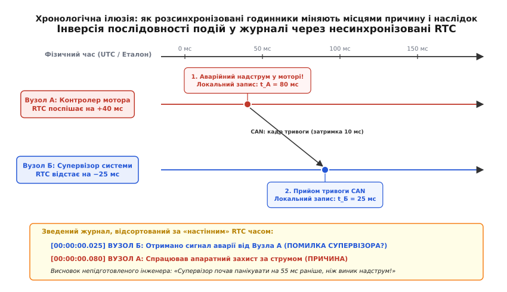
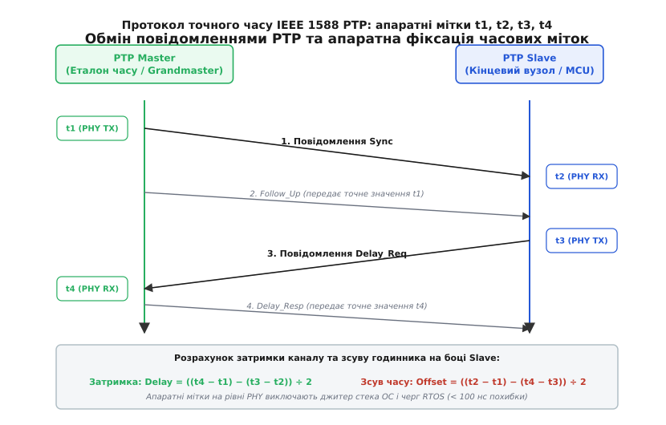
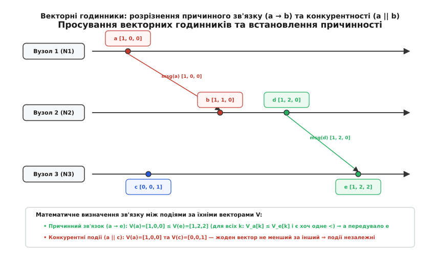
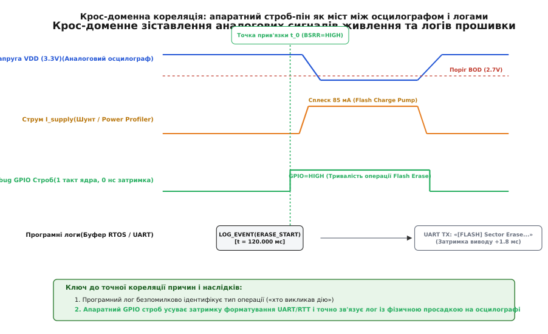

# Кореляція сигналів у журналі: як відрізнити причину від наслідку

<preknowlist>
- [Монотонний проти настінного часу](root:sf-apps/monotonic-vs-wall-time) — чому астрономічний час стрибає та дрейфує, і чому інтервали вимірюють монотонним таймером.
- [Просадка під навантаженням](root:hw-power/battery-sag) — імпеданс джерела живлення, динамічне падіння напруги при вмиканні навантажень та пороги спрацьовування BOD.
- [Побачити 200 мікросекунд, що вбивають пристрій](root:embedded/pobachyty-200-mikrosekund-shcho-vbyvaiut-prystrii) — використання цифрових осцилографів і логічних аналізаторів для фіксації швидких перехідних процесів.
- [Тестування відмовостійкості: fault injection](root:embedded/fault-injection-testing) — ланцюг «несправність → помилка → відмова» та реакція системи на критичні збої.
- [Кварцові генератори та дрейф частоти](root:embedded/tcxo-ocxo) — стабільність резонаторів (PPM), вплив температури на тактування мікроконтролера.
</preknowlist>

Коли автономний дрон, промисловий робот або бортовий контролер електромобіля раптово перезавантажується під час маневру чи аварійно вимикає приводи на випробувальному стенді, інженер насамперед витягує збережений енергонезалежний журнал подій і намагається скласти хронологію катастрофи. Перед очима постає зведена стрічка повідомлень від різних підсистем: плати керування моторами, навігаційного модуля, радіоканалу та центрального супервізора. І в цій стрічці майже завжди ховається пастка, здатна спрямувати розслідування хибним шляхом: наслідок аварії за часовими мітками виглядає так, ніби він стався **раніше** за саму першопричину.

Супервізор записує в лог аварійне вимкнення о `14:00:00.025`, а силова плата фіксує перегрів силових ключів і струмове відсікання о `14:00:00.080`. Перший висновок здається очевидним: прошивка супервізора здуріла й видала команду на аварійну зупинку на 55 мілісекунд раніше, ніж силовий каскад вийшов за межі робочого режиму. Програмісти витрачають тижні на пошук примарних дефектів у логіці кінцевого автомата, хоча насправді апаратний надструм стався першим: просто локальний годинник мікроконтролера мотора поспішав на 40 мілісекунд, а годинник супервізора відставав на 25 мілісекунд.

Ця ілюзія виникає через розрив між двома фізичними сутностями: **астрономічним часом настінних годинників**, який на кожній платі плине з власною похибкою, та **причинно-наслідковим зв'язком подій** (лат. *causa* — причина), який визначається реальними фізичними процесами й передачею сигналів. Щоб знайти справжнього винуватця збою, необхідно вміти вирішувати два взаємопов'язаних завдання: прецизійно синхронізувати часові шкали розподілених вузлів та корелювати (лат. *correlatio* — взаємне співвідношення) високорівневі програмні записи логів із реальними електричними перехідними процесами в колах живлення та цифрових шинах.

## Проблема розділеного часу в польових розподілених системах

У будь-якій вбудованій системі, що складається з двох або більше мікроконтролерів, не існує природного «єдиного часу». Кожен чип живе за власним опорним тактовим генератором: внутрішнім RC-ланцюгом, недорогим кварцовим резонатором або мікросхемою RTC (англ. *Real-Time Clock*).

Кварцовий резонатор частотою 32.768 кГц, який типово підключають до модуля RTC, має паспортну точність порядку `±20 ppm` (англ. *parts per million* — частин на мільйон). Похибка у 20 ppm означає, що за одну добу годинник може втекти на:

```
Δt = 24 · 3600 · (20 · 10⁻⁶) = 1.728 секунди
```

Якщо в системі працюють два вузли, один із яких має похибку `+20 ppm`, а сусідній `−20 ppm`, їхня взаємна розбіжність зростає зі швидкістю приблизно `3.45` секунди на добу, або `40` мікросекунд щосекунди. За кілька годин автономної роботи в польових умовах без підключення до глобальної мережі та серверів часу два сусідні контролери на одній платі або в одному кабельному джгуті CAN розходяться на сотні мілісекунд.

Ситуацію додатково загострює температура навколишнього середовища. Стандартні годинникові кварци камертонного типу мають параболічну температурну залежність частоти з вершиною біля +25 °C: за температури +60 °C або −20 °C їхній дрейф (англ. *drift* — відхилення частоти) збільшується до `−150...−200 ppm`. Якщо один мікроконтролер встановлено поруч із нагрітими силовими ключами або двигуном, а інший — у захищеному термостатованому відсіку сенсорів, темп ходу їхніх годинників відрізнятиметься в рази.


*Хронологічна аномалія в несинхронізованій системі. Справжня першопричина — надструм у моторі на Вузлі А (t_phys = 40 мс). Вузол А надсилає тривожний кадр шиною CAN Вузлу Б, який приймає його на 50-й мілісекунді. Через розбіжність локальних годинників (+40 мс на вузлі А і −25 мс на вузлі Б) у зведеному лозі запис супервізора опиняється попереду запису мотора на 55 мс, створюючи хибну ілюзію помилки алгоритму.*

Спроба розв'язати проблему за допомогою стандартних мережевих протоколів на кшталт SNTP (англ. *Simple Network Time Protocol*) у польових вбудованих пристроях наштовхується на три непереборні перешкоди:

1. **Джитер мережевого стека** (англ. *jitter* — тремтіння затримки): проходження пакета крізь буфери RTOS, черги драйверів і затримки в трансиверах вносить випадкову невизначеність від 1 до 50 мілісекунд.
2. **Асиметрія ліній зв'язку**: час передачі пакета від сервера до клієнта часто не дорівнює часу зворотного шляху через різний пріоритет черг і повторні відправки.
3. **Стрибки часу** (англ. *step adjustments*): коли служба часу NTP виявляє велику розбіжність, вона може миттєво переставити локальний годинник на 200 мс уперед або назад. Для вимірювання інтервалів та впорядкування подій стрибок часу назад є катастрофою: різниця між фінальною та початковою мітками стає від'ємною величиною.

> 🔧 **Навіщо це.** Якщо ви аналізуєте збій за журналами декількох плат, ви не маєте права сліпо довіряти календарним міткам на кшталт `YYYY-MM-DD HH:MM:SS.mmm`. Будь-який розбір починається з запитання: яким протоколом синхронізувалися шкали цих плат, яка гарантована похибка їхньої прив'язки і чи існує апаратне підтвердження причинності?

## Протоколи прецизійної синхронізації часу

Щоб звести розбіжність між журналами різних вузлів до часток мікросекунди, застосовують протоколи та апаратні сигнали високої точності. Вибір методу залежить від топології системи та доступних фізичних інтерфейсів.

### Імпульс GNSS 1PPS: абсолютний еталон

Для систем, що працюють на відкритому просторі (дрони, польові сенсорні станції, автономна техніка), еталоном слугує сигнал **1PPS** (англ. *Pulse Per Second*) від супутникового приймача GNSS (GPS, Galileo, BeiDou).

Приймач формує апаратний логічний імпульс тривалістю 100–200 мс рівно на початку кожної секунди за шкалою UTC. Похибка переднього фронту цього імпульсу відносно світового атомного еталона не перевищує `10–25 наносекунд`.

Мікроконтролер підключає лінію 1PPS до таймера з модулем захоплення входу (англ. *input capture*):
- Передній фронт імпульсу апаратно копіює поточне значення лічильника вільнобіжного таймера (наприклад, 32-бітного `TIM2` на STM32, що тактується від 100 МГц) у регістр `CCR1`.
- Прошивка обчислює точну кількість тактів між сусідніми імпульсами 1PPS (наприклад, `100 003 420` тактів замість номінальних `100 000 000`).
- Ця різниця дає миттєве значення похибки частоти локального кварцового резонатора: `+34.2 ppm`.
- Програмний цифровий фільтр (часто ПІ-регулятор) коригує віртуальну шкалу часу мікроконтролера, зводячи фазову й частотну похибку майже до нуля.

### IEEE 1588 PTP: субмікросекундна точність у мережах Ethernet

Коли вузли об'єднані дротовим Ethernet, золотим стандартом є протокол **PTP** (англ. *Precision Time Protocol*, стандарт IEEE 1588-2008 / IEEE 1588-2019). На відміну від NTP, PTP покладається на **апаратне штампування міток часу** (англ. *hardware timestamping*) на рівні фізичного контролера PHY або MAC.

У мить, коли перший байт спеціального SFD-поля кадру Ethernet перетинає інтерфейс MII/RMII, апаратний лічильник PHY-контролера робить знімок часу з роздільною здатністю 8–10 нс. Це повністю усуває затримки обробки переривань, перемикання контексту RTOS і черг у пам'яті.


*Процедура вимірювання затримки та зсуву в протоколі IEEE 1588 PTP. Апаратні мітки t1, t2, t3, t4 фіксуються на межі середовища передачі PHY, повністю ізолюючи вимірювання від програмних затримок операційної системи.*

Алгоритм обчислює параметри за чотирма апаратними мітками:
1. Майстер-вузол (англ. *Grandmaster*) надсилає повідомлення `Sync` і апаратно фіксує мітку відправлення `t1`.
2. Слейв-вузол приймає `Sync` і апаратно фіксує мітку прийому `t2`. Точне значення `t1` передається слейву у наступному повідомленні `Follow_Up`.
3. Слейв надсилає запит затримки `Delay_Req`, фіксуючи мітку виходу `t3`.
4. Майстер приймає `Delay_Req`, фіксує мітку входу `t4` і надсилає її значення слейву в повідомленні `Delay_Resp`.

Припускаючи симетрію лінії зв'язку, слейв розраховує односторонню затримку каналу (англ. *Mean Path Delay*) та зсув власного годинника (англ. *Clock Offset*):

```
Delay  = ((t4 − t1) − (t3 − t2)) ÷ 2      [затримка в каналі]
Offset = ((t2 − t1) − (t4 − t3)) ÷ 2      [зсув годинника слейва відносно майстра]
```

### Синхронізація на шині CAN: Master Sync Frame

У автомобільних та промислових пристроях без Ethernet вузли зазвичай об'єднані шиною CAN (англ. *Controller Area Network*). У CAN усі вузли підключені до спільної крученої пари й чують кожен біт одночасно з точністю до затримки поширення електромагнітної хвилі в міді (~5 нс на метр).

Для синхронізації призначають провідний вузол (Майстер), який періодично (наприклад, кожні 50 мс) транслює широкомовний кадр синхронізації з найвищим пріоритетом (найменший CAN ID, наприклад `0x000` або `0x080` у CANopen SYNC).

Усі мікроконтролери налаштовують переривання за лінією CAN RX або використовують апаратну функцію захоплення таймера від спадного фронту біта **SOF** (англ. *Start of Frame* — перший домінантний біт кадру):
- У мить SOF кожен слейв фіксує свій локальний високошвидкісний таймер (наприклад, 1 МГц, крок 1 мкс).
- Корисне навантаження кадру містить глобальний лічильник часу майстра на мить генерації цього SOF.
- Слейв обчислює локальну похибку й плавно підтягує свій таймер методом *slewing* (плавне прискорення або уповільнення лічби без стрибків назад).

### Цифровий сервопривід часу (Clock Discipline PI-Loop)

Отримавши значення зсуву `Offset` із мережі (PTP чи CAN), не можна просто додати його до поточного лічильника: це створить штучний стрибок швидкості й може поламати алгоритми керування рухом або розрахунок похідних у фільтрі Калмана.

Замість стрибка застосовують цифровий **ПІ-регулятор дисциплінування часу** (англ. *Clock Discipline Engine*), який плавно підлаштовує частоту лічби локального таймера:

```
e[k] = Offset[k]                           [миттєва фазова похибка]
I[k] = I[k-1] + K_i · e[k] · Δt           [інтегральна похибка частоти]
u[k] = K_p · e[k] + I[k]                  [керівна поправка частоти]
```

Поправка `u[k]` подається або в апаратний регістр підстроювання тактової частоти RTC/PTP, або додається як масштабуючий коефіцієнт у функції читання монотонного часу `monotonic_now_ns()`. Це забезпечує плавний монотонний плин часу без розривів і стрибків назад.

## Логічний час Лампорта та встановлення причинності

Що робити, якщо фізичні годинники неможливо синхронізувати з субмікросекундною точністю (наприклад, у бездротовій мережі з високим джиттером або при періодичній втраті зв'язку)? Як у такому разі за журналами гарантовано відрізнити причину від наслідку?

Відповідь дає математична теорія розподілених систем, сформульована американським ученим Леслі Лампортом у 1978 році. Глибоку історію про те, [як спеціальна теорія відносності народила логічний час у розподілених системах](root:embedded/log-signal-correlation/hist-lamport-causality.md), корисно знати кожному інженеру: Лампорт показав, що фізичний астрономічний час не є фундаментальним для визначення порядку. Фундаментальним є **інформаційний обмін**.

### Відношення передування (Happens-Before)

Лампорт увів відношення часткового порядку, що позначається стрілкою `a → b` (читається «подія `a` передувала події `b`»):

1. Якщо події `a` та `b` відбулися на одному мікроконтролері і `a` сталася раніше за `b`, то `a → b`.
2. Якщо подія `a` — це надсилання повідомлення вузлом, а `b` — отримання цього самого повідомлення іншим вузлом, то `a → b`.
3. Якщо `a → b` і `b → c`, то `a → c` (властивість транзитивності).

Якщо для пари подій `x` і `y` не виконується ані `x → y`, ані `y → x`, такі події називаються **конкурентними** або незалежними (позначається `x || y`). Вони сталися без жодного причинного зв'язку між собою.

### Векторні годинники (Vector Clocks)

Скалярний логічний годинник Лампорта гарантує лише те, що коли `a → b`, то числова мітка `L(a) < L(b)`. Проте зворотне не діє: менше число не доводить причинного зв'язку.

Повний ізоморфізм причинності забезпечують **векторні годинники**, запропоновані Коліном Фіджем та Фрідеманом Маттерном. Нехай у системі є `N` вузлів. Кожен вузол `i` зберігає вектор із `N` цілих чисел `V[1..N]`.


*Просування векторних годинників у системі з трьох вузлів. Подія 'a' на Вузлі 1 має вектор [1,0,0], який передається з повідомленнями й досягає події 'e' на Вузлі 3 з вектором [1,2,2]. Оскільки V(a) <= V(e), подія 'a' гарантовано передувала 'e'. Навпаки, події 'a' [1,0,0] та 'c' [0,0,1] є конкурентними (a || c), оскільки жоден вектор не є меншим за інший.*

**Правила оновлення векторного годинника:**
1. Перед генерацією локальної події вузол `i` збільшує власний елемент: `V[i] = V[i] + 1`.
2. Надсилаючи повідомлення шиною (CAN, SPI, UART), вузол додає весь свій поточний вектор `V` у службовий заголовок пакета.
3. Приймаючи повідомлення з вектором `V_msg`, вузол `i` покомпонентно об'єднує вектори:
   `V[k] = max(V[k], V_msg[k])` для всіх `k від 1 до N`, після чого інкрементує власний індекс: `V[i] = V[i] + 1`.

**Математичне порівняння двох подій у лозі:**
Подія з вектором `V_A` причинно передувала події з вектором `V_B` (`A → B`) тоді й тільки тоді, коли:

```
(∀ k: V_A[k] ≤ V_B[k])  ТА  (∃ k: V_A[k] < V_B[k])
```

Якщо ця умова не виконується в жоден бік, аналізатор логів безпомилково видає вердикт: **події A і B відбулися незалежно**. Ніякий дрейф фізичних RTC-годинників не здатен обдурити векторний логічний аналізатор.

### Гібридні логічні годинники (HLC)

Для телеметрії польових пристроїв векторні годинники мають один практичний недолік: масив `[142, 89, 210]` важко читати людині, якій потрібно знати приблизний час доби.

Сучасні вбудовані архітектури дедалі частіше використовують **гібридні логічні годинники** (англ. *Hybrid Logical Clocks*, HLC), розроблені С. Кулкарні та колегами. HLC поєднує фізичний монотонний час із логічним лічильником Лампорта в єдину структуру:

```
HLC = { l: uint64_t, c: uint32_t }
```

де `l` — це фізичний час (наприклад, мілісекунди від старту), що ніколи не відстає від локального таймера, а `c` — логічний лічильник подій усередині однієї мілісекунди. HLC гарантує дві фундаментальні речі одночасно:
1. Якщо `a → b`, то `HLC(a) < HLC(b)` у лексикографічному порядку `(l, c)`.
2. Фізична складова `l` завжди тримається на відстані не більше за `ε` від справжнього фізичного часу (`|l − phys| ≤ ε`), де `ε` — максимальна похибка протоколу синхронізації.

## Методи кореляції аналогових сигналів із програмними подіями

Векторні логи вирішують проблему зв'язку між різними програмами. Але найважчі відмови у вбудованих системах лежать на межі між **програмою** та **фізикою заліза**:
- Виклик функції стирання Flash-пам'яті вмикає внутрішній помповий перетворювач напруги (англ. *charge pump*), що викликає імпульсний стрибок струму споживання до 80–100 мА.
- Стрибок струму на тонких доріжках друкованої плати або під час розрядженого акумулятора спричиняє просадку напруги `VDD` нижче порогу вбудованого детектора Brown-Out Reset (BOD, наприклад 2.7 В).
- Мікроконтролер миттєво падає в апаратне скидання, не встигнувши скинути буфер UART на диск.

Коли інженер підключає осцилограф до шини живлення й дивиться на лог через термінал, виникає новий розрив: між моментом, коли прошивка записала `LOG_INFO("Erase start")`, і моментом, коли байти з'явилися на екрані комп'ютера, минає `1.5–5 мілісекунд` через затримку буферизації UART/RTOS. На екрані осцилографа просадка живлення виглядає так, ніби вона сталася **до** запису в лог!


*Крос-доменне зіставлення програмних і фізичних сигналів. Апаратний Debug GPIO строб перемикається за 1 машинний такт безпосередньо перед викликом критичної операції. Осцилограф реєструє передній фронт строба, точно прив'язуючи момент виклику функції прошивки до сплеску струму й просадки шини VDD, усуваючи затримку виводу через UART.*

### Апаратний строб-маркер (Debug GPIO Strobe)

Єдиним способом усунути програмну невизначеність є використання спеціального **налагоджувального виводу** (англ. *Debug Strobe Pin*):
- Окремий пін GPIO мікроконтролера виділяється виключно для діагностики й підключається до цифрового каналу осцилографа або логічного аналізатора.
- Перемикання піна виконується прямим записом у регістр атомарного встановлення бітів (`BSRR` у ядрах ARM Cortex-M або `GPIO.out_w1ts` на ESP32), що займає рівно **1 машинний такт** (менше 10 наносекунд).

:::tabs
```c
// Атомарний строб перед критичною операцією: нульова затримка
GPIOA->BSRR = GPIO_BSRR_BS0;      // GPIO0 = HIGH (Початок операції)
flash_sector_erase(SECTOR_4);
GPIOA->BSRR = GPIO_BSRR_BR0;      // GPIO0 = LOW  (Кінець операції)
```
:::code log-signal-correlation-d/cpp/aparatnyi-strob-marker.cpp
:::

Осцилограф захоплює 4 канали одночасно:
1. Аналогову напругу живлення `VDD` (вхід щупа 10:1);
2. Струм споживання `I_supply` (через струмовий шунт або струмовий щуп);
3. Апаратний строб `Debug GPIO`;
4. Лінію передачі даних `UART TX` або шину `SPI CS`.

Тепер точка `t_0` (передній фронт GPIO) слугує абсолютним нульовим якорем: вона з точністю до наносекунди позначає мить, коли ядро почало виконувати інструкції функції, і дозволяє точно виміряти фізичну затримку між командою процесора та реакцією аналогової схеми.

### Алгоритм ковзної крос-кореляції логів і сигналів

Коли система працює автономно й підключити лабораторний осцилограф неможливо, зіставлення виконується програмно всередині пристрою або на сервері телеметрії.

Нехай пристрій реєструє дискретний потік програмних подій `E = {(t_k, id_k)}` та оцифрований вбудованим АЦП масив напруги `x[n]` із фіксованим кроком дискретизації `Δt`.

Для перевірки гіпотези «чи викликає подія типу `id_target` (наприклад, запуск мотора) просадку напруги через час `τ`», обчислюють дискретну крос-кореляційну функцію між бінарною послідовністю подій `s[n]` (де `s[n] = 1`, якщо в момент `n·Δt` відбулася подія, і `0` інакше) та відхиленням напруги від номіналу `y[n] = V_nom − x[n]`:

```
R_sy[m] = ∑ s[n] · y[n + m]      [дискретна крос-кореляція]
```

- Якщо функція `R_sy[m]` має виражений гострий пік при зміщенні `m_peak > 0`, це доводить: сплеск напруги систематично виникає через час `τ = m_peak · Δt` **після** програмної події. Програмна дія є причиною електричного збурення.
- Якщо пік знаходиться при `m_peak < 0`, просадка напруги передує запису події в лог: зовнішнє апаратне збурення (наприклад, коротке замикання в колах датчиків) впливає на систему, змушуючи її фіксувати аварію.

## Реалізація модуля кореляції та аналізу причинності

Нижче наведено завершений, готовий до використання модуль на мовах C (стандарт C99) та ідіоматичному C++ (стандарт C++20). Модуль містить механізм підтримки векторного логічного часу Лампорта, інтеграцію з високоточними мікросекундними таймерами та аналізатор крос-доменної причинності подій.

:::tabs
:::code log-signal-correlation-d/c/main.c
:::code log-signal-correlation-d/cpp/realizatsiia-modulia.cpp
:::

## Діагностичний чекліст: як розплутувати складні відмови

Зіткнувшись із незрозумілим збоєм у розподіленій системі, зведіть розслідування до послідовного алгоритму:

1. **Перевірте джерело часових міток кожного вузла**:
   - Чи використовується монотонний лічильник замість стінного RTC?
   - Який протокол синхронізації діє на шині (PTP, 1PPS, CAN Sync)?
   - Який максимальний паспортний дрейф годинників між сеансами синхронізації?

2. **Застосуйте векторний причинний фільтр**:
   - Перевірте відношення `V_A` та `V_B`. Якщо події виявилися конкурентними (`A || B`), не намагайтеся будувати між ними причинний ланцюг за мікросекундними мітками — вони фізично незалежні.

3. **Використовуйте апаратні строб-піни на стенді**:
   - Виведіть критичні події прошивки (Flash erase, старт ШІМ мотора, вихід радіопередавача в ефір) на окремі виводи GPIO.
   - Підключіть змішаний осцилограф (MSO) для одночасного захоплення напруги `VDD`, струму `I_shunt` та логічних рівнів строба.

4. **Розрізняйте напрямок удару**:
   - Якщо напруга просідає **через 50–200 мкс після** підйому строба — прошивка створила небезпечний струмовий режим (програмна причина викликала апаратну просадку).
   - Якщо напруга просіла **до** або **під час** штатного виконання коду без строб-подій — зовнішнє джерело або силове коло створило заваду, яка збила процесор (апаратна причина викликала програмний збій).
