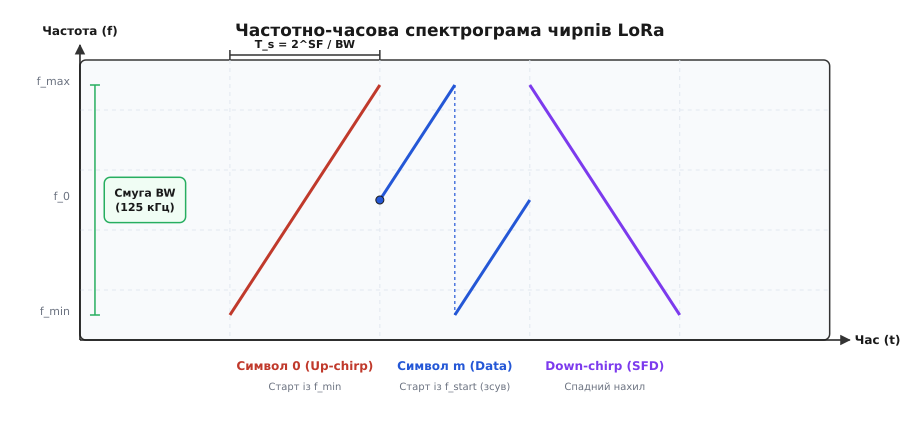
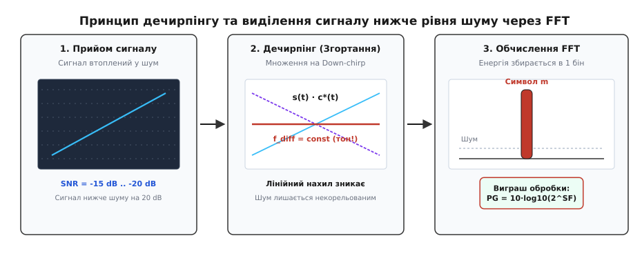
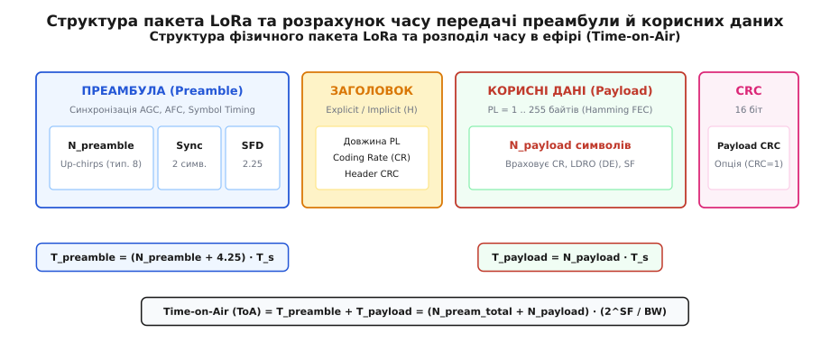
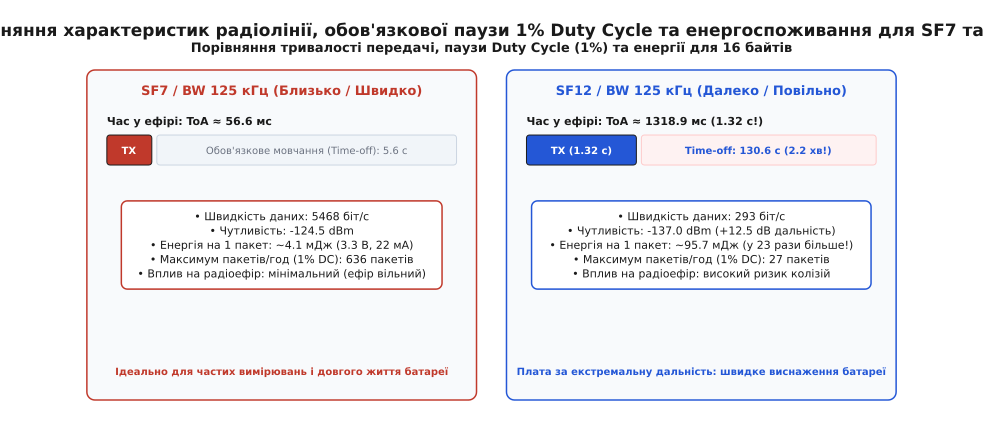

# LoRa: SF, BW, CR і час у ефірі

<preknowlist>
- [Бюджет радіолінії](root:embedded/link-budget) — баланс потужності передавача, чутливості та згасання сигналу у просторі.
- [Розширення спектра](root:com-modulation/spread-spectrum) — виграш обробки, завадостійкість та розподіл енергії по смузі частот.
- [Чирп-модуляція](root:com-modulation/lora) — базовий принцип передачі даних лінійними частотними імпульсами.
- [Імпульс передавача](root:embedded/impuls-peredavacha) — динамічне споживання струму радіотрактом під час випромінювання.
- [Канал, смуга і пакет](root:com-transport/channel-band-packet) — фізичні параметри бездротового середовища субгігагерцового діапазону.
</preknowlist>

Автономний датчик тиску газу в підземному колодязі має передавати 16 байтів телеметрії щогодини впродовж десяти років від одного літієвого елемента живлення ємністю 2.4 А·год. Відстань до найближчої базової станції становить 4.2 км крізь товщу ґрунту, бетонну плиту перекриття та щільну міську забудову. Прямий розрахунок затухання радіохвилі показує, що на антенний вхід приймача доходить потужність рівня −132 dBm. Тепловий шум ефіру в стандартній смузі 125 кГц за кімнатної температури становить −123 dBm. Тобто корисний сигнал надходить на 9 dB слабшим за невпинне шумові хаос ефіру.

Класичний приймач із частотною модуляцією (FSK, англ. *Frequency Shift Keying*) у такій ситуації абсолютно сліпий: для демодуляції FSK вимагає, щоб сигнал перевищував рівень шуму щонайменше на 6–10 dB. Щоб «пробити» радіотракт класичним способом, довелося б збільшити потужність передавача з дозволених 25 мВт до 2–3 Вт, що спустошить автономну батарею за кілька місяців замість десятиліття. 

Модуляція LoRa (англ. *Long Range*, запатентована технологія компанії Semtech на основі розширення спектра чирпами CSS — *Chirp Spread Spectrum*) розв'язує це інженерне протиріччя без підвищення випромінюваної потужності. Вона обмінює швидкість передачі даних і тривалість випромінювання на колосальний виграш обробки в цифровому демодуляторі. Щоб безпомилково проєктувати автономні пристрої, вбудованому інженеру необхідно опанувати математику тріади параметрів фізичного рівня LoRa: коефіцієнта розширення (Spreading Factor, SF), ширини смуги пропускання (Bandwidth, BW) та надлишковості завадостійкого кодування (Coding Rate, CR), а також навчитися до мілісекунди розраховувати час у ефірі (Time-on-Air, ToA), регуляторні ліміти заповнення каналу (Duty Cycle) та енергетичний бюджет батареї.

---

### Магія Chirp Spread Spectrum: як приймати сигнал нижче рівня теплового шуму

Будь-який радіоприймач працює на тлі теплового шуму, спричиненого хаотичним тепловим рухом електронів у провідниках антени та вхідних каскадах малошумного підсилювача (LNA). Потужність цього шуму описується фундаментальною формулою Джонсона — Найквіста:

```
P_noise = k_B · T · BW          [потужність теплового шуму у ватах]
P_dBm = -174 + 10·log10(BW) + NF [потужність у логарифмічній шкалі dBm]
```

Для смуги пропускання `BW = 125 кГц` за нормальної температури `T = 290 K` та ідеального підсилювача з власним коефіцієнтом шуму `NF = 0 dB` шумовий поріг становить рівно −123.0 dBm:

```
P_noise = -174 + 10·log10(125000)      [підстановка смуги BW = 125 000 Гц]
= -174 + 10·5.0969                     [обчислення десяткового логарифма]
= -174 + 50.97                         [добуток 10·log10(BW)]
= -123.03 dBm                          [інтегральний шум у смузі 125 кГц]
```

Реальний вхідний каскад сучасного трансивера (наприклад, Semtech SX1262) додає власний шум із коефіцієнтом `NF ≈ 6 dB`, через що ефективна шумова підлога приймального тракту піднімається до −117 dBm. Сигнал із рівнем −132 dBm перебуває на 15 dB нижче цього шуму. В осцилографі чи класичному амплітудному спектроаналізаторі його неможливо відокремити від шуму жодним аналоговим фільтром.


*Частотно-часова спектрограма чирпів LoRa: базовий up-chirp, корисний символ з циклічним зсувом стартової частоти та спадний down-chirp (SFD).*

Технологія LoRa використовує метод розширення спектра лінійно-частотно-модульованими імпульсами — чирпами (англ. *chirp* — цвірінькання). Частота випромінюваного коливання не є фіксованою: вона неперервно та лінійно змінюється в часі від нижньої межі смуги `f_min = f_0 - BW/2` до верхньої `f_max = f_0 + BW/2`. Швидкість зміни частоти (крутизна чирпа `k`) є фіксованою константою для обраного режиму роботи:

```
k = BW / T_s = BW² / 2^SF       [швидкість зміни частоти в Гц/с]
```

Швидкість передачі чіпів (елементарних частотних квантів) у модуляції LoRa жорстко прив'язана до ширини смуги пропускання:

```
R_chip = BW                     [швидкість чіпів у смузі дорівнює BW чіпів/с]
```

Для смуги `BW = 125 кГц` передавач генерує рівно 125 000 чіпів за секунду. Кожен інформаційний символ LoRa складається з `2^SF` чіпів і несе рівно `SF` сирих бітів інформації. Звідси випливає тривалість передачі одного символу `T_s`:

```
T_s = 2^SF / BW                 [тривалість символу LoRa в секундах]
```

Інформація всередині символу кодується початковою частотою старту чирпа `f_start`. Усього існує `2^SF` можливих дискретних значень початкової частоти:

```
f_start(m) = f_min + m · (BW / 2^SF),  де m ∈ [0, 2^SF - 1]
```

Коли частота зростаючого чирпа досягає верхньої межі `f_max`, вона миттєво «загортається» (здійснює фазово-неперервний стрибок) до нижньої межі `f_min` і продовжує лінійне зростання, доки не мине повний час символу `T_s`.


*Принцип дечирпінгу та демодуляції LoRa: множення зашумленого сигналу на спадний чирп згортає енергію в один незмінний тон, який перетворюється на виразний пік FFT.*

Демодуляція такого сигналу на приймальному боці базується на математичній операції дечирпінгу (англ. *de-chirping*):

1. **Множення на спряжений опорний сигнал:** Прийнятий сумарний сигнал `r(t) = s(t) + n(t)` (де `s(t)` — корисний чирп, а `n(t)` — широкосмуговий шум) перемножується у квадратурному змішувачі з локально згенерованим спадним чирпом (down-chirp), частота якого лінійно спадає від `f_max` до `f_min` із точно такою самою крутизною `k`.
2. **Анігіляція лінійної модуляції:** Оскільки крутизна зростання вхідного чирпа і крутизна спаду опорного чирпа за модулем однакові, їхнє перемноження повністю компенсує часову зміну частоти. Квадратичний фазовий член скорочується:
   ```
   f_out(t) = f_in(t) - f_ref(t) = (f_start + k·t) - (f_max - k·t) = f_const
   ```
   Увесь розмазаний по смузі 125 кГц корисний чирп згортається в одне строго стаціонарне гармонійне коливання незмінної проміжної частоти `f_diff`.
3. **Некорельованість шуму:** Білий тепловий шум `n(t)` та сторонні вузькосмугові завади не мають кореляції зі спадним чирпом. Після перемноження шум залишається рівномірно розподіленим по всій смузі `BW`, не утворюючи жодних когерентних піків.
4. **Швидке перетворення Фур'є (FFT):** Оцифрований після згортання сигнал надходить на блок дискретного перетворення Фур'є розмірністю `N = 2^SF`. Уся енергія корисного сигналу, накопичена за тривалий час `T_s`, фокусується в один-єдиний спектральний бін, номер якого `m` прямо вказує передане двійкове значення `SF` бітів.

Це перетворення забезпечує так званий виграш обробки (англ. *Processing Gain*, `PG`):

```
PG = 10 · log10(2^SF) = 3.01 · SF  [виграш обробки в децибелах]
```

Для максимального коефіцієнта розширення `SF = 12` виграш обробки становить:

```
PG = 3.01 · 12 ≈ 36.1 dB
```

Саме завдяки цьому накопиченню енергії в часі LoRa здатна демонструвати від'ємні граничні співвідношення сигнал/шум (SNR limit): демодулятор впевнено розпізнає сигнал при `SNR = -7.5 dB` для `SF7` і аж до `SNR = -20.0 dB` для `SF12`. Сигнал з потужністю, що в 100 разів менша за інтегральний шум приймача, виділяється з математичною надійністю.

Додаткова фізична перевага чирпів — екстремальна стійкість до доплерівського зсуву частоти та багатопроменевого завмирання. Частотний зсув `Δf`, спричинений рухом передавача або температурним дрейфом кварцового резонатора, призводить лише до пропорційного зсуву знайденого піку в часі на величину `Δt = Δf / k`, не руйнуючи когерентність згортання символу.

---

### Тріада параметрів LoRa: Spreading Factor (SF), Bandwidth (BW), Coding Rate (CR)

Фізичний рівень радіотракту LoRa визначається комбінацією трьох параметрів. Зміна будь-якого з них одночасно трансформує дальність зв'язку, чутливість приймача, швидкість передачі та споживання енергії.

```
+─────────────────────────────────────────────────────────────────────────────+
|                         ТРІАДА ПАРАМЕТРІВ LORA                              |
+─────────────────────────────────────────────────────────────────────────────+
|  Spreading Factor (SF)   ──► Керує виграшем обробки, тривалістю символу     |
|                              (Ts = 2^SF / BW) та енергетичним порогом SNR.  |
|  Bandwidth (BW)          ──► Задає швидкість чіпів (R_chip = BW)            |
|                              та інтегральний шумовий поріг приймача.        |
|  Coding Rate (CR)        ──► Визначає надлишковість коду Хеммінга (4/5..4/8)|
|                              для виправлення бітових помилок в ефірі.       |
+─────────────────────────────────────────────────────────────────────────────+
```

#### 1. Spreading Factor (Коефіцієнт розширення, SF)

Коефіцієнт розширення набуває цілочисельних значень від `SF7` до `SF12` у класичних трансиверах (SX1272/SX1276), а сучасні чіпи Semtech другого покоління (SX1261/SX1262/SX1268 та STM32WL) підтримують також надшвидкі режими `SF5` та `SF6`.

Кожен крок збільшення `SF` на одиницю має такі наслідки:
- Кількість чіпів на один символ подвоюється (`2^SF`);
- Тривалість передачі символу `T_s` зростає рівно вдвічі (`×2`);
- Граничний поріг чутливості приймача покращується приблизно на 2.5–3.0 dB;
- Сира бітова швидкість падає більш ніж удвічі.

| Параметр SF | Чіпів на символ | SNR поріг демодуляції | Чутливість RX (BW=125 кГц) | Тривалість символу Ts (BW=125 кГц) | Бітрейт (CR=4/5, BW=125 кГц) |
| :--- | :--- | :--- | :--- | :--- | :--- |
| **SF5** | 32 | −2.5 dB | −118.0 dBm | 0.256 мс | 19 531 біт/с |
| **SF6** | 64 | −5.0 dB | −121.0 dBm | 0.512 мс | 11 718 біт/с |
| **SF7** | 128 | −7.5 dB | −124.5 dBm | 1.024 мс | 5 468 біт/с |
| **SF8** | 256 | −10.0 dB | −127.0 dBm | 2.048 мс | 3 125 біт/с |
| **SF9** | 512 | −12.5 dB | −130.0 dBm | 4.096 мс | 1 757 біт/с |
| **SF10** | 1024 | −15.0 dB | −132.5 dBm | 8.192 мс | 976 біт/с |
| **SF11** | 2048 | −17.5 dB | −135.0 dBm | 16.384 мс | 537 біт/с |
| **SF12** | 4096 | −20.0 dB | −137.0 dBm | 32.768 мс | 293 біт/с |

Важлива математична властивість чирпів із різними значеннями `SF` — їхня **квазіортогональність**. Якщо два передавачі одночасно випромінюють пакети на одній і тій самій несучій частоті та в однаковій смузі `BW`, але з різними коефіцієнтами розширення (наприклад, один на `SF7`, а інший на `SF10`), їхні сигнали створюють взаємне придушення (англ. *co-channel rejection*) на рівні 16–24 dB. Приймач, налаштований на `SF7`, сприймає сигнал `SF10` як незначне підвищення фонового шуму і декодує свій пакет без втрат.

#### 2. Bandwidth (Ширина смуги частот, BW)

Ширина смуги задає діапазон частот, у якому розгортається чирп. У стандартах LoRa / LoRaWAN типовими є фіксовані значення 125 кГц, 250 кГц та 500 кГц (в окремих вузькосмугових телеметричних системах застосовують також 7.8 кГц, 15.6 кГц, 31.25 кГц і 62.5 кГц).

Вплив ширини смуги на радіолінію:
- **Швидкість:** Подвоєння `BW` удвічі скорочує тривалість передачі чіпа і символу `T_s = 2^SF / BW`, що подвоює бітову швидкість каналу.
- **Шумовий поріг:** Подвоєння смуги пропускає на вхід детектора вдвічі більше енергії теплового шуму (+3.01 dB). Відповідно, чутливість приймача погіршується на 3 dB.

```
BW = 125 кГц ──► Чутливість -137.0 dBm (SF12) ──► Дальність максимальна
BW = 250 кГц ──► Чутливість -134.0 dBm (SF12) ──► Швидкість ×2, дальність менша на ~15%
BW = 500 кГц ──► Чутливість -131.0 dBm (SF12) ──► Швидкість ×4, дальність менша на ~30%
```

#### 3. Coding Rate (Коефіцієнт кодування, CR)

Для захисту від короткочасних імпульсних завад і фазових викривлень ефіру модулятор LoRa застосовує пряме виправлення помилок (Forward Error Correction, FEC) на основі блокового коду Хеммінга з діагональним перемежуванням (англ. *diagonal interleaving*).

Корисні дані кодуються блоками по 4 інформаційні біти, до яких додається від 1 до 4 бітів парності:

```
CR = 4 / (4 + CR_val),  де CR_val ∈ {1, 2, 3, 4}
```

| Позначення CR | Значення CR_val | Кодове слово (n, k) | Надлишковість | Здатність коду |
| :--- | :--- | :--- | :--- | :--- |
| **CR 4/5** | 1 | (5, 4) | +25% | Детектує 1 бітову помилку (парність), 0 виправлень |
| **CR 4/6** | 2 | (6, 4) | +50% | Виправляє 1 бітову помилку, детектує 2 помилки |
| **CR 4/7** | 3 | (7, 4) | +75% | Виправляє 1 бітову помилку, детектує 2 помилки |
| **CR 4/8** | 4 | (8, 4) | +100% | Виправляє 1 бітову помилку, детектує до 3 помилок |

Перемежувач розподіляє біти одного кодового слова між різними чирпами символу. Якщо раптовий сплеск завади спотворює окремий чирп, помилка в розкодованому масиві перетворюється на поодинокі ізольовані бітові збої в різних байтах, які легко виправляються декодером Хеммінга.

Формула розрахунку результуючої корисної бітової швидкості (Bitrate, `R_b`):

```
R_b = SF · (BW / 2^SF) · (4 / (4 + CR_val))  [біт/с]
```

Для конфігурації `SF7`, `BW = 125 кГц`, `CR = 4/5`:

```
R_b = 7 · (125000 / 128) · (4 / 5)     [підстановка SF=7, BW=125кГц, CR=4/5]
= 7 · 976.5625 · 0.8                   [обчислення проміжних значень]
= 5468.75 біт/с                        [підсумкова швидкість для SF7]
```

Для далекобійної конфігурації `SF12`, `BW = 125 кГц`, `CR = 4/5`:

```
R_b = 12 · (125000 / 4096) · (4 / 5)   [підстановка SF=12, BW=125кГц, CR=4/5]
= 12 · 30.5175 · 0.8                   [обчислення проміжних значень]
= 292.97 біт/с                         [підсумкова швидкість для SF12]
```

Швидкість передачі на `SF12` падає у 18.6 раза порівняно з `SF7`.

---

### Точний розрахунок часу в ефірі (Time-on-Air / ToA)

Час перебування пакета в ефірі (Time-on-Air, ToA) — фундаментальна метрика для розробника вбудованих систем. Від неї безпосередньо залежать витрата заряду батареї, дотримання регуляторних вимог радіочастотного законодавства та ймовірність колізій у мережі.


*Структура фізичного кадру LoRa: тривалість преамбули, явний або неявний заголовок кадру, корисне навантаження та опціональна 16-бітна контрольна сума CRC.*

Фізичний пакет LoRa складається з двох послідовних частин: **преамбули** та **корисного навантаження** (payload).

#### 1. Тривалість преамбули (Preamble Duration)

Преамбула необхідна приймачу для автоматичного регулювання підсилення (AGC), підстроювання частоти (AFC) та захоплення фази символьної синхронізації.

Преамбула складається з:
- `N_preamble` програмованих базових up-chirps (за замовчуванням у реєстрах трансивера встановлюється значення 8);
- 2 чирпів мережевої синхронізації (Sync Word: `0x12` для приватних мереж, `0x34` для публічних мереж LoRaWAN);
- 2.25 спадних чирпів (down-chirps), що формують покажчик початку кадру (Start of Frame Delimiter, SFD).

Загальна кількість символів преамбули становить:

```
N_pream_total = N_preamble + 4.25  [символів]
```

Тривалість передачі преамбули `T_preamble`:

```
T_preamble = N_pream_total · T_s = (N_preamble + 4.25) · (2^SF / BW)
```

За стандартного значення `N_preamble = 8` преамбула займає рівно `12.25` символів:
- Для `SF7`, `BW 125 кГц`: `T_preamble = 12.25 · 1.024 мс = 12.544 мс`;
- Для `SF12`, `BW 125 кГц`: `T_preamble = 12.25 · 32.768 мс = 401.408 мс`.

#### 2. Кількість символів корисного навантаження (Payload Symbol Count)

Кількість символів, необхідних для передачі корисних даних, заголовка та контрольної суми, визначається специфікацією Semtech за формулою:

```
чисельник = 8·PL - 4·SF + 28 + 16·CRC - 20·H
знаменник = 4 · (SF - 2·DE)

N_payload = 8 + max( ⌈чисельник / знаменник⌉ · (CR_val + 4), 0 )
```

У цій формулі задіяні конфігураційні прапорці кадру:
- `PL` — довжина корисного навантаження в байтах (Payload Length, від 1 до 255);
- `SF` — коефіцієнт розширення (від 5 до 12);
- `CR_val` — надлишковість кодування (`1` для CR 4/5, `2` для CR 4/6, `3` для CR 4/7, `4` для CR 4/8);
- `CRC` — наявність 16-бітної контрольної суми payload CRC (`CRC = 1` — увімкнено, додає 16 бітів; `CRC = 0` — вимкнено);
- `H` — режим заголовка кадру (`H = 0` — явний заголовок Explicit Header, де довжина і CR передаються у службовому заголовку; `H = 1` — неявний заголовок Implicit Header без службових полів);
- `DE` — режим оптимізації для низьких швидкостей (Low Data Rate Optimization, LDRO). Прапорець `DE = 1`, коли тривалість символу перевищує 16.38 мс (`T_s > 16.38 мс`, тобто для `SF11` та `SF12` при `BW = 125 кГц`, або `SF12` при `BW = 250 кГц`). Якщо `T_s ≤ 16.38 мс`, то `DE = 0`.
- Символ `⌈ ... ⌉` позначає математичну операцію заокруглення вгору до найближчого більшого цілого числа (ceiling).

Тривалість передачі корисного навантаження:

```
T_payload = N_payload · T_s = N_payload · (2^SF / BW)
```

Загальний час у ефірі:

```
ToA = T_preamble + T_payload = (N_pream_total + N_payload) · (2^SF / BW)
```

#### Покроковий приклад розрахунку ToA для 16 байтів телеметрії

Розрахуємо точний час у ефірі для автономного датчика з пакетом `PL = 16 байтів`, стандартною преамбулою `N_preamble = 8`, явним заголовком `H = 0`, контрольною сумою `CRC = 1`, кодуванням `CR = 4/5` (`CR_val = 1`) та смугою `BW = 125 кГц`.

**Варіант А: Швидкий профіль `SF7`**
1. Тривалість символу: `T_s = 2^7 / 125000 = 128 / 125000 = 1.024 мс`.
2. Перевірка LDRO: `T_s = 1.024 мс ≤ 16.38 мс` → `DE = 0`.
3. Преамбула: `T_preamble = (8 + 4.25) · 1.024 мс = 12.544 мс`.
4. Чисельник формули payload:
   ```
   8·PL - 4·SF + 28 + 16·CRC - 20·H
   = 8·16 - 4·7 + 28 + 16·1 - 20·0        [підстановка параметрів SF7]
   = 128 - 28 + 28 + 16 - 0               [розкриття добутків]
   = 144                                  [чисельник кількості блоків]
   ```
5. Знаменник формули payload:
   ```
   4 · (SF - 2·DE) = 4 · (7 - 2·0) = 4 · 7 = 28
   ```
6. Кількість блоків кодування: `⌈144 / 28⌉ = ⌈5.143⌉ = 6`.
7. Кількість символів payload:
   ```
   N_payload = 8 + 6 · (1 + 4) = 8 + 6 · 5 = 8 + 30 = 38 символів
   ```
8. Час payload: `T_payload = 38 · 1.024 мс = 38.912 мс`.
9. Повний час у ефірі:
   ```
   ToA(SF7) = 12.544 мс + 38.912 мс = 51.456 мс
   ```

**Варіант Б: Далекобійний профіль `SF12`**
1. Тривалість символу: `T_s = 2^12 / 125000 = 4096 / 125000 = 32.768 мс`.
2. Перевірка LDRO: `T_s = 32.768 мс > 16.38 мс` → `DE = 1` (активуємо Low Data Rate Optimization).
3. Преамбула: `T_preamble = (8 + 4.25) · 32.768 мс = 401.408 мс`.
4. Чисельник формули payload:
   ```
   8·PL - 4·SF + 28 + 16·CRC - 20·H
   = 8·16 - 4·12 + 28 + 16·1 - 20·0       [підстановка параметрів SF12]
   = 128 - 48 + 28 + 16 - 0               [розкриття добутків]
   = 124                                  [чисельник кількості блоків]
   ```
5. Знаменник формули payload (враховуючи `DE = 1`):
   ```
   4 · (SF - 2·DE) = 4 · (12 - 2·1) = 4 · 10 = 40
   ```
6. Кількість блоків кодування: `⌈124 / 40⌉ = ⌈3.10⌉ = 4`.
7. Кількість символів payload:
   ```
   N_payload = 8 + 4 · (1 + 4) = 8 + 4 · 5 = 8 + 20 = 28 символів
   ```
8. Час payload: `T_payload = 28 · 32.768 мс = 917.504 мс`.
9. Повний час у ефірі:
   ```
   ToA(SF12) = 401.408 мс + 917.504 мс = 1318.912 мс ≈ 1.319 с
   ```

Передача тих самих 16 байтів на `SF12` триває **у 25.6 раза довше**, ніж на `SF7` (1.32 секунди проти 51.5 мілісекунди).

---

### Регуляторні обмеження Duty Cycle та енергетичний бюджет автономного вузла

У безліцензійному європейському діапазоні SRD (Short Range Devices) 868 МГц (стандарт ETSI EN 300 220) та відповідних регламентах радіозв'язку України вихід в ефір жорстко обмежений коефіцієнтом заповнення каналу — **Duty Cycle Limit**.

```
+─────────────────────────────────────────────────────────────────────────────+
|             РЕГЛАМЕНТ ЧАСТОТНОГО РЕСУРСУ ETSI EN 300 220 (868 МГц)          |
+─────────────────────────────────────────────────────────────────────────────+
|  Субдіапазон g  (868.0 – 868.6 МГц) ──► Duty Cycle 1.0%  (P_max = +14 dBm)  |
|  Субдіапазон g1 (868.7 – 869.2 МГц) ──► Duty Cycle 0.1%  (P_max = +14 dBm)  |
|  Субдіапазон g2 (869.4 – 869.65 МГц)──► Duty Cycle 10.0% (P_max = +27 dBm)  |
|  Субдіапазон g3 (869.7 – 870.0 МГц) ──► Duty Cycle 1.0%  (P_max = +14 dBm)  |
+─────────────────────────────────────────────────────────────────────────────+
```

Більшість каналів LoRa / LoRaWAN розміщені в субдіапазоні `g` (868.1, 868.3, 868.5 МГц), де діє ліміт **1%**.


*Компроміс між швидкістю та дальністю: порівняння тривалості ефіру, обов'язкового часу мовчання за правилом 1% Duty Cycle та енергетичних витрат батареї для SF7 і SF12.*

#### 1. Правило заповнення 1% та інтервал мовчання (Time-off)

Ліміт 1% означає, що сумарний час передачі пристрою не може перевищувати 1% від будь-якого ковзного часового інтервалу тривалістю в 1 годину (3600 секунд):

```
T_TX_max = 3600 с · 0.01 = 36.0 секунд на годину
```

Після кожної передачі тривалістю `ToA` мікроконтролер зобов'язаний витримати паузу тиші (англ. *Time-off* або *back-off*):

```
T_off = ToA · ((1 / DutyCycle) - 1) = ToA · ((1 / 0.01) - 1) = ToA · 99
```

Порівняємо допустиму інтенсивність виходу в ефір для наших розрахованих пакетів:

- **На профілі `SF7` (`ToA = 51.5 мс`):**
  ```
  T_off = 0.0515 с · 99 = 5.099 с
  ```
  Пристрій може передавати новий пакет кожні 5.15 секунди. Теоретичний максимум — до `36 / 0.0515 ≈ 699` пакетів на годину.

- **На профілі `SF12` (`ToA = 1318.9 мс = 1.319 с`):**
  ```
  T_off = 1.319 с · 99 = 130.58 с ≈ 2 хвилини 11 секунд!
  ```
  Після єдиного виходу в ефір вузол за законом зобов'язаний мовчати понад 2 хвилини. Максимально дозволена кількість таких повідомлень — лише `36 / 1.319 ≈ 27` пакетів на годину.

Якщо сенсор спробує надіслати алярм чи серію пакетів на `SF12` частіше ніж раз на 2 хвилини, прошивка грубо порушить радіочастотний регламент.

#### 2. Енергетичний розрахунок для автономного живлення

Енергія `E`, витрачена на передачу одного повідомлення, прямо пропорційна напрузі живлення `V_dd`, споживаному струму передавача `I_tx` та часу в ефірі `ToA`:

```
E_packet = V_dd · I_tx · ToA  [джоулів]
Q_packet = I_tx · ToA         [кулонів або міліампер-годин]
```

Для сучасного трансивера Semtech SX1262 з увімкненим внутрішнім імпульсним перетворювачем DC-DC при напрузі живлення `V_dd = 3.3 В` струм випромінювання на потужності `+14 dBm` становить `I_tx = 22 мА`. У режимі глибокого сну (Deep Sleep) із збереженням конфігурації регістрів трансивер споживає `I_sleep = 1.2 мкА`.

Розрахуємо енергію одного сеансу передачі 16 байтів:

```
E_SF7  = 3.3 В · 0.022 А · 0.0515 с = 0.00374 Дж = 3.74 мДж
E_SF12 = 3.3 В · 0.022 А · 1.319 с  = 0.09576 Дж = 95.76 мДж
```

Передача на `SF12` вимагає **у 25.6 раза більше енергії**, ніж на `SF7`.

Якщо датчик передає 1 пакет щогодини (8760 пакетів на рік) від елемента Li-SOCl2 ємністю 2400 мА·год:

- **При роботі на `SF7`:**
  - Заряд на передачу за рік: `8760 · (22 мА · 0.0515 с / 3600) = 2.76 мА·год/рік`.
  - За 10 років роботи радіотракт витратить лише `27.6 мА·год` (трохи більше 1% ємності батареї). Пристрій гарантовано проживе 10 років.
- **При постійній роботі на `SF12`:**
  - Заряд на передачу за рік: `8760 · (22 мА · 1.319 с / 3600) = 70.6 мА·год/рік`.
  - За 10 років радіотракт вимагатиме `706 мА·год` (близько 30% ємності).

Але якщо датчик має передавати телеметрію кожні 5 хвилин (105 120 пакетів на рік):
- На `SF7` витрата становитиме `33.1 мА·год/рік` (батареї вистачить на роки);
- На `SF12` витрата становитиме `847 мА·год/рік` (батарея помре менш ніж за 2.8 року).

Крім інтегральної енергії, існує небезпека імпульсного навантаження: тривалий безперервний імпульс струму 22–120 мА впродовж 1.32 секунди на `SF12` викликає глибоке динамічне просідання напруги на внутрішньому опорі літієвих елементів живлення (особливо при пасивації `Li-SOCl2` або на морозі). Це може спричинити раптовий скид мікроконтролера по порогу низької напруги (Brownout Reset).

---

### Компромісна матриця та інженерний алгоритм ADR

Підсумковий компроміс параметрів LoRa зведено в інженерну матрицю:

| SF | Чутливість RX | ToA (16 байт) | Time-off (1% DC) | Енергія 1 пакета | Стійкість до колізій | Типове застосування |
| :--- | :--- | :--- | :--- | :--- | :--- | :--- |
| **SF7** | −124.5 dBm | 51.5 мс | 5.1 с | 3.7 мДж | Відмінна (ефір вільний) | Пряма видимість, поруч зі шлюзом, часті пакети |
| **SF8** | −127.0 dBm | 92.7 мс | 9.2 с | 6.7 мДж | Дуже добра | Міські умови до 1–2 км |
| **SF9** | −130.0 dBm | 164.9 мс | 16.3 с | 12.0 мДж | Добра | Середня дистанція, помірні перешкоди |
| **SF10**| −132.5 dBm | 329.7 мс | 32.6 с | 23.9 мДж | Задовільна | Підвали, промислові залізобетонні будівлі |
| **SF11**| −135.0 dBm | 741.4 мс | 73.4 с | 53.8 мДж | Низька (забиває канал) | Складні заміські умови до 5–10 км |
| **SF12**| −137.0 dBm | 1318.9 мс | 130.6 с | 95.8 мДж | Критична (ризик колізій) | Екстремальна дистанція (15+ км), рідкісні алярми |

Поширена помилка початківців — зафіксувати в прошивці `SF12` «про всяк випадок, щоб зв'язок був найнадійнішим». У реальній мережі це призводить до катастрофи:
1. **Колізійний колапс каналу:** За моделлю випадкового множинного доступу без опитування (Pure ALOHA) пропускна здатність каналу обмежена стелею `18.4%`. Коли вузол передає пакет тривалістю 1.32 секунди, він уразливий до колізій упродовж подвійного часового вікна `2 · ToA = 2.64 с`. Кілька десятків таких пристроїв повністю блокують роботу шлюзу.
2. **Передчасна смерть батареї:** Сенсор витрачає у 25 разів більше заряду на кожен біт.

#### Принцип адаптивного вибору швидкості (Adaptive Data Rate, ADR)

Для динамічного вибору оптимального `SF` та потужності передавача `P_TX` використовується алгоритм ADR:

1. Базова станція вимірює максимальне співвідношення сигнал/шум (`SNR_measured`) серед останніх 20 прийнятих пакетів від конкретного вузла.
2. Обчислюється запас затухання лінії зв'язку (Link Margin):
   ```
   SNR_margin = SNR_measured - SNR_limit(SF) - Margin_safety
   ```
   де `Margin_safety` — запас надійності на випадок дощу чи пересування об'єктів (типово 10 dB).
3. Якщо `SNR_margin > 0`, доступна кількість кроків оптимізації становить `N_steps = ⌊SNR_margin / 3 dB⌋`.
4. Кожен крок спочатку зменшує `SF` на 1 рівень (знижуючи `ToA` вдвічі).
5. Якщо досягнуто мінімального `SF7`, а запас `SNR_margin` ще залишається, алгоритм зменшує випромінювану потужність `P_TX` передавача кроками по 3 dB (з +14 dBm до +2 dBm), заощаджуючи струм батареї.

---

### Практична реалізація: розрахунок ToA та вибір параметрів на C та C++

Нижче наведено практичний вбудований модуль для розрахунку тривалості пакета LoRa, обчислення обов'язкового часу мовчання Duty Cycle та динамічного підбору конфігурації.

:::tabs
:::code lora-sf-bw-cr-i-chas-u-efiri-d/c/main.c
:::code lora-sf-bw-cr-i-chas-u-efiri-d/cpp/main.cpp
:::

> 🔧 **Навіщо це.** Завжди інтегруйте функцію розрахунку Time-on-Air безпосередньо у планувальник завдань мікроконтролера. Перед відправкою кожного пакета обчислюйте точний час перебування в ефірі й автоматично встановлюйте апаратний таймер мовчання `Time-off`. Це захищає вузол від порушення частотного регламенту 1% Duty Cycle, усуває ризик зависання черги передачі та гарантує передбачуваність енергетичного ресурсу батареї на роки експлуатації.

---

### Підсумок

Модуляція LoRa змінює фундаментальний підхід до проєктування радіоканалу автономних систем: замість нарощування потужності передавача вона використовує математичну енергію чирпів, дозволяючи декодувати сигнал з рівнем на 20 dB нижче за тепловий шум ефіру.

Три головні правила проєктування вузлів LoRa:
1. **SF — це ручка енергії та часу:** Кожен крок підвищення SF подвоює тривалість символу та споживання енергії на пакет, даючи натомість 2.5–3 dB чутливості. Завжди тримайте вузол на мінімально можливому SF, який забезпечує надійний лінк із запасом 10 dB.
2. **Duty Cycle — це закон, а не порада:** На високих коефіцієнтах розширення (SF11–SF12) передача триває понад 1 секунду, вимагаючи обов'язкової паузи мовчання тривалістю понад 2 хвилини на кожен пакет.
3. **Адаптивність рятує мережу:** Застосування динамічного підбору швидкості (ADR) вивільняє радіоефір для сусідніх вузлів, мінімізує колізії в протоколах випадкового доступу та подовжує термін служби батареї пристрою з 3 до 10 років.
