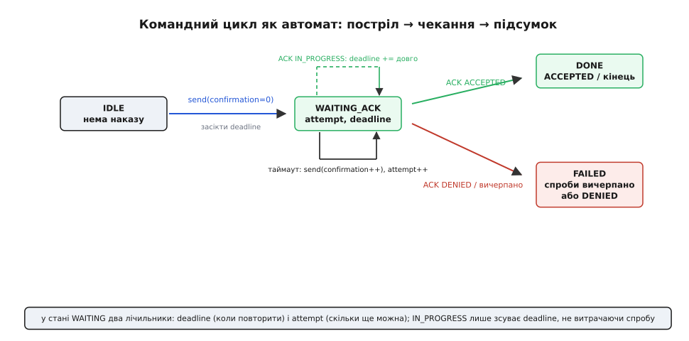
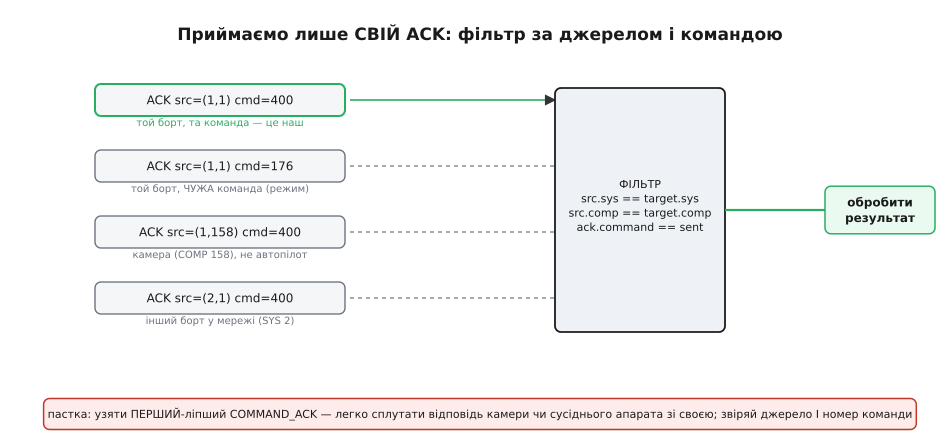

# ⚙️ Командний цикл на C: одна команда, надійно доставлена

**Задача.** Ми вже вивели, чому разову команду не можна слати «вистрелив і забув»: на дірявій радіониточці вона або мовчки пропаде (і оператор нічого не дізнається), або від сліпого повтору спрацює двічі. Рятує зв'язка з трьох речей — **підтвердження** COMMAND_ACK, **повтор по таймауту** зі збільшенням поля `confirmation`, і **розбір коду результату** MAV_RESULT, щоб реагувати за причиною, а не за галочкою «дійшло». Теорія цього циклу вже розкладена. Тепер зробімо те, чого теорія не дає: **напишімо його як живий C-код**, який можна покласти в наземну станцію чи в супутник-ретранслятор і довірити йому армування апарата.

Мета — не ще одна діаграма зі стрілками, а **скінченний автомат, який не бреше оператору**: доки він працює, оператор або отримає чесний підсумок («армовано» / «відхилено, бо немає GPS» / «прошивка цього не вміє»), або дізнається, що зв'язок мертвий, — але ніколи не залишиться в мовчазному невіданні, і ніколи не виконає небезпечний наказ двічі через власну паніку. Зберемо цей автомат крок за кроком, у кожному місці показуючи, де наївний код тихо ламається.

## Ідея: цикл — це маленька машина станів із двома годинниками

Спокуса написати командний цикл «в лоб» виглядає так: відправ пакет, а тоді `while` чекай ACK. Спинімося на цьому рядку раніше, ніж він потрапить у прошивку, бо він хибний двічі. По-перше, блокувальне очікування **заморожує** весь інший обмін: поки ти в `while`, ти не читаєш серцебиття, не оновлюєш телеметрію, не помічаєш обриву лінка — а саме командний цикл найбільше й потерпає від обривів. По-друге, «чекати ACK» — це не одна подія: тобі можуть прийти чужі ACK-и, проміжні ACK-и `IN_PROGRESS`, ніякого ACK взагалі; і на кожен випадок потрібна **різна** реакція. Блокувальний `while` жодну з них не розрізняє.

Тому реальний цикл — це **неблокувальний автомат**, який живе всередині головного циклу прошивки й на кожному оберті робить дрібний крок. Станів у нього насправді лише три:

```
IDLE         наказу немає, нічого не робимо
WAITING_ACK  наказ відправлено, чекаємо підтвердження
             ↑ тут крутяться ДВА годинники:
                deadline  — коли вважати мовчанку за втрату й повторити
                attempt   — скільки повторів ще дозволено
(термінальні) DONE / FAILED — підсумок для оператора
```

Уся хитрість — у стані `WAITING_ACK`, і саме тому в ньому **два лічильники, а не один**. Перший, `deadline`, відповідає на питання «коли повторити»; другий, `attempt`, — на питання «скільки ще можна». Їх легко сплутати в одну змінну, і це перша тиха помилка: якщо рахувати лише спроби без часу, ти не знаєш, коли робити наступну; якщо лише час без ліку спроб — ти довбатимеш мертвий лінк вічно. Потрібні обидва, і вони живуть окремо.


*Цикл — це IDLE → WAITING_ACK → DONE/FAILED. Уся логіка живе в WAITING_ACK, де крутяться два незалежні лічильники: deadline вирішує, коли повторити мовчазний наказ, а attempt — скільки повторів іще дозволено. Фінальний ACK веде в DONE, вичерпані спроби чи DENIED — у FAILED, а проміжний IN_PROGRESS лише відсуває deadline, не витрачаючи спробу.*

Ще один перехід на схемі варто помітити зараз, бо він нетривіальний: петля `IN_PROGRESS` **не витрачає спробу**. Коли борт чесно відповів «виконую, це надовго», було б безглуздям рахувати це як невдалу спробу й повторювати наказ — він і так виконується. Тому такий ACK лише **відсуває** `deadline` далеко вперед і лишає нас у `WAITING_ACK`. Це той самий випадок, коли замалий чи негнучкий таймаут ламає все: без окремої реакції на `IN_PROGRESS` ми повторили б калібрування посеред калібрування.

> 🔧 **Навіщо це.** Неблокувальний автомат — не примха стилю, а вимога живучості. Наземна станція (чи борт-ретранслятор), що застрягла в `while (!ack)`, не помічає, як під нею вмирає лінк, не малює телеметрію й не реагує на кнопку «стоп». Той самий цикл, розкладений на дрібні кроки в машині станів, робить своє діло **між** обробкою серцебиття й телеметрії, не крадучи час ні в кого. Правило просте: у вбудованій системі все, що «чекає», має чекати **лічильником у стані**, а не зупинкою процесора.

> 🔗 **Чекати, не зупиняючись.** Головний цикл прошивки крутиться безупинно; будь-яке блокувальне очікування (`while`, `delay`) заморожує в ньому все інше. Замість зупиняти процесор, стан «я чогось чекаю» тримають **змінною** й на кожному оберті перевіряють, чи не настав час діяти, — так між кроками очікування процесор устигає робити решту роботи. Саме на цьому принципі й стоїть наш командний цикл.
> [Неблокуючий час](root:sf-devices/nonblocking-time)

## Стан циклу: одна структура на одну команду в польоті

Почнімо з даних. Зберімо в одну структуру геть усе, що описує **одну команду, яка зараз пробивається до борту**: кого ми наказуємо, що саме, скільки разів уже стріляли, коли пора повторити й скільки спроб лишилось. Відокремлення цього стану в структуру — не косметика: воно дає змогу мати **кілька незалежних командних циклів** (наприклад, окремий до автопілота й окремий до підвісу камери), не плутаючи їхні таймери.

:::code proj-command-loop/c/stan-tsyklu-odna-struktura.c

Кожне поле тут — вкладена в код думка з теорії циклу, а не випадковий параметр.

**`target_sys` / `target_comp`** — це **адреса** наказу, і вона ж, як побачимо далі, ключ до розпізнавання «свого» ACK. Пара (SYS, COMP) означає конкретного мешканця мережі: не «якийсь борт», а *цей* борт, і в ньому не «щось», а *автопілот* (COMP = 1) чи, скажімо, підвіс камери. Тримати цю пару в стані циклу критично: без неї ми не зможемо відрізнити відповідь, на яку чекаємо, від відповіді сусіда.

**`command` і `params[7]`** — це сам наказ: номер команди (`MAV_CMD_COMPONENT_ARM_DISARM` = 400 для армування) і сім числових параметрів. Ми зберігаємо їх **у стані**, а не формуємо на льоту, з простої, але важливої причини: **повтор мусить бути точною копією**. Якщо при повторі змінити бодай один параметр, борт побачить не дубль, а новий наказ — і вся логіка захисту від подвійного виконання розсиплеться. Зберегли раз — стріляємо тим самим, змінюючи лише `confirmation`.

**`confirmation`** — те саме поле пакета COMMAND_LONG, яким протокол розрізняє перший постріл і повтор. За стандартом: `0` — перша передача, `1..255` — передачі-підтвердження. Ми тримаємо його в стані й **збільшуємо на кожному повторі**. Це не лічильник «для нас» — це сигнал **борту**: «те, що ти зараз бачиш, — не свіжий наказ, а мій повтор; якщо ти вже це зробив, не роби вдруге».

**`attempts_left` і `deadline_ms`** — ті самі два годинники з автомата. Перший — скільки ще стріляти; другий — абсолютний момент часу (не «скільки лишилось», а «о котрій»), коли поточну мовчанку пора вважати втратою. Абсолютний час зручніший за зворотний відлік: його ставлять один раз при пострілі й порівнюють із поточним `now`, не віднімаючи нічого щотакту.

**`timeout_ms` і `max_attempts`** — налаштування з розумними типовими значеннями. Стандарт **не диктує** їх жорстко; він лише вимагає: постав таймер на кожне повідомлення, що чекає відповіді, повтори при мовчанці, а по вичерпанні спроб — облиш і поверни оператору помилку. Реальні станції беруть таймаут близько **секунди** й **кілька** спроб (Mission Planner історично — близько 800 мс і до 5 спроб). Ми візьмемо 1000 мс і 5 — і зараз побачимо, чому обидві межі цього компромісу небезпечно порушувати.

**`last_result` і `progress`** — вікно для оператора. Сюди лягає останній код результату (щоб показати «відхилено» з причиною, а не мовчанку) і відсоток поступу довгої операції. Це найдешевша діагностика, яку можна мати: без цих двох полів наземна станція, отримавши `DENIED` через відсутність GPS, показала б лише «команда не пройшла» — і оператор шукав би причину годину.

> 🔧 **Навіщо це.** Тримати `command` і `params` у структурі, а не збирати щоразу, — звичка, що прямо боронить від подвійного виконання. Найпідступніші баги командного циклу народжуються саме тут: хтось «оптимізує» й формує пакет повтору наново, підставивши, скажімо, свіжий час у param — і борт, замість розпізнати дубль, виконує «новий» наказ ще раз. Один буфер параметрів на команду = гарантія, що повтор байт-у-байт дорівнює оригіналу (крім `confirmation`), а отже, механізм захисту від дублів працює.

## Постріл: збираємо й відправляємо COMMAND_LONG

Тепер — власне відправлення. Одна функція запускає команду: заповнює стан, збирає пакет COMMAND_LONG через згенерований API бібліотеки MAVLink, віддає його в канал і засікає перший `deadline`. Тут використаємо **реальний** C-API бібліотеки `c_library_v2` — той самий, що працює на борту й у станціях, — а не псевдокод.

:::code proj-command-loop/c/postril-zbyraiemo-i.c

Розберімо два неочевидні місця.

Перше — `now_ms()` **мусить бути монотонним**. Це не «котра година», а лічильник, що росте від старту й ніколи не стрибає назад (`millis()`, `HAL_GetTick()`). Якби ми взяли настінний час, синхронізація годинника (чи перехід на зимовий час на хості-станції) могла б **стрибнути** `now` назад — і `deadline` опинився б у майбутньому на годину: цикл замовк би, не повторюючи мертвий наказ. Монотонний лічильник цю пастку прибирає в корені.

Друге — `attempts_left = max_attempts - 1`. Ми щойно **витратили** першу спробу самим пострілом у `cmd_start`, тож у запас лишається на одну менше. Дрібниця, але помилитися тут легко: якщо лишити `max_attempts`, реальних передач буде на одну більше, ніж задумано, — зайвий пакет у вузький канал. Лічи чесно: перша передача — це вже спроба.

Відправлення `arm` тепер виглядає так:

```c
// Армувати автопілот (SYS=1, COMP=1): MAV_CMD_COMPONENT_ARM_DISARM (400)
float p[7] = {0};
p[0] = 1.0f;   // param1 = 1 → arm (0 → disarm)
p[1] = 0.0f;   // param2 = 0 → звичайне (не примусове) армування
cmd_start(&arm_loop, /*sys*/1, /*comp*/1, MAV_CMD_COMPONENT_ARM_DISARM, p);
```

## Ловимо ACK — але тільки СВІЙ

Ось місце, де наївний код падає найтихіше й найнебезпечніше. Пакети COMMAND_ACK приходять із каналу, і спокуса — узяти **перший-ліпший** ACK і вважати його відповіддю на наш наказ. У мережі з одного апарата це навіть спрацює. А тоді хтось під'єднає підвіс камери, або в ефір потрапить другий апарат, або GCS сама надішле команду іншому компоненту — і твій цикл сплутає **чужу** відповідь зі своєю. Наслідок буває злий: ти вважаєш армування підтвердженим, бо прийняв за нього ACK від камери на її власну команду; апарат насправді не армований, а станція показує зелене.

Тому «свій» ACK визначається **трьома** збігами одночасно, і жодним не можна знехтувати:

```
1. джерело ACK (SYS, COMP) == той (target_sys, target_comp), кому ми наказували
2. ack.command                == наш c->command
3. ми взагалі в стані WAITING (інакше ACK не наш або запізнілий)
```

Джерело ACK ми беремо **не** з полів усередині COMMAND_ACK, а з **заголовка кадру** (`msg.sysid`, `msg.compid`) — це той, **хто надіслав** цей пакет, тобто борт, що відповідає. (У COMMAND_ACK є ще поля `target_system`/`target_component` — розширення MAVLink 2, і вони означають *адресата* відповіді, тобто нас; на них покладатися для розпізнавання відправника не можна, бо старіші борти їх не заповнюють.) Правильний ключ — саме `sysid`/`compid` заголовка.


*З каналу сиплються ACK-и від різних відправників: наш автопілот на нашу команду, той самий борт на чужу команду, камера, сусідній апарат. Проходить лише той, де джерело кадру (SYS, COMP) збігається з адресатом нашого наказу І номер команди дорівнює надісланому. Узяти перший-ліпший ACK — пряма дорога сплутати чужу відповідь зі своєю.*

Ось обробник, який викликають на **кожен** розпарсений кадр COMMAND_ACK:

:::code proj-command-loop/c/lovymo-ack-ale-tilky-svii.c

Зверни увагу: три `return` угорі — це не перестраховка, а три реальні джерела плутанини, кожне з яких трапляється в живій мережі. Перший `return` відсіює сусідній апарат (SYS інший), другий — камеру чи інший вузол того самого апарата (COMP інший), третій — випадок, коли той самий автопілот відповідає на **іншу** свою команду (номер не той). Прибери будь-який — і за певного розкладу пакетів цикл повірить брехні.

> 🔧 **Навіщо це.** Звіряння джерела ACK — той рідкісний захист, ціна якого три рядки, а відсутність коштує аварії. На стенді з одним апаратом і нічим більше в ефірі баг спить; він прокидається саме в полі, коли поряд другий апарат чи ввімкнена камера, — тобто в найгіршу мить. Візьми за правило: будь-яку відповідь у MAVLink приймай **за адресою відправника й за тим, на що вона відповідає**, а не за самим лише фактом «прийшло повідомлення потрібного типу».

## Розбір результату: різні коди — різні дії

Тепер серце змісту. Прийшов **наш** ACK — але «наш» не означає «успіх». Поле `result` несе один із кодів MAV_RESULT, і кожен вимагає **своєї** реакції; звести їх усі до «ок / не ок» — значить викинути половину користі протоколу. Ось точні значення й зміст із чинної специфікації MAVLink (перевірено за `common.xml`):

```
0  ACCEPTED              команда підтримується, параметри чинні, ВИКОНАНА
1  TEMPORARILY_REJECTED  чинна, але зараз не можна (зайнятий/нема GPS); мине саме собою — повтори згодом
2  DENIED                чинна, та параметр неприйнятний; той самий наказ НЕ спрацює — не повторюй
3  UNSUPPORTED           команда невідома цій прошивці — повтор безнадійний
4  FAILED                чинна, але виконання зірвалося (нема пам'яті, датчик не калібрований) — усунь причину
5  IN_PROGRESS           виконую, це надовго; далі буде ще ACK; ПОДОВЖ таймаут, не витрачай спробу
6  CANCELLED             скасовано (у відповідь на COMMAND_CANCEL)
```

Придивімося, чому різниця між ними — не педантизм, а зовсім різна поведінка станції. На `TEMPORARILY_REJECTED` є сенс **тихо зачекати й повторити**: причина минуща (борт зайнятий іншою довгою дією, ще нема GPS-фіксації) і зникне сама. На `DENIED` повторювати **марно** — параметр неприйнятний, і той самий наказ дасть той самий отвід; треба показати причину оператору й дати йому виправити. На `UNSUPPORTED` не допоможе жодний повтор — прошивка просто не вміє цієї команди, і правильна реакція станції — **сховати відповідну кнопку**, а не бомбардувати борт. `FAILED` — не тимчасове: щось треба полагодити (відкалібрувати датчик, звільнити пам'ять), перш ніж наказ узагалі має шанс. А `IN_PROGRESS` — зовсім окремий звір, до якого повернемось за мить.

:::code proj-command-loop/c/rozbir-rezultatu-rizni.c

Тут кожна гілка втілює один висновок теорії. `ACCEPTED` завершує цикл. `IN_PROGRESS` — **єдиний** код, що лишає нас у `WAITING`, не витрачаючи спробу й лише подовжуючи `deadline`: борт пообіцяв ще один, фінальний ACK, і ми чесно на нього чекаємо довше. `TEMPORARILY_REJECTED` веде до повтору — але **як до звичайної спроби зі збільшенням `confirmation`**, бо це справді нова передача, і її треба лічити (інакше на вічно зайнятому борту ми довбали б без кінця). А чотири «стінові» коди (`DENIED`/`UNSUPPORTED`/`FAILED`/`CANCELLED`) обриваються в `FAILED` **негайно, без єдиного повтору**, бо повторювати те, що прошивка не вміє чи відкинула по суті, — марно палити канал.

Особливо підкреслю обробку `IN_PROGRESS`, бо тут наївний код ламається найдужче. Уяви калібрування компаса: борт відповідає `IN_PROGRESS` і чесно крутить процедуру тридцять секунд. Цикл із єдиним таймаутом у секунду вирішив би, що борт замовк, повторив би команду калібрування — **перервавши** те, що вже йде, — і так по колу, ніколи не діставшись фіналу. Різко подовжений таймаут саме на цей код прибирає катастрофу: ми даємо борту стільки часу, скільки чесно потрібно довгій операції.

## Хід часу: неблокувальний тік у головному циклі

Лишився останній шматок — те, що ганяє цей автомат уперед. Функція `cmd_tick` викликається **щооберту** головного циклу прошивки й робить рівно один дрібний обов'язок: перевіряє, чи не збіг `deadline`, і якщо так — або повторює наказ (є спроби), або здається (спроб нема). Жодного блокування: вона ставить одне порівняння часу й одразу повертає керування.

:::code proj-command-loop/c/khid-chasu-neblokuvalnyi.c

Один рядок тут вартий окремого слова — порівняння часу:

```
(int32_t)(now_ms() - c->deadline_ms) < 0     ще рано, чекаємо
(int32_t)(now_ms() - c->deadline_ms) >= 0     дедлайн збіг
```

Чому саме так, а не простіше `now_ms() >= deadline_ms`? Бо `now_ms()` — 32-бітний лічильник мілісекунд, і десь на 50-му дні безперервної роботи він **переповнюється** й починається з нуля. Пряме порівняння `>=` на межі переповнення дало б хибу: щойно `now` перескочив через нуль, а `deadline` іще «великий», умова `now >= deadline` раптом стала б хибною на цілих 49 днів. Трюк «відняти й глянути на знак у `int32_t`» цю пастку прибирає: різниця двох беззнакових лічильників, зведена до знакового, лишається правильною через межу переповнення, доки інтервал менший за пів діапазону (а таймаути в нас — секунди, не тижні). Це стандартний спосіб порівнювати монотонний час у вбудованих системах, і саме тому ми пишемо його так, а не «очевидніше».

> 🔧 **Навіщо це.** Порівняння часу через різницю в знаковому типі — дрібниця, що рятує від рідкісного, але злого бага: система, яка місяць-два не перезавантажувалась, раптом перестає повторювати команди на пару днів після переповнення лічильника. На дрони й станції, що працюють довгими сеансами, це реальність, а не теорія. Пиши порівняння монотонного часу завжди через `(int32_t)(a - b)` — і забудеш про цей клас помилок назавжди.

## Складаємо все: цикл у диспетчері прийому

Тепер видно, як три частини стають одним механізмом. Головний цикл прошивки читає байти з каналу, згодовує їх парсеру MAVLink, і на кожен зібраний кадр диспетчеризує за типом; паралельно щооберту тікає `cmd_tick`. Ось кістяк, у якому наш командний цикл живе поряд із рештою обміну, нікого не блокуючи:

:::code proj-command-loop/c/skladaiemo-vse-tsykl-u.c

Придивись, як природно все лягло. Прийом ACK і хід часу — **дві незалежні події**, і кожна робить свій дрібний крок; жодна не чекає іншу в циклі `while`. Команда завершується або через `cmd_on_ack` (прийшов фінальний результат), або через `cmd_tick` (вичерпались спроби) — і головний цикл одразу перетворює це на повідомлення оператору. Між цими подіями процесор вільний читати серцебиття, малювати телеметрію й реагувати на нову кнопку. Саме так виглядає надійна доставка команди, що не краде час у решти системи.

## Складність і пастки

Цей цикл здається простим — три стани, два годинники, один `switch`. Але майже кожен його рядок стоїть проти конкретної, живої пастки, і варто зібрати їх разом, бо на них спотикаються навіть готові проєкти.

**Сплутати відповідь від чужого компонента.** Головна й найтихіша. Прийняти перший-ліпший COMMAND_ACK — значить рано чи пізно взяти за свою відповідь ACK від камери, підвісу чи сусіднього апарата. Захист — три збіги разом: джерело кадру (`msg.sysid`, `msg.compid`) дорівнює адресатові наказу, **і** номер команди в ACK дорівнює надісланому. Баг спить на стенді з одним апаратом і прокидається саме в полі, коли в ефірі з'являється другий вузол. Пам'ятай і про різницю: джерело беруть із **заголовка кадру**, а не з полів `target_*` усередині COMMAND_ACK (ті вказують на адресата й на старих бортах порожні).

**Замалий таймаут.** Спокуса «щоб швидше зреагувати» ставить таймаут у 200–300 мс — і цикл починає сипати повторами **раніше**, ніж чесна відповідь устигла пройти вузьким каналом туди-назад. Наслідок парадоксальний: намагаючись прискорити, ти **забиваєш** і без того тісний радіоканал зайвими пакетами, через що ACK іде ще довше, і повторів стає ще більше — самопідсильна лавина. Секунда — не випадкове число: вона з запасом покриває оберт через типовий телеметрійний модем. Замалий таймаут шкодить сильніше, ніж завеликий.

**Забути про IN_PROGRESS.** Другий бік того ж «замалого таймауту», але злісніший. Довгі команди — калібрування компаса, гіроскопа, акселерометра — тривають десятки секунд і чесно шлють `IN_PROGRESS`. Цикл, що не розрізняє цей код, вирішить, що борт замовк, і повторить наказ калібрування **посеред калібрування**, перервавши його, — і так по колу, ніколи не дійшовши до кінця. Лік простий: `IN_PROGRESS` — єдиний код, що подовжує `deadline` (на десятки секунд) і **не** витрачає спробу; чекаємо фінального ACK, а не довбемо.

**Неідемпотентні накази.** Найглибша пастка, і вона не в коді циклу, а в **природі самої команди**. Наш механізм робить повтор байт-у-байт однаковим (крім `confirmation`) саме для того, щоб борт міг розпізнати дубль. Але це працює, лише якщо наказ **ідемпотентний** — тобто виконати його двічі те саме, що один раз. «Армуйся», «лети в точку з такими абсолютними координатами», «встанови режим LOITER» — ідемпотентні: повтор нічого не псує. А от **відносний** наказ на кшталт «підніми висоту на +5 м» чи «поверни на +30°» — **неідемпотентний**: спрацювавши двічі (бо перший ACK загубився й ми повторили), він додасть десять метрів замість п'яти. Тут поле `confirmation` — остання лінія оборони: борт **бачить**, що це повтор, і для такої команди може не виконувати її вдруге. Але надійніше — **не будувати керування на відносних наказах узагалі**: там, де можна, шли абсолютну ціль (кінцеву висоту, кінцевий курс, точні координати), і тоді повтор безпечний за самою суттю. Це те місце, де правильний вибір **команди** рятує більше, ніж будь-який код повтору.

**Порівняння часу без огляду на переповнення.** Тиха бомба сповільненої дії. Пряме `now >= deadline` ламається раз на ~50 днів, коли 32-бітний лічильник мілісекунд перескакує через нуль; система, що працювала місяцями, раптом на пару днів перестає повторювати команди. Завжди порівнюй монотонний час через `(int32_t)(now - deadline) < 0` — і цей клас помилок зникає.

**Блокувальне очікування.** І наостанок — та сама помилка, з якої ми почали. `while (!ack)` замість автомата не просто негарний: він **сліпне** саме тоді, коли найпотрібніше бачити. Поки цикл заморожений в очікуванні, він не читає серцебиття (і не помітить обриву лінка), не оновлює телеметрію, не реагує на «стоп». Командний цикл найбільше страждає від обривів — і не має права їх не бачити. Тому він живе дрібними кроками в головному циклі, чекаючи **лічильником у стані**, а не зупинкою процесора.

Зібравши все це, отримуємо модуль на пару сотень рядків, якому **не соромно довірити армування апарата**: він доставляє команду надійно, не плутає чужі відповіді зі своїми, чесно розрізняє «виконано», «зайнято», «заборонено» й «не вмію», терпляче чекає довгі операції, не забиває канал зайвими пострілами й не робить небезпечний наказ двічі. Складність цього коду рівно така, якою її робить ненадійність тонкої радіониточки, — не більша й не менша.
