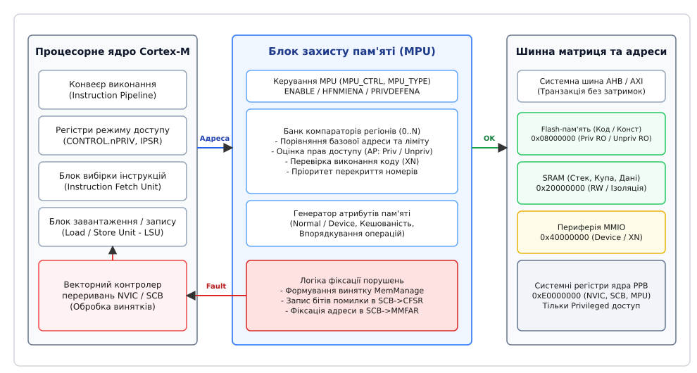
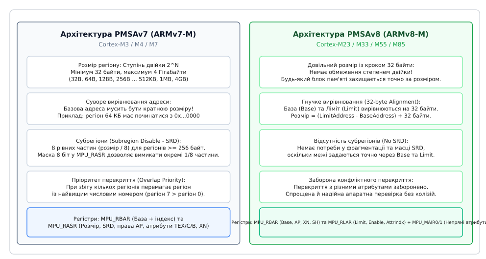
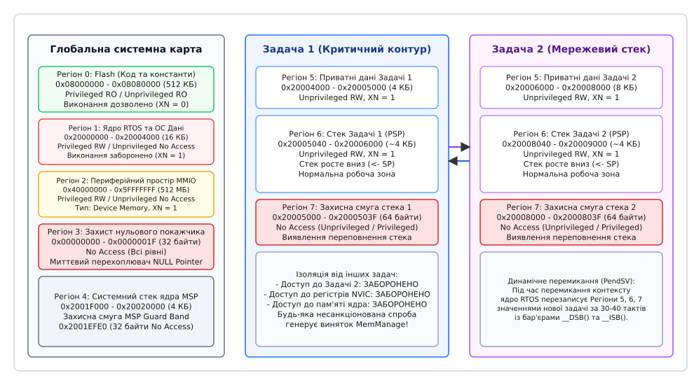
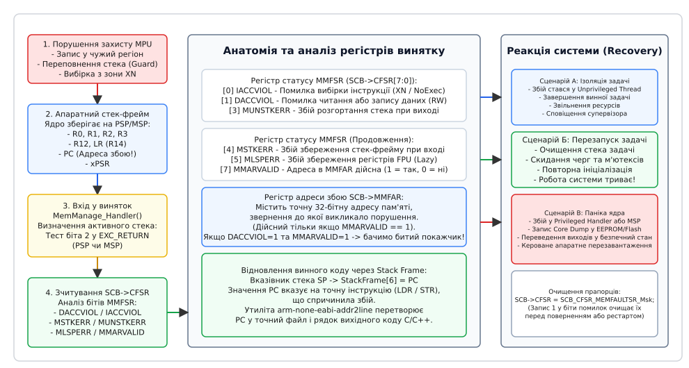

# Блок захисту пам'яті (MPU)

<preknowlist>
- [Архітектура ядра ARM Cortex-M](root:hw-arch/cortex-m) — регістри `CONTROL`, `IPSR`, режим обробника та потоку, латентність переривань.
- [Початковий векторний запуск мікроконтролера](root:embedded/startovyi-kod) — вектори скидання, вирівнювання стека `MSP` та адреси пам'яті Flash/RAM.
- [Аналіз причин аварійного скидання процесора](root:embedded/prychyna-skydannia-iak-diahnoz) — регістри статусу відмов ядра, стек-фрейми та дамп пам'яті.
- [Діагностика фатальних відмов та зависань](root:embedded/koly-chyp-padaie) — обробники HardFault, BusFault, UsageFault та алгоритм розкручування стек-трейсу.
- [Вибір архітектури прошивки: голий цикл чи RTOS](root:embedded/vybir-holyi-tsykl-freertos-zephyr) — витісняюче планування, контекст задач та вимоги до детермінізму.
</preknowlist>

У багатозадачній вбудованій системі без апаратного розмежування пам'яті одна помилка в покажчику здатна знищити весь пристрій. Розглянемо типовий польотний контролер безпілотного апарата: поруч виконуються високопріоритетна задача стабілізації кутів орієнтації (частота 1000 Гц), задача навігації за супутниками (50 Гц) та низькопріоритетний парсер текстових повідомлень телеметрії (10 Гц). Якщо розробник парсера припустився помилки у перевірці довжини вхідного пакету або розіменував неініціалізований покажчик, інструкція запису процесора `STR` мовчки спрямовує байт у довільну комірку оперативної пам'яті SRAM.

У монолітній системі без захисту цей байт потрапляє у робочий стек задачі стабілізації або спотворює дескриптор коефіцієнтів PID-регулятора. У момент самого запису нічого не вибухає: процесор успішно виконує машинну команду, а парсер телеметрії завершує свій квант часу. Справжня катастрофа розгортається через кілька мілісекунд, коли планувальник операційної системи передає керування задачі стабілізації. Спроба розрахувати тягу двигунів на основі пошкодженого коефіцієнта призводить до переповнення змінної, обчислювального збою та раптового падіння апарата. Під час посмертного аналізу логів розробники бачать лише наслідок — недійсне значення змінної в контурі керування, тоді як справжній винуватець — парсер телеметрії — уже давно завершив роботу і не залишив жодних слідів у викликах.

Програмні методи контролю — захисні маркери на дні стека (Stack Canaries), періодичне сканування пам'яті планувальником або статичний аналіз коду — принципово не здатні зупинити таку відмову. Програмний наглядач перевіряє стан пам'яті лише у фіксовані моменти часу (наприклад, під час перемикання контексту), тоді як руйнівний запис через покажчик відбувається миттєво, за один машинний такт процесора. Щоб запобігти пошкодженню пам'яті, системі потрібен апаратний арбітр, який стоїть безпосередньо в тракті виконання машинних інструкцій завантаження та збереження (`LDR`/`STR`) і перевіряє законність кожного звернення до шини до того, як фізичний сигнал запису буде виставлено на комірки пам'яті. Таким апаратним арбітром у мікроконтролерах виступає блок захисту пам'яті (Memory Protection Unit, MPU).

---

### Фізична мотивація, стандарти безпеки та комплексна модель загроз

У промислових галузях із підвищеними вимогами до надійності програмного забезпечення ізоляція пам'яті регламентується міжнародними стандартами функціональної безпеки:
- **IEC 61508 (SIL 3 / SIL 4)** — загальнопромисловий стандарт функціональної безпеки електронних систем;
- **ISO 26262 (ASIL D)** — автомобільний стандарт безпеки критичних блоків керування (ECU);
- **DO-178C (Design Assurance Level DAL A / B)** — авіаційний стандарт сертифікації бортового програмного забезпечення;
- **IEC 62304 (Class C)** — стандарт для медичних пристроїв із загрозою життю пацієнта.

Ключовою вимогою цих нормативних документів є концепція **просторової свободи від взаємного впливу (Spatial Freedom from Interference, FFI)**: програмний модуль із нижчим рівнем критичності (наприклад, графічний інтерфейс екрана чи логер діагностики) у жодному разі не повинен мати фізичної можливості модифікувати або зчитувати пам'ять модуля вищого рівня критичності (наприклад, контуру керування сервоприводами чи системи впорскування палива). Якщо такої просторової ізоляції не забезпечено апаратно, сертифікаційні органи вимагають розробляти й тестувати абсолютно весь код прошивки — включно з другорядними бібліотеками сторонніх виробників — за найвищим, найдорожчим рівнем суворості.

```
МОДЕЛЬ ЗАГРОЗ У ВБУДОВАНІЙ СИСТЕМІ БЕЗ MPU:
[Ненадійний сторонній код / Драйвер BLE] --(Помилка покажчика)--> [Пам'ять ядра RTOS] -> Крах системи!
[Ненадійний сторонній код / Драйвер BLE] --(Переповнення стека)--> [Стек керуючої задачі] -> Крах системи!
[Ненадійний сторонній код / Драйвер BLE] --(Прямий запис MMIO)--> [Регістри двигуна]    -> Аварія обладнання!

МОДЕЛЬ БЕЗПЕКИ З ВИКОРИСТАННЯМ MPU:
[Непривілейована задача BLE]
   | (Спроба несанкціонованого запису)
   v
[АПАРТАТНИЙ БАР'ЄР MPU] --(Блокування шини + MemManage Fault)--> [Пам'ять ядра ЦІЛА]
                                                                [Стек керування ЦІЛИЙ]
                                                                [Периферія ЗАХИЩЕНА]
```

#### Класифікація вразливостей пам'яті у прошивках

1. **Руйнування стека сусідніх задач (Stack Overflow / Underflow)**: При вичерпанні виділеного простору стека інструкції запису провалюються у пам'ять іншого потоку. Без MPU це викликає лавиноподібний збій через випадковий проміжок часу.
2. **Дикі покажчики (Wild / Dangling Pointers)**: Використання покажчиків після звільнення пам'яті (`Use-After-Free`) або неініціалізованих локальних змінних, які містять сміттєві адреси, що випадково вказують на важливі системні змінні.
3. **Виконання шеллкоду зі стека або оперативної пам'яті (Code Injection)**: Зловмисник передає сформований пакет через інтерфейс зв'язку (CAN, UART, Ethernet), що переповнює буфер і перезаписує адресу повернення функції на стек, передаючи керування на завантажений масив байтів.
4. **Несанкціонована зміна апаратної периферії**: Прикладна задача напряму записує дані в конфігураційні регістри таймерів ШІМ, генераторів тактових частот або портів вводу-виводу, порушуючи роботу всієї плати.
5. **Атака «Ошуканий заступник» (Confused Deputy Attack)**: Непривілейована задача передає покажчик на закриту пам'ять ядра у системний виклик (наприклад, драйвер запису Flash чи DMA), примушуючи привілейоване ядро спотворити пам'ять від власного імені.

Апаратний блок захисту пам'яті MPU перетворює мікроконтролер із монолітної системи на набір ізольованих програмних пісочниць, захищених на рівні кремнієвої логіки процесорного ядра.

---

### Фундаментальна різниця між MPU та MMU

У комп'ютерних системах загального призначення (на процесорах архітектур x86 або ARM Cortex-A під керуванням операційних систем Linux, macOS чи Windows) захист пам'яті є невіддільним від механізму віртуальної пам'яті (Virtual Memory), реалізованого повнофункціональним блоком керування пам'яттю (Memory Management Unit, MMU). Проте у мікроконтролерах реального часу сімейства ARM Cortex-M класичний MMU практично ніколи не застосовується. Розуміння причин цієї архітектурної відмінності є критичним для проектування детермінованих вбудованих систем.

```
АРХІТЕКТУРА З MMU (Cortex-A / Linux):
Віртуальна адреса -> [TLB / Page Table Walk] -> Фізична адреса -> Пам'ять
                     (Змінна затримка 10-100 тактів, динамічні сторінки)

АРХІТЕКТУРА З MPU (Cortex-M / RTOS):
Фізична адреса    -> [Паралельний верифікатор MPU] -----------> Пам'ять
                     (Фіксована затримка 0 тактів, пряма адресація)
```

Блок MMU розв'язує задачу ізоляції через **трансляцію адрес**: кожна програма функціонує у власному безперервному віртуальному просторі (наприклад, починаючи з адреси `0x00000000`), а апаратний транслятор перетворює ці віртуальні адреси у фрагментовані блоки фізичної пам'яті за допомогою багаторівневих таблиць сторінок (Page Tables) та буфера асоціативної трансляції (Translation Lookaside Buffer, TLB). Якщо потрібної трансляції немає в TLB, апаратний блок виконує послідовне сканування таблиць у пам'яті (Page Table Walk), що займає від десятків до сотень машинних тактів процесора. Більше того, коли пам'яті не вистачає, операційна система скидає неактивні сторінки на диск (Swapping / Paging).

Для систем реального часу з жорсткими часовими детерміністичними рамками (Hard Real-Time) поведінка MMU є абсолютно неприйнятною:
1. **Втрата детермінізму латентності переривань**: Час реакції на критичне переривання у мікроконтролері Cortex-M4 становить строго 12 тактів процесора. Якщо виконання інструкції всередині обробника переривання спричинить промах TLB або сторінковий збій (Page Fault), час реакції збільшиться у десятки разів непередбачуваним чином.
2. **Апаратна надмірність та енергоспоживання**: Реалізація швидкісного асоціативного буфера TLB, компараторів тегів і табличного крокуючого автомата вимагає сотень тисяч додаткових логічних вентилів на кристалі кремнію, що суттєво здорожчує мікроконтролер і збільшує його струм споживання у режимах глибокого сну.
3. **Обмеженість фізичної пам'яті SRAM**: Сторінкові таблиці MMU вимагають виділення під власні потреби від 4 до 16 кілобайтів пам'яті лише для збереження дескрипторів сторінок, що у мікроконтролерах із загальним обсягом SRAM у 64 або 128 кілобайтів становить неприпустимо велику частку ресурсів.

| Характеристика | Блок керування пам'яттю (MMU) | Блок захисту пам'яті (MPU) |
|---|---|---|
| **Трансляція адрес** | Так (Віртуальна адреса → Фізична адреса) | Ні (Адреса на шині ≡ Фізична адреса) |
| **Одиниця захисту** | Фіксовані сторінки (4 КБ, 64 КБ, 1 МБ, 2 МБ) | Програмовані регіони (від 32 Б до 4 ГБ) |
| **Вплив на час виконання** | Змінний (Промахи TLB додають затримку) | Строго нульовий (Перевірка виконується за 0 тактів) |
| **Підтримка підкачування (Swap)** | Так (Віртуальний простір більший за RAM) | Ні (Тільки фізично наявна пам'ять) |
| **Накладні витрати на таблиці** | Високі (Багаторівневі Page Tables у RAM) | Нульові (Конфігурація зберігається в регістрах) |
| **Час перемикання контексту** | Оновлення покажчика TTBR + скидання TLB | Запис у 4–8 апаратних регістрів (~20 тактів) |

Блок MPU не виконує жодної трансляції адрес: вихідна адреса, що надходить на матрицю системних шин AHB/AXI, є строго ідентичною адресі, сформованій ядром процесора (`Addr_out == Addr_in`). MPU працює виключно як **паралельний апаратний верифікатор прав доступу**. Коли процесор ініціює вибірку інструкції або транзакцію читання чи запису даних, блок компараторів MPU перевіряє фізичну адресу одночасно з формуванням шинного циклу. Якщо доступ дозволено, транзакція завершується без жодного такту затримки; якщо доступ заборонено, MPU негайно блокує проходження сигналу на шину пам'яті та виставляє апаратурі ядра сигнал внутрішнього винятку `MemManage Fault`.

---

### Архітектура шинної взаємодії та функціональна схема MPU

Внутрішня структура MPU тісно інтегрована з конвеєром процесора Cortex-M, векторним контролером переривань NVIC та матрицею шин мікроконтролера.


*Структурна організація MPU: перевірка прав доступу на льоту під час шинних транзакцій та генерація винятку MemManage.*

#### Взаємодія MPU з шинними протоколами AHB-Lite та AXI4
У мікроконтролерах Cortex-M обмін даними між процесорним ядром і пам'яттю здійснюється за протоколом AHB-Lite (Advanced High-performance Bus) або AXI4. У кожній шинній транзакції процесор виставляє адресні та контрольні сигнали:
- `HADDR[31:0]`: Цільова 32-бітна фізична адреса;
- `HPROT[3:0]`: Сигнали захисту та типу звернення:
  - `HPROT[0]` (Opcode/Data): `0` = вибірка коду інструкції, `1` = звернення до даних (`LDR`/`STR`);
  - `HPROT[1]` (Privileged/User): `0` = непривілейований режим (User), `1` = привілейований режим (Privileged);
  - `HPROT[2]` (Bufferable): Дозвіл буферизації транзакції;
  - `HPROT[3]` (Cacheable): Дозвіл кешування транзакції;
- `HWRITE`: Напрямок передачі (`1` = запис, `0` = читання);
- `HTRANS[1:0]`: Тип транзакції (IDLE, BUSY, NONSEQ, SEQ).

Блок MPU розташовується безпосередньо між конвеєром ядра та шинним інтерфейсом AHB. Перевірка прав доступу здійснюється на **фазі адреси (Address Phase)** шинного циклу. Якщо блок компараторів виявляє невідповідність прав доступу (наприклад, спробу запису `HWRITE = 1` у регіон із правами `ReadOnly` або спробу вибірки `HPROT[0] = 0` з регіону з прапорцем `XN = 1`), MPU:
1. Забороняє генерацію стробу вибірки пам'яті на зовнішній шині;
2. Повертає конвеєру процесора внутрішній сигнал помилки;
3. Формує запит на виняток `MemManage Fault` у контролер NVIC;
4. Фіксує адресу збою та статусний код у системних регістрах блоку `SCB`.

Завдяки перевірці на адресній фазі несанкціоновані дані фізично не потрапляють на шину даних `HWDATA` і не досягають комірок оперативної пам'яті чи регістрів периферії.

---

### Архітектурні покоління: PMSAv7 проти PMSAv8

В екосистемі мікроконтролерів ARM Cortex-M існують дві принципово різні специфікації апаратної моделі захисту пам'яті (Protected Memory System Architecture, PMSA):
- **PMSAv7**: Специфікація архітектури ARMv7-M, що застосовується у процесорних ядрах Cortex-M0+, Cortex-M3, Cortex-M4 та Cortex-M7.
- **PMSAv8**: Специфікація архітектури ARMv8-M, впроваджена у сучасних ядрах Cortex-M23, Cortex-M33, Cortex-M55 та Cortex-M85.


*Еволюція захисту пам'яті ARM: обмеження степенів двійки у PMSAv7 проти лінійних меж Base-Limit у PMSAv8.*

#### 1. Організація регіонів у PMSAv7 (ARMv7-M)
В архітектурі PMSAv7 конфігурація регіону базується на двох суворих математичних правилах:
1. **Розмір регіону зобов'язаний бути точним ступенем двійки $2^N$**: Мінімальний підтримуваний розмір становить 32 байти ($2^5$), максимальний — 4 гігабайти ($2^{32}$). Допустимими розмірами є виключно 32 Б, 64 Б, 128 Б, 256 Б, 512 Б, 1 КБ, 2 КБ, 4 КБ ... 512 МБ, 1 ГБ, 2 ГБ, 4 ГБ.
2. **Базова адреса регіону повинна бути кратною його розміру**: Початкова адреса має задовольняти умову:

```
Базова адреса mod Розмір регіону = 0
```

Якщо буфер даних має розмір 48 кілобайтів і розташований за адресою `0x20004000`, його неможливо захистити одним регіоном PMSAv7. Найближчий більший степінь двійки — 64 кілобайти, проте регіон розміром 64 КБ може починатися лише за адресами, кратними `0x10000` (наприклад, `0x20000000` або `0x20010000`). Якщо призначити базову адресу `0x20004000` для регіону 64 КБ, апаратний MPU PMSAv7 відкине молодші 16 бітів адреси й встановить базу на `0x20000000`, відкривши доступ до нецільових ділянок пам'яті.

##### Механізм субрегіонів (Subregion Disable, SRD)
Для подолання проблеми нестепеневих розмірів у PMSAv7 впроваджено поділ регіону на 8 рівних субрегіонів:
- Механізм діє для будь-якого регіону розміром від 256 байтів і більше;
- Розмір одного субрегіону строго дорівнює `Розмір регіону / 8`;
- У регістрі `MPU_RASR` виділено 8-бітове поле `SRD` (біти [15:8]), де кожен біт відповідає за один субрегіон: запис `1` вимикає дію правил MPU для даної однієї восьмої частини регіону.

*Приклад розрахунку*: Необхідно захистити буфер розміром 48 КБ за адресою `0x20000000`. Обирається базовий регіон розміром 64 КБ (2 в степені 16). Розмір одного субрегіону становить `64 КБ / 8 = 8 КБ`. Буфер займає перші 6 субрегіонів (`6 * 8 КБ = 48 КБ`). Останні 2 субрегіони (від 48 КБ до 64 КБ) мають бути вимкнені. Маска `SRD` встановлюється у значення `0b11000000` (`0xC0`), що деактивує 6-й та 7-й субрегіони.

##### Пріоритет перекриття у PMSAv7
Якщо дві або більше конфігурацій регіонів охоплюють одну й ту саму фізичну адресу, апаратура PMSAv7 застосовує детерміноване правило: **перемагає регіон із найбільшим числовим індексом**. Наприклад, якщо Регіон 0 накриває всю пам'ять SRAM з правами `Privileged RW / Unprivileged No Access`, а Регіон 4 накриває буфер задачі всередині цієї ж SRAM з правами `Unprivileged RW`, то для адреси буфера діятимуть правила Регіону 4, оскільки його номер 4 > 0.

#### 2. Організація регіонів у PMSAv8 (ARMv8-M)
В архітектурі ARMv8-M (Cortex-M23, Cortex-M33, Cortex-M55, Cortex-M85) концепцію степенів двійки та субрегіонів повністю скасовано на користь лінійної схеми «База — Ліміт» (Base-Limit):
1. **Лінійне завдання меж**: Початок регіону записується в регістр `MPU_RBAR`, а кінець — у регістр `MPU_RLAR`.
2. **Фіксована гранулярність 32 байти**: Обидві адреси вирівнюються на межу 32 байтів (молодші 5 бітів [4:0] повинні бути нульовими).
3. **Точний розрахунок розміру**: Регіон може мати будь-який довільний розмір, кратний 32 байтам:

```
Розмір = (LimitAddress - BaseAddress) + 32 байти
```

*Приклад розрахунку*: Буфер розміром 48 кілобайтів (49152 байти) за адресою `0x20004000`:
- Базова адреса `BaseAddress`: `0x20004000`;
- Гранична адреса `LimitAddress`: `0x20004000 + 49152 - 32 = 0x2000FFFE0`;
- Регіон ідеально накриває пам'ять від `0x20004000` до `0x2000FFFF` без залишків і без потреби у субрегіонах.

##### Заборона конфліктного перекриття у PMSAv8
У PMSAv8 перекриття регіонів із різними правами доступу **суворо заборонено**. Якщо адреса шинної транзакції одночасно потрапляє у два увімкнені регіони з різними атрибутами, апаратура генерує виняток `MemManage Fault`. Це унеможливлює приховані помилки конфігурації, коли випадкове перекриття змінювало поведінку захисту.

##### Непряма індексація атрибутів (MAIR)
У PMSAv8 атрибути кешування та типи пам'яті винесено з дескрипторів регіонів у централізовані регістри непрямої індексації `MPU_MAIR0` та `MPU_MAIR1` (Memory Attribute Indirection Registers). Регістри `MPU_RLAR` містять лише 3-бітове поле `AttrIndx`, що посилається на один із 8 заздалегідь визначених системних профілів пам'яті, аналогічно до архітектури Cortex-A.

##### Підтримка TrustZone (Secure / Non-Secure MPU)
У мікроконтролерах ARMv8-M із технологією апаратної безпеки TrustZone процесор містить **два повністю незалежні блоки MPU**:
- `Secure MPU`: Захищає пам'ять та периферію безпечного світу (Secure World);
- `Non-Secure MPU`: Контролює виконання непривілейованих задач у відкритому світі (Non-Secure World).

---

### Регістрова модель та побітова структура MPU

Керування блоком захисту здійснюється через групу 32-бітних системних регістрів, розташованих у внутрішньому адресному просторі процесорного ядра (System Control Space, SCS) за базовою адресою `0xE000ED90`.

```
        КАРТА СИСТЕМНИХ РЕГІСТРІВ MPU (CORTEX-M)
Зміщення | Регістр     | Опис
---------+-------------+----------------------------------------------------
+0x00    | MPU_TYPE    | Тип MPU та кількість апаратних регіонів
+0x04    | MPU_CTRL    | Глобальне керування (Enable, HFNMIENA, PRIVDEFENA)
+0x08    | MPU_RNR     | Вибір поточного активного регіону
+0x0C    | MPU_RBAR    | Регістр базової адреси регіону
+0x10    | MPU_RASR    | Регістр розміру та атрибутів (PMSAv7)
+0x10    | MPU_RLAR    | Регістр граничної адреси та атрибутів (PMSAv8)
+0x30    | MPU_MAIR0   | Непрямі атрибути пам'яті 0..3 (PMSAv8)
+0x34    | MPU_MAIR1   | Непрямі атрибути пам'яті 4..7 (PMSAv8)
```

#### 1. Регістр конфігурації `MPU_TYPE` (Тільки читання)
- Біти [23:16] `IREGION`: Кількість регіонів інструкцій (для роздільних I/D MPU, зазвичай 0 у Cortex-M);
- Біти [15:8] `DREGION`: Загальна кількість підтримуваних апаратних регіонів даних (зазвичай 8 або 16 слотів);
- Біт [0] `SEPARATE`: Ознака роздільної архітектури пам'яті (0 = уніфікований MPU для інструкцій і даних).

#### 2. Регістр глобального керування `MPU_CTRL`
- Біт [0] `ENABLE`: Глобальна активація блоку MPU (1 = увімкнено, 0 = вимкнено);
- Біт [1] `HFNMIENA`: Робота MPU під час обробки винятків `HardFault` та `NMI` (1 = MPU залишається активним під час аварійних переривань, 0 = MPU тимчасово вимикається для усунення подвійних збоїв);
- Біт [2] `PRIVDEFENA`: Дозвіл фонової карти за замовчуванням (Default Memory Map) для привілейованого режиму. Якщо цей біт встановлено, привілейований код (ядро RTOS та переривання) зберігає повний доступ до всього адресного простору мікроконтролера, навіть якщо адреса не покрита жодним увімкненим регістром MPU. Для непривілейованого коду фонова карта завжди вимкнена.

#### 3. Побітова структура регістрів у PMSAv7

##### Регістр базової адреси `MPU_RBAR` (PMSAv7)
- Біти [31:5] `ADDR`: Базова адреса регіону (молодші біти обов'язково нульові відповідно до розміру $2^N$);
- Біт [4] `VALID`: Прапорець швидкого запису індексу. Якщо біт встановлено у `1`, апаратний номер слота оновлюється значенням поля `REGION` за одну операцію запису;
- Біти [3:0] `REGION`: Номер слота регіону (0..15), що обирається для конфігурації.

##### Регістр розміру та атрибутів `MPU_RASR` (PMSAv7)
- Біт [0] `ENABLE`: Активація даного конкретного регіону;
- Біти [5:1] `SIZE`: Закодований розмір регіону за формулою `Розмір = 2^(SIZE + 1)` (наприклад, `0x04` = 32 байти, `0x09` = 1 КБ, `0x13` = 1 МБ);
- Біти [15:8] `SRD`: 8-бітова маска вимкнення субрегіонів;
- Біт [16] `B` (Bufferable): Дозвіл буферизації запису на шині;
- Біт [17] `C` (Cacheable): Дозвіл кешування пам'яті;
- Біт [18] `S` (Shareable): Ознака пам'яті, що розділяється між кількома ядрами чи контролерами DMA;
- Біти [21:19] `TEX` (Type Extension): Розширене керування когерентністю та політиками запису кешу;
- Біти [26:24] `AP` (Access Permission): Поле прав доступу;
- Біт [28] `XN` (Execute-Never): Заборона вибірки інструкцій (1 = заборонено, 0 = дозволено).

#### 4. Кодування прав доступу `AP` (Access Permission)

Поле `AP` визначає комбінацію прав на читання та запис окремо для привілейованого (`Privileged`) та непривілейованого (`Unprivileged`) режимів:

| Значення бітів `AP[2:0]` | Привілейований режим (Ядро/ISR) | Непривілейований режим (Задачі) | Типове застосування |
|---|---|---|---|
| `000` | Немає доступу (`No Access`) | Немає доступу (`No Access`) | Захисні смуги стеків (Guard Bands), пастка `NULL` |
| `001` | Читання / Запис (`RW`) | Немає доступу (`No Access`) | Пам'ять ядра RTOS, системні черги, структури `TCB` |
| `010` | Читання / Запис (`RW`) | Тільки читання (`RO`) | Системні таблиці конфігурації, спільні буфери стану |
| `011` | Читання / Запис (`RW`) | Читання / Запис (`RW`) | Робочий стек задачі, персональні буфери потоку |
| `101` | Тільки читання (`RO`) | Немає доступу (`No Access`) | Захищені криптографічні ключі ядра у Flash |
| `110` | Тільки читання (`RO`) | Тільки читання (`RO`) | Основний код програми у Flash, таблиці констант |

---

### Атрибути пам'яті, кешування та порядок шинних транзакцій

MPU визначає не лише права доступу, а й фізичний тип пам'яті, що критично впливає на роботу апаратного конвеєра та кеш-пам'яті мікроконтролера.

#### 1. Звичайна пам'ять (Normal Memory) проти Периферійної (Device Memory)
- **Normal Memory (Flash, SRAM)**: Пам'ять, призначена для збереження програмного коду та обчислювальних структур даних. Процесор має право виконувати спекулятивні вибірки інструкцій наперед (Speculative Fetching), об'єднувати послідовні записи у пакети (Write Gathering), змінювати черговість незалежних операцій звернення та кешувати дані.
- **Device Memory (Регістри периферії MMIO `0x40000000 - 0x5FFFFFFF`)**: Пам'ять апаратних блоків вводу-виводу (UART, SPI, таймери, DMA). Для неї діють суворі правила: спекулятивне читання категорично заборонено (оскільки читання регістра приймача UART змінює апаратний стан FIFO), операції запису ніколи не об'єднуються і виконуються строго у послідовності, визначеній машинними інструкціями (Strict Program Order, nGnRnE / nGnRE).

#### 2. Таблиця кодування типів пам'яті у PMSAv7 (TEX, C, B)

У PMSAv7 комбінація полів `TEX[2:0]`, `C` та `B` регістра `MPU_RASR` задає один із наступних фізичних режимів шинного інтерфейсу:

| `TEX[2:0]` | `C` | `B` | Тип пам'яті | Властивості та політика кешування |
|---|---|---|---|---|
| `000` | `0` | `0` | Strongly-Ordered | Суворий порядок транзакцій, без буферизації (Shareable) |
| `000` | `0` | `1` | Device | Device Memory (nGnRE) з дозволом шинної буферизації |
| `000` | `1` | `0` | Normal | Write-Through, без виділення під час запису (No Write-Allocate) |
| `000` | `1` | `1` | Normal | Write-Back, без виділення під час запису (No Write-Allocate) |
| `001` | `0` | `0` | Normal | Non-cacheable (Ідеально для буферів DMA у Cortex-M7) |
| `001` | `1` | `1` | Normal | Write-Back, Read-Allocate та Write-Allocate (Максимальна швидкість) |
| `010` | `0` | `0` | Device | Device Memory (nGnRnE), суворий порядок без буферизації |

#### 3. Проблема узгодженості кеш-пам'яті (Cache Coherency) у Cortex-M7
У високопродуктивних мікроконтролерах із ядром Cortex-M7 (наприклад, STM32F7, STM32H7, NXP i.MX RT) вбудовано кеш інструкцій (I-Cache) та кеш даних (D-Cache) першого рівня (L1). Якщо виділити буфер для приймання пакетів Ethernet або SPI DMA у звичайній оперативній пам'яті з політикою `Normal Write-Back`, виникає фатальна втрата когерентності:
1. Процесор читає буфер: рядок завантажується в L1 D-Cache.
2. Контролер DMA записує новий вхідний мережевий пакет безпосередньо у фізичну SRAM через матрицю шин AXI.
3. Процесор знову звертається до буфера: замість нових даних із SRAM ядро зчитує застарілий вміст із D-Cache!

```
+---------------+          +---------------+
| CPU Core (M7) |          |  DMA Master   |
+---------------+          +---------------+
       |                          |
   [L1 D-Cache] (Застарілі дані!) | (Нові байти з Ethernet)
       |                          |
       +------------+-------------+
                    |
              [Шина AXI]
                    |
           [Фізична SRAM]
```

Вирішення проблеми засобами MPU полягає у створенні окремого регіону пам'яті для DMA-дескрипторів та буферів обміну з атрибутом **`Normal Non-cacheable`** (`TEX=001, C=0, B=0`). Тоді будь-який запис DMA негайно стає видимим для процесора без потреби ручного скидання та інвалідації рядків кешу інструкціями `SCB_InvalidateDCache_by_Addr()`.

#### 4. Апаратні бар'єри пам'яті: `__DMB()`, `__DSB()`, `__ISB()`
Через наявність апаратних буферів відкладеного запису (Write Buffers) та конвеєра інструкцій, будь-яка зміна конфігураційних регістрів MPU вимагає обов'язкового застосування асемблерних інструкцій бар'єрів пам'яті:
- `__DMB()` (Data Memory Barrier): Гарантує завершення всіх попередніх операцій з пам'яттю до початку наступних звернень;
- `__DSB()` (Data Synchronization Barrier): Призупиняє виконання будь-яких наступних інструкцій процесора, доки всі активні транзакції запису на шинах AHB/AXI не будуть фізично завершені;
- `__ISB()` (Instruction Synchronization Barrier): Повністю очищає конвеєр вибірки команд процесора, примушуючи ядро перечитати інструкції з пам'яті вже з урахуванням оновлених правил MPU.

Якщо пропустити виклик `__DSB()` та `__ISB()` після налаштування регіону MPU, процесор виконає наступну непривілейовану інструкцію зі старою чергою конвеєра, що призведе до помилкового виклику `MemManage Fault` або несанкціонованого доступу до закритої пам'яті.

---

### Системна карта регіонів та ізоляція задач

Для побудови захищеної вбудованої системи типовий банк із 8 апаратних слотів MPU розбивається на статичну системну основу та динамічний пул задачі.


*Системна мапа регіонів: ізоляція стеків задач, захисні смуги Guard Band від переповнення та динамічне перемикання.*

```
СЛОТИ MPU | ПРИЗНАЧЕННЯ ТА ДІАПАЗОН ПАМ'ЯТІ        | ПРАВА AP     | АТРИБУТИ
----------+----------------------------------------+--------------+------------------
Регіон 0  | Flash Код програми (0x08000000, 512 КБ)| Priv/UnprivRO| Normal, Exec (XN=0)
Регіон 1  | Пам'ять ядра RTOS  (0x20000000, 16 КБ) | Priv RW      | Normal, XN=1
Регіон 2  | Периферія MMIO     (0x40000000, 512 МБ)| Priv RW      | Device, XN=1
Регіон 3  | Пастка NULL        (0x00000000, 32 Б)  | No Access    | Normal, XN=1
Регіон 4  | Стек ядра MSP Guard(0x2001FE00, 64 Б)  | No Access    | Normal, XN=1
----------+----------------------------------------+--------------+------------------
Регіон 5  | Робочий стек задачі (Динамічний, PSP)  | Unpriv RW    | Normal, XN=1
Регіон 6  | Захисна смуга стека (Динамічний, 64 Б) | No Access    | Normal, XN=1
Регіон 7  | Приватні дані задачі (Динамічний)      | Unpriv RW    | Normal, XN=1
```

Статичні регіони 0–4 ініціалізуються один раз під час старту мікроконтролера в функції `mpu_isolator_init()`. Динамічні регіони 5–7 переналаштовуються планувальником операційної системи під час кожного перемикання контексту в обробнику `PendSV_Handler`.

Детальний приклад повнофункціональної реалізації модуля ізоляції задач та стекових меж для систем реального часу представлено у практичній вставці:
[Практична реалізація ізолятора задач RTOS](root:embedded/memory-protection-unit/proj-mpu-task-isolator.md) — у ній надано повний архітектурний розбір промислового коду на мовах C99 та C++20, вимірювання затримок перемикання контексту, реалізацію безпечних системних викликів `SVC` та алгоритми автоматичного відновлення потоків після збоїв.

---

### Ініціалізація та конфігурація через CMSIS-Core API

Для стандартизації взаємодії з апаратурою консорціум ARM надає набір низькорівневих макросів CMSIS-Core у заголовних файлах `mpu_armv7.h` та `mpu_armv8.h`.

:::tabs
@tab C (CMSIS Initialization)
```c
#include "cmsis_compiler.h"

void mpu_system_init_cmsis(void) {
    /* 1. Вимкнення MPU перед конфігурацією */
    ARM_MPU_Disable();

    /* 2. Регіон 0: Flash Код програми (0x08000000, 512 КБ, Unprivileged RO) */
    ARM_MPU_SetRegion(
        ARM_MPU_RBAR(0, 0x08000000),
        ARM_MPU_RASR(0, ARM_MPU_AP_URO, 0, 0, 1, 1, 0x00, ARM_MPU_REGION_SIZE_512KB)
    );

    /* 3. Регіон 1: Пам'ять ядра RTOS (0x20000000, 16 КБ, Privileged RW) */
    ARM_MPU_SetRegion(
        ARM_MPU_RBAR(1, 0x20000000),
        ARM_MPU_RASR(1, ARM_MPU_AP_PRIV, 0, 0, 1, 1, 0x00, ARM_MPU_REGION_SIZE_16KB)
    );

    /* 4. Регіон 2: Периферія MMIO (0x40000000, 512 МБ, Device Memory) */
    ARM_MPU_SetRegion(
        ARM_MPU_RBAR(2, 0x40000000),
        ARM_MPU_RASR(1, ARM_MPU_AP_PRIV, 2, 0, 0, 0, 0x00, ARM_MPU_REGION_SIZE_512MB)
    );

    /* 5. Регіон 3: Захисна зона NULL-покажчика (0x00000000, 32 Б, No Access) */
    ARM_MPU_SetRegion(
        ARM_MPU_RBAR(3, 0x00000000),
        ARM_MPU_RASR(1, ARM_MPU_AP_NONE, 0, 0, 0, 0, 0x00, ARM_MPU_REGION_SIZE_32B)
    );

    /* 6. Увімкнення винятку MemManage */
    SCB->SHCSR |= SCB_SHCSR_MEMFAULTENA_Msk;

    /* 7. Активація MPU з фоновою картою для ядра */
    ARM_MPU_Enable(MPU_CTRL_PRIVDEFENA_Msk);
}
```
@tab C++ (CMSIS Wrapper Class)
```cpp
#include "cmsis_compiler.h"
#include <cstdint>

class CmsisMpuController {
public:
    static void initialize() noexcept {
        ARM_MPU_Disable();

        configure_region(0, 0x08000000, ARM_MPU_AP_URO,  0, true,  ARM_MPU_REGION_SIZE_512KB);
        configure_region(1, 0x20000000, ARM_MPU_AP_PRIV, 0, false, ARM_MPU_REGION_SIZE_16KB);
        configure_region(2, 0x40000000, ARM_MPU_AP_PRIV, 2, false, ARM_MPU_REGION_SIZE_512MB);
        configure_region(3, 0x00000000, ARM_MPU_AP_NONE, 0, false, ARM_MPU_REGION_SIZE_32B);

        SCB->SHCSR |= SCB_SHCSR_MEMFAULTENA_Msk;
        ARM_MPU_Enable(MPU_CTRL_PRIVDEFENA_Msk);
    }

private:
    static void configure_region(uint32_t region_num, uint32_t base_addr, 
                                 uint8_t ap, uint8_t tex, bool exec, uint8_t size_code) noexcept {
        ARM_MPU_SetRegion(
            ARM_MPU_RBAR(region_num, base_addr),
            ARM_MPU_RASR(!exec, ap, tex, 0, 1, 1, 0x00, size_code)
        );
    }
};
```
:::

---

### Апаратне виявлення переповнення стека (Stack Guard Bands)

У класичних RTOS контроль переповнення стека реалізується програмним методом заповнення пам'яті фіксованим шаблоном (Watermarking, байти `0xA5`). Під час кожного перемикання контексту функція `vApplicationStackOverflowHook()` перевіряє цілісність останніх кількох слів стекового буфера.

Головний недолік програмного методу: перевірка виконується **після того, як переповнення вже відбулося**. Якщо функція всередині задачі записала масив розміром 1 КБ повз межу стека, змінні сусіднього потоку вже пошкоджено.

```
ТРАДИЦІЙНИЙ СТЕК БЕЗ MPU (Програмний контроль):
[Верхівка стека SP] ----> [Дані задачі] ----> [Дно стека: 0xA5A5] | [СУСІДНЯ ПАМ'ЯТЬ ПОШКОДЖЕНА!]
                                                                    ^ Запізніле виявлення!

СТЕК З АПАРАТНИМ ЗАХИСТОМ MPU GUARD BAND:
[Верхівка стека SP] ----> [Дані задачі] ----> [GUARD BAND: NO ACCESS] | [СУСІДНЯ ПАМ'ЯТЬ ЦІЛА!]
                                              ^ МИТТЄВИЙ MemManage Fault ДО ЗАПИСУ!
```

Апаратна захисна смуга MPU розміром 32 або 64 байти з правами `No Access` встановлюється безпосередньо під найнижчою фізичною адресою стека. Коли глибина викликів перевищує ліміт, перша ж інструкція `PUSH` на межі викликає апаратний сигнал збою. Запис фізично блокується шинним мостом, і сусідні змінні залишаються неушкодженими.

В архітектурі ARMv8-M для цієї мети додатково реалізовано спеціалізовані апаратні регістри ліміту стека `MSPLIM` та `PSPLIM`, які перевіряють значення покажчика `SP` апаратно без використання окремих слотів MPU.

---

### Діагностика та обробка винятку `MemManage_Handler`

Коли MPU фіксує несанкціоноване звернення до пам'яті, процесор негайно зупиняє виконання поточної інструкції та переходить до обробника винятку `MemManage_Handler`.


*Діагностичний конвеєр MemManage: розбір стек-фрейму PSP/MSP, аналіз прапорців MMFSR та локалізація винної інструкції.*

#### 1. Активація обробника в системному блоці SCB
За замовчуванням виняток `MemManage` вимкнено, і будь-яке порушення прав автоматично ескалується до загального фатального переривання `HardFault`. Для активації індивідуального обробника під час ініціалізації встановлюється біт `MEMFAULTENA` у регістрі `SCB->SHCSR`:

:::tabs
@tab C (CMSIS Activation)
```c
SCB->SHCSR |= (1UL << 16); /* SCB_SHCSR_MEMFAULTENA_Msk */
```
@tab C++ (CMSIS Activation)
```cpp
SCB->SHCSR |= SCB_SHCSR_MEMFAULTENA_Msk;
```
:::

#### 2. Анатомія регістра статусу помилок `SCB->CFSR` (MMFSR)
Молодший байт регістра конфігурації відмов `SCB->CFSR[7:0]` (Memory Management Fault Status Register, MMFSR) містить точні прапорці причини збою:
- Біт [0] `IACCVIOL` (Instruction Access Violation): Спроба вибірки інструкції з пам'яті з прапорцем `XN` або без прав читання/виконання;
- Біт [1] `DACCVIOL` (Data Access Violation): Спроба читання або запису даних за адресою без відповідних прав доступу;
- Біт [3] `MUNSTKERR` (Unstacking Fault): Помилка доступу до пам'яті під час автоматичного відновлення регістрів зі стека при виході з переривання;
- Біт [4] `MSTKERR` (Stacking Fault): Помилка доступу до пам'яті під час збереження апаратного стек-фрейму при вході у виняток;
- Біт [5] `MLSPERR` (Lazy Stacking Error): Помилка збереження контексту регістрів блоку плаваючої коми FPU;
- Біт [7] `MMARVALID` (MMFAR Address Valid): Ознака дійсності адреси збою в регістрі `SCB->MMFAR`.

#### 3. Регістр адреси збою `SCB->MMFAR`
Якщо прапорець `MMARVALID` встановлено в `1`, регістр `SCB->MMFAR` містить точну 32-бітну адресу комірки пам'яті, спроба звернення до якої спричинила аварійний стан.

#### 4. Видобування адреси винної інструкції зі стек-фрейму
Під час виникнення винятку ядро автоматично зберігає 8 базових регістрів на поточному активному стеку (`PSP` або `MSP`):

```
Покажчик стека SP -> [R0]
                     [R1]
                     [R2]
                     [R3]
                     [R12]
                     [LR (R14)]
                     [PC (R15)] -> АДРЕСА ВИНОЇ ІНСТРУКЦІЇ!
                     [xPSR]
```

Шосте слово стекового кадру (`StackFrame[6]`) містить значення програмного лічильника `PC` у момент порушення. За допомогою утиліти командного рядка крос-компілятора `arm-none-eabi-addr2line` адреса `PC` миттєво перетворюється у назву файлу та точний номер рядка коду C/C++:

```bash
arm-none-eabi-addr2line -e firmware.elf -f -C 0x080023A4
```

---

### Динамічне перемикання контексту RTOS та безпека системних викликів

У безпечній операційній системі кожна прикладна задача виконується у непривілейованому режимі потоку зі скинутим бітом `nPRIV` у регістрі `CONTROL`:

:::tabs
@tab C (Inline Assembly)
```c
/* Перехід у непривілейований режим (Thread Mode Unprivileged) */
__asm volatile(
    "mrs r0, control \n"
    "orr r0, r0, #1  \n"
    "msr control, r0 \n"
    "isb             \n"
);
```
@tab C++ (C++20 Wrapper)
```cpp
inline void drop_privileges() noexcept {
    __asm volatile(
        "mrs r0, control \n"
        "orr r0, r0, #1  \n"
        "msr control, r0 \n"
        "isb             \n"
    );
}
```
:::

#### 1. Оптимізоване перемикання регіонів у `PendSV`
Під час перемикання контексту ядро не вимикає весь MPU, а лише перезаписує динамічні слоти 5, 6 та 7 за допомогою швидкого запису в `MPU_RBAR` з активним бітом `VALID`. Це гарантує мінімальну затримку планувальника (менше 40 машинних тактів) без створення проміжків часу, коли пам'ять залишається незахищеною.

#### 2. Захист від атаки «Ошуканий заступник» (Confused Deputy Prevention)
Коли непривілейована задача звертається до системного сервісу ядра через інструкцію `SVC` (наприклад, для надсилання даних у радіомодуль), ядро отримує покажчик на буфер даних. Оскільки саме ядро виконується з максимальними привілеями, без попередньої перевірки воно може прочитати або перезаписати пам'ять іншої задачі.

Для запобігання цьому ядро реалізує строгу функцію перевірки належності буфера:

:::tabs
@tab C (Buffer Validation)
```c
bool mpu_validate_buffer(const void *buffer, size_t length, bool write_access) {
    uintptr_t start = (uintptr_t)buffer;
    uintptr_t end   = start + length;
    if (end < start || !buffer || length == 0) return false;

    /* Перевірка чи лежить буфер у дозволеному стеку або приватній пам'яті задачі */
    if (start >= task->stack_usable_base && end <= task->stack_limit) return true;
    if (start >= task->private_data_base && end <= task->private_data_limit) return true;

    return false; /* Спроба передати покажчик на чужу пам'ять! */
}
```
@tab C++ (std::span Validation)
```cpp
#include <span>
#include <cstdint>

bool mpu_validate_buffer(std::span<const uint8_t> buffer, bool write_access) noexcept {
    if (buffer.empty()) return false;
    auto start = reinterpret_cast<uintptr_t>(buffer.data());
    auto end   = start + buffer.size_bytes();
    if (end < start) return false;

    if (start >= task->stack_usable_base && end <= task->stack_limit) return true;
    if (start >= task->private_data_base && end <= task->private_data_limit) return true;

    return false;
}
```
:::

---

### Диспетчеризація системних викликів (SVC Mechanism)

Перехід із непривілейованого режиму потоку до привілейованих системних функцій ядра здійснюється виключно через програмне переривання `SVC`.

:::tabs
@tab C (SVC Gateway Handler)
```c
void SVC_Handler_C(uint32_t *svc_args) {
    /* svc_args[6] містить PC повернення */
    uint8_t svc_number = ((uint8_t *)svc_args[6])[-2];
    uint32_t param0    = svc_args[0];
    uint32_t param1    = svc_args[1];

    switch (svc_number) {
        case 0x01: /* SYS_YIELD */
            SCB->ICSR |= SCB_ICSR_PENDSVSET_Msk;
            svc_args[0] = 0;
            break;
        case 0x02: /* SYS_UART_WRITE (param0 = buf, param1 = len) */
            if (mpu_validate_buffer((const void*)param0, (size_t)param1, false)) {
                /* Буфер валідний, виконання передачі */
                svc_args[0] = uart_transmit_blocking((const uint8_t*)param0, param1);
            } else {
                svc_args[0] = (uint32_t)-13; /* -EACCES */
            }
            break;
        default:
            svc_args[0] = (uint32_t)-38; /* -ENOSYS */
            break;
    }
}
```
@tab C++ (Type-Safe Syscall Dispatcher)
```cpp
#include <cstdint>
#include <cstddef>
#include <span>

enum class SyscallId : uint8_t {
    Yield      = 0x01,
    UartWrite  = 0x02,
    TaskExit   = 0xFF
};

extern "C" void SVC_Handler_Cpp(uint32_t *svc_args) noexcept {
    auto svc_id = static_cast<SyscallId>(((reinterpret_cast<const uint8_t*>(svc_args[6]))[-2]));

    if (svc_id == SyscallId::Yield) {
        SCB->ICSR |= SCB_ICSR_PENDSVSET_Msk;
        svc_args[0] = 0;
    } else if (svc_id == SyscallId::UartWrite) {
        auto buf = reinterpret_cast<const uint8_t*>(svc_args[0]);
        auto len = static_cast<std::size_t>(svc_args[1]);

        if (mpu_validate_buffer(buf, len, false)) {
            svc_args[0] = uart_transmit_blocking(buf, len);
        } else {
            svc_args[0] = static_cast<uint32_t>(-13); // -EACCES
        }
    }
}
```
:::

---

### Детальний аналіз відкладеного збереження контексту FPU (Lazy Stacking)

У процесорах Cortex-M4F та Cortex-M7F з апаратним модулем обчислень з плаваючою комою (Floating-Point Unit, FPU) контекст процесора розширюється регістрами `S0-S31` та регістрами стану `FPSCR`. Збереження додаткових 32 слів (128 байтів) під час кожного переривання збільшило б латентність входу з 12 до 29 тактів процесора.

Для збереження швидкодії архітектура ARM впроваджує технологію **ледачого збереження (Lazy Stacking)**, що керується регістром `FPCCR` (Floating-Point Context Control Register):
- Під час входу у виняток процесор лише резервує 136 байтів у стеку, але фізично не записує туди значення регістрів `S0-S15` та `FPSCR`, встановлюючи апаратний прапорець `FPCCR.LSPACT = 1`;
- Якщо тіло обробника переривання не використовує інструкцій плаваючої коми, повернення з переривання відбувається без жодних накладних витрат;
- Якщо всередині переривання виконується перша інструкція FPU (наприклад, `VADD.F32`), процесор призупиняє конвеєр і фізично записує збережені регістри у зарезервоване вікно на стеку.

```
       БАЗОВИЙ СТЕК-ФРЕЙМ (32 байти):
       [xPSR, PC, LR, R12, R3, R2, R1, R0]

       РОЗШИРЕНИЙ СТЕК-ФРЕЙМ FPU (104 байти):
       [xPSR, PC, LR, R12, R3, R2, R1, R0] + [S0 - S15, FPSCR, Reserved]
```

#### Механізм відмови `MLSPERR`
Якщо на момент входу у переривання робочий стек непривілейованої задачі був заповнений настільки, що вказівник стека `SP` знаходився лише за 40 байтів від захисної смуги `Guard Band`:
1. Базовий стек-фрейм (32 байти) успішно записується у залишок стека;
2. Процесор входить в обробник винятку;
3. Обробник викликає функцію з плаваючою комою;
4. Апаратний блок ледачого збереження намагається дозаписати 72 байти регістрів FPU, врізається у захисну смугу `No Access` і генерує виняток `MemManage Fault` із встановленим прапорцем `MLSPERR` у регістрі `MMFSR`!

*Інженерне правило розрахунку меж стека*: Товщина захисної смуги `Guard Band` та запас пам'яті робочого стека задачі обов'язково повинні перевищувати максимальний розмір повного розширеного стек-фрейму FPU (щонайменше 128 байтів).

---

### Захист від атак на рівні вбудованих систем

Блок MPU є фундаментальним бар'єром проти експлуатації апаратних вразливостей мікроконтролера.

#### 1. Захист від виконання довільного коду (Execute-Never, XN)
Класична атака типу переповнення буфера (Stack Buffer Overflow) полягає у записі масиву машинних інструкцій (Shellcode) у стековий масив із наступним переписуванням адреси повернення `LR`. 

Коли для Регіону 5 (Стек) встановлено біт `XN = 1` (`Execute-Never`), апаратний блок вибірки інструкцій процесора фізично блокує завантаження інструкцій з адрес стекового простору. Спроба передати керування на стек викликає негайний апаратний збій `IACCVIOL` на стадії вибірки, унеможливлюючи виконання шкідливого коду.

#### 2. Пам'ять тільки для виконання (Execute-Only Memory, XOM)
Для захисту інтелектуальної власності та пропрієтарних алгоритмів прошивки у сучасних мікроконтролерах застосовується конфігурація пам'яті `Execute-Only`:
- Права доступу налаштовуються як `Unprivileged Read: No, Write: No, Execute: Yes`;
- Процесор має право вибирати та виконувати машинний код із цього регіону Flash, проте будь-яка спроба прочитати байти як дані (інструкцією `LDR`) викликає апаратний збій `DACCVIOL`.
Це повністю захищає критичні алгоритми від викрадення через сторонні інструменти зчитування або вразливості розкриття пам'яті.

---

### Організація секцій лінкера та мінімізація втрат вирівнювання

Для коректної роботи блоку захисту пам'яті програмні секції повинні бути розташовані у фізичній пам'яті відповідно до правил вирівнювання MPU. Скрипт лінкера (`linker.ld`) виконує розбивку адреси пам'яті на ізольовані блоки.

#### Скрипт лінкера GNU LD для архітектури з MPU

:::tabs
@tab C (Linker Script)
```ld
/* Скрипт компонувальника linker.ld з вирівнюванням під MPU */
MEMORY
{
    FLASH (rx)  : ORIGIN = 0x08000000, LENGTH = 512K
    RAM   (rwx) : ORIGIN = 0x20000000, LENGTH = 128K
}

SECTIONS
{
    /* Регіон 0: Flash Код програми та константи (Unprivileged RO) */
    .text : ALIGN(4)
    {
        _stext = .;
        KEEP(*(.isr_vector))
        *(.text*)
        *(.rodata*)
        . = ALIGN(4);
        _etext = .;
    } > FLASH

    /* Регіон 1: Системні дані ядра RTOS (Privileged RW) */
    .kernel_data : ALIGN(16384)
    {
        _skernel_data = .;
        *(.kernel_data*)
        *(.kernel_bss*)
        . = ALIGN(16384);
        _ekernel_data = .;
    } > RAM

    /* Регіон 5: Стеки непривілейованих задач (Unprivileged RW) */
    .task_stacks : ALIGN(4096)
    {
        _stask_stacks = .;
        *(.task_stack_telemetry)
        . = ALIGN(4096);
        *(.task_stack_control)
        . = ALIGN(4096);
        _etask_stacks = .;
    } > RAM

    /* Регіон 7: Приватні дані задач (Unprivileged RW) */
    .task_data : ALIGN(4096)
    {
        _stask_data = .;
        *(.task_data_telemetry)
        . = ALIGN(4096);
        *(.task_data_control)
        . = ALIGN(4096);
        _etask_data = .;
    } > RAM
}
```
@tab C++ (Memory Map Symbols)
```cpp
#include <cstdint>
#include <span>

// Експорт меж секцій із скрипту компонувальника
extern "C" {
    extern const uint32_t _stext;
    extern const uint32_t _etext;
    extern const uint32_t _skernel_data;
    extern const uint32_t _ekernel_data;
    extern const uint32_t _stask_stacks;
    extern const uint32_t _etask_stacks;
}

namespace MemoryLayout {
    inline std::span<const uint8_t> flash_code_region() noexcept {
        auto start = reinterpret_cast<const uint8_t*>(&_stext);
        auto end   = reinterpret_cast<const uint8_t*>(&_etext);
        return {start, static_cast<std::size_t>(end - start)};
    }

    inline std::span<uint8_t> kernel_data_region() noexcept {
        auto start = reinterpret_cast<uint8_t*>(const_cast<uint32_t*>(&_skernel_data));
        auto end   = reinterpret_cast<uint8_t*>(const_cast<uint32_t*>(&_ekernel_data));
        return {start, static_cast<std::size_t>(end - start)};
    }
}
```
:::

#### Проблема внутрішньої фрагментації та алгоритм жадібного пакування (Greedy Packing)
У PMSAv7 через вимогу кратності бази розміру $2^N$ розташування дрібних секцій після великих може призвести до утворення порожніх зазорів (Padding Waste). 
*Правило оптимізації*: Усі секції у скрипті лінкера сортуються **за спаданням розміру вирівнювання**:
1. Спершу розміщуються секції з вирівнюванням 64 КБ;
2. Потім секції з вирівнюванням 16 КБ;
3. Потім 4 КБ, 1 КБ, 256 Б і 32 Б.
Таке впорядкування зводить внутрішню фрагментацію до нуля.

---

### Керування динамічною пам'яттю (Unprivileged Heaps)

У багатозадачних додатках непривілейовані задачі часто потребують динамічного виділення пам'яті під буфери обміну. Використання класичної бібліотечної функції `malloc()` зі стандартної бібліотеки C (Newlib / glibc) у таких умовах є неприпустимим:
1. Стандартна купа (Heap) є спільним монолітним блоком пам'яті для всього мікроконтролера;
2. Надання задачі прав на запис у купу відкриває їй доступ до об'єктів усіх інших задач, руйнуючи концепцію ізоляції;
3. Пошкодження дескрипторів вільного списку купи (Heap Metadata Corruption) однією задачею виводить з ладу всю систему виділення пам'яті.

#### Архітектура персональних ізольованих пулів пам'яті (Per-Task Heaps)
У безпечній системі кожній задачі виділяється власний, строго обмежений блок оперативної пам'яті під динамічний пул, що контролюється алгоритмом швидкого виділення пам'яті TLSF (Two-Level Segregated Fit) або блочним алокатором з фіксованим розміром (Fixed-Block Memory Pool).

```
   ПРИВІЛЕЙОВАНА ПАМ'ЯТЬ ЯДРА               НЕПРИВІЛЕЙОВАНІ ІЗОЛЬОВАНІ КУПИ
+-------------------------------+       +------------------------------------+
| Системний пул ядра            |       | Купа Задачі 1 (TLSF Pool, 8 КБ)   |
| (Privileged RW, MPU Слот 1)   |       | (Unprivileged RW, MPU Слот 7)      |
+-------------------------------+       +------------------------------------+
                                        | [GUARD BAND: NO ACCESS, 64 Б]      |
                                        +------------------------------------+
                                        | Купа Задачі 2 (TLSF Pool, 16 КБ)  |
                                        | (Unprivileged RW, MPU Слот 7)      |
                                        +------------------------------------+
```

Коли задача 1 активна, її персональний пул мапується у динамічний Регіон 7 MPU. Під час перемикання на задачу 2 планувальник переналаштовує Регіон 7 на адресу її власної купи. Навіть у разі критичного переповнення або помилки подвійного звільнення (`Double Free`) всередині купи задачі 1, пошкодження локалізується виключно в межах її 8 кілобайтів і не впливає на інші потоки.

---

### Апаратні брандмауери пам'яті (MPC та PPC)

У сучасних системах на кристалі (SoC) процесорне ядро є не єдиним пристроєм, здатним здійснювати запис у пам'ять. Контролери DMA, мережеві адаптери Ethernet MAC, контролери USB та криптографічні співпроцесори є автономними ведучими шини (Bus Masters).

Оскільки процесорний MPU перевіряє виключно транзакції, що виходять безпосередньо з конвеєра центрального процесора, запит від шини DMA проходить повз MPU напряму у фізичну пам'ять.

```
       ПРОЦЕСОРНЕ ЯДРО                    КОНТРОЛЕР ПРЯМОГО ДОСТУПУ DMA
     [Конвеєр Cortex-M]                         [Шинний майстер DMA]
             |                                           |
       [Вбудований MPU]                                  | (Транзакція повз MPU!)
             |                                           |
             +--------------------+----------------------+
                                  |
                   [ЗОВНІШНІЙ ШИННИЙ БРАНДМАУЕР MPC]
                                  |
                          [Матриця шин AXI]
                                  |
                         [Фізична пам'ять SRAM]
```

Для створення комплексного ешелонованого захисту виробники мікроконтролерів встановлюють додаткові апаратні брандмауери:
- **Memory Protection Controller (MPC)**: Апаратний блок на шині перед пам'яттю SRAM/Flash, що перевіряє права доступу кожного шинного майстра на основі апаратної маски сторінок;
- **Peripheral Protection Controller (PPC)**: Блок захисту на шині периферії APB, що блокує несанкціонований доступ до конфігураційних регістрів апаратних модулів.

---

### Багатоядерні мікроконтролери та захист спільної пам'яті (Asymmetric Multiprocessing)

У сучасних гетерогенних двоядерних мікроконтролерах (наприклад, STM32H747 з ядрами Cortex-M7 + Cortex-M4 або NXP LPC55S69 з подвійним Cortex-M33) кожне процесорне ядро оснащене **власним незалежним блоком MPU**.

Для організації безпечного обміну даними між ядрами виділяється спільна область пам'яті (Shared Inter-Processor RAM):
1. MPU ядра Core 0 налаштовує діапазон пам'яті `0x38000000 - 0x38004000` як `Normal Non-cacheable, Shareable (S=1)` з правами `Privileged RW / Unprivileged No Access`;
2. MPU ядра Core 1 конфігурує той самий діапазон з ідентичними атрибутами;
3. Для захисту від стану перегонів (Race Conditions) між ядрами застосовуються апаратні семафори ядра (Hardware Semaphores, HSEM), а спроба доступу до буфера без захоплення семафора блокується логікою операційної системи.

Така конфігурація гарантує, що збій у непривілейованому коді одного ядра не зможе зашкодити виконанню завдань реального часу на іншому ядрі.

---

### Енергоспоживання та поведінка MPU у режимах сну

При проектуванні автономних пристроїв із батарейним живленням критично важливо враховувати стан MPU при переходах у режими глибокого сну (DeepSleep, Stop, Standby):
- У режимах сну з вимкненням живлення ядра процесора (Core Power Gating) стан конфігураційних регістрів MPU **повністю втрачається**;
- Під час пробудження ядро виконує процедуру скидання (Reset Sequence). Якщо до відновлення конфігурації MPU дозволити виконання коду, пам'ять залишатиметься повністю відкритою;
- *Інженерне правило*: Код початкового відновлення після сну (Wakeup Hook) зобов'язаний виконати повну реініціалізацію блоку MPU та встановлення захисних бар'єрів `__DSB()` / `__ISB()` **до** передачі керування планувальнику задач RTOS.

---

### Аудит цілісності MPU та самодіагностика (Safety Self-Tests)

У системах критичного призначення згідно з вимогами стандарту ISO 26262 конфігурація апаратури MPU підлягає періодичному аудиту в процесі роботи для захисту від спонтанних інверсій бітів (Single Event Upsets / Bit Flips), викликаних космічною радіацією чи електромагнітними завадами.

#### 1. Періодичний розрахунок контрольних сум конфігурації
У фоновому циклі самодіагностики ядро процесора зчитує поточні значення всіх конфігураційних регістрів `MPU_RBAR`, `MPU_RASR`/`MPU_RLAR` та розраховує їхню контрольну суму CRC32. Отримане значення порівнюється з еталонним значенням, збереженим у закритій Flash-пам'яті. У разі невідповідності фіксується апаратний збій регістрового файлу, і система негайно переходить у безпечний аварійний режим.

#### 2. Апаратне тестування спрацьовування захисту (Fault Injection Test)
Під час початкового завантаження мікроконтролера ядро виконує контрольований тест:
1. Налаштовується тимчасовий тестовий регіон MPU з правами `No Access`;
2. Виконується навмисна спроба читання за цією тестовою адресою;
3. Перевіряється, чи процесор коректно перейшов у `MemManage_Handler`, чи встановлено прапорець `DACCVIOL` і чи зафіксована правильна адреса в `MMFAR`;
4. Обробник винятку очищає статусний прапорець, відновлює стек-фрейм для пропуску інструкції та повертає керування;
5. Тільки після успішного проходження апаратного стрес-тесту MPU дозволяється запуск основного прикладного коду.

---

### Покрокова методика діагностики збоїв у зневаджувачах

При виникненні аварійного винятку `MemManage_Handler` інженер може миттєво відновити повну картину подій за допомогою налагоджувача GDB або Segger Ozone.

#### Сценарій аналізу збою пам'яті в GDB

```gdb
# 1. Зчитування регістра статусу помилок CFSR
(gdb) x/1wx 0xE000ED28
0xe000ed28: 0x00000082
# Пояснення: 0x82 = MMARVALID (0x80) | DACCVIOL (0x02)

# 2. Зчитування адреси комірки, до якої звертався код
(gdb) x/1wx 0xE000ED34
0xe000ed34: 0x20005018
# Адреса 0x20005018 потрапляє в Guard Band Регіону 6 (0x20005000 - 0x2000503F)!

# 3. Визначення покажчика стека (тестуємо біт 2 EXC_RETURN у регістрі $lr)
(gdb) print $lr
$1 = 0xfffffffd  # Біт 2 = 1 -> Збій стався на покажчику PSP!

# 4. Видобування адреси інструкції зі стек-фрейму PSP
(gdb) x/8wx $psp
0x20005040: 0x00000000 0x20004100 0x00000020 0x00000001
0x20005050: 0x00000000 0x08001893 0x080014B2 0x21000000
# Шосте слово (0x080014B2) — це збережений лічильник команд PC

# 5. Дизасемблювання винної інструкції
(gdb) x/2i 0x080014B0
0x80014b0 <parse_packet+44>: str.w   r2, [r1, #4]!
0x80014b4 <parse_packet+48>: adds    r4, #1
```

Дизасемблер чітко показує: інструкція `str.w r2, [r1, #4]!` спробувала записати значення регістра `R2` за адресою `0x20005018`, що викликало миттєву апаратну зупинку.

---

### Практичний розбір типових сценаріїв збою в реальних системах

Розглянемо чотири найпоширеніші сценарії виникнення апаратних відмов у вбудованому програмному забезпеченні та реакцію MPU на кожен із них.

#### 1. Сценарій 1: Порушення меж масиву у парсері протоколу (DACCVIOL)
- *Код*: Непривілейована задача обробки вхідних пакетів парсить поле довжини і виконує запис у буфер: `rx_buffer[index] = data`. Через відсутність перевірки змінна `index` набуває значення `5000` при виділеному розмірі буфера `4096` байтів.
- *Реакція MPU*: Цільова адреса виходить за межі Регіону 7 (Приватні дані задачі) і потрапляє у закритий простір пам'яті сусіднього потоку або ядра. Шинний міст блокує запис, встановлюється прапорець `CFSR.DACCVIOL = 1` та `MMFAR = target_addr`.
- *Результат*: Пам'ять сусідніх задач лишається неушкодженою.

#### 2. Сценарій 2: Виклик віртуального методу пошкодженого об'єкта C++ (IACCVIOL)
- *Код*: Задача викликає метод інтерфейсу через покажчик `ptr->process()`. Внаслідок використання звільненого об'єкта покажчик на таблицю віртуальних функцій `vtable` вказує на заповнений нулями або сміттям блок оперативної пам'яті.
- *Реакція MPU*: Процесор завантажує адресу з `vtable` (яка вказує у стек або SRAM) і намагається здійснити вибірку інструкції. Оскільки для Регіонів 5 та 7 встановлено біт `XN = 1` (Execute-Never), апаратний конвеєр вибірки інструкцій ядра генерує виняток із прапорцем `CFSR.IACCVIOL = 1`.
- *Результат*: Запобігання виконанню довільного коду з оперативної пам'яті.

#### 3. Сценарій 3: Каскадне вкладення переривань та збій збереження стека ядра (MSTKERR)
- *Код*: Внаслідок високочастотних зовнішніх імпульсів відбувається швидке каскадне спрацьовування вкладених переривань ISR, що переповнює системний стек ядра `MSP`.
- *Реакція MPU*: При спробі процесора зберегти черговий апаратний стек-фрейм покажчик `MSP` перетинає межу і потрапляє у Регіон 4 (MSP Guard Band, `No Access`). Апаратура ядра фіксує помилку збереження контексту зі встановленням прапорця `CFSR.MSTKERR = 1`.
- *Результат*: Ескалація до обробника фатального скидання без перезапису таблиці векторів.

#### 4. Сценарій 4: Розіменування нульового покажчика при невдалому виділенні пам'яті
- *Код*: Функція викликає виділення динамічного буфера: `char *buf = allocate_memory(); buf[0] = 0xAA;`. За відсутності вільної пам'яті функція повертає `NULL` (`0x00000000`).
- *Реакція MPU*: Інструкція запису звертається за адресою `0x00000000`. Регіон 3 з правами `No Access` миттєво викликає `MemManage Fault` із прапорцем `DACCVIOL`.
- *Результат*: Збій локалізовано у точці виникнення, системна таблиця векторів переривань у Flash залишається захищеною.

---

### Інтеграція MPU з технологією ARM TrustZone (SAU та MPU)

В архітектурі ARMv8-M (Cortex-M33, Cortex-M55, Cortex-M85) апаратний захист пам'яті стає дворівневим завдяки технології TrustZone.

```
+-----------------------------------------------------------------------------------+
|                        ФІЗИЧНИЙ АДРЕСНИЙ ПРОСТІР ARMv8-M                          |
+-----------------------------------------------------------------------------------+
| 1. АРБІТРАЖ БЕЗПЕКИ: Блок SAU (Secure Attribution Unit)                           |
|    - Secure (S)           : Повний доступ тільки з безпечного світу              |
|    - Non-Secure (NS)      : Доступ з відкритого прикладного світу                 |
|    - Non-Secure Callable  : Точки входу в безпечний світ (Інструкція SG)         |
+-----------------------------------------------------------------------------------+
| 2. РОЗМЕЖУВАННЯ ПРИВІЛЕЇВ: Два незалежні блоки MPU                                |
|    - Secure MPU           : Ізоляція криптоядра та ключів (Priv/Unpriv у Secure)  |
|    - Non-Secure MPU       : Ізоляція прикладних RTOS-задач (Priv/Unpriv у NS)     |
+-----------------------------------------------------------------------------------+
```

#### Механіка роботи дворівневого фільтра:
1. **Перший рівень (Блок SAU/IDAU)**: Будь-яка адреса транзакції спершу проходить перевірку в блоці безпеки SAU. Якщо непривілейований Non-Secure потік намагається напряму звернутися до Secure-адреси (минаючи спеціальний шлюз `NSC`), процесор негайно генерує апаратний виняток `SecureFault`;
2. **Другий рівень (Блоки MPU)**: Якщо доступ за доменом безпеки дозволено, транзакція потрапляє у відповідний блок захисту — `Secure MPU` (для безпечного коду) або `Non-Secure MPU` (для задач RTOS), який перевіряє права `Privileged`/`Unprivileged` та атрибути кешування.

Така дворівнева схема унеможливлює злам криптографічних модулів навіть у випадку повної компрометації операційної системи реального часу у відкритому світі.

---

### Апаратний захист від атак на потік керування (PACBTI в ARMv8.1-M)

У найсучасніших мікроконтролерах архітектури ARMv8.1-M (Cortex-M55, Cortex-M85) апаратний захист пам'яті MPU доповнюється технологіями автентифікації покажчиків (Pointer Authentication, PAC) та ідентифікації цілей переходів (Branch Target Identification, BTI):
- **Pointer Authentication (PAC)**: Перед збереженням адреси повернення `LR` на стек функція виконує інструкцію `PAC`, яка генерує криптографічний код автентифікації на основі поточного покажчика стека `SP` та секретного апаратного ключа. Перед поверненням інструкція `AUT` перевіряє підпис. Якщо зловмисник спробував підробити адресу повернення через переповнення буфера, процесор фіксує невідповідність і генерує виняток без передачі керування на сторонній код;
- **Branch Target Identification (BTI)**: Усі легітимні функції компилюються зі спеціальною захисною інструкцією `BTI` на початку тіла. Будь-який непрямий перехід (`BX`, `BLX`) за адресою, де першою інструкцією не є `BTI`, негайно зупиняється апаратним збоєм конвеєра.

---

### Статична валідація карти пам'яті в конвеєрах неперервної інтеграції (CI/CD)

У професійній розробці критичного вбудованого програмного забезпечення правильність конфігурації MPU перевіряється автоматизовано ще на етапі компіляції прошивки, до її завантаження на цільовий мікроконтролер.

#### Скрипти автоматизованого аудиту карт лінкера
Після етапу лінкування бінарного файлу ELF утиліти GNU Binutils генерують детальну карту символів (`map`-файл) або дамп секцій через команду `arm-none-eabi-readelf -S firmware.elf`. Автоматичний тестовий скрипт у середовищі CI виконує перевірку трьох ключових критеріїв:
1. **Перевірка вирівнювання бази**: Для кожного символу початку стека задачі `_stask_stack` обчислюється залишок від ділення адреси на розмір регіону (`Base % Size == 0` для PMSAv7 або `Base % 32 == 0` для PMSAv8). Будь-яке порушення вирівнювання негайно зупиняє процес збірки помилкою;
2. **Перевірка відсутності перекриття приватних областей**: Скрипт сканує діапазони адрес `[Base, Limit]` усіх непривілейованих задач. Якщо знайдено спільні байти пам'яті між різними потоками, збірка маркується як небезпечна;
3. **Контроль залишку захисних смуг Guard Bands**: Перевіряється, щоб між нижньою межею стека задачі та верхньою межею сусідніх даних гарантовано було зарезервовано щонайменше 32 або 64 байти простору з правами `No Access`.

Завдяки цьому інженерні помилки конфігурації у скриптах компонувальника виявляються на етапі компіляції, а не під час аварійного скидання обладнання на стенді.

---

### Взаємодія MPU з блоками апаратного налагодження CoreSight

Сучасні мікроконтролери ARM Cortex-M містять розвинену підсистему апаратного налагодження та трасування ARM CoreSight, яка включає контролери DWT (Data Watchpoint and Trace), FPB (Flash Patch and Breakpoint), ITM (Instrumentation Trace Macrocell) та ETM (Embedded Trace Macrocell). Розуміння взаємодії цих блоків з MPU є необхідним для ефективного зневадження систем під захистом.

#### 1. Апаратні точки спостереження DWT та компаратори MPU
Блок DWT містить апаратні компаратори, здатні зупиняти процесор або надсилати трасувальне повідомлення при зчитуванні або записі за заданою адресою. Оскільки перевірка DWT відбувається паралельно з арбітражем MPU, якщо несанкціонований доступ здійснюється до відстежуваної комірки:
- Блок MPU генерує сигнал помилки `MemManage Fault` та блокує запис у пам'ять;
- Блок DWT одночасно фіксує спробу звернення та генерує подію відлагодження;
- Це дозволяє розробнику перехоплювати спроби несанкціонованого запису у вікні налагоджувача ще до того, як процесор завершить вхід в обробник винятку.

#### 2. Доступ зневаджувача через порт налагодження AHB-AP
Коли розробник зчитує або записує пам'ять мікроконтролера через адаптер JTAG/SWD, запити надходять на системну шину через інтерфейс точки доступу AHB-AP (Access Port). Важливо пам'ятати: **процесорний MPU контролює виключно транзакції процесорного ядра**. Шинний інтерфейс AHB-AP є окремим майстром шини. Тому апаратний зневаджувач зберігає повний прямий доступ до всіх комірок SRAM та регістрів периферії навіть тоді, коли для непривілейованого коду MPU встановив режим `No Access`.

---

### Інженерні пастки та крайові випадки

1. **Пастка черговості номерів слотів у PMSAv7**: При збігу правил перемагає регіон із вищим індексом. Завжди призначайте локальним регістрам задач вищі номери (5, 6, 7), ніж глобальній системній пам'яті (0, 1, 2).
2. **Пастка відкладеного збереження контексту FPU (Lazy Stacking)**: Використання блоку плаваючої коми вимагає збільшення розміру захисної смуги Guard Band щонайменше до 64–128 байтів, щоб апаратне скидання регістрів `S0-S31` не призводило до помилкового `MLSPERR`.
3. **Обхід захисту контролером прямого доступу DMA**: Контролери DMA звертаються до пам'яті в обхід процесорного MPU. Регістри керування DMA повинні бути повністю закриті від непривілейованих задач, а налаштування передач має здійснюватися виключно через перевірені шлюзи ядра.
4. **Заборона виконання коду зі стека (XOM / Trampoline Traps)**: Використання компіляторних трамплінів (Nested Functions у GCC) генерує виконуваний код на стеку. Оскільки стек обов'язково захищається прапорцем `XN = 1`, виклик такої функції призведе до негайного винятку `IACCVIOL`.
5. **Масштабування на велику кількість задач**: Якщо кількість непривілейованих задач перевищує кількість апаратних слотів MPU (наприклад, 16 задач на 8 слотах MPU), дескриптори регіонів зберігаються у структурах `TCB` в пам'яті ядра, а планувальник динамічно перепрограмує 3 виділені слоти (5, 6, 7) під час кожного перемикання контексту без жодних обмежень на загальну кількість потоків.

---

### Стратегії відновлення працездатності системи після збою (Fault Recovery Policies)

Виникнення винятку `MemManage Fault` не обов'язково означає негайне аварійне перезавантаження всього пристрою. Завдяки ізоляції доменів операційна система отримує можливість реалізувати диференційовані політики локалізації та відновлення:

#### 1. Сценарій А: Ізоляція та примусове завершення задачі (Task Termination)
Якщо збій стався у непривілейованому режимі потоку (`PSP`, біт 2 `EXC_RETURN` дорівнює `1`) у задачі низького ступеня критичності (наприклад, фоновий логер або інтерфейс користувача):
1. Ядро вилучає дескриптор винної задачі зі списку готових до виконання (`Ready List`);
2. Звільняються всі захоплені задачею м'ютекси та семафори для запобігання взаємному блокуванню (Deadlock) інших потоків;
3. Пам'ять стека та динамічних буферів повертається у системний пул;
4. Відправляється діагностичне повідомлення супервізору;
5. Решта критичних контурів керування продовжують безперервне виконання без жодної затримки!

#### 2. Сценарій Б: Гарячий перезапуск задачі (Task Hot Restart)
Якщо задача є важливою (наприклад, мережевий стек MQTT):
1. Ядро скидає покажчик стека `PSP` у вихідний початковий стан;
2. Очищаються локальні змінні у приватній пам'яті задачі;
3. Стек-фрейм перевизначається на початкову точку входу функції задачі;
4. Задача починає виконання з чистого аркуша.

#### 3. Сценарій В: Керована системна паніка ядра (Kernel Panic & Safe Fallback)
Якщо збій стався у привілейованому режимі ядра (`MSP`, біт 2 `EXC_RETURN` дорівнює `0`):
1. Це сигналізує про дефект у самому ядрі або критичному драйвері переривання;
2. Ядро негайно вимикає силові ключі, реле та двигуни, переводячи апаратні виводи у безпечний стан (Safe State);
3. Повний знімок стану процесора (Core Dump) записується у захищену область Flash чи EEPROM;
4. Виконується кероване апаратне перезавантаження через сторожовий таймер Watchdog.

---

### Підсумковий синтез

Блок захисту пам'яті (MPU) перетворює мікроконтролер реального часу з ненадійної монолітної системи на стійку платформу з ізольованими доменами безпеки. Використання апаратних захисних смуг стека, суворий поділ привілеїв, прецизійна діагностика через регістри `CFSR`/`MMFAR` та валідація системних викликів дозволяють створювати вбудоване програмне забезпечення, що гарантує безперервне функціонування критичних систем навіть за наявності локальних помилок у прикладних модулях. 

Інженерна дисципліна використання MPU передбачає принцип найменших привілеїв: жодна прикладна задача не повинна виконуватися у привілейованому режимі ядра, жоден стек не повинен мати дозвіл на виконання коду `XN=0`, а всі критичні конфігураційні регістри ядра та периферії мають бути апаратно закриті від прямого доступу користувацьких потоків. Апаратна перевірка шинних циклів у реальному часі унеможливлює розповсюдження помилок і забезпечує надійну основу для сертифікації вбудованих рішень за найсуворішими стандартами функціональної безпеки.
