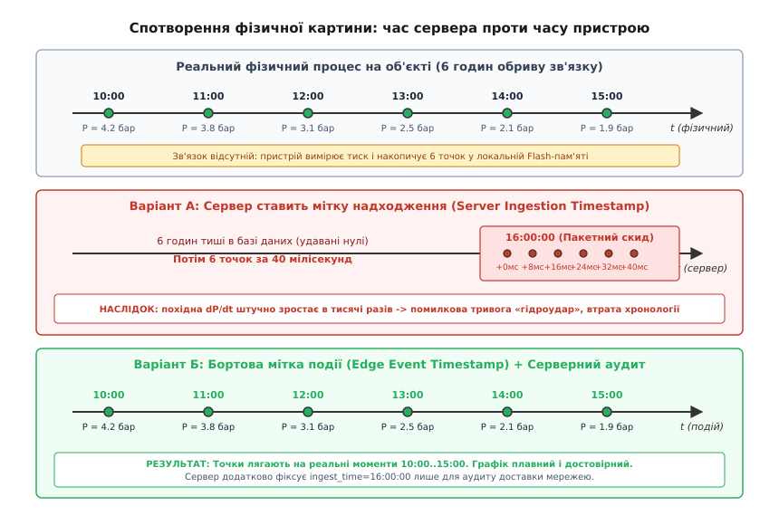
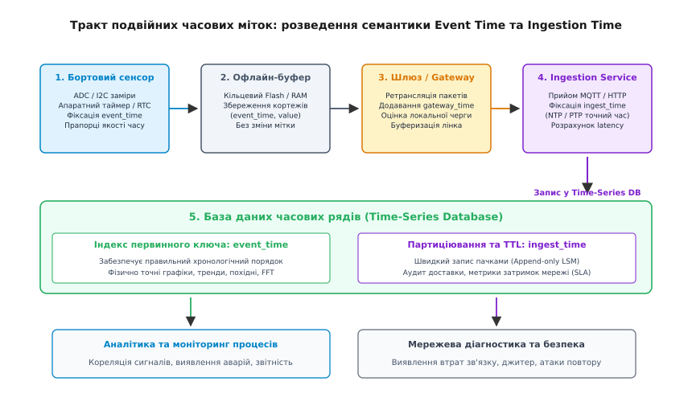
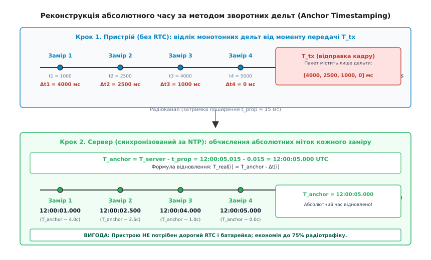

# Мітка часу: хто її ставить — пристрій чи сервер

<preknowlist>
- [Годинник на борту: RTC, дрейф, монотонність](root:embedded/hodynnyk-na-bortu) — як працюють апаратні лічильники, чому кварц дрейфує і чим небезпечний стрибок настінного часу.
- [Монотонний проти настінного часу](root:sf-apps/monotonic-vs-wall-time) — різниця між лінійним вимірюванням тривалості та календарем доби.
- [NTP і SNTP](root:com-protocol/ntp-sync) — мережева синхронізація часу, оцінка RTT та компенсація мережевої затримки.
</preknowlist>

Автономний реєстратор тиску на магістральному водогоні вимірює гідравлічний стан труби щосекунди, живлячись від літій-тіонілхлоридної батареї. Стільниковий модем вмикається раз на шість годин або під час аварійного сплеску, щоб скинути накопичений буфер на центральний сервер. О 10:00 зв'язок зникає через регламентні роботи на базовій станції. Насосна станція о 12:30 плавно знижує тиск з 4.2 до 1.9 бара протягом двадцяти хвилин. Логер сумлінно фіксує кожен відлік у [черзі офлайну](root:embedded/cherha-oflainu) у SPI Flash. О 16:00:00 стільниковий лінк відновлюється, і пристрій за 4 секунди вивантажує пачку з 21600 вимірювань через MQTT-брокер.

Якщо бекенд ставить мітку часу в момент отримання HTTP-запиту чи MQTT-повідомлення (англ. *server ingestion timestamp* — «серверний час реєстрації»), усі 21600 точок отримують мітки між `16:00:00.001` та `16:00:04.000`. На графіку чергового інженера шестигодинний плавний перехід перетворюється на вертикальний обвал за 4 секунди. Математичний алгоритм обчислює похідну `dP/dt`, фіксує перевищення порогу швидкості падіння тиску у 5400 разів і запускає фальшиву тривогу гідроудару. Водночас аналітична система не може зіставити цей графік із даними сусіднього витратоміра, який залишався на дротовому зв'язку і чесно писав реальний час подій.

Ця аварія ілюструє фундаментальну помилку спостереження в розподілених системах: підміну часу фізичного явища часом його транспортування комп'ютерною мережею. Щоб телеметрія залишалася достовірною, інженер мусить чітко розмежувати походження кожної мітки, зрозуміти природу затримок у радіоканалах і спроєктувати протокол передачі так, щоб часова вісь не спотворювалася за жодних умов зв'язку.

### Анатомія затримок у телеметричному тракті

Шлях сигналу від фізичного первинного перетворювача до запису в базу даних складається з кількох послідовних етапів. На кожному з них виникає часова затримка різної фізичної природи:

1. **Затримка перетворення сенсора (англ. *sensing latency*):** час інтегрування сигналу в АЦП, цифрова фільтрація всередині MEMS-сенсора та передача шиною I2C/SPI до мікроконтролера. Ця затримка варіюється від одиниць мікросекунд для простих АЦП до десятків мілісекунд для оптичних та електрохімічних газових сенсорів (детальніше цей етап розбирає [затримка давача й компенсація](root:hw-sensing/sensor-latency-compensation)).
2. **Черга обробки та квантування на мікроконтролері:** періодичний запуск вимірювальних завдань в RTOS або головному циклі (super-loop), накопичення вибірок у буфері оперативної пам'яті.
3. **Офлайн-буферизація (англ. *link outage buffering*):** вимушене або заплановане утримання даних на борту через відсутність радіопокриття, режим глибокого сну вузла чи розклад виходу на зв'язок. Затримка сягає від кількох хвилин до діб.
4. **Черги на проміжних вузлах і шлюзах:** буферизація в чергах пакетних концентраторів LoRaWAN, Mesh-маршрутизаторів та шлюзів протоколів. При сплеску трафіку або перевантаженні транзитного каналу шлюз затримує пакети на сотні мілісекунд або секунди.
5. **Протокольні повтори (ARQ):** механізми автоматичного запиту на повторну передачу кадрів при радіозавадах. Якщо кадр доставлено лише з четвертої спроби з експоненційним відкатом таймера (англ. *exponential backoff*), затримка в радіоканалі зростає від 20 мс до десятків секунд.
6. **Черги брокера та конвеєра прийому (англ. *ingestion lag*):** затримка обробки в чергах повідомлень Kafka, RabbitMQ чи пулі обробників бекенду перед фізичним записом у таблицю на диску.


*Зверху — реальний процес на об'єкті протягом шести годин відсутності зв'язку. Посередині — варіант із серверним часом надходження: вивантаження пачки о 16:00 спресовує всю історію в 40 мілісекунд, породжуючи фіктивний гідроудар і ламаючи похідні. Знизу — правильний підхід із бортовим часом події: точки займають свої істинні часові позиції, графік залишається фізично достовірним.*

Серверний час отримання пакета відбиває виключно стан транспортної мережі в дану мить: завантаженість радіоефіру, черги маршрутизатора та затримку стільникових стеків. Робити висновки про фізичний процес на основі мітки надходження — це те саме, що визначати дату написання паперового листа за штемпелем поштового відділення, яке тримало мішок із кореспонденцією на складі цілий тиждень.

> 🔧 **Навіщо це.** Якщо система керує зворотним зв'язком (наприклад, вентиляцією в теплиці чи автоклавом), підміна часу події серверним часом призводить до катастрофи. Регулятор отримує запізнілу пачку даних, вважає, що перегрів виник «щойно», і вмикає охолодження на повну потужність у момент, коли температура в системі вже впала природним шляхом. Тільки явний час вимірювання дозволяє математичній моделі оцінити актуальність даних і відрізнити миттєвий стан від запізнілого звіту.

### Пастка бортового часу: чому пристрій теж може брехати

Висновок про необхідність маркування даних безпосередньо на пристрої (англ. *edge event timestamp* — «бортова мітка події») здається очевидним, але на практиці він стикається з обмеженнями вбудованого заліза. Мікроконтролер не має постійного прямого доступу до атомного годинника, тому бортове джерело часу має власні критичні вразливості:

#### 1. Скидання епохи при холодному старті
Якщо пристрій не має резервної літієвої батарейки на виводі `VBAT` мікроконтролера або суперконденсатора, після будь-якого знеструмлення апаратний лічильник реального часу (англ. *real-time clock*, RTC) скидається в апаратний нуль. Для системного таймера UNIX це `1970-01-01 00:00:00 UTC`, для вбудованих RTC чипів STM32 — часто `2000-01-01 00:00:00`, для деяких модулів зв'язку — дата складання прошивки (наприклад, `2023-01-01`).

Якщо польовий сенсор увімкнувся в лісі без покриття мережі, він починає відраховувати секунди від 1970 року. Якщо прошивка сліпо чіпляє цей час до телеметрії, база даних Time-Series розкладає ці записи у партиції піввікової давнини. Коли зв'язок з'явиться, графік за поточний день залишиться порожнім, а оператор вважатиме, що датчик мертвий.

#### 2. Температурний дрейф годинникового кварцу
Більшість недорогих RTC використовують камертонні кварцові резонатори з номінальною частотою 32.768 кГц. Стандартна похибка такого кварцу становить ±20 ppm (англ. *parts per million* — «часток на мільйон») за кімнатної температури (+25 °C).

```
Дрейф за добу (20 ppm):
Δt = 24 · 3600 с · 20 · 10⁻⁶
   = 86400 · 0.000020
   = 1.728 с/добу
```

За місяць автономної роботи пристрій зміститься на `1.728 · 30 ≈ 51.8` секунди. Але на відкритому повітрі ситуація значно гірша: залежність частоти резонатора від температури є квадратичною параболою. За температури -20 °C або +60 °C відхилення досягає -150 ppm, що дає понад 13 секунд накопиченого дрейфу за добу (детальний аналіз фізики резонаторів наведено у статті [дрейф годинників](root:sf-distributed/clock-offset-drift)).

#### 3. Стрибки часу при жорсткій синхронізації
Коли розсинхронізований пристрій раптово отримує точний час (через GPS-модуль чи відповідь SNTP-сервера), наївна реалізація записує нове значення прямо в регістри RTC (англ. *stepping* — «крокове переведення»). Якщо внутрішній годинник поспішав на 10 секунд, після корекції час стрибає назад.

У результаті в пам'яті утворюється послідовність вимірювань, де час наступного відліку менший за час попереднього (`t[k+1] < t[k]`). Такий злам [монотонності](root:sf-apps/monotonic-vs-wall-time) ламає компресію в базах даних (наприклад, алгоритм Gorilla / Delta-of-Delta у Time-Series СУБД), спричиняє викиди у фільтрах Калмана та може призвести до нескінченних циклів у прошивці, яка очікує монотонного зростання часової осі.

#### 4. Вразливість до маніпуляцій та підробок
Якщо система виставляє рахунки за спожиті ресурси (електроенергія, вода, газ) за різними тарифами залежно від часу доби (день/ніч), повна довіра бортовій мітці часу відкриває шлях до шахрайства. Зловмисник може навмисно зрушити RTC лічильника назад, щоб дороге денне споживання зафіксувалося за дешевим нічним тарифом.

### Дворівневі часові мітки: розведення Event Time та Ingestion Time

Єдиний спосіб розв'язати цей конфлікт — відмовитися від спроб вибрати «одного господаря часу» і перейти до архітектурного патерну подвійних часових міток (англ. *dual timestamps*). Кожен замір у системі супроводжується двома обов'язковими мітками та бітовими метаданими якості:

```
+-------------------------------------------------------------------------+
| Кортеж телеметричного заміру                                            |
|                                                                         |
|  event_time    : 2026-08-26T12:30:15.120Z  (Час фізичного вимірювання)  |
|  ingest_time   : 2026-08-26T16:00:01.450Z  (Час реєстрації на сервері)  |
|  time_quality  : RTC_ESTIMATED | DRIFT_HIGH (Метадані довіри до часу)    |
|  sensor_value  : 3.82                      (Фізична величина)           |
+-------------------------------------------------------------------------+
```

Розгляньмо обов'язки кожного рівня в архітектурі:

- **`event_time` (час події):** формується в момент завершення перетворення АЦП або спрацювання апаратного переривання. Використовується виключно в інженерній аналітиці, на графіках процесів, при обчисленні швидкостей зміни параметрів, спектральному аналізі (FFT) та відновленні хронології аварій.
- **`ingest_time` (час прийому):** виставляється бекендом (або надійним шлюзом за Stratum-1 сервером) у момент прийому кадру. Використовується для аудиту доставки, виявлення затримок каналу зв'язку (`latency = ingest_time - event_time`), моніторингу працездатності шлюзів і технічного витіснення застарілих даних (TTL).
- **`time_quality` (прапорці достовірності):** бітова маска, що вказує статус бортового годинника в момент заміру.


*Архітектурний рух даних: сенсор фіксує event_time та якість годинника, офлайн-буфер зберігає кортеж без спотворень, шлюз опційно додає свій час, а ingestion service фіксує точний час надходження. СУБД розділяє індексацію для аналітики та партиціювання для запису.*

### Організація сховища в Time-Series СУБД

Сучасні бази даних часових рядів (TimescaleDB, ClickHouse, InfluxDB) оптимізовані під запис даних, що надходять строго в реальному часі. Коли сенсор після тривалого офлайну надсилає пачку історичних даних (англ. *out-of-order data* / *late arriving data*), це створює колосальне навантаження на підсистему пам'яті СУБД, якщо схема спроєктована неправильно.

Правильна стратегія полягає в розділенні осей індексації та партиціювання:

1. **Первинний індекс таблиці (Sorting Key):** будується за складеним ключем `(device_id, event_time)`. Це гарантує, що запити виду «показати графік тиску за вівторок з 10:00 до 16:00» зчитуватимуть послідовні сектори диска без зайвого пошуку, незалежно від того, коли ці дані були завантажені на сервер.
2. **Фізичне партиціювання таблиці (Partitions / Chunks):** налаштовується за вікнами `ingest_time` (наприклад, денні партиції). Завдяки цьому нові порції даних, навіть історичні, завжди дописуються в кінець активної поточної партиції на диску (LSM-дерево), не викликаючи важкої перебудови старих стиснених блоків минулих місяців.
3. **Обробка вікон агрегації (Watermarking):** у потокових процесорах (Apache Flink, Kafka Streams) для запізнілих даних налаштовують ватерлінії (англ. *watermarks*). Якщо дані за 12:30 надходять о 16:00, система тимчасово відкриває закрите вікно агрегації 12:00–13:00, оновлює розраховані середні значення і генерує коригувальне сповіщення в аналітичні дашборди. Формати представлення таких міток регламентує [ISO 8601, часові пояси й прикладний час](root:sf-data/iso-8601), а впорядкування подій із кількох джерел аналізують [порядок подій із різних джерел](root:sf-distributed/lamport-clocks) та [толерантність до безладу](root:sf-distributed/out-of-order-tolerance).

> 🔧 **Навіщо це.** Якщо ви налаштуєте партиціювання в ClickHouse за `event_time`, а польовий реєстратор після збою надішле пачку вимірювань із міткою 1970 року через скинутий RTC, СУБД створить окрему файлову партицію для 1970 року. Якщо сотні пристроїв перезавантажаться одночасно, база створить тисячі дрібних нестиснених шматків, що призведе до вичерпання дескрипторів файлів і падіння сервера (`Too many parts`). Фільтрація невалідного `event_time` на рівні шлюзу — обов'язкова умова стабільності бекенду.

### Відносні дельта-кодування та якірний метод

У вузькосмугових радіомережах (LoRaWAN, BLE Advertising, NB-IoT) розмір корисного навантаження кадру суворо обмежений. Наприклад, у LoRaWAN на швидкості DR0 максимальний розмір пакета становить лише 51 байт. Якщо передавати стандартну 64-бітну мітку часу UNIX (`uint64_t` = 8 байтів) для кожного 16-бітного вимірювання сенсора (`int16_t` = 2 байти), накладні витрати на метадані часу становитимуть 80% радіоканалу:

```
[Timestamp: 8 байтів][Value: 2 байти] -> 10 байтів на замір (лише 5 точок у кадрі)
```

Щоб розмістити в одному кадрі десятки вимірювань, застосовують відносне дельта-кодування часових інтервалів (англ. *delta timestamp encoding*).

#### Пряме дельта-кодування від бази (Forward Delta)
Якщо пристрій має синхронізований годинник, у заголовок кадру записують одну абсолютну базову мітку часу `t_base` (32 або 64 біти), а кожен наступний замір супроводжують короткою 16-бітною або 8-бітною дельтою зміщення вперед:

```
t_i = t_base + Δt_i
```

Якщо замір відбувається кожну секунду, дельта `Δt_i` займає лише 1–2 байти, що дозволяє вмістити в той самий 51-байтний кадр понад 20 вибірок замість 5.

#### Якірний метод зворотних дельт (Reverse Delta Reconstruction)
Що робити, якщо на борту пристрою **взагалі немає годинника реального часу**, немає резервної батарейки, а протокол зв'язку не передбачає прийому пакетів синхронізації часу з сервера (односторонній канал зв'язку)?

У цьому випадку застосовують метод якірної реконструкції за зворотними дельтами. Мікроконтролер використовує власний апаратний таймер мілісекунд (наприклад, системний лічильник `uptime_ms`), який гарантовано монотонний і не зазнає стрибків.


*Пристрій без RTC записує локальні вимірювання за монотонним таймером. У момент виходу в ефір T_tx він пакує різниці часу між кожним заміром і моментом відправки. Сервер, маючи точний час прийому, відновлює істинний астрономічний час кожної точки в минулому.*

Алгоритм працює наступним чином:
1. Під час кожного вимірювання мікроконтролер фіксує локальний монотонний час `t_mono[i]`.
2. У момент відправки кадру в радіоефір `t_tx` пристрій обчислює зворотну дельту — скільки мілісекунд тому відбувся кожен конкретний замір:
   
```
delta_back[i] = t_tx - t_mono[i]
```

3. У кадр записуються лише масив `delta_back[i]` та масив значень. Сам момент `t_tx` для останнього заміру дорівнює 0.
4. Сервер приймає пакет у момент `T_server` за власним високоточним NTP/PTP годинником.
5. Сервер віднімає відому фізичну затримку передачі сигналу в радіоканалі `t_prop` (затримка поширення та обробки в радіомодемі, зазвичай 10–50 мс) і знаходить абсолютний якірний час відправки:
   
```
T_anchor = T_server - t_prop
```

6. Сервер відновлює абсолютний час кожного вимірювання в минулому:
   
```
T_event[i] = T_anchor - delta_back[i]
```

Точність цього методу залежить виключно від дрейфу бортового генератора за короткий час накопичення пачки (кілька хвилин) та варіації затримки доставки в радіоканалі (джитера). Оскільки за 10 хвилин кварц встигає здрейфувати лише на 10–30 мілісекунд, похибка відновлення часу становить частки секунди — без використання RTC і без витрат енергії на підтримку резервного живлення годинника.

Повний математичний апарат розрахунку похибок та температурних залежностей наведено у вставці [розрахунок бюджету розсинхронізації та похибки зворотних дельт](root:embedded/mitka-chasu/math-clock-drift-budget.md).

### Програмна реалізація модуля часових міток на C та C++

Наведемо закінчену інженерну реалізацію модуля формування та відновлення телеметричних кадрів. Модуль підтримує як режим синхронізованого RTC з прямими мітками, так і якірний метод зворотних дельт для пристроїв без годинника.

Повний бінарний формат заголовків та специфікацію полів описано у вставці [специфікація бінарного кадру телеметрії](root:embedded/mitka-chasu/api-telemetry-frame.md).

:::tabs
:::code mitka-chasu-d/c/main.c
:::code mitka-chasu-d/cpp/main.cpp
:::

### Інженерна матриця вибору стратегії

Вибір методу маркування часу залежить від архітектурних обмежень проєкту: типу живлення, наявності зворотного радіоканалу, вимог до точності та бюджету трафіку.

| Характеристика системи | Рекомендована стратегія | Джерело часу | Накладні витрати на точку |
| :--- | :--- | :--- | :--- |
| **Real-time потік із низькою затримкою (UART, Ethernet, Wi-Fi)** | Dual Timestamps (Прямі мітки) | Бортовий SNTP + Серверний Ingest | 4–8 байтів на замір |
| **Автономний логер із періодичним зливом (LoRaWAN, NB-IoT)** | Якірний метод зворотних дельт | Монотонний таймер MCU + Якір сервера | 1–2 байти (дельта) |
| **Ультранизькоспоживаючий маяк без RTC (BLE Advertisement)** | Якірний метод зворотних дельт | Апаратний таймер мілісекунд | 1–2 байти |
| **Комерційний облік (електроенергія, газ, тепло)** | Dual Timestamps + Криптопідпис | Захищений апаратний RTC + NTP | 8 байтів + підпис |
| **Високошвидкісна вібродіагностика (1–10 кГц)** | Блоковий заголовок + фіксована сітка `dt` | Апаратний таймер вибірки АЦП | 0 байтів (індекс сітки) |

### Чекліст надійності часових міток у прошивці

Перед випуском телеметричного пристрою у польову експлуатацію перевірте дотримання семи інженерних інваріантів:

1. **Заборона жорсткого кроку часу назад (No Backward Stepping):** якщо годинник RTC під час синхронізації потребує коригування назад більше ніж на 1 секунду, прошивка зобов'язана використати плавне підтягування частоти (англ. *slewing* через регістри калібрування RTC, наприклад, `RTC_CALR` у мікроконтролерах STM32 або `rtc_clk_cali_value` в ESP-IDF) або зберегти старий монотонний часовий ряд до моменту перезапуску буфера.
2. **Обов'язкова валідація діапазону років:** значення року в системному часі повинно перевірятися за формулою `year >= BUILD_YEAR`. Якщо RTC повертає 1970 чи 2000 рік, прапорець `RTC_STATUS` виставляється в `UNSYNCHRONIZED`, а генерація абсолютних міток блокується на користь зворотних дельт.
3. **Обробка переповнення апаратного таймера (Timer Wrap-around):** стандартний 32-бітний лічильник мілісекунд (`millis()`) переповнюється через `2³² / (1000 · 3600 · 24) ≈ 49.71` доби. Обчислення інтервалів завжди повинно виконуватися через беззнакове віднімання `(uint32_t)(now - prev)`, яке коректно обробляє перехід через нуль завдяки арифметиці доповняльного коду.
4. **Ізоляція монотонного таймера від настінного:** для внутрішніх інтервалів (таймаути протоколів, періоди збору) використовується виключно `CLOCK_MONOTONIC` або апаратний таймер мікроконтролера (наприклад, `k_uptime_get()` у Zephyr RTOS або `xTaskGetTickCount()` у FreeRTOS), а не змінні настінного календаря.
5. **Фіксація температури для термокомпенсації:** якщо автономний пристрій накопичує дані понад 1 годину без синхронізації, прошивка повинна зчитувати внутрішній термодатчик кристала для програмної компенсації параболічного дрейфу частоти кварцу.
6. **Захист від атак повтору (Replay Attacks):** кожен кадр телеметрії повинен містити монотонно зростаючий лічильник пакетів (`sequence_number`), що унеможливлює повторне надсилання зловмисником старого валідного кадру з метою спотворення статистики.
7. **Роздільне зберігання на сервері:** бекенд ніколи не перезаписує `event_time` серверним часом і зберігає обидві мітки в окремих колонках бази даних, дозволяючи моніторити фізичний процес і мережевий тракт незалежно.
