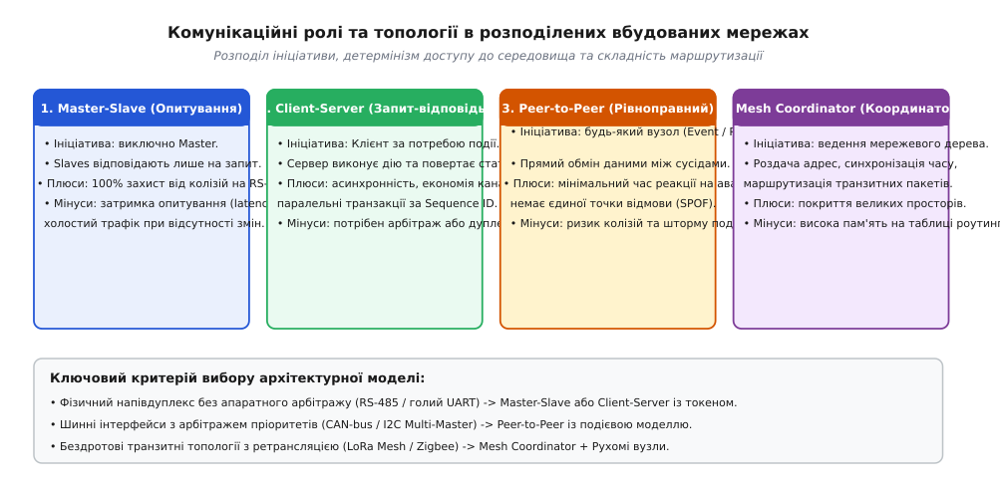
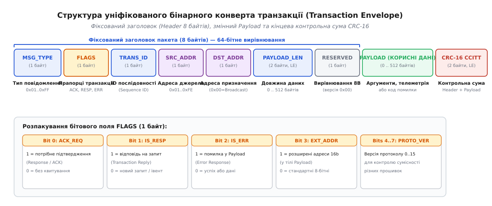
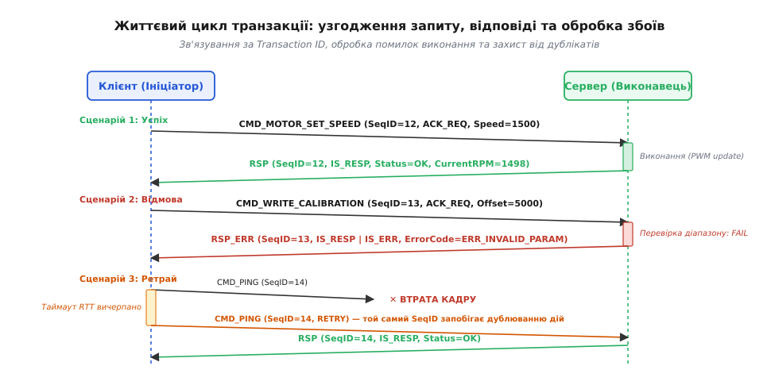
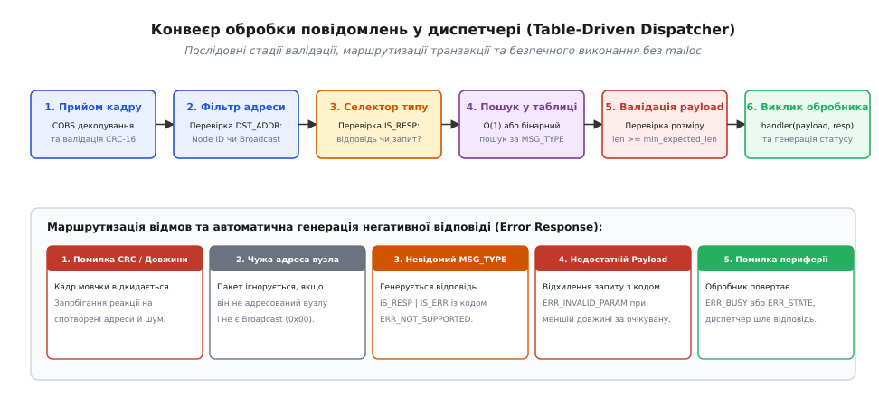

# Набір повідомлень і ролі сторін: клієнт, сервер, координатор

<preknowlist>
- [Проєктування пакета](root:com-transport/packet-design) — поділ кадру на заголовок, корисне навантаження й кінцевик.
- [Контрольна сума і CRC](root:com-modulation/crc) — виявлення бітових спотворень у каналі передачі.
- [Номер послідовності й дублікати](root:com-transport/sequence-numbering) — відстеження порядку та втрати повідомлень.
- [Таймаут як частина протоколу](root:sf-distributed/timeouts-deadlines) — граничний час очікування відповіді у розподілених системах.
</preknowlist>

Коли два мікроконтролери обмінюються сирим потоком байтів через спільну лінію зв'язку (наприклад, опитувальний модуль зчитує показники плати датчиків по інтерфейсу [RS-485](root:com-medium/rs-485-multidrop-bus)), відсутність чіткої системи команд перетворює будь-яку нештатну ситуацію на глухий кут. Якщо приймач отримує послідовність байтів `0x10 0x02 0x00 0xFA`, без протокольного конверта неможливо визначити, чи це результат вимірювання температури, вимога ввімкнути реле підігріву, чи аварійне сповіщення про перегрів силового каскаду. Якщо обидва вузли почнуть передавати дані одночасно, на напівдуплексній шині [UART](root:com-devices/half-duplex-uart) виникне апаратна колізія, яка спотворить дані, а якщо один із вузлів зависне під час запису налаштувань у Flash-пам'ять, ініціатор запиту не дізнається, чому операція не завершилася.

Для побудови надійної розподіленої системи недостатньо просто запакувати байти в кадр за допомогою [COBS](root:com-transport/cobs-framing) і захистити їх [контрольною сумою CRC](root:com-modulation/crc). Необхідно спроєктувати семантичний рівень протоколу: чітко розмежувати ролі пристроїв у фізичному середовищі, класифікувати типи повідомлень, закласти механізм наскрізного зв'язування запитів із відповідями через унікальні ідентифікатори транзакцій (лат. *transactio* — звершення справи) та визначити стандартну модель повернення помилок.


*Чотири архітектурні моделі розподілу ролей: від жорсткого циклічного опитування на напівдуплексній шині до динамічної маршрутизації в комірчастій бездротовій мережі.*

---

## 1. Комунікаційні ролі та топології в розподілених системах

Розподіл ініціативи в мережі визначається фізичною природою каналу зв'язку, вимогами до часу реакції на критичні події та обчислювальними ресурсами вузлів. У вбудованих системах виділяють чотири базові комунікаційні парадигми:

### Master-Slave (Опитування за розкладом)

У моделі з виділеним ведучим вузлом (Master) і підлеглими пристроями (Slave) виключне право ініціювати передачу в каналі належить ведучому. Підлеглий вузол перебуває в режимі постійного прослуховування лінії й активує свій передавач лише тоді, коли приймає кадр, адресований безпосередньо йому.

```
Master:   [POLL Node 2] ──────────────────────> [POLL Node 3] ───────>
Slave 2:                 [DATA: T=24.5C] ───────┘
Slave 3:                                                       [DATA: T=21.0C]
```

Головна перевага цієї моделі — абсолютний захист від електричних колізій на простих напівдуплексних шинах без вбудованого апаратного арбітражу (RS-485, однопровідні шини 1-Wire, прості трансивери радіоканалу). Однак підхід має два принципових обмеження:
1. **Затримка реакції (Latency):** якщо на підлеглому вузлі спрацював кінцевий аварійний вимикач або сенсор удару, він не може повідомити систему негайно. Вузол змушений чекати, доки ведучий контролер завершить цикл опитування решти сорока вузлів на шині та надішле йому черговий опитувальний кадр. Для шини на 32 вузли зі швидкістю 9600 бод повний цикл опитування може тривати від 150 до 500 мс.
2. **Нераціональне використання смуги пропускання:** більша частина трафіку витрачається на циклічні порожні опитування вузлів, чий стан між циклами опитування взагалі не змінився.

### Client-Server (Запит-відповідь / RPC)

Модель «клієнт-сервер» (лат. *client*, той, що звертається по послугу; лат. *servus*, той, що виконує дію) переносить ініціативу на сторону пристрою, якому потрібна дія або ресурс. Клієнт формує запит на читання чи запис параметрів, відправляє його серверу й переходить у стан очікування квитанції або результату обчислень.

На відміну від моделі Master-Slave, взаємодія тут подієва: запит надсилається лише тоді, коли в ньому дійсно є потреба. У мережах із можливістю мультиплексування (наприклад, повнодуплексний UART або адресований CAN) клієнт може надіслати кілька незалежних запитів поспіль різним вузлам, не очікуючи негайного блокуючого завершення кожного з них, якщо протокол підтримує відстеження транзакцій через номери послідовностей.

У конвеєрному режимі (Pipelining) клієнт тримає чергу активних транзакцій. Якщо сервер зайнятий повільною операцією (наприклад, калібруванням оптичного сенсора тривалістю 40 мс), клієнт може паралельно опитувати інший модуль або виконувати фонові обчислення, прив'язуючи асинхронні відповіді до оригінальних запитів за їхніми унікальними номерами.

### Peer-to-Peer (Рівноправний подієвий обмін)

В одноранговій моделі (Peer-to-Peer, P2P) кожен мікроконтролер має однаковий мережевий пріоритет і право передавати пакети без дозволу зовнішнього координатора. Вузол генерує сповіщення негайно в момент виникнення фізичної події — наприклад, перевищення порогу струму на драйвері двигуна.

Для роботи P2P фізичний рівень зобов'язаний забезпечувати неруйнівний побітовий арбітраж середовища (як у [CAN](root:com-devices/can-arbitration)) або протокол множинного доступу з контролем несучої (CSMA/CA в Ethernet та радіомодулях). Без апаратного або протокольного арбітражу одночасна спроба двох вузлів сповістити про аварію призведе до спотворення обох пакетів на шині.

У P2P мережах застосовують модель «публікація-підписка» (Publish-Subscribe): вузол формує повідомлення з ідентифікатором теми чи події, а всі зацікавлені вузли на спільній шині приймають і обробляють його паралельно, що скорочує затримку сповіщення системи до одиниць мікросекунд.

### Mesh Coordinator (Координатор сітчастої мережі)

У масштабних бездротових мережах зі складною геометрією (Mesh-мережі стандартів Zigbee, Thread або кастомних протоколів на базі LoRa / 802.15.4) прямий радіозв'язок між крайніми вузлами неможливий через обмежений радіус дії передавачів.

У такій системі роль координатора (Coordinator) полягає не в постійному опитуванні датчиків, а в адміністративному керуванні мережевою інфраструктурою:
- **Формування мережі та автентифікація:** координатор відкриває вікно реєстрації для нових вузлів, перевіряє ключі доступу та видає короткі логічні адреси (наприклад, 16-бітні мережеві ID замість довгих 64-бітних апаратних MAC-адрес).
- **Синхронізація часу:** розсилка періодичних маякових сигналів (Beacons) для підтримування єдиної шкали часу, що необхідно для технологій із часовим розподілом каналів (Time-Slotted Channel Hopping).
- **Маршрутизація:** координатор бере участь у побудові таблиць пересилань для транзитних пакетів, коли датчик із периферії надсилає дані на базову станцію через два проміжних ретранслятори.

> 🔧 **Навіщо це.**
> Архітектурна роль диктує внутрішню організацію прошивки: для ролі Slave у Master-Slave достатньо простого лінійного автомата в перериванні UART, який читає запит і заповнює статичний буфер відповіді. Для ролей Client або P2P мікроконтролеру потрібна повноцінна черга вихідних транзакцій із таймерами повторних спроб (Retransmission Timers), таблицею очікування квитанцій та логікою обробки таймаутів.

---

## 2. Семантична типологія повідомлень

Якщо звести всі протокольні кадри до єдиного формату «команда з кодом і навантаженням», логіка прошивки заплутається у взаємних блокуваннях. Наприклад, якщо вузол сприйматиме черговий пакет телеметрії як команду, що потребує обов'язкової відповіді, шина захлинеться у лавині зворотних квитанцій.

Щоб протокол був передбачуваним, усі повідомлення розподіленої системи поділяють на три семантичні класи з принципово різними правилами доставки та життєвого циклу.

```
┌────────────────────────────────────────────────────────────────────────┐
│                        ТИПИ ПОВІДОМЛЕНЬ                                │
├─────────────────────────┬────────────────────────┬─────────────────────┤
│ 1. Команди (Commands)   │ 2. Телеметрія / Події  │ 3. Запити стану     │
│    • Імперативна дія    │    • Одностороння      │    (Get / Set)      │
│    • Зміна стану заліза │      публікація фактів │    • Читання реєстру│
│    • Обов'язкова        │    • Періодична або    │    • Ідемпотентна   │
│      відповідь (ACK/RSP)│      порогова аварія   │      конфігурація   │
└─────────────────────────┴────────────────────────┴─────────────────────┘
```

### Команди (Commands — `CMD`)

Команда — це директивна вимога від ініціатора до виконавця виконати певну фізичну чи програмну дію, що змінює внутрішній стан пристрою:
- змінити шпаруватість ШІМ на драйвері крокового двигуна;
- переключити стан силового твердотільного реле;
- виконати апаратне перезавантаження вузла або перехід у режим завантажувача (Bootloader).

Команда завжди вимагає генерації квитанції або розгорнутої відповіді (`Response` / `RSP`). Якщо виконавець прийняв команду, він зобов'язаний повернути результат її виконання (статус успіху або код виявленої помилки).

Критичним аспектом проєктування команд є **ідемпотентність** (лат. *idem* — той самий, *potentia* — сила). Якщо через заваду в лінії відповідь виконавця була втрачена, ініціатор після закінчення таймауту відправить команду повторно. Якщо команда неідемпотентна (наприклад, «повернути сервопривід на +10 градусів»), повторне виконання призведе до сумарного повороту на +20 градусів замість бажаних +10.

Щоб запобігти цьому, застосовують два підходи:
1. **Абсолютні величини в аргументах:** замість відносних дій («додати 10 градусів») команду проєктують через цільовий кінцевий стан («встановити абсолютний кут 45 градусів»).
2. **Дедуплікаційне вікно транзакцій:** виконавець зберігає кільцевий буфер із кількох останніх оброблених пар `(src_addr, trans_id)` та сформованих для них відповідей. Отримавши повторний запит із тим самим ідентифікатором, мікроконтролер не запускає мотор удруге, а миттєво відправляє збережену копію попередньої відповіді з буфера.

### Телеметрія та події (Events / Telemetry — `EVT` / `TLM`)

Телеметрія (грец. *tele* — далеко, *metron* — вимір) та події — це асинхронні сповіщення, що передають факти про стан вузла в односторонньому порядку:
- періодичний звіт: кожні 100 мс передається масив із напругою акумулятора, температурою радіатора та струмом споживання;
- аварійна подія: миттєве сповіщення про спрацювання оптичного датчика перешкоди.

Телеметрія переважно транслюється без очікування відповіді (Unconfirmed / Fire-and-Forget). Втрата одного проміжного вимірювання температури у безперервному потоці не є критичною, оскільки через 100 мс надійде свіже актуальне значення. Спроба вимагати квитанцію на кожне періодичне вимірювання подвоїть навантаження на канал зв'язку та призведе до вичерпання буферів передавача.

Винятком є критичні аварійні події (Alarm Events). Для них у заголовку встановлюють прапорець вимоги квитування (`ACK_REQ`), і передавач повторює сповіщення доти, доки центральний контролер не підтвердить його отримання.

Для черг подій на мікроконтролері реалізують стратегію витіснення:
- для періодичних показників застосовують політику **Drop Oldest** (найстаріше невідправлене значення замінюється свіжим);
- для аварійних подій застосовують блокуючу політику з найвищим пріоритетом передачі без скидання.

### Запити та встановлення властивостей (Get / Set Properties)

Для конфігурування та діагностики вузлів застосовують модель параметричних реєстрів або властивостей:
- `GET_PROPERTY(PropertyID)`: запит поточного значення параметра (версія прошивки, серійний номер, поточний коефіцієнт підсилення операційного підсилювача). Запит `GET` строго ідемпотентний, він гарантовано не змінює конфігурацію пристрою.
- `SET_PROPERTY(PropertyID, Value)`: запис нового значення в оперативну або енергонезалежну пам'ять. Відповіддю на `SET` є або ехо-пакет із новим підтвердженим значенням, або код помилки, якщо передане значення виходить за допустимі межі калібрування.

Модель `Get/Set` дозволяє уніфікувати роботу конфігураційних утиліт та інструментів автотестування: замість створення десятків спеціалізованих команд для кожного калібрувального коефіцієнта прошивка оперує єдиною таблицею властивостей із числовими ідентифікаторами.

---

## 3. Універсальний бінарний конверт транзакції

Щоб диспетчер повідомлень на приймальній стороні міг однозначно маршрутизувати будь-який пакет, виділити корисне навантаження та повернути відповідь потрібному адресату, поверх транспортного кадру накладається уніфікований бінарний заголовок транзакції (Transaction Envelope).


*Побайтова розкладка бінарного пакета: фіксований 8-байтний заголовок, вирівняний по межі 64 біт, довільне корисне навантаження та хвостова контрольна сума.*

### Поля заголовка та їхнє призначення

Заголовок проєктується компактним, але вирівняним, щоб спростити роботу 32-бітних процесорів архітектур ARM Cortex-M та RISC-V без виникнення штрафів за непарний доступ до пам'яті (unaligned access):

| Зміщення (байт) | Поле | Тип | Опис |
|---|---|---|---|
| `0x00` | `msg_type_id` | `uint8_t` | Числовий ідентифікатор типу команди, події або запиту (0x01..0xFF). |
| `0x01` | `flags` | `uint8_t` | Бітові прапорці транзакції (квитування, тип відповіді, версія). |
| `0x02` | `trans_id` | `uint8_t` | Унікальний номер транзакції (Sequence ID) для зв'язування запиту й відповіді. |
| `0x03` | `src_addr` | `uint8_t` | Логічна адреса відправника пакета (0x01..0xFE). |
| `0x04` | `dst_addr` | `uint8_t` | Логічна адреса отримувача (0x00 = Broadcast, 0x01..0xFE = вузли). |
| `0x05..0x06` | `payload_len` | `uint16_t` | Довжина корисного навантаження в байтах у порядку Little-Endian. |
| `0x07` | `reserved` | `uint8_t` | Байт вирівнювання до межі 8 байтів (зарезервовано, завжди 0x00). |
| `0x08..` | `payload[]` | `uint8_t[N]` | Довільні аргументи команди, байти телеметрії або код помилки. |
| `0x08+N..` | `crc16` | `uint16_t` | Контрольна сума CRC-16 CCITT від заголовка та навантаження. |

### Бітове поле прапорців (`flags`)

Байт прапорців містить службову інформацію, що керує логікою маршрутизації в диспетчері:

```
Біти:   [ 7   6   5   4 ] [   3   ] [   2   ] [   1   ] [   0   ]
Поле:   [   PROTO_VER   ] [EXT_ADDR] [IS_ERR ] [IS_RESP] [ACK_REQ]
```

1. **`ACK_REQ` (Bit 0, `0x01`):** прапорець вимоги підтвердження. Якщо встановлено в `1`, отримувач зобов'язаний сформувати відповідь. Якщо `0`, пакет обробляється односторонньо без відправки зворотного трафіку.
2. **`IS_RESP` (Bit 1, `0x02`):** селектор напрямку транзакції. Значення `0` вказує на ініціативний запит (команда, запит `GET`, подія). Значення `1` вказує, що це відповідь на раніше надісланий запит із відповідним `trans_id`.
3. **`IS_ERR` (Bit 2, `0x04`):** прапорець помилки. Встановлюється сервером разом із `IS_RESP`, якщо запит не вдалося виконати. У такому разі `payload` містить не дані результату, а стандартизований код помилки та необов'язковий діагностичний контекст.
4. **`EXT_ADDR` (Bit 3, `0x08`):** ознака використання розширеної 16-бітної адресації в тілі payload (для транзитних Mesh-пакетів або систем із понад 250 пристроями).
5. **`PROTO_VER` (Bits 4..7, маска `0xF0`):** 4-бітний номер версії протоколу (0..15). Дозволяє прошивкам різного покоління контролювати сумісність форматів даних.

### Механізм узгодження транзакцій за Sequence ID

Головна проблема асинхронного зв'язку — переплутування відповідей. Припустимо, хост відправив датчику запит температури (`trans_id = 42`), а слідом за ним — запит напруги батареї (`trans_id = 43`). Через різний час опитування датчиків по I2C/ADC відповідь на другий запит може згенеруватися швидше, ніж на перший.


*Діаграма послідовності обміну: зв'язування за SeqID, коректне відхилення некоректних параметрів та відновлення після втрати кадру.*

Приймаючи відповідь із прапорцем `IS_RESP`, клієнт перевіряє поле `trans_id`. Знайшовши у внутрішній таблиці активних транзакцій запис із номером 43, клієнт точно знає, що отриманий масив байтів належить напрузі батареї, навіть якщо відповідь на запит 42 ще перебуває в дорозі. Після завершення обробки слот транзакції 43 у таблиці звільняється.

---

## 4. Модель обробки помилок на рівні протоколу

У розподілених системах принципово розрізняють два рівні помилок:
1. **Помилки каналу зв'язку (Транспортний рівень):** пошкодження байтів шумом на лінії, незбіг контрольної суми CRC, порушення розмітки кадру COBS. Такі кадри **відкидаються мовчки**. Генерація відповіді на битий кадр заборонена, оскільки через спотворення бітів поле адреси відправника (`src_addr`) або номер транзакції (`trans_id`) можуть бути хибними, і відповідь полетить невинному вузлу або викличе шторм у мережі.
2. **Протокольні помилки виконання (Рівень застосунку):** кадр прийнято цілим, контрольна сума зійшлася, адреса співпала, але мікроконтролер не може виконати дію (передано неприпустимий аргумент, периферійний блок зайнятий іншою задачею, команда не підтримується поточною прошивкою).

У випадку протокольної помилки сервер формує **негативну відповідь (Error Response)**:
- встановлює прапорці `flags = IS_RESP | IS_ERR`;
- копіює значення `trans_id` та `msg_type_id` із вхідного запиту;
- у полі `payload` повертає мінімум один байт — стандартизований код помилки (`ErrorCode`).

```
┌────────────────────────────────────────────────────────────────────────┐
│                  КАТАЛОГ СТАНДАРТНИХ КОДІВ ПОМИЛОК                    │
├──────┬──────────────────────┬──────────────────────────────────────────┤
│ Код  │ Константа            │ Опис причини відмови                     │
├──────┼──────────────────────┼──────────────────────────────────────────┤
│ 0x00 │ ERR_OK               │ Успішне виконання (для простих квитанцій)│
│ 0x01 │ ERR_INVALID_PARAM    │ Аргумент виходить за допустимі межі      │
│ 0x02 │ ERR_NOT_SUPPORTED    │ Невідомий MSG_TYPE або застаріла функція │
│ 0x03 │ ERR_BUSY             │ Периферія (ADC/Flash/I2C) зайнята        │
│ 0x04 │ ERR_INVALID_STATE    │ Команда неприпустима в поточному режимі  │
│ 0x05 │ ERR_HARDWARE_FAULT   │ Апаратний збій (немає відповіді від чипа)│
│ 0x06 │ ERR_UNAUTHORIZED     │ Дія вимагає попереднього пароля чи сесії │
│ 0x07 │ ERR_BUFFER_OVERFLOW  │ Розмір навантаження перевищує буфер вузла│
└──────┴──────────────────────┴──────────────────────────────────────────┘
```

Такий підхід позбавляє клієнта необхідності чекати вичерпання повного таймауту очікування. Отримавши пакет із кодом `ERR_INVALID_PARAM` за 2 мілісекунди, хост негайно реєструє програмну помилку та припиняє марні повторні відправки.

Для критичних систем негативна відповідь може містити розширений діагностичний контекст:

```
[Помилка 0x01 (ERR_INVALID_PARAM)] [ID параметра (2B)] [Отримане значення (4B)] [Діапазон Min..Max (8B)]
```

Це дозволяє інженеру під час налагодження через консоль чи логер бачити точну причину відхилення команди без підключення апаратного відлагоджувача JTAG.


*Конвеєр диспетчеризації: шість етапів валідації пакета від прийому сирого буфера до генерації позитивної або негативної відповіді.*

---

## 5. Практична реалізація: диспетчер повідомлень вузла датчиків

Розглянемо практичний приклад побудови диспетчера повідомлень для автономного сенсорного вузла моніторингу навколишнього середовища. Вузол підтримує чотири типи повідомлень:
1. `CMD_PING` (`0x01`): перевірка зв'язку (повертає `ERR_OK`).
2. `CMD_GET_TELEMETRY` (`0x10`): читання показників сенсорів (температура `int16_t`, тиск `uint32_t`, заряд батареї `uint8_t`).
3. `CMD_SET_REPORT_RATE` (`0x20`): налаштування періоду автоматичного вимірювання (аргумент: період у мілісекундах `uint16_t`, допустимий діапазон 100..10000 мс).
4. `CMD_CALIBRATE_ADC` (`0x30`): запуск тривалого процесу автокалібрування АЦП (повертає `ERR_BUSY`, якщо калібрування вже виконується).

### Реалізація на мовах C та C++

У вбудованих системах критично уникати динамічного виділення пам'яті (`malloc`/`new`) під час обробки пакетів. Диспетчер організовується на базі статичної таблиці обробників (Dispatch Table), що зв'язує `msg_type_id` із функцією-обробником та мінімально необхідним розміром навантаження.

:::tabs
:::code nabir-povidomlen-i-roli-storin-d/c/main.c
:::code nabir-povidomlen-i-roli-storin-d/cpp/main.cpp
:::

---

## 6. Практичні пастки проектування та інженерні обмеження

Під час впровадження кастомного протоколу розробники найчастіше стикаються з трьома критичними проблемами синхронізації та масштабування.

### 1. Джиттер таймаутів та розрахунок вікна очікування

Якщо клієнт встановить таймаут очікування відповіді занадто малим (наприклад, 10 мс), а сервер виконує блокуюче зчитування датчика I2C тривалістю 12 мс, клієнт передчасно зафіксує збій зв'язку та відправить повторний запит. Сервер, завершивши роботу, надішле відповідь на перший запит, але клієнт сприйме її як відповідь на другий, що призведе до порушення фази транзакцій.

Граничний час очікування відповіді (`T_timeout`) повинен враховувати найгірший час обробки та затримку поширення:

```
T_timeout = 2 · T_tx_max + T_proc_max + T_guard
= 2 · (N_bytes · 10 / BaudRate) + T_proc_max + T_guard  [розрахунок часу RTT]
```

де `T_tx_max` — час фізичної передачі найдовшого кадру на заданій швидкості бод, `T_proc_max` — максимальний час виконання операції сервером (з урахуванням можливого блокування в перериваннях), а `T_guard` — захисний інтервал джиттеру RTOS (зазвичай 10..50 мс).

### 2. Запобігання шторму квитанцій при широкомовній розсилці (Broadcast Storm)

Якщо хост надсилає широкомовне повідомлення на адресу `0x00` (наприклад, команду «вимкнути всі приводи») із встановленим прапорцем `ACK_REQ`, усі підключені до шини пристрої одночасно спробують виставити рівень передавача та надіслати квитанцію. На шині RS-485 це спричинить миттєву апаратну колізію, перегрів вихідних каскадів мікросхем трансиверів та повне спотворення сигналу.

**Залізне правило протоколу:** обробник вхідного пакета зобов'язаний ігнорувати прапорець `ACK_REQ`, якщо адреса призначення `dst_addr == 0x00`. Відповіді на широкомовні пакети заборонені. Якщо хосту необхідно перевірити стан кожного вузла після групової команди, він зобов'язаний опитати кожен вузол індивідуальним адресним запитом по черзі.

### 3. Еволюція набору команд та зворотна сумісність

У процесі експлуатації виникає потреба додати до структури телеметрії нові поля (наприклад, вологість або вібрацію). Якщо старий хост отримає від нової прошивки пакет більшого розміру, він може відкинути його як пошкоджений.

Для забезпечення сумісності дотримуються трьох правил:
- **Перевірка за мінімальною довжиною:** диспетчер перевіряє умову `rx_len >= min_expected_len`, а не строгу рівність `rx_len == sizeof(...)`. Це дозволяє старим пристроям ігнорувати нові поля, додані в кінець пакета.
- **Незмінність ідентифікаторів `msg_type_id`:** видалені команди помічаються як застарілі (`DEPRECATED`), але їхні числові коди ніколи не призначаються новим функціям.
- **Використання поля версії:** біти `PROTO_VER` у байті прапорців змінюються лише тоді, коли змінюється базова структура 8-байтного заголовка або алгоритм розрахунку контрольної суми. Детальніше про стратегії міграції версій див. у статті [Версія протоколу](root:embedded/versiia-protokolu).

---

## 7. Підсумки

Побудова надійного протокольного рівня спирається на три принципи:
1. **Топологічна дисципліна:** комунікаційна роль (Master-Slave для захисту від колізій на RS-485, Client-Server для асинхронного запиту дій, P2P для швидких аварійних сигналів) повинна відповідати фізичним можливостям каналу.
2. **Однозначність семантики:** розділення повідомлень на ідемпотентні команди зі зміною стану, періодичну телеметрію та запити реєстрів запобігає перевантаженню шини та фатальним повторним діям.
3. **Уніфікований конверт транзакцій:** фіксований заголовок із полями `trans_id`, `flags` та адресацією дозволяє організувати табличну диспетчеризацію без динамічної пам'яті та гарантує швидке повернення стандартизованих кодів помилок.
