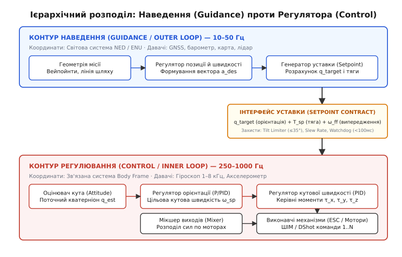
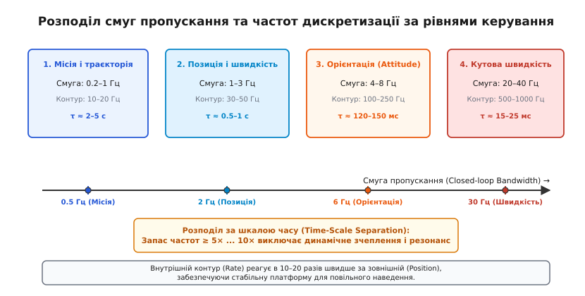
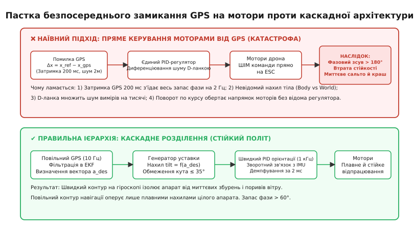
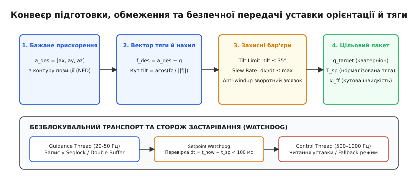

# Наведення проти регулятора: хто обирає уставку, хто її тримає

<preknowlist>
- [Автономна система](root:embedded/autonomous-system) — замкнений контур: давачі, оцінювач, каскадні регулятори та актуатори.
- [Три способи керувати](root:embedded/try-sposoby-keruvaty) — пряме, з підказкою та наглядове керування, каскад вкладених петель.
- [Оцінка орієнтації](root:embedded/attitude-estimation) — відновлення просторових кутів і кватерніонів із гіроскопа та акселерометра.
- [Каскадне налаштування PID](root:embedded/pid-tuning-cascade) — внутрішня петля швидкості та зовнішня петля кута.
- [Мікшування виходів](root:embedded/output-mixing) — перетворення бажаних моментів та тяги на команди окремих моторів.
</preknowlist>

Квадрокоптер завис у точці над землею на висоті п'яти метрів. Раптовий бічний порив вітру налітає на раму: за перші 15 мілісекунд апарат нахиляється на 12 градусів праворуч, а за наступні півтори секунди зміщується на два метри вбік від заданої точки. Якщо в цей момент система керування спробує розв'язати обидві проблеми одним монолітним алгоритмом — скажімо, подасть відхилення координат з GNSS безпосередньо на оберти безколекторних моторів, — апарат перекинеться й розіб'ється менш ніж за секунду. 

Причина полягає в тому, що нахил на 12 градусів загрожує негайною втратою підйомної сили й вимагає реакції за 2–5 мілісекунд, тоді як повернення на два метри назад є повільним геометричним процесом, де намагання діяти миттєво лише розгойдує конструкцію. Щоб літальний апарат, підводний робот чи безпілотний автомобіль залишалися керованими, задачу управління розділяють на два фундаментальні шари: **наведення** (англ. *guidance*, від *to guide* — вести, скеровувати) та **регулювання** (лат. *regulare* — впорядковувати, тримати в нормі). Один шар вирішує, **куди** апарат має прямувати, а другий — **як** збалансувати сили на його корпусі прямо зараз.


*Ієрархічний розподіл: Контур наведення (Guidance) оперує навігаційними координатами й генерує уставку, а контур регулювання (Control) відпрацьовує моменти та тягу у зв'язаній системі координат апарата.*

## Концептуальна межа: хто що знає і хто чим розпоряджається

Головна причина поділу автоматичного керування на наведення та регулювання полягає у відмінності **систем координат**, **джерел інформації** та **керованих фізичних величин**.

Контур наведення (зовнішній контур, *Outer Loop* / *Guidance Loop*) відповідає на стратегічне питання місії: *«Яке прискорення й просторове положення потрібні апарату, щоб рухатися за заданою траєкторією?»*. Він оперує **навігаційною системою координат** — зазвичай це географічна тривимірна система NED (північ–схід–вниз, *North-East-Down*) або ENU (схід–північ–вгору). 

Наведення спирається на «повільні» вимірювання зовнішнього світу:
- Географічні координати та швидкість від супутникового приймача GNSS;
- Висоту від барометра, ультразвукового чи лазерного далекоміра;
- Дані оптичного потоку (*optical flow*) або карти зайнятості простору;
- Положення маршрутних точок (*waypoints*) та векторів цільових швидкостей.

Контур наведення розраховує траєкторію, компенсує статичний знос вітром, відстежує бічне відхилення від лінії шляху (*cross-track error*) і формує на своєму виході єдиний результат — **уставку** (англ. *setpoint*). Уставка містить цільову просторову орієнтацію (бажаний нахил корпуса) та величину сумарної тяги.

Контур регулювання (внутрішній контур, *Inner Loop* / *Attitude & Rate Control*) відповідає на суто динамічне питання: *«Як прямо зараз збалансувати тягу й кутові моменти на моторах, щоб реальна орієнтація збіглася із заданою уставкою?»*. Регулятор оперує виключно **зв'язаною системою координат** (*Body Frame*, де вісь `X` спрямована вздовж носа, `Y` — праворуч, `Z` — вниз крізь дно апарата).

Регулятор бачить внутрішній світ динаміки твердого тіла:
- Миттєві кутові швидкості з триосьового гіроскопа (`ω_x, ω_y, ω_z`);
- Питомі сили з акселерометра;
- Поточну оцінку орієнтації корпуса у вигляді кватерніона `q_est` з алгоритму комплексування давачів [оцінки орієнтації](root:embedded/attitude-estimation).

Регулятор не знає, де розташована кінцева точка маршруту, чи летить дрон над полем або над лісом, і чи дує зустрічний вітер. Його єдина мета — мінімізувати похибку між бажаною орієнтацією з уставки та фактичним кутом нахилу рами, формуючи моменти сил (`τ_x, τ_y, τ_z`) для [мікшера виходів](root:embedded/output-mixing).

```
НАВЕДЕННЯ (GUIDANCE):
  Вхід:   Маршрутні точки (NED), координати GNSS, барометр, карта
  Знає:   «Куди треба летіти і де ціль у просторі»
  Вихід:  Уставка орієнтації (q_target) + Нормалізована тяга (T_sp)

                  │  [Межа інтерфейсу: уставка]
                  ▼

РЕГУЛЯТОР (CONTROL):
  Вхід:   Уставка (q_target, T_sp) + Гіроскоп / IMU (Body Frame)
  Знає:   «Як стабілізувати кути й моменти твердого тіла прямо зараз»
  Вихід:  Керівні моменти (τ_x, τ_y, τ_z) → Мотори / ESC
```

Такий поділ створює жорстку інформаційну ізоляцію: контур стабілізації захищений від шуму та збоїв навігаційних сенсорів, а алгоритми навігації звільнені від необхідності враховувати конфігурацію гвинтів, вагу рами чи аеродинамічний демпфер пропелерів.

> 🔧 **Навіщо це.** Якщо ви заміните чотирилопатеві пропелери на трилопатеві або встановите важчу батарею, зміняться лише коефіцієнти PID внутрішнього контуру регулятора кутових швидкостей. Алгоритм наведення на точку, розрахунок вейпойнтів і логіка місії залишаться на 100% незмінними, оскільки інтерфейс між ними — це абстрактне прискорення та цільовий кут.

## Різниця в часових шкалах: теорія розділення рухів

Поділ контурів — це не лише зручність програмування, а фундаментальна вимога теорії автоматичного керування, яка спирається на **принцип розділення часових шкал** (англ. *Time-Scale Separation Principle* або *Singular Perturbation Theory*).

Фізичні процеси безпілотного апарата мають кардинально різну власну швидкість протікання:

1. **Динаміка обертання навколо центру мас (швидка підсистема):** визначається моментами інерції рами `I_xx, I_yy, I_zz` та аеродинамічними моментами гвинтів. Постійна часу кутового прискорення становить від 10 до 30 мілісекунд. Щоб надійно демпфувати коливання й не допустити розгойдування, замкнений контур регулятора кутових швидкостей мусить мати власну смугу пропускання (*bandwidth*) на рівні **20–40 Гц**, а частота дискретизації алгоритму в прошивці становить **500–1000 Гц** (а в перегонових контролерах — до 4–8 кГц).
2. **Кінематика трансляційного руху (повільна підсистема):** визначається загальною масою апарата `m`, вектором гравітації `g` та аеродинамічним опором. Щоб змінити швидкість або координату, апарат спочатку має нахилитися, переспрямувати вектор тяги й подолати інерцію маси. Постійна часу переміщення становить від 0.5 до 3 секунд. Смуга пропускання контуру позиції становить лише **0.5–2 Гц**, а частота роботи алгоритмів наведення — **10–50 Гц**.


*Розподіл смуг пропускання: Кожен внутрішній контур має смугу пропускання щонайменше у 5–10 разів ширшу за зовнішній, що гарантує стійкість системи.*

Згідно з інженерним «правилом декади», щоб два вкладені контури зворотного зв'язку не вступали в динамічний резонанс, **смуга пропускання внутрішнього контуру має бути принаймні у 5–10 разів ширшою за смугу зовнішнього контуру**:

```
f_bw(Rate)  ≥  5 · f_bw(Attitude)  ≥  25 · f_bw(Velocity)  ≥  100 · f_bw(Position)
```

Завдяки такому частотному розриву виникає математична асимптотика:
- **Для контуру наведення** внутрішній контур стабілізації виглядає практично миттєвим: щойно наведення наказує «нахилися на 10 градусів», регулятор відпрацьовує цей наказ настільки швидко, що наведення може вважати, ніби кут нахилу вже досягнуто без запізнення.
- **Для контуру регулятора** уставка з контуру наведення виглядає практично постійною (квазістатичною): поки регулятор за 10 мілісекунд виконує п'ять ітерацій PID-циклу, цільовий кут майже не змінюється, що дозволяє регулятору спокійно гасити внутрішні збурення.

Якщо цей розрив порушити (наприклад, спробувати примусити контур позиції реагувати з частотою 15 Гц при смузі кутового стабілізатора 10 Гц), контури починають конкурувати між собою: зовнішній контур смикає уставку швидше, ніж мотори встигають нахилити раму. Виникає перехресне збурення фази, амплітуда коливань наростає за кілька циклів, і система втрачає керованість.

## Анатомія катастрофи: чому не можна керувати моторами безпосередньо від GPS

Спроба об'єднати наведення й стабілізацію в один контур — класична помилка розробників-початківців. Логіка здається простою: *«Маємо координати цілі `[x_ref, y_ref]` та координати з GNSS `[x_gps, y_gps]`. Порахуємо похибку `e = x_ref - x_gps`, пропустимо через один PID-регулятор і подамо результат прямо на ШІМ моторів 1..4»*.

Така система приречена на миттєве падіння через чотири фізичні та алгоритмічні бар'єри.


*Анатомія краху: Затримка й шум GNSS руйнують фазовий запас єдиного регулятора, тоді як каскадне розділення ізолює швидку динаміку.*

### 1. Фазове запізнення та втрата запасу стійкості

Будь-який приймач GNSS видає оновлення координат із частотою 5–20 Гц і має внутрішню затримку обробки навігаційного повідомлення (транспортний лаг) близько `τ = 100–250 мс`. 

У теорії керування чиста затримка на час `τ` вносить у контур фазовий зсув, пропорційний частоті коливань `ω`:

```
Δφ = −ω · τ  [радіан]
```

Якщо апарат має власну частоту кутових коливань рами `f = 2.5 Гц` (`ω = 2π · f ≈ 15.7 рад/с`), то затримка GNSS усього в `τ = 0.2 с` створює фазове запізнення:

```
Δφ = −15.7 · 0.2 = −3.14 рад = −180°
```

Фазовий зсув у `−180°` означає, що керівний імпульс моторів приходить рівно в протифазі: замість того, щоб зупинити нахил апарата, мотори підштовхують його в бік падіння. Запас за фазою стає від'ємним, і система перетворюється на автогенератор розбіжних коливань.

У каскадній архітектурі контур кутових швидкостей спирається на гіроскоп із затримкою менше `1 мс` (фазовий зсув менше `1°`), тому він надійно тримає рівновагу, тоді як затримка GNSS впливає лише на плавний дрейф траєкторії в межах кількох сантиметрів.

### 2. Диференціювання шуму та вибух D-ланки

Сигнал супутникової навігації завжди містить випадковий шум позиції амплітудою 0.5–2.0 метра від такту до такту через атмосферні спотворення та багатопроменевість радіохвиль (*multipath*). 

Диференціальна ланка PID-регулятора обчислює похідну сигналу помилки `D = K_d · de/dt`. Якщо координата стрибає на 1 метр за крок дискретизації `dt = 0.05 с` (20 Гц), диференціатор сприймає це як фантомну швидкість у 20 м/с:

```
v_noise = Δx / dt = 1.0 / 0.05 = 20.0 м/с
```

Спроба безпосередньо скомпенсувати такий сплеск змусить PID-регулятор миттєво викрутити мотори одного борту на 100%, а протилежного — на 0%. Мотори починають шалено вібрувати на повній потужності, що призводить до зриву синхронізації безколекторних двигунів, миттєвого перегріву та виходу з ладу силових транзисторів ESC-регуляторів швидкості.

### 3. Недоактюованість і підміна систем координат

Мультиротор є **недоактюованим** (*underactuated*) механізмом: він має 6 ступенів свободи в просторі (3 координати `x, y, z` та 3 кути `roll, pitch, yaw`), але лише 4 незалежні вектори тяги моторів, які всі жорстко спрямовані вгору вздовж осі `Body-Z`. 

Апарат фізично не здатний створити силу для руху на схід, не нахиливши попередньо весь свій корпус на схід. Спроба керувати моторами без проміжного контуру орієнтації не враховує поточного курсу (*yaw*): якщо дрон повернеться носом на північ, мотор 1 відповідатиме за нахил уперед, але якщо він повернеться носом на захід, той самий мотор 1 уже нахилятиме його вбік. Без розв'язки орієнтації будь-який поворот по курсу призводить до того, що лінійна корекція штовхає дрон по спіралі у випадковий бік.

### 4. Нелінійне просідання висоти при маневрі

Коли мультиротор зависає горизонтально, його сумарна тяга `T` спрямована строго вертикально і врівноважує силу тяжіння `T = m · g`. Щойно апарат нахиляється на кут `θ` для розгону вперед, вертикальна складова тяги падає до `T · cos(θ)`. 

Якщо нахил становить 30 градусів, вертикальна підйомна сила зменшується до `cos(30°) ≈ 0.866` (втрата 13.4% підйому), а при нахилі 45 градусів — до 70.7%. Монолітний регулятор координат не розуміє цього зв'язку: намагаючись прискоритися вперед, він нахиляє дрон і одночасно не додає загального газу, через що апарат втрачає висоту й врізається в землю.

```
ВЕКТОР ТЯГИ ПРИ НАХИЛІ:
        
         │ Вертикаль (NED-Z)
         │
         ├─── θ (кут нахилу)
         │  /
         │ /  Сумарна тяга T
         │/
         ▼
         Вертикальна складова: T_vert = T · cos(θ)  ← падає при нахилі!
         Горизонтальна сила:   F_horiz = T · sin(θ) ← прискорює дрон
```

Контур наведення автоматично компенсує цей ефект через геометричне масштабування: знаючи бажаний нахил `θ`, він збільшує уставку загальної тяги рівно у `1 / cos(θ)` разів.

## Інтерфейс уставки: математичний контракт між контурами

Межею між двома світами виступає строго типізована структура даних — **пакет уставки** (*Setpoint Payload*). Вона передається з повільного домену наведення у швидкий домен стабілізації.


*Конвеєр уставки: Від бажаного вектору прискорення через обмеження кутів і швидкостей до безпечного цільового кватерніона.*

### 1. Перетворення бажаного прискорення в цільову орієнтацію

Контур наведення обчислює бажаний тривимірний вектор лінійного прискорення `a_des = [a_x, a_y, a_z]` у навігаційній системі NED на основі похибки позиції та поточної швидкості.

Щоб визначити необхідний нахил апарата, до бажаного прискорення додають компенсацію вектора гравітації `g = [0, 0, −9.81]` м/с² (пам'ятаючи, що вісь NED-Z спрямована вниз, тому гравітація діє зі знаком мінус):

```
f_des = a_des − g = [a_x, a_y, a_z − 9.81]  [м/с²]
```

Вектор питомої сили `f_des` показує, куди саме в просторі має бути спрямована вісь тяги дрона. Бажана одинична вісь `Z_body` у системі координат NED отримується нормалізацією вектора `f_des`:

```
z_body_des = −f_des / ||f_des||
```

Знаючи бажаний курсовий кут `ψ_des` (напрямок носа відносно півночі), алгоритм будує повний базис просторової орієнтації (ортонормований тригранник осей `x_body, y_body, z_body`) через векторний добуток і перетворює його в цільовий кватерніон `q_target = [w, x, y, z]`.

Необхідна колективна тяга `T_sp` обчислюється як проєкція повної сили на вісь апарата, нормована на максимальну тягоозброєність:

```
T_sp = ||f_des|| / a_max_thrust  [діапазон 0.0 .. 1.0]
```

### 2. Захисні бар'єри та кондиціонування уставки

Сира уставка, розрахована математично, не може бути передана регулятору безпосередньо. Вона проходить крізь три рівні фільтрації та безпеки:

1. **Обмежувач кута нахилу (Tilt Angle Limiter):** максимальний кут відхилення осі `Z_body` від вертикалі обмежується значенням `tilt_max` (зазвичай 35°–45°). Якщо наведення через далеку ціль вимагає прискорення 15 м/с² (що відповідає нахилу понад 55°), вектор сили примусово масштабується так, щоб кут не перевищив поріг:
   ```
   cos(tilt) = z_body_des · [0, 0, 1] ≥ cos(tilt_max)
   ```
   Це гарантує, що апарат ні за яких обставин не втратить вертикальну підйомну силу.
2. **Обмежувач швидкості зміни уставки (Slew Rate Limiter):** різка сходинкова зміна цільового кута (наприклад, перемикання вейпойнта під кутом 90°) створює миттєвий удар по D-ланці регулятора орієнтації. Slew rate limiter обмежує швидкість обертання кватерніона уставки значенням максимальної кутової швидкості `ω_max` (наприклад, не швидше 180°/с).
3. **Анти-вінд-ап зворотний зв'язок (Anti-Windup & Saturation Clamping):** якщо мотори досягли свого фізичного ліміту (100% ШІМ при сильному зустрічному вітрі), внутрішній регулятор сигналізує про насичення актуаторів (*actuator saturation*). Отримавши цей прапорець, контур наведення зобов'язаний **призупинити інтегрування похибки позиції**, інакше інтегратор накопичить нереальне значення, що призведе до тривалого перельоту цілі після стихання вітру.

## Модульна архітектура у прошивці: асинхронні домени на C та C++

У реальній вбудованій системі під керуванням FreeRTOS, Zephyr або голому залізі контури наведення та регулювання розносяться в різні асинхронні задачі з різними пріоритетами.

- **Guidance Task (20–50 Гц):** середній пріоритет. Виконує тривалі обчислення з плаваючою комою, читає дані з шин I2C/SPI або черги повідомлень MAVLink від комп'ютера компаньйона.
- **Control Task (500–1000 Гц):** найвищий пріоритет у системі або апаратне переривання таймера / DMA по готовності даних гіроскопа (Data Ready IRQ). Виконує мінімальний детермінований набір арифметичних операцій.

Оскільки високопріоритетна задача стабілізації не може чекати на повільну задачу наведення чи блокуватися м'ютексами, для обміну уставкою використовується потокобезпечний **подвійний буфер без блокувань** (*Lock-Free Double Buffer*) або послідовне блокування (*Seqlock*).

Обов'язковим елементом є **сторож застарівання уставки** (*Setpoint Watchdog*): якщо від задачі наведення немає свіжих даних понад 100 мілісекунд (зависання потоку навігації, втрата пакетів радіоканалу), регулятор негайно скидає цільові кути в нуль (`q_target = [1, 0, 0, 0]`, утримання горизонту) і плавно зменшує тягу для аварійної посадки.

Нижче наведено промислову реалізацію розділення наведення та регулювання на мовах C та C++.

**Контракт уставки та безблокувальний канал між доменами.** Seqlock: письменник один (наведення, 50 Гц), читач один (регулятор, 1 кГц), і зворотний біт насичення актуаторів — без нього анти-вінд-ап зовнішнього контуру неможливий.

:::tabs
:::code navedennia-proty-rehuliatora-d/c/setpoint.h
:::code navedennia-proty-rehuliatora-d/cpp/setpoint.hpp
:::

**Геометрія:** побудова кватерніона з ортонормованого тригранника та обмежувач швидкості зміни уставки.

:::tabs
:::code navedennia-proty-rehuliatora-d/c/linalg.c
:::code navedennia-proty-rehuliatora-d/cpp/geometry.hpp
:::

**Шар наведення:** похибка позиції → уставка швидкості → прискорення → вісь тяги → обмежувачі → кватерніон і газ.

:::tabs
:::code navedennia-proty-rehuliatora-d/c/guidance.c
:::code navedennia-proty-rehuliatora-d/cpp/guidance.cpp
:::

**Шар регулювання:** сторож застарівання, петля орієнтації та PID кутових швидкостей на кожному такті.

:::tabs
:::code navedennia-proty-rehuliatora-d/c/control.c
:::code navedennia-proty-rehuliatora-d/cpp/control.cpp
:::

**Мікшер квадрокоптера** — місце, де народжується прапорець насичення актуаторів.

:::tabs
:::code navedennia-proty-rehuliatora-d/c/mixer.c
:::code navedennia-proty-rehuliatora-d/cpp/mixer.hpp
:::

**Обидва домени разом:** імітатор рами, порив вітру, низхідний потік і зупинка задачі наведення на четвертій секунді.

:::tabs
:::code navedennia-proty-rehuliatora-d/c/main.c
:::code navedennia-proty-rehuliatora-d/cpp/main.cpp
:::

## Інженерний чеклист проектування контурів

Під час розробки або налагодження власного бортового стеку автономного апарата дотримуйтеся таких діагностичних правил:

1. **Ізоляція систем координат:** Жодна змінна з індексом `NED` чи `ENU` (метри, географічні координати) не повинна заходити глибше генератора уставки. Контур стабілізації оперує виключно векторами в системі `Body`.
2. **Перевірка частотного розриву:** Співвідношення частоти квантування внутрішнього контуру до зовнішнього має становити щонайменше `10:1` (наприклад, 1000 Гц для гіроскопа та 50 Гц для GNSS).
3. **Обмеження градієнта уставки:** Перевірте реакцію на різке сходинкове перемикання цільової точки. Якщо апарат смикається чи свистить моторами — на межі контурів відсутній або неправильно налаштований Slew Rate Limiter.
4. **Поведінка при втраті сенсорів:** Імітуйте відключення антени GNSS або зависання процесора навігації. Регулятор повинен самостійно зафіксувати таймаут за 100 мс і перейти в режим утримання горизонту без втручання зовнішньої логіки.
