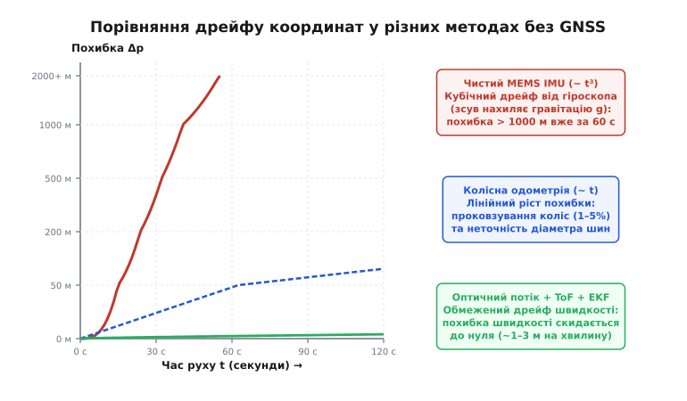
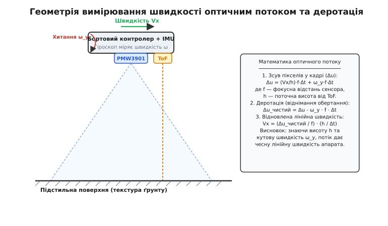
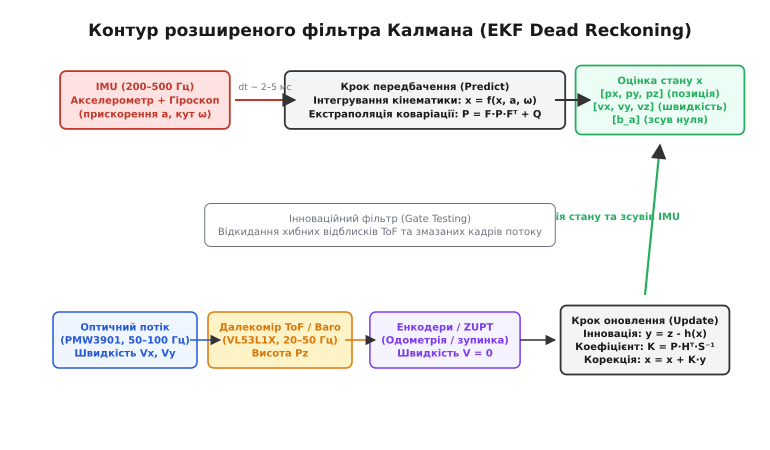

# Навігація без GNSS: що лишається

<preknowlist>
- [IMU й барометр](root:embedded/imu-barometer) — як акселерометр міряє питому силу, а гіроскоп накопичує кутовий зсув нуля.
- [Оцінка орієнтації](root:embedded/attitude-estimation) — об'єднання гіроскопа й акселерометра для стабілізації крену й тангажа.
- [Інерціальна навігація](root:embedded/inertial-navigation) — механіка подвійного інтегрування прискорень та межі автономії.
- [Фільтр Калмана](root:embedded/kalman-filter) — матричне передбачення стану та зважування зашумлених вимірювань.
- [Підміна GNSS](root:sys-dron/pidmina-gnss-spoofing-i-iak-ii-pomityty) — як працює супутникове глушіння та чому не можна вірити скомпрометованим координатам.
</preknowlist>

Квадрокоптер летить за супутниковими координатами зі швидкістю 15 м/с на висоті сорока метрів. У мить входження в зону радіоелектронної боротьби зв'язок із сузір'ями GPS і ГЛОНАСС зникає: рівень шуму на частотах L1/L2 підскакує на сорок децибелів вище корисного сигналу, або, що значно небезпечніше, генератор фальшивих псевдовідстаней починає непомітно зміщувати координату вбік. Якщо прошивка наївно вважає, що за відсутності супутників можна просто інтегрувати покази власного інерціального блока [IMU](root:embedded/imu-barometer), вже через сорок п'ять секунд розрахована позиція відлетить від справжньої на півтора кілометра, а регулятор положення кине апарат у землю.

Коли зовнішні абсолютні маяки вимкнено або скомпрометовано, апарат опиняється в стані навігаційного блекауту. Єдине, що лишається бортовому комп'ютеру, — відновлювати траєкторію за сумою власних рухів від останньої довіреної точки. Цей підхід називають **численням координат** або **численням шляху** (англ. *dead reckoning*, історично від *deduced reckoning* — виведене, обчислене положення). Розберімо крок за кроком, чому одних лише акселерометрів і гіроскопів недостатньо, які датчики дають фізичну опору в просторі та як розширений фільтр Калмана зшиває їх у стійку систему без супутників.

---

## 1. Проблема навігаційного блекауту в зоні РЕБ

Супутникова навігація розпестила інженерів: приймач розміром із ніготь видає готову абсолютну тривимірну координату з точністю до метра і не вимагає знання передісторії польоту. Проте потужність супутникового сигналу біля поверхні Землі мізерна — приблизно `−130 dBm` (близько `10⁻¹⁶ Вт`). Заглушити такий сигнал генератором білого шуму потужністю всього кілька десятків ват можна на відстані в десятки кілометрів.

Ще підступніший випадок — [спуфінг супутників](root:sys-dron/pidmina-gnss-spoofing-i-iak-ii-pomityty): приймач продовжує бачити валідні супутникові повідомлення, але координати в них навмисно викривлені або вектор швидкості застиг на місці. Якщо автопілот сліпо довіряє GNSS, контур навігації сприймає фальшивий дрейф за реальний вітер, починає кренити апарат у протилежний бік і вводить його в некероване піке.

Перше правило автономії в умовах завад: **супутник — це лише опціональна корекція, а не фундамент навігації**. Щойно бортовий фільтр виявляє падіння співвідношення сигнал/шум (HDOP > 2.5, різке зменшення кількості видимих супутників) або розбіжність супутникової швидкості з інерціальною, приймач GNSS негайно ізолюється. Від цієї миті система переходить на автономне числення шляху.

---

## 2. Інерціальна одометрія (INS) та природа її катастрофічного дрейфу

Першим природним кандидатом для заміни супутників виступає шестиосьовий інерціальний блок [IMU](root:embedded/imu-barometer) — три осі акселерометра плюс три осі гіроскопа. Його перевага абсолютна: він цілком автономний, не випромінює радіохвиль і не залежить від оптичної видимості чи погоди.

Проте спроба покластися лише на чисте подвійне інтегрування прискорень стикається з нездоланною фізичною перешкодою — **накопиченням похибок зміщення нуля** (англ. *sensor bias*).

```
Прискорення a(t)  ──[ Інтеграл 1 ]──►  Швидкість v(t)  ──[ Інтеграл 2 ]──►  Позиція p(t)
 (зсув нуля b_a)                        (+ b_a · t)                           (+ 0.5 · b_a · t²)
```

### Квадратичний дрейф акселерометра

Жоден реальний MEMS-акселерометр не видає ідеального нуля в стані спокою. Через температурне розширення кремнієвих пружних підвісів, несиметрію ємнісних гребінок та деформацію друкованої плати сенсор має постійний залишковий зсув нуля `b_a`.

Під час першого інтегрування за часом постійний зсув `b_a` перетворюється на лінійно зростаючу похибку швидкості `Δv(t) = b_a · t`. Друге інтегрування перетворює швидкість на похибку положення, яка зростає **квадратично**:

```
Δp_acc(t) = (1/2) · b_a · t²
```

Навіть якщо перед польотом акселерометр ретельно відкалібрували й залишковий зсув становить скромні `0.05 м/с²` (приблизно 5 тисячних від земного тяжіння), за 60 секунд квадратичний закон дасть відхилення: `0.5 · 0.05 · 3600 = 90 метрів`. За дві хвилини похибка сягне вже 360 метрів.

### Кубічний дрейф гіроскопа через нахил гравітації

Квадратичний дрейф акселерометра здається неприємним, але справжня катастрофа інерціальної навігації ховається в гіроскопі.

Акселерометр закріплений на платі всередині апарата і вимірює вектор питомої сили у власних осях корпусу. Щоб обчислити реальне прискорення руху над землею, бортовий процесор повинен перепроєктувати вектор прискорення в нерухому систему світу (North-East-Down) і відняти вектор сили тяжіння Землі `g = 9.81 м/с²`.

Для цієї проєкції потрібна точна [орієнтація апарата](root:embedded/attitude-estimation). Її обчислюють інтегруванням вимірів гіроскопа. Якщо гіроскоп має нескомпенсований зсув нуля `b_ω`, кут нахилу щосекунди накопичує похибку `Δθ(t) = b_ω · t`.

Через хибний кут `Δθ` вектор гравітації віднімається під мікроскопічним нахилом. У горизонтальній площині з'являється уявне фальшиве прискорення `a_err = g · sin(Δθ) ≈ g · b_ω · t`. Перше інтегрування цієї сили дає квадратичну похибку швидкості, а друге — **кубічну похибку координати**:

```
Δp_gyro(t) = (1/6) · g · b_ω · t³
```

Типовий MEMS-гіроскоп польотного контролера має температурний дрейф близько `0.5 °/с` (`0.0087 рад/с`). За 60 секунд польоту множник `t³ = 216000` перетворює цей крихітний кутовий зсув на похибку координати у **понад 3000 метрів**! Детальне математичне виведення взаємозв'язку між шумами датчиків, кубічним дрейфом та дисперсією Аллана розібрано в окремій вставці [виведення накопичення дрейфу IMU](root:embedded/navihatsiia-bez-gnss/math-drift-growth.md).


*Порівняння темпів накопичення похибки позиції. Чистий MEMS IMU через нахил вектора гравітації кубічно розбігається до кілометрових помилок вже за першу хвилину (червона лінія). Колісна одометрія деградує лінійно зі швидкістю проковзування (синій пунктир). Комплексування оптичного потоку, висотоміра та IMU у розширеному фільтрі Калмана (зелена крива) стабілізує швидкість і переводить дрейф у субметровий діапазон.*

> 🔧 **Навіщо це.** Знання кубічного закону рятує від наївних ілюзій у коді. Не можна «трохи підправити коефіцієнти» в чистому інтеграторі прискорень і сподіватися, що квадрокоптер протримається без супутників п'ять хвилин. Без зовнішнього давача, який безпосередньо вимірює швидкість або позицію відносно зовнішнього світу, інерціальна навігація на дешевих MEMS-чипах фізично помирає за перші 15–20 секунд.

---

## 3. Наземна опора: колісна та крокова одометрія

Для наземних платформ (колісних роботів, гусеничних шасі, крокуючих апаратів) найпростішим і найнадійнішим джерелом швидкості є контакт із ґрунтом.

Колісна одометрія (англ. *wheel odometry*) використовує енкодери, встановлені на валах двигунів або маточинах коліс. Підраховуючи кількість імпульсів `N` за інтервал часу `dt`, контролер обчислює лінійну швидкість кожного колеса:

```
v_wheel = (N / CPR) · (π · D) / dt
```

Тут `CPR` — кількість відліків енкодера на один повний оберт вала (англ. *counts per revolution*), а `D` — фізичний діаметр колеса.

```
┌─────────────────────────────────────────────────────────────┐
│                 Кінематика диференціального приводу         │
│                                                             │
│         Ліве колесо (v_L)             Праве колесо (v_R)    │
│            ┌───────┐                     ┌───────┐          │
│            │  ═══  │                     │  ═══  │          │
│            └───┬───┘                     └───┬───┘          │
│                │◄───────── Колія L ─────────►│              │
│                                                             │
│       Лінійна швидкість:   v = (v_R + v_L) / 2              │
│       Кутова швидкість:    ω = (v_R - v_L) / L              │
└─────────────────────────────────────────────────────────────┘
```

### Чому одометрія кардинально краща за чистий IMU

Одометрія вимірює **швидкість**, а не прискорення. Щоб знайти координату, швидкість інтегрують лише **один раз**:

```
p(t) = p₀ + ∫₀ᵗ v_wheel(τ) dτ
```

Постійна відносна похибка калібрування діаметра коліс (наприклад, 2%) породжує лише **лінійний дрейф** позиції: проїхавши 100 метрів, робот помилиться рівно на 2 метри. Ніякого кубічного вибуху похибки тут немає.

### Де ламається колісна одометрія

Попри простоту, колісна одометрія має три вроджені слабкі місця:

1. **Проковзування коліс (Slip & Skid):** на мокрій траві, піску, льоду або під час різкого гальмування колесо обертається, але робот не рухається вперед. Енкодери показують рух, якого насправді немає.
2. **Зміна ефективного радіуса:** під навантаженням або через падіння тиску в шині радіус колеса зменшується. Помилка всього в 1 мм для колеса діаметром 100 мм дає 1% систематичного дрейфу на кожному кілометрі шляху.
3. **Накопичення похибки курсу:** якщо різниця діаметрів лівого та правого коліс становить хоча б 0.2 мм, робот під час прямолінійного руху буде непомітно повертати дугою. Похибка курсу `Δθ`, накопичена на старті, повертає весь подальший вектор переміщення: похибка позиції росте як добуток кутової помилки на пройдений шлях.

### Неолономні зв'язки та детектування ковзання в реальному часі

Для колісних шасі автомобільного чи диференціального типу інженери використовують фундаментальну фізичну властивість — **неолономні зв'язки** (англ. *non-holonomic constraints*).

Колесо без заносу котиться суворо вперед і не може ковзати боком. Це означає, що в системі координат шасі бічна швидкість завжди дорівнює нулю: `v_y_body ≈ 0`, а вертикальна швидкість підйому на площині — `v_z_body ≈ 0`.

Фільтр Калмана використовує цей факт як регулярне псевдовимірювання: кожні 10 мс у контур подається штучний вимір `[v_y, v_z] = [0, 0]` з дисперсією можливого бічного люфту (наприклад, `R_side = 0.01 м²/с²`). Це миттєво обмежує бічний дрейф інерціальної системи, навіть коли супутників немає взагалі.

Для захисту від пробуксовки (наприклад, коли колесо буксує в багнюці) алгоритм порівнює швидкість обертання навколо вертикальної осі з двох незалежних джерел:
- `ω_gyro`: виміряна безпосередньо гіроскопом IMU;
- `ω_enc = (v_R - v_L) / L`: обчислена з різниці швидкостей колісних енкодерів.

```
Δω = |ω_gyro - ω_enc|
```

Якщо різниця `Δω` перевищує поріг (наприклад, `0.15 рад/с`), система фіксує проковзування коліс (англ. *wheel slip*), динамічно піднімає коваріацію шуму одометрії `R_wheel` в сотні разів і тимчасово забороняє енкодерам коригувати швидкість у фільтрі Калмана.

---

## 4. Повітряна опора: оптичний потік та висотомір

Для літальних апаратів (квадрокоптерів, гексакоптерів, дронів літакового типу) коліс немає — спиратися на твердий ґрунт механічно неможливо. Проте поверхню під апаратом можна бачити.

Цю задачу вирішує **сенсор оптичного потоку** (англ. *optical flow*), що працює в парі з **лазерним далекоміром** часу прольоту (ToF / LiDAR).

```
          ┌───────────────────────────┐
          │  Квадрокоптер у польоті   │
          │                           │
          │   [PMW3901]     [ToF]     │
          └───┬───────────────┬───────┘
              │ Оптичний      │ Лазерний
              │ конус зору    │ промінь (висота h)
              │               │
              ▼               ▼
   ═══════════════════════════════════════════
        Підстильна поверхня (ґрунт/трава)
```

### Фізика вимірювання швидкості за текстурою

Сенсор оптичного потоку (наприклад, чіп [PMW3901](root:embedded/navihatsiia-bez-gnss/comp-pmw3901-flow.md)) містить матрицю пікселів надвисокої частоти кадрів (від 100 до 400 Гц) і спеціалізований процесор автокореляції зображень.

Коли апарат летить над землею, оптична текстура поверхні (травинки, камінці, тріщини асфальту) біжить по піксельній матриці сенсора. Сенсор обчислює вектор зміщення кадрів `[Δu, Δv]` у пікселях.

Проте саме по собі піксельне зміщення безрозмірне: щоб перевести його у фізичну швидкість у метрах за секунду, обов'язково треба знати поточну відстань до поверхні — висоту `h`, яку вимірює лазерний висотомір:

```
v_x = (Δu / focal_px) · (h / Δt)
```

Тут `focal_px` — фокусна відстань оптики в пікселях, а `Δt` — час між опитуваннями.

### Деротація: як прибрати паразитний нахил корпусу

Квадрокоптер для створення горизонтальної тяги зобов'язаний нахилятися. Коли дрон нахиляє ніс уперед (тангаж), камера обертається разом із рамою. Обертання камери зміщує картинку в кадрі точно так само, як і горизонтальний політ!

Якщо не відокремити обертання від переміщення, автопілот при кожній спробі нахилитися сприйме оберт за зміщення і спробує повернути апарат назад, унеможливлюючи керований політ.

Ця процедура називається **деротацією** (англ. *gyro derotation*). Бортовий процесор зчитує кутову швидкість `ω_y` з гіроскопа IMU і віднімає викликаний обертанням зсув пікселів від виміряного потоку:

```
Δu_clean = Δu_measured - ω_y · focal_px · Δt
```

Лише після деротації чистий зсув `Δu_clean` масштабується висотою `h` і перетворюється на чесну швидкість польоту відносно ґрунту. Повний огляд підключення, регістрів та характеристик сенсора винесено в окрему вставку [давач оптичного потоку та лазерний далекомір](root:embedded/navihatsiia-bez-gnss/comp-pmw3901-flow.md).

### Компенсація плеча встановлення сенсора (Lever-Arm Effect)

У реальному компонуванні дрона сенсор оптичного потоку рідко вдається встановити точно в центрі мас апарата (де розташований IMU). Зазвичай плату виносять під ніс або на нижній кронштейн рами на певну відстань `r_offset = [r_x, r_y, r_z]ᵀ`.

Коли дрон обертається з кутовою швидкістю `ω_body = [ω_x, ω_y, ω_z]ᵀ`, винесений сенсор відчуває додаткову лінійну швидкість за рахунок радіуса обертання:

```
v_lever = ω_body × r_offset
```

Наприклад, якщо оптичний сенсор зсунутий уперед на `r_x = 0.15 м`, швидкий тангаж зі швидкістю `ω_y = 1.0 рад/с` (близько 57 °/с) створить на лінзі сенсора уявну вертикальну швидкість `1.0 · 0.15 = 0.15 м/с`. Без урахування плеча фільтр сприйме цей оберт як реальне вертикальне зміщення всього апарата.

Тому перед подачею швидкості в EKF виконується повна векторна корекція плеча:

```
v_sensor_clean = v_flow_derotated - (ω_body × r_offset)
```


*Геометрія оптичного потоку. Виміряний зсув пікселів у кадрі складається з лінійного зміщення відносно ґрунту (масштабованого висотою h від ToF) та паразитного кутового нахилу корпусу. Віднімання кутової швидкості гіроскопа (деротація) дає чистий вимір лінійної швидкості апарата.*

### Де оптичний потік вимикається

Оптичний потік перетворює розрахунок координат із подвійного інтегрування прискорень на одинарне інтегрування швидкості, зводячи накопичення похибки до часток відсотка від пройденого шляху. Але в нього є граничні умови:

- **Однорідні поверхні:** над спокійною водою, чистим снігом або дзеркальною плиткою контрастних деталей немає. Сенсор не знаходить за що зачепитися, і показник якості поверхні `SQUAL` падає до нуля.
- **Діапазон висоти далекоміра:** недорогі ToF-сенсори (VL53L1X) працюють на відстанях до 3–4 метрів. Вище 4 метрів лазер не бачить відбиття від ґрунту. Для польотів на висотах 10–50 метрів потрібні спеціалізовані оптичні лідари дальньої дії або перехід на барометричне масштабування.
- **Повна темрява:** для нічних польотів потрібна інфрачервона підсвітка (850/940 нм), синхронізована з експозицією матриці сенсора.
- **Рухома підстильна поверхня:** висока трава чи очерет, які коливаються під струменем повітря від пропелерів, створюють уявний потік назовні від центру апарата.

---

## 5. Комплексування датчиків: розширений фільтр Калмана (EKF)

Ми маємо набір взаємодоповнюючих датчиків з протилежними характеристиками:
- **IMU:** надшвидкий (500 Гц), точний на мікроінтервалах, але накопичує катастрофічний кубічний дрейф.
- **Оптичний потік / Енкодери:** видають швидкість без кубічного дрейфу (50 Гц), але шумять, мають затримку обробки й іноді відмовляють на слизьких чи гладких поверхнях.
- **ToF / Барометр:** дають висоту та вертикальну прив'язку (20–50 Гц).

Об'єднати ці сигнали в єдину достовірну оцінку стану дозволяє **розширений фільтр Калмана** (англ. *Extended Kalman Filter*, EKF).

```
                   ┌─────────────────────────────────────────────────┐
                   │        Швидкий контур передбачення (500 Гц)     │
                   │      IMU [ax, ay, az, ωx, ωy, ωz] ──► Predict    │
                   └────────────────────────┬────────────────────────┘
                                            │
                                            ▼
┌────────────────────────────────────────────────────────────────────────────────────┐
│ Вектор стану x:  [ px, py, pz (позиція) | vx, vy, vz (швидкість) | bax, bay, baz ] │
└───────────────────────────────────────────┬────────────────────────────────────────┘
                                            ▲
                   ┌────────────────────────┴────────────────────────┐
                   │       Асинхронний контур корекції (20–100 Гц)   │
                   │  - Оптичний потік: інновація швидкості Vx, Vy    │
                   │  - ToF далекомір:  інновація висоти Pz          │
                   │  - ZUPT (зупинка): швидкість V = 0              │
                   └─────────────────────────────────────────────────┘
```


*Архітектура контуру EKF Dead Reckoning. Високочастотний потік IMU (200–500 Гц) неперервно штовхає кінематичну модель уперед на кроці передбачення. Асинхронні корекції від оптичного потоку, ToF-далекоміра та енкодерів формують інновації, коригують положення й швидкість та скидають накопичений зсув нуля акселерометра.*

### Вектор стану та крок передбачення

Фільтр відстежує 9 змінних у світовій системі координат NED:

```
x = [ p_x, p_y, p_z,   v_x, v_y, v_z,   b_ax, b_ay, b_az ]ᵀ
```

Кожні 2–5 мс надходить новий відлік акселерометра `a_body`. Фільтр віднімає оцінку зсуву `b_a`, переводить прискорення у систему світу через матрицю орієнтації `R_wb` і додає силу тяжіння `g`:

```
a_world = R_wb · (a_body - b_a) + [0, 0, g]ᵀ
```

Координати й швидкості екстраполюються вперед за простими формулами кінематики:

```
p_new = p + v · dt + 0.5 · a_world · dt²
v_new = v + a_world · dt
```

Одночасно матриця коваріації похибок `P` збільшується на величину шуму процесу `Q · dt`: фільтр «знає», що з кожною мілісекундою його невпевненість зростає.

### Асинхронний крок корекції та оцінка зсувів

Коли надходить вимір від сенсора швидкості (наприклад, оптичний потік дав `v_meas` на частоті 50 Гц), фільтр обчислює **інновацію** (нев'язку між виміряним і передбаченим значенням):

```
y = v_meas - v_predicted
```

Далі обчислюється матриця коефіцієнтів підсилення Калмана `K`. Коефіцієнт `K` визначає, кому зараз вірити більше: якщо коваріація шуму сенсора `R` велика (погана текстура ґрунту), `K` стає малим і поправка майже не впливає на стан; якщо сенсор надійний, `K` підтягує оцінку швидкості до вимірювання.

Найголовніше: завдяки перехресним елементам матриці коваріації `P` корекція швидкості **підтягує й оцінку зсуву нуля акселерометра `b_a`**! Якщо акселерометр постійно тягне швидкість праворуч, а оптичний потік раз за разом каже «ми летимо прямо», фільтр розуміє, що справа в постійному зсуві сенсора, і компенсує `b_a`.

### Тест Махаланобіса (Gate Testing): фільтрація викидів

Що станеться, якщо під апаратом пробіжить собака, проїде автомобіль або ToF-далекомір на мить зловить сонячний відблиск від калюжі? Сенсор видасть різкий стрибок швидкості чи висоти, який не має відношення до реального руху.

Щоб захистити фільтр, використовують перевірку відстані Махаланобіса:

```
d² = yᵀ · S⁻¹ · y
```

Тут `S = H·P·Hᵀ + R` — коваріація інновації. Якщо скаляр `d²` перевищує поріг (зазвичай `d² > 4.0`, що відповідає довірчому інтервалу 95.4% для нормального розподілу), вимір **відкидається цілком**. Фільтр не пускає аномалію всередину вектора стану.

### Механізм ZUPT (Zero Velocity Update)

Для наземних роботів та крокуючих систем існує потужний прийом — оновлення нульової швидкості (англ. *Zero Velocity Update*, ZUPT).

Коли апарат зупиняється на світлофорі або нога крокуючого робота стає на ґрунт, бортові давачі фіксують стан спокою (дисперсія гіроскопа та акселерометра падає до рівня шуму). У цей момент фільтр штучно подає у контур корекції вимір швидкості `v_meas = [0, 0, 0]ᵀ` з мізерною коваріацією шуму `R_zupt = 10⁻⁵`.

У результаті ZUPT миттєво стирає весь накопичений дрейф швидкості, а залишковий сигнал акселерометра стає чистим виміром його зміщення нуля `b_a`. Саме завдяки ZUPT пішохідні трекери, вмонтовані в підошву взуття, здатні рахувати координати без GNSS годинами з точністю до кількох відсотків від пройденої дистанції.

---

## 6. Програмна реалізація модуля Dead Reckoning на C та C++

Погляньмо, як алгоритм автономного числення координат втілюється у вбудованому коді. Наведений нижче фрагмент містить функції кроку передбачення IMU та кроку корекції 2D-швидкості оптичним потоком.

:::tabs
:::code navihatsiia-bez-gnss-d/c/main.c
:::code navihatsiia-bez-gnss-d/cpp/main.cpp
:::

Повний варіант проєкту з підтримкою висотоміра, ZUPT та обробкою затримок винесено у вставку [повнофункціональний модуль автономного числення координат](root:embedded/navihatsiia-bez-gnss/proj-ekf-dead-reckoning.md).

---

## 7. Тактичні сценарії автономії та інженерний баланс

Організація навігації в умовах радіоелектронного придушення — це завжди компроміс між доступними датчиками, енергоспоживанням та висотою руху.

Зведемо всі розглянуті підходи у підсумкову матрицю:

| Метод навігації | Фізична основа | Типовий дрейф позиції | Де працює | Де відмовляє |
|---|---|---|---|---|
| **Чистий MEMS IMU** | Інтегрування сил і кутів | **Кубічний ~ t³** (1000–3000 м/хв) | Скрізь, повна автономія | Будь-який рух довше 15 секунд |
| **Колісна одометрія** | Підрахунок обертів коліс | **Лінійний ~ t** (10–50 м на 1 км) | Твердий сухий ґрунт | Ожеледиця, глибокий пісок, бруд |
| **Оптичний потік + ToF** | Зміщення текстури поверхні | **Обмежений** (1–3 м/хв) | Низька висота (<4 м), контрастний ґрунт | Вода, сніг, туман, велика висота |
| **EKF Fusion (IMU+Flow+ToF)** | Комплексне оцінювання стану | **Субметровий** при стабільному трекінгу | Комплексні автономні місії | Повна темрява без ІЧ-підсвітки |

### Системна параметризація у польотних стеках (PX4 та ArduPilot)

У відкритих прошивках автопілотів інтеграція оптичного потоку та далекомірів керується системними параметрами розширеного оцінювача стану:

#### Польотний стек PX4 (модуль EKF2):
- `EKF2_OF_QMIN` — мінімальний поріг якості оптичного потоку (за замовчуванням 19%). Якщо регістр `SQUAL` падає нижче цієї межі, вимірювання швидкості автоматично ізолюються.
- `EKF2_OF_POS_X`, `EKF2_OF_POS_Y`, `EKF2_OF_POS_Z` — координати просторового зміщення об'єктива відносно центру мас у метрах (вектор `r_offset` для компенсації плеча).
- `EKF2_RNG_AID` — активація підтримки висоти далекоміром (Range Aid). Дозволяє EKF автоматично перемикатися з барометра на ToF-лідар на висотах нижче 3.0 м.
- `EKF2_OF_N_MIN` / `EKF2_OF_N_MAX` — граничні значення дисперсії шуму вимірювань оптичного потоку для матриці коваріації `R_flow`.

#### Польотний стек ArduPilot (модуль EKF3):
- `FLOW_TYPE = 1` — увімкнення драйвера оптичного сенсора PMW3901 на шині SPI.
- `FLOW_FXSCALER`, `FLOW_FYSCALER` — масштабні коефіцієнти для точного юстування фокусної відстані оптики під час тестового висіння.
- `FLOW_ORIENT_YAW` — кут апаратного розвороту плати сенсора відносно носа апарата (0°, 90°, 180°, 270°).
- `AHRS_EKF_TYPE = 3` — вибір 24-вимірного фільтра EKF3 з підтримкою комплексного оптичного злиття без супутників.

### Практичні правила побудови автономного маршруту без GNSS:

1. **Притискання до рельєфу (Terrain Hugging):** під час перетину зони дії ворожих комплексів РЕБ апарат знижується на гранично малу висоту (1.5–3.0 метри). Це дає дві фундаментальні переваги: дрон ховається за складками місцевості від радіогоризонту станцій РЕБ і водночас входить у робочий діапазон сенсора оптичного потоку та лазерного далекоміра ToF.
2. **Аварійне повернення додому (Dead Reckoning RTH):** якщо зв'язок втрачено повністю, а оптичний потік працює, автопілот розвертається на 180° за гіроскопом і летить за зворотним вектором швидкості рівно стільки часу, скільки тривав політ уперед. Точність повернення за оптичним потоком на дистанції 2–3 км становить близько 20–50 метрів — достатньо, щоб вийти із зони придушення й відновити радіозв'язок з оператором.
3. **Утримання курсу магнітометром з перевіркою аномалій:** компас дає абсолютний кут на північ, рятуючи гіроскоп від дрейфу навколо осі Z. Проте поблизу ліній електропередач та бронетехніки магнітне поле спотворюється. Надійний фільтр постійно перевіряє довжину вектора індукції `|B|`: якщо поле відхиляється від геомагнітної норми регіону більш ніж на 15%, магнітометр тимчасово вимикається з контуру EKF.

Автономія без супутників — це не пошук одного ідеального сенсора, якого в природі не існує. Це дисципліна об'єднання недосконалих приладів, де швидкість інерції виправляє повільність оптики, а оптика стирає невблаганний кубічний дрейф інерції.
