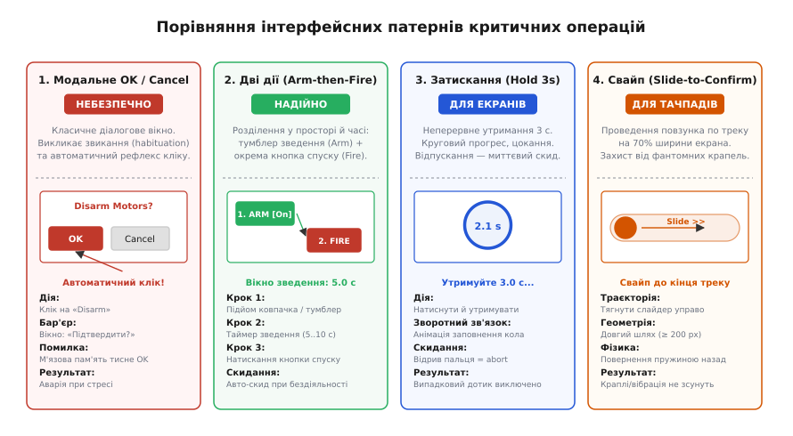
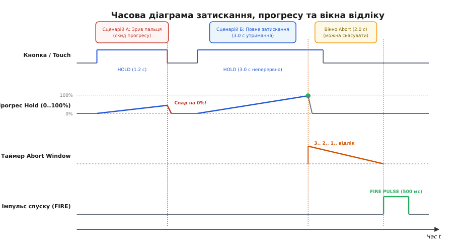
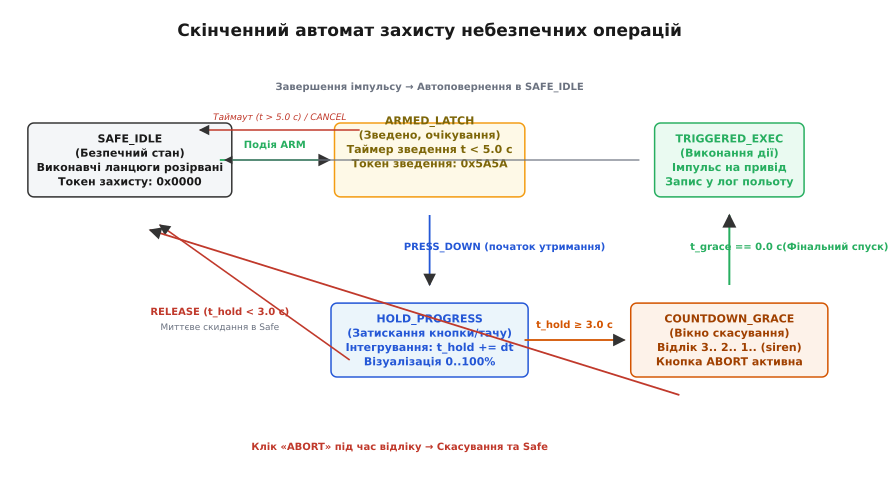

# Небезпечна дія: підтвердження, дві дії, відлік — детально

<preknowlist>
- [Від натискання до події](root:embedded/vid-natyskannia-do-podii) — дебаунс контактів, розпізнавання коротких кліків і тривалого утримання кнопки.
- [Автомат станів і черга подій у прошивці](root:embedded/avtomat-staniv-i-cherha-podii-u-proshyvtsi) — неблокувальні переходи, таймери станів та стійкість автомата до зависань.
- [Аварійний стоп і мертва рука](root:embedded/avariinyi-stop-i-mertva-ruka) — апаратні ланцюги швидкого розриву живлення та захист від неконтрольованого руху.
- [Що мусить бути видно завжди](root:embedded/shcho-musyt-buty-vydno-zavzhdy) — постійне відображення режиму, статусу озброєння та стану зв'язку на панелі оператора.
</preknowlist>

Квадрокоптер летить на висоті 400 метрів за два кілометри від точки зльоту. На планшеті наземної станції з'являється попередження про просідання однієї з банок акумулятора. Оператор у щільних тактичних рукавичках намагається змахнути інформаційний банер у куток екрана, але вібрація рук або крапля дощу на ємнісному сенсорі спричиняє мікрозсув точки дотику. Палець потрапляє на сусідню піктограму екстреного зняття з охорони (англ. *Emergency Disarm*). Контролер інтерфейсу викидає швидке модальне вікно «Підтвердити?», і оператор, чия увага прикута до висоти й орієнтирів на місцевості, на автоматі тисне велику кнопку «OK» у центрі екрана, намагаючись повернути карту. Через пів секунди чотири безколекторні мотори вимикаються в польоті, і трикілограмовий апарат падає на землю вільно, як камінь.

Така сама катастрофа регулярно трапляється на виробництві: оператор верстата з числовим програмним керуванням хоче скинути лічильник оброблених деталей, але через когнітивну втому натискає «Скинути нуль координат заготовки» (англ. *Zero Work Coordinates*). Шпиндель на швидкості 18 000 обертів на хвилину врізається в сталевий затискач лещат, ламаючи твердосплавну фрезу вартістю в сотні доларів і деформуючи прецизійні напрямні.

Усі ці інциденти поєднує одна фундаментальна інженерна помилка: інтерфейс дозволив виконати **небезпечну незворотну дію** за тією ж кінематичною моделлю, що й звичайну навігацію по меню. Коли дію з високою ціною помилки відокремлює від спокою лише один клік або шаблонний діалог «OK / Скасувати», система обов'язково зламається під час стресу.

## Чому небезпечні дії вимагають штучного тертя

У типовому інтерфейсі головна мета розробника — зменшити затримку та тертя: користувач має досягати бажаного екрана за мінімальну кількість кліків, а реакція на дотик має бути миттєвою. Але для операцій, наслідки яких неможливо скасувати програмно (англ. *irreversible physical actions*), це правило розвертається на 180 градусів.

Тут інженер зобов'язаний ввести **навмисне, каліброване тертя** (англ. *deliberate friction*). Бар'єр між наміром і виконанням має вимагати від людини усвідомленої фізичної або когнітивної дії, яку неможливо виконати рефлекторно, випадковим дотиком чи спазмом м'язів.

Усі операції у вбудованій системі за ступенем небезпеки діляться на чотири класи:

1. **Аварійне зняття з охорони та зупинка приводів (Disarm / Kill Switch).** На землі зняття моторів з охорони — це штатна безпечна процедура. У повітрі або під час руху навантаженого маніпулятора зняття з охорони — це миттєва втрата керування. Інтерфейс зобов'язаний розрізняти контекст: на землі кнопка може спрацьовувати легко, але як тільки датчики фіксують висоту, струм моторів чи швидкість, ланцюг спуску блокується спеціальними інтерблоками.
2. **Скидання навантаження та активація виконавчих механізмів (Payload Drop / Pyrotechnics).** Розмикання електромагнітного замка скиду, підпал піропатрона відстрілу парашута чи пуск потужного лазерного випромінювача — це події, після яких повернення назад не існує. Якщо вантаж скинуто в неправильній точці, його вже не повернути на борт.
3. **Зміна критичних калібрувань та орієнтації датчиків (IMU / Compass / Kinematics Zeroing).** Зміна нульового зміщення гіроскопа, інверсія полярності сервоприводів або перепризначення матриці орієнтації польотного контролера на ходу призводить до того, що контур стабілізації починає розкручувати апарат у позитивному зворотному зв'язку замість гасіння коливань.
4. **Перезавантаження контролера та очищення енергонезалежної пам'яті (Reboot / Factory Reset).** Скидання живлення бортового комп'ютера чи мікроконтролера під час виконання місії стирає оперативні координати, скидає таймери failsafe і на кілька секунд повністю засліплює всі канали телеметрії.

```
+─────────────────────────────────────────────────────────────────────────────+
|                         АСИМЕТРІЯ ІНТЕРФЕЙСНОГО ТЕРТЯ                       |
+─────────────────────────────────────────────────────────────────────────────+
  Штатна навігація:           [Клік] ────────► [Миттєве виконання]
                              (Мінімум зусиль, висока швидкість)

  Критична операція:          [Вибір] ──► [Зведення ARM] ──► [Затискання 3 с]
                                                                     │
                              [Виконання] ◄── [Вікно відліку] ◄──────┘
                              (Штучний бар'єр: простір + час + кінематика)
+─────────────────────────────────────────────────────────────────────────────+
```

Ці дії об'єднує спільна риса: їхня ціна помилки незрівнянно вища за ціну додаткових 2–3 секунд, витрачених оператором на проходження процедури підтвердження.

## Анатомія провалу: чому модальне вікно «OK / Cancel» не працює

Класичне діалогове вікно з текстом «Ви впевнені?» та двома кнопками «OK» і «Cancel» прийшло у вбудовані інтерфейси з настільних операційних систем. У текстових редакторах воно рятує від закриття незбереженого документа. Проте в польових умовах керування машинами воно перетворюється на смертельну пастку.

Головна причина — **звикання до підтверджень** (англ. *Confirmation Habituation*). Коли оператор щодня бачить десятки спливаючих діалогів («Оновити список?», «Зберегти лог?», «Перейти в режим перегляду?»), мозок перестає читати текст запиту. Нейронна система людини оптимізує енерговитрати й формує стійкий руховий шаблон (англ. *muscle memory primitive*): будь-яке сіре вікно, що перекриває екран, сприймається як тимчасова перешкода, яку треба змахнути натисканням на активну кнопку в правому нижньому кутку або по центру.

Під час польового стресу чи дефіциту часу (наприклад, коли зв'язок починає обриватися або апарат втрачає висоту) рівень когнітивного навантаження зростає в рази. Оператор потрапляє в стан тунельного зору: очі фокусуються на відеокартинці або висотомірі, а пальці на пульті діють автоматично. Якщо в цей момент через хибне торкання вискакує вікно підтвердження дисарму, палець рефлекторно тисне «OK» за 150–200 мілісекунд — набагато швидше, ніж кора головного мозку встигне прочитати навіть перше слово попередження.


*Чотири інтерфейсні патерни небезпечних дій: модальне вікно провокує автоматичний рефлекторний клік; двоетапне зведення розділяє дію в просторі; тривале затискання з прогресом фільтрує випадкові дотики; свайп створює кінематичний бар'єр проти вібрацій та дощу.*

До психофізіологічних факторів додаються суто фізичні вади польової експлуатації:

* **Ефект товстого пальця (Fat Finger):** під час роботи в рукавицях площа контакту з сенсорним екраном зростає в 3–4 рази. Центр ємнісної плями легко зміщується на 5–10 міліметрів від точки зорового прицілювання, одночасно зачіпаючи сусідній елемент керування.
* **Фантомні дотики від вологи:** краплі дощу, сніг або конденсат на ємнісному склі діють як локальні провідники, створюючи паразитні сигнали натискання (англ. *ghost touches*), які можуть активувати кнопку, розташовану під ними.
* **Тремтіння та перевантаження:** на ходу автомобіля, катера чи під час бігу палець оператора тремтить із амплітудою до 15 мм, перетворюючи точковий клік на серію випадкових ударів по екрану.

Тому надійний інтерфейс безпеки відмовляється від простих модальних вікон і переходить до спеціалізованих захисних патернів.

## Патерн 1: Двоетапна дія (Arm-then-Fire)

Патерн двоетапної дії (англ. *Two-Step Action*, або *Select → Arm → Trigger*) розділяє одну небезпечну команду на два послідовні кроки, рознесені в просторі та часі. 

Логіка процесу складається з трьох фаз:
1. **Вибір об'єкта (Target Selection):** оператор вибирає, яку саме систему буде задіяно (наприклад, «Вантажний замок №2» або «Моторний контур лівого борту»).
2. **Зведення запобіжника (Arming Phase):** оператор переводить окремий перемикач у положення «ARM». Це може бути як фізичний тумблер під захисною кришкою, так і виділена екранна зона. Перехід у стан ARM активує лічильник часового вікна (зазвичай 5.0–10.0 секунд) і вмикає агресивну візуальну сигналізацію (червоне миготіння рамки екрана, звукові біпи зумера).
3. **Спуск (Trigger / Execution):** тільки поки активне вікно зведення, стає доступною окрема кнопка спуску «FIRE» або «EXECUTE».

```
+─────────────────────────────────────────────────────────────────────────────+
|                     ПРОСТОРОВО-ЧАСОВИЙ РОЗПОДІЛ ДІЇ                         |
+─────────────────────────────────────────────────────────────────────────────+
  [ Ліва панель / Фізичний тумблер ]       [ Права панель / Екран ]
  ┌─────────────────────────────────┐      ┌─────────────────────────────┐
  │   1. ПЕРЕМИКАЧ ARM [ON]         │ ───► │ 2. ВІКНО ЗВЕДЕННЯ (5.0 с)   │
  │   (Зміна стану захисту)         │      │    Кнопка FIRE активна      │
  └─────────────────────────────────┘      └──────────────┬──────────────┘
                                                          │ (Натискання)
                                                          ▼
                                           ┌─────────────────────────────┐
                                           │ 3. ВИКОНАННЯ КОМАНДИ        │
                                           └─────────────────────────────┘
  (Якщо FIRE не натиснуто за 5.0 с ──► Автоматичний скид у SAFE_IDLE)
+─────────────────────────────────────────────────────────────────────────────+
```

Головне правило просторового розділення: **орган зведення ARM і орган спуску FIRE ніколи не повинні знаходитися в одній і тій самій точці простору або накладатися на екрані**. Якщо тумблер зведення розташований на лівому боці пульта, кнопка спуску має бути на правому боці. Це вимагає задіяти обидві руки або зробити свідомий перенос пальця через усю панель.

Обов'язковим елементом є **автоматичне скидання готовності за таймаутом** (англ. *Arm Timeout Decay*). Якщо оператор звів систему, але відволікся і не натиснув спуск протягом заданого інтервалу (наприклад, 5 секунд), автомат станів самостійно повертається в режим `SAFE_IDLE`. Система не має права залишатися у зведеному стані без обмеження часу.

Глибше про те, як ці просторові та кінематичні бар'єри формувалися у військовій авіації та на пультах стратегічних ракетних комплексів, розповідає [історичний нарис про еволюцію захисних ковпачків та дворучного пуску](root:embedded/nebezpechna-diia/hist-switch-guards.md).

## Патерн 2: Затискання та відлік часу (Hold-to-Confirm)

Для систем із обмеженою кількістю кнопок або для повністю сенсорних інтерфейсів найефективнішим інструментом захисту є **утримання кнопки з часовою інтеграцією** (англ. *Hold-to-Confirm*, зазвичай 3.0 секунди).

Механізм базується на фізичній неможливості випадкового утримання: випадковий дотик, зачіпання рукавом, короткочасне коротке замикання кнопки брудом чи падіння краплі води триває від кількох мілісекунд до кількох десятих часток секунди. Неперервне утримання точки контакту протягом 3000 мілісекунд вимагає безперервного цілеспрямованого зусилля людини.

```
       t = 0.0 с                  t = 1.5 с                  t = 3.0 с
     ┌───────────┐              ┌───────────┐              ┌───────────┐
     │  (     )  │              │  (███  )  │              │  (█████)  │
     │   HOLD    │              │   1.5 s   │              │   FIRE!   │
     └───────────┘              └───────────┘              └───────────┘
     Старт натиску             50% заповнення              Спрацювання
                               (Часте цокання)             (Імпульс на ключ)
```

Щоб патерн працював надійно, він зобов'язаний супроводжуватися трьома критичними властивостями зворотного зв'язку:

1. **Неперервна візуальна шкала накопичення (Progress Feedback):** інтерфейс відображає прогрес утримання у вигляді радіального кола, що заповнюється навколо пальця, або лінійної шкали зі зворотним відліком часу з точністю до десятих часток секунди (`3.0s` → `2.1s` → `0.9s` → `OK`).
2. **Акустична та тактильна акселерація:** вбудований зумер генерує короткі клацання або вібромотор дає імпульси, частота яких експоненційно зростає з наближенням до порогу 3.0 с (наприклад, 2 Гц на початку, 10 Гц на 2-й секунді, суцільний тон на 3-й секунді). Людина відчуває наближення спрацювання всіма органами чуття.
3. **Миттєве скасування при відпусканні (Zero Tolerance Release):** якщо палець відривається від кнопки чи сенсора хоча б на позначці 2.95 с (за 50 мс до порогу), накопичений час скидається в 0. Жодних поблажок і округлень: система повертається у вихідний стан.

## Патерн 3: Свайп (Slide-to-Confirm) та апаратні ковпачки

Коли екран приладу піддається впливу сильного дощу, бруду або вібрацій, навіть утримання може бути скомпрометоване великою водяною плівкою, яка створює тривалий стаціонарний ємнісний місток. У таких умовах використовують **траєкторне підтвердження — свайп** (англ. *Slide-to-Confirm*).

Свайп вимагає від пальця оператора прокреслити безперервну лінію по треку від лівого краю екрана до правого. Фізика розпізнавання свайпа надійно захищена від перешкод завдяки суворим геометричним та динамічним фільтрам:

```
[Початок треку] ══════════════════════════════════════════► [Фінішний замок]
   ● (Повзунок)          Мінімальна довжина: ΔX ≥ 70% W           [Спуск]
                       Швидкість: V_min < V < V_max
                       Максимальне відхилення: |ΔY| ≤ 20 px
```

* **Довжина шляху:** переміщення повзунка має становити не менше 60–70% від загальної ширини робочої зони екрана (зазвичай не менше 200–300 пікселів).
* **Контроль коридору:** відхилення пальця по вертикальній осі не повинно перевищувати заданий коридор (наприклад, `|ΔY| ≤ 25 px`). Якщо палець зісковзує за межі треку, слайдер під дією віртуальної пружини миттєво відлітає назад на стартову позицію.
* **Векторна монотонність:** координата `X` має монотонно зростати. Рух назад або зупинка на тривалий час скидає стан.

### Апаратні запобіжники: ковпачки Mollie

На фізичних пультах еквівалентом свайпа є механічні відкидні ковпачки (англ. *Mollie covers* / *Guarded Switches*). 

Тумблер поміщається під яскраво-червону підпружинену металеву кришку. Щоб подати живлення на піропатрон або відсікти мотори, оператор мусить підчепити кришку пальцем, підняти її на 90 градусів угору проти сили пружини (перший рух) і перекинути важіль тумблера у відкритому просторі (другий ортогональний рух). Завдяки спеціальній формі скоби закриття ковпачка примусово повертає тумблер у безпечне положення `OFF`.

## Вікно скасування (Abort Window)

Для операцій максимального рівня ризику (наприклад, запуск твердопаливного стартового прискорювача безпілотника чи самоліквідація) навіть проходження процедури Hold або Slide не повинно призводити до негайного вибуху чи пуску. Останнім бар'єром стає **вікно скасування** (англ. *Abort Window*, або *Grace Period Countdown*).

Після того, як оператор успішно виконав утримання протягом 3 секунд, силова частина не вмикається миттєво. Автомат станів переходить у режим відліку затримки безпеки (наприклад, ще 3.0 або 5.0 секунд):


*Часова діаграма взаємодії: Сценарій А демонструє скидання прогресу при передчасному відпусканні кнопки на 1.2 с; Сценарій Б показує повне утримання 3.0 с, перехід у вікно відліку скасування (Abort Window) та формування фінального імпульсу спуску.*

Під час дії вікна скасування:
1. Борт або пульт подає безперервний гучний сигнал сирени та вмикає стробоскоп (якщо є світлова сигналізація), попереджаючи всіх людей навколо апарата про неминучу дію.
2. На весь екран розгортається гігантська контрастна кнопка **«СКАСУВАТИ / ABORT»**.
3. На відміну від запуску, скасування не потребує жодних утримань, паролів чи свайпів. Будь-який одиничний дотик до кнопки «ABORT», натискання клавіші Escape чи пробілу на клавіатурі **миттєво зупиняє процес**, скидає всі токени зведення і повертає систему в базовий спокійний стан.

## Архітектура автомата безпеки (Safety Interlock Engine)

Щоб унеможливити збої логіки через пошкодження змінних у RAM або зависання підпрограм, диспетчер захисту операцій проєктується як детермінований скінченний автомат (англ. *Finite State Machine*, FSM) із явним контролем часу та токенів.


*Граф переходів автомата безпеки: будь-який таймаут, зрив затискання чи натискання кнопки ABORT безумовно скидає систему в SAFE_IDLE із зануленням токенів авторизації.*

Головні правила побудови надійного FSM захисту:

* **Захист пам'яті через магічні токени (Safety Authorization Tokens):** стан зведення `ARMED` ніколи не позначається простим булевим прапорцем `bool is_armed = true`. Якщо вказівник у пам'яті вийде за межі масиву й затре байт одиницею, система зведеться випадково. Стан готовності кодується 16-бітними або 32-бітними магічними константами з великою відстанню Геммінга (наприклад, `TOKEN_ARMED = 0x5A5A`, `TOKEN_EXEC = 0xA5A5`, тоді як дефолтний безпечний стан — `0x0000`). Для спрацювання приводу функція перевіряє точний бітовий патерн.
* **Неблокувальна часова дискретизація:** функція обробки автомата викликається регулярно (наприклад, кожні 10 мс у головному циклі або з таймерного переривання). Вона приймає дельту часу `dt_ms` і монотонно нарощує або зменшує лічильники.
* **Енергонезалежна безпека (Volatile Safe Invariant):** стан зведення `ARMED` ніколи не зберігається в Flash чи EEPROM. Під час перезавантаження контролера внаслідок просідання живлення система **завжди** ініціалізується в стані `SAFE_IDLE`.

## Повна реалізація модуля безпеки на C та C++

Нижче наведено промислову реалізацію автономного рушія захисту операцій `SafetyInterlock`, яка підтримує двоетапне зведення з таймаутом, інтегратор утримання кнопки (Hold) та вікно скасування (Abort Window).

:::tabs
:::code nebezpechna-diia-d/c/main.c
:::code nebezpechna-diia-d/cpp/main.cpp
:::

## Крайові випадки та пастки реальних систем

Навіть бездоганно написаний програмний автомат захисту стикається з апаратними та фізичними крайовими випадками, які необхідно враховувати під час проектування апаратури та протоколів обміну.

### 1. Зварювання контактів кнопки або застрягання перемикача

Якщо механічна тактова кнопка чи кінцевик зазнає електричної ерозії, металеві контакти можуть зваритися мікродугою під час комутації індуктивного навантаження підсвічування або підтяжки. У такому разі вхід мікроконтролера постійно бачить низький логічний рівень (сигнал `PRESSED`).

Якщо оператор активує фазу ARM перемикачем, система, побачивши застряглу кнопку, негайно почне відлік утримання і через 3 секунди виконає спуск без участі оператора.

**Захист:** реалізація обов'язкової **перевірки вихідного ненатиснутого стану перед зведенням** (англ. *Initial Level Verification* / *Edge-Triggered Arming*). Автомат відхиляє перехід у стан ARM, якщо кнопка спуску вже була затиснута в момент зведення. Щоб почати утримання, система зобов'язана зафіксувати явний перехід `RELEASED → PRESSED` після активації ARM.

:::tabs
```c
// Перевірка інваріанта: кнопка не повинна бути натиснута ДО команди ARM
if (inst->is_button_pressed) {
    // Відхилити зведення: підозра на залипання контактів кнопки
    return;
}
```
```cpp
// Перевірка інваріанта: вимагаємо явно ненатиснутого стану перед зведенням
if (m_buttonPressed) {
    // Відхилити перехід: кнопка вже затиснута або контакти зварилися
    return;
}
```
:::

### 2. Фантомні краплі на ємнісному сенсорі

Під час дощу крапля води діаметром понад 8 мм створює провідний місток між сенсорними електродами, який контролер екрана може інтерпретувати як статичний дотик пальця з нескінченним часом утримання.

**Захист:**
1. **Фільтрація площі плями (Contact Geometry Filter):** ємнісні драйвери передають координату та площу плями (параметр `touch_major` / `touch_minor`). Краплі мають малу або неприродно витягнуту форму; рукавиця — надмірно велику. Дотик приймається лише у фізіологічному діапазоні площі.
2. **Абсолютна стеля очікування (Stuck Touch Timeout):** якщо сенсор фіксує безперервний дотик довше 6 секунд, система вважає точку контакту артефактом вологи або залипанням сенсора й примусово скидає інтерблок у `SAFE_IDLE` з виведенням попередження «Перевірте екран на вологу».

### 3. Втрата пакетів скасування по радіоканалу

Коли пульт управління віддає команду екстреного скасування відліку (Abort) на борт ровера чи дрона через зашумлений радіоканал (Wi-Fi, ExpressLRS чи LoRa), пакет команди може бути втрачено через заваду чи багатопроменеве згасання.

**Захист:** команда скасування надсилається **пакетним залпом** (англ. *redundant burst transmission*):
* Пульт генерує 3–5 дублюючих пакетів команди `ABORT_ACTION` з однаковим монотонним ідентифікатором транзакції та надсилає їх у найближчих слотах часу без очікування поодиноких підтверджень.
* Бортовий приймач скидає відлік за першим же успішно розкодованим пакетом і повертає квитанцію підтвердження скасування.

```
+─────────────────────────────────────────────────────────────────────────────+
|               ЗАЛПОВЕ НАДСИЛАННЯ КОМАНДИ СКАСУВАННЯ (ABORT)                 |
+─────────────────────────────────────────────────────────────────────────────+
  Пульт:   [ABORT #42] ──► [ABORT #42] ──► [ABORT #42] ──► (3 копії поспіль)
                 │               │               │
  Ефір:          ▼ (Загублено)   ▼ (ПРИЙНЯТО)    ▼ (Дубль, відкинуто)
  Борт:    [Завада ефіру] ──► [ СКИД АВТОМАТА В SAFE ] ──► [Підтвердження ACK]
+─────────────────────────────────────────────────────────────────────────────+
```

### 4. Просідання живлення під час стану зведення (Brownout Reset)

Якщо під час 3-секундного відліку вікна скасування вмикається потужне допоміжне навантаження (наприклад, прогрів свічки розжарювання чи підйом антени), напруга живлення мікроконтролера може короткочасно просісти нижче порогу 2.7 В, спричинивши скидання ядра за Brownout Reset (BOR).

Якщо ініціалізація після перезавантаження прочитає стан ARM з некоректно ініціалізованої пам'яті, привід може спрацювати в момент відновлення живлення.

**Захист:** стан зведення та токени авторизації розміщуються виключно в секції оперативної пам'яті `.bss` або `.data`, які гарантовано занулюються під час стартового коду CRT0 (англ. *C Runtime Startup*) до передачі керування у функцію `main()`. За замовчуванням після будь-якого перезапуску токен завжди дорівнює `SAFETY_TOKEN_DISARMED` (`0x0000`).

---

Захист від небезпечних дій оператора будується не на збільшенні кількості попереджувальних написів на екрані, а на зміні фізики взаємодії: рознесенні підтвердження в просторі, вимозі неперервного затискання в часі та наданні безумовного вікна скасування. Тільки коли інтерфейс змушує людину подолати навмисно створений кінематичний опір, випадковий дотик або рефлекторний клік у стресі перестають бути фатальними.
