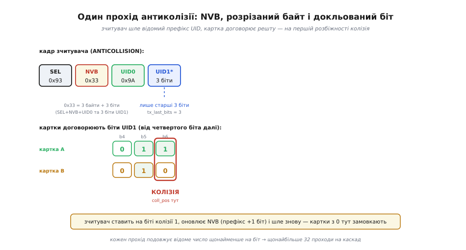

# ⚙️ Цикл антиколізії ISO 14443A на C: від REQA до вибору кожної картки в полі

## Задача: коли фронтенд НЕ робить дерево за вас

Ми вже бачили, як `InListPassiveTarget` одним рядком витягує UID: усередині PN532 сидить ядро 80C51 із зашитою логікою, і воно саме проганяє REQA, антиколізію й SELECT. Зручно — але це чорна скринька. Щойно ви візьмете дешевший фронтенд без вбудованого автомата протоколу — MFRC522, MFRC523, ST25R391x у режимі «прозорого» кадру — картина зміниться: мікросхема вміє лише *передати кадр і прийняти відповідь*, порахувати CRC та повідомити «сталася колізія на такому біті». Двійкове дерево, байт NVB, каскади Cascade Tag, переведення карток у HALT — усе це доведеться написати вам, у прошивці мікроконтролера.

Це не рідкісний випадок. MFRC522 — найпоширеніший RFID-фронтенд у аматорській і бюджетній промисловій електроніці саме тому, що дешевий; а дешевий він тому, що не несе ядра-співпроцесора з готовим стеком. Тому вміння руками зібрати цикл антиколізії — не академічна вправа, а щоденний хліб, щойно ви виходите за межі «магічної» бібліотеки. І ще одна причина: навіть коли фронтенд робить дерево сам, розуміти *точну* механіку кадрів критично для налагодження. Коли SELECT уперто повертає не той UID або зависає на колізії, без карти кадрів ви безпорадні.

Отже, конкретна задача цього кроку: **у полі лежить невідома кількість карток ISO 14443A (від нуля до десятка), з UID різної довжини (4, 7 або 10 байт). Треба перебрати їх усі, дістати повний UID кожної й лишити поле в чистому стані.** Розв'яжемо її з нуля — на голому C, у стилі реальної прошивки, спираючись лише на примітиви «передай кадр» / «прийми кадр» / «порахуй CRC», які дає будь-який фронтенд.

> 🔧 **Навіщо це.** Різниця між «моя бібліотека читає одну картку» і «мій пристрій надійно працює в полі з кількома мітками» — це саме цей цикл. Турнікет, до якого піднесли гаманець із трьома картками; складський сканер, над яким проїхала палета з десятком міток; платіжний термінал, що мусить обрати рівно одну картку й не переплутати, — усе це коректний цикл антиколізії. Пропустите його — і пристрій «іноді бачить, іноді ні», що в польових умовах гірше за чесне «не працює».

## Ідея: домовитися по біту, відсікаючи половину щоразу

Стратегію ми вже вивели концептуально — тепер зробімо її настільки конкретною, щоб з неї виріс код. Уся антиколізія тримається на одному фізичному факті: коли дві картки в тому самому бітовому вікні шлють протилежні біти, зчитувач бачить *обидва* — бо «1» це ввімкнена субнесуча, а ввімкнена хоч однією карткою субнесуча вже помітна. Манчестерський код у цьому вікні ламається (активні обидва півперіоди), і демодулятор фронтенда рапортує: «колізія, позиція N».

З цього єдиного факту виростає весь протокол як **бітовий діалог**:

1. Зчитувач каже: «усі, хто в полі, — надішліть мені свій UID, починаючи з біта 0».
2. Картки шлють синхронно. Поки їхні біти збігаються, зчитувач приймає їх спокійно. На першому біті, де вони розійшлися, — колізія на позиції N.
3. Зчитувач *довизначає* цей біт (обирає, скажімо, 1) і повторює запит уже з відомим префіксом: «мене цікавлять тільки ті, чиї перші N+1 біт — ось такі». Картки, чий біт на позиції N інший, замовкають.
4. Кроки 2–3 повторюються, щоразу подовжуючи відомий префікс, доки колізій не стане: у полі (з-поміж тих, хто ще відповідає) лишилася рівно одна картка, і зчитувач знає весь її UID.
5. Зчитувач шле SELECT із повним UID — картка переходить в активний стан. Потім HLTA — картка «засинає» й вибуває з гри.
6. Знову крок 1 — але тепер приспана картка мовчить, і дерево спускається в іншу гілку. Так, картка за карткою, поле порожніє.

Кожен раунд відсікає щонайменше половину кандидатів у поточній гілці — це буквально двійковий пошук по значенню UID. Тому глибина дерева обмежена довжиною UID: 32 біти на каскад → щонайбільше 32 раунди, щоб виокремити одну картку, скільки б їх не було.

Уся хитрість реалізації — у трьох місцях, де диявол ховається в деталях: **як спакувати «відомий префікс» у кадр** (байт NVB і розрізаний по біту останній байт), **як прочитати позицію колізії з фронтенда** й дописати біт, і **як зшити каскади** для довгих UID. Розберемо кожне, а тоді складемо повний робочий цикл.

## Анатомія кадру: SEL, NVB і розрізаний байт

Почнімо з кадру, яким зчитувач веде діалог. Він до безглуздя простий на вигляд і хитрий у деталях:

```
[ SEL ][ NVB ][ UID/CT байти... ][ BCC ][ CRC_A CRC_A ]
   0      1        2 .. 6            —        (лише в SELECT)
```

**SEL** — байт вибору каскаду, він же код команди. Три значення, по одному на рівень каскаду:

```
SEL = 0x93  →  каскад 1 (CL1): біти  0..31 UID
SEL = 0x95  →  каскад 2 (CL2): біти 32..63 UID
SEL = 0x97  →  каскад 3 (CL3): біти 64..79 UID
```

**NVB (Number of Valid Bits, кількість дійсних біт)** — найважливіший і найменш очевидний байт протоколу. Він каже картці, *скільки саме біт наступного за ним UID уже відомі зчитувачу*, тобто де закінчується «префікс від зчитувача» і починається «те, що картка має договорити». Кодується він двома півбайтами:

```
NVB = (кількість_повних_байтів << 4) | кількість_зайвих_біт
       └── старші 4 біти ──┘          └── молодші 4 біти ──┘
```

Причому лічать *увесь кадр разом із SEL і NVB*, не лише UID. Звідси два опорні значення:

```
NVB = 0x20  →  2 повні байти (це самі SEL+NVB), 0 біт UID відомо.
              Стартова точка: «нічого про UID не знаю, шліть усе».
NVB = 0x70  →  7 повних байтів (SEL+NVB+4 UID+BCC), 0 зайвих біт.
              Усі 32 біти UID відомі → це вже не ANTICOLLISION, а SELECT.
```

Ось перша ключова думка: **ANTICOLLISION і SELECT — це той самий кадр, лише з різним NVB.** Поки NVB < 0x70, картка *договорює* решту UID (це запит-антиколізія); коли NVB = 0x70, зчитувач передає повний UID, додає CRC_A і чекає підтвердження (це вибір). Одна структура кадру працює на обидві ролі — елегантно й економно.

А тепер найтонше місце всього протоколу. Колізія рідко трапляється рівно на межі байта. Скажімо, перші 11 біт UID уже відомі. Одинадцять — це один повний байт (8 біт) плюс 3 біти другого. Як передати «байт із трьох біт»? Тут вступає **бітово-орієнтований кадр** (bit-oriented frame): останній байт кадру передають *не повністю*, а рівно стільки біт, скільки треба, і фронтенд домовляється передати «обрубок». NVB у цьому разі:

```
11 відомих біт UID = 1 повний байт + 3 біти
   + 2 службові байти (SEL, NVB) = 3 повні байти + 3 біти
NVB = (3 << 4) | 3 = 0x33
```

І кадр `[0x93][0x33][UID0][частковий_UID1]` фізично несе SEL, NVB, повний UID0 і лише *старші 3 біти* другого байта. Картки, у яких ці 3 біти збіглися з надісланими, договорять решту — почавши рівно з четвертого біта другого байта. Ця «зшивка на межі біта» — те, через що наївна реалізація «передам-но байтами» ламається; фронтенд мусить уміти передати неповний останній байт і прийняти відповідь, вирівняну не по байту. Далі побачимо, як це роблять регістром `BitFramingReg`.

> 🔧 **Навіщо це.** Дев'ять із десяти помилок у саморобному стеку антиколізії — саме тут, у NVB і розрізаному байті. Типовий симптом: «одну картку читає, а на двох зависає». Причина — код рахує NVB тільки в цілих байтах або передає останній байт повністю, тож картки не розуміють, де кінчається префікс, і відповідають кашею. Правильний NVB із точністю до біта — умова, без якої дерево не спуститься.

## Читання UID однієї картки: найпростіший випадок

Перш ніж воювати з юрбою, зберемо кістяк на одній картці — коли колізій немає взагалі. Це дасть скелет, який далі обростатиме обробкою колізій і каскадів.

Спершу — фундамент. Опишемо примітиви, які дає будь-який фронтенд, і команди протоколу. Примітиви навмисне тримаємо абстрактними: `pcd_transceive` передає кадр і приймає відповідь, а розріз останнього байта задають `tx_last_bits` (скільки біт останнього переданого байта дійсні) і `rx_align` (з якого біта складати прийняте) — точнісінько те, що ховає регістр `BitFramingReg` у MFRC522.

:::code proj-anticollision-loop/c/stdint.h

Тепер — REQA. Це семибітний *короткий кадр* (short frame): не байт, а рівно 7 біт, тому передаємо один байт `0x26` з `tx_last_bits = 7`. У відповідь картка шле **ATQA** — два байти, що грубо натякають на тип і бажаний рівень антиколізії:

:::code proj-anticollision-loop/c/chytannia-uid-odniiei.c

Зверніть увагу: колізію на ATQA ми свідомо *не* вважаємо помилкою. ATQA — не UID, розрізняти картки за ним не треба; нам досить факту «поле не порожнє». Розбирання карток почнеться на наступному етапі, з UID.

Тепер найпростіший каскад без колізій. Ідея: шлемо `[SEL][0x20]` (NVB = «нічого не знаю»), картка договорює весь свій 4-байтний блок UID + BCC; ми перевіряємо BCC, тоді шлемо SELECT `[SEL][0x70][UID×4][BCC][CRC×2]` і читаємо SAK:

:::code proj-anticollision-loop/c/chytannia-uid-odniiei-2.c

Це вже робочий вибір однієї картки з коротким UID. Але він падає, щойно в полі з'явиться друга картка (`PCD_COLLISION`) або UID виявиться довшим за 4 байти (у SAK стоятиме прапорець каскаду). Додамо обидві речі — і отримаємо повний цикл.

## Спуск двійковим деревом: обробка колізії

Ось серце вправи. Замість «шлю 0x20 і чекаю весь блок» треба вести діалог по біту: тримати лічильник *відомих біт* UID цього каскаду, на кожній колізії дописувати біт і подовжувати префікс.

Ключова структура — робочий буфер каскаду `buf[]`, де `buf[0]=SEL`, `buf[1]=NVB`, а `buf[2..5]` поступово наповнюються бітами UID (шостий байт `buf[6]` — BCC, дописуємо в кінці). Лічильник `known` — скільки біт UID уже зафіксовано (0..32). І одразу критична деталь реалізації: біти UID ми **накопичуємо** — дописуємо по одному через `OR`, а не перезаписуємо байт цілком, — тому буфер треба спершу **занулити**. Незаповнені позиції мусять стартувати з нуля, інакше перший же `OR` підмішає до UID сміття, що лежало на стеку, і зчитувач піде в SELECT із зіпсованим ідентифікатором.

Як фронтенд повідомляє позицію колізії? У MFRC522 після колізії регістр `CollReg` містить `CollPos` — номер першого розбіжного біта (біти 0..4; значення 0 означає «32-й біт»). Наш примітив `pcd_transceive` віддає це через `coll_pos` (1..32). Знаючи позицію, робимо головний хід: **ставимо на цьому біті 1** (обираємо гілку) і повторюємо запит із подовженим на цей біт префіксом. Наступний прохід або дасть нову, глибшу колізію, або договорить UID чисто.

Розгляньмо арифметику розрізу уважно, бо тут і живуть помилки. Нехай `known` біт UID уже відомі. Тоді:

```
повні_байти_UID   = known / 8            // цілих байтів UID у буфері
зайві_біти        = known % 8            // біт у частковому останньому байті
NVB = ((2 + повні_байти_UID) << 4) | зайві_біти     // +2 за SEL і NVB
tx_last_bits      = зайві_біти           // скільки біт останнього байта шлемо
```

А прийняту відповідь картка почне *рівно з того біта*, де ми зупинилися, тож її треба «доскладати» до нашого часткового байта — це і є `rx_align = зайві_біти`. Фронтенд припасує прийняті біти так, щоб вони лягли поряд із уже відомими в тому самому байті. Ось повна функція одного каскаду з деревом:

:::code proj-anticollision-loop/c/spusk-dviikovym-derevom.c

Зверніть увагу на два тонкі місця. Перше — `buf[byte_i] |= (1u << bit_in_b)`: ми не *перезаписуємо* байт, а *дотискаємо* один біт, бо старші біти цього байта вже могли бути зафіксовані на попередніх раундах. Друге — `OR` при вклеюванні прийнятого: біти, які ми вже знали, лишаються, а картка додає свої поверх. Наївне `memcpy` затерло б відомий префікс і зламало б спуск. Саме через ці «докльовування по біту» ручна антиколізія неінтуїтивна: це не «зчитав блок», а «поступово домалював число, гілка за гілкою».

Чому ми завжди обираємо гілку **1**, а не 0? Це домовленість, не закон, — байдуже, аби послідовно. Обравши 1, ми відкидаємо всі картки з 0 на цьому біті; їх заберемо пізніше, коли ця гілка вичерпається й ми повернемося. Стандарт лишає вибір гілки за зчитувачем; головне — щоб потім не забути обійти й другу.


*Зчитувач шле SEL+NVB і відомий префікс UID (останній байт розрізано на tx_last_bits); картка договорює решту, на першому розбіжному біті — колізія на позиції coll_pos. Зчитувач ставить там 1, оновлює NVB і шле довший префікс. Кожен прохід подовжує відоме число щонайменше на біт.*

## Каскади: коли UID не влазить у чотири байти

Один каскад дає 32 біти UID. Але картки бувають із 7- і 10-байтними UID — простір 2³² замалий, щоб гарантувати унікальність мільярдам випущених чипів, тож NXP та інші перейшли на довші ідентифікатори. Як передати 7 байт через кадр, що несе лише 4? Каскадами, і механіка тут така, що її легко наплутати.

У *першому* каскаді (CL1) чотирибайтний блок віддають не під самі байти UID, а під **Cascade Tag** плюс перші три реальні байти:

```
7-байтний UID = u0 u1 u2 u3 u4 u5 u6
  CL1 (SEL=0x93): [ CT=0x88 ][ u0 ][ u1 ][ u2 ]   BCC1 = 0x88 ^ u0 ^ u1 ^ u2
  CL2 (SEL=0x95): [ u3     ][ u4 ][ u5 ][ u6 ]     BCC2 = u3 ^ u4 ^ u5 ^ u6
```

Cascade Tag `0x88` на місці нульового байта — це прапор «те, що ти отримав, — не повний UID; його початок, справжні байти далі, роби наступний каскад». Оскільки жоден реальний перший байт UID не буває `0x88` (значення зарезервоване саме під цю роль), картка й зчитувач однозначно розуміють: UID триває. Для 10-байтного UID Cascade Tag стоїть у CL1 *і* CL2, а «чисті» останні чотири байти приходять у CL3.

Звідки зчитувач знає, чи потрібен наступний каскад? З **SAK** (Select Acknowledge), який картка шле у відповідь на SELECT. У SAK є **біт каскаду** — b3, тобто маска `0x04`:

```
SAK & 0x04 == 0x04  →  UID НЕ повний, роби наступний каскад
SAK & 0x04 == 0     →  UID повний; інші біти SAK кажуть тип картки
```

Коли каскад завершено (біт `0x04` погашено), решта SAK характеризує картку: наприклад, `0x08` — MIFARE Classic 1K, `0x00` — MIFARE Ultralight/NTAG, `0x20` — картка з підтримкою ISO 14443-4 (APDU, як банківські). Тому SAK — це і «каскад закінчено», і «ось хто я».

Зберемо все у зовнішній цикл, що зшиває каскади в повний UID:

:::code proj-anticollision-loop/c/kaskady-koly-uid-ne-vlazyt.c

Логіка стику проста, щойно її побачиш: якщо блок починається з `0x88` *і* SAK каже «каскад триває», то реальних байтів у блоці три (нульовий — службовий тег), інакше — усі чотири, і це кінець. Складання довжини UID (4/7/10) виходить саме собою.

## Переведення в HALT і перебір усього поля

Тепер зовнішня оболонка — та, що робить задачу задачею: перебрати *всіх* у полі. Після того, як картку вибрано й прочитано, її треба прибрати з гри, інакше наступний REQA знову підніме її, і ми крутитимемося на тій самій. Прибирають командою **HLTA** (Halt Type A):

:::code proj-anticollision-loop/c/perevedennia-v-halt-i.c

Тут криється контрінтуїтивна пастка: правильно приспана картка **мовчить** у відповідь на HLTA. Тобто ознака успіху — таймаут, а не відповідь. Код, який чекає ACK на HLTA й рахує тишу за помилку, «лагодитиме» те, що й так працює.

І нарешті — головний цикл, що склеює все докупи. Він тримається на різниці між REQA і WUPA: **REQA** будить лише картки в стані IDLE (ще не приспані), **WUPA** будить *усіх*, зокрема й тих, кого ми вже перевели в HALT. Тому в межах одного обходу поля ми користуємося REQA: приспані на попередніх ітераціях картки лишаються осторонь, і дерево щоразу спускається в *нову* гілку.

:::code proj-anticollision-loop/c/perevedennia-v-halt-i-2.c

Розгляньмо, чому цей цикл *завершується* й не зациклюється. Кожна успішна ітерація забирає рівно одну картку з множини «відповідають на REQA» (переводить у HALT). Множина скінченна й лише зменшується. Коли вона порожня, REQA дає таймаут (`picc_request` повертає `false`) — і ми виходимо. Запобіжник `max_cards` страхує від патології (картка, що не приспалася через слабке живлення на межі поля й уперто відповідає) — без нього битий контакт міг би крутити цикл вічно.

**Приклад (повний прохід поля з трьома картками).** Уявімо в полі три MIFARE Classic (усі 4-байтні UID), що збіглися в старших 20 бітах і розійшлися далі:

```
REQA → ATQA (хтось є)
  select_level(0x93, NVB=0x20…): колізія на біті 21 → ставимо 1, NVB=0x35, далі
      ще колізія на біті 24 → ставимо 1 → чисто → UID картки A
  SELECT(0x93,0x70,UID_A,BCC,CRC) → SAK=0x08 (Classic 1K, каскаду нема)
  on_card(UID_A, 4, 0x08);  HLTA → картка A мовчить
REQA → ATQA (ще хтось є — B і C)
  select_level: колізія на біті 21 (A вже спить) → тепер гілка веде до B/C…
      → UID картки B;  SELECT → SAK;  on_card(UID_B);  HLTA
REQA → ATQA (лишилась C)
  select_level: колізій нема (одна картка) → UID картки C;  on_card(UID_C);  HLTA
REQA → TIMEOUT (поле порожнє) → вихід, found = 3
```

Три обходи дерева, три HALT, і поле вичерпано. Кожен REQA бачить на одну картку менше — саме тому дерево щоразу мілкішає. Так виглядає коректний перебір, якого бракує наївному «прочитав перший UID і зупинився».

## Складність і пастки: де воно ламається насправді

Тепер, маючи повний код перед очима, пройдімо ті місця, де реальні пристрої спотикаються. Кожна пастка — не абстрактна, а прив'язана до конкретного рядка вище.

**Порядок біт: LSB-first, а не як ви читаєте.** Найпідступніше. ISO 14443A передає байти *молодшим бітом уперед* (LSB first). Це означає, що «позиція колізії N» рахується в порядку передачі, і біт, який ми дотискаємо через `1u << bit_in_b`, — це біт у *логічному* байті, який фронтенд відправить молодшим кінцем першим. Здебільшого фронтенд (MFRC522) бере цей клопіт на себе: ви кладете байти в буфер «нормально», а мікросхема сама шле LSB-first і рахує `CollPos` у тому ж порядку — тож `1u << bit_in_b` лягає правильно. Але щойно ви реалізуєте фронтенд без апаратного кадрування (bit-banging чи FPGA) — доведеться самому перевертати порядок біт, і плутанина MSB/LSB дає UID, читаний «навиворіт». Симптом: ваш UID — це дзеркальне відображення того, що показує еталонний зчитувач. Перевірка: прочитайте ту саму картку робочою бібліотекою й порівняйте побайтово.

**BCC і CRC_A — різні контролі, не переплутайте.** BCC (Block Check Character) — простий XOR чотирьох байтів блоку, він захищає *антиколізійний* обмін і йде в кадрі *без* CRC. CRC_A (поліном x¹⁶+x¹²+x⁵+1 = 0x1021, початкове значення 0x6363, без фінального XOR, передається молодшим байтом уперед) захищає *SELECT* і *всі* стандартні кадри після активації. Плутанина типова: додати CRC до ANTICOLLISION (там його не має бути — картка не зрозуміє кадр) або забути додати до SELECT (тоді картка проігнорує вибір). У коді вище CRC з'являється рівно у двох місцях — у гілці `known >= 32` (SELECT) і в `picc_halt` (HLTA); більше ніде. Константа CRC_A для HLTA `0x50 0x00` завжди `0x57 0xCD` — зручний тест вашого обчислювача CRC: якщо не сходиться, шукайте помилку в поліномі чи початковому значенні.

**Таймінги: FDT і «вікно» відповіді.** Між кадром зчитувача й відповіддю картки стандарт задає точний *час кадрової затримки* (Frame Delay Time, FDT) — для 106 кбіт/с це 1236 / 13.56×10⁶ ≈ 91.15 мкс після біта «1» і трохи інакше після «0». Картка відповідає рівно в це вікно; якщо ваш фронтенд налаштований на надто короткий таймаут приймання, ви отримаєте `PCD_TIMEOUT` там, де картка чесно відповіла — просто ви перестали слухати зарано. У MFRC522 це регістри таймера (`TModeReg`, `TPrescalerReg`, `TReloadReg`); типовий симптом недоладу — «читає з десятої спроби» або «читає лише впритул». Живлення тут ні до чого — це вікно приймання.

**Скидання CollReg перед кожним раундом.** У MFRC522 біт `ValuesAfterColl` у `CollReg` керує тим, чи *зберігати* прийняті до колізії біти. Його треба виставити правильно перед раундом антиколізії, інакше фронтенд або відкине корисні біти, або складе сміття. Наш примітив `pcd_transceive` мусить робити це всередині; якщо пишете його самі — не забудьте, бо симптом підступний: дерево «майже працює», але зрідка дає биті UID на глибоких колізіях.

**Колізія не на межі байта — і арифметика rx_align.** Ми вже наголошували: якщо колізія трапилася, скажімо, на 11-му біті, останній переданий байт несе лише 3 біти (`tx_last_bits = 3`), а відповідь картки треба вирівняти на ті самі 3 біти (`rx_align = 3`), щоб її біти лягли поряд із нашими в *тому самому* байті буфера. Помилка на одиницю тут (off-by-one у `coll_pos`, плутанина 0-based/1-based) зсуває весь подальший UID — і SELECT іде з невірним ідентифікатором, картка мовчить. Це найтонше місце `select_level`; при написанні свого коду варто прогнати його на *двох* картках із відомими UID і покроково звірити буфер після кожного раунду.

**Кілька карток фізично розладнали одне одного.** Це вже не логічний, а енергетичний рівень — і жоден бездоганний код антиколізії його не порятує. Дві-три картки, притулені впритул, зв'язуються взаємоіндукцією між собою, їхні власні частоти розповзаються, і жодна не потрапляє точно в 13.56 МГц — тоді REQA не побачить *нікого*, і дерево навіть не почнеться. Ознака: `nfc_enumerate_field` повертає 0 при явно наявних картках, причому та сама картка *поодинці* читається чудово. Тут допомагає не код, а рознести картки на кілька міліметрів. Це нагадування, що антиколізія живе на верхньому рівні драбини й покладається на те, що нижні (поле, живлення, кодування) справні.

**Хтось прибрав картку посеред дерева.** Реальне поле — динамічне: картку піднесли й забрали за частки секунди. Якщо це сталося між ANTICOLLISION і SELECT, картка зникне з відповіді, і ви отримаєте `PCD_ERR` чи биту BCC. У циклі вище ми ловимо це через `if (len == 0) continue;` — просто перечитуємо, що лишилося. Без такої стійкості пристрій «підвисав» би на кожному швидкому змаху карткою. Правило: будь-який крок дерева може провалитися через зникнення картки, і це нормальний робочий випадок, а не виняток.

Отже, повний цикл антиколізії — це три вкладені механізми: діалог по біту з докльовуванням NVB усередині каскаду (`select_level`), зшивання каскадів через Cascade Tag і біт SAK (`picc_select_full`), і зовнішній перебір поля з HALT і REQA (`nfc_enumerate_field`). Кожен рівень простий сам по собі; складність — у стиках, де ховаються off-by-one у позиції колізії, плутанина BCC/CRC і LSB-first. Зате, склавши це раз і звіривши на кількох картках, ви отримуєте те, чого не дає жодна «магічна» бібліотека без розуміння: пристрій, що *передбачувано* поводиться в реальному полі — з однією карткою, з десятком, зі змахом руки. А коли ваш фронтенд усе ж робить дерево сам, ця сама карта кадрів перетворює налагодження з ворожіння на прицільний пошук: ви точно знаєте, який байт, який біт і який контроль мали б стояти в кожному кадрі.
