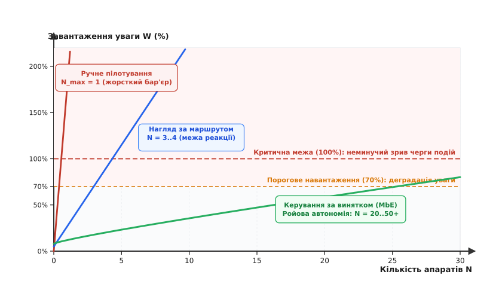
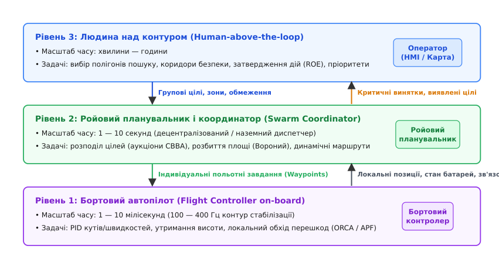
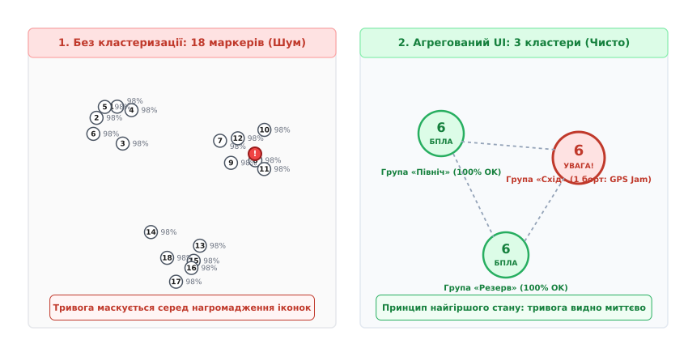
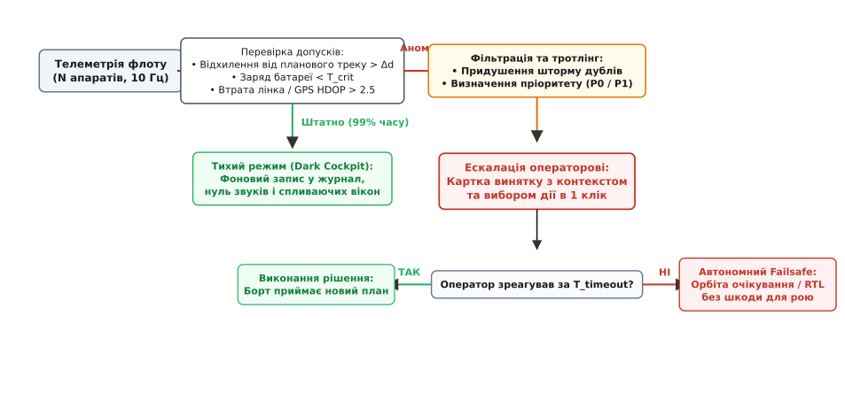

# Один оператор, багато апаратів: межа уваги

<preknowlist>
- [Людина в контурі: чому затримка руйнує керування](root:embedded/liudyna-v-konturi) — фізіологічні затримки оператора та передатна функція людини за моделлю Макруера.
- [Телекерування: затримки, відеоканал, втрата лінка](root:embedded/teleoperation-latency) — бюджети затримки відеотракту, буферизація та поведінка при втраті сигналу.
- [Віддати керування автоматові й забрати назад](root:embedded/viddaty-keruvannia-avtomatovi-i-zabraty-nazad) — перемикання рівнів автономії та межі відповідальності автоматики.
- [Планування місій](root:embedded/mission-planning) — точки маршруту (waypoints), геозони та автономне виконання польотних завдань.
</preknowlist>

Оператор сидить перед трьома моніторами, намагаючись одночасно вести три розвідувальні безпілотники за допомогою трьох окремих джойстиків. Перший апарат потрапляє в низхідний потік повітря біля лісосмуги й просідає на вісім метрів, що вимагає негайного коригування тяги та кута тангажу протягом двохсот мілісекунд. У цей самий момент другий дрон фіксує радіоелектронну заваду й починає дрейфувати в бік забороненої зони, а на третьому спрацьовує оптичний датчик зближення з верхівками дерев. Очі людини здатні фокусуватися лише на одній точці екрана за раз: кут чіткого центрального зору становить лише два градуси, переведення погляду забирає тридцять мілісекунд, а повторне зчитування просторової орієнтації іншого апарата вимагає щонайменше чотириста мілісекунд когнітивної роботи. Поки оператор вирівнює перший дрон, третій врізається в крону дерева, а другий остаточно втрачає супутниковий зв'язок.

Ця аварія не є наслідком браку навичок пілота чи несправності радіоканалу. Вона зумовлена фундаментальним біологічним обмеженням: **людський мозок не здатний паралельно замикати кілька динамічних контурів швидкісного керування**. Як тільки кількість керованих рухомих об'єктів перевищує одиницю, спроба прямого ручного пілотування гарантовано перевантажує когнітивний тракт оператора й призводить до колапсу черги подій.

Щоб одна людина могла контролювати групу, загін або цілий рій із десятків і сотень безпілотників, необхідно докорінно змінити саму модель взаємодії: усунути людину з контуру безпосередньої стабілізації польоту, агрегувати візуальну інформацію на карті, розподілити задачі через ройові алгоритми та перевести інтерфейс на керування за винятком.

## Когнітивна пляшка уваги та бар'єр ручного пілотування

Пряме ручне керування літальним або наземним апаратом *(Human-in-the-loop)* є неперервним процесом відстеження та компенсації помилки. Оператор безперервно порівнює бажане положення машини з поточним, вираховує похибку за кутами й швидкістю та зміщує стіки пульта. Пропускна здатність свідомого інформаційного каналу людини обмежена сорока-п'ятдесятьма бітами на секунду за законом Гіка-Хаймана *(Hick-Hyman Law)*, а гранична частота зорово-моторного контуру не перевищує двох-трьох герців.


*Залежність когнітивного завантаження оператора від кількості контрольованих апаратів: при прямому пілотуванні бар'єр перевантаження наступає вже при двох машинах; при нагляді за маршрутом — при чотирьох-шести; лише керування за винятком (MbE) дозволяє масштабувати флот до десятків одиниць на одного оператора.*

Коли оператор намагається керувати кількома апаратами одночасно, його увага перетворюється на дискретний часовий ресурс, що розподіляється між машинами за принципом почергового обслуговування. Математично завантаження уваги `W` *(Workload factor)* описується моделлю балансу часу взаємодії та періоду між втручаннями:

```
W = ∑ [ IT[i] / MTBO[i] ]    для i = 1 … N
```

де:
- `N` — загальна кількість апаратів під наглядом оператора;
- `IT[i]` *(Interaction Time)* — середній час, необхідний людині на одне втручання в роботу `i`-го апарата (зчитування телеметрії, оцінка ситуації, рух пальцями, контроль результату);
- `MTBO[i]` *(Mean Time Between Operator Intervention)* — середній час автономного руху апарата між ситуаціями, які вимагають людської реакції.

Якщо сумарне завантаження `W` перевищує `0.70` (сімдесят відсотків робочого часу), система переходить у режим когнітивного перевантаження. Згідно з теорією масового обслуговування, при `W > 0.70` час очікування подій у внутрішній черзі людини зростає експоненційно. Якщо ж `W ≥ 1.00`, оператор фізично не встигає реагувати на збурення, і черга невиправлених помилок зростає до нескінченності:

```
Розрахунок для прямого ручного пілотування (Manual Control):
IT   = 1.8 с     [час реакції, маніпуляції стіком та контролю крену]
MTBO = 1.0 с     [збурення від вітру та динаміки вимагають реакції щосекунди]

W = N · (IT / MTBO) = N · (1.8 / 1.0) = 1.8 · N

При N = 1:   W = 1.80   (180% — пілот працює на межі фізіологічного виснаження)
При N = 2:   W = 3.60   (360% — неминуча катастрофа за 2–4 секунди)
```

З цього розрахунку випливає жорстке фізичне правило: **максимальна кількість динамічних апаратів при прямому ручному керуванні для однієї людини дорівнює одиниці** (`N_max = 1`).

### Математична модель черги уваги оператора (M/G/1)

Потік запитів на втручання від флоту з `N` апаратів можна подати як пуассонівський процес із сумарною інтенсивністю `λ`:

```
λ = ∑ λ[i] = N · (1 / MTBO)
```

Час обслуговування інциденту людиною `S` є випадковою величиною із середнім значенням `E[S] = IT` та дисперсією `Var(S) = σ_S²`. Відповідно до формули Поллачека-Хінчина *(Pollaczek-Khinchine formula)* для черги типу M/G/1, середній час очікування інциденту в черзі до уваги оператора `W_q` дорівнює:

```
W_q = [ λ · (IT² + σ_S²) ] / [ 2 · (1 - W) ]
```

де `W = λ · IT` — коефіцієнт завантаження.

Коли завантаження наближається до одиниці (`W → 1`), знаменник прямує до нуля, і час очікування `W_q` стрімко вибухає. Якщо на борту виникає критична несправність (наприклад, небезпека зіткнення, яка вимагає маневру за три секунди), а середній час очікування в черзі `W_q` становить вісім секунд через зайнятість оператора іншим дроном, борт гарантовано зазнає аварії.

```
Числовий приклад розрахунку черги уваги:
N = 4 апарати в режимі нагляду за маршрутом (Supervisory Control)
IT = 6.0 с,   σ_S = 2.0 с,   MTBO = 30.0 с

λ = 4 · (1 / 30.0) = 0.1333 подій/с
W = λ · IT = 0.1333 · 6.0 = 0.80  (80% завантаження — небезпечна зона)

W_q = [ 0.1333 · (6.0² + 2.0²) ] / [ 2 · (1 - 0.80) ]
    = [ 0.1333 · (36 + 4) ] / [ 2 · 0.20 ]
    = [ 0.1333 · 40 ] / 0.40
    = 5.332 / 0.40
    = 13.33 с
```

Середній час очікування реакції становить понад тринадцять секунд. Будь-яка аномалія, яка вимагає втручання швидше ніж за 13 секунд, призведе до втрати апарата з імовірністю понад 85%.

### Ціна перемикання контексту: когнітивне тунелювання

Другий бар'єр людського фактора полягає у високій вартості перемикання уваги *(Context Switching Penalty)*. Людина не здатна миттєво перенести фокус з одного апарата на інший. Процес переорієнтації складається з трьох послідовних рівнів формування ситуаційної обізнаності *(Situational Awareness, SA)*:

1. **Рівень сприйняття (Perception):** зчитування положення нового апарата на карті, його висоти, курсу, швидкості та заряду батареї (забирає 1.5–3 секунди).
2. **Рівень розуміння (Comprehension):** зіставлення поточного стану з рельєфом, сусідніми апаратами та поточним етапом місії (забирає 2–5 секунд).
3. **Рівень прогнозування (Projection):** передбачення траєкторії на найближчі десять секунд та виявлення прихованих загроз (забирає 2–7 секунд).

Повний час відновлення ситуаційної обізнаності `T_switch` становить від п'яти до п'ятнадцяти секунд на кожен перехід між апаратами.

У стані сильного стресу виникає феномен **когнітивного тунелювання** *(Attentional Tunneling)*: зіткнувшись із нештатною ситуацією на одному з дронів, оператор «прилипає» поглядом до проблемної машини, намагаючись врятувати її. У цей час уся решта флоту залишається абсолютно без нагляду. Якщо автопілот не володіє повною внутрішньою автономією, решта `N - 1` апаратів приречені на аварію через банальне вичерпання палива або зіткнення з перешкодами.

> 🔧 **Навіщо це.** Якщо ви проєктуєте систему керування кількома БПЛА, категорично заборонено будувати інтерфейс навколо швидкого перемикання між відеопотоками від першої особи (FPV). Навіть якщо забезпечити миттєве апаратне перемикання радіоканалів за п'ять мілісекунд, мозок людини витратить десять секунд на кожну зміну виду, щоб просто зорієнтуватися, де північ, який дрон куди дивиться і де земля.

---

## Зміна парадигми: від пілотування до управління місіями

Щоб розірвати залежність між кількістю машин `N` та завантаженням оператора `W`, необхідно прибрати людину з контурів швидкого реагування. Управління роєм будується на переході від концепції «людина в контурі» *(Human-in-the-loop)* до концепції «людина над контуром» *(Human-above-the-loop)*.


*Розподіл функцій та часових масштабів в автономній системі: внутрішній автопілот відпрацьовує мілісекундну динаміку, ройовий диспетчер розподіляє задачі за секунди, а оператор формує високорівневі наміри з горизонтом у хвилини й години.*

Система керування розбивається на три чіткі ієрархічні рівні:

### 1. Бортовий автопілот (Контур стабілізації та реактивної безпеки, 100–400 Гц)
Бортовий контролер повністю бере на себе низькорівневу фізику польоту:
- ПІД-регулятори кутових швидкостей і кутів нахилу.
- Утримання висоти за барометром та лідаром.
- Утримання позиції за супутниковою навігацією або оптичним потоком.
- Локальне уникнення зіткнень із перешкодами та сусідніми апаратами.
- Автоматичний аварійний протокол *(Failsafe)*: повернення на точку старту при втраті зв'язку або аварійна посадка при критичному розряді акумулятора.

На цьому рівні людина не втручається ніколи. Оператор фізично не надсилає команди крену чи тангажу: бортовий комп'ютер сприймає лише цільові вектори швидкості або координати точок маршруту.

#### Алгоритми локального уникнення колізій: APF проти ORCA
Для запобігання зіткненням між сусідніми апаратами рою застосовують два підходи:

1. **Штучні потенціальні поля (Artificial Potential Fields, APF):**
   Цільова точка створює потенціал притягання `U_att`, а сусідні дрони та перешкоди — потенціал відштовхування `U_rep`:
   ```
   U_total(p) = U_att(p) + ∑ U_rep(p, p[j])

   U_att(p)       = ½ · k_att · ||p - p_goal||²
   U_rep(p, p[j]) = ½ · k_rep · (1/d - 1/d_0)²    при d = ||p - p[j]|| ≤ d_0
   ```
   Результуюча сила керування дорівнює антиградієнту: `F = -∇ U_total(p)`. Недолік APF — ризик потрапляння в локальні мінімуми, коли вектор притягання точно врівноважується силами відштовхування двох сусідів.

2. **Оптимальні взаємні перешкоди швидкості (Optimal Reciprocal Collision Avoidance, ORCA):**
   Сучасні ройові системи використовують метод ORCA у просторі швидкостей. Кожен дрон припускає, що сусідній апарат також намагається уникнути колізії, тому ділить необхідну зміну відносної швидкості порівну (50% маневру бере на себе дрон А, 50% — дрон Б). Задача зводиться до швидкого двовимірного лінійного програмування *(2D Linear Programming)*, яке обчислюється на бортовому мікроконтролері за 0.1–0.3 мс без виникнення коливань і коливальних петель.

### 2. Ройовий планувальник і координатор (Тактичний розподіл задач, 0.1–1 Гц)
Проміжний алгоритмічний шар координує спільну роботу групи. Він може виконуватися децентралізовано на бортових комп'ютерах зв'язки *(Companion Computer)* або централізовано на наземній станції:
- **Аукціонний алгоритм CBBA (Consensus-Based Bundle Algorithm):** децентралізований двоетапний розподіл завдань. На першому етапі *(Bundle Construction)* кожен дрон жадібно обирає найвигідніші для себе цілі з урахуванням залишкового палива та відстані. На другому етапі *(Consensus Phase)* дрони обмінюються векторами призначень по радіомережі й розв'язують конфлікти ставок за чіткими правилами пріоритету без участі наземного сервера.
- **Просторове розбиття зони:** побудова діаграм Вороного *(Voronoi Tessellation)* для рівномірного покриття заданого сектору пошуку.
- **Підтримка мережевої зв'язності:** якщо один із розвідників віддаляється за радіогоризонт, алгоритм автоматично висуває найближчий вільний апарат у проміжну позицію для виконання ролі ретранслятора.

### 3. Оператор (Стратегічне цілепокладання, хвилини — години)
Людина визначає кінцеву мету місії *(Mission Intent)*:
- Задає межі полігону пошуку або маршрутного коридору *(Search Polygons & Geofences)*.
- Визначає типи корисного навантаження та пріоритети цілей.
- Задає правила відкриття вогню або застосування корисного навантаження *(Rules of Engagement, ROE)*: оператор дає підтвердження на дію, але не наводить апарат на ціль вручну.
- Приймає рішення у нестандартних ситуаціях, які алгоритм не здатен вирішити автономно.

Завдяки такому розподілу параметр `MTBO` (час автономності між втручаннями) зростає від часток секунди до десяти-двадцяти хвилин:

```
Розрахунок для керування місіями (Task-Oriented Swarm Management):
IT   = 20 с      [людина переглядає запропонований план і тисне «Схвалити»]
MTBO = 600 с     [дрон самостійно виконує ділянку пошуку протягом 10 хвилин]

W = N · (IT / MTBO) = N · (20 / 600) = N · 0.0333

При N = 10:  W = 0.333  (33% — комфортне завантаження, низький рівень втоми)
При N = 20:  W = 0.667  (67% — безпечна верхня межа стійкої уваги)
```

Один оператор стає здатним безпечно та впевнено керувати флотом із двадцяти машин, оскільки його роль зведена до затвердження високорівневих рішень.

---

## Агреговане відображення флоту: боротьба з візуальним шумом

Коли на екрані наземної станції з'являються кілька десятків літальних апаратів, класичний інтерфейс QGroundControl чи Mission Planner перетворюється на нечитабельне нагромадження іконок. Якщо кожен дрон малювати окремим маркером із вектором курсу, висотою, швидкістю, зарядом і треком руху, виникає ефект **візуального захаращення** *(Visual Clutter)*. Маркери перекривають один одного, текст нашаровується, а критичне попередження про відмову одного борту губиться серед десятків однакових зелених значків.


*Порівняння інтерфейсів: ліворуч — неструктуроване виведення всіх маркерів, де критична аварія маскується графічним шумом; праворуч — семантична кластеризація з агрегованими бейджами та індикацією за принципом найгіршого стану.*

Для подолання візуального шуму інтерфейс флоту повинен реалізовувати два обов'язкові механізми: **екранну просторову кластеризацію** та **семантичне масштабування**.

### Геопросторова кластеризація маркерів

Кластеризація виконується не у географічних координатах на поверхні землі, а в **екранному просторі пікселів** *(Screen-Space)* після матричного перетворення проєкції карти.

Алгоритм працює за кроками:
1. Координати широти й довготи кожного апарата `(lat[i], lon[i])` трансформуються в екранні пікселі `(x[i], y[i])` відповідно до поточного масштабу та центру перегляду.
2. Простір екрана розбивається на сітку комірок розміром `R_cluster` (типово 40–50 пікселів).
3. Якщо два або більше апарати потрапляють в одну комірку або відстань між їхніми центрами `d_screen < R_cluster`, вони об'єднуються в єдиний **кластерний бейдж**.
4. Кластерний бейдж відображає:
   - Кількість машин у групі (велике число в центрі, наприклад `[12]`).
   - Усереднений вектор напрямку руху групи.
   - Опуклу оболонку *(Convex Hull)* або прямокутник охоплення території, яку контролює цей підрозділ.
   - Інтегральний колірний індикатор стану групи.

### Семантичне масштабування (Semantic Zooming)

Зміст відображення змінюється залежно від рівня наближення карти:

- **Макрорівень (загальна карта театру дій, масштаб Z < 12):** окремі дрони приховані. Відображаються лише великі кластери, загальні межі зон пошуку, відсоток виконання місії у відсотках площі та теплова карта покриття датчиками.
- **Мезорівень (масштаб групи, 12 ≤ Z ≤ 16):** кластери розпадаються на підгрупи. Відображаються маршрутні коридори, топологія локальної радіомережі (лінії радіолінків із колірним кодуванням якості зв'язку RSSI) та ключові ролі (лідер групи, ретранслятор).
- **Мікрорівень (максимальне наближення, Z > 16):** розгортається детальна картка одиничного дрона — відеопотік із камери, пілотажний горизонт (PFD), детальна напруга по банках акумулятора, температура регуляторів обертів і супутникова геометрія (HDOP/VDOP).

### Принцип ескалації найгіршого стану (Worst-State Escalation)

Найважливіше ергономічне правило авіаційного інтерфейсу: **колір та статус групи визначаються найгіршим станом серед усіх її членів**.

Кожен апарат має один із трьох базових станів:
1. 🟢 **Штатний (Nominal / OK):** політ за планом, батарея > 35%, радіолінк стабільний, GPS у нормі.
2. 🟡 **Попереджувальний (Advisory / Degraded):** незначна аномалія, яка не загрожує втратою борту негайно (перехід на резервний канал зв'язку, заряд 20–35%, погіршення точності супутників). Потребує уваги, але не негайної зупинки місії.
3. 🔴 **Критичний виняток (Critical / Fault):** загроза втрати апарата або зриву завдання (відмова мотора, розряд батареї < 15%, вихід за межі геозони, загроза зіткнення).

```
Status_cluster = max [ Status_uav[1], Status_uav[2], …, Status_uav[k] ]
де пріоритет: Fault (Червоний) > Degraded (Жовтий) > Nominal (Зелений)
```

Якщо в групі з десяти безпілотників дев'ять працюють ідеально, а на одному зафіксовано відмову сенсора або спробу супутникового спуфінгу, **увесь кластерний бейдж негайно забарвлюється у червоний колір** із пульсуючим контуром. Оператор миттєво бачить, яка саме група потребує уваги, навіть перебуваючи на найвищому макрорівні карти.

---

## Керування за винятком (Management by Exception)

У класичній авіації та пілотованих комплексах десятиліттями панував підхід безперервного інформування: прилади показують усі параметри щосекунди, пілот зобов'язаний постійно сканувати приладову панель очима. При керуванні роєм із тридцяти машин цей підхід гарантовано призводить до **інформаційного паралічу** та втоми від тривог *(Alarm Fatigue)*.

Керування роєм базується на філософії **«темної кабіни»** *(Dark Cockpit / Silent Cockpit Principle)*:
- Якщо всі системи функціонують штатно, інтерфейс залишається візуально спокійним і абсолютно німим.
- Відсутність сповіщень — це нормальний стан системи.
- Кожне спливаюче повідомлення чи звуковий сигнал — це надзвичайна подія, яка вимагає від людини конкретної усвідомленої дії.


*Контур обробки телеметрії за принципом MbE: 99% штатної телеметрії записується у фоновий журнал без генерації сповіщень. При аномалії система фільтрує дублі, визначає пріоритет, ескалує проблему оператору та автоматично активує безпечний Failsafe при тайм-ауті.*

### Ієрархія тривог і придушення штормів сповіщень

Усі події флоту проходять через фільтр пріоритетів і часового тротлінгу:

| Рівень пріоритету | Подія | Індикація в UI | Звуковий супровід | Очікувана дія оператора |
| :--- | :--- | :--- | :--- | :--- |
| **P3: INFO** | Проходження точки, плановий знімок | Фоновий лог, без спливаючих вікон | Немає | Жодної (автоматична фіксація) |
| **P2: ADVISORY** | Батарея 30%, перемикання радіоканалу | Жовта піктограма в списку флоту | Одиничний м'який тон | Ознайомлення, планування заміни |
| **P1: WARNING** | Відхилення від курсу > 50 м, втрата зв'язку | Жовтий пульсуючий бейдж, таймер | Переривчастий сигнал | Затвердження обходу або повторної спроби |
| **P0: CRITICAL** | Відмова мотора, розряд < 15%, загроза колізії | Червона картка по центру екрана | Безперервний сигнал тривоги | Вибір аварійного рішення в один клік |

Критично важливим елементом є **придушення шторму тривог** *(Alert Throttling & De-duplication)*. Якщо рій із двадцяти дронів залітає в зону дії ворожого комплексу РЕБ, усі двадцять апаратів одночасно зафіксують втрату супутникового сигналу GNSS протягом ста мілісекунд. Традиційна станція керування згенерує двадцять окремих модальних вікон і двадцять звукових сигналів, заблокувавши весь інтерфейс.

Модуль керування за винятком групує ці події в єдине системне повідомлення:
> ⚠️ **Групова подія:** «Група АЛЬФА (12 бортів) увійшла в зону придушення GNSS. Автопілоти перейшли на інерціальну навігацію та оптичний потік. Рекомендовано: змінити ешелон польоту або повернути групу.»

### Бюджет радіоефіру: адаптивний телеметричний пульс

Для передачі телеметрії від десятків безпілотників на одну наземну станцію стандартний протокол MAVLink v2 при частоті 10 Гц на кожен борт стає джерелом перевантаження радіоканалу.

Повний пакет стандартної телеметрії одного апарата містить:
- `HEARTBEAT` (ідентифікатор системи, тип, автопілот) — 23 байти фрейму.
- `GLOBAL_POSITION_INT` (широта, довгота, висота, вектори `vx, vy, vz`) — 42 байти.
- `ATTITUDE` (кути крену, тангажу, рискання та їхні похідні) — 42 байти.
- `SYS_STATUS` (напруга, залишок заряду, прапори сенсорів) — 45 байтів.

Сумарний потік одного апарата при 10 Гц становить близько 1.5 кБ/с (12 кбіт/с). Для флоту з 32 апаратів сумарний трафік сягає 384 кбіт/с чистого корисного навантаження. У напівдуплексних радіоканалах діапазону 868/915 МГц або LoRa-Mesh із колізійним доступом CSMA-CA такий потік спричиняє **ефірний шторм**, що призводить до втрати понад 70% пакетів.

Рішення полягає в **адаптивному телеметричному пульсі** *(Adaptive Swarm Telemetry Pulse)*:
1. **Штатний режим (Nominal):** кожен борт транслює лише компактний скорочений пакет `HIGH_LATENCY2` (48 байтів) з низькою частотою 0.5 Гц (раз на дві секунди). Сумарне навантаження від 32 машин падає до `6.1` кбіт/с.
2. **Аварійний режим (Exception Triggered):** щойно бортовий детектор виявляє вихід параметрів за допуски (просідання батареї, втрата супутників, відхилення від траєкторії), цей конкретний борт самостійно піднімає рейт трансляції до 10 Гц і передає повні діагностичні структури.

Таким чином понад 85% пропускної здатності радіоефіру залишаються завжди вільними для передачі критичних команд керування та корисних даних.

### Рішення в один клік (Actionable Context)

Кожне екстрене сповіщення рівня P0/P1 формується не як сухий опис помилки (наприклад, `Error: Low Battery Cell 2 on UAV #14`), а як **готова картка рішення**:
1. Короткий опис контексту (де борт, який залишок часу до аварії).
2. Дві або три великі кнопки з розрахованими варіантами дій:
   - `[RTL: Повернути на базу]` (прораховано, що енергії вистачить на повернення).
   - `[Land: Аварійна посадка тут]` (якщо вітер зустрічний і дрон не долетить додому).
   - `[Ignore: Продовжити місію]` (під відповідальність оператора).

Оператору не потрібно вручну шукати дрон у списку, вибирати вкладку параметрів і шукати потрібну команду в меню: рішення приймається рівно в один клік.

### Автономне безпечне очікування (Failsafe Hold-Pattern)

Якщо в момент виникнення критичної ситуації оператор уже зайнятий обробкою іншого інциденту і не реагує на запит протягом встановленого тайм-ауту `T_timeout` (наприклад, 15 секунд), апарат не продовжує летіти назустріч катастрофі.

Бортовий автопілот автоматично переходить у режим **автономного очікування**:
- Стає в коло або зависає в поточній точці *(Loiter / Orbit)* на безпечній висоті.
- Активує радіомаяк і транслює свій статус сусідам по рою, щоб ті скоригували свої траєкторії для уникнення зіткнення.
- Якщо заряд батареї опускається нижче порогу безпечного повернення, дрон самостійно ініціює посадку або повернення додому без згоди людини.

### Відмовостійкість при розриві мережі (Network Partitioning)

У реальних умовах радіозавад або складного рельєфу рій може розколотися на два або більше ізольованих сегменти *(Split-Brain scenario)*, втративши прямий зв'язок із наземною станцією керування.

У такому випадку система застосовує алгоритм **динамічних локальних виборів лідера** *(Dynamic Leader Election)*:
- Кожен борт в ізольованому кластері розраховує власний ваговий коефіцієнт:
  ```
  Score[i] = α · Battery[i] + β · RSSI_base[i] + γ · Mesh_degree[i]
  ```
  де `Mesh_degree[i]` — кількість активних прямих сусідів у локальній радіомережі.
- Борт із максимальним індексом стає тимчасовим локальним координатором сегмента.
- Локальний лідер приймає рішення щодо безпеки групи: або продовжує виконання автономної місії в призначеному секторі із записом телеметрії на флеш-пам'ять, або повертає підгрупу до останньої географічної точки, де був надійний зв'язок із базою.

---

## Модуль агрегації телеметрії та відстеження уваги

Для реалізації цих принципів на наземній станції керування або шлюзі зв'язку розгортається програмний модуль агрегації телеметрії. Він розв'язує три задачі:
1. Прийом телеметрії від `N` апаратів із частотою 10 Гц, класифікація їхнього стану та розрахунок просторових кластерів на екрані.
2. Фільтрація та тротлінг винятків із формуванням пріоритетної черги тривог.
3. Оцінка когнітивного навантаження оператора `W(t)` у реальному часі на основі частоти подій та часу реакції людини на тривоги.

:::tabs
:::code odyn-operator-bahato-aparativ-d/c/main.c
:::code odyn-operator-bahato-aparativ-d/cpp/main.cpp
:::code odyn-operator-bahato-aparativ-d/py/main.py
:::

---

## Інженерний підсумок архітектури

Перехід від одного безпілотника до флоту вимагає повної відмови від пілотажного мислення на користь розподіленої системної автоматизації.

1. **Фізіологічна межа людини:** при прямому ручному керуванні одна людина здатна стабілізувати не більше одного апарата (`N = 1`). Спроба вести два і більше рухомих дронів вручну гарантовано призводить до втрати контролю через затримку реакції зорово-моторного тракту (200–350 мс), обмежену пропускну здатність уваги (< 50 біт/с) та високу ціну перемикання контексту (5–15 с).
2. **Ієрархія автономії:** оператор звільняється від низькорівневого пілотування й переходить на рівень стратегічного цілепокладання *(Human-above-the-loop)*. Внутрішній автопілот самостійно тримає рівновагу та уникає локальних перешкод через алгоритми ORCA та APF (100–400 Гц), ройовий диспетчер розподіляє завдання через алгоритми аукціонів CBBA та діаграми Вороного (0.1–1 Гц), а людина лише формує зони пошуку та затверджує застосування корисного навантаження.
3. **Ергономіка екрана:** десятки окремих маркерів замінюються геопросторовою екранною кластеризацією та семантичним масштабуванням. Стан групи маркується за правилом найгіршого стану (`Worst-State Escalation`): якщо хоча б один борт у групі має критичну відмову, весь кластер забарвлюється у червоний колір.
4. **Керування за винятком (MbE):** у штатному режимі інтерфейс зберігає повну тишу («темна кабіна»). Сповіщення генеруються лише при виникненні аномалій, проходять дедуплікацію та тротлінг, надаючи оператору вибір готового рішення в один клік. Адаптивний телеметричний пульс скорочує фоновий радіотрафік на 85%, запобігаючи колізійному колапсу ефіру.
5. **Автономний Failsafe та стійкість до розривів зв'язку:** якщо оператор не відповідає за тайм-аутом або втрачено зв'язок із базою, борт або ізольований сегмент флоту обирає локального лідера та автоматично переходить у безпечний автономний патерн (Loiter/RTL), зберігаючи цілісність усього флоту без ризику катастрофи.
