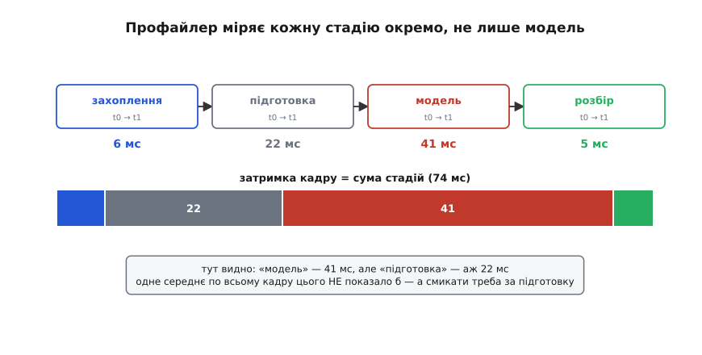
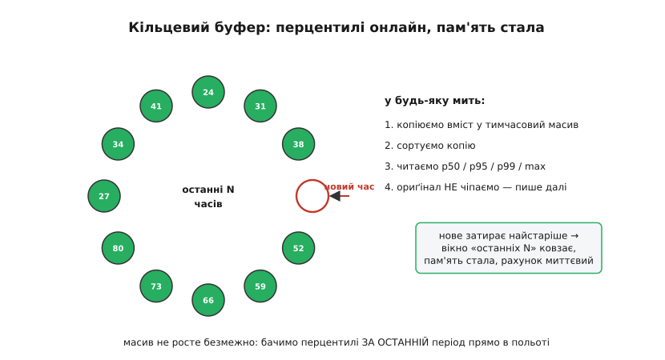
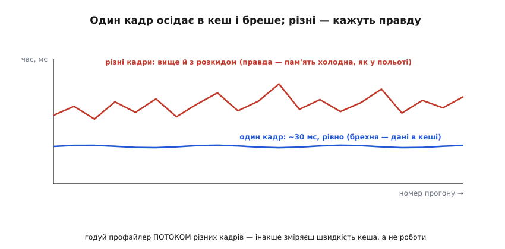

# ⚙️ Бортовий профайлер зору: стадії, перцентилі, нагляд за температурою

У самій темі ми зібрали голий кістяк чесного виміру: монотонний годинник, прогрів у смітник, багато прогонів, збір усіх часів, перцентиль замість середнього. Цього досить, щоб зрозуміти **принцип**. Та коли ти ставиш цей кістяк на справжній апарат, він мовчить про головне: він каже «кадр зайняв 74 мс», але не каже, **на що** ці 74 мс пішли. А ще він дає одне число на весь прогін — тоді як у польоті чіп гріється, зрізає частоту, і число пливе прямо під час роботи. І найпідступніше: якщо годувати його тим самим кадром, він збреше в твою користь, бо кадр осяде в кеш.

Тому зберемо **повний** інструмент — такий, яким справді профілюють бортовий зір. Він уміє чотири речі, яких кістяк не вмів: мірити **кожну стадію конвеєра окремо** (бо смикати треба за конкретну, а не за «кадр узагалі»); тримати **кільцевий буфер** і віддавати p50/p95/p99 **онлайн**, не нарощуючи пам'ять до безкінечності; читати **теплові й частотні лічильники** чіпа в реальному часі, щоб упіймати троттлінг **у мить**, коли він стався; і годувати модель **потоком різних кадрів**, бо один кадр бреше. Усе це — реальний C++, який компілюється й лягає на бортовий Linux. Псевдокоду тут не буде.

## Задача

Сформулюймо точно, що профайлер має робити — рівно стільки, бо кожна зайва функція тут це ще одна можливість збрехати самому собі.

- **Розкласти кадр по стадіях.** Не «кадр = 74 мс», а «захоплення 6, підготовка 22, модель 41, розбір 5». Кожна стадія — свій таймер, усі разом дають затримку. Без цього розкладу бенчмарк каже «повільно», але мовчить, **де** повільно.
- **Зібрати розподіл, не суму.** На кожну стадію (і на повний кадр) тримати **всі** недавні часи й уміти будь-якої миті віддати середнє, p50, p95, p99 і максимум. Сума й лічильник тут не годяться: з них перцентиль не дістанеш.
- **Працювати онлайн, зі сталою пам'яттю.** Профайлер крутиться годинами в польоті. Якщо складати кожен час у безмежний масив, пам'ять колись закінчиться. Треба **ковзне вікно** останніх N вимірів — кільцевий буфер фіксованого розміру.
- **Бачити залізо в реальному часі.** Поряд із часами читати температуру чіпа й поточну частоту з системних лічильників. Коли FPS просів — одразу видно **чому**: чіп уперся в тепловий ліміт і сам зрізав частоту, чи причина в чомусь іншому.
- **Годувати правдою.** Прогонити не один кадр по колу, а **потік різних** кадрів. Інакше зміряєш швидкість теплого кеша, а не швидкість роботи на холодних даних, як у польоті.
- **Лишити слід для аналізу хвоста.** Писати кожен кадр у CSV: час кожної стадії, температуру, частоту. Хвіст (рідкісні повільні кадри) видно лише на масі — а щоб зрозуміти, **що** з ним коїлося, потрібен лог, де поряд із поганим часом стоїть температура тієї миті.

> 🔧 **Навіщо це.** Межі задачі тут — половина успіху. Спокуса дописати «трохи усереднення для гладкості», «трохи фільтрації викидів», «а викинемо-но найгірший 1%, бо це, мабуть, шум» — і профайлер починає **ховати** саме те, заради чого існує. Його робота — показувати правду якнайнещадніше, зокрема найгірший кадр. Згладжування й рішення — це наступний крок, **після** виміру, а не всередині нього. Чистий, нещадний профайлер легко довірити; «дбайливий» профайлер бреше в твою користь — найгірша з можливих брехонь, бо її не видно.

## Ідея

Складімо все докупи однією картиною — як кадр протікає крізь профайлер і де він лишає сліди.

Серце інструменту — думка, що **стадія — це окремий вимір**. Той самий монотонний годинник, той самий бар'єр, але обхоплюємо не «весь кадр», а кожен його шматок зокрема. Захоплення з камери, підготовка (масштаб, формат, нормування), сама модель, розбір її виходу — чотири незалежні секундоміри. Сума їхніх часів дорівнює затримці кадру, але тепер ми знаємо **внесок кожного**. І це не косметика: дуже часто винна зовсім не модель.


*Профайлер міряє кожну стадію окремо. Кадр проходить захоплення, підготовку, модель і розбір — кожну обхоплює власний таймер (t0 → t1). Сума стадій і є затримка кадру (тут 74 мс). Розклад одразу видає те, чого одне число на весь кадр не показало б: модель — 41 мс, але **підготовка — аж 22 мс**, хоч начебто це просто «масштабувати картинку». Якби ти дивився лише на загальний час, ти кинувся б полегшувати модель — а реальний виграш чекав у підготовці. Розклад по стадіях каже не «повільно», а «повільно **отут**».*

Друга думка — **онлайн-перцентилі на сталій пам'яті**. У темі ми збирали всі триста часів у масив, сортували й брали перцентиль. Для разового заміру це чудово. Та профайлер живе в польоті годинами: безмежний масив рано чи пізно з'їсть усю пам'ять. Вихід — **кільцевий буфер** (англ. *ring buffer*): масив фіксованого розміру, скажімо на 512 останніх вимірів, у який нові часи пишуться по колу, затираючи найстаріші. У будь-яку мить ми копіюємо його вміст у тимчасовий масив, сортуємо копію й читаємо p50/p95/p99 — за **останні** 512 кадрів. Пам'ять стала, вікно ковзає, перцентилі завжди свіжі.


*Кільцевий буфер дає перцентилі онлайн, не нарощуючи пам'ять. Масив фіксованого розміру; вказівник запису йде по колу й затирає найстаріший час новим. Щоб дістати перцентиль, ми **копіюємо** вміст у тимчасовий масив, **сортуємо копію** й читаємо p50/p95/p99/max — оригінал при цьому пише далі. Так у нас завжди є «найгірший кадр за останні N» прямо в польоті, а пам'ять не росте безмежно. Чому копія, а не сортування на місці: сортувати робочий буфер — означає переплутати порядок «хто найстаріший», і затирання зламається.*

Третя думка — **залізо поряд із часами**. Просіла продуктивність — мало знати **що**, треба знати **чому**. Linux на бортовому чіпі віддає температуру й частоту через **sysfs** — віртуальну файлову систему, де стан заліза виглядає як звичайні файли: «прочитав файл — дізнався значення». Температура кожної теплової зони лежить у `/sys/.../thermal_zoneX/temp` (у тисячних частках градуса: число `38800` означає 38.8 °C), поточна частота ядра — у `/sys/devices/system/cpu/cpu0/cpufreq/scaling_cur_freq` (у кілогерцах). Читаємо ці файли в тому самому циклі, що й міряємо кадри, — і коли FPS падає, поряд видно: температура вперлась у ліміт, частота зрізана. Це й є троттлінг, спійманий **у мить**, а не вгаданий заднім числом.

Четверта, найтонша думка — **потік різних кадрів**. Якщо ганяти модель по одному й тому самому кадру, дані після першого ж прогону осідають у кеш процесора, наступні читання беруться вже з теплого кеша, і час падає — штучно, бо в польоті кожен кадр новий і пам'ять щоразу холодна. Профайлер мусить тримати **набір** різних кадрів і подавати їх по черзі, щоб кеш не «вивчив» картинку. Різниця не косметична: один кадр може показати 30 мс там, де чесний потік дає 45.


*Один кадр осідає в кеш і бреше; потік різних — каже правду. Якщо прогонити модель по **одному** кадру, після першого разу його дані лежать у теплому кеші, і всі наступні прогони штучно швидкі та підозріло рівні (синя лінія, ~30 мс). Потік **різних** кадрів б'є по пам'яті чесно — як у польоті, де кожен кадр новий: часи вищі й мають реальний розкид (червона). Годуючи профайлер одним кадром, ти зміряєш швидкість кеша, а не швидкість роботи — і твоя гарна цифра помре в повітрі.*

Тепер, коли всі чотири думки на місці, зберемо їх у код.

## Робочий код

Будуватимемо знизу вгору: спершу таймер однієї стадії й кільцевий буфер під неї, тоді читання теплових лічильників, тоді все це в одному профайлері й головний цикл, що годує його різними кадрами й пише CSV.

### Таймер стадії й кільцевий буфер перцентилів

Почнімо з цеглини, що повторюється: одна вимірювана стадія. У неї дві відповідальності — обхопити шматок роботи монотонним годинником і скласти час у кільцевий буфер, з якого будь-якої миті дістаються перцентилі.

:::code proj-profiler/cpp/taimer-stadii-i-kiltsevyi.hpp

Кожна деталь тут затуляє пастку. `steady_clock` — **монотонний** годинник: він міряє лише плин часу й не стрибне назад, навіть якщо системний «настінний» час підкрутить синхронізація прямо посеред виміру (а вона це робить, і тоді звичайний годинник може дати від'ємний інтервал). Кільцевий буфер `buf_` має сталий розмір `cap_`: `head_` ходить по колу через `% cap_`, нові часи затирають найстаріші, пам'ять не росте. `snapshot()` навмисне **копіює** буфер у `tmp` і сортує копію — якби ми сортували `buf_` на місці, порядок «хто найстаріший» зламався б і затирання почало б викидати не ті елементи. `filled_` окремо від `cap_` потрібен, бо перші N кадрів буфер ще не повний, і рахувати перцентиль по нулях-заглушках не можна.

> 🔧 **Навіщо це.** Розмір вікна `window` — це компроміс, який варто розуміти. Мале вікно (64) реагує швидко: щойно почався троттлінг, перцентилі поповзли вгору вже за секунду. Та воно «забудькувате» — рідкісний хвостовий кадр у ньому губиться, бо 1% від 64 це менше за один кадр. Велике вікно (2048) ловить хвіст надійно (p99 має сенс лише коли вибірка більша за сотню), зате реагує мляво й усереднює свіжий троттлінг зі старим добрим часом. Для бортового зору розумна середина — кількасот: достатньо, щоб p95/p99 щось означали, і досить рухливо, щоб бачити зміну поведінки в межах десятків секунд.

### Читання теплових і частотних лічильників

Тепер око на залізо. На бортовому Linux (як на типовому одноплатнику для зору) температура й частота лежать у sysfs — їх просто читають як файли. Зробимо тонкий помічник, що відкриває файл, читає число й мовчки повертає «немає даних», якщо лічильника на цій платі нема (різні плати — різні зони, і жорстко зашитий шлях ламається на іншому залізі).

:::code proj-profiler/cpp/chytannia-teplovykh-i.hpp

Дві деталі, на яких легко спіткнутися, — **одиниці** й **переносність**. Температура в sysfs віддається у **тисячних** градуса (`38800` = 38.8 °C), частота — у **кілогерцах** (`1190000` = 1190 МГц); забув поділити — і в логу красується «38800 °C». А `std::optional` тут не для краси: номери теплових зон і самі шляхи **різні на різних платах** (на одній цікава зона — нульова, на іншій — четверта, на третій файл зветься інакше), тож профайлер мусить спокійно пережити відсутній лічильник, а не падати. Який саме номер зони відповідає чіпу — дивляться раз, прочитавши сусідній файл `thermal_zoneX/type`, де лежить назва зони (`CPU-therm`, `GPU-therm` тощо).

> 🔧 **Навіщо це.** На багатьох бортових платформах є готова утиліта, що зводить усе залізо в один рядок раз на секунду — наприклад, на модулях Nvidia Jetson це `tegrastats`, і її рядок виглядає десь так: `... GR3D_FREQ 0%@318 ... GPU@39.5C CPU@39.5C thermal@38.8C ...` (завантаженість і частота відеоядра, температури блоків у °C; типовий інтервал — 1000 мс, міняється ключем `--interval`). Для **ока людини** під час налаштування це зручно. Та для профайлера всередині твого процесу читати sysfs **напряму** краще: ти береш саме потрібні лічильники, з потрібною частотою, без запуску й парсингу чужого процесу, і прив'язуєш значення точно до того кадру, який щойно зміряв. Зовнішню утиліту лиши для очей; у код став прямий доступ до файлів.

### Профайлер цілком і головний цикл

Тепер зведімо стадії, лічильники й лог в один об'єкт і покажемо головний цикл, що годує його **потоком різних кадрів** і пише CSV.

:::code proj-profiler/cpp/profiler.cpp

:::code proj-profiler/cpp/profailer-tsilkom-i.cpp

Прочитаймо цей цикл як одну думку. Спершу **тридцять кадрів у смітник** — холодний старт (чіп ще не розігнався, кеш коду порожній, бібліотека доініціалізовується) не псує статистику, бо ці прогони ми просто викидаємо. Тоді **довгий** вимір — три тисячі кадрів, близько двох хвилин: саме стільки треба, щоб чіп нагрівся й показав, чи зрізає він частоту. Кожна ітерація бере **новий** кадр із камери (`cam.grab()`) — не один кадр по колу, а живий потік, тож кеш не «вивчить» картинку й часи лишаться чесними. Усередині `run_frame` кожну стадію обхоплює свій таймер, а навколо моделі стоїть `synchronize()` — той самий бар'єр, без якого таймер моделі зловив би лише чергу, а не обчислення. Поряд із часом кадру пишемо температуру й частоту тієї ж миті — і коли в логу p99 поповзе вгору, в сусідньому стовпці видно, що температура вперлась у ліміт. Раз на секунду коротке зведення в консоль показує троттлінг **наживо**, а наприкінці повний звіт по стадіях каже, **за яку** смикати.

> 🔧 **Навіщо це.** CSV-лог — не бюрократія, а **єдиний** спосіб зрозуміти хвіст. Перцентиль каже, що один кадр зі ста був 90 мс, але не каже **чому** саме той. Відкривши `bench.csv`, ти знаходиш повільні рядки й дивишся, що стояло поряд: підскочила температура (троттлінг), стрибнув час підготовки (камера віддала кадр в іншому форматі), просіла частота. Хвіст майже завжди має причину, і причина видно лише там, де поганий час лежить **поряд** із станом заліза тієї миті. Без логу ти знаєш, що апарат зрідка гальмує; з логом — знаєш, від чого, і б'єш точно в це.

### Невелика нотатка про `last_ms`

Щоб приклад компілювався чесно, доповнімо одну деталь, яку я навмисне відклав, аби не розривати головну думку. Для **рядка CSV** нам потрібен не перцентиль, а **останній** записаний час кожної стадії (бо CSV — це покадровий слід, а перцентиль рахується по вікну). Найпростіше — хай `stop()` запам'ятовує останнє значення в полі, а `last_ms()` його віддає:

```cpp
// У клас StageTimer додати поле й геттер:
//   double last_ = 0.0;
//   у stop():  last_ = ms;   (перед return ms)
//   public:    double last() const { return last_; }
// Тоді у profiler.cpp:
double VisionProfiler::last_ms(const StageTimer& t) { return t.last(); }
```

Дрібниця, та вона показує важливий поділ ролей: **кільцевий буфер** годує перцентилі (звіт за вікном), а **останнє значення** годує CSV (покадровий слід). Два різні питання — «як поводиться система за останній період» і «що сталося саме в цьому кадрі» — і кожне має свій механізм. Плутати їх не можна: перцентиль у CSV-рядку був би безглуздий (він не про цей кадр), а останнє значення у звіті ховало б хвіст.

## Складність і пастки

Інструмент простий лиш на вигляд. Збираючи його на реальному залізі, спіткнешся об кілька речей — і кожна тихо псує цифри, не падаючи з помилкою.

**Бар'єр забувають саме там, де він критичний.** У головному циклі `synchronize()` стоїть навколо моделі — і це не випадково: саме модель найчастіше рахується на прискорювачі (відеоядрі, нейропроцесорі), а виклик «порахуй» там лише **ставить роботу в чергу** й одразу повертається. Без бар'єра таймер моделі покаже фантастичні 3 мс там, де реально 41, бо зловить швидкість віддавання наказу, а не його виконання. Підступність у тому, що код **працює** й цифри **виглядають** прекрасно — просто вони брехливі. Правило: будь-яка стадія, що віддає роботу асинхронному залізу, **мусить** дочекатися його перед `stop()`.

**Саме читання лічильників коштує часу.** Відкрити файл sysfs, прочитати, закрити — це системні виклики, десятки мікросекунд, а то й більше, якщо драйвер за файлом неквапливий. Якщо робити це **всередині** обхопленого таймером шматка, ти доміряєш до стадії час читання термометра. Тому в `run_frame` температуру й частоту читаємо **після** `frame.stop()` — поза всіма таймерами. А якщо навіть так читання важке, його вартує робити не щокадрово, а раз на N кадрів (температура повільна, міняється за секунди, а не за мілісекунди — щокадрове читання нічого не додає, крім накладних витрат).

**Кільцевий буфер тихо обнуляє сенс p99, поки малий.** Поки буфер заповнений на 50 елементів, `p99` — це фактично `tmp[49]`, тобто максимум: 99-й перцентиль від п'ятдесяти не має статистичного сенсу. Це не баг коду (індекс коректний), а пастка **інтерпретації**: дивитися на p99 варто лише коли `count` перевалив за кількасот. Тому профайлер віддає `count` у `Stats` — щоб ти бачив, чи вже можна вірити перцентилю, чи вікно ще наповнюється. Перші секунди звіту ігноруй: вони про напівпорожнє вікно.

**`new`/`malloc` у гарячому циклі — джерело власного хвоста.** Якщо `cam.grab()`, `pre.process()` чи розбір виходу щокадрово виділяють пам'ять, виділення зрідка зачепить системний аллокатор і дасть **повільний кадр** — і профайлер чесно його зловить у хвіст, але причина буде не в моделі, а в твоєму ж коді обв'язки. Тому буфери (зображення, тензор, масив результатів) варто виділити **один раз** перед циклом і перевикористовувати. Інакше профайлер міряє почасти власну неохайність, а ти полюватимеш на привид у моделі, якого там нема. До речі, тому й кільцевий буфер виділено наперед у конструкторі `StageTimer` — щоб `stop()` у гарячому циклі не алокував нічого.

**Сортування на кожен `snapshot()` — не безкоштовне.** `snapshot()` копіює вікно й сортує його — це O(N·log N) на виклик. Якщо смикати його **щокадрово** (наприклад, друкувати повний звіт після кожного кадру), на великому вікні сортування саме почне відкушувати помітний час і викривлювати вимір. Тому в циклі ми кличемо `snapshot()` лише раз на секунду (`n % 25`), а повний звіт — раз наприкінці. Профайлер не повинен сам ставати помітним навантаженням — інакше він міряє систему **разом із собою**.

**Один профіль — для одних умов.** І найголовніша пастка — не в коді, а в голові. Цифри, які видасть профайлер, чесні рівно для тих умов, у яких ти міряв: цей корпус, ця вентиляція, ця напруга живлення, ця температура повітря, ця роздільність кадру, ця версія мережі. Винеси апарат із прохолодної кімнати на спеку — і троттлінг прийде раніше, плато буде нижчим. Тому профіль не вічний: переміряй після будь-якої зміни заліза, прошивки чи умов. Профайлер — це не разовий вирок, а вартовий, якого тримають увімкненим; він цінний саме тим, що ловить просідання щойно воно з'явилось — на столі, а не в повітрі.

Зібравши все це, ти маєш інструмент, який не просто каже «повільно», а показує пальцем: ось стадія, що з'їдає час; ось мить, коли чіп перегрівся й зрізав частоту; ось рідкісний кадр у хвості й те, що з ним коїлося. Він годується правдою (різні кадри, бар'єр, довге навантаження), не нарощує пам'ять (кільцевий буфер) і лишає слід для розбору (CSV). Це той самий чесний кістяк із теми — але доведений до стану, у якому ним справді профілюють бортовий зір перед польотом.
