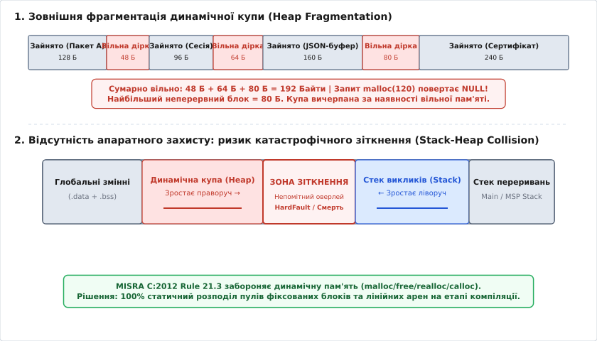
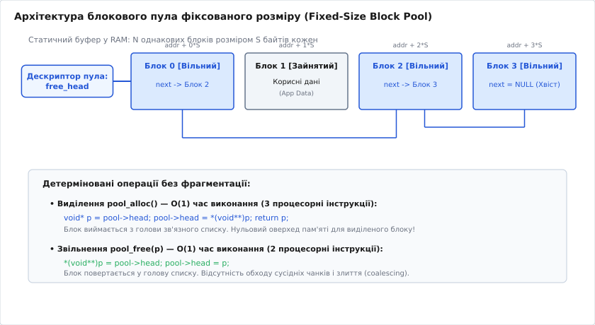
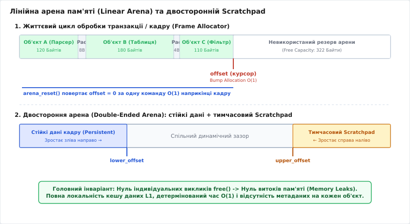

# Пам'ять без купи: пули, арени, бюджет

<preknowlist>
- [Вказівники та пам'ять у C](root:embedded/c-pointers-intro) — адресна арифметика, розіменування, непряма адресація та небезпеки виходу за межі буфера.
- [Вирівнювання даних](root:sf-apps/memory-alignment) — апаратні вимоги процесорів ARM Cortex-M та RISC-V до кратних адрес при завантаженні слів.
- [Розподіл пам'яті мікроконтролера](root:embedded/memory-budget-mcu) — карта RAM, компонування секцій .data/.bss, напрямки зростання стека та розміщення купи.
- [Динамічна пам'ять та купа](root:sf-lang/heap-dynamic-memory) — структура heap-чанків, оверхед метаданих, виділення пам'яті та механізми виникнення фрагментації.
</preknowlist>

Промисловий телеметричний контролер бездоганно проходить лабораторні випробування, безперервно відпрацьовуючи тисячі синтетичних пакетів на стенді розробника. Проте після трьох тижнів автономної експлуатації в герметичній шафі на віддаленому об'єкті пристрій раптово зависає або скидається апаратним сторожовим таймером Watchdog. Підключений зневаджувач фіксує аварійний вихід: черговий виклик функції виділення пам'яті під буфер вхідного TLS-сертифіката розміром 160 байтів повернув нульовий вказівник, що призвело до розіменування недійсної адреси. При цьому системна діагностика звітує, що в оперативній пам'яті мікроконтролера сумарно залишається понад 24 кілобайти вільного простору із 64 КБ доступної SRAM.

Причиною такої раптової відмови є зовнішня фрагментація динамічної купи (англ. *heap fragmentation*, від латинського *fragmentum* — уламок). Постійне виділення та звільнення буферів змінного розміру розбиває суцільну карту пам'яті на хаотичну мозаїку крихітних ізольованих ділянок. У підсумку жоден з наявних вільних сегментів не може вмістити неперервний запит, хоча сума всіх дірок у рази перевищує потрібний розмір.

У критичних вбудованих системах така поведінка є неприпустимою. Стандарти функціональної безпеки для автомобільної електроніки ISO 26262, авіаційний стандарт DO-178C (Level A) та настанови MISRA C:2012 (правило 21.3) прямо забороняють використання стандартних бібліотечних функцій динамічного розподілу пам'яті після етапу первинної ініціалізації системи. Надійна прошивка вимагає 100% детермінізму: кожна операція з пам'яттю повинна виконуватися за строгий константний час `O(1)`, не створювати фрагментації та мати наперед математично розрахований статичний бюджет.

## 1. Анатомія фрагментації купи та чому динамічна пам'ять вбиває прошивку

Класичні алокатори загального призначення (такі як dlmalloc або ptmalloc у складі бібліотеки newlib) створювалися для систем із віртуальною пам'яттю та гігабайтами доступного адресного простору. Їхня внутрішня механіка спирається на розбиття пам'яті на так звані чанки (англ. *chunks* — шматки), кожен з яких обрамляється службовими заголовками (boundary tags).

Заголовок чанка зазвичай містить розмір поточного блоку, прапорець зайнятості попереднього блоку та вказівники для зв'язних списків у вільних блоках. У 32-бітній архітектурі такий заголовок забирає від 8 до 16 байтів на кожну окрему алокацію.

```
[ Службовий заголовок: 8-16 Б ] [ Корисне навантаження клієнта ] [ Вирівнювання: 0-7 Б ]
```

Це породжує перший рівень неефективності — внутрішню фрагментацію (англ. *internal fragmentation*). Якщо системі потрібно виділити структуру з 6 байтів, алокатор додає 8 байтів метаданих, а потім вирівнює підсумковий розмір до кратності 8 байтам відповідно до апаратних вимог процесора Cortex-M. Замість 6 байтів фізично споживається 24 байти RAM. Коефіцієнт корисного використання пам'яті для дрібних об'єктів падає нижче 30%.

Другий рівень — зовнішня фрагментація (англ. *external fragmentation*). Вбудовані пристрої взаємодіють із зовнішнім світом через асинхронні події: з датчиків надходять періодичні короткі вибірки, мережевий стек розбирає великі HTTP або MQTT-пакети, криптографічні підсистеми тимчасово виділяють сесійні ключі, а логер форматує текстові рядки повідомлень. Об'єкти мають принципово різний час життя.

Коли чергуються виклики виділення та звільнення пам'яті для об'єктів різного розміру, купа втрачає компактність. Звільнені блоки утворюють дірки. Щоб об'єднати сусідні вільні чанки в один більший блок (процес злиття, англ. *coalescing*), алокатор повинен перевіряти стан попереднього та наступного блоків у пам'яті. Якщо хоча б один байт між ними залишається зайнятим довгоживучим дескриптором з'єднання, злиття стає неможливим.


*Анатомія деградації купи: утворення ізольованих дірок пам'яті блокує алокацію попри наявність сумарного обсягу, а відсутність MPU створює ризик фатального накладання стека на купу.*

### Патологічний приклад деградації купи

Розглянемо типовий патерн роботи мережевого сенсора. Програма циклічно виконує дві операції:

1. Створює дескриптор клієнтської сесії розміром 64 байти, який живе довго.
2. Створює тимчасовий буфер прийому пакетів розміром 256 байтів, який звільняється одразу після парсингу.

Нехай пам'ять виділяється почергово: `Сесія 1 (64 Б)`, `Пакет 1 (256 Б)`, `Сесія 2 (64 Б)`, `Пакет 2 (256 Б)`, `Сесія 3 (64 Б)`, `Пакет 3 (256 Б)`. Коли пакети 1, 2 і 3 звільняються, у купі з'являються три дірки по 256 байтів. Сумарно вільно `3 · 256 = 768` байтів.

Проте якщо системі раптово знадобиться виділити один неперервний буфер оновлення прошивки розміром 300 байтів, виклик `malloc(300)` поверне `NULL`. Жодна з вільних дірок не вміщує 300 байтів, а злиття заблоковане розташованими між ними 64-байтними сесіями. Купа заблокована за наявності 75% вільного простору.

### Аналіз реалізацій купи у FreeRTOS

Поширена помилка розробників — сподівання на те, що зміна алгоритму купи в операційній системі реального часу вирішить проблему фрагментації. Розглянемо п'ять стандартних схем керування пам'яттю у FreeRTOS (`heap_1.c` – `heap_5.c`):

1. **`heap_1.c`:** Найпростіший лінійний алокатор (bump allocator). Дозволяє виділяти пам'ять лише наростаючим підсумком. Функція `vPortFree()` є порожньою заглушкою. Фрагментація відсутня, але пам'ять неможливо повторно використати для динамічних сесій. Підходить виключно для створення статичних задач на етапі запуску.
2. **`heap_2.c`:** Алокатор за принципом *Best-Fit*. Дозволяє звільняти пам'ять, але **не виконує злиття** сусідніх вільних блоків. Піддається швидкій та незворотній фрагментації при роботі з блоками різного розміру. У сучасних версіях FreeRTOS вважається застарілим і не рекомендований.
3. **`heap_3.c`:** Проста обгортка над стандартними функціями бібліотеки C `malloc()` та `free()`, обгорнута у виклики зупинки планувальника `vTaskSuspendAll()`. Успадковує всі вади системного `malloc`: оверхед метаданих, недетермінований час виконання та фрагментацію.
4. **`heap_4.c`:** Алокатор за принципом *First-Fit* з обов'язковим об'єднанням (coalescing) суміжних вільних блоків. Значно стійкіший за `heap_2`, однак у тривалих циклах чергування дрібних і великих алокацій неминуче вироджується у фрагментований стан.
5. **`heap_5.c`:** Розширення `heap_4.c`, яке дозволяє об'єднувати у спільний простір кілька несуміжних банків пам'яті (наприклад, внутрішню SRAM і зовнішню SDRAM). Проблема фрагментації всередині банків залишається незмінною.

Жодна з цих схем не задовольняє вимогам стандарту MISRA C:2012 Rule 21.3. Єдиним безпечним рішенням у середовищі RTOS є використання статичних API створення об'єктів: `xTaskCreateStatic()`, `xQueueCreateStatic()`, `xSemaphoreCreateStaticBinary()` та `xTimerCreateStatic()`, де вся пам'ять під дескриптори та стеки виділяється як статичні масиви компілятором.

### Недетермінізм часу виконання O(N)

Пошук вільного блоку в алгоритмах динамічної купи вимагає проходу по лінійному зв'язному списку вільних чанків. У найгіршому випадку, коли купа сильно фрагментована, кількість дрібних дірок `N` може сягати сотень. Час виконання операції стає функцією поточного стану пам'яті:

```
T_alloc = O(N_free_chunks)
```

Якщо високопріоритетний потік намагається виділити пам'ять під час обробки аварійного сигналу або повідомлення шини CAN, непередбачувана затримка в кілька сотень мікросекунд спричиняє джитер (англ. *jitter* — тремтіння затримки) і зрив дедлайнів керування приводом або контуром стабілізації.

### Зіткнення стека та купи (Stack-Heap Collision)

У типовій карті пам'яті мікроконтролерів без блоку керування пам'яттю MMU статичні змінні розміщуються в нижніх адресах SRAM, динамічна купа зростає знизу вгору, а системний стек викликів функцій і переривань росте від верхньої межі пам'яті зверху вниз.

Між купою та стеком немає жодної апаратної ізоляції, якщо не налаштовано блок захисту MPU. Коли купа внаслідок фрагментації розростається вгору, а глибоке вкладення функцій або вектор переривання просуває стек вниз, покажчик вершини стека перетинає межу останнього виділеного чанка купи. Дані стека тихо затирають структури купи, або навпаки — черговий запис у купу пошкоджує вказівник повернення з функції (LR / Saved PC). Наслідком стає HardFault або хаотичне виконання коду зі стертими регістрами.

> 🔧 **Навіщо це в реальній розробці.**
> Повна відмова від стандартної купи ліквідує цілий клас найважчих дефектів у прошивці: фрагментаційне виснаження пам'яті, витоки (memory leaks), виклики після звільнення (use-after-free), недетерміновані затримки планувальника та затирання стека. Пам'ять резервується на етапі збирання проєкту, унеможливлюючи несподіваний брак RAM під час роботи в полі.

---

## 2. Блоковий пул фіксованого розміру (Fixed-Size Block Pool)

Фундаментальний спосіб подолати зовнішню фрагментацію — повністю усунути варіативність розмірів блоків. Блоковий пул (англ. *block pool* або *fixed-size object pool*) розбиває суцільний масив статично виділеної пам'яті на фіксовану кількість `N` абсолютно однакових слотів розміром `S` байтів кожен.

Оскільки всі блоки мають ідентичний розмір, будь-який звільнений блок ідеально підходить для задоволення будь-якого наступного запиту до цього пула. Зовнішня фрагментація стає фізично неможливою.

### Механізм вбудованого вільного списку (Intrusive Free List)

Головна перевага якісно спроєктованого пула — нульові накладні витрати пам'яті на метадані для зайнятих блоків. Досягається це за допомогою техніки вбудованого зв'язного списку (англ. *intrusive linked list*).

Коли блок вільний, його корисна пам'ять не містить прикладних даних. Перші 4 байти (для 32-бітного процесора) цього вільного блоку використовуються для збереження вказівника на наступний вільний блок у ланцюжку. Коли клієнт запитує блок, пул віддає йому цей вказівник, а програма записує туди власні дані, затираючи непотрібний зв'язок.


*Блоковий пул фіксованого розміру: вільні блоки утворюють однозв'язний список через власне тіло пам'яті, гарантуючи O(1) виділення без фрагментації.*

Операція виділення блоку `pool_alloc()` зводиться до вилучення елемента з голови стека вільних блоків:

```
вказівник_блоку = голова_вільних
голова_вільних = *(вказівник_блоку)
кількість_вільних = кількість_вільних - 1
```

На асемблері ARM Cortex-M це транслюється рівно в 3 процесорні інструкції:

```asm
LDR  r0, [r3, #0]    ; Завантажити адресу вільного блоку (head)
LDR  r1, [r0, #0]    ; Прочитати збережений у ньому вказівник next
STR  r1, [r3, #0]    ; Оновити head новим вказівником next
```

Час виконання операції є строго константним: `T_alloc = O(1)`. Він не залежить ані від розміру пула, ані від того, скільки блоків зараз зайнято.

Операція повернення блоку `pool_free(p)` працює дзеркально: блок кладеться назад у голову вільного списку:

```
*(p) = голова_вільних
голова_вільних = p
кількість_вільних = кількість_вільних + 1
```

Це займає рівно 2 інструкції `STR` на асемблері та виконується за час `T_free = O(1)` без необхідності перевірки та злиття сусідніх блоків.

### Валідація меж та контроль цілісності

На відміну від небезпечного `free(ptr)` у купі, блоковий пул дозволяє перевірити коректність поверненого вказівника за `O(1)` операцій за допомогою адресної арифметики. Програма перевіряє три умови:

1. Вказівник не є нульовим.
2. Вказівник лежить у межах виділеного буфера: `p >= pool->buffer && p < pool->buffer + pool->total_size`.
3. Вказівник суворо вирівняний на крок блоку: `((uintptr_t)p - (uintptr_t)pool->buffer) % pool->block_size == 0`.

Якщо хоча б одна умова порушена (наприклад, помилково передано адресу локальної змінної зі стека чи середину блоку), пул негайно фіксує помилку і не руйнує внутрішній ланцюжок покажчиків.

### Потокобезпека та атомарні операції без блокування (Lock-Free)

У багатозадачних системах із витісняльною багатозадачністю RTOS або при викликах з обробників переривань ISR звичайний доступ до голови пула вимагає захисту від стану гонитви (race condition).

Традиційний підхід полягає у використанні критичних секцій із вимкненням переривань:

:::tabs
```c
uint32_t primask = __get_PRIMASK();
__disable_irq();
/* Безпечна модифікація pool->free_list */
__set_PRIMASK(primask);
```
:::code pamiat-bez-kupy-d/cpp/potokobezpeka-ta-atomarni.cpp
:::

Однак вимкнення переривань збільшує затримку реакції системи на апаратні події (interrupt latency). Процесори архітектури ARMv7-M / ARMv8-M (Cortex-M3/M4/M7/M33) надають механізм ексклюзивного доступу до пам'яті через інструкції `LDREX` та `STREX`, що дозволяє реалізувати неблокуючий (lock-free) атомарний пул без вимкнення переривань:

:::tabs
:::code pamiat-bez-kupy-d/c/potokobezpeka-ta-atomarni.c
:::code pamiat-bez-kupy-d/cpp/potokobezpeka-ta-atomarni-2.cpp
:::

Такий підхід повністю захищений від конфліктів між потоками та обробниками переривань, не зупиняючи таймери та високошвидкісні канали зв'язку.

### Мультипул (Pool-Set) для різних градацій розміру

Якщо системі потрібні блоки різного розміру (наприклад, дескриптори таймерів на 16 байтів, заголовки повідомлень на 64 байти та пакети радіообміну на 256 байтів), використовується каскад пулів (англ. *multi-pool* або *slab allocator*).

Створюється набір із кількох незалежних пулів, наприклад для градацій 32, 128, 512 та 2048 байтів. Запит на виділення `N` байтів знаходить найменший пул, розмір блоку якого більший або дорівнює `N`. Пошук відповідного індексу пула виконується за константний час через інструкцію підрахунку провідних нулів `CLZ` або пряму таблицю пошуку.

---

## 3. Лінійні та кадрові арени пам'яті (Linear & Scratchpad Arenas)

Блокові пули ідеальні для об'єктів з однаковим розміром та незалежним часом життя. Проте для задач пакетної обробки даних (наприклад, розбір кадру протоколу, десеріалізація JSON, обчислення швидкого перетворення Фур'є чи фільтрація масиву сенсорів) виділення дрібних об'єктів через пули створює зайву складність. Для таких сценаріїв застосовується лінійна арена (англ. *linear arena*, *bump allocator* або *arena allocator*, від латинського *arena* — замкнений майданчик).

### Принцип роботи лінійного алокатора

Лінійна арена володіє суцільним статичним буфером пам'яті фіксованої місткості `Capacity` та єдиним лічильником поточного зміщення `offset` (курсором). На початку роботи `offset = 0`.

Виділення пам'яті виконується зсувом курсора вперед (англ. *bump allocation*):

1. Поточний зсув вирівнюється вгору до необхідної межі адреси (наприклад, 4 або 8 байтів).
2. Перевіряється, чи вміщується новий запит у залишок буфера: `aligned_offset + size <= Capacity`.
3. Вказівник на початок вирівняної ділянки повертається користувачеві.
4. Курсор зміщується: `offset = aligned_offset + size`.

```
Вирівнювання адреси вгору:
aligned_offset = (offset + (align - 1)) & ~(align - 1)
```

Час виділення становить строгий `O(1)` і займає 4-5 арифметичних команд. Жодних метаданих усередині буфера не створюється.


*Лінійна арена пам'яті: послідовний розподіл зі строгим вирівнюванням та миттєве групове скидання без ризику витоків.*

### Життєвий цикл кадру та групове скидання (Arena Reset)

Ключова властивість арени: індивідуального звільнення блоків (`free`) не існує в принципі. Пам'ять звільняється вся разом після завершення відповідного циклу роботи.

Типовий цикл обробки вбудованого пристрою складається з таких фаз:

1. **Очікування події:** прибуття мережевого кадру або спрацьовування таймера.
2. **Обробка:** функція розбирає пакет, виділяючи з арени пам'ять під деревоподібні вузли парсера, проміжні рядки та тимчасові буфери криптографії.
3. **Завершення транзакції:** корисний результат відправлено або збережено у фіксованому стані.
4. **Скидання:** викликається `arena_reset()`, який встановлює `offset = 0`.

Уся пам'ять миттєво стає доступною для наступного кадру за одну операцію запису `O(1)`. Це на 100% захищає систему від витоків пам'яті: навіть якщо внутрішній алгоритм парсера містить десятки гілок обробки помилок і дострокових виходів `return`, пам'ять гарантовано повернеться в початковий стан під час фінального скидання арени.

### Збереження стану (Savepoints / Scopes)

Для вкладених обчислень використовується механізм контрольних точок (англ. *savepoints*):

```
mark = arena_save(&arena);    // Зберігає поточне значення offset
ptr = arena_alloc(&arena, 128);
// ... використання тимчасової пам'яті ...
arena_restore(&arena, mark);   // Відкочує offset назад до mark
```

Це дозволяє використовувати одну й ту саму арену на різних рівнях виклику функцій як надшвидкий стек пам'яті для тимчасових масивів змінної довжини, уникаючи ризику переповнення основного апаратного стека мікроконтролера.

### Двостороння арена (Double-Ended Scratchpad)

Для складних модулів використовується двостороння арена (англ. *double-ended arena*). Один статичний буфер обслуговує два курсори:

- **Нижній курсор (`lower_offset`):** росте від нульової адреси вгору. Тут розміщуються довготривалі об'єкти поточної сесії.
- **Верхній курсор (`upper_offset`):** росте від кінця буфера вниз. Тут виділяються короткоживучі буфери для проміжних розрахунків (scratchpad).

Коли обчислення завершуються, верхній курсор миттєво відкочується до верхньої межі `upper_offset = Capacity`, тоді як сформовані нижні дані залишаються недоторканими. Вільний динамічний простір між курсорами спільно використовується обома напрямками.

---

## 4. Розрахунок статичного бюджету пам'яті та захист стека

Коли в прошивці повністю вилучено динамічну купу, вся оперативна пам'ять мікроконтролера стає строго детермінованою і піддається повному статичному обліку ще на етапі компонування бінарного файлу.

### Рівняння балансу SRAM

Загальний обсяг оперативної пам'яті мікроконтролера `SRAM_Total` розподіляється за строгим рівнянням балансу:

```
SRAM_Total ≥ SRAM_Static + Σ(SRAM_Pools) + Σ(SRAM_Arenas) + Σ(SRAM_Task_Stacks) + SRAM_ISR_Stack + SRAM_Safety_Margin
```

Де складники формуються наступним чином:

- `SRAM_Static`: глобальні та статичні змінні ініціалізованої секції `.data` та неініціалізованої секції `.bss`.
- `Σ(SRAM_Pools)`: сума байтів усіх статичних масивів блокових пулів.
- `Σ(SRAM_Arenas)`: сума байтів статичних буферів усіх лінійних арен.
- `Σ(SRAM_Task_Stacks)`: виділені масиви під стеки кожної окремої задачі FreeRTOS чи Zephyr RTOS.
- `SRAM_ISR_Stack`: системний стек головної нитки виконання та обробників апаратних переривань (Main Stack Pointer, MSP).
- `SRAM_Safety_Margin`: обов'язковий інженерний запас пам'яті (зазвичай 10–15% від загального обсягу SRAM) на випадок майбутніх оновлень прошивки та непередбачених сплесків вкладеності викликів.

### Приклад розрахунку бюджету пам'яті для 64 КБ SRAM

Розглянемо практичну відомість розподілу пам'яті для типового IoT-контролера на базі STM32F401 (64 КБ SRAM = 65536 байтів):

| Секція пам'яті | Призначення | Обсяг (Байти) | Частка від SRAM |
| :--- | :--- | :--- | :--- |
| **`.data` + `.bss`** | Глобальні структури драйверів, HAL, таблиці калібрування | 8 192 | 12.5% |
| **Session Pool** | 16 клієнтських сесій по 64 байти | 1 024 | 1.6% |
| **Network RX/TX Pool** | 8 буферів кадрів по 512 байтів | 4 096 | 6.2% |
| **Event Queue Pool** | 64 системні події по 32 байти | 2 048 | 3.1% |
| **Frame Scratch Arena** | Лінійна арена парсингу JSON / TLS-сертифікатів | 8 192 | 12.5% |
| **DSP Scratch Arena** | Тимчасовий масив фільтрації сигналів датчиків | 4 096 | 6.2% |
| **Task: Comm (Стек)** | Мережевий потік TLS/MQTT | 4 096 | 6.2% |
| **Task: Control (Стек)** | Потік опитування сенсорів та автомата станів | 2 048 | 3.1% |
| **Task: Storage (Стек)** | Потік запису у Flash/EEPROM | 2 048 | 3.1% |
| **Task: Idle + Timer** | Системні службові потоки RTOS | 1 536 | 2.3% |
| **ISR / MSP Stack** | Стек обробників переривань (DMA, UART, EXTI) | 4 096 | 6.2% |
| **MPU Guard Regions** | Апаратні бар'єри захисту стеків (4 регіони по 32 Б) | 128 | 0.2% |
| **Резервний запас (Margin)**| Вільний нерозподілений простір на майбутнє | 23 996 | 36.6% |
| **РАЗОМ** | **Повний обсяг SRAM мікроконтролера** | **65 536** | **100.0%** |

Такий розпис унеможливлює ситуацію браку пам'яті: кожна підсистема має суворо гарантований ліміт, а пікове навантаження однієї задачі ніколи не позбавить ресурсів іншу.

### Фізичне вилучення купи в скрипті лінкера та аналіз Map-файлу

Щоб гарантувати, що жодна стороння бібліотека випадково не викличе `malloc`, скрипт компонувальника (Linker Script, `.ld`) конфігурується з нульовим розміром купи:

```ld
/* Linker script: stm32f401.ld */
_Min_Heap_Size = 0x0;      /* Купа повністю вилучена з RAM */
_Min_Stack_Size = 0x1000;  /* 4 КБ для стека переривань MSP */

._user_heap_stack :
{
  . = ALIGN(8);
  PROVIDE ( end = . );
  PROVIDE ( _end = . );
  . = . + _Min_Heap_Size;
  . = . + _Min_Stack_Size;
  . = ALIGN(8);
} >RAM
```

Для контролю викликів компілятор налаштовується на генерацію детальної карти пам'яті (Map file) та перехоплення стандартних функцій:

```makefile
LDFLAGS += -Wl,-Map=firmware.map,--cref
LDFLAGS += -Wl,--wrap=malloc -Wl,--wrap=free -Wl,--wrap=calloc -Wl,--wrap=realloc
```

Якщо будь-який об'єктний файл намагається викликати `malloc`, лінкер вимагатиме функцію-обгортку `__wrap_malloc`, у якій розміщується макрос аварійної зупинки `assert(false)` або пряме повідомлення про помилку на етапі збирання.

Аналіз згенерованого файлу `firmware.map` дозволяє миттєво виявити приховані алокації стандартної бібліотеки. Наприклад, виклик стандартного `printf()` або `sprintf()` із плаваючою комою у стандартній бібліотеці `newlib-nano` може неявно викликати функцію `_sbrk` для виділення внутрішнього 1-кілобайтного буфера форматування рядків. Використання нульової купи негайно призведе до помилки компонування, змушуючи розробника замінити важкий системний `printf` на легку вбудовану альтернативу (наприклад, `tiny_printf` або вбудований логер на базі арен).

### Статичний аналіз використання стека (Static Stack Analysis)

Оскільки купа відсутня, єдиним джерелом динамічного споживання пам'яті залишаються стеки задач і переривань. Для знаходження максимальної глибини стека компілятор GCC запускається з прапорцем генерації метрик використання стека:

```makefile
CFLAGS += -fstack-usage -Wstack-usage=2048
```

Для кожного вихідного `.c`-файлу компілятор створює звіт `.su`, у якому фіксує точний розмір стекового фрейму кожної функції в байтах та тип виклику (`static` чи `dynamic`).

```
main.c:42:6:process_sensor_data    48    static
crypto.c:115:5:aes256_encrypt      128   static
network.c:88:5:parse_header        64    static
```

Спеціалізовані утиліти статичного аналізу (такі як `avstack.pl` або вбудовані аналізатори в рамках стандартів безпеки) об'єднують таблицю символів, граф викликів (Call Graph) та `.su` файли. Вони розраховують найгірший сценарій глибини викликів (Worst-Case Stack Depth) від точки входу задачі до найглибшого листка дерева викликів:

```
Глибина_стека_задачі = Max_Path(Task_Entry → Func_A → Func_B → Func_Leaf) + Запас_на_контекст_RTOS
```

Правила MISRA C суворо вимагають відсутності непрямої або прямої рекурсії (MISRA C:2012 Rule 17.2) та відсутності неконтрольованих покажчиків на функції без явного обмеження глибини, що гарантує кінцевість і розрахункову точність графа викликів.

### Динамічний моніторинг глибини стека (Stack Watermarking)

Статичний розрахунок доповнюється динамічним контролем методом водяних знаків (англ. *stack watermarking* або *stack painting*):

1. Під час запуску системи вся область пам'яті, виділена під стек задачі, заповнюється характерним числовим патерном (наприклад, байтами `0xA5`).
2. У процесі роботи стек зростає вниз, перезаписуючи патерн `0xA5` локальними змінними та адресами повернення.
3. Фоновий потік Idle періодично сканує пам'ять стека від його нижньої границі вгору, підраховуючи кількість байтів, які досі містять значення `0xA5`.
4. Різниця між загальним розміром стека та кількістю незайманих байтів визначає піковий рівень використання стека (High Watermark). Якщо запас падає нижче 20%, система записує діагностичний лог або сигналізує про необхідність збільшення стека.

```
+------------------------------------+ <- Верхня межа (Stack Pointer Init)
| Використаний стек (дані функцій)   |
|                                    |
| . . . . . . . . . . . . . . . . .  | <- Піковий рівень (High Watermark)
| Недоторканий патерн (0xA5 A5 A5 A5)|
+------------------------------------+ <- Нижня межа (Stack Limit)
| MPU Guard Region (No Access)       | <- 32 байти апаратного бар'єра
+------------------------------------+
```

### Апаратний бар'єр переповнення стека через MPU

Для гарантованого захисту від раптового переповнення стека задіюється апаратний блок захисту пам'яті MPU (Memory Protection Unit). На дні виділеного стекового масиву налаштовується регіон MPU розміром 32 або 64 байти з атрибутом повної заборони доступу (`NO_ACCESS`).

Якщо внаслідок непередбаченого сплеску навантаження покажчик стека опускається на дно, перша ж спроба інструкції `PUSH` записати значення в захищену зону негайно викликає апаратне виключення `MemManage_Handler` процесора ARM Cortex-M. Система миттєво перехоплює аварію, переводить виконавчі механізми в безпечний стан (Safe State) та записує діагностичний знімок пам'яті, унеможливлюючи затирання сусідніх змінних у SRAM.

---

## 5. Повна виробнича реалізація пулового та аренного алокаторів

Нижче наведено повну реалізацію детермінованих алокаторів, придатну для використання у відповідальних вбудованих системах. Вона містить реалізацію мовою C з перевіркою меж і вирівнювання та сучасний ідіоматичний еквівалент мовою C++20 з механізмами RAII, шаблонами та контролем типів на етапі компіляції.

### Реалізація блокового пула та лінійної арени

:::tabs
:::code pamiat-bez-kupy-d/c/realizatsiia-blokovoho.c
:::code pamiat-bez-kupy-d/cpp/realizatsiia-blokovoho.cpp
:::

### Комплексний приклад: конвеєр обробки мережевого пакета

Наведений нижче приклад демонструє типову архітектуру підсистеми зв'язку IoT-вузла. Обробка кожного вхідного кадру використовує швидку лінійну арену для проміжних розрахунків та блоковий пул для довготривалого збереження активних клієнтських сесій:

:::tabs
:::code pamiat-bez-kupy-d/c/kompleksnyi-pryklad.c
:::code pamiat-bez-kupy-d/cpp/kompleksnyi-pryklad.cpp
:::

---

## 6. Зведена матриця вибору техніки керування пам'яттю

Для вибору оптимального механізму розподілу пам'яті в архітектурі вбудованого пристрою слід керуватися такими інженерними критеріями:

| Критерій порівняння | Динамічна купа (`malloc`/`free`) | Блоковий пул (`FixedPool`) | Лінійна арена (`MemoryArena`) | Статичні змінні (`.bss`/`.data`) |
| :--- | :--- | :--- | :--- | :--- |
| **Час виділення** | Недетермінований `O(N)` | Строгий `O(1)` (3 інструкції) | Строгий `O(1)` (3 інструкції) | `O(0)` (під час збирання) |
| **Час звільнення** | Недетермінований `O(N)` | Строгий `O(1)` (2 інструкції) | Миттєве групове `O(1)` | Не звільняється |
| **Зовнішня фрагментація** | **Висока** (критичний ризик) | **Відсутня** (0%) | **Відсутня** (0%) | **Відсутня** (0%) |
| **Оверхед метаданих** | 8–16 байтів на кожен чанк | 0 байтів у зайнятому стані | 0 байтів на об'єкт (єдиний offset) | 0 байтів |
| **Безпека витоків (Leaks)**| Високий ризик забутого `free`| Потрібен парний `pool_free` / RAII | **Неможливі** (скидання всієї арени) | Неможливі |
| **Типове призначення** | Заборонено стандартами безпеки | Дескриптори, черги, сесії | Парсери пакетів, кадри, DSP | Глобальні таблиці конфігурації |

Повна відмова від динамічної купи на користь статично виділених пулів та лінійних арен переводить керування пам'яттю з категорії випадкових процесів у площину математично верифікованого інженерного розрахунку. Це гарантує безперебійну роботу вбудованого пристрою протягом усього життєвого циклу виробу без спонтанних зависань і відмов через деградацію адресного простору.
