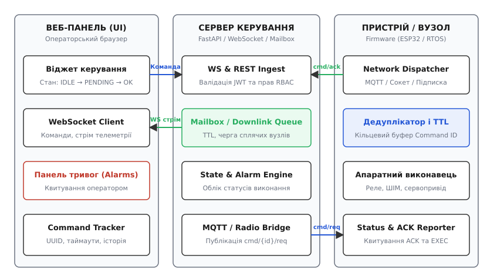
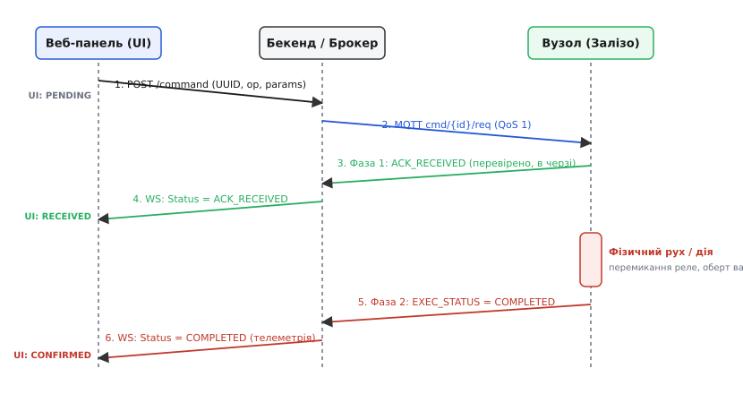
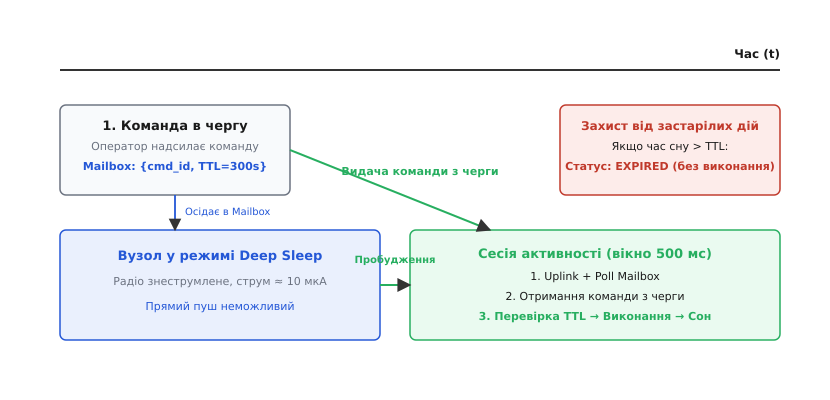

# Панель і команда назад (детально)

<preknowlist>
- [WebSocket, SSE й довгий запит](root:com-protocol/streaming-push-transports) — технології передачі потокових даних від сервера до браузера в реальному часі.
- [Дизайн тем, retained, LWT і QoS у MQTT](root:embedded/dyzain-tem-retained-lwt-i-qos-u-mqtt) — рівні доставки, прапорець збереження стану та виявлення раптового обриву клієнта.
- [Ідемпотентність](root:sf-distributed/idempotency) — збереження однакового кінцевого стану системи при багаторазовому повторенні однієї й тієї самої операції.
- [Сон як стан програми](root:embedded/son-iak-stan-prohramy-a-ne-iak-vyklyk-funktsii) — робота автономних вузлів із періодичним знеструмленням радіомодуля.
- [Вузол розумного дому](root:embedded/smart-home-node) — автономна логіка регулювання та поведінка польового пристрою в умовах втрати зв'язку.
- [Команда пристрою: доставка, підтвердження, строк дії](root:embedded/komanda-prystroiu) — базовий життєвий цикл команд у розподіленому парку обладнання.
- [API служби](root:embedded/api-sluzhby) — проєктування ресурсів, схем даних та версіонування серверних інтерфейсів.
- [Сховище й запити до нього](root:embedded/skhovyshche-i-zapyty-do-noho) — збереження часових рядів телеметрії та матеріалізованого стану пристроїв.
</preknowlist>

Оператор на веб-панелі натискає перемикач «Перекрити магістральний вентиль #3». Веб-інтерфейс миттєво анімує кнопку в стан «Перекрито», підсвічує її спокійним зеленим кольором, і людина зі спокійною совістю закриває браузер. Проте в цей самий момент на об'єкті стається серія непомітних подій: стільниковий шлюз відчув секундний джитер і скинув TCP-сесію, напруга на акумуляторі резервного живлення просіла нижче 10.2 В, і силовий ключ драйвера двигуна пішов у захист по струму. Кран повернувся лише на 15 градусів і заклинив, лишивши трубу відкритою під тиском 6 бар. Через дві години насосна станція затоплює підвал, а в системному журналі висить запис про «успішне перемикання вентиля».

Ця катастрофа виникла через фундаментальне змішування двох принципово різних площин передачі даних: прямого потоку спостереження (англ. *Data Plane* / *Uplink*) та зворотного контуру керування (англ. *Control Plane* / *Downlink*). Якщо потік телеметрії зазвичай є односпрямованим потоком «багато-до-одного», де втрата одного проміжного виміру температури не руйнує систему, то командний канал назад — це суворо адресований потік «один-до-одного», де кожен біт несе юридичну та фізичну відповідальність за стан заліза.

Побудова надійного командного каналу вимагає усунення оптимістичних ілюзій у веб-інтерфейсі, впровадження двофазного підтвердження доставки та виконання, гарантування ідемпотентності на рівні прошивки мікроконтролера та безпомилкової диспетчеризації завдань для вузлів, які 99% часу перебувають у глибокому сні.

---

## Архітектура операторського інтерфейсу: реальний час проти оптимістичних ілюзій

Класичний веб-розробницький патерн «Optimistic UI» полягає в тому, що інтерфейс негайно відображає бажаний стан користувача ще до того, як сервер поверне відповідь бази даних. Для соціальної мережі чи списку завдань це створює відчуття миттєвого відгуку: лайк з'явився одразу, а якщо через 200 мс сервер відхилить запит, інтерфейс непомітно повернеться назад.

У кіберфізичних системах такий підхід неприпустимий. Перемикач на панелі керування — це не запис у реляційній таблиці, а відображення положення фізичного якоря реле, кута повороту заслінки або стану силового контактора. Між натисканням кнопки оператором та завершенням дії лежить ланцюг затримок:
- Мережевий час проходження пакета через глобальну мережу до хмарного брокера (10–100 мс);
- Маршрутизація в шлюз польової шини або базову станцію стільникового/радіоканалу (50–500 мс);
- Час пробудження мікроконтролера з енергозберігаючого режиму (від 5 мс до кількох секунд або хвилин);
- Фізичний розгін двигуна, переміщення штока клапана та очікування спрацьовування кінцевого вимикача (1–15 секунд).

Якщо веб-інтерфейс позначає пристрій як «вимкнений» у перші 5 мілісекунд, оператор бачить не правду, а намір.

```
Класичний Optimistic UI (Небезпечно в IoT):
  [Клік оператора] ──> [UI: "Вимкнено" (миттєво)] ──> [Пакет летить у мережу...]
                                                            │
                                                     (Обвал зв'язку / збій заліза)
                                                            │
                                                     [UI продовжує показувати "Вимкнено"!]

Коректний Verified Hardware UI:
  [Клік оператора] ──> [UI: "Відправка... (PENDING)"] ──> [Фаза 1: Прийнято платою (ACK)]
                                                                    │
                                                           [UI: "Рух приводу..."]
                                                                    │
                                                          [Фаза 2: Кінцевик замкнувся]
                                                                    │
                                                      [UI: "Вимкнено" (CONFIRMED)]
```


*Архітектура операторського каналу керування. Веб-панель зв'язується з сервером через WebSocket для отримання потоку статусів і передачі команд. Сервер перевіряє права доступу, веде поштову скриньку Mailbox для сплячих пристроїв і транслює команди через брокер MQTT. Мікроконтролер виконує дедуплікацію, повертає квитанцію ACK та асинхронно звітує про стан фізичного виконавця.*

### Технології транспорту веб-панелі: REST, SSE чи WebSockets

Для забезпечення двостороннього зв'язку між браузером оператора та бекендом керування застосовують три основні підходи:

1. **Періодичне опитування (REST Polling):** Браузер кожні 1–2 секунди виконує запит `GET /api/devices/{id}/state`. Це створює надлишковий трафік, перевантажує базу даних запитами на читання незміненого стану і дає неприйнятну затримку відображення тривог (до періоду опитування).
2. **Server-Sent Events (SSE):** Односпрямований потік від сервера до браузера поверх звичайного HTTP/2 або HTTP/1.1 з автоматичним перепідключенням. Ідеальний для простого відображення графіків телеметрії, проте відправка команд назад вимагає окремих паралельних викликів `POST /api/commands`, що розриває логічний контекст сесії.
3. **Двосторонній WebSocket:** Повнодуплексне TCP-з'єднання з мінімальним оверхедом (2–10 байтів заголовка на фрейм). Дозволяє передавати телеметрію вниз, відправляти команди вгору та негайно отримувати персоналізовані статуси виконання в єдиному мультиплексованому каналі.

Для промислових та інженерних панелей оптимальною є гібридна або чиста WebSocket-архітектура: стрім телеметрії та зміна статусів передаються через активний сокет, а критичні команди можуть дублюватися через ідемпотентний REST POST із поверненням дескриптора операції (англ. *Operation Handle*), за яким браузер слухає оновлення у сокеті.

### Трьохпозиційний стан віджетів керування

Щоб оператор ніколи не був дезінформований, кожен елемент керування на панелі (тумблер, кнопка, слайдер уставки) проектується як автомат із чотирма основними візуальними станами:
- `IDLE (Підтверджено)` — елемент відображає поточний фізичний стан, підтверджений останнім пакетом телеметрії;
- `PENDING (Відправка / Очікування ACK)` — елемент блокується для повторних кліків, підсвічується нейтральним жовтим або анімованим індикатором, сигналізуючи, що команда перебуває в польоті;
- `EXECUTING (Виконання залізом)` — елемент показує проміжний прогрес (наприклад, плавне заповнення шкали ходу штока від 0% до 100%);
- `CONFIRMED (Успіх)` — короткочасна (1–2 с) фіксація зеленого підсвічування після отримання фінального звіту від заліза з переходом у новий стабільний `IDLE`;
- `ERROR / TIMEOUT (Збій)` — елемент переходить у червоний стан, виводить спливаючий бейдж із кодом апаратної помилки та автоматично повертає графічний перемикач у попереднє підтверджене положення.

### Розділення станів і тривог (State vs Alarms)

Телеметричний стан та аварійні тривоги (англ. *Alarms / Alerts*) підкоряються принципово різній логіці обробки:

| Параметр | Поточний стан (State) | Аварійна тривога (Alarm) |
| :--- | :--- | :--- |
| **Природа даних** | Безперервна величина (температура 22.1 °C, струм 1.4 А). | Дискретна подія перетину критичної межі (тиск > 10 бар, витік газу). |
| **Втрата повідомлення**| Терпима (наступний відлік через 1 с оновить стан). | Неприпустима (вимагає гарантованої фіксації в журналі). |
| **Збереження** | Останнє значення витісняє попереднє (Last Value Cache).| Черга подій, доки кожна тривога не буде оброблена. |
| **Реакція оператора** | Пасивний моніторинг. | Обов'язкове явне квитування (Operator Acknowledge). |
| **Візуалізація** | Віджет зі стрілкою, цифрове табло або графік. | Модальний банер, звуковий сигнал, червона фіксація панелі. |

Квитування тривоги оператором означає запис у журнал аудиту факту: *«Оператор Іваненко о 14:02 підтвердив отримання тривоги про перегрів котла»*. Це не вимикає аварійний захист автоматично, але переводить тривогу зі стану `ACTIVE_UNACKNOWLEDGED` у стан `ACTIVE_ACKNOWLEDGED`, сигналізуючи іншим учасникам чергової зміни, що проблемою вже займаються.

---

## Бюджет кругового часу (RTT) та розрахунок таймаутів

Проєктування таймаутів керування не може бути випадковим підбором чисел «зі стелі». Кожен таймаут виводиться з фізичної моделі затримок на кожній ланці тракту.

Розглянемо повний бюджет часу кругового обігу операції (Round-Trip Time, RTT):

```
T_rtt_ack = T_ui_ws + T_srv_process + T_mqtt_pub + T_radio_down + T_mcu_parse + T_radio_up + T_srv_ws
```

Розрахуємо типовий бюджет для Wi-Fi/Ethernet каналу та важкого польового радіолінка (наприклад, LoRa SF10):

| Ланка затримки | Швидкий IP-канал (Wi-Fi/LAN) | Польовий радіолінк (LoRa SF10 / NB-IoT) |
| :--- | :--- | :--- |
| Відправка WS з браузера (`T_ui_ws`) | 5–25 мс | 10–50 мс |
| Валідація JWT та маршрутизація на бекенді | 2–5 мс | 2–5 мс |
| Доставка в брокер MQTT / чергу | 2–10 мс | 5–20 мс |
| Проходження радіоефіру вниз (`T_radio_down`)| 10–50 мс | 450–1200 мс (час у повітрі пакета 24 B) |
| Парсинг та фіксація дедуплікації на МК | 1–3 мс | 1–3 мс |
| Відправка квитанції ACK вгору (`T_radio_up`)| 10–50 мс | 450–1200 мс |
| Доставка статусу на веб-панель (`T_srv_ws`) | 5–20 мс | 10–30 мс |
| **Разом для Фази 1 (Отримання ACK)** | **35–163 мс** | **928–2528 мс** |

Звідси випливає фундаментальне інженерне правило:
1. **Таймаут першої фази (Transport ACK Timeout)** для Wi-Fi вузлів виставляється на рівні `1.5–2.0 с` (з урахуванням можливого TCP retransmission), а для LoRaWAN — `5.0–8.0 с`. Якщо за цей час квитанція не надійшла, лінк вважається обірваним.
2. **Таймаут другої фази (Physical Execution Timeout)** розраховується суто на основі фізики актуатора:
   ```
   T_exec_timeout = T_actuator_nominal + T_margin_safety + T_rtt_ack
   ```
   Якщо час повного ходу заслінки становить 10 секунд, таймер аварійного відкату на сервері встановлюється на `10 + 3 + 2 = 15 с`.

---

## Протокол відправки команд (Downlink): ідемпотентність і двофазне підтвердження

Головна небезпека ненадійного радіоефіру полягає в тому, що втрата прямого пакета (команди) і втрата зворотного пакета (відповіді) виглядають для ініціатора абсолютно однаково — як таймаут очікування.

Якщо оператор або хмарний сервіс відправляє команду «Збільшити дозу на 10 мл», а зворотний пакет загубився, сервер змушений повторити спробу (англ. *retry*). Наївна прошивка прийме другий пакет як нову дію і видасть ще 10 мл. Щоб усунути цей ризик, діють два залізні правила:

1. **Команди формулюються як цільовий абсолютний стан, а не відносний приріст:** замість «додати 10» передається `target_volume = 150`; замість «перемкнути реле» передається `target_state = ON`.
2. **Кожна команда отримує глобально унікальний ідентифікатор (Command ID або UUID v4) та клієнтський ключ ідемпотентності.**

Повна структура полів командного конверта, компактного бінарного кодування, кодів помилок та схем квитування формалізована у [специфікації протоколу командного каналу](root:embedded/panel-i-komanda-nazad/api-downlink-protocol.md).


*Послідовність двофазного квитування команди. Веб-панель надсилає команду з UUID, сервер транслює її в MQTT. Фаза 1 повертає негайне підтвердження ACK_RECEIVED після верифікації формату та фіксації в черзі. Фаза 2 генерується асинхронно лише після фізичного завершення руху приводу або спрацьовування захисту.*

### Двофазний життєвий цикл команди (Two-Phase Confirmation)

Транспортне квитування мережевого стека (наприклад, TCP ACK або MQTT `PUBACK` для QoS 1) означає лише одне: байти успішно дісталися сокета операційної системи або буфера мікроконтролера. Воно нічого не говорить про те, чи розібрав процесор формат даних, чи вистачає напруги на двигуні й чи не заклинило редуктор.

Тому прикладний протокол розділяє підтвердження на дві послідовні фази:

```
[Ініціація команди]
        │
        ▼
   [Фаза 1: ACK] ───> Перевірка структури JSON/CBOR, валідація діапазонів,
        │             перевірка підпису, фіксація UUID у буфері дедуплікації.
        │             Статус: ACK_RECEIVED (або ACK_DUPLICATE / ACK_REJECTED).
        ▼
[Апаратне виконання] ─> Запуск таймера, подача ШІМ, поворот вала, очікування датчиків.
        │
        ▼
 [Фаза 2: EXEC] ───> Фізичний кінцевик замкнувся або вийшов таймаут мотора.
                      Статус: COMPLETED (або FAILED / INTERLOCK_BLOCKED).
```

### Механізм дедуплікації на мікроконтролері

Щоб мікроконтролер із пам'яттю RAM у кілька десятків кілобайт не витрачав ресурси на нескінченні списки вже виконаних операцій, модуль дедуплікації організують як статичний кільцевий буфер фіксованого розміру (наприклад, 16 або 32 останні ідентифікатори).

Коли приходить пакет із `cmd_id`:
1. Прошивка сканує кільцевий буфер.
2. Якщо `cmd_id` уже є в списку, пристрій розуміє, що це мережевий повтор через втрачений зворотний пакет.
3. Прошивка **не перезапускає** виконавчий механізм, а негайно повертає квитанцію `ACK_DUPLICATE` разом із останнім зафіксованим статусом виконання (`COMPLETED`).
4. Якщо `cmd_id` новий, він записується на позицію вказівника голови буфера `head = (head + 1) % SIZE`, витісняючи найстаріший запис, після чого запускається звичайний конвеєр виконання.

Для критичних систем (наприклад, запірні клапани газу чи лічильники) покажчик останньої виконаної команди дублюється в енергонезалежну пам'ять (NVS / FRAM). Якщо плата раптово перезавантажиться через просідання живлення під час руху приводу, після старту вона перевірить NVS і не виконає повторний наказ наосліп.

> 🔧 **Навіщо це.** Кільцевий буфер дедуплікації фіксованого розміру `O(1)` за пам'яттю захищає від шторму повторних запитів без динамічного виділення пам'яті (`malloc`), що гарантує відсутність фрагментації купи у довготривалій роботі.

---

## Робота з асинхронно сплячими вузлами: патерн Mailbox

У бездротових сенсорних мережах (на базі батарейного Wi-Fi, BLE Long Range, LoRaWAN або NB-IoT) пристрої проводять понад 99% життєвого циклу в режимі глибокого сну (англ. *Deep Sleep*). У цьому стані споживання струму становить одиниці мікроампер, а внутрішній радіоприймач повністю знеструмлений.

Сервер керування фізично не здатний у будь-який довільний момент відправити команду в такий вузол: сокет закритий, TCP-з'єднання немає, радіоефір глухий.

Для керування такими системами застосовують патерн поштової скриньки (англ. *Mailbox Pattern* або *Queued Downlinks*).


*Обробка черги команд для сплячих вузлів. Команда оператора осідає в Mailbox на сервері з обмеженням часу життя TTL. Вузол прокидається за розкладом, відправляє телеметрію й опитує скриньку. Якщо час очікування перевищив TTL, команда відкидається зі статусом EXPIRED, запобігаючи небезпечним застарілим діям.*

### Керування строком придатності (Time-To-Live, TTL)

Уявімо вузол поливу теплиці, який прокидається один раз на годину. О 08:00 оператор надсилає команду «Увімкнути нагрів на 15 хвилин». Через локальний збій мережі вузол не зміг вийти на зв'язок о 09:00, о 10:00 та об 11:00, і прокинувся лише о 14:00, коли сонце розігріло теплицю до +35 °C.

Якщо команда о 08:00 не мала обмеження строку дії, сервер віддасть її з черги о 14:00, і наївний вузол увімкне нагрівач у розпал спеки, знищивши врожай.

Кожна команда в черзі Mailbox повинна містити поле `issued_at` (час створення) та `ttl_sec` (строк придатності). Перевірка строку придатності виконується на двох рубежах:
1. **На сервері перед видачею:** сервер видаляє з черги пристрою всі команди, для яких `now > issued_at + ttl_sec`, і переводить їхній статус у базі даних у `EXPIRED`.
2. **На пристрої після отримання:** прошивка звіряє свій внутрішній синхронізований годинник (RTC / SNTP) із міткою `issued_at + ttl_sec`. Якщо ліміт вичерпано, пристрій відхиляє дію та надсилає звіт `state: "EXPIRED", error_code: 104`.

### Політики згортання черги (Queue Compaction Policies)

Якщо під час сну пристрою оператор кілька разів змінював уставку цільової температури (20 °C → 22 °C → 21 °C), зберігати всі три команди в черзі безглуздо. Для різних типів дій серверна скринька застосовує дві політики:

- **FIFO (First-In, First-Out):** Послідовна черга транзакцій. Застосовується для дій накопичення або крокових наказів (наприклад, «вивантажити журнал логів за годину №1», «вивантажити журнал за годину №2»).
- **LATEST_ONLY (State Compaction):** Згортання за станом. Нова команда замінює собою попередню невиконану команду того самого типу в черзі. Якщо в скриньці лежала команда встановлення уставки 20 °C, а прийшла 21 °C, стара команда негайно позначається як `SUPERSEDED`, а в черзі лишається лише найновіша.

---

## Реалізація повного двостороннього контуру керування

Розглянемо практичну реалізацію обробки команд на боці вбудованого вузла. Прошивка демонструє неблокуючий прийом пакетів, перевірку ідемпотентності за кільцевим буфером, моментальну видачу першої квитанції та передачу завдання у фоновий апаратний автомат без затримки виконання швидкого циклу.

Повний працюючий код бекенда на Python (FastAPI + WebSocket + Mailbox) та клієнтського віджета на TypeScript наведено у вставці [наскрізний двосторонній контур керування](root:embedded/panel-i-komanda-nazad/proj-control-plane-full-duplex.md).

:::tabs
:::code panel-i-komanda-nazad-d/c/main.c
:::code panel-i-komanda-nazad-d/cpp/main.cpp
:::

---

## Безпека каналу керування та локальні апаратні блокування

Канал керування має принципово вищу поверхню загроз, ніж канал збору телеметрії. Якщо перехоплення телеметрії загрожує лише витоком конфіденційності, то компрометація командного каналу дозволяє зловмиснику дистанційно вивести з ладу обладнання, спричинити пожежу або відкрити замок периметра.

### 1. Криптографічний захист та автентифікація оператора

Передача команд повинна відповідати таким вимогам безпеки:
- **Автентифікація та авторизація (RBAC):** Кожен запит від веб-панелі до сервера підписується JSON Web Token (JWT), де перевіряється роль користувача (`operator`, `engineer`, `admin`).
- **Захист від атак повторного відтворення (Replay Attack Protection):** Зловмисник може перехопити валідний шифрований пакет «Відчинити двері» і відправити його повторно через годину. Захист забезпечується комбінацією унікального одноразового числа (*nonce*), суворо зростаючого лічильника пакетів (*sequence counter*) та вузького вікна перевірки мітки часу `issued_at`.
- **Контроль цілісності:** У відкритих радіоканалах (LoRa / RF 433 МГц) або поверх незахищених промислових шин RS-485 кожна команда постачається імітовставкою або криптографічним гешем HMAC-SHA256, що обчислюється на спільному ключі пристрою.

### 2. Локальні апаратні взаємоблокування (Hardware Interlocks)

Головний принцип відмовостійкості вбудованих систем: **хмара ніколи не має права віддати наказ, який призведе до фізичного самознищення плати чи установки.**

Прошивка мікроконтролера повинна мати незалежний шар перевірки безпеки (англ. *Local Safety Interlocks*), який стоїть нижче за будь-які мережеві інтерпретатори команд.

```
[Команда з хмари: "Увімкнути ТЕН #1 на 100%"]
                    │
                    ▼
       [Мережевий шар розібрав JSON]
                    │
                    ▼
     [Шар локальної безпеки (Interlock)]
                    │
   ├── Давач протоку рідини замкнений? ──> [НІ] ──> ВІДХИЛИТИ КОМАНДУ!
   │                                                 (Код помилки: 202 ERR_INTERLOCK)
   │
   └── [ТАК] ──> Дозволити подачу живлення на симістор ТЕНа
```

Якщо залізо не бачить циркуляції теплоносія через трубний датчик, команда на нагрів відхиляється на рівні самої плати, навіть якщо наказ надійшов від імені головного інженера чи директора підприємства.

---

## Діагностика та трасування каналу керування

Для локалізації мережевих затримок і втрати квитанцій на стенді застосовують наскрізне трасування пакетів через утиліти `mosquitto_sub` та системний лог брокера:

```bash
# Підписка на повний життєвий цикл команд конкретного вузла:
mosquitto_sub -h localhost -t "devices/zone1/cmd/#" -v
```

У лозі розгортається чітка часова шкала:
```text
devices/zone1/cmd/req {"cmd_id":"a8f3b21c","op":"set_valve","params":{"pos":75},"ttl":60}
devices/zone1/cmd/ack {"cmd_id":"a8f3b21c","status":"ACK_RECEIVED"}
devices/zone1/cmd/status {"cmd_id":"a8f3b21c","state":"STARTED","progress_pct":0}
devices/zone1/cmd/status {"cmd_id":"a8f3b21c","state":"IN_PROGRESS","progress_pct":50}
devices/zone1/cmd/status {"cmd_id":"a8f3b21c","state":"COMPLETED","progress_pct":100,"pos":75}
```

Якщо в цьому ланцюгу після `cmd/req` протягом 2 секунд немає `cmd/ack`, серверний супервізор фіксує таймаут першої фази (обрив радіоканалу) і сповіщає веб-панель про збій доставки без марного очікування фізичного руху.

---

## Типові інженерні антипатерни

1. **Використання MQTT Retained повідомлень для відправки команд.** Прапорець `retained` призначений виключно для збереження *останнього відомого стану* датчика або пристрою. Якщо встановити `retained = true` на топік команди `devices/01/cmd/req`, то щоразу при відновленні зв'язку брокер вистрілить у пристрій цією старою командою, змушуючи його багаторазово перезавантажуватися або клацати реле після кожного реконекту.
2. **Блокуюче виконання дії всередині мережевого колбеку.** Якщо при отриманні команди функція обробника викликає синхронну затримку `delay(3000)` для очікування розгону мотора, мережевий стек MQTT не зможе надіслати `PINGREQ` брокеру. Брокер зафіксує таймаут `keepalive` і примусово розірве з'єднання за прапорцем заповіту Last Will.
3. **Відсутність клієнтського таймауту у веб-панелі.** Якщо при відправці команди віджет перейшов у стан `PENDING`, а сервер або пристрій завис і не надіслав ні ACK, ні помилки, інтерфейс назавжди зависає в режимі очікування з заблокованими кнопками. Кожен стан очікування повинен мати таймер відкату (наприклад, 10–15 секунд), після чого інтерфейс повертається в стан помилки з можливістю ручного скидання.
4. **Ігнорування черги після пробудження з глибокого сну (Command Storm).** Якщо брокер накопичив у сесійному буфері чергу з 10 команд за час тривалого сну, вузол після пробудження отримує їх пачкою за 5 мілісекунд. Прошивка без контролю віку команд почне хаотично смикати реле в спробі виконати всі 10 дій одночасно.

---

## Підсумок

Командний канал назад (Control Plane) завершує формування замкненого контуру наскрізної IoT-системи. Надійне керування досягається за рахунок:
- **Правдивого інтерфейсу**, який відображає лише фізично підтверджений стан заліза й інформує оператора про всі проміжні фази руху виконавчого механізму;
- **Двофазного квитування**, де транспортний прийом (`ACK_RECEIVED`) відокремлений від бізнес-результату фізичної дії (`EXEC_STATUS`);
- **Суворої ідемпотентності** на базі унікальних Command ID та кільцевого буфера дедуплікації в оперативній пам'яті мікроконтролера;
- **Диспетчеризації поштової скриньки Mailbox** із обов'язковим контролем строків придатності (TTL) для асинхронно сплячих батарейних пристроїв;
- **Локальних апаратних блокувань**, які гарантують захист механізмів від некоректних наказів із хмари.
