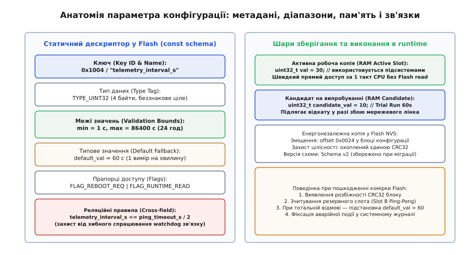
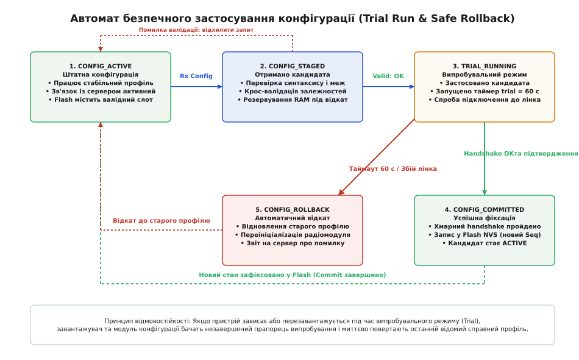
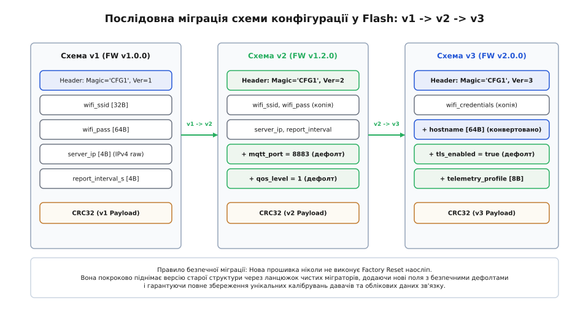
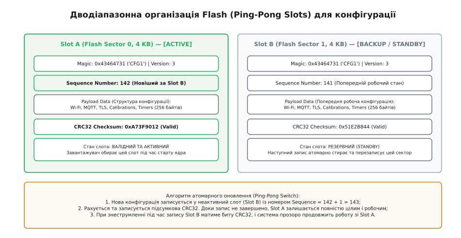

# Параметри пристрою: дефолти, валідація, міграція схеми

<preknowlist>
- [Пропало живлення під час запису](root:embedded/propalo-zhyvlennia-pid-chas-zapysu) — захист від неповного запису (torn writes) та пошкодження Flash-комірок при знеструмленні.
- [Сторож, який справді ловить зависання](root:embedded/storozh-iakyi-spravdi-lovyt-zavysannia) — апаратний та програмний сторожовий таймер (Watchdog) для відновлення після збоїв.
- [Серцебиття і виявлення розриву](root:embedded/sertsebyttia-i-vyiavlennia-rozryvu) — моніторинг життєздатності з'єднання та виявлення втрати каналу зв'язку.
- [Captive portal і своя сторінка налаштувань](root:embedded/captive-portal-i-svoia-storinka-nalashtuvan) — введення первинних конфігураційних параметрів через локальний веб-інтерфейс.
- [Завантажувач, який не можна закирпичити](root:embedded/zavantazhuvach-iakyi-ne-mozhna-zakyrpychyty) — відмовостійке оновлення прошивки та механізми захисту від перетворення плати на «цеглину».
</preknowlist>

Автономний вузол комерційного обліку газу, встановлений у підземному колодязі за сотні кілометрів від найближчого сервісного центру, щодня о третій годині ночі прокидається з глибокого сну, вмикає стільниковий модем, встановлює TLS-сесію з хмарним сервером і передає накопичений масив вимірювань. Під час чергового сеансу оператор диспетчерського пульта вирішує оптимізувати енергоспоживання парку пристроїв і відправляє на вузол нову конфігурацію: збільшити інтервал виходу на зв'язок до 24 годин і зменшити тайм-аут очікування відповіді від сервера з 60 секунд до 0. Оператор припустився друкарської помилки у веб-інтерфейсі хмари або вважав, що нуль означає «вимкнути тайм-аут». 

Мікроконтролер слухняно записує отримані байти в енергонезалежну Flash-пам'ять і перезапускає мережеву підсистему. Під час наступної спроби зв'язку сокетний рівень зчитує таймаут `0 мс`, миттєво фіксує помилку з'єднання, перериває передачу пакетів і відправляє модем у сон. Пристрій більше ніколи не зв'яжеться з сервером, не прийме виправленого пакета і не зможе повідомити про причину збою. Прилад перетворився на «цеглину» посеред поля через запис одного некоректного чотирибайтового числа.

Ця аварія ілюструє головну небезпеку керування конфігурацією у розподілених вбудованих системах: **неправильний параметр є не менш руйнівним за помилку в коді ядра або збій завантажувача**. Покладати валідацію виключно на хмарний бекенд або мобільний додаток наївно. Нова версія прошивки може змінити семантику полів; зловмисник може надіслати прямий сирий кадр по шині RS-485 чи через Bluetooth; космічна радіація або деградація Flash-комірки може спонтанно змінити окремий біт конфігурації. Єдиним надійним рубежем оборони є сам мікроконтролер. Він повинен суворо перевіряти кожен вхідний байт, володіти детермінованими типовими значеннями (дефолтами), ізолювати підозрілі налаштування на випробувальний термін (Trial Run) та бездоганно зберігати налаштування користувача при оновленні версій прошивки (Flash Schema Migration).

---

### Анатомія конфігураційного параметра

У простих навчальних скетчах налаштування нерідко зберігають у вигляді розрізнених глобальних змінних або зберігають увесь конфігураційний файл як суцільний текстовий JSON. Для польового пристрою з 32–128 КБ оперативної пам'яті обидва підходи згубні. Текстовий JSON вимагає динамічного виділення пам'яті в купі (heap), що веде до [фрагментації та вичерпання RAM](root:embedded/when-memory-runs-out), а неструктуровані змінні позбавлені будь-яких метаданих для системної валідації.

Інженерно правильна архітектура будується на понятті **дескриптора параметра**. Кожен конфігураційний елемент системи описується незмінною структурою у Flash-пам'яті програм (ROM), яка визначає його ідентифікатор, тип, дозволені фізичні межі, адресу в робочій пам'яті, права доступу та типове заводське значення.


*Анатомія дескриптора параметра: статична схема меж, вирівнювання у пам'яті та реляційні зв'язки.*

Повний опис життєвого циклу параметра складається з шести взаємопов'язаних атрибутів:

1. **Ключ та ідентифікатор (Key ID & Name)**. Текстове ім'я (наприклад, `"telemetry_interval_s"`) зручне для людей і REST API, але передача та парсинг рядків на кожному кроці коштують дорого. Всередині прошивки параметр адресується фіксованим двобайтовим числом (`uint16_t key_id` або хешем рядка FNV-1a). Це зводить пошук параметра в таблиці до лінійного проходу за кілька мікросекунд без жодного виділення пам'яті.
2. **Тип даних і фізичний розмір (Type Tag & Size)**. Суворо типізований тег (`BOOL`, `INT32`, `UINT32`, `FLOAT`, `STRING`, `BLOB`), що визначає вирівнювання у бінарній структурі. Використання типів змінної довжини на MCU суворо лімітується фіксованими буферами (`char[32]`), щоб унеможливити вихід за межі масиву (buffer overflow).
3. **Діапазон валідності (Validation Bounds)**. Жорсткі мінімальні та максимальні межі фізичної величини (`min_val`, `max_val`). Для цілочисельного таймауту це може бути інтервал `[1, 86400]` секунд; для коефіцієнта підсилення сигналу — `[0.1, 10.0]`. Будь-яке значення поза цим коридором апаратно чи логічно небезпечне й відкидається на рівні десеріалізатора.
4. **Типове значення (Compile-time & Factory Default)**. Еталонне значення, гарантовано зашите у Flash-пам'ять програми. Якщо мікросхема EEPROM/Flash виявиться чистою після монтажу або пошкодженою внаслідок апаратного збою, система не зупиняється з фатальною помилкою, а прозоро підставляє дефолтне значення.
5. **Прапорці поведінки (Access & Runtime Flags)**. Бітова маска, що регулює поведінку параметра під час роботи:
   - `FLAG_READ_ONLY` — параметр призначається виключно на заводі під час калібрування (наприклад, MAC-адреса, апаратна ревізія плати, серійний номер сенсора);
   - `FLAG_REBOOT_REQ` — зміна параметра вимагає повного перезавантаження мікроконтролера (наприклад, зміна базової тактової частоти шини або розподілу пам'яті);
   - `FLAG_CONFIDENTIAL` — чутливі дані (пароль Wi-Fi, приватний ключ TLS), які заборонено друкувати у системний журнал чи повертати у відкритих діагностичних звітах;
   - `FLAG_TRIAL_CRIT` — критичний параметр зв'язку, зміна якого активує обов'язковий випробувальний режим з автопідтвердженням.
6. **Крос-параметричні правила (Relational Constraints)**. Залежності між різними полями конфігурації. Наприклад, параметр `static_ip` має сенс лише тоді, коли `dhcp_enabled == false`; інтервал передачі `telemetry_interval_s` зобов'язаний бути принаймні вдвічі меншим за таймаут обриву зв'язку `connection_timeout_s`, інакше система фіксуватиме хибний розрив сесії при кожній затримці мережі.

Повна специфікація типів даних, службових бітових масок та системних кодів помилок винесена в [Специфікацію API конфігураційного сховища](root:embedded/parametry-prystroiu/api-config-schema.md).

---

### Сувора локальна валідація на пристрої

Чому конфігурація стає некоректною? У реальних розподілених системах існує щонайменше чотири джерела шкідливих значень:
- **Людський фактор**: оператор ввів некоректний порт (`0` або `99999`) чи випадково вказав IP-адресу широкомовного розсилу (`255.255.255.255`);
- **Розсинхронізація версій API**: сервер оновили раніше за прошивку, і нове поле зі значенням за замовчуванням інтерпретується старим бінарником як інше поле через зсув байтів;
- **Порушення цілісності каналу зв'язку**: спотворені байти при передачі через шумний радіоканал, якщо транспортний рівень не мав суворого контролю цілісності;
- **Апаратні збої Flash-пам'яті**: спонтанна зміна бітів (bit flip) через радіаційний вплив або неповний запис комірки при раптовому падінні напруги ([явище torn write](root:embedded/propalo-zhyvlennia-pid-chas-zapysu)).

Щоб жоден із цих факторів не перетворив пристрій на некерований шматок текстоліту, конфігураційний менеджер організовує **багаторівневу локальну валідацію**:

```
 [Вхідний бінарний пакет конфігурації]
                  │
                  ▼
 ┌─────────────────────────────────────────────────┐
 │ 1. Структурна валідація                         │
 │    • Перевірка Magic Bytes ("CFG1")             │
 │    • Звірка CRC-32 корисного навантаження       │
 │    • Перевірка довжини та вирівнювання пам'яті  │
 └────────────────────────┬────────────────────────┘
                          │ (OK)
                          ▼
 ┌─────────────────────────────────────────────────┐
 │ 2. Синтаксична валідація дескрипторів           │
 │    • min <= value <= max для кожного числа      │
 │    • Наявність нуль-термінатора у рядках        │
 │    • Заборона запису в поля Read-Only           │
 └────────────────────────┬────────────────────────┘
                          │ (OK)
                          ▼
 ┌─────────────────────────────────────────────────┐
 │ 3. Семантична та крос-параметрична валідація    │
 │    • telemetry_interval < conn_timeout / 2      │
 │    • IP-адреса вузла належить масці підмережі   │
 │    • Режим шифрування відповідає номеру порту   │
 └────────────────────────┬────────────────────────┘
                          │ (OK)
                          ▼
 ┌─────────────────────────────────────────────────┐
 │ 4. Апаратна допустимість                        │
 │    • Вихідна потужність TX не перевищує ліміт PA│
 │    • Частотний канал підтримується антеною      │
 └────────────────────────┬────────────────────────┘
                          │ (OK)
                          ▼
          [Допуск кандидата до випробування]
```

Особливу увагу слід звертати на апаратні обмеження. Якщо користувач обере вихідну потужність радіопередавача +20 dBm на платі, що живиться від крихітної літієвої батарейки CR2032, імпульсний струм у 120 мА миттєво просадить внутрішній опір джерела. Напруга на шині 3.3 В впаде нижче порогу 2.0 В, що призведе до спрацювання схеми скидання за падінням напруги (Brownout Reset). Вузол потрапить у нескінченний цикл рестартів щоразу при спробі передачі пакета. Локальний валідатор зобов'язаний заблокувати потужність вище +4 dBm, якщо у дескрипторі джерела живлення вказано тип `BATTERY_CR2032`.

Розгляньмо зразок реалізації модуля валідації на C та C++.

:::tabs
:::code parametry-prystroiu-d/c/suvora-lokalna-validatsiia.c
:::code parametry-prystroiu-d/cpp/suvora-lokalna-validatsiia.cpp
:::

---

### Патерн Trial Run: випробувальний термін та безпечний відкат

Навіть якщо новий конфігураційний профіль ідеально пройшов усі локальні перевірки, це не гарантує, що пристрій зможе працювати в реальній інфраструктурі. Користувач міг ввести пароль від Wi-Fi з помилкою в один символ або вказати IP-адресу сервера, на якому впала служба MQTT.

Якщо мікроконтролер відразу запише такі параметри у Flash як активні, він розірве робоче з'єднання, спробує підключитися до нової точки і, зазнавши невдачі, опиниться в глухому куті без зв'язку з диспетчером.

Щоб запобігти цьому, застосовується архітектурний патерн **Trial Run** (випробувальний режим або відкладена фіксація).


*Скінченний автомат Trial Run: перевірка кандидата, випробувальний період 60 с та автоматичний відкат при втраті лінка.*

Процес керується детермінованим скінченним автоматом, що складається з п'яти стадій:

1. **Отримання та ізоляція кандидата (`CONFIG_STAGED`)**:
   Отриманий по мережі пакет налаштувань не потрапляє в активну конфігурацію і не записується у Flash. Він зберігається в окремому буфері в оперативній пам'яті (`candidate_config`).
2. **Активація випробувального режиму (`TRIAL_RUNNING`)**:
   Запускається незалежний таймер випробувального терміну (Trial Watchdog) тривалістю `T_TRIAL = 60` секунд. Мережевий стек тимчасово перемикається на використання параметрів кандидата. 
3. **Мережева перевірка (End-to-End Connectivity Check)**:
   Пристрій намагається виконати повний цикл зв'язку:
   - Встановити фізичний лінк (асоціація з точкою доступу Wi-Fi чи з'єднання з базовою станцією LTE);
   - Отримати IP-адресу по DHCP та резолвнути доменне ім'я через DNS;
   - Встановити TCP/TLS сесію з сервером;
   - Надіслати автентифікований пакет і **отримати підтвердження (ACK/PINGRESP) від бекенду**.
4. **Успішна фіксація (`CONFIG_COMMITTED`)**:
   Щойно сервер відповів на запит у новому сеансі, хмара (або сам пристрій) ініціює команду `Commit`. Лише в цей момент кандидат атомарно записується в енергонезалежну Flash-пам'ять як новий активний профіль, а таймер випробування зупиняється.
5. **Аварійний відкат (`CONFIG_ROLLBACK`)**:
   Якщо протягом 60 секунд зв'язок не піднявся, або якщо під час випробування стався збій ядра (Kernel Panic, HardFault, WDT Reset), автомат негайно перериває випробування. Конфігураційний менеджер відкидає кандидата з RAM, відновлює останній гарантовано робочий профіль із Flash і піднімає старе з'єднання.

#### Взаємодія з апаратним сторожем та збереження стану в RTC-пам'яті

Що станеться, якщо новий мережевий драйвер або некоректний стек викликає `HardFault` чи зависання під час випробування? Апаратний сторожовий таймер (IWDG/WDT) перезавантажить процесор. Якщо прошивка після рестарту не знатиме, що перебувала у випробувальному режимі, вона знову спробує підняти збійного кандидата, що призведе до нескінченної петлі перезавантажень (Boot Loop).

Для запобігання цьому прапорець випробування `trial_in_progress` зберігається в незалежній **RTC Backup Memory** (регістрах, що зберігають вміст крізь програмні скидання та глибокий сон). Під час старту завантажувач перевіряє цей регістр: якщо прапорець активний, а причина скидання — спрацювання сторожа (`RESET_REASON_WDT`), система негайно очищує прапорець і завантажує попередній надійний профіль.

Повний працюючий рушій конфігурації з емуляцією переривань таймера та відкату наведено у практичній вставці [Повний менеджер конфігурації з випробувальним режимом](root:embedded/parametry-prystroiu/proj-config-manager.md).

---

### Міграція схеми конфігурації у Flash: еволюція прошивки

Розробка вбудованої системи не закінчується після випуску першої серійної партії. Через пів року після релізу замовник просить додати підтримку шифрування TLS, через рік — перевести зв'язок з сирих IP-адрес на доменні імена та додати вибір режиму роботи сенсорів.

Коли пристрій оновлює прошивку «по повітрю» ([через завантажувач OTA](root:embedded/zavantazhuvach-iakyi-ne-mozhna-zakyrpychyty)), виникає серйозний конфлікт: нова прошивка скомпільована з новим розташуванням полів у структурах C/C++, а у Flash-пам'яті лежить бінарний блок старої версії.


*Покрокова міграція схеми між версіями прошивки: збереження старих налаштувань та ініціалізація нових полів дефолтами.*

Найпримітивніша реакція недосвідченого розробника — виконати сліпе скидання до заводських налаштувань (`Factory Reset`), якщо розмір збереженого блоку не збігся з новою структурою. У серійному виробі це катастрофа:
- Стираються унікальні коефіцієнти калібрування сенсорів, отримані в метрологічній камері на виробництві;
- Знищуються користувацькі облікові дані точки доступу, і пристрій втрачає зв'язок;
- Втрачаються криптографічні ключі та сертифікати ідентифікації вузла на сервері.

Щоб еволюція відбувалася безшовно, застосовують **детерміноване версіонування схеми** (Flash Schema Migration).

Кожен блок даних містить у своєму бінарному заголовку монотонно зростаюче поле `schema_version`. Під час старту ядра конфігураційний менеджер порівнює версію з Flash із поточною версією прошивки `CURRENT_SCHEMA_VER`. Якщо версія з пам'яті старіша, запускається ланцюжок покрокових чистих функцій-трансформаторів (міграторів): `v1 -> v2`, потім `v2 -> v3`.

:::tabs
:::code parametry-prystroiu-d/c/mihratsiia-skhemy.c
:::code parametry-prystroiu-d/cpp/mihratsiia-skhemy.hpp
:::

---

### Надійна організація пам'яті: Dual-Slot Ping-Pong та ресурс Flash

Фізика роботи напівпровідникової Flash-пам'яті накладає жорстке апаратне обмеження: комірки можна записувати лише після повного посторінкового або посекторного стирання (переведення всіх бітів у стан `1` / `0xFF`). 

Якщо система зберігає конфігурацію в одному єдиному секторі, то процедура оновлення змушена спочатку стерти цей сектор, а потім записати нові байти. Якщо живильна напруга раптово впаде в проміжку між стиранням і записом (наприклад, під час витягування батарейки), на диску залишиться стертий сектор зі сміттям. При наступному старті плата втратить і старі, і нові налаштування.

Для досягнення абсолютної відмовостійкості використовується архітектура **Dual-Slot Ping-Pong** (дводіапазонне чергування секторів).


*Дводіапазонна організація секторів Flash для атомарного запису без ризику пошкодження активного профілю.*

1. **Виділення пам'яті**: Для конфігурації резервується два окремих незалежних сектори Flash (наприклад, Sector 0 — `Slot A` та Sector 1 — `Slot B`).
2. **Монотонний лічильник поколінь (`sequence_number`)**: Кожен успішний запис інкрементує цей номер (`1, 2, 3...`).
3. **Алгоритм вибору активного слота під час старту**:
   - Читається заголовок Slot A і перевіряється його `CRC32(Slot A)`.
   - Читається заголовок Slot B і перевіряється його `CRC32(Slot B)`.
   - Якщо обидва слоти валідні — обирається той, у якого значення `sequence_number` більше (з урахуванням переповнення через знакове порівняння).
   - Якщо один зі слотів пошкоджений (наприклад, перерваний запис) — обирається єдиний вцілілий валідний слот.
   - Якщо пошкоджені обидва слоти — завантажуються заводські дефолти (`Factory Defaults`).
4. **Атомарне оновлення**:
   - Новий стан конфігурації **завжди записується у неактивний (протилежний) сектор**.
   - Доки весь сектор не буде записаний і фінальна контрольна сума CRC-32 не ляже у службовий заголовок, активний сектор залишається недоторканим.
   - Знеструмлення в будь-яку мікросекунду процесу не загрожує системі: при рестарті пошкоджений новий сектор буде відкинуто через невідповідність CRC, а мікроконтролер продовжить штатну роботу на старому цілому секторі.

#### Розрахунок ресурсу Flash-пам'яті (Flash Endurance Budget)

Типовий сектор Flash-пам'яті NOR (як внутрішньої пам'яті STM32, так і зовнішніх SPI Flash типу W25Q32) витримує гарантовані **100 000 циклів стирання**.

Оцінімо ресурс пристрою при дводіапазонній організації:
- Якщо конфігурація змінюється лише при переналаштуванні оператором або зміні графіка (у середньому 5 разів на добу):
  
```
N_циклів_на_сектор = 5 / 2 = 2.5 циклів/добу
Ресурс_років = 100 000 / (2.5 · 365) ≈ 109 років
```

- Якщо ж недосвідчений розробник зберігає в конфігураційний сектор поточні показники лічильника або телеметрію щохвилини:

```
N_циклів_на_добу = 1440 / 2 = 720 циклів/добу
Ресурс_днів = 100 000 / 720 ≈ 138 днів (менше 5 місяців до фізичної деградації чіпа)
```

Цей розрахунок наочно доводить правило: **конфігураційне сховище призначене виключно для повільнозмінних метаданих та налаштувань**. Для високочастотних телеметричних даних або кільцевих журналів застосовують спеціалізовані журнали з вирівнюванням зносу (Wear Leveling) або енергонезалежну FRAM/EEPROM пам'ять.

---

### Порівняння підходів збереження конфігурації

Залежно від апаратних ресурсів мікроконтролера та складності моделі даних інженер обирає одну з трьох типових архітектур:

| Критерій | Фіксовані структури Ping-Pong | NVS Key-Value (наприклад, ESP-IDF NVS) | Серіалізація (CBOR / MessagePack) |
| :--- | :--- | :--- | :--- |
| **Накладні витрати RAM** | Мінімальні (розмір однієї структури C, ~100–512 B) | Помірні (кеш таблиці ключів, ~2–4 КБ) | Значні (динамічні буфери дерева парсера, ~4–16 КБ) |
| **Швидкість читання** | Миттєво: `memcpy` або пряме відображення в пам'ять MMU (1 такт) | Пошук ключа по хеш-таблиці в RAM (кілька мікросекунд) | Повний обхід дерева десеріалізатором (мілісекунди) |
| **Стійкість до знеструмлення** | Абсолютна (атомарне чергування слотів A/B з CRC32) | Висока (журналювання операцій у кільцевому буфері сторінки) | Залежить від файлової системи (потребує LittleFS) |
| **Гнучкість міграції** | Потребує явних функцій-трансформаторів `v1->v2` | Висока: нові ключі просто додаються, старі ігноруються | Дуже висока: опціональні поля підтримуються автоматично |
| **Оптимальна сфера** | Промислові MCU класу Cortex-M0+/M3/M4 (STM32, NXP, nRF) | Wi-Fi/BLE SoC середнього класу (ESP32, Realtek, TI CC) | Потужні шлюзи та SBC на Linux (i.MX6, STM32MP1) |

---

### Інженерні висновки

1. **Конфігурація — це код, що зберігається в даних**. Будь-який параметр без чітких меж і правил валідації є потенційним вектором віддаленого заклинювання (remote bricking) пристрою.
2. **Ніколи не застосовуйте мережеві налаштування наосліп**. Будь-яка зміна маршрутизації, ключів шифрування, IP-адрес чи сертифікатів повинна проходити крізь випробувальний режим (Trial Run) із захисним таймером. Якщо зв'язок не підтверджено на рівні прикладного протоколу — автоматичний відкат (Safe Rollback) зобов'язаний повернути старий робочий профіль.
3. **Оновлення прошивки не має знищувати налаштування користувача**. Архітектура версіонування схем з чистими функціями міграції гарантує плавний перехід між релізами зі збереженням заводських калібрувань.
4. **Дводіапазонне чергування (Ping-Pong Slots) — мінімальний стандарт надійності**. Прямий перезапис єдиного Flash-сектора на місці рано чи пізно призведе до занулення конфігурації під час аварійного вимкнення живлення.
