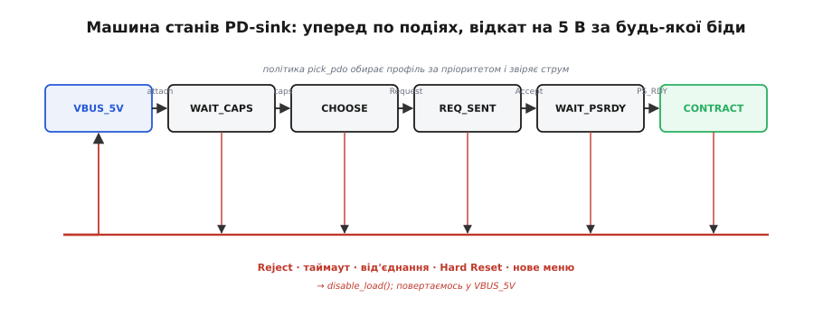

# ⚙️ Машина станів PD-sink: capabilities → request → accept

Як оформити [рукостискання USB Power Delivery](root:com-devices/usb-pd) в надійну машину станів, що сама веде політику живлення й безпечно падає, коли щось іде не так.

### Задача

Наш пристрій хоче дістати з PD-джерела певну напругу (скажімо, 12 В). [Рукостискання PD](root:com-devices/usb-pd) — це не один обмін, а **послідовність з умовами**: дочекатися меню профілів (`Source_Capabilities`), обрати потрібний, надіслати `Request`, дочекатися `Accept`, потім `PS_RDY` — і лише тоді на VBUS буде потрібна напруга. Але по дорозі все може піти не так: джерело може **відмовити** (`Reject`), сказати **«зачекай»** (`Wait`), **не відповісти** вчасно, **переукласти** контракт новим меню, або зв'язок узагалі обірветься (від'єднали кабель, джерело зробило Hard Reset). Потрібна логіка, що проводить пристрій крізь усі ці випадки й **за будь-якої біди безпечно повертається на 5 В**. Це і є «мозок» того МК-шляху, яким пристрій сам керує своїм живленням.

### Ідея

Оформимо sink як **скінченну машину станів** (англ. *finite state machine*, FSM — автомат зі скінченним набором станів). Кожен стан — це «де ми зараз у розмові», кожна подія (прийшло повідомлення, вийшов таймер, від'єднали) — перехід. Чому саме машина станів, а не «лінійний» код із чергою очікувань? Бо PD-розмова **асинхронна**: повідомлення приходять ззовні, коли заманеться джерелу, а між ними мусить тривати решта роботи пристрою. Якби ми писали це як послідовність `чекай меню; чекай Accept; чекай PS_RDY`, кожне «чекай» заблокувало б процесор — а ще довелося б у кожній такій точці окремо ловити від'єднання, таймаут і Hard Reset. Машина станів натомість зводить усе до одного простого правила: «у стані X на подію Y роби Z», і будь-яка біда (від'єднання, прострочений таймер) — це просто ще одна подія, що веде в один спільний безпечний стан.

Окремо від станів живе **політика** `pick_pdo(caps)` — чиста функція, що з меню профілів вибирає найкращий під нашу потребу (з пріоритетом і запасними варіантами). Цей поділ важливий: машина відповідає за *коли* і *в якому порядку* щось робити, а політика — за *що саме* просити. Захочете завтра іншу драбину напруг чи інше правило вибору — міняєте лише `pick_pdo`, а перевірена логіка переходів лишається незайманою. Машина рухається вперед на успішних подіях і **відкочується на 5 В** на будь-якій проблемній.

*Уперед: VBUS 5 В → WAIT_CAPS → CHOOSE → REQ_SENT → WAIT_PSRDY → CONTRACT, кожен крок за своєю подією (caps, Request, Accept, PS_RDY). Униз — спільна «червона шина»: Reject, таймаут, від'єднання, Hard Reset чи нове меню скидають усе в безпечні 5 В і знімають навантаження. Політика pick_pdo обирає профіль за пріоритетом і звіряє струм.*

### Машина станів у коді

Ось та сама машина реальним C для МК. Ключова умова: вона працює з **уже розкодованими** повідомленнями, які подає PD-PHY чи контролер (бітове кодування, `GoodCRC`, повтори — не її клопіт), а весь свій стан тримає в одній змінній `st`, а не в стеку викликів. Спершу — самі стани, політика вибору й переходи:

:::code proj-pd-state-machine/c/mashyna-staniv-u-kodi.c

Числа в таймерах — не вигадані: відповідь на `Request` за специфікацією має прийти десь за 30 мс (tSenderResponse — близько 24–30 мс у PD2, 27–33 мс у PD3), а перехід живлення до `PS_RDY` укладається в сотні мілісекунд (tPSTransition — до 550 мс). Прострочив — це не «джерело гальмує», а сигнал, що щось пішло не так, і час відкочуватися.

Чому взагалі дедлайн на кожен крок, а не «почекаємо, поки прийде»? Бо мовчання — найпідступніший вид збою. Якщо джерело відповіло `Reject`, ми це бачимо й діємо; але якщо воно просто **замовкло** на півслові (поганий контакт, перешкода, баг у дешевій зарядці), без таймера ми застрягли б у `WAIT_PSRDY` назавжди — навантаження так і не ввімкнулося б, а пристрій виглядав би «завислим» без жодного видимого приводу. Таймер перетворює «нічого не сталося» на повноцінну подію `EV_TIMEOUT`, і та веде в той самий безпечний відкат `fall_to_safe`, що й явна відмова. Тому таймери ставлять на **кожен** стан очікування, а не лише там, де «здається, треба».

Лишилось показати, **хто** кличе ці реакції й звідки береться сама подія таймауту. Тут і криється головна дисципліна подієвої машини: переривання не смикають `st` власноруч — вони лише **кладуть подію в чергу**, яку розбирає один-єдиний цикл. Той самий таймер, що стеріг дедлайн, у перериванні не відкочує машину сам, а кладе `EV_TIMEOUT`; далі все стається в одному контексті:

:::code proj-pd-state-machine/c/mashyna-staniv-u-kodi-2.c

### Складність і пастки на МК

- **Таймери — обов'язкові, не опційні.** Кожен крок має дедлайн: відповідь (`Accept`) — десятки мілісекунд, перехід живлення до `PS_RDY` — сотні, очікування меню — теж сотні. Прострочив — `fall_to_safe()`, а не «чекаю далі». FSM без таймерів зависає назавжди, якщо джерело замовкло на півслові.
- **Не блокуй.** Машина має бути **подієвою** — крутитися на перериваннях і черзі подій, а не в `busy-wait`. На МК сотні мілісекунд активного очікування `PS_RDY` вб'ють решту роботи пристрою. Стан зберігаємо у змінній, а не в стеку викликів.
- **Не пиши сам PD-PHY.** Бітове кодування, `GoodCRC`, повтори, точний тайминг на рівні символів — це робота PD-PHY чи спеціального контролера. Наша FSM працює з **уже розкодованими** повідомленнями. Спокуса зробити весь стек на голому МК велика — і майже завжди марна.
- **Навантаження — лише по контракту.** `enable_load()` викликаємо аж у `CONTRACT`, після `PS_RDY`. До того на шині тільки 5 В, і вмикати на них пристрій, розрахований на 12, не можна.
- **Джерело переукладає на ходу.** `Source_Capabilities` можуть прийти **знову** під час контракту — меню змінилося, треба переобрати, а не ігнорувати. А `Hard Reset` будь-коли скидає все в 5 В — обробляй його як повний відкат.
- **`Wait` — це не `Reject`.** На `Reject` сенсу повторювати той самий запит нема; на `Wait` джерело саме просить спробувати трохи згодом (воно зайняте іншим портом). І те, і те безпечно вести через `fall_to_safe`, але `Wait` лишає надію на повторну спробу пізніше.
- **Звіряй не лише напругу, а й струм.** Контракт — це напруга **й** струм, тож `pick_pdo` мусить перевіряти, що профіль дає потрібні ампери, інакше дістанеш «правильні» вольти, але замало потужності.
- **За замовчуванням — безпечно.** Будь-який несподіваний стан чи подія → `fall_to_safe()`. У живленні «коли сумніваюся — повертаюсь на 5 В» завжди дешевше за «спробую вгадати».
