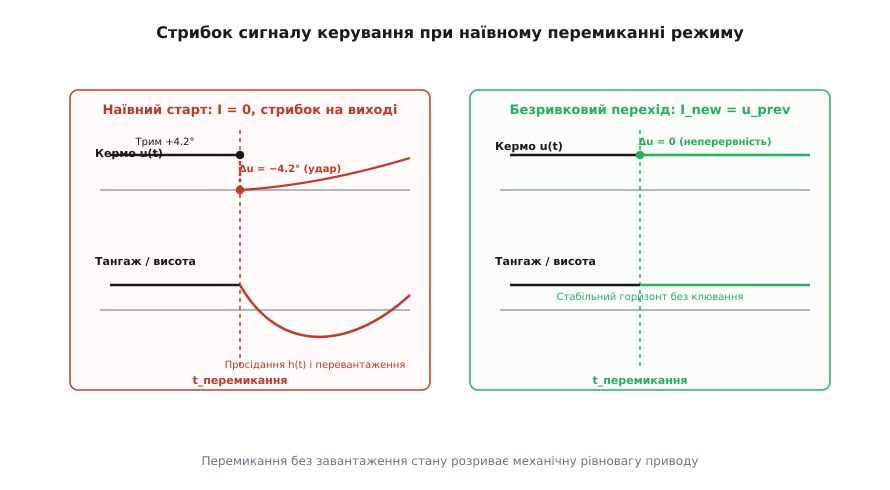
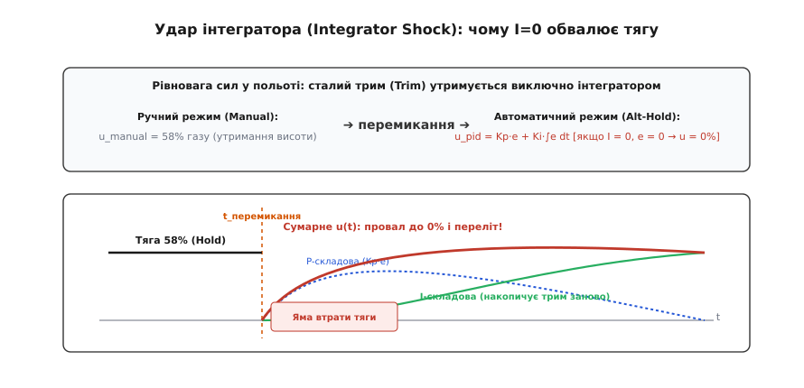
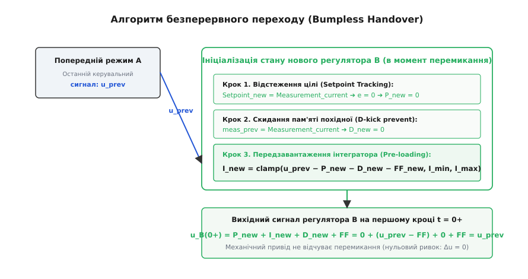
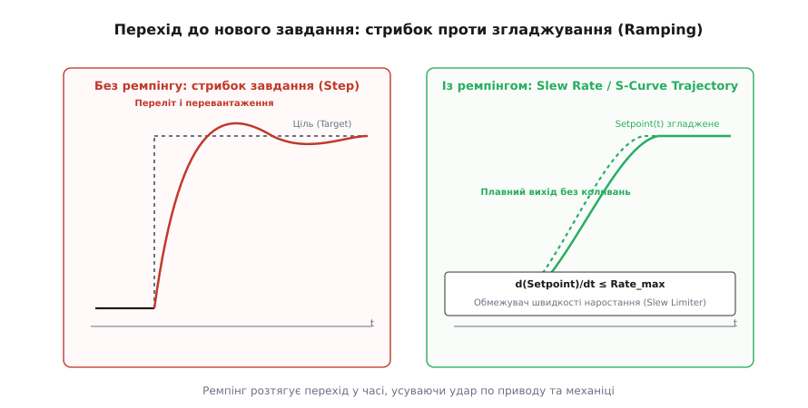

# Перехід без ривка: стан регулятора при зміні режиму

<preknowlist>
- [ПІД-регулятор: інтегральна складова](root:embedded/integral-control) — накопичує площу помилки з кроку в крок, усуває статичну похибку та врівноважує постійні навантаження (масу, гравітацію, опір повітря).
- [ПІД-регулятор: похідна складова](root:embedded/derivative-control) — реагує на швидкість зміни виміру чи помилки, демпфує коливання, але схильна до різких стрибків при миттєвій зміні цілі.
- [Налаштування ПІД: каскади й насичення](root:embedded/pid-tuning-cascade) — робота з межами приводу, анти-віндап (clamping, back-calculation) і розв'язання вкладених контурів керування.
- [Автомат станів у прошивці](root:embedded/avtomat-staniv-i-cherha-podii-u-proshyvtsi) — таблиці переходів, обробка подій перемикання режимів і забезпечення детермінізму в реальному часі.
- [Автомат режимів польоту](root:embedded/avtomat-rezhymiv) — ієрархія та правила перемикання між ручним, стабілізованим та автоматичним режимами автопілота.
</preknowlist>

Безпілотний літак летить у горизонтальному крейсерському польоті зі швидкістю 18 м/с. Центрування апарата дещо переднє, тому для втримання нульового кута тангажу кермо висоти постійно відхилене вгору на +4.2° (сигнал сервоприводу 1620 мкс), а тяга двигуна зафіксована ручкою газу на рівні 58%. Пілот на пульті клацає трипозиційним тумблером, переводячи апарат із ручного режиму керування в режим стабілізації висоти (Altitude Hold). Якщо новий регулятор висоти стартує «з чистого аркуша» — з нульовим інтегратором і бажаною висотою, що відрізняється від поточної бодай на пів метра, — сервопривід керма висоти за один такт таймера (2.5 мс) скидається з +4.2° у нуль. Аеродинамічне фокусування миттєво зриває баланс: літак різко клює носом униз на −12°, просідає на 15 метрів, відчуває ударне перевантаження −1.8 g, а пасажирське чи сенсорне навантаження зазнає жорсткого механічного струсу, поки інтегратор контуру висоти за кілька секунд знову не намацає потрібний трим.

Цей перехідний удар називають **стрибком керування** (англ. *control bump* або *control glitch*). Він виникає не через помилку у формулі регулятора чи шуми давача, а через порушення фундаментальної умови безперервності фізичного світу: механічний привід володіє інерцією й утримує систему в точці статичної рівноваги, тоді як дискретний алгоритм керування здатний миттєво змінити свій числовий вихід на будь-яку величину.


*Фізика стрибка керування. Зліва: наївний перезапуск регулятора скидає вихід на нуль, через що кермова поверхня миттєво відхиляється, викликаючи глибоке клювання носом і просідання траєкторії. Справа: алгоритм безперервного переходу утримує попереднє значення тяги й кута, зберігаючи неперервність вектора підйомної сили.*

## Анатомія стрибка керування: розрив між пам'яттю та станом приводу

Щоб зрозуміти, чому зміна режиму породжує удар, простежимо стан виконавчого органу в момент перемикання. У замкненій системі положення керма, кут нахилу лопатей автомата перекосу чи шпаруватість ШІМ силового моста визначаються вихідним числом регулятора:

```
   u(t) = P(t) + I(t) + D(t) + FF(t)
```

де P — пропорційний внесок від миттєвої помилки, I — накопичений інтеграл попередніх помилок, D — диференційний демпфер швидкості, а FF — пряме прогнозне керування (Feedforward).

У стаціонарному польоті попереднього режиму (нехай це буде ручне керування з ручки пульта чи стабілізація кутової швидкості) вихідний сигнал дорівнює певному ненульовому значенню `u_prev`. Це число врівноважує реальні зовнішні сили: гравітацію, несиметричність тяги двигунів, зміщення центру мас відносно центру тиску, аеродинамічний опір фюзеляжу.

У мить часу `t_switch` диспетчер режимів активує інший контур керування — наприклад, зовнішній контур позиціювання чи автопосадки. Цей новий регулятор має власні коефіцієнти Kp, Ki, Kd, власну уставку (Setpoint) і власні внутрішні змінні стану.

Якщо новий контур запускається наївно:

```
   e_new = Setpoint_new − Measurement_current
   P_new = Kp_new · e_new
   I_new = 0.0
   D_new = 0.0
   u_new(0+) = P_new + 0.0 + 0.0 + FF_new
```

то на першому ж кроці дискретизації виникає розрив вихідного сигналу:

```
   Δu = u_new(0+) − u_prev
```

Якщо пілот передав керування автопілоту в момент, коли помилка `e_new` близька до нуля, то `P_new ≈ 0`. Оскільки `I_new` скинуто в нуль, сумарний сигнал `u_new(0+)` падає практично до нуля (або базового FF). Стрибок `Δu = −u_prev` дорівнює повній амплітуді сили, що щойно тримала апарат у повітрі.

Такий стрибок призводить до трьох небезпечних наслідків:
1. **Механічний удар по трансмісії та редукторах**: струм через обмотки безколекторного мотора чи сервоприводу підскакує до струму короткого замикання (Stall Current), викликаючи зношування зубів шестерень і просідання напруги на шині живлення бортової електроніки.
2. **Динамічний зрив потоку на кермах**: миттєва перекладка елерона чи елевона на великий кут змінює локальний кут атаки за межу критичного, спричиняючи аеродинамічний зрив, бафтинг (вібрацію хвостового оперення) і різку втрату керованості.
3. **Хибне спрацьовування датчиків безпеки**: різкий ривок реєструється акселерометром як аварійне зіткнення чи збій двигуна, через що автомат безпеки польотного контролера може помилково ініціювати аварійне глушіння двигунів (Kill-switch) або передчасний викид парашута.

Головна вимога до інженерії перемикання формулюється як **принцип неперервності керівного впливу**:

```
   lim_{t → t_switch+} u(t) = lim_{t → t_switch−} u(t)   ➔   Δu = 0
```

Виконавчий привід не повинен відчувати, що алгоритм, який формує для нього завдання, змінився.

## Удар інтегратора (Integrator Shock): чому скидання I ламає баланс

Серед усіх складових ПІД-регулятора найпідступнішою при зміні режиму є інтегральна ланка. Поширена помилка програмістів-початківців — вважати інтегратор «чистим накопичувачем минулих помилок», який перед стартом нового завдання нібито обов'язково треба обнулити (`integral = 0.0f;`), щоб «старі помилки не заважали новому польоту».

У реальному фізичному об'єкті інтегратор виконує зовсім іншу роль: він є **динамічним оцінювачем невідомого зміщення робочої точки (Trim Estimator)**.


*Механізм удару інтегратора. У стаціонарному польоті постійне балансувальне навантаження (трим) забезпечується інтегральною складовою. Скидання інтегратора в нуль усуває це утримання, змушуючи контур накопичувати помилку заново, що супроводжується глибоким падінням тяги та тривалим перельотом.*

Розглянемо квадрокоптер масою 1.8 кг. Щоб зависнути на місці, мотори повинні створювати сумарну тягу, рівну силі тяжіння:

```
   F_thrust = m · g = 1.8 · 9.81 ≈ 17.66 Н
```

У перерахунку на нормалізований сигнал газу регулятора це відповідає, наприклад, значенню `u_hover = 0.52` (52% потужності).

Коли квадрокоптер нерухомо висить на заданій висоті:
- Помилка за висотою: `e = h_target − h_current = 0`.
- Пропорційний внесок: `P = Kp · 0 = 0`.
- Диференційний внесок: `D = −Kd · 0 = 0`.

Звідки береться керівний сигнал `u = 0.52`, який змушує пропелери крутитися й компенсувати 17.66 Н ваги? Він повністю зосереджений в інтеграторі:

```
   u(t) = 0 + Ki · ∫ e dt + 0 = I(t) = 0.52
```

Інтегратор — це пам'ять системи про те, яка саме тяга потрібна для нейтралізації гравітації в поточному стані заряду батареї та щільності повітря.

Якщо в момент активації автоматичного утримання висоти ви обнулите інтегратор (`I = 0`), апарат негайно опиниться в стані вільного падіння (`u = 0`). Що станеться далі:
1. Квадрокоптер починає падати під дією сили тяжіння з прискоренням 9.81 м/с².
2. З'являється наростаюча помилка за висотою `e(t) > 0`.
3. Лише тоді, коли апарат просяде досить глибоко, пропорційна складова `P = Kp · e` згенерує тягу, щоб зупинити падіння.
4. Поки апарат вирівнюється, інтегратор `I += Ki · e · dt` починає повільно збирати потрібні 0.52 зі стовпчиків помилки.
5. Коли інтегратор нарешті добереться до 0.52, пропорційна помилка все ще буде великою, через що сумарний сигнал підскочить до `u = 0.85`, і квадрокоптер різко підкине вгору з перельотом (Overshoot).

Цей коливальний зрив — падіння в яму з наступним перельотом — називають **ударом інтегратора** (англ. *integrator shock*). Причина удару — не слабкість коефіцієнтів, а штучно створений голод триму: ми власноруч стерли з пам'яті регулятора знання про вагу апарата, змусивши його розплачуватися реальними метрами висоти за відновлення інтегральної суми.

## Алгоритм безперервного переходу (Bumpless Transfer)

Щоб усунути стрибок керування та удар інтегратора, застосовують алгоритм **безперервного переходу (Bumpless Transfer / Handover)**. Завдання алгоритму — так обчислити початковий стан усіх змінних нового регулятора в мить перемикання `t_switch`, щоб виконувалися дві умови:
1. Вихід нового регулятора на першому ж такті точно дорівнював попередньому виходу: `u_new(0+) = u_prev`.
2. Усталена динаміка нового контуру не породжувала паразитних ривків на наступних кроках.


*Послідовність операцій безперервного переходу. Поточний вимір прив'язується до уставки (Setpoint Tracking), похідна скидає пам'ять відліків, а інтегратор завантажується залишковою різницею між попереднім виходом приводу та пропорційним внеском, гарантуючи нульовий стрибок на виконавчому механізмі.*

Алгоритм реалізується за три послідовні математичні кроки.

### Крок 1. Відстеження уставки (Setpoint Tracking / Co-linearization)

Якщо новий режим керує певною фізичною величиною (кутом тангажу, швидкістю, висотою), неприпустимо залишати в ньому уставку, заздалегідь задану в місії чи збережену з минулого польоту (наприклад, 100 метрів висоти, коли літак зараз перебуває на 35 метрах). Стрибок уставки `ΔSetpoint = 65 м` миттєво створить велетенський пропорційний удар `Kp · 65`.

Тому в момент перемикання цільове значення нового регулятора **ініціалізується поточним фактичним виміром датчика**:

```
   Setpoint_new = Measurement_current
```

Наслідок:
```
   e_new(0+) = Setpoint_new − Measurement_current = 0.0
   P_new(0+) = Kp · 0.0 = 0.0
```

Пропорційна складова гарантовано обнуляється без жодного ривка, а апарат у першу секунду нового режиму просто продовжує тримати ту точку, в якій його застало перемикання.

### Крок 2. Знешкодження похідного стрибка (Derivative Kick Prevention)

Диференційна ланка рахує швидкість зміни:
- Якщо диференціюється помилка: `(e[k] − e[k−1]) / dt`.
- Якщо диференціюється вимір (рекомендована форма): `−(Measurement[k] − meas_prev) / dt`.

Якщо попередня історія вимірів `meas_prev` містить застаріле значення з іншого режиму або неініціалізоване сміття з пам'яті, перший такт дасть величезний сплеск `D`.

У мить перемикання пам'ять диференціатора явно прирівнюється до поточного значення:

```
   meas_prev = Measurement_current
   deriv_filt = 0.0
```

Це гарантує, що `D_new(0+) = 0.0`.

### Крок 3. Передзавантаження інтегратора (Integrator Pre-loading)

Тепер запишемо повне рівняння виходу нового регулятора в мить `t_switch+`:

```
   u_new(0+) = P_new(0+) + I_new(0+) + D_new(0+) + FF_new
```

Підставимо умову неперервності `u_new(0+) = u_prev`:

```
   u_prev = 0.0 + I_new(0+) + 0.0 + FF_new
```

Звідси однозначно виводиться формула **передзавантаження інтегратора**:

```
   I_new(0+) = u_prev − FF_new
```

Якщо з якихось причин уставка не могла бути прирівняна до виміру (наприклад, оператор вимагає зберегти конкретний кут, і `P_new ≠ 0`), узагальнена формула передзавантаження набуває вигляду:

```
   I_new(0+) = u_prev − P_new(0+) − D_new(0+) − FF_new
```

Після обчислення `I_new(0+)` обов'язково пропускається через обмежувач фізичного насичення інтегратора (Anti-windup Saturation Limits):

```
   I_new(0+) = clamp(I_new(0+), I_min, I_max)
```

Перевіримо баланс на першому такті:
```
   u_new(0+) = P_new + I_new + D_new + FF_new                               [загальне рівняння виходу регулятора]
             = P_new + (u_prev − P_new − D_new − FF_new) + D_new + FF_new   [підставляємо виведене значення I_new]
             = u_prev                                                        [скорочуємо взаємні внески P, D та FF]
```

Математичний стрибок `Δu` строго дорівнює **нулю**. Сервопривід чи мотор не отримує жодної сходинки сигналу — передача повноважень від одного алгоритму до іншого відбувається абсолютно прозоро.

## Згладжування траєкторій (Ramping & Slew Rate Limiters)

Алгоритм безперервного переходу вирішує задачу моменту перемикання: у точці `t_switch` стрибка немає. Але що робити далі? Апарат зафіксував свій поточний стан (наприклад, висоту 35 м), а місія польоту вимагає набрати 100 м.

Якщо на наступному такті автопілот просто запише в уставку `Setpoint = 100.0`, виникне **відкладений пропорційний удар**: помилка стрибне з 0 до 65 м, і регулятор кине приводи в насичення.


*Згладжування цілі після безривкового захоплення. Зліва: ступінчаста зміна уставки після переходу збуджує пропорційний удар і перерегулювання. Справа: обмежувач швидкості наростання формує плавну лінійну або S-подібну траєкторію, розтягуючи перехідний процес без перевантаження механіки.*

Для плавного підведення системи до нової мети застосовують **генератори траєкторій (Trajectory Ramping)**.

### Метод 1. Обмежувач швидкості наростання (Slew Rate Limiter)

Найпростіший і найнадійніший спосіб — не дозволяти уставці змінюватися швидше, ніж фізично допустима швидкість процесу `Rate_max` (наприклад, вертикальна швидкість підйому дрона не більше 2.5 м/с):

```
   ΔSP_max = Rate_max · dt
   ΔSP = Target_Setpoint − Setpoint_current

   if ΔSP > ΔSP_max:
       Setpoint_current += ΔSP_max
   else if ΔSP < −ΔSP_max:
       Setpoint_current −= ΔSP_max
   else:
       Setpoint_current = Target_Setpoint
```

Уставка плавно прямує до цільового значення прямою лінією з постійним нахилом. Помилка `e(t)` наростає поступово, даючи системі час спокійно розігнатися без перевантаження двигунів.

### Метод 2. Фільтр нижніх частот першого порядку (Експоненційний ремпінг)

Якщо лінійний нахил має різкі злами на початку й у кінці руху, то плавнішу, асимптотичну криву забезпечує цифровий фільтр першого порядку:

```
   alpha = dt / (dt + tau_ramp)
   Setpoint_current += alpha · (Target_Setpoint − Setpoint_current)
```

де `tau_ramp` — стала часу переходу (зазвичай 1.0–3.0 секунди). На початку переходу швидкість максимальна, а в міру наближення до цілі вона плавно спадає до нуля, гарантуючи підхід до точки без перельоту.

### Метод 3. S-подібні профілі з обмеженням ривка (Jerk-Limited S-Curves)

Для оптико-електронних підвісів камер, маніпуляторів та пасажирських дронів навіть стрибок прискорення є неприпустимим (він викликає коливання пружних конструкцій і розмиття кадру). У таких системах використовують поліноми 3-го або 5-го порядку (мінімальний ривок, англ. *minimum jerk trajectory*), де обмеженою є не лише швидкість `d(SP)/dt`, але й друга та третя похідні: прискорення `d²(SP)/dt²` та ривок `d³(SP)/dt³`.

## Каскадні контури: безривковий перехід крізь шари

У сучасних автопілотах керування рідко буває одноконтурним. Зазвичай це каскад із 3–4 вкладених петель, рознесених за смугою пропускання (див. [налаштування ПІД у каскаді](root:embedded/pid-tuning-cascade)):

```
   [Позиція X,Y,Z] (10–20 Гц) ➔ [Швидкість Vx,Vy,Vz] (50 Гц) ➔ [Кут Roll,Pitch,Yaw] (100–250 Гц) ➔ [Кутова швидкість p,q,r] (400–1000 Гц) ➔ [Мотори]
```

Коли оператор перемикає режими, зміна конфігурації може відбуватися на будь-якому поверсі цієї ієрархії:
- **З Manual у Acro (Rate)**: ручка керує кутовою швидкістю напряму.
- **З Acro в Angle (Stabilize)**: вмикається контур кута, вихід якого стає уставкою для контуру кутової швидкості.
- **З Angle в Position Hold**: вмикаються контури швидкості й позиції, виходи яких керують кутами.

Безривковий перехід у каскаді вимагає **зворотного прокидання станів (Cascaded Back-Propagation)**:

1. **Ініціалізація зовнішнього контуру**:
   При перемиканні в режим утримання позиції уставка позиції стає рівною поточному виміру GNSS/RTK (`Pos_sp = Pos_actual`), а уставка швидкості — поточній швидкості за інерціальною системою (`Vel_sp = Vel_actual`).
2. **Ініціалізація проміжних контурів**:
   Інтегратор контуру швидкості передзавантажується поточним фактичним кутом нахилу апарата, поділеним на коефіцієнт передачі:
   ```
      I_velocity = Angle_actual / Kp_angle
   ```
3. **Ініціалізація внутрішнього швидкого контуру**:
   Інтегратор контуру кутової швидкості передзавантажується поточним значенням моменту/тяги на моторах:
   ```
      I_rate = Output_actuator_prev
   ```

Якщо знехтувати зворотним прокиданням хоча б в одному проміжному контурі (наприклад, обнулити інтегратор швидкості в каскаді позиції), зовнішній контур на перший такт видасть нульовий кут нахилу, літак вирівняється, втратить кут атаки, і каскад зламає рівновагу приводу, викликавши той самий удар керування.

## Граничні випадки, реальне залізо та підводні камені

На реальному мікроконтролері бездоганна на папері математика безривкового переходу стикається з фізичними обмеженнями заліза.

### 1. Насичення приводу в момент перемикання (Saturation Boundary)

Якщо попередній режим тримав привід у глибокому насиченні (наприклад, серво вперлося в механічний упор 100% через сильний боковий порив вітру), сигнал `u_prev = 1.0`.

Якщо просто виконати `I_new = 1.0 − P_new`, то новий інтегратор стартує прямо на краю насичення. Якщо перша ж помилка нового режиму штовхне його далі, регулятор зазнає глибокого розкручування інтеграла (Integral Windup).

**Правило**: При передзавантаженні інтегратор нового контуру обов'язково обрізається не просто до фізичних меж, а до меж із запасом на пропорційне реагування:

```
   I_max_safe = u_max − Kp · max_expected_noise
   I_new = clamp(I_new, I_min_safe, I_max_safe)
```

### 2. Розбіжність між поданою командою та фактичним положенням приводу

У дешевих безпілотниках автопілот знає лише те, що сам послав у PWM-таймер (`u_commanded`), але не знає, де реально перебуває вал сервоприводу (`u_actual`). Якщо швидкість перекладки сервоприводу обмежена (наприклад, 0.15 с на 60°), а перемикання режиму сталося під час швидкого маневру, сервопривід фізично відстає від команди на 10–15°.

Якщо передзавантажити новий регулятор значенням `u_commanded`, виникне стрибок за рахунок механічного люфту й відставання.
Там, де надійність критична, використовують сервоприводи зі зворотним зв'язком за потенціометром чи магнітним енкодером (через окремий АЦП або цифрову шину telemetry/CAN) і для передзавантаження беруть **фактичне положення вала**, а не бажане програмне число:

```
   u_prev = read_actuator_telemetry_feedback()
```

### 3. Асинхронність і різні частоти контурів (Multi-rate Handover)

Зовнішній контур навігації може викликатися за таймером 50 Гц, а внутрішній контур гіроскопа — на частоті 1 кГц за перериванням готовності даних IMU (Data Ready Interrupt).

Якщо перемикання режимів відбувається в задачі низького пріоритету, внутрішній швидкий контур може встигнути виконати 20 тактів із напівзавантаженим станом, поки зовнішній контур не оновить свої змінні.

Для запобігання цьому операція перемикання режиму та передзавантаження всіх контурів повинна бути **строго атомарною**: вона виконується в критичній секції із заблокованими перериваннями контурів керування або через захищений м'ютексом механізм транзакційного перемикання контексту регулятора.

## Бібліотека безривкового ПІД на C та C++

Розглянемо промислову реалізацію модуля ПІД-регулятора з підтримкою безривкового переходу, захисту від стрибка похідної, анти-віндапу на основі clamping та обмежувача темпу зміни уставки.

Детальний опис усіх структур даних, кодів помилок та сигнатур функцій винесено в окремий [довідник інтерфейсу безривкового ПІД](root:embedded/perekhid-bez-ryvka/api-bumpless-pid.md).

:::tabs
:::code perekhid-bez-ryvka-d/c/src/bumpless_pid.c
:::code perekhid-bez-ryvka-d/cpp/src/pid.cpp
:::

Повний приклад побудови повноцінного диспетчера польотних режимів з автоматом станів, обробкою подій від пульта та наскрізною перевіркою безривковості реалізовано у [практичному проекті диспетчера режимів](root:embedded/perekhid-bez-ryvka/proj-mode-switcher.md).

## Чеклист валідації безривкового переходу на HIL-стенді

Перед випробуванням у повітрі алгоритм перемикання режимів обов'язково тестується на стенді напівнатурного моделювання (Hardware-In-The-Loop) за суворим протоколом:

1. **Тест нульового стрибка (Zero-glitch test)**:
   Система вводиться у збурений стаціонарний стан (наприклад, вітровий потік на стенді вимагає триму керма 30%). Проводиться серія з 50 перемикань між усіма доступними комбінаціями режимів. Критерій проходження:
   ```
      max |u(t_switch + dt) − u(t_switch)| < 10^{−4}
   ```
2. **Тест насиченого передзавантаження (Saturated Handover test)**:
   Привід штучно блокується на упорі 100%, після чого активується режим стабілізації в протилежний бік. Критерій: інтегратор не застрягає в насиченні, вихід починає спадати на першому ж такті зміни знака помилки.
3. **Тест темпу наростання (Ramping tracking test)**:
   Після перемикання задається максимальний стрибок місії (наприклад, набор висоти +200 м). Критерій: струм моторів не перевищує номінального пікового ліміту, перевантаження фюзеляжу літака не виходить за експлуатаційні межі `[−0.5 g, +2.5 g]`.