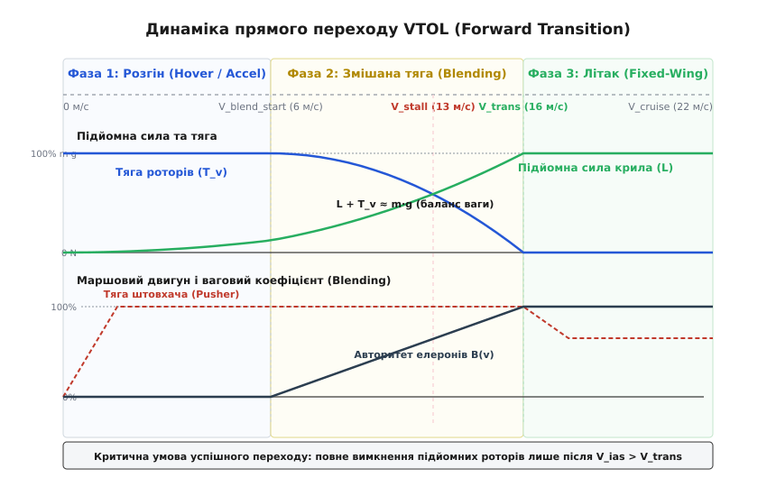
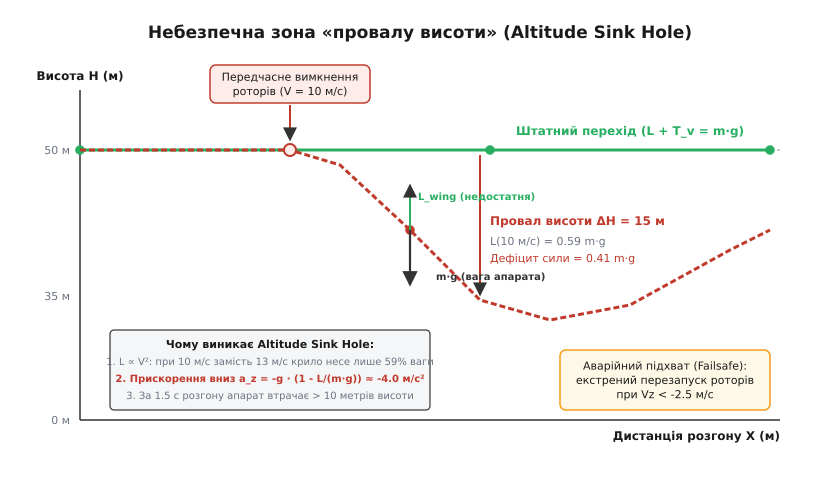
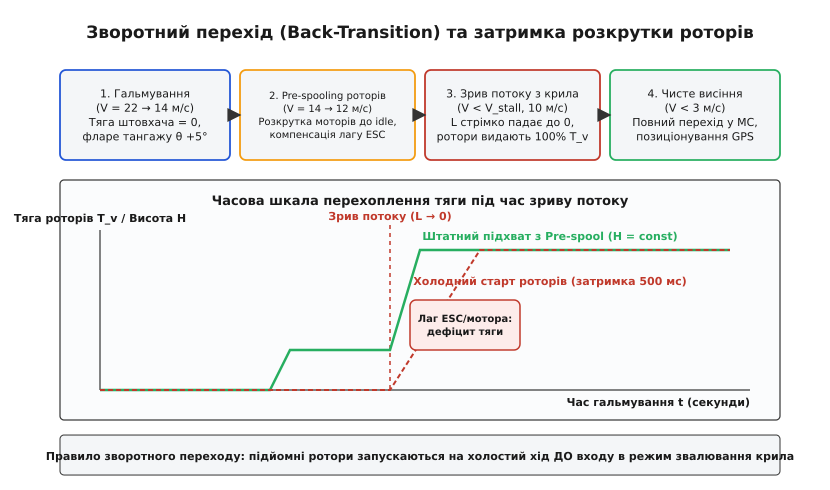
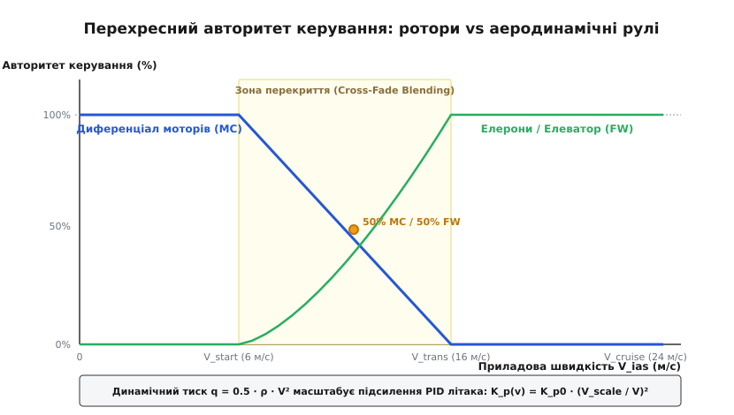

# Перехідний режим VTOL: де апарат найвразливіший

<preknowlist>
- [VTOL-гібриди](root:ph-mechanics/vtol-transition) — базові схеми (QuadPlane, Tilt-Rotor, Tailsitter) та концепція поєднання роторного висіння з нерухомим крилом.
- [Підйомна сила крила](root:ph-mechanics/fixed-wing-lift) — формула `L = 0.5 · ρ · v² · S · C_l` та формування аеродинамічної сили обтіканням профілю.
- [Керування літаком: елерони, руль, мікшування](root:embedded/fixed-wing-control-surfaces) — авторитет аеродинамічних поверхонь і керування літальним апаратом за трьома осями.
- [Трубка Піто та швидкість польоту](root:hw-sensing/pitot-tube) — вимірювання динамічного тиску, індикована приладова швидкість (IAS) та її відмінність від шляхової швидкості (GS).
</preknowlist>

Коли чотирнадцятикілограмовий комбінований безпілотник вертикального зльоту та посадки (VTOL, від англ. *Vertical Take-Off and Landing*) завершує набір висоти у режимі коптера і розпочинає горизонтальний розгін, він потрапляє в зону аеродинамічної невизначеності. Підйомні ротори поступово скидають оберти, а крило ще не набрало швидкості, необхідної для утримання ваги планера. Якщо автопілот передчасно вимкне вертикальні двигуни на швидкості 10 м/с за швидкості звалювання крила 13 м/с, крило створить лише 59% необхідної підйомної сили. Апарат миттєво переходить у некероване вертикальне падіння з прискоренням близько 4 м/с², втрачаючи понад 15 метрів висоти за дві секунди.

Цей проміжок польоту між чистим гвинтокрилим висінням і стабільним літаковим польотом називається перехідним режимом (*transition phase*). Саме на перехідний режим припадає понад 70% аварій безпілотних гібридних платформ. У цей момент апарат одночасно підпорядковується двом принципово різним фізичним моделям: механіці прямої реактивної тяги повітряних гвинтів та аеромеханіці нерухомого крила, де сили масштабуються пропорційно квадрату швидкості набігаючого потоку.

Складності додає те, що аеродинамічні рульові поверхні (елерони, кермо висоти та напрямку) на малих швидкостях повністю позбавлені керованості через низький динамічний тиск, тоді як роторний диференціал втрачає авторитет через розвантаження моторів. Щоб безпілотник не зірвався у штопор і не провалив висоту, бортовий контролер польоту зобов'язаний динамічно перерозподіляти вагу й моменти керування за строгими законами аеромеханіки.

---

### 1. Аеромеханіка прямого переходу (Forward Transition)

Прямий перехід (*forward transition*) — це процес керованого горизонтального розгону апарата від нульової горизонтальної швидкості у точці зависання до швидкості впевненого літакового польоту `V_cruise`.

Повний баланс сил під час переходу описується сумою векторів тяги підйомних роторів `T_v`, підйомної сили крила `L`, сили тяжіння `m · g`, горизонтальної тяги маршового рушія `T_push` та повного аеродинамічного опору `D`:

```
Вертикальна вісь Z:   m · a_z = L(V_ias, α) + T_v(t) - m · g
Горизонтальна вісь X: m · a_x = T_push(t) - D(V_ias, α)
```

де `V_ias` — індикована приладова швидкість (*indicated airspeed, IAS*), виміряна трубкою Піто за динамічним тиском `q = 0.5 · ρ · V_ias²`, `α` — кут атаки крила, `S` — площа крила, а `C_L(α)` — коефіцієнт підйомної сили профілю.


*Динаміка прямого переходу: перерозподіл ваги між роторами та крилом, поріг швидкості V_trans та наростання авторитету елеронів.*

#### Квадратичне перенесення навантаження

Головна фізична особливість прямого переходу полягає в нелінійності виникнення підйомної сили. Підйомна сила крила зростає пропорційно **квадрату приладової швидкості**:

```
L(V_ias) = 0.5 · ρ · V_ias² · S · C_L
```

Якщо швидкість безпечного завершення переходу `V_trans` становить 16 м/с, то на швидкості 8 м/с (половина коридору швидкостей) крило генерує не половину ваги апарата, а лише:

```
(8 / 16)² = 0.25  [тобто лише 25% від повної маси m·g]
```

Решту 75% ваги у цій точці розгону зобов'язані утримувати вертикальні ротори:

```
T_v_req(V_ias) = m · g · (1 - (V_ias / V_trans)²)
```

Якщо система керування зменшуватиме тягу роторів лінійно від швидкості (`T_v = m · g · (1 - V_ias / V_trans)`), сума сил `L + T_v` на швидкості 8 м/с складе лише `0.25 + 0.50 = 0.75 m · g`. Апарат миттєво отримає дефіцит сили у 25% власної ваги і почне просідати вниз. Детальний математичний апарат розрахунку сил, кінематики та енергетичного балансу наведено у вставці [баланс сил, перехідний коридор та динамічний тиск VTOL](root:embedded/perekhidnyi-rezhym-vtol/math-transition-forces.md).

#### Порівняльна аеромеханіка схем VTOL

Фізика переходу має принципові відмінності для різних компонувань гібридних літальних апаратів:

##### 1. Квадроплан (QuadPlane / Lift+Cruise)
Конструкція має незалежні вертикальні підйомні мотори (4 або 8 роторів на поздовжніх балках) та окремий горизонтальний маршовий штовхач або тягнучий гвинт.
*Переваги:* Механічна надійність, відсутність високонавантажених поворотних сервомеханізмів, незалежність матриць мікшування коптера та літака.
*Аеродинамічна ціна:* Зупинені вертикальні гвинти та масивні монтажні труби утворюють великий додатковий паразитний опір `D_rot`. Маршовий двигун повинен мати значний запас надлишкової тяги `ΔT = T_push - D_total`, інакше прискорення `a_x = ΔT / m` виявиться недостатнім, розгін затягнеться, і акумулятор вичерпає запас енергії до досягнення швидкості `V_trans`.

##### 2. Конвертоплан (Tilt-Rotor / Tilt-Wing)
Гондоли двигунів або все крило повертаються сервоприводами на кут `δ` від 90° (вертикаль) до 0° (горизонт). Вектор тяги повертається у просторі: `T_vert = T · cos(δ)`, `T_horiz = T · sin(δ)`.
*Переваги:* Відсутність «мертвої маси» непрацюючих моторів у горизонтальному польоті, висока крейсерська швидкість та максимальна дальність.
*Аеродинамічні пастки переходу:*
1. **Гіроскопічна прецесія:** Швидке повертання гондоли з масивним ротором, що обертається з кутовою швидкістю `Ω`, створює гіроскопічний момент `M_gyro = I_prop · (Ω × ω_tilt)`. Цей момент діє перпендикулярно до площини повороту й викликає різке скручування консолей крила за тангажем або креном.
2. **Косий обдув крила:** При проміжних кутах нахилу `δ ≈ 30° ÷ 60°` струмінь повітря від гвинтів набігає на профіль крила під великим кутом, викликаючи передчасний локальний зрив потоку біля кореневої частини.

##### 3. Хвостосідач (Tailsitter)
Апарат позбавлений поворотних механізмів і окремих моторів: він злітає вертикально носом угору, спираючись на кілі, а для переходу нахиляє весь корпус на 90° вперед.
*Переваги:* Мінімальна маса конструкції, гранична механічна простота.
*Аеродинамічні пастки переходу:* Найвища вразливість до вітру. Під час перевороту на 90° крило великої площі розвертається плазом до бокового або зустрічного вітру, створюючи величезний перекидаючий момент. Одночасно відбувається підміна осей керування автопілота: кут рискання коптера стає креном літака, а крен коптера перетворюється на рискання літака.

---

### 2. Небезпечна зона «провалу висоти» (Altitude Sink Hole)

«Провал висоти» (*Altitude Sink Hole*) — це аварійне явище у перехідному режимі, коли апарат стрімко втрачає висоту внаслідок дефіциту сумарної підйомної сили:

```
L(V_ias) + T_v(t) < m · g
```

Якщо цей дефіцит зберігається протягом 1.5–3 секунд, вертикальна швидкість зниження перевищує 3–5 м/с. Навіть якщо після цього літак досягає швидкості крила, вивести його з пікірування без запасу висоти неможливо через затримку зростання підйомної сили при збільшенні тангажу.


*Небезпечна зона «провалу висоти»: дефіцит підйомної сили при передчасному вимкненні моторів та траєкторія падіння.*

#### Головні фактори виникнення провалу висоти

Аналіз телеметрії реальних аварій гібридних дронів показує чотири систематичні інженерні причини провалу:

##### 1. Передчасне відсікання роторів за фіксованим таймером
У спрощених алгоритмах розробники часто програмують перехід як часову затримку: «увімкнути штовхач на 100%, почекати 4 секунди, вимкнути підйомні ротори». Якщо апарат розганяється проти сильного вітру, необхідна швидкість набереться швидко. Проте за попутного вітру або при просіданні напруги тяга штовхача падає, і за 4 секунди швидкість досягає лише 9 м/с при швидкості звалювання `V_stall = 13 м/с`. Ротори зупиняються, крило ще не несе — безпілотник плазом падає на землю.

##### 2. Пастка попутного вітру (розбіжність між GS та IAS)
Шляхова швидкість (*Ground Speed, GS*), яку фіксує супутниковий приймач GPS/GNSS, показує переміщення відносно поверхні землі, а не відносно повітряних мас.
Якщо дрон розганяється за попутного вітру 8 м/с, GPS показує швидкість 18 м/с, і примітивний алгоритм вважає, що перехід завершено. Проте справжня індикована приладова швидкість обтікання крила становить лише:

```
V_ias = V_ground - V_wind = 18 - 8 = 10 м/с
```

При швидкості звалювання 13 м/с вимкнення роторів за швидкістю GPS гарантовано руйнує апарат. Політ комбінованого VTOL без перевіреної та каліброваної трубки Піто є грубим порушенням безпеки польотів.

##### 3. Індуктивний спадний потік від роторів (Rotor Downwash)
Працюючі підйомні ротори відкидають повітря вниз зі швидкістю індуктивного скосу:

```
v_downwash = √( T_v / (2 · ρ · A_rotor) )
```

Цей потік обдуває верхню поверхню крила та елерони, спотворюючи обтікання профілю. Коли підйомні двигуни раптово вимикаються, картина ліній току миттєво перебудовується. На верхній кромці виникає нестаціонарний відрив пограничного шару, викликаючи короткочасне (0.4–0.8 с) падіння коефіцієнта `C_L`.

##### 4. Паразитний поздовжній момент штовхача та зміщення центру тиску
У більшості компонувань вісь маршового мотора розташована з вертикальним зміщенням відносно центру мас (`z_push ≠ 0`). Повний газ штовхача створює різкий кабруючий або пікіруючий момент. Якщо виникає кабрування, ніс задирається, кут атаки перевищує критичний `α > α_crit`, і крило входить у зривне звалювання (*accelerated stall*).

#### Захисний алгоритм відновлення (Failsafe Recovery)

Бортовий контролер польоту зобов'язаний щотактово контролювати вертикальну швидкість `v_z` та прискорення `a_z`.
Якщо темп просідання перевищує поріг (`v_z < -2.0 м/с` протягом понад 0.5 с), або кутові швидкості крену й тангажу перевищують ліміти керованості, алгоритм негайно скасовує прямий перехід і запускає аварійний підхват:
- Маршовий штовхач скидається до нуля;
- Усі підйомні мотори форсуються до 100% тяги;
- Контур автопілота примусово повертається в режим стабілізації коптера (Hover) і відновлює безпечний ешелон висоти.

---

### 3. Зворотний перехід (Back-Transition)

Зворотний перехід (*back-transition* або *inbound transition*) — це процес сповільнення апарата від літакового крейсерського польоту (20–30 м/с) до повної зупинки та зависання над точкою посадки (`V_ias ≈ 0`).

Хоча завдання здається простим, фізика зворотного переходу приховує критичну загрозу: **затримку розкрутки зупинених роторів** на тлі швидкого аеродинамічного звалювання крила.


*Фази зворотного переходу: гальмування, холоста передрозкрутка роторів та перехоплення ваги при зриві потоку з крила.*

#### Лаг розкрутки роторів (Spool-Up Latency)

У горизонтальному літаковому польоті підйомні двигуни вимкнені і перебувають у спокої (інколи навіть механічно або магнітно зафіксовані вздовж балок для зменшення опору).

Масивні карбонові повітряні гвинти великого діаметра (16–24 дюйми для важких БПЛА) мають значний момент інерції `I_prop`. Час розкрутки безколекторного мотора від 0 до робочих обертів створення тяги висіння (4000–6000 об/хв) становить від **300 до 700 мілісекунд** залежно від потужності регулятора швидкості (ESC) та напруги батареї:

```
t_spool = (I_total · ΔΩ) / M_torque
```

Якщо польотний контролер почне запускати підйомні двигуни лише в той момент, коли літак уже сповільнився нижче швидкості звалювання `V_stall`, виникає фатальний розрив у часі:
1. На швидкості 11 м/с крило повністю втрачає підйомну силу (`L ≈ 0`).
2. Підйомні ротори лише починають розганятися і за перші 300 мс створюють менше 20% номінальної тяги.
3. Протягом 0.5–0.8 секунди безпілотник перебуває у стані некерованого вільного падіння, втрачаючи до 10–15 метрів висоти.

#### Стратегія холостої передрозкрутки (Pre-Spooling)

Для усунення провалу висоти при гальмуванні застосовується трифазна стратегія зворотного переходу:

1. **Фаза аеродинамічного гальмування:** Маршовий двигун вимикається (або вмикається активне реверсивне гальмування штовхачем). Автопілот збільшує кут тангажу літака на `θ = +4° ÷ +7°` (гальмівний фларе), ефективно скидаючи швидкість за рахунок індуктивного опору крила.
2. **Фаза холостого пуску (Pre-Spooling):** Щойно швидкість падає до верхнього порогу `V_trans` (наприклад, 16 м/с), підйомні ротори примусово запускаються на мінімальні оберти холостого ходу (15–25% шпаруватості PWM/DShot). Гвинти вже обертаються, затримку синхронізації безколекторного мотора та перехідні процеси в ESC подолано.
3. **Фаза безшовного перехоплення тяги:** У міру сповільнення від `V_trans` до `V_stall` (13 м/с) тяга роторів плавно наростає від холостих обертів до 100% ваги `m · g`. Коли потік остаточно зривається з крила, ротори вже працюють на повній потужності висіння, і висота апарата залишається незмінною.

---

### 4. Перехресний авторитет керування (Control Authority Blending)

Найскладнішою алгоритмічною задачею переходу є забезпечення стабільності за трьома кутовими осями: крен (*roll*), тангаж (*pitch*) та рискання (*yaw*).

У перехідному коридорі діють дві незалежні виконавчі системи:
- **Мультироторні актуатори:** Диференціал тяги підйомних моторів `ΔT` створює моменти відносно центру мас:
  ```
  M_mc_roll  = (T_left - T_right) · d_y
  M_mc_pitch = (T_rear - T_front) · d_x
  M_mc_yaw   = ∑ M_reactive_torque
  ```
  Авторитет цієї системи максимальний на нульовій швидкості й не залежить від динамічного тиску.
- **Аеродинамічні рулі літака:** Елерони, елеватор та руль напрямку створюють моменти за рахунок обтікання набігаючим потоком:
  ```
  M_fw = 0.5 · ρ · V_ias² · S · c · C_m_delta · δ_surface
  ```
  Авторитет цієї системи строго пропорційний **динамічному тиску** `q = 0.5 · ρ · V_ias²`. На низьких швидкостях він наближається до нуля, а при розгоні до 24 м/с зростає у 16 разів.


*Перехресний авторитет керування: динамічне змішування диференціальної тяги роторів та аеродинамічних рулів залежно від приладової швидкості.*

#### Ваговий коефіцієнт змішування (Blending Factor)

Для гладкого перерозподілу керуючих моментів автопілот обчислює безрозмірний ваговий коефіцієнт `B(V_ias)` у коридорі швидкостей `[V_blend_start, V_trans]`:

```
B(V_ias) = clamp( (V_ias - V_blend_start) / (V_trans - V_blend_start), 0.0, 1.0 )
```

Команди від контурів кутової стабілізації передаються на виконавчі механізми за принципом перехресного згасання (*cross-fading*):

```
u_rotors_diff = (1.0 - B(V_ias)) · u_pid_multirotor
u_surfaces    = B(V_ias) · u_pid_fixedwing
```

У середині коридору (при `B = 0.5`) апарат керується комбіновано: ротори швидко придушують високочастотні збурення, а елерони стабілізують планер у потоці.

#### Запобігання насиченню інтегратора (Anti-Windup)

Якщо ПІД-регулятор елеронів та елеватора працюватиме з постійними коефіцієнтами на швидкості 3–5 м/с, виникає небезпечне інтегральне насичення (*integrator windup*):
- Планер отримує невелике кутове збурення, і контур стабілізації вимагає повернути елерони.
- Через відсутність динамічного тиску максимальне відхилення елеронів на 25° не створює повертального моменту.
- Інтегральна складова (`I-term`) безперервно накопичує помилку кута до граничного насичення.
- Коли швидкість досягає 16 м/с і динамічний тиск стрімко з'являється, рулі залишаються затиснутими в крайньому положенні через переповнений інтегратор.
- Апарат здійснює раптове некероване бокове обертання (*snap roll*) і врізається в землю.

*Інженерне правило:* Інтегральна складова літакових контурів повинна бути повністю заблокована (`I_term = 0`) на швидкостях `V_ias < V_blend_start`, а швидкість накопичення інтеграла має динамічно масштабуватися коефіцієнтом `(V_ias / V_trans)²`.

#### Спотворення оцінки орієнтації (AHRS / EKF Drift) при прискоренні

Під час інтенсивного горизонтального розгону акселерометр вимірює вектор суми гравітації та горизонтального прискорення розгону `a_x`:

```
a_measured = [ a_x, 0, -g ]^T
```

Якщо фільтр орієнтації (Complementary Filter або розширений фільтр Калмана EKF) наївно вважає, що вектор вимірюваного прискорення завжди спрямований строго вертикально до центру Землі, автопілот отримає хибну оцінку кута тангажу (нібито апарат опустив ніс униз на кут `arctan(a_x / g)`).
Щоб скомпенсувати це «уявне» пікірування, автопілот задере ніс угору і введе крило у звалювання.
*Рішення:* Під час переходу алгоритм EKF повинен віднімати від показників акселерометра похідну швидкості з трубки Піто або GPS: `a_corr = a_measured - [dv_ias/dt, 0, 0]^T`.

---

### 5. Реалізація модуля керування переходом VTOL на C та C++

Нижче наведено модульну архітектуру контролера перехідного режиму на основі детермінованого скінченного автомата. Код реалізує контроль безпеки, лінеаризацію сигналу газу підйомних роторів, розрахунок вагового змішування поверхонь та аварійний захист від провалу висоти.

:::tabs
:::code perekhidnyi-rezhym-vtol-d/c/main.c
:::code perekhidnyi-rezhym-vtol-d/cpp/main.cpp
:::

---

### 6. Інженерна практика: конфігурація та аналіз польотних логів

> 🔧 **Навіщо це в реальній розробці.**
> Під час першого вильоту нового прототипу VTOL перехідний режим ніколи не вмикають на малій висоті. Перехід виконують на висоті не менше 50–70 метрів над рівнем рельєфу, щоб у разі помилки в розрахунку `V_trans` або відмови датчика швидкості мати 3–5 секунд запасу висоти для спрацьовування аварійного захисту.

#### Ключові параметри автопілотів (PX4 та ArduPilot)

У відкритих польотних стеках налаштування перехідного режиму зведені до кількох критичних констант, які інженер зобов'язаний узгодити з аеродинамічним розрахунком планера:

1. `VT_ARSP_TRANS` (PX4) / `Q_TRANSITION_MS` (ArduPilot):
   Цільова швидкість завершення переходу `V_trans`. Її значення встановлюють на рівні `1.20 · V_stall`. Заниження цього параметра навіть на 1.5 м/с гарантовано призводить до провалу висоти при вимкненні роторів.
2. `VT_TRANS_TIMEOUT` (PX4):
   Таймаут прямого переходу (зазвичай 10–15 секунд). Якщо через поривчастий зустрічний вітер або брак потужності мотора літак не зміг досягти швидкості `V_trans` за цей час, автопілот автоматично скасовує перехід і переводить апарат у безпечне висіння.
3. `VT_B_REV_DEL` (PX4) / `Q_BACKTRANS_MS` (ArduPilot):
   Час затримки запуску роторів та активації холостого ходу при зворотному переході. Забезпечує попередню розкрутку моторів перед входом у зону звалювання крила.
4. `VT_ELEV_MC_LOCK` (PX4):
   Блокування або обмеження кута відхилення керма висоти під час розгону для запобігання паразитному кабруванню планера струменем повітря від штовхача.

#### Діагностика переходу за логами ULog / DataFlash

Під час аналізу телеметрії тестового польоту у програмах FlightPlot або Plot.PX4 інженер перевіряє такі графіки:

* **Збіг швидкостей:** Графік `airspeed_validated.indicated_airspeed_m_s` порівнюють із розрахунковою кривою розгону. Будь-які «сходинки» або нульові показники свідчать про засмічення трубки Піто чи зрив динамічного тиску.
* **Вертикальна швидкість під час відсічки:** У точці переходу статусу з `Transition` у `Fixed-Wing` графік вертикальної швидкості `vehicle_local_position.vz` не повинен мати від'ємного піку глибше `-0.5 м/с`. Якщо видно пік `-2.0 ÷ -4.0 м/с`, швидкість `VT_ARSP_TRANS` занижена.
* **Насичення інтеграторів:** Графіки `rate_ctrl_status.roll_integrator` та `pitch_integrator` не повинні сягати максимальних меж `±1.0` під час розгону. Якщо це відбувається, масштабування динамічного тиску налаштовано некоректно.
* **Напруга акумулятора:** Графік `battery_status.voltage_v` аналізують на предмет просідання в момент старту штовхача. Якщо напруга просідає нижче 3.3 В на банку, слід обмежити темп наростання газу штовхача параметром `VT_FWD_THR_RMP`.
