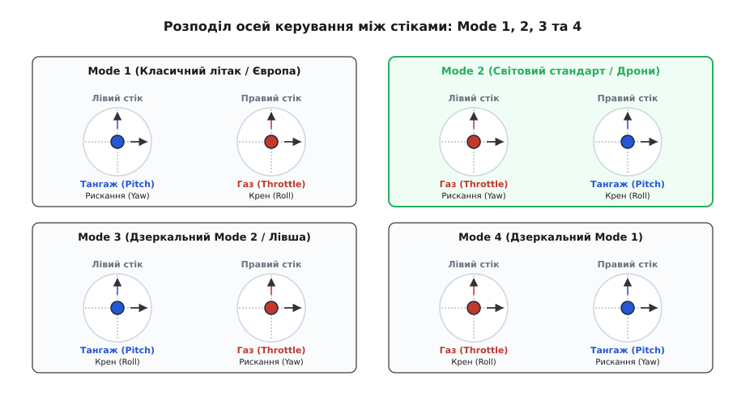
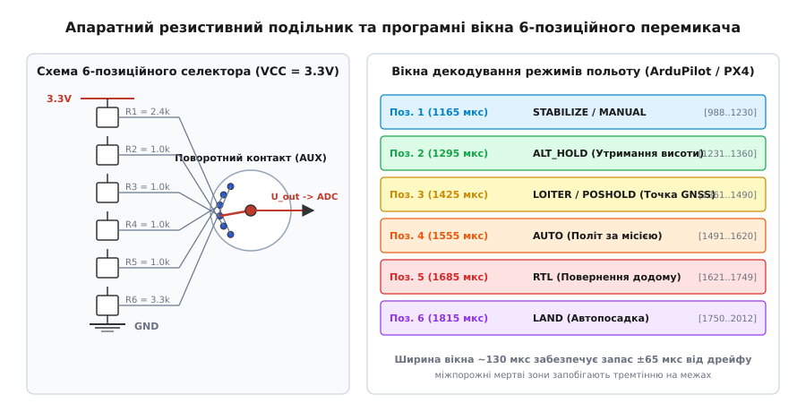
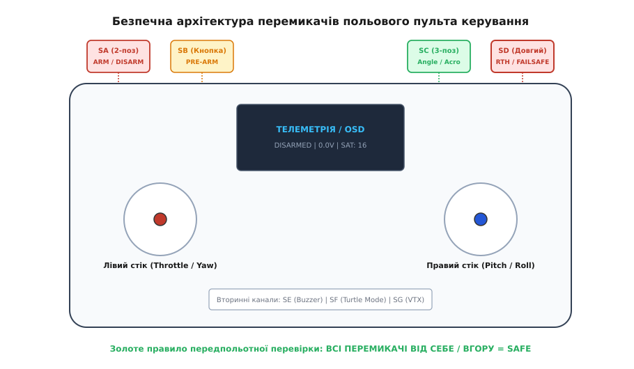

# Перемикачі й розкладка пульта: чому апарат летить не туди

<preknowlist>
- [Апарат, який рушив сам](root:embedded/aparat-iakyi-rushyv-sam) — ризики неконтрольованого старту приводів та апаратні ланцюги блокування.
- [Стенд без гвинтів](root:embedded/stend-bez-hvyntiv) — правила сухого тестування радіоапаратури та перевірки напрямків обертання моторів.
- [Аварійний стоп і мертва рука](root:embedded/avariinyi-stop-i-mertva-ruka) — схемотехніка негайного зняття живлення та логіка Watchdog.
- [Arming-перевірки](root:sys-dron/arming-checks) — багаторівневі програмні блокування запуску двигунів у польотному контролері.
- [Автомат станів у прошивці](root:embedded/avtomat-staniv-i-cherha-podii-u-proshyvtsi) — детермінована обробка подій та запобігання гонитві сигналів.
</preknowlist>

Оператор безпілотного апарата масою три кілограми готується до зльоту в умовах сильного поривчастого вітру. На борту встановлено польотний контролер, налаштований під стандартну розкладку каналів `Mode 2` (газ і рискання на лівому стіку, тангаж і крен — на правому). Проте в самому пульті керування активним випадково залишився профіль літакового типу з розкладкою `Mode 1`, де вісь вертикальної тяги виведена на правий стік. Оператор підключає силовий акумулятор `6S LiPo`, вмикає тумблер активації моторів (`ARM`) і рефлекторно штовхає правий стік уперед, розраховуючи нахилити дрон носом уперед для компенсації зустрічного вітру. Замість нахилу чотири безколекторні двигуни миттєво виходять на 100% максимальної тяги: апарат зі свистом зривається вертикально вгору з прискоренням понад `30 м/с²`. У паніці пілот тягне лівий стік на себе, очікуючи скидання газу, але натомість змінює кут тангажу на максимальне закидання хвоста — дрон робить неконтрольований переворот на висоті п'ятнадцяти метрів і врізається в ґрунт поруч із пусковою позицією.

Паралельно розгортається інший поширений сценарій: пілот у складних польових умовах намагається перемкнути режим стабілізації (`Angle`) на утримання позиції за супутниками (`Loiter`). Тумблер вибору режимів розташований впритул до тумблера зняття з охорони (`Disarm`) і має ідентичну форму важеля. На дотик рука в тактичній рукавичці зачіпає тумблер вимкнення моторів: на висоті сорока метрів живлення силових ключів вимикається за десять мілісекунд, пропелери зупиняються, і безпілотник падає у вільному падінні.

Обидві аварії — результат ігнорування законів людино-машинного інтерфейсу (англ. *Human-Machine Interface*, HMI), біомеханіки моторної пам'яті, помилок узгодження радіоканалів та відсутності апаратно-програмних захистів від випадкового спрацьовування. Розберімо фізичну та математичну структуру режимів стіків, схемотехніку селекторів додаткових каналів, алгоритми безпечної активації приводів та ергономіку розкладки польового пульта.

---

## 1. Режими стіків: розрив зв'язку між рукою та динамікою апарата

Керування просторовим рухом будь-якого літального апарата спирається на чотири базові динамічні ступені вільності (англ. *Degrees of Freedom*, DoF):
1. **Газ / Вертикальна тяга (Throttle / Collective):** керує сумарним вектором підйомної сили вздовж вертикальної осі апарата `Z`.
2. **Рискання / Курс (Yaw / Rudder):** повертає апарат навколо вертикальної осі `Z` (кутова швидкість `r = dψ/dt`, від англ. *yaw rate*).
3. **Тангаж / Нахил подовжній (Pitch / Elevator):** обертання навколо поперечної осі `Y` (кутова швидкість `q = dθ/dt`), що спрямовує вектор тяги вперед або назад.
4. **Крен / Нахил поперечний (Roll / Aileron):** обертання навколо подовжньої осі `X` (кутова швидкість `p = dϕ/dt`), що зміщує вектор тяги ліворуч або праворуч.

Пульт дистанційного керування має два двовісні шарнірні механізми (англ. *gimbals*, від лат. *gemellus* — парний/подвійний), кожен із яких перетворює відхилення пальця за осями `X` та `Y` в електричний сигнал через потенціометри або безконтактні магнітні датчики Холла. Комбінація розподілу чотирьох польотних осей між лівим і правим стіками формує чотири міжнародні стандарти: `Mode 1`, `Mode 2`, `Mode 3` та `Mode 4`.


*Порівняння чотирьох розкладок стіків: розподіл осей Throttle, Yaw, Pitch та Roll.*

### Анатомія та фізика Mode 2

Стандарт `Mode 2` став загальноприйнятим світовим каноном для мультироторних дронів, гелікоптерів та робототехнічних комплексів. Його структура:
- **Лівий стік:** вертикальна вісь — Газ (`Throttle`), горизонтальна вісь — Курс (`Yaw`). Вертикальна вісь позбавлена зворотної пружини й утримується фрикційною тріскачкою або тертям (у дронах із барометричним утриманням висоти застосовують пружне центрування в точці 50%).
- **Правий стік:** вертикальна вісь — Тангаж (`Pitch`), горизонтальна вісь — Крен (`Roll`). Обидві осі оснащені зворотними пружинами для автоматичного повернення в центр (`1500 мкс`).

Біомеханічна перевага `Mode 2` полягає в просторовому розділенні векторів:
- Правий стік повністю відповідає за **трансляційне переміщення в горизонтальній площині** (циклічний крок, англ. *cyclic control*). Відхилення правого стіка точно відповідає руху верхівки вектора тяги: вперед — рух уперед, праворуч — рух праворуч. Мозок оператора сприймає правий стік як двовимірну віртуальну проекцію положення апарата на площині землі.
- Лівий стік ізольовано керує **висотою та орієнтацією носа** (загальний крок, англ. *collective control*). Зміна курсу не впливає на кути нахилу горизонту, а маневри крену не призводять до випадкового просідання тяги.

### Mode 1: спадщина класичного авіамоделізму

У розкладці `Mode 1` (популярній в авіамоделістів Великої Британії, Японії та частини Європи) вісь газу винесена на **правий стік**, а тангаж — на **лівий стік**:
- **Лівий стік:** Тангаж (`Pitch`) + Курс (`Yaw`).
- **Правий стік:** Газ (`Throttle`) + Крен (`Roll`).

Ця розкладка виникла на зорі радіокерованих літаків. При виконанні спортивних аеробатичних фігур (наприклад, мертвої петлі Нестерова) різкий рух руля висоти (тангаж) на класичному літаку вимагав значного зусилля. Рознесення тангажу й крену на різні руки запобігало випадковому завалюванню літака на крило (паразитний крен) під час силового витягування петлі.

Проте на квадрокоптері, де рух у просторі є результатом суперпозиції векторів крену й тангажу, `Mode 1` розриває єдиний горизонтальний контур між двома півкулями мозку. Щоб летіти вперед-праворуч під кутом `45°`, пілот у `Mode 1` змушений одночасно штовхати лівий стік від себе (тангаж), а правий — праворуч (крен), паралельно стежачи за тим, щоб правий палець випадково не змінив рівень газу за вертикальною віссю. Якщо пілот із рефлексами `Mode 2` бере пульт `Mode 1`, перша спроба скоригувати висоту призводить до зміни нахилу дрона, викликаючи неминуче зіткнення.

### Дзеркальні розкладки: Mode 3 та Mode 4

- `Mode 3` — точне дзеркальне відображення `Mode 2`: циклічне керування (крен і тангаж) перенесене на лівий стік, а газ і курс — на правий. Цей режим застосовують пілоти-лівші, у яких провідна ліва рука забезпечує вищу точність ювелірного пілотування за горизонтом.
- `Mode 4` — дзеркальне відображення `Mode 1` (газ і крен зліва, тангаж і курс справа).

### Пастка розкладки каналів: AETR проти TAER

Окрім механічної конфігурації стіків, критичну небезпеку становить програмний порядок каналів у радіопротоколі (CRSF, SBUS, PPM, IBUS). Усього використовують чотири основні послідовності перших чотирьох каналів:
- `AETR` (Aileron, Elevator, Throttle, Rudder) — канал 1: Крен, канал 2: Тангаж, канал 3: Газ, канал 4: Курс. Загальний стандарт для протоколів ExpressLRS, TBS Crossfire, прошивок OpenTX/EdgeTX та Betaflight.
- `TAER` (Throttle, Aileron, Elevator, Rudder) — канал 1: Газ, канал 2: Крен, канал 3: Тангаж, канал 4: Курс. Фірмовий стандарт передавачів Spektrum (DSMX/DSM2) та JR.
- `RETA` (Rudder, Elevator, Throttle, Aileron) — стандарт передавачів Futaba та FlySky.

Якщо передавач транслює пакет у форматі `TAER`, а польотний контролер очікує `AETR`, виникає апаратна інверсія функцій:
- Канал 1 передавача (Газ) потрапляє на канал 1 контролера (Крен). При піднятті стіка газу апарат намагається виконати бочку праворуч із максимальною кутовою швидкістю.
- Канал 3 передавача (Тангаж) потрапляє на канал 3 контролера (Газ). При спробі нахилити ніс уперед польотний контролер скидає або підвищує оберти моторів.

Повна таблиця відповідності протоколів, числових кодів та меж мікросекунд наведена у [специфікації карти каналів та прапорців безпеки](root:embedded/peremykachi-i-rozkladka-pulta/api-aux-channel-map.md).

---

## 2. Дискретні допоміжні канали (AUX) та апаратні селектори режимів

Крім чотирьох основних пропорційних осей пілотування, сучасні радіосистеми транслюють від 8 до 24 дискретних та пропорційних допоміжних каналів (англ. *Auxiliary Channels*, AUX). Канал AUX 1 відповідає логічному каналу радіопакета CH5, AUX 2 — CH6 і так далі.

Усі радіопротоколи кодують положення органів керування у вигляді часового інтервалу імпульсу ШІМ (англ. *Pulse-Width Modulation*, PWM) або еквівалентного цифрового числа. Стандартний часовий діапазон становить від `1000 мкс` (крайнє нижнє значення, 0%) до `2000 мкс` (крайнє верхнє значення, 100%) із центром у точці `1500 мкс` (50%). У розширених протоколах (Extended Limits) діапазон розширено до `988...2012 мкс`.

### Логіка 2-позиційних та 3-позиційних перемикачів

Для дискретних перемикачів прошивка пульта генерує фіксовані рівні сигналу:
- **2-позиційний тумблер (SA / SD):**
  - Позиція 0 (Вимкнено / Від себе): `1000 мкс` (цифрове значення `172` у CRSF).
  - Позиція 1 (Увімкнено / До себе): `2000 мкс` (цифрове значення `1811` у CRSF).
- **3-позиційний тумблер (SB / SC):**
  - Позиція 0 (Верхня): `1000 мкс` (стан `LOW`).
  - Позиція 1 (Середня): `1500 мкс` (стан `MID`).
  - Позиція 2 (Нижня): `2000 мкс` (стан `HIGH`).

У польотному контролері для захисту від радіочастотного джиттеру (тремтіння фронтів імпульсу) програмна обробка перемикача завжди реалізується через вікна з гістерезисом (від дав.-гр. *hysterēsis* — запізнення/відставання):

```
Стан = LOW:    988 мкс ≤ T_pwm < 1300 мкс
Стан = MID:   1300 мкс ≤ T_pwm < 1700 мкс
Стан = HIGH:  1700 мкс ≤ T_pwm ≤ 2012 мкс
```

Гістерезисний зазор шириною `100 мкс` між діапазонами виключає хаотичне перемикання станів, якщо через наведення сигнал коливається навколо межі `1300 мкс` або `1700 мкс`.


*Схема 6-позиційного резистивного селектора польотних режимів та програмні вікна декодування в польотному контролері.*

### 6-позиційні селектори польотних режимів

Складні автономні комплекси на базі ArduPilot та PX4 мають понад двадцять різних режимів функціонування: `Manual`, `Stabilize`, `Altitude Hold`, `Loiter/PosHold`, `Auto (Mission)`, `Guided`, `RTL (Return-to-Launch)`, `Land`, `Follow Me`. Для перемикання основних шести робочих режимів на один канал призначають 6-позиційний селектор (поворотний галетний перемикач або клавіатуру з шести кнопок із взаємовиключенням).

Апаратна реалізація такого селектора спирається на резистивний дільник напруги (англ. *resistor ladder*). Шість постійних резисторів з'єднані послідовно між напругою живлення АЦП пульта (`V_cc = 3.3 В`) та землею. Поворотний контакт підключає вхід АЦП до відповідного проміжного вузла дільника.

Прошивка пульта перетворює отриману напругу в шість каліброваних значень ШІМ із кроком `130 мкс`:
- Позиція 1: `1165 мкс` (вікно контролера `988...1230 мкс`)
- Позиція 2: `1295 мкс` (вікно контролера `1231...1360 мкс`)
- Позиція 3: `1425 мкс` (вікно контролера `1361...1490 мкс`)
- Позиція 4: `1555 мкс` (вікно контролера `1491...1620 мкс`)
- Позиція 5: `1685 мкс` (вікно контролера `1621...1749 мкс`)
- Позиція 6: `1815 мкс` (вікно контролера `1750...2012 мкс`)

Повний математичний аналіз чутливості дільника, розрахунок номіналів ряду E96 та доказ стабільності напівширини вікон наведено у [виведенні резистивного дільника та розрахунку допусків](root:embedded/peremykachi-i-rozkladka-pulta/math-resistor-ladder-modes.md).

---

## 3. Логіка активації двигунів: тумблер Arming проти рухів стіками

Активація моторів (англ. *Arming*, від англ. *arm* — споряджати, ставити на бойовий звід) переводить систему керування зі стану безпечного очікування в активний стан, коли на обмотки безколекторних двигунів подається ШІМ або цифровий сигнал DShot.

Історично існували два методи зведення апарата:
1. **Зведення положенням стіків (Stick Arming):** утримання стіка газу в нулі, а стіка рискання — у крайньому правому положенні протягом двох секунд.
2. **Зведення виділеним тумблером (Switch Arming):** зміна стану виділеного 2-позиційного тумблера на каналі AUX 1.

### Чому Stick Arming заборонено на професійних платформах

Зведення стіками з'явилося в еру чотириканальних пультів, де не було вільних дискретних каналів для тумблерів. На сучасних мультироторах `Stick Arming` є критичним джерелом важких аварій через три фізичні причини:

1. **Негайне зняття з охорони під час аварії (Disarm Latency):**
   Коли дрон падає, чіпляється за перешкоду або потрапляє в зону скупчення людей, оператор зобов'язаний зупинити мотори за мілісекунди. Заблокований пропелер під напругою споживає струм короткого замикання обмотки (`> 150 А`), що призводить до вигоряння силових транзисторів регулятора швидкості (ESC) за `200...400 мс` або загоряння LiPo акумулятора. При `Stick Arming` оператор повинен тримати стік у кутку 1.5–2 секунди. Виділений тумблер вимикає мотори за час одного радіокадру — менше ніж за `10 мс` (у протоколах ExpressLRS на частоті 500 Гц — за `2 мс`).

2. **Паразитне роззброєння в повітрі (In-flight Accidental Disarm):**
   Під час виконання динамічних маневрів у ручному режимі (Acro / Freestyle) пілот скидає газ у нуль і закручує апарат по осі рискання (`Yaw Right` або `Yaw Left`). Польотний контролер зі `Stick Arming` сприймає цей маневр як команду зняття з охорони прямо у вільному падінні, повністю вимикаючи стабілізацію.

3. **Випадкове зведення при транспортуванні:**
   Якщо пульт лежить у рюкзаку або оператор переносить його на шийному ремені, зачіпання стіка за одяг призводить до тихого зведення системи. Будь-який наступний дотик до газу спричиняє обертання відкритих лопатей.

### Обов'язкова умова нульового газу (Zero-Throttle Precondition)

Головний програмний інтерлок (англ. *interlock* — взаємне блокування) польотного контролера полягає в перевірці положення стіка газу в момент надходження сигналу `ARM`.

Якщо тумблер `ARM` переведено в положення `HIGH`, але стік газу знаходиться вище мінімального захисного порогу:

```
T_throttle > T_min_arm_threshold   (де T_min_arm_threshold = 1050 мкс)
```

контролер категорично **блокує запуск моторів** і виставляє бітовий прапорець аварії `ARMING_DISABLED_THROTTLE`.

Якби цього захисту не існувало, увімкнення тумблера при стіку газу на рівні 80% призвело б до раптового вибухового старту з прискоренням сотні метрів на секунду у квадратну, завдаючи каліцтв оператору.

```
+-------------------------------------------------------------------------+
|                  АВТОМАТ БЕЗПЕЧНОЇ АКТИВАЦІЇ МОТОРІВ                    |
+-------------------------------------------------------------------------+
                                    │
                                    ▼
                         [ Стан: DISARMED ]
                                    │
               Подія: Тумблер ARM переведено в ON (AUX1 > 1700 мкс)
                                    │
                                    ▼
                       ┌─────────────────────────┐
                       │  ПЕРЕВІРКА ІНТЕРЛОКІВ:  │
                       │ 1. Газ < 1050 мкс?      │
                       │ 2. Pre-Arm натиснуто?   │
                       │ 3. Лінк без Failsafe?   │
                       │ 4. IMU откалібровано?   │
                       │ 5. Нахил < 25°?         │
                       └────────────┬────────────┘
                                    │
                 ┌──────────────────┴──────────────────┐
                 │                                     │
           [ ВСІ УМОВИ ТАК ]                    [ ХОЧА Б ОДНЕ НІ ]
                 │                                     │
                 ▼                                     ▼
        [ Стан: ARMED ]                       [ Стан: DISARMED ]
        - Запуск Motor Idle                   - Блокування DShot/PWM
        - Вмикання PID-контуру                - Генерація звуку біпера
        - Запис Blackbox                      - Вивід причини в OSD
```

### Двоетапна авторизація: кнопка Pre-Arm

На професійних важких платформах (апарати масою понад `5 кг`, дрони-носії, системи доставки) однопозиційного тумблера недостатньо: випадкове зачіпання перемикача рукавом призводить до розкручування важких карбонових пропелерів діаметром 15–28 дюймів.

Для таких систем застосовують алгоритм двоетапного зведення `Pre-Arm`:
1. На пульті призначається додатковий канал із кнопкою без фіксації (англ. *momentary switch*, `SB` або `SH`).
2. Щоб звести дрон, оператор повинен **затиснути й утримувати кнопку Pre-Arm** лівим вказівним пальцем, і лише після цього перемкнути основний тумблер `ARM` великим пальцем.
3. Прошивка контролера перевіряє, що `Pre-Arm` був активним протягом щонайменше `100 мс` до перемикання `ARM`.
4. Після переходу в стан `ARMED` кнопку `Pre-Arm` можна відпустити: система залишається зведеною до переведення тумблера `ARM` у положення `DISARM`.

Зняття з охорони залишається **однодійною операцією**: клацання основного тумблера `ARM` миттєво знеструмлює мотори без натискання будь-яких додаткових кнопок.

---

## 4. Ергономіка безпеки польового пульта та моторна пам'ять

Ергономіка (від дав.-гр. *ergon* — робота та *nomos* — закон) апаратури радіокерування визначає, наскільки безпомилково оператор виконує критичні дії в умовах екстремального стресу, холоду, дощу або візуального перевантаження.


*Ергономічна розкладка перемикачів польового пульта: розділення зон активації, попередньої авторизації, зміни режимів та аварійного порятунку.*

### Стилі хвату стіків та розподіл пальців

В інженерній практиці виділяють три базові типи хвату пульта (англ. *grip styles*):
1. **Хват великими пальцями (Thumb Grip):** пульт лежить у долонях, великі пальці знаходяться на верхівках стіків, а вказівні та середні пальці вільно лежать на верхніх торцевих тумблерах. Цей хват є найпоширенішим у польових умовах та на геймпад-пультах (Radiomaster Zorro, Pocket, Jumper T-Lite).
2. **Щипковий хват (Pinch Grip):** стік затискається між великим та вказівним пальцями, забезпечуючи максимальну точність мікропілотування. Пульт вимагає опори на ремінь або столик; перемикання тумблерів виконується вільними середніми або безіменними пальцями.
3. **Гібридний хват (Hybrid Grip):** великий палець лежить зверху, а вказівний підтримує стік збоку.

### Матриця просторового розділення функцій

Головна вимога ергономічної безпеки — **фізичне рознесення тумблерів різного ступеня критичності під різні руки та різні пальці**:

| Функція | Тип тумблера / Органу | Рекомендована позиція | Обґрунтування безпеки |
|:---|:---|:---|:---|
| **ARM / DISARM** | 2-позиційний тумблер (короткий або запірний) | Верхній лівий край (`SA`) | Керується лівим вказівним пальцем. Віддалений від правої руки, яка здійснює циклічне маневрування. |
| **PRE-ARM** | Кнопка без фіксації (Momentary) | Верхнє ліве плече (`SB`) | Розташована поруч із тумблером Arm для зручного затискання однією лівою рукою перед стартом. |
| **FLIGHT MODE** | 3-позиційний тумблер (середньої довжини) | Верхній правий кут (`SC`) | Керується правим вказівним пальцем. Дозволяє змінювати режими польоту (`Angle` / `Acro`), не відпускаючи лівий стік газу. |
| **EMERGENCY RTH** | 2-позиційний тумблер (довгий, виділений) | Верхній край праворуч (`SD`) | Аварійне повернення додому. Має бути відчутно довшим за тумблер режимів, щоб у паніці оператор знайшов його наосліп. |
| **TURTLE / BUZZER** | 2-позиційний або 3-позиційний | Нижні тумблери / задні пелюстки (`SE`/`SF`) | Вторинні сервісні функції (реверс моторів для перевороту після аварії, пошуковий біпер). Повинні бути сховані від випадкового натискання в польоті. |

### Тактильна диференціація: відчуття на дотик

Оператор у відеоокулярах (FPV-шоломі) або оператор, який безперервно спостерігає за апаратом у небі, не дивиться на пульт керування. Усі маніпуляції виконуються за рахунок пропріоцепції (м'язового відчуття положення рук).

Щоб уникнути помилкових перемикань, застосовують чотири методи тактильного маркування:
1. **Різна довжина важелів:** тумблер аварійного повернення додому роблять на `10 мм` довшим за тумблер польотних режимів.
2. **Силіконові ковпачки різного профілю:** на тумблер `ARM` встановлюють яскраво-червоний ребристий силіконовий ковпачок, на тумблер `RTH` — жовтий гладкий, на допоміжні функції — чорні або сині ковпачки.
3. **Запірні тумблери (Pull-to-Toggle Switches):** важіль тумблера має механічний фіксатор. Щоб перемкнути такий тумблер, його треба спочатку потягнути вгору вздовж осі, а потім перекинути. Випадкове ковзання пальця чи зачіпання гілкою фізично не здатне змінити його стан.
4. **Золоте правило передпольотної перевірки (SOP Sweep):**
   Усі тумблери польотного пульта налаштовуються так, щоб їхнє положення **«ВІД СЕБЕ / ВГОРУ»** завжди відповідало **безпечному пасивному стану**:
   - `SA` вгору = `DISARMED` (мотори вимкнено).
   - `SC` вгору = `STABILIZE / ANGLE` (найбільш стійкий стабілізований режим).
   - `SD` вгору = `RTH OFF` (автономне повернення вимкнено).
   - Стік газу вниз = `0% THROTTLE`.

Перед підключенням батареї оператор одним рухом долоні скидає всі перемикачі вперед. Якщо хоча б один тумблер спрямований на оператора — апарат не готовий до старту.

---

## 5. Програмний модуль декодування та валідації AUX у польотному контролері

На рівні вбудованого програмного забезпечення (Firmware) модуль обробки каналів керування виконує фільтрацію шумів, декодування дискретних позицій перемикачів, моніторинг інтерлоків активації та формування бітової маски відмов.

Нижче наведено робочу реалізацію модуля валідації каналів та безпечного зведення двома мовами програмування: системною мовою C для операційних систем реального часу (FreeRTOS / NuttX) та ідіоматичною мовою C++ з використанням сучасних безпечних конструкцій.

:::tabs
:::code peremykachi-i-rozkladka-pulta-d/c/rc_safety_module.c
:::code peremykachi-i-rozkladka-pulta-d/cpp/rc_safety_module.hpp
:::

> 🔧 **Навіщо це.**
> У польових умовах понад 40% усіх передпольотних інцидентів та аварій на старті пов'язані з непоміченими змінами профілю в пульті, переплутаними розкладками `AETR`/`TAER` або випадковим зачіпанням тумблерів. Реалізація суворого автомату станів із перевіркою `Zero-Throttle`, обов'язковою кнопкою `Pre-Arm` та відображенням прапорців блокування в OSD шолома перетворює потенційно смертельну помилку оператора на інформативне текстове попередження `THROTTLE > 0` або `PREARM REQUIRED` на екрані без розкручування гвинтів.

---

## 6. Підсумковий регламент налаштування польового комплексу

Перед кожним виходом на польотні випробування інженер зобов'язаний виконати строгу послідовність верифікації радіотракту:
1. **Перевірка відповідності Stick Mode:** переконатися, що в системних налаштуваннях передавача обрано `Mode 2` (або профіль, що відповідає моторній пам'яті пілота), а калібрування стіків повертає `1500 мкс` у центрі та `1000...2000 мкс` у крайніх положеннях.
2. **Перевірка карти каналів на стенді без гвинтів:** підключити контролер до конфігуратора (Betaflight / QGroundControl / Mission Planner) і візуально перевірити, що рух стіка газу змінює саме смугу `Throttle`, а крен — смугу `Roll`.
3. **Тактильна ревізія тумблерів:** перевірити наявність захисного силіконового ковпачка на тумблері `ARM` та фізичне рознесення тумблерів `Mode` і `RTH`.
4. **Тест інтерлоку Pre-Arm:** спробувати активувати тумблер `ARM` без натискання кнопки `Pre-Arm` — мотори повинні залишатися нерухомими.
5. **Тест блокування газу:** підняти стік газу на 20% і спробувати звести дрон — система зобов'язана виставити помилку блокування.
6. **Правило вихідного стану тумблерів:** перед увімкненням силового живлення переконатися, що всі тумблери пульта переведені у вихідне положення **«ВІД СЕБЕ / ВГОРУ»**.
