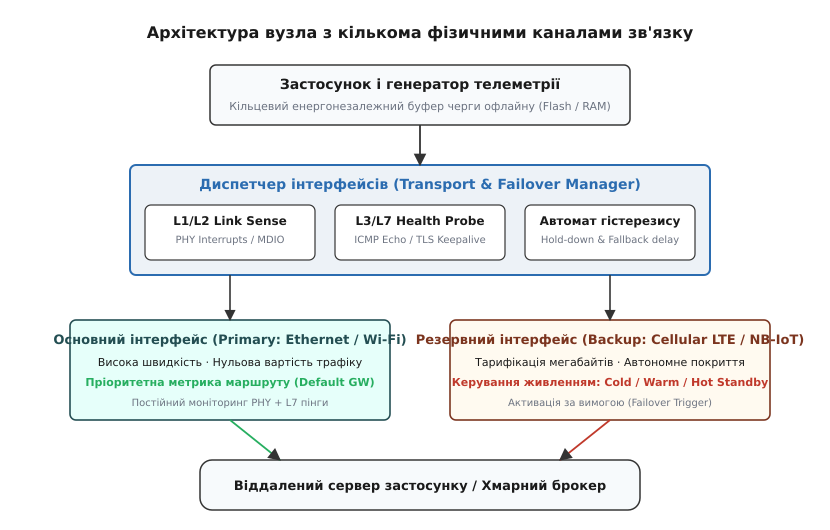
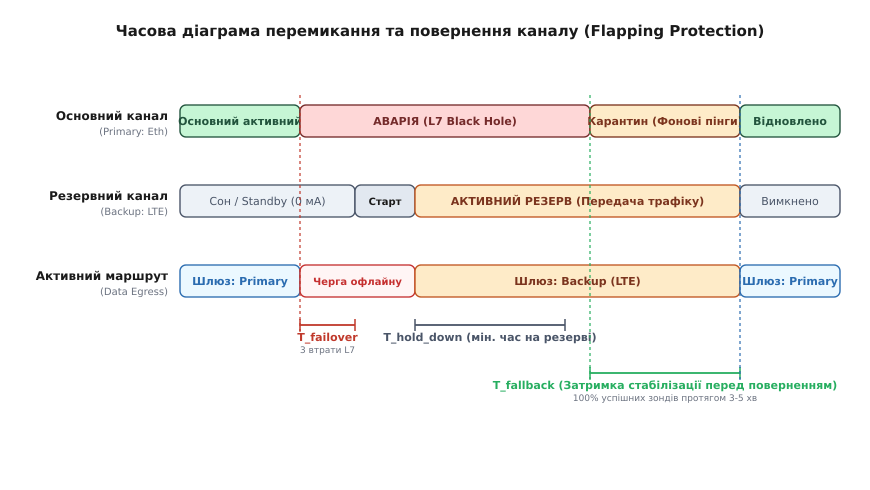

# Перемикання каналу: мульти-інтерфейс і резервування

<preknowlist>
- [Мертвий чи повільний: виявлення обриву](root:sf-distributed/failure-detection) — неможливо локально відрізнити вмерлий вузол від перевантаженого каналу без таймаутів і зондів.
- [Відступ і тремтіння: як перепідключатися, не вбиваючи мережу](root:sf-distributed/retries-backoff) — експоненційний бекофф із випадковим джитером запобігає перевантаженню базових станцій і шлюзів під час масових збоїв.
- [Фізика лінка Ethernet: автопогодження та апаратний статус PHY](root:com-medium/ethernet-link-phy) — регістр стану PHY сигналізує лише про фізичний контакт міді, а не про наскрізну зв'язність з інтернетом.
- [Маршрутизація IP](root:com-transport/ip-routing) — вибір інтерфейсу за пріоритетом метрик у таблиці маршрутизації та обробка шлюзів за замовчуванням.
- [Скінченні автомати та черги подій у прошивці](root:embedded/avtomat-staniv-i-cherha-podii-u-proshyvtsi) — детерміноване керування станами мережевих модулів без блокування головного циклу обробки.
</preknowlist>

Коли промисловий контролер сонячної електростанції втрачає зв'язок через знеструмлення проміжного комутатора на розподільчому пункті, його єдиний Ethernet-інтерфейс стає марним, а телеметрія аварійного перегріву інверторів опиняється замкненою у локальній пам'яті. Якщо пристрій розрахований на роботу в режимі 24/7 у критичній інфраструктурі, наявність лише одного фізичного середовища передачі перетворює будь-який обрив кабелю, збій комутатора або зависання точки доступу на повну відмову системи.

Побудова відмовостійких вбудованих пристроїв вимагає поєднання кількох фізично незалежних каналів зв'язку (*Multi-Homing*) та механізму автоматичного перемикання при аварії (*Automatic Failover*). Проте просте встановлення двох мережевих чипів на одну плату не вирішує проблему: мікроконтролер має розпізнавати не лише повний апаратний обрив кабелю, а й приховану втрату наскрізної маршрутизації, захищатися від циклічного «брязкоту» каналів на межі зони радіопокриття та збалансовано керувати енергоспоживанням резервних радіомодемів.

---

### Архітектура мульти-інтерфейсних систем: типові зв'язки та компроміси

В автономних та вбудованих системах резервний канал обирають за принципом протилежності властивостей: швидкий і дешевий локальний інтерфейс страхують повільнішим, дорожчим у тарифікації, але фізично незалежним середовищем.


*Архітектура пристрою з автоматичним резервуванням: дворівнева діагностика фізичного лінку та наскрізної зв'язності, диспетчер маршрутизації та кільцевий буфер накопичення даних.*

Інженерна практика виділяє три найпоширеніші комбінації інтерфейсів, кожна з яких має специфічні обмеження за швидкістю, затримками та вартістю експлуатації:

1. **Ethernet (основний) + Cellular LTE Cat.1 / NB-IoT (резервний):**
   * *Основний канал:* провідний Ethernet (100BASE-TX) забезпечує пропускну здатність до 100 Мбіт/с, затримку кругового обігу (*RTT*) у межах 1–5 мс та нульову вартість кожного переданого мегабайта в межах локальної мережі підприємства. Постійне споживання струму мікросхемою PHY (наприклад, LAN8720 або DP83848) становить 40–80 мА від лінії 3.3 В.
   * *Резервний канал:* стільниковий зв'язок оператора повністю незалежний від локальної мережевої інфраструктури об'єкта. Однак стільниковий трафік тарифікується за кожен мегабайт, затримки зростають до 50–300 мс, а під час передачі радіомодуль споживає імпульсний струм амплітудою до 1.5–2.0 А.
2. **Wi-Fi 802.11 (основний) + Bluetooth Low Energy (аварійний локальний):**
   * *Основний канал:* бездротова мережа Wi-Fi 2.4/5 ГГц передає потокові телеметричні дані та логи в локальну хмару без прокладання кабелів.
   * *Резервний канал:* якщо точка доступу зависає або втрачає інтернет, BLE використовується як прямий діагностичний канал зв'язку «поза смугою» (*Out-Of-Band*). Сервісний інженер підключається до контролера зі смартфона чи планшета безпосередньо на об'єкті, щоб зчитати журнал відмов із Flash-пам'яті та змінити мережеві налаштування без фізичного демонтажу корпусу.
3. **LoRa Sub-GHz (основний телеметричний) + Cellular 4G / 2G (пакетний/сервісний):**
   * *Основний канал:* безліцензійний діапазон 868 МГц дозволяє автономним датчикам у полі передавати крихітні пакети телеметрії (по 30–50 байтів раз на 10–30 хвилин) на базову станцію за 5–15 км, споживаючи всього 20–30 мкА в режимі сну.
   * *Резервний канал:* коли накопичується великий обсяг діагностики або потрібно завантажити бінарний образ оновлення прошивки (*OTA Firmware Update*) розміром 1–2 МБ, увімкнення стільникового модема на 1–2 хвилини є єдиним способом виконати операцію, яку LoRa за низької швидкості передачі виконувала б десятки годин.

У такій системі кожен інтерфейс описується вектором параметрів: пріоритетом у таблиці маршрутизації, поточною якістю зв'язку, лімітом трафіку та енергетичною ціною роботи.

---

### Детектування відмови: апаратний лінк проти наскрізного зондування

Найпоширеніша помилка під час реалізації резервування — орієнтуватися лише на статус апаратного з'єднання фізичного рівня (*L1/L2 Link State*).

```
   ┌───────────────┐     Ethernet     ┌──────────────┐     Оптика (ОБРИВ)     ┌───────────────┐
   │  Вбудований   │─────────────────▶│ Некерований  │ ─ ─ ─ ─ ─ ─ ─ ─ ─ ─ ─ ─▶│    Шлюз /     │
   │    вузол      │  (Link UP 100M)  │  комутатор   │      (Трафік гине)     │  Провайдер    │
   └───────────────┘                  └──────────────┘                        └───────────────┘
```

#### Рівень L1/L2: шина MDIO та апаратний моніторинг PHY

Апаратне відстеження статусу фізичного лінку базується на роботі з регістрами мікросхеми трансивера Ethernet PHY через послідовну шину керування SMI / MDIO (*Management Data Input/Output*, стандарт IEEE 802.3 Clause 22).

Шина складається з двох ліній: тактового сигналу `MDC` (частотою до 2.5 МГц) та двоспрямованої лінії даних `MDIO`. Кожен цикл обміну передає 32-бітний фрейм, що містить 5-бітну адресу PHY на платі (PHYAD 0..31) та 5-бітну адресу цільового регістру (REGAD 0..31).

Для діагностики фізичного стану мікроконтролер працює з двома ключовими регістрами:

* **Базовий регістр керування BMCR (Basic Mode Control Register, адреса 0x00):**
  * Біт 15 (`Reset`): програмне скидання аналогової та цифрової частини PHY.
  * Біт 12 (`Auto-Negotiation Enable`): увімкнення процесу автопогодження швидкості та дуплексу.
  * Біт 9 (`Restart Auto-Negotiation`): примусовий перезапуск узгодження параметрів лінії.
* **Базовий регістр статусу BMSR (Basic Mode Status Register, адреса 0x01):**
  * Біт 5 (`Auto-Negotiation Complete`): приймач зафіксував завершення обміну конфігураційними кодовими словами з віддаленим комутатором.
  * Біт 2 (`Link Status`): прапорець наявності сигналу несучої та фізичного контакту мідної пари.

> ⚠️ **Пастка «залипання» регістру BMSR (Latch-Low Behavior):**
> Згідно зі специфікацією IEEE 802.3, біт 2 (`Link Status`) у регістрі `BMSR` має властивість *Latch-Low*. Це означає, що якщо фізичний лінк хоча б на одну мілісекунду обірвався і потім знову відновився, регістр запам'ятовує факт аварії і при першому зчитуванні повертає `0`. Тільки повторне зчитування того самого регістру повертає поточний актуальний стан фізичної лінії. Прошивка, яка зчитує регістр `BMSR` лише один раз, фіксуватиме застарілий збій.

:::tabs
:::code peremykannia-kanalu-d/c/riven-l1-l2-shyna-mdio-ta.c
:::code peremykannia-kanalu-d/cpp/riven-l1-l2-shyna-mdio-ta.hpp
:::

Для зменшення навантаження на шину керування використовується вивід апаратного переривання PHY (`PHY_INT_N`). У регістрі керування перериваннями трансивера (наприклад, `MICR` у LAN8720) виставляється біт `LINK_UP_DOWN_INT`. Це дозволяє процесору обробляти подію висмикнутого кабелю миттєво (за час < 10 мс) без постійного циклічного опитування шини MDIO.

#### Рівень L3/L7: пастка локального лінка («чорна діра»)

Якщо Ethernet-кабель від контролера підключено до локального некерованого комутатора в монтажній шафі, фізичний лінк між ними залишатиметься активним (`Link UP`), навіть якщо сам комутатор відрізаний від зовнішнього інтернету через аварію оптоволоконної магістралі, збій DNS-сервера або вичерпання коштів у провайдера. Аналогічно модуль Wi-Fi може успішно асоціюватися з точкою доступу та підтримувати радіозв'язок на канальному рівні, але шлюз точки доступу не маршрутизуватиме пакети назовні.

Для виявлення таких прихованих відмов застосовується періодичне наскрізне зондування (*Active Probing / End-to-End Health Check*):

1. **Мережевий рівень (L3) — ICMP Echo Request (Ping):** мікроконтролер періодично надсилає короткі ехо-запити до надійних публічних Anycast IP-адрес (наприклад, `1.1.1.1`, `8.8.8.8`) або адреси прикордонного шлюзу.
   * *Обмеження:* мобільні оператори та корпоративні фаєрволи нерідко блокують ICMP-трафік або встановлюють для нього жорсткий пріоритет відсікання (*Rate Limiting*), що може призводити до хибних висновків про аварію.
2. **Прикладний рівень (L7) — HTTP HEAD / TLS Heartbeat:** мікроконтролер надсилає легкотривалий запит до власного бекенд-сервера (наприклад, `HEAD /health HTTP/1.1` на 443 порт).
   * *Перевага:* успішна відповідь сервера доводить працездатність усього ланцюжка: локального лінку, шлюзу, DNS-резолвера, зовнішніх магістралей та самого сервера застосунку.

Діагностичний диспетчер використовує статистику ковзного вікна (*Sliding Window*):

```
                       Кількість втрачених відповідей за вікно
Коефіцієнт втрат PLR = ──────────────────────────────────────── × 100%
                                Розмір вікна (N)
```

Якщо за ковзним вікном з N = 5 послідовних зондів коефіцієнт втрат перевищує поріг у 60% (3 невдалі спроби), або середній час кругового обігу RTT перевищує критичну межу τ_max = 3000 мс, інтерфейс переводиться в статус деградації або відмови незалежно від стану регістрів PHY.

#### Маршрутизація на мікроконтролері: сокети, SO_BINDTODEVICE та пастки MTU

Коли система фіксує аварію основного інтерфейсу і перемикає глобальний маршрут за замовчуванням (*Default Gateway*) на резервний стільниковий модуль `ppp0`, виникає архітектурна проблема: відкриті раніше TCP-сокети застосунку зависають у стані `ESTABLISHED`. Стек протоколів продовжує намагатися відправити непідтверджені сегменти через відмерлий маршрут, і до спрацьовування таймауту повторної передачі (*TCP Retransmission Timeout*, що за стандартом може тривати до 15 хвилин) застосунок не дізнається про розрив.

Для коректної роботи мульти-інтерфейсного стека вбудоване ПЗ реалізує такі правила:

1. **Ізоляція зондувальних сокетів (`SO_BINDTODEVICE`):**
   Щоб фоновий зонд основного каналу міг періодично надсилати тестові пакети через інтерфейс `eth0` навіть тоді, коли загальний трафік системи спрямовано в резервний інтерфейс `ppp0`, сокет зондування жорстко прив'язується до фізичного мережевого адаптера:

:::tabs
:::code peremykannia-kanalu-d/c/marshrutyzatsiia-na.c
:::code peremykannia-kanalu-d/cpp/marshrutyzatsiia-na.cpp
:::

2. **Примусове скидання завислих сесій (`TCP Abort`):**
   У момент офіційного переходу на резервний інтерфейс диспетчер зобов'язаний примусово закрити всі клієнтські сокети застосунку (виклик `close()` або `tcp_abort()` у стеку lwIP), щоб змусити прикладний рівень відкрити нові TCP-з'єднання вже через резервний шлюз.
3. **Очищення кешу DNS та оновлення серверів:**
   Якщо DNS-запити кешувалися через локальний шлюз провайдера `192.168.1.1`, після падіння лінії Ethernet ці запити через стільникову мережу не проходитимуть. Диспетчер очищає внутрішній кеш резолвера (`dns_clear_cache()`) і перемикає адреси DNS-серверів на призначені оператором мобільного зв'язку через IPCP/DHCP.
4. **Узгодження максимального розміру пакета (MTU та MSS Clamping):**
   * Ethernet використовує стандартний розмір кадру з MTU = 1500 байтів.
   * Стільникові мережі LTE/3G (протоколи PPP/QMI) через заголовки інкапсуляції тунелів оператора (GTP-U) часто обмежують MTU до 1420–1460 байтів.
   * Якщо контролер спробує відправити 1500-байтний пакет у стільниковий канал із прапорцем `DF` (*Don't Fragment*), пакет буде мовчки відкинуто шлюзом без генерації повідомлення ICMP (*Path MTU Black Hole*). Прошивка зобов'язана динамічно обмежувати максимальний розмір сегмента (*MSS*) для резервного каналу:
   ```
   MSS_Cellular = MTU_Cellular - 40 байтів (заголовки IP + TCP) = 1420 - 40 = 1380 байтів
   ```

---

### Алгоритми перемикання: гістерезис і захист від «брязкоту» каналів

Найнебезпечнішим станом для мережевого стека є «брязкіт» інтерфейсу (*Route Flapping / Ping-Pong Effect*). Коли пристрій знаходиться на межі дії базової станції або в роз'ємі RJ-45 окислилися контакти, лінк може встановлюватися на 2 секунди, обриватися на 3 секунди і знову підніматися.

```
 Канал:   ───[UP]───┐         ┌───[UP]───┐         ┌───[UP]───
                    └──[DOWN]─┘          └──[DOWN]─┘
 Маршрут:  Primary   Backup    Primary    Backup    Primary   (ШТОРМ ПЕРЕМИКАНЬ)
```

Без спеціального захисту кожне таке коливання викликає скидання поточної TCP-сесії, переініціалізацію сокетів, повторне TLS-рукостискання з витратою 5–10 кБ трафіку та високим навантаженням на процесор. Для запобігання хаосу в алгоритм перемикання закладають часовий та пороговий гістерезис.


*Часова діаграма перемикання на резерв та стабілізованого повернення: утримання на резерві запобігає перериванню транзакцій, а карантинний інтервал підтверджує надійність основного каналу.*

#### Математика захисних таймерів

Скінченний автомат перемикання оперує трьома часовими константами:

1. **Таймаут підтвердження відмови (`T_failover`):**
   Канал не вважається відмовленим від разової втрати пакета. Необхідно зафіксувати N_fail послідовних збоїв зондування з інтервалом T_probe:
   ```
   T_failover = N_fail * T_probe
   ```
   Для типових систем з T_probe = 5 с та N_fail = 3 час реакції становить 15 с. Для апаратного обриву PHY застосовується короткий антидребезговий фільтр T_phy_debounce ≈ 300–500 мс.
2. **Мінімальний час утримання на резерві (`T_hold_down`):**
   Після перемикання на резервний канал система зобов'язана залишатися на ньому щонайменше фіксований час T_hold_down = 60–120 с, навіть якщо основний інтерфейс раптово відновив роботу через 5 секунд. Це гарантує, що поточна транзакція (наприклад, передача тривожного сповіщення або аварійного пакета) буде завершена без повторного розриву сокета.
3. **Затримка перевірки стабільності перед поверненням (`T_fallback` / Revert Delay):**
   Коли основний канал відновлює фізичний лінк, він не вводиться в експлуатацію негайно. Він переводиться в «карантинний» режим фонового зондування. Лише за умови, що протягом усього інтервалу T_fallback = 180–300 с (3–5 хвилин) 100% фонових тестових запитів завершилися успішно без жодного збою, диспетчер перемикає активний маршрут назад на основний інтерфейс.

#### Гістерезис за метриками радіосигналу

Для бездротових каналів (Cellular / Wi-Fi) перемикання може ініціюватися за рівнем потужності прийнятого сигналу (*RSSI / RSRP*). Щоб уникнути перемикань при коливанні рівня сигналу через багатопроменевість або рух об'єктів поруч, пороги входу та виходу розносять:

```
Поріг аварійного виходу з каналу:    P_drop    = -112 dBm
Поріг повернення на канал:          P_restore =  -98 dBm
Ширина зони гістерезису:            Delta_P   =   14 dB
```

Канал відкидається, коли сигнал падає нижче -112 dBm, але зворотне перемикання на нього дозволяється лише тоді, коли рівень сигналу стабільно перевищує -98 dBm.

---

### Керування живленням резервних модулів: Hot, Warm і Cold Standby

Вибір режиму очікування для резервного радіоінтерфейсу визначається компромісом між швидкістю активації зв'язку та струмом розряду джерела живлення.

| Параметр | Гарячий резерв (*Hot Standby*) | Теплий резерв (*Warm Standby*) | Холодний резерв (*Cold Standby*) |
| :--- | :--- | :--- | :--- |
| **Стан радіомодуля** | Увімкнений, зареєстрований, IP активна | Увімкнений, режим сну eDRX / PSM | Повністю знеструмлений (MOSFET OFF) |
| **Час готовності** | **10–50 мс** (миттєве перемикання) | **1.5–5 секунд** | **20–45+ секунд** |
| **Струм у спокої** | **40–120 мА** постійно | **15–60 мкА** (глибокий сон) | **< 1 мкА** (струм витоку ключа) |
| **Піковий струм** | До 2.0 А під час передачі | До 2.0 А під час виходу зі сну | До 2.0 А + заряд ємностей живлення |
| **Ресурс батареї 2.5 Ah** | ≈ 25–40 годин | До 2–3 років | До 5–10 років (саморозряд батареї) |
| **Вимоги до схеми** | Стандартне живлення | Підтримка eDRX/PSM модулем | Силовий P-MOSFET ключ, схема керування PWRKEY |

#### Хронометраж холодного старту стільникового модема

При використанні холодного резерву (*Cold Standby*) розробник повинен чітко розуміти, чому передача даних не може розпочатися миттєво після фіксації аварії основного каналу. Запуск стільникового модема складається з низки послідовних фізичних та програмних етапів:

```
[0.0c] ── Подача 3.8V через MOSFET (зарядка танталових конденсаторів 1000 мкФ)
[0.2c] ── Утримання лінії PWRKEY в логічному '0' протягом 1.2 с
[1.5c] ── Запуск внутрішнього завантажувача та RTOS baseband-процесора модема
[4.5c] ── Ініціалізація UART-порту та видача статусного рядка "RDY" / "OK"
[5.5c] ── Конфігурація модема AT-командами (AT+CFUN=1, вимкнення ехо ATE0, вибір діапазонів)
[7.0c] ── Пошук базової станції та синхронізація частоти (Cell Search)
[15.0c] ── Реєстрація в мережі оператора (відповідь модема +CEREG: 1 або +CEREG: 5)
[18.0c] ── Активація контексту передачі даних PDP (AT+CGACT=1,1) та отримання IP-адреси
[22.0c] ── Встановлення TCP-з'єднання або TLS-рукостискання з хмарним сервером
```

Сумарна затримка холодного старту становить від 20 до 45 секунд за сприятливих радіоумов, а у випадку слабкого сигналу або перевантаженої стільникової вежі може досягати 60–90 секунд.

#### Діагностика статусів реєстрації стільникового модуля

Драйвер модема відстежує стан реєстрації за допомогою коду відповіді команди `AT+CEREG?`:

* `+CEREG: 0,1` — зареєстровано в домашній мережі (*Registered, home network*);
* `+CEREG: 0,2` — активний пошук оператора (*Searching*);
* `+CEREG: 0,3` — у реєстрації відмовлено (*Registration denied* — заблокована SIM або відсутній роумінг);
* `+CEREG: 0,5` — зареєстровано в роумінгу (*Registered, roaming*).

Якщо модем повертає статус відмови (`+CEREG: 0,3`) або помилки активації PDP (`+CME ERROR: 100` — мережа недоступна), драйвер застосовує алгоритм експоненційного відступу з випадковим джитером перед наступною спробою реєстрації. Постійне агресивне бомбардування базової станції AT-командами призводить до тимчасового блокування IMSI на рівні оператора.

#### Черга офлайн-буферизації та пріоритезація трафіку

Оскільки в холодному резерві між моментом аварії основного каналу та готовністю резервного існує «вікно сліпоти» тривалістю 30–45 секунд, система не має права скидати вимірювання датчиків.

Вбудоване програмне забезпечення містить кільцевий буфер (*Offline Ring Buffer*) у статичній оперативній пам'яті (SRAM) або енергонезалежній Flash-пам'яті (SPI Flash з файловою системою LittleFS). Під час перехідного процесу генератор телеметрії продовжує записувати пакети в буфер, розділяючи їх за трьома класами пріоритету:

1. **Критичні події (Alarm Events, пріоритет 1):** спрацьовування захистів, аварійні перегріви, сигнали тривоги. Ці пакети записуються в енергонезалежний сектор Flash і ніколи не видаляються до підтвердження доставки сервером.
2. **Періодична телеметрія (Periodic Metrics, пріоритет 2):** вимірювання струмів, напруг та температур щосекунди. При переповненні буфера старі вимірювання заміщуються новими (*Drop-Tail / Ring Overwrite*) або проріджуються (10 послідовних точок усереднюються в одну).
3. **Діагностичні трасування (Debug Logs, пріоритет 3):** детальні системні логи. При роботі на дорогому резервному стільниковому каналі передача цього класу трафіку повністю блокується для економії мегабайтів.

---

### Програмний диспетчер транспортних інтерфейсів на C та C++

Для забезпечення чистоти коду та легкості тестування архітектура системи розбивається на два незалежні шари:
1. **Драйвер фізичного транспорту (`Transport Driver`):** апаратно-залежний модуль, що знає, як увімкнути живлення, ініціалізувати чип, надіслати байтовий буфер та перевірити локальний лінк.
2. **Диспетчер перемикання (`Failover Arbiter`):** загальний керівний автомат, що збирає метрики, рахує таймери гістерезису та обирає активний інтерфейс для передачі даних.

:::tabs
:::code peremykannia-kanalu-d/c/prohramnyi-dyspetcher.c
:::code peremykannia-kanalu-d/cpp/prohramnyi-dyspetcher.cpp
:::

---

### Апаратні пастки та крайові випадки мульти-інтерфейсних плат

Реалізація двох мережевих інтерфейсів на одній друкованій платі приховує кілька суто апаратних небезпек, здатних викликати незрозумілі циклічні перезавантаження мікроконтролера.

#### 1. Просідання напруги від імпульсу передавача (TX Burst Drop)

Коли система фіксує аварію Ethernet і вмикає резервний стільниковий модуль LTE/GSM, під час виходу в ефір на повній потужності модем споживає короткочасні імпульси струму амплітудою до 2.0 А тривалістю 577 мкс. Якщо джерело живлення плати (наприклад, імпульсний понижувальний перетворювач DC-DC 3.8 В) має повільну перехідну характеристику або недостатню вихідну ємність, напруга на шині живлення просідає нижче 3.0 В. 

Це викликає спрацьовування детектора зниження напруги (*Brownout Reset, BOR*) мікроконтролера. Мікроконтролер перезавантажується, знову запускає Ethernet, бачить аварію, знову вмикає модем і знову падає по BOR — виникає нескінченна петля перезавантаження (*Bootloop*).

```
Струм LTE:   0.1A ───────┐ 2.0A Імпульс TX ┌──────── 0.1A
                         └─────────────────┘
Напруга:     3.8V ───────┐                 ┌──────── 3.8V
                         └─── 2.9V (BOR!) ─┘  <-- Поріг скиду МК
```

*Інженерне рішення:* використання спеціалізованого імпульсного перетворювача DC-DC (наприклад, TPS54302) із номінальним струмом до 3.0 А, встановлення біля виводів живлення модема танталових або полімерних конденсаторів низького еквівалентного послідовного опору (*Low-ESR*) сумарною ємністю ≥ 470–1000 мкФ, а також живлення ядра мікроконтролера через окремий LDO-стабілізатор з високим коефіцієнтом придушення пульсацій (*PSRR*).

#### 2. Апаратне зависання модема (Baseband Deadlock)

Стільникові модеми мають власні складні операційні системи реального часу, які під час роботи в зонах із нестабільним радіопокриттям можуть зависати без відповіді на UART або зависати в нескінченній процедурі пошуку базової станції.

Якщо диспетчер надсилає команду `AT` і не отримує відповіді `OK` протягом 10 секунд, програмні спроби перепідключення стають марними. Схема плати зобов'язана передбачати два апаратні ланцюги порятунку:
* Лінію апаратного скидання `RESET_N`, підключену до GPIO мікроконтролера.
* Керівний P-канальний MOSFET-ключ на вході живлення модема, що дозволяє мікроконтролеру повністю знеструмити модуль (*Hard Power-Cycle*) на 2–3 секунди для повного холодного перезавантаження.

---

### Системна поведінка: що купує та чого вимагає резервування

Автоматичне перемикання каналів перетворює розподілений пристрій з уразливої ланки на автономний надійний вузол. Проте резервування не є безкоштовним: за відмовостійкість розробник платить ускладненням схеми живлення, підвищеними вимогами до енергонезалежної пам'яті для черг офлайну та суворою дисципліною налаштування таймерів гістерезису, без яких система ризикує потонути у штормі безперервних перепідключень.
