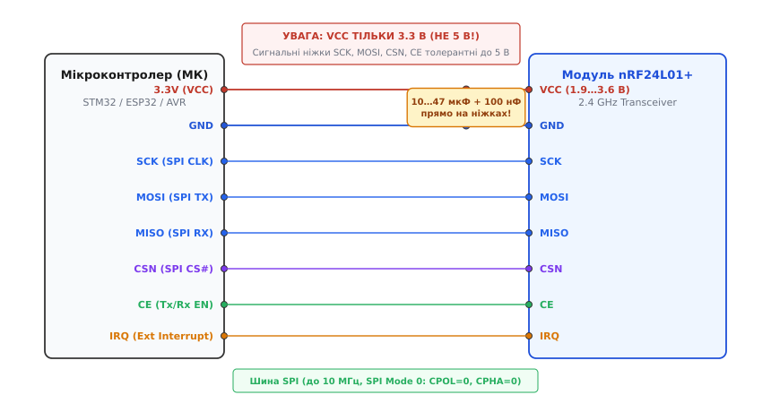
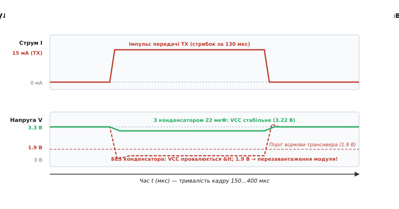
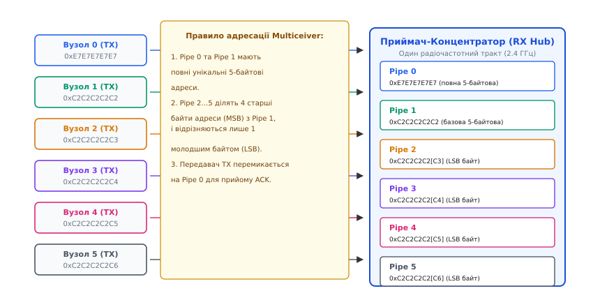
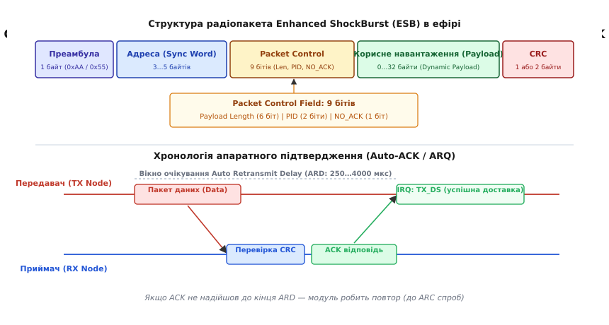
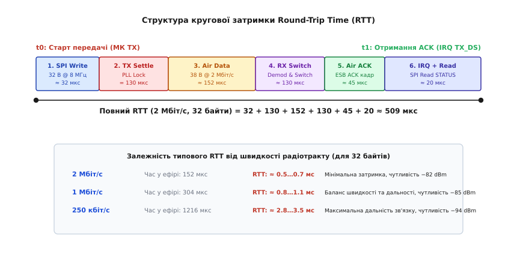

# Перший радіоканал на двох платах

<preknowlist>
- [Шина SPI](root:com-devices/spi-bus) — повнодуплексний синхронний інтерфейс обміну байтами між мікроконтролером і трансивером.
- [Контрольна сума CRC](root:com-modulation/crc) — математичний механізм виявлення бітових спотворень у радіоефірі.
- [Спільна земля](root:hw-pcb/common-ground) — правила з'єднання опорних потенціалів і запобігання паразитним контурам струму.
- [Проєктування пакета](root:com-transport/packet-design) — структура мережевого кадру: преамбула, синхрослово, заголовок довжини та корисне навантаження.
</preknowlist>

Коли два автономні мікроконтролери рознесені в просторі навіть на двадцять метрів, дротовий зв'язок вимагає прокладання кабельних трас, узгодження диференційних ліній та встановлення гальванічної розв'язки для захисту від різниці потенціалів між заземленнями. Якщо ж один із вузлів рухається — наприклад, це сенсорний блок на обертовому валу чи телеметрійний передавач на рухомому апараті — провідний міст стає фізично неможливим. Заміна дроту радіотрактом на базі інтегрованого трансивера частотного діапазону 2.4 ГГц (сімейства nRF24L01+) виглядає найпростішим кроком, проте перший же зібраний на макетній платі стенд зазвичай демонструє повну відсутність зв'язку: приймач мовчить, передавач зависає після спроби відправити перший байт, або мікроконтролер циклічно перезавантажується в момент активації антени.

Радіоканал принципово відрізняється від мідного провідника двома фізичними чинниками: імпульсним споживанням енергії та спільним недетермінованим середовищем. У мить увімкнення вихідного каскаду передавача струм модуля стрибає від мікроамперів режиму очікування до десятків міліамперів за лічені мікросекунди, що через паразитну індуктивність дротів обвалює напругу живлення нижче порогу скиду мікросхеми. Водночас ефір діапазону 2.4 ГГц заповнений випромінюванням сусідніх мереж Wi-Fi та побутових приладів, тому надійна доставка цифрового повідомлення можлива лише за умови жорсткого апаратного кадрування, контролю цілісності, керування чергами та протоколу гарантованого підтвердження прийому.

## 1. Фізика бездротового мосту та архітектура радіотракту

У дротовій шині SPI чи UART передавач формує рівні напруги безпосередньо на виводах, а приймач фіксує перепади сигналу за фронтами тактових імпульсів. У радіоефірі постійний струм не поширюється: передавач мусить перетворити послідовність цифрових нулів та одиниць у високочастотні коливання електромагнітного поля, а приймач — виділити з антени мікровольтові наведення, підсилити їх малошумним вхідним каскадом (Low-Noise Amplifier, LNA) та здемодулювати бітовий потік.

Модуль nRF24L01+ містить усередині кремнієвого кристала синтезатор частоти з фазовим автопідстроюванням (Phase-Locked Loop, PLL), підсилювач потужності (Power Amplifier, PA), демодулятор гауссової частотної маніпуляції (Gaussian Frequency Shift Keying, GFSK) та апаратний кінцевий автомат пакування кадрів Enhanced ShockBurst (ESB). У модуляції GFSK логічна одиниця та логічний нуль передаються зміщенням частоти опорної несної вгору чи вниз від центрального значення каналу, причому перед модулятором сигнал пропускається крізь гауссів фільтр, що згладжує фронти та запобігає розширенню спектра на сусідні частотні смуги.

Керування мікросхемою побудовано на зміні чотирьох базових станів внутрішнього автомата:

1. **Вимкнено (Power Down):** Споживання струму падає до 0.9 мкА. Кварцовий резонатор 16 МГц зупинено, внутрішні аналогові блоки знеструмлені, проте вміст регістрів конфігурації утримується статичною пам'яттю за наявності живлення на виводі VCC.
2. **Очікування (Standby-I):** Струм становить близько 22 мкА. Кварцовий генератор працює, формуючи стабільну тактову частоту, що дозволяє вийти в активний режим передачі або прийому за фіксований час 130 мкс.
3. **Прийом (RX Mode):** Вивід керування режимом CE (Chip Enable) підтягнуто до високого рівня, а біт `PRIM_RX` у регістрі `CONFIG` встановлено в одиницю. Споживання струму зростає до 12.3–13.5 мА. Вхідний підсилювач безперервно сканує ефір, шукаючи бітову преамбулу та синхрослово адреси.
4. **Передача (TX Mode):** Біт `PRIM_RX` скинуто в нуль, у буфер FIFO завантажено пакет даних, а на лінію CE подано імпульс тривалістю не менше 10 мкс. Синтезатор за 130 мкс захоплює частоту, вмикається вихідний підсилювач потужності (струм 7.0–11.3 мА при вихідній потужності 0 dBm або понад 115 мА для версій із додатковим зовнішнім підсилювачем PA+LNA), пакет випромінюється в антену, після чого модуль автоматично повертається в режим очікування або переходить у прийом підтвердження.

Завдяки наявності апаратного протокольного рушія мікроконтролер звільняється від необхідності генерувати бітові таймінги ефіру. Процесор завантажує байти даних у буфер модуля на швидкості шини SPI до 10 Мбіт/с, а трансивер самостійно формує преамбулу, додає мережеву адресу, обчислює контрольну суму CRC та керує повторними спробами передачі у разі збоїв.

## 2. Схемотехніка вузла: інтерфейс SPI, лінії CE/IRQ та імпульсне живлення

Модуль nRF24L01+ виготовляється у вигляді компактної плати з 8-вивідним дворядним роз'ємом із кроком 2.54 мм. Для забезпечення двостороннього зв'язку задіюються шість цифрових ліній керування та дві шини живлення.

```
       ┌────────────────────────┐
       │   nRF24L01+ Header     │
       │                        │
       │   1: GND     2: VCC    │  VCC: 1.9…3.6 В (СУВОРО 3.3 В!)
       │   3: CE      4: CSN    │  CE:  Chip Enable (режим RX/TX)
       │   5: SCK     6: MOSI   │  CSN: SPI Chip Select (активний 0)
       │   7: MISO    8: IRQ    │  IRQ: Переривання (активний 0)
       └────────────────────────┘
```

Сигнали SCK, MOSI та MISO утворюють стандартну шину SPI. Обмін даними здійснюється в режимі SPI Mode 0 (полярність синхросигналу `CPOL = 0`, фаза вибірки `CPHA = 0`), де біти виставляються за спадним фронтом і зчитуються за наростаючим фронтом тактового сигналу SCK. Лінія CSN (Chip Select Not) є вибіркою мікросхеми: логічний нуль на CSN відкриває доступ до внутрішніх регістрів nRF24, а перехід у логічну одиницю завершує поточну SPI-команду.

Вивід CE (Chip Enable) керує аналоговим трактом трансивера. У режимі прийому постійна одиниця на виводі CE утримує LNA активним. У режимі передачі короткий імпульс високого рівня тривалістю щонайменше 10 мкс запускає спустошення буфера FIFO у радіоефір.

Вивід IRQ є виходом апаратного переривання з активним низьким рівнем. Модуль тягне лінію IRQ до землі при виникненні однієї з трьох подій:
- успішний прийом нового пакета (`RX_DR`, Data Ready);
- успішна відправка пакета з отриманням квитанції підтвердження (`TX_DS`, Data Sent);
- вичерпання ліміту автоматичних повторів без отримання відповіді (`MAX_RT`, Max Retransmits).

Використання виводу IRQ дозволяє уникнути постійного блокувального опитування регістрів через SPI, переводячи мікроконтролер на подієву модель обробки повідомлень.


*Схема підключення радіомодуля nRF24L01+ до мікроконтролера з обов'язковим шунтувальним конденсатором на виводах живлення.*

### Фізика імпульсного просідання живлення та розрахунок фільтра

Найпоширеніша помилка при самостійному складанні першого радіомосту — підключення модуля до плати мікроконтролера тонкими гнучкими провідниками (Dupont jumpers) довжиною 10–20 см безпосередньо до виходу вбудованого стабілізатора 3.3 В.

Провідник макетної плати має власну паразитну індуктивність порядку `L ≈ 1 нГн/мм` (для проводу 10 см це `L ≈ 100 нГн`) та перехідний опір контактів `R_k ≈ 0.1…0.3 Ом`. У момент, коли трансивер переходить із режиму Standby (струм `22 мкА`) у режим активного випромінювання (струм `15 мА` для базового чіпа або `120 мА` для модуля з підсилювачем), швидкість наростання струму `di / dt` сягає пікових значень за час запуску підсилювача `dt ≈ 1 мкс`.

Розрахуємо миттєве спадання напруги на живильних лініях радіомодуля:

```
ΔV_total = L · (di / dt) + I_peak · R_contact
= 100·10⁻⁹ · (0.015 / 10⁻⁶) + 0.015 · 0.2     [підстановка L=100 нH, dt=1 мкс, di=15 мА]
= 100·10⁻⁹ · 15000 + 0.003                     [обчислення похідної di/dt = 15000 А/с]
= 1.500 + 0.003                                [індуктивний спад напруги]
= 1.503 В                                      [сумарне динамічне просідання напруги]
```

Якщо базова напруга живлення становить `3.30 В`, динамічне просідання `1.50 В` обвалює напругу на кристалі до `1.80 В`. Нижня робоча межа nRF24L01+ становить `1.90 В`, а поріг спрацьовування внутрішнього вузла скиду живлення (Power-On Reset) лежить біля `1.85 В`. 

У результаті мікросхема скидає всі сконфігуровані через SPI регістри у значення за замовчуванням (вимикаючи обраний канал, адреси труб та налаштування потужності) рівно в мить спроби відправити перший пакет. Зовні це виглядає як повне зависання передавача чи «незрозуміла» відмова радіозв'язку.


*Осцилограма напруги живлення модуля під час імпульсу передачі: глибокий провал нижче 1.9 В без конденсатора та стабільна напруга 3.22 В за наявності локальної ємності 22 мкФ.*

Єдиним надійним схемотехнічним вирішенням цієї проблеми є запаювання шунтувального танталового або якісного керамічного конденсатора ємністю **10–47 мкФ** безпосередньо між ніжками 1 (GND) та 2 (VCC) роз'єму модуля паралельно з керамічним блокувальним конденсатором **100 нФ** (для фільтрації високочастотного шуму). Конденсатор виступає локальним резервуаром енергії, який миттєво віддає необхідний заряд під час імпульсу передачі, не створюючи надмірного перехідного струму в довгих підвідних дротах.

> 🔧 **Навіщо це.**
> Напруга живлення VCC модуля nRF24L01+ не повинна перевищувати `3.6 В`. Подача `5.0 В` на вивід VCC безповоротно пропалює вихідний кремнієвий транзистор живлення. Проте сигнальні входи мікросхеми (SCK, MOSI, CSN, CE) мають внутрішні діодні обмежувачі і є толерантними до логіки `5 В`, що дозволяє з'єднувати їх безпосередньо з 5-вольтовими виводами класичних мікроконтролерів без дільників напруги.

## 3. Конфігурація радіотракту: канали 2.4 ГГц, бітрейт, потужність та адреси труб

Трансивер працює в міжнародному неліцензованому діапазоні ISM (Industrial, Scientific, Medical) від 2400.0 до 2525.0 МГц. Робоча частота розбита на 126 каналів із кроком 1 МГц і задається формулою:

```
f_RF = 2400 + RF_CH [МГц]
```

Значення `RF_CH` записується у молодші 7 бітів регістра `0x05`. Діапазон значень від 0 (`2400 МГц`) до 125 (`2525 МГц`).

### Співіснування з мережами Wi-Fi

Побутові роутери стандарту IEEE 802.11b/g/n використовують канали шириною 20–22 МГц. Три основні неперекривні канали Wi-Fi — це Channel 1 (центр 2412 МГц), Channel 6 (центр 2437 МГц) та Channel 11 (центр 2462 МГц). Їхнє сумарне випромінювання надійно блокує роботу слабких передавачів nRF24 у смузі частот від 2400 до 2483 МГц (канали 0–83).

```
 2.400 ГГц         2.437 ГГц         2.462 ГГц        2.4835 ГГц     2.525 ГГц
  ├── Wi-Fi Ch 1 ──┼── Wi-Fi Ch 6 ──┼── Wi-Fi Ch 11 ──┤   Вільна зона ISM   ┤
  │ (nRF CH 0..22) │ (nRF CH 26..48)│ (nRF CH 51..73) │  (nRF CH 76..125)   │
  └────────────────┴────────────────┴─────────────────┴─────────────────────┘
```

Для стабільного зв'язку без втрати пакетів рекомендується обирати робочі канали в діапазоні **`RF_CH = 76…100`** (частоти 2476–2500 МГц), де побутовий ефір залишається чистим від Wi-Fi маяків і широкосмугового трафіку.

### Швидкість передачі даних та чутливість приймача

Регістр `RF_SETUP` (`0x06`) визначає вихідну потужність передавача та швидкість передачі даних у радіоефірі (бітрейт):

| Бітрейт | Біти `RF_DR_LOW`, `RF_DR_HIGH` | Чутливість приймача | Смуга каналу | Особливості застосування |
|:---|:---:|:---:|:---:|:---|
| **250 кбіт/с** | `1`, `0` | **−94 dBm** | 1 МГц | Максимальна дальність зв'язку та пробиваність перешкод |
| **1 Мбіт/с** | `0`, `0` | **−85 dBm** | 1 МГц | Стандартний компроміс між швидкістю та радіусом дії |
| **2 Мбіт/с** | `0`, `1` | **−82 dBm** | 2 МГц | Мінімальний час випромінювання пакета в ефір |

Зниження швидкості з 2 Мбіт/с до 250 кбіт/с підвищує чутливість вхідного тракту на 12 dB, що за формулою Фрііса для вільного простору збільшує дальність прямої видимості майже в чотири рази. Проте на швидкості 2 Мбіт/с пакет знаходиться в ефірі у вісім разів менше часу, що пропорційно знижує ймовірність колізій із чужими передавачами та зменшує середній струм споживання пристрою від батареї. На швидкості 2 Мбіт/с рекомендовано встановлювати крок між сусідніми частотними каналами не менше 2 МГц, щоб запобігти інтерференції в суміжних смугах.

Вихідна потужність `RF_PWR` налаштовується бітами 1–2 регістра `RF_SETUP`: `00` відповідає −18 dBm, `01` — −12 dBm, `10` — −6 dBm, а `11` — максимальним **0 dBm** (1 мВт). 

> 🔧 **Навіщо це.**
> Під час перших лабораторних тестів, коли передавач і приймач лежать на одному столі на відстані 20–30 см, висока вихідна потужність 0 dBm здатна перевантажити чутливий вхідний підсилювач LNA приймача (ефект «засліплення» або swamping). Це викликає аномальні втрати пакетів біля антени. Для настільного тестування потужність корисно знижувати до −18 dBm або розносити плати щонайменше на 1.5–2 метри.

### Архітектура логічних каналів Multiceiver

Трансивер nRF24L01+ має апаратний блок Multiceiver, що дозволяє одному приймачу одночасно слухати до шести незалежних передавачів на єдиній спільній частоті без переналаштування регістрів.

Кожен із шести логічних каналів називається **трубою** (Data Pipe 0…5) і має власну адресу:
- **Pipe 0** (`RX_ADDR_P0`) та **Pipe 1** (`RX_ADDR_P1`): мають повнорозмірні індивідуальні 5-байтові адреси (наприклад, `0xE7E7E7E7E7` та `0xC2C2C2C2C2`).
- **Pipes 2…5** (`RX_ADDR_P2`…`RX_ADDR_P5`): спільно використовують 4 старші байти адреси Pipe 1 і відрізняються виключно одним молодшим байтом LSB (наприклад, `0xC2C2C2C2C3`, `0xC2C2C2C2C4` тощо).


*Архітектура логічних каналів Multiceiver: концентратор одночасно очікує пакети від шести передавачів із різними адресами на одному частотному каналі.*

Коли пакет надходить з ефіру, апаратний дешифратор звіряє адресу в заголовку із таблицею відкритих труб. Якщо знайдено збіг і контрольна сума зійшлася, дані записуються у спільний вхідний буфер FIFO приймача, а у статусний регістр записується номер труби (0..5), з якої було вичитано повідомлення.

## 4. Протокол Enhanced ShockBurst: Auto-ACK, DPL та контроль цілісності

Формат кадру Enhanced ShockBurst формується апаратно і складається з п'яти обов'язкових полів:

```
┌───────────┬──────────────┬──────────────────┬─────────────────┬──────────┐
│ Преамбула │ Адреса труби │  Packet Control  │ Payload (Дані)  │   CRC    │
│  1 байт   │  3…5 байтів  │      9 бітів     │   0…32 байти    │ 1..2 байти│
└───────────┴──────────────┴──────────────────┴─────────────────┴──────────┘
```

1. **Преамбула (1 байт):** Чергування бітів `01010101` (якщо перший біт адреси дорівнює 1) або `10101010` (якщо перший біт адреси дорівнює 0). Використовується демодулятором приймача для автопідстроювання коефіцієнта підсилення AGC та фазової синхронізації бітового годинника.
2. **Адреса (3–5 байтів):** Служить словом синхронізації (Sync Word) та ідентифікатором цільового вузла. Довжина задається регістром `SETUP_AW` (`0x03`).
3. **Поле керування пакетом (Packet Control Field, 9 бітів):**
   - *Довжина навантаження (Payload Length, 6 бітів):* кодує розмір даних від 0 до 32 байтів.
   - *Ідентифікатор пакета (PID, 2 біти):* лічильник від 00 до 11, що збільшується з кожним новим повідомленням. Дозволяє приймачу відрізнити новий пакет від повторно надісланого дубліката.
   - *Прапорець NO_ACK (1 біт):* дозволяє відключити очікування підтвердження для окремого разового широкомовного кадру.
4. **Корисне навантаження (Payload):** Блок корисних даних розміром від 1 до 32 байтів.
5. **Контрольна сума CRC (1 або 2 байти):** Апаратно обчислюється над полями адреси, керування та корисного навантаження за стандартом CRC-16 (поліном `X¹⁶ + X¹² + X⁵ + 1`). Біт `CRCO` у регістрі `CONFIG` обирає 1-байтовий чи 2-байтовий варіант.

### Динамічна довжина навантаження (Dynamic Payload Length, DPL)

У ранніх версіях протоколу розмір корисного навантаження був фіксованим: приймач мусив заздалегідь знати довжину кадру через регістр `RX_PW_Px`, а всі короткі пакети доповнювалися нулями до заданої довжини.

Увімкнення розширеного режиму DPL дозволяє передавати пакети довільного розміру від 1 до 32 байтів. Для активації DPL необхідно встановити:
1. Біт `EN_DPL` (біт 2) у спеціальному регістрі розширених можливостей `FEATURE` (`0x1D`).
2. Відповідні біти `DYNPD` у регістрі `0x1C` для кожної активної труби.

Приймач після надходження переривання викликає спеціальну команду SPI `R_RX_PL_WID` (`0x60`), яка повертає точну кількість прийнятих байтів, після чого вичитує з FIFO рівно цей обсяг даних командою `R_RX_PAYLOAD` (`0x61`).

### Автоматичне підтвердження прийому (Auto-ACK) та таймінги повторів

Головною перевагою режиму Enhanced ShockBurst є повністю апаратний протокол ARQ (Automatic Repeat reQuest).


*Структура радіопакета Enhanced ShockBurst та хронологія автоматичного апаратного підтвердження прийому Auto-ACK.*

Механізм працює за наступним циклом:
1. Передавач відправляє пакет даних.
2. Одразу після передачі останнього біта передавач за 130 мкс автоматично переходить у режим прийому на трубі Pipe 0, чекаючи квитанцію ACK.
3. Приймач, отримавши пакет без помилок CRC, за 130 мкс перемикається на передачу і вистрілює у відповідь короткий порожній кадр ACK (або кадр із корисними даними зворотного каналу ACK Payload).
4. Якщо передавач отримав ACK у межах тайм-ауту `ARD` (Auto Retransmit Delay), на ніжці IRQ формується імпульс готовності `TX_DS`, а пакет видаляється з черги передачі.
5. Якщо квитанція не надійшла (через заваду в ефірі чи колізію), передавач вичікує інтервал `ARD` і здійснює повторну відправку. Якщо кількість спроб перевищує значення `ARC` (Auto Retransmit Count, від 0 до 15), модуль виставляє прапорець переривання `MAX_RT`, залишаючи пакет у буфері FIFO для ручного аналізу помилки програмою.

> ⚠️ **Критичне правило узгодження таймінгу ARD:**
> Регістр `SETUP_RETR` (`0x04`) задає затримку повтору `ARD` із кроком 250 мкс (значення `0x00` = 250 мкс, `0x01` = 500 мкс ... `0x0F` = 4000 мкс). На швидкості 250 кбіт/с або при передачі повних 32-байтових пакетів сам час польоту кадру в ефірі триває понад 1200 мкс!
> Якщо затримку `ARD` залишити за замовчуванням (250 мкс), передавач спробує надіслати повторний пакет ще до того, як приймач встигне прийняти перший і сформувати відповідь ACK. Це призводить до миттєвого вичерпання ліміту повторів `MAX_RT` на ідеально справному залізі. Для швидкості 250 кбіт/с значення `ARD` обов'язково встановлюють не менше **1500 мкс** (`SETUP_RETR = 0x5A` — 1500 мкс затримки, 10 спроб).

## 5. Повна прошивка передавача та приймача на C та C++

Для взаємодії з радіомодулем реалізуємо компактний, незалежний від платформи драйвер. Програма підтримує повноцінне налаштування регістрів, передачу пакетів з апаратним Auto-ACK, перевірку динамічної довжини та подієву обробку переривань IRQ.

### Таблиця базових команд SPI

| Команда | Байт команди | Опис операції |
|:---|:---:|:---|
| `R_REGISTER` | `0x00 \| reg` | Зчитування регістру конфігурації (0x00…0x1D) |
| `W_REGISTER` | `0x20 \| reg` | Запис у регістр конфігурації |
| `R_RX_PAYLOAD` | `0x61` | Вичитування отриманого пакета з буфера RX FIFO |
| `W_TX_PAYLOAD` | `0xA0` | Запис пакета у вихідний буфер TX FIFO |
| `FLUSH_TX` | `0xE1` | Очищення вихідного буфера передавача TX FIFO |
| `FLUSH_RX` | `0xE2` | Очищення вхідного буфера приймача RX FIFO |
| `R_RX_PL_WID` | `0x60` | Запит довжини прийнятого динамічного пакета |
| `NOP` | `0xFF` | Холоста операція (повертає значення регістра STATUS) |

Нижче наведено робочий код драйвера nRF24L01+ мовами C та C++.

:::tabs
:::code pershyi-radiokanal-na-dvokh-platakh-d/c/main.c
:::code pershyi-radiokanal-na-dvokh-platakh-d/cpp/main.cpp
:::

## 6. Діагностика перших проблем, вимірювання затримки (RTT) та аналіз надійності

Коли радіоканал не виходить на зв'язок одразу після прошивки плат, пошук причини несправності здійснюють покроковим апаратним алгоритмом.

### Крок 1. Перевірка цілісності шини SPI (Loopback тест)

Перша перевірка — контроль фізичного доступу до регістрів трансивера. Прошивка записує довільне значення (наприклад, `0x0C`) у регістр `CONFIG` (`0x00`), а потім вичитує його назад.

- Якщо зчитується `0x00`: лінія MISO притягнута до землі, модуль не має живлення VCC, або переплутано виводи MOSI/MISO.
- Якщо зчитується `0xFF`: лінія MISO підтягнута до живлення (плаває), лінія CSN не переходить у нуль, або тактовий сигнал SCK не надходить через хибний вибір SPI Mode (потрібен строго Mode 0).
- Якщо зчитане значення точно збігається із записаним: шина SPI повністю працездатна, а кристал успішно живиться.

### Крок 2. Оцінка зашумленості каналу (Received Power Detector)

Регістр `0x09` (`RPD` у nRF24L01+ або `CD` у nRF24L01) містить біт виявлення потужності сигналу. Якщо під час прослуховування ефіру рівень випромінювання на вибраній частоті перевищує −64 dBm, біт `RPD` встановлюється в одиницю. Сканування каналів від 0 до 125 із вичитуванням регістра `RPD` дозволяє побудувати спектральну карту завад у приміщенні та обрати гарантовано чистий канал без наявності зовнішнього апаратного спектроаналізатора.

### Крок 3. Моніторинг лічильників повторів та втрат (`OBSERVE_TX`)

Регістр `0x08` (`OBSERVE_TX`) є головним інструментом діагностики якості радіоефіру під час роботи передавача:
- **`PLOS_CNT` (біти 7..4):** Лічильник втрачених пакетів. Збільшується на 1 щоразу, коли пакет не вдалося доставити після вичерпання всіх спроб `ARC` (виставляється прапорець `MAX_RT`). Лічильник насичується на значенні 15 і скидається лише при зміні частотного каналу `RF_CH`.
- **`ARC_CNT` (біти 3..0):** Кількість повторних спроб, витрачених на доставку *останнього успішного пакета*. Якщо зв'язок ідеальний, `ARC_CNT = 0`. Якщо значення регулярно коливається між 3 та 8 — це свідчить про граничну дальність або наявність сильних імпульсних завад в ефірі.

### Вимірювання кругової затримки передачі (Round-Trip Time, RTT)

Для критичних систем керування (наприклад, радіокерування сервоприводами чи польотними контролерами) вирішальне значення має затримка кругового обігу повідомлення (RTT). RTT вимірюється часом від моменту відправки кадру передавачем до моменту отримання квитанції ACK від приймача.


*Складові затримки кругового обігу пакета (RTT): від запису в буфер передавача через радіоефір до прийому підтвердження та переривання МК.*

Розрахуємо сумарний бюджет затримки RTT для повного 32-байтового пакета даних та короткого кадру підтвердження ACK на бітрейті 2 Мбіт/с:

```
t_RTT = t_SPI_write + t_settle + t_air_data + t_rx_switch + t_air_ack + t_irq_read
= 32 + 130 + 152 + 130 + 45 + 20 [підстановка складових у мікросекундах]
= 509 мкс                        [сумарна кругова затримка без повторних спроб]
```

1. Запис 32 байтів по SPI на частоті 8 МГц: `t_SPI_write ≈ 32 мкс`.
2. Захоплення частоти PLL передавача: `t_settle = 130 мкс`.
3. Час випромінювання кадру (преамбула + адреса + заголовок + 32 байти даних + CRC = 38 байтів = 304 біти при 2 Мбіт/с): `t_air_data ≈ 152 мкс`.
4. Демодуляція, верифікація CRC та перемикання приймача на передачу ACK: `t_rx_switch ≈ 130 мкс`.
5. Час випромінювання пустого кадру ACK у зворотному напрямку (≈ 11 байтів = 88 бітів): `t_air_ack ≈ 45 мкс`.
6. Спрацьовування виводу IRQ та зчитування статусу мікроконтролером: `t_irq_read ≈ 20 мкс`.

Повна затримка доставки з апаратним підтвердженням на швидкості 2 Мбіт/с становить **близько 0.51 мс**. На швидкості 1 Мбіт/с RTT зростає до **≈ 0.9 мс**, а на швидкості 250 кбіт/с сягає **≈ 3.1 мс**.

### Зведена таблиця типових несправностей першого радіомосту

| Симптом несправності | Фізична першопричина | Інженерне усунення |
|:---|:---|:---|
| Читання `CONFIG` дає `0x00` або `0xFF` | Відсутній контакт на шині SPI; рівень CSN не змінюється; переплутано виводи MOSI/MISO. | Перевірити розпіновку; переконатися у виборі SPI Mode 0; перевірити наявність 3.3 В на виводі VCC. |
| МК перезавантажується під час передачі | Імпульсне просідання напруги живлення через паразитну індуктивність провідників. | Запаяти танталовий конденсатор 10–47 мкФ безпосередньо на ніжки VCC-GND модуля. |
| Передавач завжди завершує роботу прапорцем `MAX_RT` | Адреса `RX_ADDR_P0` передавача не збігається з адресою `TX_ADDR`. | При відправці з Auto-ACK обов'язково дублювати адресу приймача у власний регістр `RX_ADDR_P0` передавача. |
| Приймач не фіксує переривання `RX_DR` | Невідповідність робочого каналу `RF_CH`, бітрейту `RF_SETUP` або довжини адреси `SETUP_AW`. | Узгодити конфігураційні регістри обох пристроїв; перевірити відкриття труби в регістрі `EN_RXADDR`. |
| Зв'язок працює на столі, але рветься на відстані 2 м | Перевантаження вхідного каскаду завеликою потужністю, або завади від домашнього Wi-Fi роутера. | Змінити частотний канал на діапазон 76–100 (вище 2476 МГц); знизити бітрейт до 250 кбіт/с. |
| Довжина прийнятих даних дорівнює нулю або сміттю | Вимкнено режим Dynamic Payload або не очищено чергу `FLUSH_RX` після помилки кадру. | Увімкнути `EN_DPL` у `FEATURE` та `DYNPD`; викликати `FLUSH_RX` при отриманні розміру > 32 байтів. |

Побудований із дотриманням правил фільтрації живлення та таймінгів Auto-ACK радіоканал забезпечує стабільний двосторонній потік телеметрії з гарантованим часом доставки повідомлень і стійкістю до завад у реальному радіоефірі.
