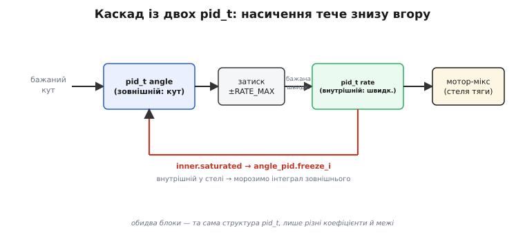

# ⚙️ Бойовий ПІД у прошивці: одна структура, що переживе політ

Досі ми розбирали захисти ПІД **поодинці**: ось затиск інтеграла, ось зворотний перерахунок, ось похідна від виміру, ось фільтр, ось безстрибкове перемикання. Кожен рядок був правильний — але жив окремо, у власному прикладі, з власними статичними змінними. У справжній прошивці так не буває. Там регулятор — це **один об'єкт**, який усі ці захисти носить у собі одночасно, працює по десять разів у кожному з трьох контурів (крен, тангаж, рискання), перемикає режими на льоту й мусить робити все це, не збиваючись, тисячу разів на секунду роками поспіль.

Тут ми зберемо все докупи. Візьмемо розсипані шматки й виллємо їх в одну структуру `pid_t` зі станом, одну функцію кроку й кілька коротких помічників — рівно те, що можна взяти, вставити у власну прошивку й підняти на ньому апарат. А тоді покажемо, як **два** таких регулятори складаються в каскад кут→швидкість так, як це роблять ArduPilot і PX4, і чесно пройдемось усіма пастками, які виникають саме тоді, коли захисти починають працювати **разом**, а не нарізно.

Головна думка проста: **розрізнені правильні шматки — ще не правильний регулятор.** Порядок, у якому вони виконуються, спільний стан, який вони ділять, і те, що станеться в мить увімкнення чи перемикання, — усе це вирішується не в кожному шматку окремо, а в тому, як вони зшиті. Саме це зшивання ми й зробимо.

## Задача

Уявіть, що ви пишете польотний контролер — не навчальну вправу, а код, який підніме реальний квадрокоптер. Вам потрібен ПІД. Не «формула Kp·e + Ki·∫e + Kd·de/dt», а **вузол коду**, який:

- тримає **весь свій стан** у собі (інтеграл, попередній вимір, стан фільтра) — щоб можна було мати їх скільки завгодно, по одному на кожну вісь, і жоден не заважав іншому;
- має вбудований **анти-віндап** — бо мотори мають стелю тяги, і без цього перший же різкий маневр дасть затяжний переліт;
- бере **похідну від виміру** з **фільтром** — бо сира похідна від помилки і смикається на стрибках завдання, і роздуває шум гіроскопа в деренчання моторів;
- **обмежує свій вихід** фізичними межами привода — бо просити в мотора більше, ніж він дає, безглуздо, а ще саме обрізання живить анти-віндап;
- **умикається без стрибка** — щоб у мить, коли ви клацнули режим чи ввели регулятор у роботу, апарат не смикнувся;
- працює з **виміряним** кроком часу, а не з припущеним, — бо на реальному чипі проміжок між викликами гуляє.

Кожну з цих вимог ми вже розбирали. Задача цього кроку — не вигадати нове, а **звести їх в одну структуру так**, щоб вони не побилися між собою. Бо, як ми зараз побачимо, вони таки норовлять побитися: анти-віндапу треба знати, чи вихід обрізано, а обрізання стається наприкінці; фільтру похідної треба стан між викликами; безстрибковому старту треба вміти підігнати інтеграл — і все це в одному кроці, у правильному порядку.

> 🔧 **Навіщо це.** Копіювати формулу ПІД у код уміє кожен; підняти на ній апарат — ні. Різниця рівно в тому шарі, який ми тут збираємо: стан у структурі (щоб масштабуватись на багато осей), захисти всередині кроку (щоб великий маневр не ламав контур), безстрибковий старт (щоб перемикання не смикали апарат). Один раз написавши таку структуру правильно, ви носитимете її з проєкту в проєкт — це той самий `pid_t`, що всередині кожного серйозного контролера.

## Ідея

Розкладімо рішення на три ясні частини, перш ніж писати код.

**Перше — увесь стан в одну структуру.** Наївний код тримав інтеграл і попередній вимір у `static`-змінних усередині функції. Це працює рівно для **одного** регулятора: другий виклик тієї самої функції ділив би той самий інтеграл, і два контури злилися б в один. Тому весь стан — інтеграл, попередній вимір, стан фільтра похідної, попередній вихід — переїжджає в поля структури `pid_t`, а поряд у ній живуть і **налаштування** (Kp, Ki, Kd, межі, параметр фільтра N, коефіцієнт анти-віндапу, вага завдання). Тепер регулятор — це змінна: скільки треба, стільки й заведіть, кожен зі своїм станом. Це той самий рух, що перетворює «функцію з `static`» на «об'єкт»: стан стає явним і належить конкретному примірнику.

**Друге — один крок, у якому все відбувається в правильному порядку.** Уся робота регулятора — в одній функції `pid_update`, і порядок операцій у ній **не довільний**. Спершу помилка. Тоді похідна — від виміру, крізь фільтр (їй потрібен старий вимір і старий стан фільтра, тож читаємо їх до оновлення). Тоді пробний вихід із пробним інтегралом. Тоді обрізання до меж — і **аж тепер**, знаючи, чи обрізали й куди, ми вирішуємо долю інтеграла (затиск або зворотний перерахунок). Наприкінці — зберегти стан для наступного кроку. Переставте будь-що з цього — і захист зламається тихо: наприклад, вирішите долю інтеграла **до** обрізання — і анти-віндап ніколи не спрацює, бо він якраз і живе з різниці «хотів проти дав».

**Третє — анти-віндап на вибір, але завжди присутній.** Ми розбирали два методи — затиск (простий, різкуватий) і зворотний перерахунок (плавний, з коефіцієнтом Kaw). Обидва хороші, обидва кращі за жоден. Тож у структурі буде **перемикач**: одне поле каже, який метод застосувати. Так одна й та сама структура обслуговує і простий контур, де досить затиску, і прецизійний, де хочеться гладкості. Але **вимкнути анти-віндап зовсім** структура не дасть — бо це найчастіша й найдорожча помилка: написати ПІД «поки що без анти-віндапу, додам потім». Потім не настає, а перший різкий маневр дає жахливий переліт.

Ключ до всього — **дисципліна порядку й спільного стану**. Кожен окремий шматок ми вже довели правильним. Тут єдине, що може піти не так, — це як вони складені: хто після кого, хто чий стан читає, що стається в першому виклику після ввімкнення. Тому спершу — найчистіша структура й крок, а тоді чесний розбір кожної пастки складання.

## Робочий C: структура стану й налаштувань

Почнемо зі структури. Тримаймося звички, яку ми взяли ще в [специфікації-як-структурі](root:embedded/filter-specification/proj-spec-struct.md): усе, що задає поведінку, — в одному місці, з ясними іменами й одиницями в коментарі, щоб ніхто нічого не сплутав. Розділимо поля на **налаштування** (їх задають раз при старті й рідко чіпають) і **стан** (він живе й міняється від кроку до кроку).

:::code proj-anti-windup/c/robochyi-c-struktura-stanu.c

Кілька рішень тут несуть вагу, попри те що структура — просто список полів.

По-перше, **межі `u_min`/`u_max` живуть у структурі регулятора, а не десь іззовні**. Це не косметика: анти-віндап неможливий без знання меж, бо вся його логіка — «наскільки вихід довелося обрізати». Тримаючи межі при регуляторі, ми гарантуємо, що обрізання й анти-віндап дивляться на **те саме** число. Якщо межі жили б окремо й хтось обрізав вихід «десь потім, назовні», регулятор про це не дізнався б — і накопичував би отруту, не розуміючи, що вже в стелі.

По-друге, поле **`initialized`**. Воно здається дрібницею, а рятує від тихої біди першого виклику: у самому першому кроці ще немає «попереднього виміру», і якщо взяти похідну від нуля до першого реального значення, вона підстрибне на весь вимір, поділений на dt, — фальшивий кік просто від увімкнення. Прапорець дає нам чесно обробити перший крок окремо. Розберемо це нижче в пастках — але поле мусить бути в структурі з самого початку.

По-третє, **ваги завдання `b` і `c`**. Це той самий регулятор із двома ступенями свободи: `c` при похідній (майже завжди 0 — чиста похідна від виміру, без кіку), `b` при пропорційній (тонке налаштування реакції на нове завдання). Тримаємо їх полями, щоб мати ручку, коли знадобиться, але зі здоровими типовими значеннями їх можна й не чіпати.

## Робочий C: ініціалізація

Перш ніж крок, — коротка функція, що ставить регулятор у чесний нуль. Її легко зневажити («та занулю поля й усе»), і саме тут ховається половина бід «увімкнув — смикнулось».

:::code proj-anti-windup/c/robochyi-c.c

Типове `Kaw = Ki/Kp` — не з повітря. Ми виводили, що розвантаження інтеграла має бути приблизно таким самим прудким, як сам інтеграл: у формі часів це стала часу трекінгу Tt ≈ √(Ti·Td), і при звичайних співвідношеннях це дає Kaw поблизу Ki/Kp. Ставимо цей орієнтир за замовчуванням, щоб зворотний перерахунок працював розумно ще до тонкого налаштування. Правило Tt ≈ √(Ti·Td) — це усталений емпіричний орієнтир Åström і Hägglund (1995); сам метод зворотного перерахунку («back-calculation and tracking») запропонували Fertik і Ross ще 1967 року, і він досі один із найпоширеніших у промисловості.

Найважливіше рішення — `initialized = false`. Ми свідомо **не** вдаємо, що «попередній вимір» уже є. Він з'явиться аж у першому кроці — і там ми його чесно підхопимо, а не порахуємо від нуля фальшиву похідну.

## Робочий C: крок регулятора — усе разом

Тепер серце. Одна функція, у якій усі захисти працюють у правильному порядку. Прочитайте її повільно — порядок рядків тут значить не менше за самі рядки.

:::code proj-anti-windup/c/robochyi-c-krok.c

Це і є весь бойовий ПІД. Двадцять рядків логіки, але кожен на своєму місці, і місце вибране не випадково. Пройдімося порядком і побачимо, чому саме така послідовність.

**Крок 0 і 1 — цілісність до всякої математики.** Хворий dt (нуль, від'ємний, велетенський через застряглий планувальник) отруїв би і похідну (ділення), і інтеграл (множення), тож ми відсікаємо його першим. Далі — перший виклик: замість вдавати неіснуючий «попередній вимір» ми його **підхоплюємо**, і похідна на першому кроці чесно виходить нулем. Без цих двох рядків регулятор смикається рівно в мить увімкнення — саме тоді, коли апарат найвразливіший.

**Крок 3 читає старе, крок 7 пише нове — і між ними вся математика.** Це тонкість, яку легко проґавити: похідній потрібен `meas_prev` **попереднього** кроку, а фільтру — його старий стан. Тому ми читаємо їх на кроці 3, до всякого оновлення, а зберігаємо новий вимір аж на кроці 7, останнім. Якби ми оновили `meas_prev` раніше, похідна порахувала б нахил «від себе до себе» — нуль завжди, демпфування зникло б безслідно.

**Крок 4 рахує з пробним інтегралом, крок 6 вирішує його долю — і саме в цьому порядку.** Ось де живе анти-віндап. Ми **спершу** припускаємо, що інтеграл накопичився (`integral_try`), рахуємо необмежений вихід, обрізаємо його — і **аж потім**, знаючи `u_unsat` і `u`, вирішуємо: прийняти накопичення чи ні (затиск), або підтягнути інтеграл назад (зворотний перерахунок). Переставте кроки 4 і 6 — вирішіть долю інтеграла до того, як дізналися, чи обрізали вихід, — і анти-віндап осліпне: він не знатиме, що вихід уперся в стелю, бо обрізання ще не сталося. Це найпоширеніша помилка складання, і компілятор про неї не скаже ані слова.

**Ki всередині суми, не зовні.** Погляньте на крок 4: `integral_try = p->integral + p->Ki * e * dt`. Поле `integral` тут уже містить коефіцієнт Ki — тобто це не «сира сума ∫e dt», а «Ki, помножене на суму». Так зроблено навмисне: тоді у зворотному перерахунку різниця `(u − u_unsat)` (у вольтах виходу) додається до інтеграла (теж у вольтах виходу) — **однакові одиниці**, і Kaw виходить безрозмірним множником коло Ki/Kp. Якби `integral` тримав сиру суму, довелося б стежити, де множиться Ki, і легко переплутати одиниці в анти-віндапі. Дрібне рішення про те, «що саме зберігати в полі», рятує від тихої плутанини одиниць.

> 🔧 **Навіщо це.** Порядок операцій у кроці ПІД — не стиль, а **умова правильності**. Три залізні правила: (1) обрізай вихід **перед** тим, як вирішувати долю інтеграла — інакше анти-віндап не працює; (2) читай старий стан похідної **до** його оновлення — інакше зникає демпфування; (3) відсікай хворий dt **першим** — інакше одне ділення на нуль отруює весь контур. Ці три правила не видно у формулах; вони видно тільки коли шматки складено докупи — і саме на них розбиваються перші саморобні ПІД.

## Робочий C: безстрибковий старт і перемикання

Регулятор уміє чесно стартувати з нуля. Але часто він мусить стартувати **не** з нуля — а з того значення, яке щойно видавало щось інше: ручне керування, попередній режим, інший регулятор. Ми розбирали цей принцип: у мить увімкнення підігнати інтеграл так, щоб сумарний вихід збігся з поточним. Ось він як окрема функція над нашою структурою.

:::code proj-anti-windup/c/robochyi-c-bezstrybkovyi.c

Логіка та сама, що ми виводили, тільки тепер вона працює з нашими полями. Похідну ми обнуляємо (щойно підхопили вимір, стрибка немає), пропорційну рахуємо з поточного завдання й виміру, а **інтеграл підганяємо так**, щоб сума трьох склалась рівно в `u_hold`. Оскільки в нашій структурі `integral` уже містить Ki (ми домовились про це вище), формула виходить чиста: `integral = u_hold − Kp·e_p`. Після цього виклику перший же `pid_update` продовжить вихід неперервно — і апарат не відчує моменту передачі керування.

Ця функція потрібна скрізь, де регулятор **підхоплює** керування: перехід з ручного на автоматичний (автопілот бере рівно там, де пілот відпустив), увімкнення зовнішнього контуру кута поверх працюючого контуру швидкості, «гаряче» ввімкнення після failsafe. Скрізь ідея одна: **новий регулятор стартує з виходу, що дорівнює поточному**, і лише потім починає його змінювати.

## Робочий C: каскад кут → швидкість

Тепер найцікавіше — заради чого все й будувалось. Ми маємо структуру `pid_t`, яка носить у собі всі захисти. Складімо з **двох** таких структур каскад, як у справжньому польотному контролері: зовнішній контур кута задає бажану кутову швидкість, внутрішній контур швидкості її відпрацьовує. І тут виникає нова пастка, якої в одиночному ПІД просто немає, — **насичення поширюється знизу вгору**.

Нагадаю механізм, який ми вже розбирали: у каскаді вихід зовнішнього контуру — це не вплив на мотори, а **завдання** внутрішньому. Коли внутрішній упреться в стелю (мотори на повному газі, більшої швидкості не дати), зовнішній цього **не бачить прямо** — він шле все більші бажані швидкості, апарат не встигає, помилка зовнішнього не спадає, і **його** інтеграл починає розкручуватись. Отрута переїхала на поверх вище. Ліки — розповісти зовнішньому, що внутрішній у насиченні, і заморозити зовнішній інтеграл.

Реалізуймо це чисто. Внутрішній контур після кроку має **повідомити**, чи він у стелі. Найпростіше — окрема функція, що каже, чи обрізало вихід:

:::code proj-anti-windup/c/robochyi-c-kaskad-kut.c

Щоб зовнішній контур міг заморозити свій інтеграл на команду ззовні, дамо `pid_t` ще одне поле — прапорець `freeze_i`. Коли він піднятий, крок рахує все як завжди, але **не приймає** нового накопичення. Це та сама умова, що в затиску, лише привід її не внутрішній («я сам у стелі»), а зовнішній («мені сказали морозити»). Додаємо в крок один рядок:

:::code proj-anti-windup/c/robochyi-c-kaskad-kut-2.c

Тепер сам каскад. Зовнішній контур кута рахує бажану швидкість; його вихід уже обмежений фізичною межею апарата (це його власні `u_min`/`u_max` = ±RATE_MAX). Внутрішній відпрацьовує це завдання, а на **наступному** кроці ми морозимо інтеграл зовнішнього рівно тоді, коли внутрішній щойно був у стелі.

:::code proj-anti-windup/c/robochyi-c-kaskad-kut-3.c

Зверніть увагу: тут **два рівні** анти-віндапу працюють разом, і кожен зі свого приводу. Внутрішній контур захищає себе сам — коли мотори в стелі, його власний анти-віндап усередині `pid_update_ex` не дає його інтегралу розкручуватись. Зовнішній контур захищений **знизу**: прапорець `freeze_i`, який виставляє каскад за сигналом `inner.saturated`, морозить його інтеграл рівно тоді, коли впирається не він сам, а поверх нижче. Так отрута віндапу не переїжджає на верхній поверх.

Одна чесна тонкість реалізації: `freeze_i` тут діє з **затримкою в один крок** — ми виставляємо його наприкінці кроку, а спрацьовує він на початку наступного. На частотах польотного контуру (сотні-тисячі герц) один крок — це частка мілісекунди, тож затримка неістотна. Хто хоче без неї — може розбити крок зовнішнього на дві частини (порахувати вихід, дізнатись про насичення внутрішнього, аж тоді вирішити долю інтеграла зовнішнього), але це ускладнює код заради виграшу, якого в польоті не помітно.

Найчистіший же спосіб узагалі уникнути цієї машинерії — **не давати зовнішньому контуру інтеграла**. Дуже часто зовнішній контур кута беруть як П- або ПД-регулятор: сталий зсув по куту зазвичай малий, а без інтеграла каскадному віндапу просто нема що розкручувати. Тоді `freeze_i` не потрібен зовсім, а анти-віндап лишається один — усередині внутрішнього контуру. Вибір між «зовнішній з інтегралом + freeze_i» і «зовнішній без інтеграла» — це, по суті, вибір, чи потрібен вам інтеграл на зовнішньому рівні взагалі.


*Два примірники однієї структури pid_t у каскаді. Зовнішній (кут) і внутрішній (швидкість) — та сама pid_t, лише з різними коефіцієнтами й межами. Вихід зовнішнього обмежений фізичною межею швидкості ±RATE_MAX — це його власні u_min/u_max. Ключова стрілка — тонка, знизу вгору: коли внутрішній контур у насиченні (мотори в стелі), він доповідає про це, і зовнішній заморожує свій інтеграл. Без цієї стрілки отрута віндапу переїжджає на верхній поверх, де впирається не він.*

## Складність і пастки

Код цілісний, а гострих кутів у ньому рівно стільки, скільки виникає, коли правильні шматки починають ділити стан і час. Пройдімося кожним — усі реальні, кожен дає ПІД, що компілюється, начебто працює біля робочої точки й підводить рівно тоді, коли на нього покластися.

- **Порядок операцій у кроці — найтихіша й найдорожча.** Ми вже наголосили, але це варте окремого рядка серед пасток, бо на ньому спотикаються майже всі. Три залізні залежності: обрізання виходу **перед** рішенням про інтеграл (інакше анти-віндап сліпий); читання старого стану похідної **до** його оновлення (інакше зникає демпфування); відсікання хворого dt **першим** (інакше ділення на нуль). Жодну з них не видно у формулі ПІД — вони народжуються тільки при складанні, і компілятор мовчить про всі три. Якщо ваш «правильний» ПІД поводиться дивно, першим ділом перевірте не коефіцієнти, а **порядок рядків**.

- **Виміряний dt проти номінального.** Спокуса написати `pid_update(&pid, sp, meas, 0.0025f)` — зашити період 2.5 мс числом — велика, бо «таймер же налаштований на 400 Гц». Але реальний проміжок між викликами **гуляє**: гіроскоп віддає дані нерівномірно, планувальник підвинув виклик, шина затрималась. Якщо dt зашитий, а справжній проміжок відрізняється, то похідна (ділення на dt) і інтеграл (множення на dt) рахуються по **брехливому** часі — і контур, ідеальний на столі, у польоті поводиться інакше. Правильно — **міряти** проміжок таймером високої роздільності й передавати виміряний dt. Тонкість: виміряний dt іноді дає викиди (пропущений тик подвоїть проміжок), тож його варто **обмежувати** розумними межами:

  ```c
  // виміряти реальний крок і захистити від викидів
  uint32_t now = micros();
  float dt = (now - last_us) * 1e-6f;
  last_us = now;
  if (dt < 0.5f * DT_NOMINAL) dt = 0.5f * DT_NOMINAL;   // задрібний — обрізати
  if (dt > 3.0f * DT_NOMINAL) dt = 3.0f * DT_NOMINAL;   // завеликий — обрізати
  float u = pid_update(&pid, setpoint, meas, dt);
  ```

  Ідея: довіряти виміряному dt у нормі, але не дати одному хворому проміжку (перший виклик, застряглий цикл, переповнення лічильника) отруїти похідну велетенським чи від'ємним значенням. Це компроміс між «завжди номінальний» (бреше, коли частота гуляє) і «завжди сирий виміряний» (вразливий до викидів).

- **Ініціалізація стану при вмиканні — фальшивий кік на першому кроці.** Найпідступніша з «дрібниць». У першому виклику після `pid_init` немає справжнього `meas_prev`. Якщо його не підхопити (наш прапорець `initialized`), похідна порахується як `−(meas − 0)/dt` — тобто весь поточний вимір, поділений на крихітний dt. Для дрона, що вже нахилений на 10° у мить увімкнення, це велетенський викид у вихід рівно тоді, коли апарат щойно віддали під керування регулятора. Симптом — «апарат смикається в мить арму» — і його роками списують на що завгодно, крім справжньої причини. Прапорець `initialized`, що в першому кроці робить `meas_prev = meas` (похідна виходить нулем), лікує це начисто. Те саме стосується інтеграла: він мусить стартувати з нуля (або з підігнаного значення для безстрибкового старту), а не з випадкового сміття неініціалізованої пам'яті — тому `pid_init` явно зануляє **весь** стан.

- **Подвійний анти-віндап у каскаді — коли власників забагато.** Тонка пастка складання. На зовнішній інтеграл тепер дивляться **два** механізми: його власний вбудований анти-віндап (спрацьовує, коли вихід зовнішнього впирається в свою межу `±RATE_MAX`) і наш `freeze_i` (спрацьовує, коли в стелі внутрішній). Поки вони діють у **різні** моменти й в **один** бік — не накопичувати, коли накопичувати марно, — вони не сваряться, а доповнюють один одного, і саме тому в коді вони мирно співіснують. Небезпека настає, якщо додати **третій** механізм навмання — скажімо, ще десь окремо «скидати» зовнішній інтеграл — і тоді троє почнуть смикати одне число врізнобій. Правило: **у кожного інтеграла має бути ясний, перелічуваний набір власників**, і кожен тягне його в один і той самий бік (до розвантаження), ніколи не всупереч. Найпростіше ж узагалі уникнути питання — **не давати зовнішньому контуру інтеграла** (робити його ПД- чи П-регулятором): сталий зсув по куту зазвичай малий, розкручуватись нема чому, і на зовнішньому рівні анти-віндап стає непотрібним зовсім.

- **Спільний dt на обидва контури — правильно, але з умовою.** У `cascade_step` ми передали той самий dt і зовнішньому, і внутрішньому. Це нормально й навіть бажано, **якщо обидва контури крутяться на одній частоті** (як у більшості польотних контролерів — увесь каскад в одному циклі). Але буває, що зовнішній контур навмисне повільніший (кут рахують рідше за швидкість, щоб розвантажити процесор). Тоді передавати внутрішній dt зовнішньому **не можна** — його інтеграл і похідна порахуються по чужому часу. Кожен контур мусить діставати **свій** проміжок між **своїми** викликами. Це прямий наслідок правила «dt — виміряний, реальний»: реальний для того контуру, у якому стоїть.

- **`float` і накопичення інтеграла за години польоту.** Інтеграл — сума, що росте кроками `Ki·e·dt`. У `float` (24 біти мантиси) є неприємність: коли сам інтеграл великий, а доданок крихітний, додавання **втрачає** доданок — «поглинання» молодших розрядів. За довгого польоту біля робочої точки, де e мале, це може тихо спотворити інтегральну дію. Здебільшого анти-віндап і межі виходу тримають інтеграл у розумних рамках, тож проблема рідко проявляється; але в контурах, де інтеграл довго тримає велике стале значення (утримання висоти, підігрів), варто або тримати інтеграл у `double`, або періодично його «підрівнювати». Знати про це варто, щоб не ловити містичний повільний дрейф після годин роботи.

- **`Ki = 0` і `Kp = 0` — ділення й безстрибковий старт.** Дрібні краї, що кусають на реконфігурації. Наш `tau_d` рахується як `(Kd/Kp)/N` — і якщо хтось на льоту виставив `Kp = 0`, буде ділення на нуль; тому в коді стоїть перевірка `Kp != 0`. Дзеркально, безстрибковий старт `pid_engage_bumpless` у загальному вигляді ділив би на Ki (якщо тримати сиру суму) — ще одна причина, чому ми домовились тримати в полі `integral` **уже помножене на Ki**: тоді підгонка інтеграла — просте віднімання, без ділення на Ki, і `Ki = 0` (чистий ПД) не ламає старт. Дрібне рішення про формат поля вкотре знімає цілий клас крайових бід.

- **Скидання інтеграла на землі (pre-arm).** Практична дрібниця з великими наслідками. Поки апарат стоїть на землі й мотори вимкнені, а завдання вже надходить (пілот ворушить ручкою), інтеграл усіх контурів **накопичується даремно** — привід же не рухається. У мить арму цей накопичений інтеграл дає різкий стрибок. Лікують це просто: поки апарат не в повітрі (не armed), **тримати інтеграл у нулі** — по суті, той самий безстрибковий старт, тільки тривалий. У польотних прошивках це роблять явно: `if (!armed) pid.integral = 0;` перед кожним кроком на землі. Знову той самий мотив: регулятор має вмикатись у роботу з чесного, а не накопиченого наперед стану.

Підсумок думки короткий. Кожен захист ПІД ми довели правильним поодинці — але правильний регулятор народжується не з правильних шматків, а з правильного їх **складання**. Одна структура `pid_t` тримає весь стан, щоб масштабуватись на багато осей; один крок виконує все в порядку, де обрізання передує рішенню про інтеграл, а старий стан читається до оновлення; анти-віндап завжди присутній, лиш метод на вибір; старт — безстрибковий, з підігнаним інтегралом; dt — виміряний, обмежений від викидів. А коли таких структур дві, вони складаються в каскад, де насичення чесно тече знизу вгору й один власник відповідає за кожен інтеграл. Усі пастки — порядок операцій, виміряний dt, ініціалізація стану — це не дрібниці стилю, а рівно ті стики, де правильні шматки, недбало зшиті, дають регулятор, що бреше саме тоді, коли на нього покладаєшся. Назвавши й закривши кожен стик, ви дістаєте `pid_t`, якому можна довірити апарат.
