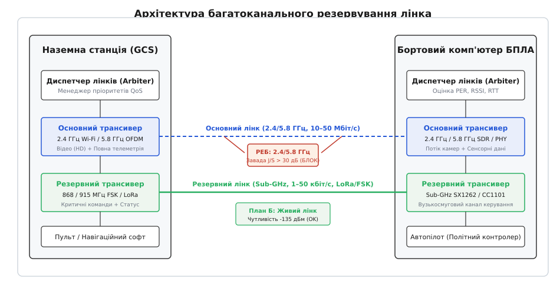
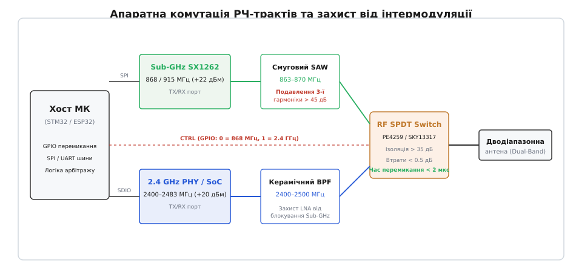
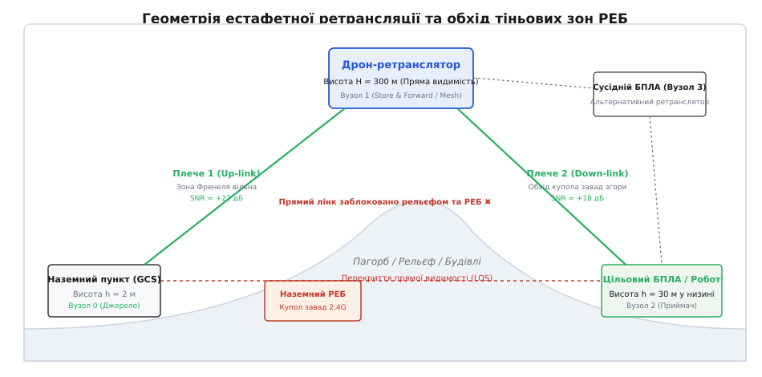
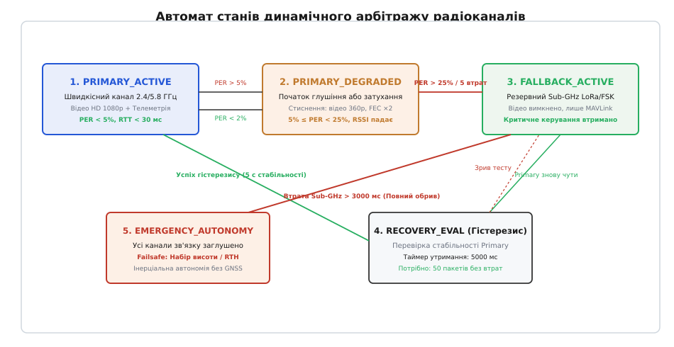
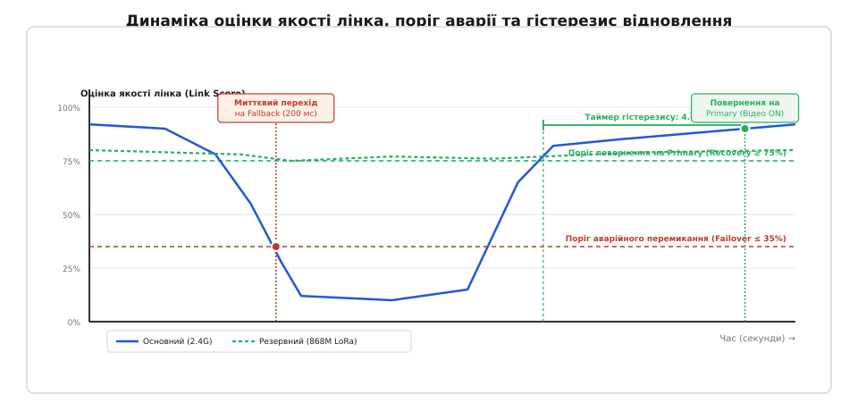

# План Б для лінка: діапазон, ретранслятор, автономія

<preknowlist>
- [Лінк під глушінням](root:embedded/jamming-fhss) — відношення завада/сигнал, виграш обробки та перехоплення частот.
- [Метрики якості лінку](root:com-medium/link-quality-metrics) — показники RSSI, SNR, коефіцієнт пакетних втрат PER та оцінка зашумленості каналу.
- [Серцебиття й виявлення розриву](root:embedded/sertsebyttia-i-vyiavlennia-rozryvu) — сторожові таймаути та діагностика обриву радіоканалу.
- [Навігація без GNSS](root:embedded/navihatsiia-bez-gnss) — автономне числення координат за одометрією та IMU в умовах супутникового блекауту.
</preknowlist>

Коли безпілотний апарат на швидкості тридцять метрів за секунду знижується за лісосмугу або заходить у сектор дії наземного комплексу радіоелектронної боротьби, широкосмуговий канал передачі відео зникає за частки секунди. Екран оператора вкривається цифровими артефактами, потік телеметрії зависає, а лічильник пропущених пакетів стрімко росте до сотні відсотків. Якщо система покладається на єдиний радіотракт і сподівається виключно на програмне відновлення кадрів, на цьому місія завершується аварією або втратою борта.

Жоден універсальний радіомодуль не здатен водночас передавати відеопотік високої роздільної здатності на швидкості в десятки мегабітів і водночас пробивати кіловатний купол завад за горизонтом прямої видимості. Це фундаментальний компроміс фізики радіозв'язку: швидкість вимагає широкої смуги частот, а завадозахищеність і дальність вимагають максимальної концентрації енергії у вузькому спектрі. Живучість системи досягається лише багатоканальним резервуванням (англ. *multi-bearer redundancy*) — поєднанням рознесених за частотою та фізичним рівнем каналів зв'язку, естафетної ретрансляції через дружні вузли та детермінованого переходу в автономію.


*Архітектура живучого лінка: швидкісний канал 2.4/5.8 ГГц передає відео й повну телеметрію в нормальних умовах, а резервний Sub-GHz канал гарантує проходження критичних команд керування навіть під щільним глушінням основного діапазону.*

## Фізика компромісу: чому один діапазон завжди програє

Спроба побудувати радіоканал «на всі випадки життя» неминуче впирається у співвідношення теплового шуму та ширини смуги частот, сформульоване Джонсоном і Найквістом. Потужність теплового шуму на вході радіоприймача визначається фундаментальним виразом:

```
P_noise = k · T · B
```

де `k` — стала Больцмана (`1.38 · 10⁻²³` Дж/К), `T` — абсолютна температура у кельвінах (типово 290 К для стандартних умов), а `B` — ширина смуги пропускання приймального тракту в герцах.

У логарифмічному масштабі при кімнатній температурі потужність теплового шуму становить приблизно `−174` дБм на кожен герц смуги. Передавач цифрового відеопотоку високої чіткості або швидкісного зв'язку стандарту 802.11 Wi-Fi вимагає смуги не менше `B = 20` МГц (`73` дБ·Гц), що задає нижню теоретичну межу теплового шуму:

```
P_noise_20MHz = −174 + 10 · log₁₀(20 · 10⁶) = −174 + 73 = −101 дБм
```

Реальний вхідний каскад підсилювача низького шуму (LNA) додає власний коефіцієнт шуму (Noise Figure, `NF ≈ 3...5` дБ). Крім того, демодуляція швидкісних квадратурних амплітудних модуляцій (64-QAM або 256-QAM) вимагає високого відношення сигнал/шум (`SNR ≥ +18...22` дБ) для збереження низької ймовірності бітової помилки (BER < 10⁻⁵). У результаті мінімальна потужність сигналу на вході приймача для утримання відеопотоку має становити:

```
P_min_video = −101 + 4 (NF) + 20 (SNR) = −77 дБм
```

Будь-яка завада РЕБ, яка створює на антені приймача рівень шуму вище `−80` дБм у смузі 20 МГц, повністю блокує демодулятор відео.

На противагу цьому, резервний канал передачі телеметрії та директив керування на базі субгігагерцового трансивера (868/915 МГц FSK або LoRa) використовує смугу пропускання лише `B = 125` кГц (`51` дБ·Гц) або `B = 10.4` кГц (`40.1` дБ·Гц). Для смуги 125 кГц термошум становить:

```
P_noise_125kHz = −174 + 51 = −123 дБм
```

Завдяки технології розширення спектра лінійною частотною модуляцією (Chirp Spread Spectrum, CSS) модуляція LoRa з коефіцієнтом розширення `SF = 7...10` дозволяє успішно виділяти та декодувати пакети навіть тоді, коли сигнал перебуває глибше за рівень шумів (`SNR = −12.5...−17.5` дБ). Чутливість такого приймача сягає `−136...−138` дБм.

```
ΔЕнергетика = (−137 дБм) − (−77 дБм) = 60 дБ
```

Різниця у 60 децибелів за енергетичним бюджетом означає, що резервний субгігагерцовий лінк залишається повністю працездатним при рівнях сигналу, які у **мільйон разів** слабші за поріг згасання швидкісного відеоканалу.

До різниці в чутливості додаються втрати розповсюдження у вільному просторі (англ. *Free Space Path Loss*, FSPL), які зростають пропорційно квадрату частоти несучої:

```
FSPL = (4 · π · d · f / c)²
```

де `f` — несуча частота, `d` — відстань зв'язку, а `c` — швидкість світла у вакуумі.

Порівняння втрат на одній і тій самій дистанції для частот `f₁ = 5800` МГц та `f₂ = 868` МГц дає прямий виграш:

```
ΔFSPL = 20 · log₁₀(5800 / 868) ≈ 20 · log₁₀(6.68) ≈ 16.5 дБ
```

Сумарний виграш резервного лінка складається з менших втрат траси (16.5 дБ) та вищої чутливості за рахунок вузької смуги (60 дБ), досягаючи сумарної переваги у `76.5` дБ.

Крім того, довжина хвилі на частоті 868 МГц становить `λ = 34.5` см, тоді як на частоті 5.8 ГГц вона дорівнює лише `λ = 5.17` см. Довші хвилі значно ефективніше огинають нерівності рельєфу та будівлі за рахунок дифракції, а також зазнають на 12–18 дБ меншого поглинання при проходженні крізь листяний покрив дерев за моделлю Вейсбергера (англ. *Weissberger's modified exponential model*).

> 🔧 **Навіщо це.** Енергетичний розрахунок доводить: намагатися утримати важкий потік відео в зоні активного придушення технічно безглуздо. Архітектура зв'язку будується на асиметрії: швидкісний канал розглядається як тимчасовий сервіс високої якості (Best-Effort), а вузькосмуговий субгігагерцовий канал — як гарантована артерія живучості апарата.

## Апаратне співіснування та РЧ-комутація

Одночасне розміщення двох або трьох незалежних радіотрансиверів на невеликій друкованій платі створює важку електромагнітну проблему блокування та десенсибілізації приймачів (англ. *receiver desensitization* / *desense*).

Головне джерело апаратного конфлікту — паразитна генерація вищих гармонік вихідними підсилювачами потужності (PA). Коли субгігагерцовий передавач працює в діапазоні `f₀ = 868` МГц з вихідною потужністю `+22` дБм (160 мВт) або `+30` дБм (1 Вт), нелінійність вихідного транзистора генерує гармоніки кратної частоти. Третя гармоніка потрапляє точно в смугу прийому модуля 2.4 ГГц:

```
3 · f₀ = 3 · 868 МГц = 2604 МГц
```

Частота 2604 МГц розташована впритул до верхнього краю цивільного діапазону 2.4 ГГц Wi-Fi / Bluetooth (2400–2483.5 МГц). Якщо вихідний тракт субгігагерцового чипа не має достатнього пригнічення, потужність третьої гармоніки може сягати `0...−10` дБм. Потрапляючи через близьке розташування антен на вхід підсилювача LNA 2.4 ГГц приймача, цей сигнал перевантажує перший каскад (точка компресії `P1dB`), у результаті чого приймач повністю «сліпне» до корисного сигналу базової станції.


*РЧ-фронтенд системи резервування: смугові фільтри SAW та керамічні резонатори пригнічують гармоніки й захищають вхідні підсилювачі LNA, а твердотільний комутатор SPDT забезпечує миттєве перемикання між трактами за мікросекунди.*

Для забезпечення безконфліктного співіснування вбудована апаратура реалізує чотири рівні захисту:

1. **Фільтри на поверхневих акустичних хвилях (SAW / BAW):** безпосередньо за вихідним фільтром низьких частот субгігагерцового чипа встановлюють смуговий ПАХ-фільтр з крутим спадом АЧХ, який забезпечує гарантоване пригнічення третьої гармоніки на рівні не менше `45...50` дБ.
2. **Вхідні керамічні діелектричні фільтри (BPF):** перед LNA приймача 2.4 ГГц монтують монолітний керамічний смуговий фільтр, що затримує сигнали нижче 2.3 ГГц з глибиною затухання понад `40` дБ, відсікаючи потужні позасмугові сигнали 868 МГц.
3. **Твердотільна комутація антен (RF SPDT Switch):** для спільного використання оптимізованих дводіапазонних антен або перемикання між ортогональними поляризаціями застосовують арсенід-галієві (GaAs) або кремнієві на ізоляторі (SOI) ключі (наприклад, Peregrine PE4259 або Skyworks SKY13317). Вони забезпечують час перемикання менше `2` мікросекунд, прямі втрати менше `0.45` дБ та ізоляцію вимкненого каналу понад `35` дБ при робочій потужності до +30 дБм.
4. **Просторове екранування та розв'язка живлення:** кожен радіотракт на платі закривається індивідуальною екрануючою кришкою з нейзильберу, припаяною по периметру до шару заземлення з кроком перехідних отворів (via stitching) не більше `λ / 20` (близько 2.5 мм для 5.8 ГГц). Лінії живлення підсилювачів розв'язуються феритовими бусинами (ferrite beads) з імпедансом понад 600 Ом на частоті 100 МГц та паралельними керамічними конденсаторами ємністю 10 пФ, 100 пФ і 1 мкФ для нейтралізації високочастотного просочування.

## Естафетна ретрансляція та топологія Mesh

Коли цільовий апарат знижується для виконання завдання на гранично малу висоту (10–30 метрів), пряма радіохвиля від наземної станції керування (GCS) блокується пагорбами, лісосмугами або кривизною поверхні землі. Навіть найпотужніший субгігагерцовий передавач не здатен подолати відсутність прямої видимості (NLOS) через масивні земляні перешкоди.

Вирішенням проблеми є залучення повітряного ретранслятора (англ. *airborne relay*) — допоміжного квадрокоптера, літака чи прив'язного аеростата, піднятого на висоту `H = 200...400` метрів над точкою старту.

Підйом проміжного вузла забезпечує звільнення першої зони Френеля над вершинами перешкод. Радіус поперечного перерізу зони Френеля на відстані `d₁` від передавача та `d₂` від приймача обчислюється за формулою:

```
r₁ = √( (λ · d₁ · d₂) / (d₁ + d₂) )
```

Якщо перешкода заступає понад 40% радіуса `r₁`, дифракційні втрати зростають на 10–25 дБ. Піднятий ретранслятор утворює два чистих радіопрольоти прямої видимості (LOS), кожен з яких має вільну зону Френеля: `GCS → Ретранслятор` та `Ретранслятор → Цільовий БПЛА`.


*Геометрія ретрансляції: підйом проміжного дрона на висоту повертає зв'язок із цільовим апаратом у низині, обходячи купол наземних завад РЕБ та перешкоди рельєфу.*

Програмна реалізація ретранслятора використовує один із двох підходів:

1. **Пакетний ретранслятор зі збереженням (Store-and-Forward Relay):** ретранслятор використовує єдиний напівдуплексний трансивер. Прийнятий кадр від GCS перевіряється на валідність контрольної суми CRC, у заголовку встановлюється прапорець `MUX_FLAG_RELAYED`, зменшується лічильник переходів `TTL`, і пакет ставиться у чергу на передачу цільовому апарату. Пропускна здатність каналу при цьому зменшується вдвічі, а затримка зростає на час передачі одного кадру (15–30 мс).
2. **Крос-діапазонний ретранслятор реального часу (Cross-Band Translation):** ретранслятор обладнаний двома незалежними радіотрактами. Зв'язок із GCS підтримується на частоті 2.4 ГГц Wi-Fi/OFDM, а ретрансляція на цільовий борт здійснюється на частоті 868 МГц FSK/LoRa. Пересилання відбувається з апаратною затримкою менше 50 мікросекунд без втрати смуги пропускання.

У багатовузлових тактичних сценаріях група безпілотників утворює самоорганізовану Ad-Hoc мережу (MANET). Оцінка маршрутів виконується за метрикою очікуваної кількості передач (англ. *Expected Transmission Count*, ETX), яка динамічно враховує втрати в прямому `d_f` та зворотному `d_r` напрямках:

```
ETX = 1 / (d_f · d_r)
```

Маршрутизатор постійно вибирає шлях із мінімальною сумою `∑ ETX`. Якщо прямий лінк між GCS та бортом глушиться і втрачає 90% пакетів (`ETX_direct ≈ 100`), система автоматично спрямовує пакети через сусідній дрон із сумарним `ETX_relay ≈ 2.2`.

## Алгоритм динамічного арбітражу (Multi-Link Arbiter)

Ключовим елементом надійності є програмний арбітр лінків (Link Arbiter). Він працює як детермінований скінченний автомат (FSM), що постійно аналізує потік метрик і здійснює перемикання радіоканалів.


*Автомат станів арбітра: чіткі пороги перемикання вниз при виявленні сплеску втрат і захисний часовий інтервал гістерезису для безпечного повернення на основний канал.*

Автомат станів арбітра містить шість режимів:

1. `PRIMARY_ACTIVE`: основний швидкісний канал (2.4/5.8 ГГц) справний. Обслуговуються всі три яруси пріоритетів (відеопотік HD 1080p, MAVLink телеметрія 50 Гц, команди керування).
2. `PRIMARY_DEGRADED`: виявлено зростання втрат пакетів у діапазоні 5–25% або падіння SNR нижче +10 дБ. Арбітр вмикає деградацію: відеокодек переводиться на мінімальний бітрейт (360p, 500 кбіт/с), частота телеметрії знижується до 10 Гц, а для команд активується подвійна передача.
3. `SWITCHING`: зафіксовано аварійне руйнування основного каналу (PER > 25% або 4 поспіль втрачені кадри). Арбітр перемикає логічний рівень на GPIO керування RF-комутатором, ініціалізує буфери субгігагерцового носія і відправляє кадр сповіщення про зміну активного лінка.
4. `FALLBACK_ACTIVE`: трафік спрямовується через вузькосмуговий субгігагерцовий канал. Черга відеопотоку повністю блокується на вході диспетчера. Телеметрія пакується у бінарний стиснутий кадр (24 байти), критичні команди передаються негайно.
5. `RECOVERY_EVALUATION`: основний канал знову почав приймати тестові пінг-пакети. Арбітр запускає таймер гістерезису тривалістю 4–6 секунд. Повернення на основний канал відбудеться лише тоді, коли протягом усього інтервалу ковзне вікно PER залишатиметься нижчим за 5%.
6. `EMERGENCY_AUTONOMY`: повна тиша на всіх фізичних носіях тривалістю понад 3.0 секунди. Арбітр сповіщає політний контролер про розрив зв'язку та ініціює автономний протокол Failsafe.


*Часова діаграма арбітражу: при сплеску завад перехід на резервний канал відбувається за 200 мс, тоді як повернення на основний канал стримується таймером гістерезису тривалістю 4 секунди, що запобігає флапінгу.*

Повні математичні формули згладжування метрик за методом EWMA, розрахунку ковзного вікна PER та виведення інтегрального балу наведені у спеціальному матеріалі: [математичну модель оцінки якості лінка та розрахунок коефіцієнтів гістерезису](root:embedded/plan-b-dlia-linka/math-link-score.md).

## Програмна реалізація менеджера лінків

Програмна архітектура будується на повній ізоляції апаратно-залежних драйверів від логіки диспетчеризації через стандартизовану структуру носія `bearer_interface_t`.

Повна специфікація типів даних, бітових прапорців заголовка та контрактів функцій наведена у довідковому матеріалі: [структуру даних та контракт функцій диспетчера](root:embedded/plan-b-dlia-linka/api-link-arbiter.md).

Нижче наведено робочу реалізацію автомата арбітражу та пріоритетної маршрутизації для мікроконтролерів STM32 / ESP32.

:::tabs
:::code plan-b-dlia-linka-d/c/main.c
:::code plan-b-dlia-linka-d/cpp/main.cpp
:::

Повний проект із синтетичним генератором втрат, чергами пакетів та тестовим стендом наведено у вставці: [робочу реалізацію мультиплексора та арбітра на мовах C та C++](root:embedded/plan-b-dlia-linka/proj-link-mux.md).

## Автономія при повному радіоблекауті (Loss-of-Link Failsafe)

Коли безпілотний апарат потрапляє в зону комбінованого придушення РЕБ, де одночасно блокуються і основний гігагерцовий канал, і субгігагерцовий резерв, і ретранслятор, настає стан повної радіотиші (`EMERGENCY_AUTONOMY`). У цей момент керування апаратом повністю бере на себе бортовий модуль аварійного виживання (Failsafe Engine).

Алгоритм виходу з радіоблекауту реалізується за п'ятьма послідовними етапами:

1. **Фільтр підтвердження розриву (Detection Window, 0.0–3.0 с):** короткочасні втрати пакетів через маневри апарата або локальні радіотіні ігноруються. Апарат зберігає останній заданий вектор шляхової швидкості та утримує барометричну висоту.
2. **Тактичний набір висоти (Tactical Pop-Up, 3.0–8.0 с):** апарат здійснює енергійний підйом на 100–150 метрів з максимальним градієнтом набору. Наземні станції глушіння мають діаграму спрямованості, притиснуту до горизонту; підйом угору виводить апарат із купола приземних завад і відновлює пряму радіовидимість до ретранслятора або GCS.
3. **Інерціальне повернення курсом прибуття (Dead Reckoning RTH):** якщо після набору висоти зв'язок не відновлено, автопілот розгортається на 180 градусів і слідує за записаним треком точок назад. Оскільки супутникова навігація GNSS у зоні РЕБ також заглушена або зазнає спуфінгу, числення шляху виконується за допомогою інерціальної системи (IMU), давачів оптичного потоку та трубки Піто (повітряної швидкості) без використання супутників.
4. **Імпульсний радіомаяк (Burst Beaconing):** на зворотному шляху субгігагерцовий передавач переходить у режим коротких псевдовипадкових посилок (тривалістю 8 мс раз на 5 секунд), що різко ускладнює його пеленгацію засобами радіотехнічної розвідки супротивника, але дозволяє наземній станції зафіксувати наближення борту.
5. **Аварійна посадка за таймером:** якщо зв'язок не відновлено, а розрахунковий запас заряду акумулятора знижується до критичних 15%, автопілот виконує автоматичну посадку за давачем висоти LiDAR / оптичним потоком у заздалегідь запрограмованій точці евакуації.
