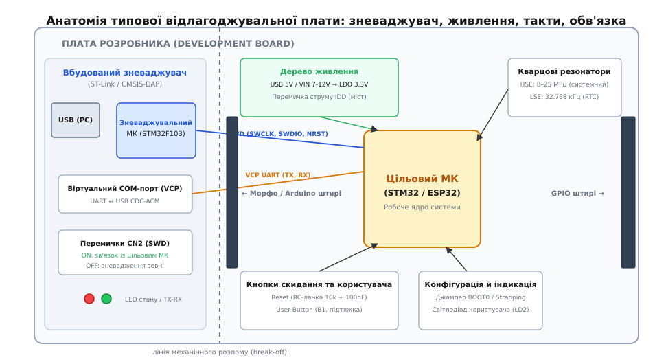

# ⚙️ Схемотехніка та драйвери базової обв'язки: фільтрація скидання, антибрязкіт і керування індикацією

Будь-яка плата розробника починається з двох мінімальних інтерфейсних вузлів: тактової кнопки для введення сигналів користувача та світлодіода для візуального відображення стану системи. Проте спроба підключити механічну кнопку напряму до вхідного виводу мікроконтролера, а світлодіод — до вихідного без урахування електричних переходів та опорів призводить до хибних багаторазових спрацьовувань, нестабільного старту ядра та електричного перевантаження вихідних транзисторів порту.


*Схемотехнічна обв'язка користувацької периферії: захист входу від завад та обмеження струму вихідного каскаду GPIO.*

---

## 1. Фізика контактного брязкоту та апаратна фільтрація

### Природа брязкоту механічних контактів
Механічна тактова кнопка містить пружну металеву мембрану або контактну пластину. При натисканні металеві поверхні не змикаються миттєво: вони пружно відскакують одна від одної, генеруючи серію з 5–20 мікроскопічних розмикань і замикань тривалістю від 1 до 20 мілісекунд:

```
Натискання
 ───┐ ┌─┐ ┌──┐ ┌──────────────── (Логічний рівень на ніжці)
    └─┘ └─┘  └─┘
     ▲
     └─ Зона брязкоту контактів (10–20 мс)
```

Якщо цей вивід налаштований на обробку апаратних переривань (*EXTI*), процесор викличе обробник переривання десятки разів на одне фізичне натискання, багаторазово перемикаючи стан програми.

### Апаратний RC-фільтр із тригером Шмітта
Для апаратного придушення брязкоту паралельно кнопці встановлюють конденсатор `C = 100 нФ`, а послідовно з контактом вмикають захисний резистор `R2 = 100 Ом` разом із підтяжкою `R1 = 10 кОм`:

```
+3.3V ───[ R1: 10 kΩ ]───┬───────────────► До входу GPIO (Тригер Шмітта)
                         │
                      [ C: 100 nF ]
                         │
                 GND ────┴───[ Кнопка ]───[ R2: 100 Ω ]─── GND
```

Під час натискання кнопки конденсатор розряджається через малий резистор `R2` за час `τ_dis = R2 · C = 100 Ом · 100 нФ = 10 мкс`. При відпусканні кнопки конденсатор заряджається через підтяжку `R1` за час `τ_ch = R1 · C = 10 кОм · 100 нФ = 1 мс`. Вхідний тригер Шмітта мікроконтролера з гістерезисом `ΔV_H = V_T+ - V_T- ≈ 0.4 В` перетворює плавну експоненту на чіткий логічний перепад без жодного брязкоту.

---

## 2. Схемотехнічний розрахунок ланцюга скидання (NRST)

Вивід апаратного скидання `NRST` мікроконтролера чутливий до коротких перехідних сплесків напруги в момент увімкнення живлення. Щоб забезпечити надійне формування імпульсу початкового скидання *(Power-On Reset, POR)* під час наростання живильної шини 3.3 В та усунути брязкіт при натисканні кнопки `RESET`, використовують інтегрувальний RC-ланцюжок:
- Підтягувальний резистор `R_pull = 10 кОм` до шини 3.3 В;
- Фільтрувальний керамічний конденсатор `C_reset = 100 нФ` на землю.

Розрахуймо часову сталу заряду інтегрувального ланцюжка:

```
τ = R · C                              [часова стала RC-ланцюжка]
= 10000 Ом · 0.0000001 Ф               [підстановка: R=10 кОм, C=100 нФ]
= 0.001 с = 1 мс                       [розрахункова тривалість затримки]
```

При подачі живлення напруга на виводі `NRST` наростає плавно за експоненційним законом `V(t) = V_DD · (1 - e^(-t/τ))`. Поріг перемикання логічної одиниці вбудованого тригера Шмітта (`V_IH ≈ 0.7 · V_DD = 2.31 В`) досягається за час:

```
t_por = -τ · ln(1 - 0.7)               [час наростання до порогу 70% VDD]
= -1 мс · (-1.204)                     [обчислення натурального логарифма]
≈ 1.2 мс                               [тривалість імпульсу скидання POR]
```

Цієї затримки в 1.2 мс гарантовано вистачає для повної стабілізації вихідної напруги лінійного стабілізатора LDO та виходу внутрішніх опорних джерел живлення ядра на робочий режим.

---

## 3. Розрахунок баластного резистора світлодіода (User LED)

Вихідний каскад GPIO в мікроконтролерах побудований на комплементарній парі MOSFET-транзисторів (Push-Pull). Пряме підключення світлодіода без обмежувального резистора створює режим короткого замикання через відкритий p-n перехід діода, що випалює вихідний транзистор мікроконтролера.

Звичайний зелений індикаторний світлодіод має пряме падіння напруги `V_F ≈ 2.1 В` і номінальний струм світіння `I_LED = 5 мА = 0.005 А`. При живленні від виводу GPIO з напругою `V_DD = 3.3 В` баластний опір розраховується за законом Ома:

```
R_ballast = (V_DD - V_F) / I_LED       [закон Ома для баластного резистора]
= (3.3 В - 2.1 В) / 0.005 А            [підстановка: VDD=3.3 В, VF=2.1 В, I=5 мА]
= 1.2 В / 0.005 А                      [падіння напруги на резисторі]
= 240 Ом                               [мінімальний розрахунковий опір]
```

Розрахуймо потужність розсіювання тепла на баластному резисторі:

```
P_res = I_LED² · R_ballast             [потужність теплових втрат на резисторі]
= (0.005 А)² · 240 Ом                  [підстановка струму й опору]
= 0.000025 · 240
= 0.006 Вт = 6 мВт                     [безпечно для будь-якого SMD 0402/0603]
```

На платах розробника встановлюють резистори номіналом `330 Ом` або `510 Ом`. Це обмежує робочий струм на рівні 2.5–3.5 мА: світлодіод яскраво світить, не створюючи надлишкового нагріву порту процесора.

---

## 4. Програмні підходи до антибрязкоту: періодичне опитування чи таймерне блокування

В інженерній практиці програмної фільтрації застосовують два принципово різні підходи:

1. **Періодичне опитування (Periodic Polling):** Таймер генерує переривання кожні 10 мс. Програма зчитує сирий стан піна та оновлює лічильник стабільності. Якщо рівень сигналу не змінюється протягом 5 послідовних опитувань (50 мс), стан фіксується як дійсний. Це найнадійніший метод, стійкий до сильних електромагнітних завад.
2. **Переривання з блокуванням (Interrupt with Debounce Timer):** Перший фронт сигналу кнопки викликає апаратне переривання EXTI, яке негативно маскує переривання цієї лінії та запускає одноразовий апаратний таймер на 20 мс. Після закінчення таймера переривання таймера зчитує фінальний рівень на ніжці та знову дозволяє обробку EXTI. Цей метод економить такти процесора, коли кнопка перебуває у стані спокою.

Нижче наведено реалізацію періодичного кінцевого автомата на мовах C та C++.

:::tabs
:::code proj-power-and-reset-protection/c/debounce.c
:::code proj-power-and-reset-protection/cpp/debouncer.hpp
:::

Другий підхід — маскування лінії EXTI на час брязкоту з одноразовим таймером TIM3:

:::tabs
:::code proj-power-and-reset-protection/c/exti_button.c
:::code proj-power-and-reset-protection/cpp/button_irq.cpp
:::

Обидва варіанти спираються на один шар доступу до заліза: підтяжка входу, режим вихідного каскаду та перемикання світлодіода активним нулем.

:::tabs
:::code proj-power-and-reset-protection/c/board.c
:::code proj-power-and-reset-protection/cpp/gpio.hpp
:::

Точка входу вмикає рівно один із двох механізмів фільтрації, бо обидва керують тим самим виводом:

:::tabs
:::code proj-power-and-reset-protection/c/main.c
:::code proj-power-and-reset-protection/cpp/main.cpp
:::

---

## 5. Інженерні пастки реалізації

1. **Плаваючий вхід (Floating Input):** Якщо вивід сконфігуровано як цифровий вхід без підтягувального резистора (*Floating Input*), його затвор підключений до високоомного входу польового транзистора. У розімкненому стані кнопки він працює як антена, випадково перемикаючись від мережевих наведень частотою 50 Гц.
2. **Перевантаження сумарного струму шини VDD:** Окремий пін мікроконтролера витримує струм до 20–25 мА, але сумарний струм через усі виводи живлення `V_DD` і `V_SS` корпусу обмежений значенням 120–150 мА. Спроба одночасно живити 8 світлодіодів по 20 мА безпосередньо від портів GPIO призводить до локального перегріву металізації кристала та спотворення аналогових вимірювань вбудованого АЦП.
3. **Блокуючі затримки в обробниках:** Застосування функції `delay(50)` або `HAL_Delay(50)` для очікування завершення брязкоту є грубою помилкою у вбудованих системах: процесор марно спалює мільйони тактів ядра, блокуючи виконання решти задач та своєчасне обслуговування переривань інших датчиків.
4. **Вибір конфігурації Push-Pull проти Open-Drain для світлодіодів:** При підключенні світлодіода за схемою Active-LOW вивід GPIO можна перевести в режим відкритого стоку *(Open-Drain)*. У цьому разі верхній P-MOSFET вимкнений, і при логічній одиниці вивід переходить у стан високого опору Hi-Z, що дозволяє живити індикаторний світлодіод від напруги 5.0 В (якщо пін є 5V-толерантним), не створюючи загрози для внутрішньої шини 3.3 В ядра.
