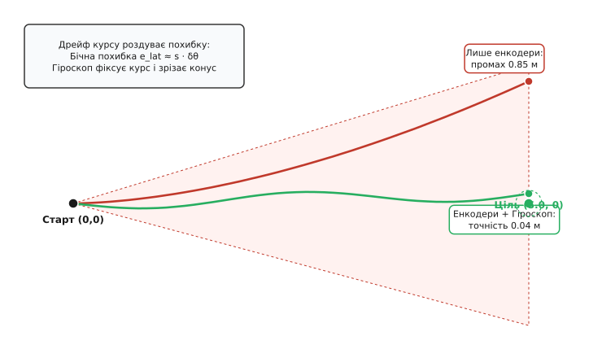
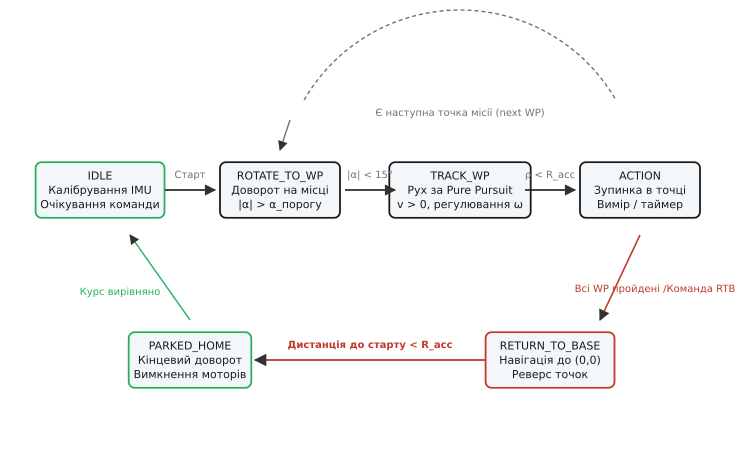
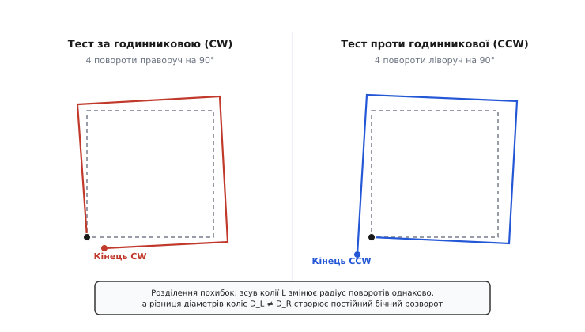

# Платформа їде до точки й повертається — детально

<preknowlist>
- [Кінематика диференціального приводу](root:embedded/differential-drive-kinematics) — зв'язок швидкостей коліс із лінійною v та кутовою ω швидкостями корпуса.
- [Одометрія](root:com-signal/odometry) — розрахунок пройденого шляху за дискретними відліками оптичних чи магнітних енкодерів.
- [Інерціальне числення позиції](root:com-signal/dead-reckoning) — інтегрування навігаційних даних та природа накопичення похибок без зовнішніх орієнтирів.
- [IMU-давач](root:hw-sensing/imu) — принцип роботи тривісних гіроскопів та акселерометрів, дрейф нульового рівня (bias).
- [П-регулятор](root:embedded/proportional-control) — пропорційне керування розбіжністю для корекції курсу.
</preknowlist>

Двоколісний робот із диференціальним приводом, колісною базою 180 мм і колесами діаметром 65 мм отримує просте завдання: проїхати 5.0 метрів уперед по осі X, зупинитися на 2 секунди для ультразвукового сканування перешкод, розвернутися на 180 градусів і повернутися точно на зарядну базу в точку (0.0, 0.0). Якщо реалізувати цю місію без зворотного зв'язку за координатами — подати ШІМ 160 на обидва мотори на 6.2 секунди вперед, розвернути колеса в протилежні боки на 1.1 секунди й знову подати ШІМ на 6.2 секунди, — результат буде катастрофічним. Через різницю тертя в редукторах на 3%, просідання гумової шини під акумулятором на 0.3 мм та нерівності підлоги ліве колесо проходить за секунду на 4 мм менше за праве. На перших п'яти метрах робот описує плавну дугу й відхиляється вбік на 42 см, розвертається з помилкою в куті на 6 градусів, а на зворотному шляху подвоює відхилення й фінішує в 1.35 метра осторонь від бази, врізаючись у стіну.

Щоб робот прибував у задані координати й повертався у вихідну точку з точністю до кількох сантиметрів, прошивка повинна не просто крутити мотори фіксований час, а безперервно вирішувати дві задачі: **оцінювати свій стан** (інтегрувати плоску позу `(x, y, θ)` за енкодерами та IMU) і **формувати керування** (розраховувати необхідну лінійну швидкість `v` та кутову швидкість `ω` для виходу на цільову точку через алгоритм стеження за траєкторією).

Ця стаття розгортає повний інженерний контур автономної плоскої навігації: від дискретної кінематики перерахунку тиків енкодерів до компенсації накопиченого дрейфу курсу через гіроскоп, інженерного бюджету похибок, геометричного виведення регулятора Pure Pursuit з адаптивною довжиною випередження, детектування заклинювання та проковзування коліс, оптимізації реверсного маршруту (Breadcrumb Pruning), багаторівневої архітектури контурів керування з компенсацією просідання батареї, логіки автомата станів автономної місії та метрологічного калібрування шасі тестом UMBmark.

## 1. Кінематична модель диференціальної платформи та розрахунок одометрії

Мобільна платформа з двома тяговими колесами на спільній осі та одним або двома пасивними опорними роликами (касторами) належить до класу неголономних роботів. Вона не здатна миттєво рухатися вбік, перпендикулярно до площини коліс, але може досягти будь-якої точки на площині через поєднання прямолінійного руху та повороту.

Стан робота на двовимірній площині описується вектором пози `P = [x, y, θ]ᵀ`, де `x` та `y` — декартові координати середини колісної осі у світовій системі координат (метрах), а `θ` — курс (азимут) робота відносно осі `X` (в радіанах, додатний проти годинникової стрілки).

Кожне колесо оснащене квадратурним енкодером, закріпленим на валу мотора або на валу колеса після редуктора. Якщо енкодер видає `N_cpr` імпульсів на один повний оберт колеса, а фізичний радіус колеса дорівнює `r`, ціна одного лічильного тика (коефіцієнт переводу імпульсів у метри) становить:

```
c_tick = (2 · π · r) / N_cpr    [ціна одного імпульсу енкодера, м/тик]
```

За фіксований квант часу керуючого циклу `Δt` (зазвичай від 10 до 50 мс) лічильники таймерів фіксують приріст імпульсів `Δticks_L` для лівого та `Δticks_R` для правого колеса. Лінійні переміщення ободів коліс за цей крок дорівнюють:

```
Δs_L = Δticks_L · c_tick
Δs_R = Δticks_R · c_tick
```

З кінематики твердого тіла лінійне переміщення центра колісної осі `Δs` та приріст кута орієнтації `Δθ` за крок `Δt` визначаються як:

```
Δs = (Δs_R + Δs_L) / 2          [лінійне переміщення середини осі, м]
Δθ = (Δs_R - Δs_L) / L          [кутовий приріст орієнтації, рад]
```

де `L` — ефективна колісна база (відстань між точками контакту лівого та правого коліс із поверхнею).

### Дискретні схеми інтегрування пози

Для інтегрування пози робота в глобальній системі координат на практиці використовують три схеми різної точності:

1. **Прямокутна схема Ейлера (Euler Forward):** бере курс на початку кроку `θ(k)`. Вона проста, але на поворотах систематично зрізає кути, оскільки вважає, що весь крок робот їхав під застарілим кутом. Похибка цієї схеми пропорційна першому порядку `O(Δθ)`.
2. **Схема середньої точки (Midpoint Runge-Kutta 2-го порядку):** бере усереднений курс `θ_mid = θ(k) + Δθ / 2`. Ця схема враховує, що розворот розподілений по всьому інтервалу часу, тому її похибка зменшується до другого порядку `O(Δθ²)`.
3. **Точна дугова інтеграція (Exact Arc Integration):** розглядає рух як точну дугу кола радіуса `R_c = Δs / Δθ` навколо миттєвого центра швидкостей (ICC).

Порівняймо математичні вирази для оновлення координат:

```
Схема середньої точки (2-й порядок):
θ_mid = θ(k) + Δθ / 2
x(k+1) = x(k) + Δs · cos(θ_mid)
y(k+1) = y(k) + Δs · sin(θ_mid)
θ(k+1) = θ(k) + Δθ

Точна дугова інтеграція (при |Δθ| > ε):
R_c    = Δs / Δθ
x(k+1) = x(k) + R_c · (sin(θ(k) + Δθ) - sin(θ(k)))
y(k+1) = y(k) - R_c · (cos(θ(k) + Δθ) - cos(θ(k)))
θ(k+1) = θ(k) + Δθ
```

При високій частоті циклу (100 Гц, `Δt = 10 мс`) схема середньої точки дає похибку апроксимації менше 0.01% навіть на крутих віражах. Головна її перевага перед точною дуговою формулою полягає у відсутності ділення на `Δθ`, що виключає апаратні помилки ділення на нуль або втрату точності чисел з плаваючою комою при прямолінійному русі (`Δθ → 0`).


*Геометрія наведення Pure Pursuit: цільова точка на відстані випередження L_d утворює хорду кола радіуса R, задаючи кривину κ = 2·sin(α)/L_d і необхідну кутову швидкість обертання платформою.*

## 2. Анатомія накопичення навігаційного дрейфу (Dead Reckoning Drift) та злиття з IMU

Числення позиції виключно за обертами коліс називається відліковою одометрією (Dead Reckoning). Фундаментальна властивість одометрії — **монотонне незворотне накопичення похибок**. Усі джерела навігаційних спотворень поділяються на дві категорії: систематичні та несистематичні.

### Систематичні похибки (детерміновані)

* **Нерівність радіусів коліс (`r_L ≠ r_R`):** виникає через виробничі допуски виготовлення гумових шин, різний внутрішній тиск чи несиметричний розподіл маси платформи (наприклад, важкий акумулятор зміщений на правий борт). Якщо праве колесо має радіус на 0.5% більший за ліве, платформа при спробі рухатися строго прямо описуватиме дугу радіуса `R = L / (r_R/r_L - 1) ≈ 0.18 / 0.005 = 36 м`.
* **Похибка ефективної ширини колії (`L_eff ≠ L_nominal`):** через скінченну ширину контакту гуми з підлогою пляма контакту не є нескінченно тонкою точкою. Під час повороту шини ковзають із боковим притиранням (tire scrub), тому реальна вісь обертання відрізняється від паспортної відстані між центрами шин. Робот під час кожного розвороту на 90° недовертає або перевертає на 2–5 градусів.
* **Похибка роздільної здатності енкодера та масштабного коефіцієнта:** похибка квантування імпульсів та неточність калібрування лінійного коефіцієнта `c_tick`.

### Несистематичні похибки (випадкові)

* **Проковзування коліс (Wheel Slip):** виникає при різкому прискоренні, коли тягова сила перевищує силу тертя зчеплення `F_accel > μ · N`, або при гальмуванні на слизькій підлозі (ламінат, плитка).
* **Нерівності рельєфу, стики, пороги:** одне колесо тимчасово відривається від поверхні або долає сходинку, роблячи зайві холості оберти без поступального руху корпуса.
* **Вплив поворотного ролика (Caster Flutter):** пасивний кастор при зміні напрямку руху примусово розвертається навколо своєї вертикальної осі, створюючи різкий боковий поштовх і момент опору на ведучі колеса.

### Чому помилка курсу фатальна для одометрії

Припустимо, робот має похибку вимірювання лінійного переміщення `δs` (масштабна похибка 1%) та похибку вимірювання орієнтації `δθ` (кутова похибка 1° = 0.0175 рад).

Поздовжня похибка положення вздовж траєкторії зростає лінійно зі шляхом:

```
e_long(s) = δs · s = 0.01 · s
```

Натомість похибка курсу `δθ`, накопичена на початку руху, повертає всю подальшу систему координат. Бічне відхилення від істинної лінії шляху зростає пропорційно пройденій відстані `s`:

```
e_lat(s) = s · sin(δθ) ≈ s · δθ
```

Якщо на першому метрі робот накопичив кутову помилку всього у 2 градуси (0.035 рад), то через 5 метрів прямолінійного руху бічне відхилення складе:

```
e_lat = 5.0 · sin(0.035) ≈ 0.175 м = 17.5 см
```

При розвороті на 180 градусів помилка подвоюється, утворюючи широкий конус невизначеності, спрямований у бік розвороту.


*Накопичення похибки одометрії: розбіжність колісних радіусів роздуває бічний конус невизначеності (червоний), тоді як злиття з гіроскопом фіксує курс і втримує відхилення в межах кількох сантиметрів (зелений).*

### Інженерний бюджет похибок (Error Budget)

Оцінимо внесок кожного фізичного фактора на типовому 10-метровому маршруті (5 м уперед + 5 м назад):

| Джерело похибки | Фізична величина | Вплив на фінішну позицію | Спосіб компенсації |
|---|---|---|---|
| Неточність радіуса коліс `r` | Δr = 0.3 мм (0.9%) | Поздовжня помилка `e_long ≈ 4.5 см` | Лінійне калібрування за рулеткою |
| Розбіжність радіусів `r_L ≠ r_R` | Δr = 0.15 мм (0.45%) | Бічний розворот `e_lat ≈ 38 см` | Злиття з гіроскопом / тест UMBmark |
| Люфт редуктора мотора | 2.5° холостого ходу вала | Недоліт при старті `e ≈ 1.4 см` | Програмна вибірка люфту при реверсі |
| Дрейф нульового рівня гіроскопа | 0.05°/с (після калібрування) | Похибка кута за 25 с `δθ ≈ 1.25° ⇒ e_lat ≈ 3.2 см` | Періодичне автокалібрування під час зупинок |
| Проковзування коліс при розгоні | 2% при `a = 0.8 м/с²` | Поздовжня похибка `e ≈ 3.0 см` | Обмеження прискорення S-кривою |

Сумарна середньоквадратична похибка (Root-Sum-Square) повернення на базу за умови IMU-злиття складає:

```
E_rss = √(e_long² + e_lat_gyro² + e_backlash²) = √(4.5² + 3.2² + 1.4²) ≈ 5.7 см
```

Це демонструє, що поєднання одометрії з гіроскопом скорочує фінішну похибку повернення з 1.35 м до менш ніж 6 см.

### Злиття одометрії з IMU (Heading Fusion)

MEMS-гіроскоп вимірює миттєву кутову швидкість обертання навколо вертикальної осі корпуса `ω_z` (Yaw Rate) безпосередньо за фізичним ефектом Коріоліса. Гіроскопу байдуже до прослизання коліс, нерівностей підлоги чи ширини колії `L`. Проте гіроскоп має власну ваду — дрейф нульового рівня (Zero-rate Bias `b_z`), який під час простого інтегрування дає повільне накопичення помилки в часі.

Найпростіший і найнадійніший для мікроконтролерів спосіб об'єднання — **комплементарний фільтр приросту курсу**:

1. **Калібрування нульового зміщення:** під час старту прошивки робот стоїть нерухомо 1.5–2 секунди. Контролер усереднює 200–500 вибірок кутової швидкості й знаходить постійний зсув нуля:
   ```
   b_z = (1 / N) · ∑ ω_raw[i]
   ```
2. **Інтегрування кутової швидкості в швидкому циклі:**
   ```
   ω_clean = ω_raw - b_z
   dθ_gyro = ω_clean · Δt
   ```
3. **Злиття з одометрією:** під час руху прямо колеса дають стабільний сигнал без дрейфу нуля, а під час поворотів гіроскоп забезпечує точне відстеження реального кута без урахування притирання шин:
   ```
   dθ_odo = (Δs_R - Δs_L) / L
   dθ_fused = α · dθ_gyro + (1.0 - α) · dθ_odo
   θ(k+1) = wrap_to_pi(θ(k) + dθ_fused)
   ```
   де `α` (коефіцієнт довіри до гіроскопа) зазвичай обирають у діапазоні `0.95...0.98`.

Таке об'єднання повністю нівелює вплив колісного ковзання: навіть якщо одне колесо буксує на слизькій ділянці, гіроскоп не фіксує обертання корпусу, і прошивка не нараховує фальшивий поворот.

## 3. Алгоритми руху до цільової координати (Waypoint Navigation)

Маючи оцінку поточної пози `P = (x, y, θ)`, навігаційний контролер повинен обчислити керуючі сигнали: лінійну швидкість `v` (м/с) та кутову швидкість `ω` (рад/с) для досягнення цільової точки `W = (x_g, y_g)`.

### Полярні координати помилки цілі

Обчислимо вектор від поточної позиції робота до цілі:

```
dx = x_g - x
dy = y_g - y

ρ = √(dx² + dy²)                [відстань до цілі, м]
θ_target = atan2(dy, dx)         [азимут на ціль у світовій системі, рад]
α = wrap_to_pi(θ_target - θ)     [кутова помилка наведення в системі робота, рад]
```

Функція `wrap_to_pi(angle)` нормалізує будь-який кут у діапазон `[-π, +π]`, що виключає розвороти робота на 350° замість короткого довороту на -10°:

```
wrap_to_pi(a) = a - 2·π · floor((a + π) / (2·π))
```

### Геометричне виведення регулятора Pure Pursuit

Алгоритм Pure Pursuit (чисте переслідування) будує траєкторію як дугу кола, що проходить крізь поточну позу робота та точку на відстані випередження (Lookahead distance `L_d`), дотичну до вектора поточного курсу.

Виведімо формулу кривини аналітично. Розглянемо локальну систему координат робота, де робот розташований у початку координат `(0, 0)`, вісь `X_r` спрямована вперед вздовж курсу, а вісь `Y_r` — ліворуч. У цій системі цільова точка має координати:

```
x_t = L_d · cos(α)
y_t = L_d · sin(α)
```

Центр шуканого кола ICC лежить на осі `Y_r` на відстані радіуса `R` від робота, тобто має координати `(0, R)`. Рівняння кола радіуса `R` з центром у `(0, R)` має вигляд:

```
x² + (y - R)² = R²
x² + y² - 2·y·R + R² = R²
x² + y² - 2·y·R = 0
```

Підставимо в це рівняння координати точки цілі `(x_t, y_t)`:

```
x_t² + y_t² - 2 · y_t · R = 0
```

Оскільки `x_t² + y_t² = L_d²` (за означенням відстані випередження), а `y_t = L_d · sin(α)`, маємо:

```
L_d² - 2 · (L_d · sin(α)) · R = 0
L_d - 2 · sin(α) · R = 0
R = L_d / (2 · sin(α))
```

Кривина траєкторії `κ` є оберненою величиною до радіуса:

```
κ = 1 / R = (2 · sin(α)) / L_d
```

Кутова швидкість платформою задається як добуток поточної лінійної швидкості `v` на розраховану кривину дуги:

```
ω = v · κ = (2 · v · sin(α)) / L_d
```

Розглянемо крайові випадки поведінки цієї формули:
* **`α = 0` (ціль строго попереду):** `sin(0) = 0 ⇒ κ = 0, ω = 0`. Платформа рухається прямолінійно з максимальною лінійною швидкістю.
* **`α = ±90°` (ціль строго збоку):** `sin(±π/2) = ±1 ⇒ R = L_d / 2`. Платформа повертає по півколу, діаметр якого дорівнює довжині випередження `L_d`.
* **Дискретне обмеження стійкості:** якщо за період навігаційного циклу `Δt_nav` робот долає шлях, більший за `L_d` (`v · Δt_nav > L_d`), алгоритм втрачає стійкість і перелітає точку цілі, викликаючи автоколивання. Звідси випливає жорстка інженерна вимога до вибору параметрів: `L_d ≥ 2 · v_max · Δt_nav`.

### Адаптивна довжина випередження L_d(v)

Фіксована довжина випередження `L_d` має принциповий компроміс:
* Замала `L_d` (наприклад, 10–15 см) робить регулятор занадто агресивним: на високій швидкості робот починає рипатись і коливатися навколо лінії шляху (явище hunting/weaving).
* Завелика `L_d` (наприклад, 60–80 см) робить рух дуже плавним, але робот починає сильно зрізати кути (corner cutting) і відхилятися від заданого коридору.

Оптимальне інженерне рішення — **динамічна довжина випередження**, що лінійно масштабується зі швидкістю руху:

```
L_d = clamp(k_lookahead · v + L_d_min, L_d_min, L_d_max)
```

де `k_lookahead` зазвичай лежить у межах `0.5...1.2 с` (час горизонту планування). При розгоні робот дивиться далі вперед і згладжує траєкторію; при сповільненні перед точкою — підтягує фокус близько до корпуса для точного позиціонування.

### Профілювання швидкості та обмеження кута

Якщо робот дивиться спиною до цілі (`|α| > 90°`), спроба рухатися вперед із повною лінійною швидкістю спричинить надмірний занос. Тому вводиться профіль швидкості з трьома запобіжниками:

1. **Гальмування в зоні прибуття:** на відстані `ρ < d_slowdown` швидкість пропорційно знижується для м'якої зупинки без перельоту.
2. **Косинусна модуляція за кутом:** лінійна швидкість множиться на `max(0, cos(α))`. Коли кутова помилка велика, робот майже зупиняє лінійний рух і розвертається на місці; коли кут малий — набирає повний хід.
3. **Роздільний режим великих кутів (Coarse Rotation):** якщо `|α| > α_threshold` (наприклад, більше 45°), робот повністю обнуляє `v = 0` і виконує чистий розворот на місці за П-законом `ω = K_p · α` доти, доки кут не ввійде в конус допуску.

```
Формули профілювання:
v_cmd = v_max · min(1.0, ρ / d_slowdown) · max(0.0, cos(α))
ω_cmd = (2.0 · v_cmd · sin(α)) / L_d
```

### Інверсна кінематика та збереження кривини при насиченні моторів

Розраховані `(v_cmd, ω_cmd)` перетворюються в лінійні швидкості лівого та правого колеса через інверсну кінематику:

```
v_L = v_cmd - (ω_cmd · L) / 2
v_R = v_cmd + (ω_cmd · L) / 2
```

Якщо одна зі швидкостей перевищує фізичний максимум моторів `v_max_wheel`, просте обрізання (clamping) одного колеса спотворить співвідношення `v_R - v_L`, тобто змінить кутову швидкість `ω` і викине робота з розрахованої траєкторії. Правильний підхід — **масштабування зі збереженням кривини**:

```
v_peak = max(|v_L|, |v_R|)
if v_peak > v_max_wheel:
    scale = v_max_wheel / v_peak
    v_L = v_L · scale
    v_R = v_R · scale
```

При такому масштабуванні радіус повороту `R` лишається незмінним, а платформа просто сповільнює рух на крутому віражі.

## 4. Логіка автоматного планувальника місії та повернення на базу

Автономний рух складним маршрутом із поверненням у точку старту реалізується як детермінований скінченний автомат (Finite State Machine, FSM).


*Діаграма станів навігаційного автомата: чітке розмежування калібрування, орієнтації на місці, руху за траєкторією, виконання дії в точці та безпечного повернення на вихідну базу.*

### Стани навігаційного автомата

1. **`NAV_STATE_IDLE` (Очікування / Калібрування):**
   * Платформа нерухома.
   * Проводиться збір нульового рівня гіроскопа (100–200 вибірок).
   * Одометрія скидається в нуль `x = 0, y = 0, θ = 0`.
   * За командою старту FSM переходить до першої точки маршруту.

2. **`NAV_STATE_ROTATE_TO_WP` (Початкова орієнтація на місці):**
   * Обчислюється кутова помилка `α` на поточну цільову точку.
   * Якщо `|α| > 20°`, лінійна швидкість `v = 0`, а кутова швидкість `ω = sgn(α) · min(ω_max, K_p · |α|)`.
   * При вході в конус `|α| < 10°` автомат перемикається в режим руху.

3. **`NAV_STATE_TRACK_WP` (Рух за Pure Pursuit):**
   * Контролер виконує об'єднане керування `(v, ω)`.
   * Постійно перевіряється умова захоплення точки: відстань `ρ < R_acceptance` (наприклад, 5 см).
   * Коли умова виконана — перехід до виконання дії або перемикання на наступну точку.

4. **`NAV_STATE_ACTION_AT_WP` (Зупинка та дія):**
   * Мотори вимикаються (`v = 0, ω = 0`).
   * Запускається таймер витримки (наприклад, 2.0 секунди) або опитування корисного навантаження (вимір температури, радіолокація, фотозйомка).
   * Після завершення таймера індекс цілі збільшується. Якщо всі точки місії вичерпано — вмикається процедура Return to Base.

5. **`NAV_STATE_RETURN_TO_BASE` (Повернення на базу):**
   * Цільовою точкою стає `(0.0, 0.0)` або послідовність реверсних проміжних точок.
   * Контролер веде платформу назад із тими самими правилами стеження.

6. **`NAV_STATE_PARKED_HOME` (Фініш і паркування):**
   * Робот прибув у радіус 3–5 см від вихідної точки `(0, 0)`.
   * Виконується фінальний доворот на вихідний курс `θ = 0`.
   * Мотори переводяться в режим активного динамічного гальмування, місія оголошується виконаною.

7. **`NAV_STATE_FAULT_STALL` (Аварійна зупинка):**
   * Спрацьовує за таймаутом місії, сигналом бампера або детектуванням заклинювання коліс (ШІМ високий, а приріст енкодерів нульовий понад 300 мс).

### Реверсний стек точок (Breadcrumb Stack) та згладжування маршруту

Якщо робот рухається в лабіринті чи коридорі з перешкодами, повернення по прямій векторній лінії від фінальної точки до `(0, 0)` призведе до зіткнення зі стінами, які робот огинав на шляху вперед.

Для безпечного повернення використовується стек слідів (Breadcrumbs): під час руху вперед координати пройдених точок (або проміжних чекпоїнтів через кожні 1–2 метри) записуються в масив-стек LIFO. При переході в режим RTB робот послідовно витягує точки зі стеку у зворотному порядку (`WP_N → WP_N-1 → ... → WP_0`), точно повторюючи розчищений маршрут назад.

Щоб робот не зупинявся на кожному з десятків проміжних слідів, прошивка виконує динамічне проріджування (Breadcrumb Pruning): якщо пряма лінія видимості між поточною позою робота та точкою через одну `WP[k-2]` не містить різких зламів кута, проміжний слід `WP[k-1]` видаляється, забезпечуючи плавний безупинний рух по зрізаній траєкторії.

## 5. Архітектура контурів керування та виявлення аварій у прошивці

У реальній вбудованій системі на STM32 або ESP32 навігація ніколи не виконується в одному загальному суперциклі. Обчислювальний процес розділяється на два незалежних контури з різним тактом виконання:

1. **Швидкий контур стабілізації швидкостей коліс (100–200 Гц):**
   * Працює в апаратному перериванні таймера або високопріоритетній задачі RTOS (`dt = 5...10 мс`).
   * Читає регістри квадратурних таймерів для обох коліс (`Δticks_L`, `Δticks_R`).
   * Читає FIFO-буфер IMU за шиною SPI/I2C для отримання кутової швидкості `ω_z`.
   * Виконує швидке комплементарне оновлення пози `(x, y, θ)`.
   * Запускає два дискретні ПІ-регулятори швидкості коліс, які розраховують вихідний ШІМ на драйвери двигунів (H-міст):
     ```
     PWM_L = PI_Controller(v_L_target, v_L_actual)
     PWM_R = PI_Controller(v_R_target, v_R_actual)
     ```
   * Обробляє анти-windup інтегратора при досягненні 100% шпаруватості ШІМ: інтегральна сума заморожується і не накопичується, якщо вихід регулятора вперся в апаратне обмеження.
   * Виконує компенсацію просідання батареї: ШІМ масштабується за поточною напругою акумулятора `V_bat` через АЦП:
     ```
     PWM_out = PWM_calc · (V_nominal / V_bat_adc)
     ```

2. **Повільний контур траєкторії та планувальника (10–20 Гц):**
   * Працює в низькопріоритетній задачі (`dt = 50...100 мс`).
   * Розраховує вектор помилки на ціль `(ρ, α)` та геометрію Pure Pursuit.
   * Виконує логіку перемикання станів FSM (захоплення чекпоїнтів, таймаути витримки, реверс маршруту).
   * Генерує плавні уставки `(v_cmd, ω_cmd)` та передає їх у швидкий контур через потокобезпечні атомарні змінні.
   * Відправляє телеметрію `(x, y, θ, v_L, v_R, state)` через UART або радіоканал для налагодження на ПК.

### Детектування заклинювання коліс (Stall Detection)

Якщо платформа впирається в непереборну перешкоду (стілець, поріг), ПІ-регулятор швидкості коліс швидко інтегрує помилку розбіжності й виводить ШІМ на 100%. Струм обмоток мотора підскакує до струму короткого замикання (Stall Current), викликаючи нагрів ключів H-моста та просідання напруги акумулятора.

Контролер виявляє цей стан за двома критеріями:
* **Критерій енкодера:** якщо `|PWM_cmd| > 70%`, а швидкість коліс за енкодером `|v_wheel| < 0.02 м/с` протягом понад 250 мс.
* **Критерій акселерометра:** якщо розрахункове прискорення від коліс `a_wheel = (v(k) - v(k-1))/dt > 0.5 м/с²`, а поздовжнє прискорення від IMU `a_imu_x ≈ 0`.

При спрацьовуванні критерію ШІМ миттєво обнуляється, а FSM переходить у стан аварії `NAV_STATE_FAULT_STALL` або виконує процедуру маневру звільнення (відкат назад на 15 см і повторна спроба під іншим кутом).

## 6. Повна інженерна реалізація навігаційного модуля

Нижче наведено модульну, детерміновану бібліотеку навігації двоколісної платформи. Вона містить оновлення пози з фільтрацією гіроскопа, регулятор Pure Pursuit з косинусним профілюванням швидкості та автомат керування місією з поверненням на базу.

:::tabs
:::code platforma-ide-do-tochky-i-povertaietsia-d/c/main.c
:::code platforma-ide-do-tochky-i-povertaietsia-d/cpp/main.cpp
:::

## 7. Практичне калібрування (UMBmark) та усунення несправностей

Навіть найдосконаліший алгоритм Pure Pursuit зійде з траєкторії, якщо у прошивку закладено хибні фізичні параметри шасі. Для роздільного вимірювання та компенсації двох головних систематичних похибок колісної бази використовують **тест UMBmark (University of Michigan Benchmark)**, розроблений Йоганном Боренштейном.


*Тест UMBmark: розбіжність кінцевих точок після обходу квадрата за та проти годинникової стрілки дозволяє математично розділити похибку ширини колії (симетричне вигинання) та різницю діаметрів коліс (постійний дрейф).*

### Методика UMBmark

1. Робот програмується на рух по квадратному контуру розміром 4.0 × 4.0 м. Контур складається з чотирьох відрізків по 4 м і чотирьох поворотів на 90° на місці.
2. Проводять 5 заїздів за годинниковою стрілкою (CW) і 5 заїздів проти годинникової стрілки (CCW).
3. Після кожного заїзду вимірюють координати фінішної точки відносно стартового хреста `(x_i, y_i)`.
4. Обчислюють центри мас фінішних точок для обох серій:

```
x_cg_cw  = (1/5) · ∑ x_i_cw,    y_cg_cw  = (1/5) · ∑ y_i_cw
x_cg_ccw = (1/5) · ∑ x_i_ccw,   y_cg_ccw = (1/5) · ∑ y_i_ccw
```

### Розділення похибок

* **Різниця діаметрів коліс `E_d`** діє як паразитна кутова швидкість однакового знака: вона відхиляє траєкторію в один і той самий бік незалежно від напрямку обходу, тому центри мас `(x_cg_cw)` та `(x_cg_ccw)` зміщуються асиметрично.
* **Похибка бази колії `E_b`** змінює радіус кожного з чотирьох поворотів на 90°, тому її внесок протилежний для CW та CCW тестів.

Зсув колії `c_L` та коефіцієнт корекції співвідношення радіусів коліс `c_d` вираховуються за формулами Боренштейна:

```
α_err = ( (x_cg_cw + x_cg_ccw) / (-4 · L_square) ) · (180 / π)
β_err = ( (x_cg_cw - x_cg_ccw) / (-4 · L_square) ) · (180 / π)

c_L = 90.0 / (90.0 - α_err)            [коефіцієнт корекції ширини колії L]
c_d = (1.0 + sin(β_err / 2)) / (1.0 - sin(β_err / 2))  [корекція радіуса лівого/правого колеса]
```

Отримані коефіцієнти множаться на вихідні значення `L` та `r` у структурі конфігурації прошивки, що зменшує систематичну помилку одометрії у 5–10 разів без встановлення додаткових сенсорів.

### Чек-лист інженерних пасток на реальному залізі

* **Люфт моторних хабів:** кріплення колеса на D-подібний вал мотора одним стопорним гвинтом часто має люфт 1–3 градуси. Під час реверсу мотора вал прокручується в холосту, генеруючи тики енкодера без руху колеса. Рішення: затискні цангові муфти або шпонкові з'єднання.
* **Розташування IMU:** чип акселерометра-гіроскопа повинен монтуватися якомога ближче до геометричного центра колісної осі. Зсув сенсора вперед або назад додає до показів гіроскопа тангенційне прискорення при кутових розворотах, що спотворює обчислення кутів.
* **Кастори з підпружинюванням:** стандартний металевий ролик-кастор при наїзді на стик плитки підкидає шасі, викликаючи миттєву втрату зчеплення одного ведучого колеса. Заміна на м'яку кулькову опору або кастор із силіконовим демпфером усуває до 80% випадкових викидів одометрії.

## Підсумковий синтез

Автономна плоска навігація колісної платформи будується як замкнена багаторівнева ієрархія:
1. **Низький рівень:** квадратурні енкодери та гіроскоп формують оцінку пози `(x, y, θ)` через кінематику диференціального приводу та комплементарну фільтрацію середньої точки.
2. **Середній рівень:** геометричний регулятор Pure Pursuit вираховує бажані швидкості `(v, ω)` за кривиною хорди випередження, а інверсна кінематика масштабує напруги моторів зі збереженням радіуса дуги.
3. **Високий рівень:** скінченний автомат керує переходами між орієнтацією на місці, динамічним стеженням за маршрутом, виконанням цільової дії в точці та гарантованим поверненням на базу за збереженим реверсним стеком координат.
