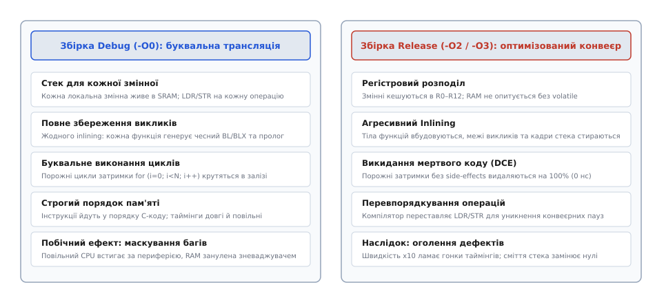
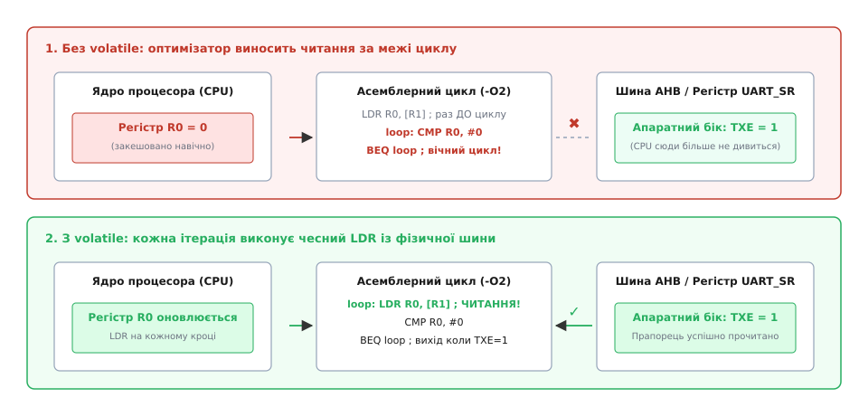
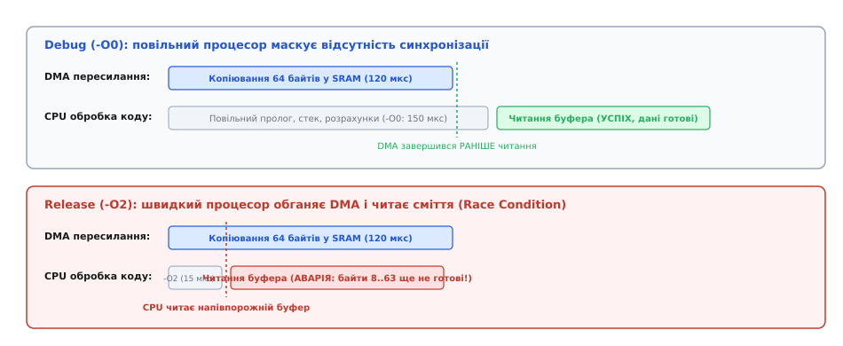
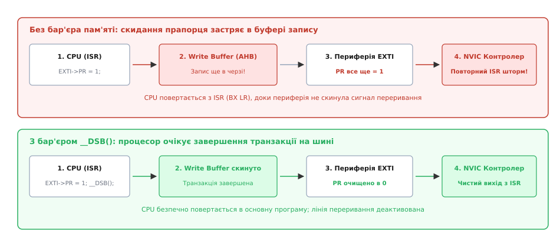

# Працює в debug, падає в release

<preknowlist>
- [Систематичний пошук несправності](root:embedded/troubleshooting-methodology) — як ізолювати плаваючий дефект і методично відсікати хибні гіпотези.
- [Розбір HardFault](root:sf-devices/hardfault) — чому процесор переходить в апаратний виняток і як розшифрувати регістри стану помилок.
- [Декодування адрес аварії](root:embedded/addr2line-workflow) — як за числовим лічильником команд знайти проблемний рядок у вихідному коді прошивки.
- [Оптимізації компілятора](root:sf-lang/compiler-optimizations) — що змінюють рівні -O0, -O2 і -O3 та як перетворюється машинний код.
- [Правило «ніби»](root:sf-lang/as-if-rule) — межі свободи компілятора під час перетворення абстрактної C-машини на асемблер.
</preknowlist>

Ви підключаєте плату до робочої станції через SWD-програматор, запускаєте сесію зневадження — прошивка зібрана з прапорцем `-O0` і працює бездоганно. Світлодіоди блимають у чіткому ритмі, пакети UART безпомилково надходять у термінал, давачі стабільно віддають коректні показання. Але варто змінити профіль збірки на Release з оптимізацією `-O2` або `-O3`, прошити мікроконтролер і від'єднати кабель зневаджувача — як пристрій негайно зависає на першій же секунді, потрапляє у вічний цикл опитування периферії або падає в [HardFault](root:sf-devices/hardfault), викликаючи перезавантаження через сторожовий таймер.

Перша інтуїтивна реакція розробника — звинуватити компілятор у «поломці робочого коду» або запідозрити дефект кристала. Проте компілятор не ламає логіку навмисно: він діє строго в межах стандартів мов C та C++. Режим зневадження (`Debug`, `-O0`) насправді не робить програму правильною — він лише маскує критичні порушення стандартів, гонки таймінгів та неініціалізований стан пам'яті. Зневаджувач і нульова оптимізація сповільнюють процесор у десятки разів і заповнюють оперативну пам'ять передбачуваними нулями. Щойно ці «милиці» зникають у збірці `Release`, прихований дефект виходить назовні.

## Анатомія парадоксу: що змінюють -O2 та -O3 у машинному коді

Щоб зрозуміти джерело збоїв, необхідно поглянути, як саме оптимізатор інтерпретує вихідний текст програми. Компілятор мов C та C++ оптимізує програму не для конкретного кремнію з регістрами та шинами, а для так званої **абстрактної C-машини**. За [правилом «ніби»](root:sf-lang/as-if-rule) (*as-if rule*), компілятор має право змінювати машинний код будь-яким чином, якщо це не змінює спостережувану поведінку програми з погляду самої абстрактної машини.

До спостережуваних дій стандарт відносить лише три речі:
1. Звернення до об'єктів із кваліфікатором `volatile`.
2. Операції введення-виведення (I/O).
3. Повернення значення з точки входу або завершення виконання програми.

Усе інше — порядок розташування змінних у пам'яті, проміжні обчислення, виклики функцій та порожні цикли — оптимізатор має право перевпорядковувати, об'єднувати, спрощувати або видаляти повністю.

У режимі `-O0` (Debug) компілятор вимикає майже всі аналітичні перетворення і генерує машинний код за принципом максимальної наївності. Кожна локальна змінна отримує власну комірку в оперативній пам'яті на стеку. Будь-яка дія в коді `x = a + b;` призводить до послідовності інструкцій: завантажити `a` зі стека в регістр процесора (`LDR`), завантажити `b` зі стека (`LDR`), додати їх (`ADD`), зберегти результат назад у стек у комірку `x` (`STR`). Функції викликаються буквально через інструкції переходу `BL`/`BLX`, формуючи стандартні кадри стека.

```
                    ┌────────────────────────┐
                    │      Вихідний код      │
                    │      C / C++ (AST)     │
                    └───────────┬────────────┘
                                │
        ┌───────────────────────┴───────────────────────┐
        ▼                                               ▼
┌───────────────────────────────┐       ┌───────────────────────────────┐
│     Збірка Debug (-O0)        │       │     Збірка Release (-O2/-O3)  │
├───────────────────────────────┤       ├───────────────────────────────┤
│ • Змінні на стеку (LDR / STR) │       │ • Регістровий розподіл (R0–R12)│
│ • Буквальні виклики (BL / BLX)│       │ • Агресивний Inlining         │
│ • Порожні цикли крутяться     │       │ • Dead Code Elimination (DCE) │
│ • Порядок пам'яті як у C      │       │ • Перевпорядкування інструкцій│
│ • Повільний CPU (маскує гонки)│       │ • Максимальна швидкість такту │
└───────────────────────────────┘       └───────────────────────────────┘
```

У режимі `-O2` або `-O3` оптимізатор будує граф потоку керування (Control Flow Graph), переводить код у проміжне представлення у формі статичного єдиного присвоєння (Static Single Assignment, SSA) та виконує серію глибоких математичних оптимізацій:
* **Регістровий розподіл (Register Allocation):** локальні та проміжні змінні за допомогою алгоритму розфарбовування графа переносяться з повільної пам'яті SRAM у швидкі регістри ядра (`R0`–`R12` в архітектурі ARM Cortex-M). Процесор більше не звертається до шини пам'яті на кожній операції.
* **Вбудовування функцій (Inlining):** код функцій підставляється безпосередньо в місце виклику. Межі функцій і накладні витрати на пролог/епілог (збереження регістрів `PUSH`/`POP` на стек) зникають, що відкриває простір для міжпроцедурного поширення констант (Constant Propagation) та видалення надлишкових розгалужень.
* **Видалення мертвого коду (Dead Code Elimination, DCE):** будь-які обчислення або цикли, результати яких не впливають на спостережуваний стан системи, видаляються з бінарного файлу.
* **Перевпорядкування інструкцій (Instruction Scheduling):** порядок виконання операцій змінюється так, щоб заповнити конвеєрні паузи (pipeline stalls) та мінімізувати простої шини пам'яті.
* **Векторизація та злиття звернень:** послідовні поодинокі зчитування байтів або слів об'єднуються в інструкції подвійного чи групового завантаження (`LDRD`, `LDM`).


*Принципова різниця між генерацією коду в режимах Debug та Release. У Debug кожна змінна живе на стеку, а виклики функцій відбуваються буквально. У Release оптимізатор переносить змінні в регістри процесора, вбудовує функції та видаляє операції без спостережуваного результату.*

Ці оптимізації скорочують розмір прошивки та прискорюють її виконання в 5–20 разів. Проте разом із цим вони викривають приховані помилки в коді, які режим Debug замовчував завдяки своїй повільності та неефективності.

## Забутий volatile: кешування регістрів та вічні цикли

Найпоширеніша причина зависання прошивки в Release — відсутність кваліфікатора `volatile` на змінних або регістрах, стан яких змінюється ззовні поточного контексту виконання: апаратною периферією мікроконтролера, прямим доступом до пам'яті (DMA) або обробником переривання (ISR).

Розглянемо типовий фрагмент коду очікування готовності передавача UART або завершення вимірювання АЦП:

:::tabs
:::code pratsiuie-v-debug-padaie-v-release-d/c/zabutyi-volatile.c
:::code pratsiuie-v-debug-padaie-v-release-d/cpp/zabutyi-volatile.cpp
:::

У режимі `-O0` компілятор чесно транслює кожну ітерацію циклу `while`:
```asm
; Збірка -O0 (ARM Thumb-2)
uart_send_byte:
    ldr     r1, =0x40013800   ; Адреса регістру стану USART1->SR
.L_loop_debug:
    ldr     r2, [r1]          ; Зчитуємо фізичний регістр з шини пам'яті
    tst     r2, #128          ; Перевіряємо біт TXE (1 << 7)
    beq     .L_loop_debug     ; Якщо 0 — повторюємо читання
    ; Буфер вільний, записуємо дані...
```
На кожній ітерації процесор відправляє запит на шину APB/AHB, зчитує актуальний стан регістра `USART1->SR`, і щойно апаратний блок UART встановлює біт `TXE`, цикл завершується. Програма працює.

Але що бачить оптимізатор у режимі `-O2`? Оскільки вказівник оголошено як звичайний `uint32_t*`, компілятор звертається до правил абстрактної C-машини: всередині тіла циклу `while` немає жодного запису за адресою `0x40013800`. Отже, з погляду компілятора, значення за цією адресою змінитися **не може**. Компілятор застосовує оптимізацію винесення інваріантів за межі циклу (*Loop-Invariant Code Motion, LICM*):

:::code pratsiuie-v-debug-padaie-v-release-d/asm/main.s

Оптимізатор завантажив значення регістра `USART1->SR` у регістр ядра `r2` рівно один раз. Якщо в цей початковий момент буфер UART був зайнятий (`TXE == 0`), процесор переходить у нескінченний локальний перехід `b .L_infinite_hang`. Хоча залізо через дві мікросекунди звільнило буфер і виставило `TXE = 1` на фізичній шині, процесор цього ніколи не дізнається — він крутиться у власному регістрі.


*Механізм апаратного зависання: без ключового слова volatile компілятор вважає значення в пам'яті незмінним і виносить інструкцію LDR за межі циклу. З volatile кожна ітерація генерує обов'язкове фізичне читання з шини.*

Точно така ж картина виникає зі змінними-прапорцями, які змінюються всередині обробників переривань ([ISR](root:sf-devices/hardfault)):

:::tabs
:::code pratsiuie-v-debug-padaie-v-release-d/c/zabutyi-volatile-2.c
:::code pratsiuie-v-debug-padaie-v-release-d/cpp/zabutyi-volatile-2.cpp
:::

Кваліфікатор `volatile` вказує компілятору: «доступ до цього об'єкта є спостережуваною побічною дією; заборонено видаляти читання чи записи, кешувати їх у регістрах або переставляти місцями відносно точок послідовності». Усі периферійні регістри в бібліотеках CMSIS визначені через макрос `__IO` (що розгортається у `volatile uint32_t`).

### Межі застосування volatile: де його недостатньо

Важливо пам'ятати, що `volatile` у мовах C та C++ **не є синонімом атомарності або потокобезпеки**:
1. `volatile` не гарантує атомарності складених операцій на кшталт `counter++` (вона розгортається у три окремі інструкції `LDR` -> `ADD` -> `STR`, між якими може вклинитися переривання).
2. `volatile` не створює апаратних бар'єрів пам'яті для кешів процесора або буферів запису шини.
3. У C++ для міжпотокової синхронізації слід використовувати `std::atomic<T>`, тоді як `volatile` залишається інструментом виключно для відображених на пам'ять апаратних регістрів (MMIO) та взаємодії з асинхронними ISR.

## Пастка неініціалізованої пам'яті: BSS, стек та сміття в SRAM

Наступна класична пастка виникає через нерозуміння того, як організована оперативна пам'ять мікроконтролера та як середовище зневадження впливає на фізичні комірки SRAM.

Оперативна пам'ять вбудованої системи поділена на секції:
* **`.data`** — глобальні та статичні змінні з ненульовими початковими значеннями (копіюються з Flash у SRAM стартовим кодом `Reset_Handler`).
* **`.bss`** — глобальні та статичні змінні без ініціалізації або з явним нулем (стартовий код обнуляє цей діапазон у циклі від адреси `_sbss` до `_ebss`).
* **Стек (Stack)** та **Купа (Heap)** — динамічна область пам'яті.

```
┌────────────────────────────────────────────────────────┐
│ Flash (ROM)                                            │
│ [ Вектори переривань | Код .text | Константи .rodata ] │
└───────────────────────────┬────────────────────────────┘
                            │ (копіювання .data при старті)
                            ▼
┌────────────────────────────────────────────────────────┐
│ SRAM (RAM)                                             │
│ [ .data ] [ .bss (обнулено) ] [ Heap -> ] [ <- Stack ] │
└────────────────────────────────────────────────┘
```

Локальні автоматичні змінні функцій розміщуються на **стеку** або в регістрах. Вони **не належать** до секції `.bss` і ніколи не обнуляються стартовим кодом мікроконтролера!

Коли ви запускаєте програму під зневаджувачем (OpenOCD, J-Link, ST-Link):
1. Перед завантаженням коду скрипт зневаджувача часто ініціалізує всю SRAM нулями (`0x00000000`) або фіксованим патерном (`0xDEADBEEF`) для очищення попередніх даних.
2. У режимі `-O0` стек функцій глибокий, і змінні розташовуються в пам'яті послідовно. Якщо програма запускається вперше після скидання, стек потрапляє на щойно занулені ділянки SRAM.
3. Локальна неініціалізована змінна `int status;` випадково отримує значення `0`. Код перевірки `if (status == 0)` спрацьовує, створюючи ілюзію повної працездатності.

У режимі `Release` на автономному пристрої:
1. Фізичні комірки статичної пам'яті (SRAM) побудовані на 6-транзисторних тригерах (6T SRAM). У момент подачі живлення стан кожного тригера визначається мікроскопічною асиметрією порогів транзисторів і тепловим шумом. Пам'ять заповнена випадковим сміттям (типово чергуванням патернів на зразок `0xAA`, `0x55` або хаотичними байтами).
2. При виклику функцій стек багаторазово перезаписується адресами повернення та проміжними даними попередніх підпрограм.
3. Оптимізатор у `-O2` агресивно перевикористовує регістри та пакує змінні на стеку. Якщо змінну не було ініціалізовано, вона бере той залишковий бітовий масив, який лежав у регістрі чи на верхівці стека від попередньої функції.

:::tabs
:::code pratsiuie-v-debug-padaie-v-release-d/c/pastka-neinitsializovanoi.c
:::code pratsiuie-v-debug-padaie-v-release-d/cpp/pastka-neinitsializovanoi.cpp
:::

### Повторне використання стека (Stack Frame Aliasing)

В оптимізованому коді виникає ще тонший ефект: **перекриття кадрів стека**. Коли дві функції викликаються послідовно в одному блоці:

:::tabs
:::code pratsiuie-v-debug-padaie-v-release-d/c/povtorne-vykorystannia.c
:::code pratsiuie-v-debug-padaie-v-release-d/cpp/povtorne-vykorystannia.cpp
:::

У Debug кадр кожної функції мав додаткові збережені регістри та службові поля, тому адреси змінних зміщувалися. У Release обидві функції використовують абсолютно однакові зміщення стека, і друга функція читає «спадщину» першої.

## Зникнення циклів затримки (Dead Code Elimination)

Ще одна класична проблема — створення затримок за допомогою порожніх циклів `for` або `while`.

:::tabs
:::code pratsiuie-v-debug-padaie-v-release-d/c/znyknennia-tsykliv.c
```cpp
#include <cstdint>

// Наївний C++ цикл очікування
void delay_ms(std::uint32_t count) {
    for (std::uint32_t i = 0; i < count * 1000U; ++i) {
        // Компілятор видалить цей цикл у -O2
    }
}
```
:::

У збірці Debug (`-O0`) компілятор чесно виділяє комірку для лічильника `i` і на кожному кроці виконує `LDR`, `ADD`, `STR`, `CMP`, `BLT`. На частоті ядра 72 МГц виконання 5000 ітерацій займає приблизно 5 мілісекунд. Зовнішня мікросхема пам'яті I2C EEPROM встигає записати сторінку, і наступна операція проходить успішно.

Що робить оптимізатор при `-O2`? Він бачить, що змінна `i` локальна, її значення за межі функції не повертається, а тіло циклу не містить жодних операцій зі спостережуваним побічним ефектом. Висновок компілятора категоричний: цей код не робить нічого корисного. Компілятор виконує **Dead Code Elimination** і перетворює всю функцію на одну інструкцію повернення:

```asm
; Збірка delay_ms при -O2
delay_ms:
    bx      lr      ; Миттєве повернення! Тривалість: 1 такт (14 наносекунд)!
```

Затримка в 5 мілісекунд перетворилася на 14 наносекунд. Програма надсилає наступний байт по I2C, коли EEPROM ще зайнята внутрішнім високовольтним циклом запису. Мікросхема не видає підтвердження (NACK), шина I2C блокується, а драйвер зависає в очікуванні відповіді.

Аналогічна доля спіткає й інші апаратні таймінги:
* Імпульс апаратного скидання OLED-дисплея (вимагає мінімум 10 мікросекунд низького рівня на лінії `RESET`).
* Час стабілізації аналогового живлення та PLL давача після подачі живлення.
* Час заряду ємності на лініях вимірювання сенсорних кнопок.

### Як організувати надійні апаратні затримки

Для апаратних затримок необхідно використовувати апаратні таймери, лічильник циклів ядра або в крайньому разі інструкцію вбудованого асемблера з пам'яттєвим бар'єром:

:::tabs
:::code pratsiuie-v-debug-padaie-v-release-d/c/iak-orhanizuvaty-nadiini.c
:::code pratsiuie-v-debug-padaie-v-release-d/cpp/iak-orhanizuvaty-nadiini.cpp
:::

## Зміна таймінгів і маскування гонок (Race Conditions)

Один із найпідступніших феноменів вбудованої розробки має назву **гейзенбаг** (*Heisenbug*) — дефект, який зникає або змінює свою поведінку під час спроби його дослідити.

У режимі Debug код виконується повільно. Пролог функцій, постійне збереження змінних на стек і відсутність інлайнінгу створюють затримку між діями процесора у десятки мікросекунд. Крім того, апаратний адаптер SWD/JTAG під час покрокового виконання або опитування пам'яті через Background Memory Access перехоплює цикли внутрішньої шини процесора, додатково гальмуючи виконання.

Якщо в коді є стан гонки ([Race Condition](root:sf-tasks/lock-free-basics)) між ядром процесора та апаратною периферією (DMA, АЦП, передавач SPI), повільний процесор у Debug майже завжди «випадково програє» гонку периферії — тобто периферія встигає завершити транзакцію до того, як процесор дійде до точки перевірки даних.

Розглянемо прийом пакета по DMA:

:::tabs
:::code pratsiuie-v-debug-padaie-v-release-d/c/zmina-taiminhiv-i.c
:::code pratsiuie-v-debug-padaie-v-release-d/cpp/zmina-taiminhiv-i.cpp
:::


*Часова діаграма гонки станів: у режимі Debug повільний процесор починає обробку буфера вже після того, як DMA завершив пересилання. У Release оптимізований код доходить до буфера за лічені такти й читає неповні дані.*

У Release з оптимізацією `-O2` процесор вбудовує функцію `parse_packet` і починає аналізувати байти вже через 10 тактів після старту DMA (менш ніж 100 наносекунд). У цей момент DMA переніс лише перші 2 байти з 64. Програма намагається розпарсити сміття, отримує помилку валідації пакета й переходить в аварійний режим.

Єдине правильне рішення — сувора апаратна або програмна синхронізація: очікування прапорця Transfer Complete (`TCIF`) у регістрі DMA, очікування семафора від ISR переривання DMA або використання подвійної буферизації (Ping-Pong buffers).

## Неочікуване переповнення стека при Inlining

Інтуїтивно здається, що оптимізація повинна зменшувати споживання пам'яті. Однак агресивне вбудовування функцій (*Inlining*) у режимі `-O2`/`-O3` може призвести до **вибухового зростання розміру стека окремої задачі** в операційних системах реального часу (FreeRTOS, Zephyr).

Коли функція не вбудована, її локальні змінні виділяються на стеку в момент виклику і звільняються при поверненні (`POP`). Пам'ять стека може бути повторно використана наступною функцією.

Коли компілятор вбудовує 5 функцій усередину головного циклу задачі `task_main()`, він об'єднує всі локальні змінні цих функцій в **один гігантський кадр стека**. Якщо кожна функція мала локальний буфер на 128 байтів, розмір кадру задачі зростає зі 150 до 700 байтів! У Release це миттєво пробиває виділений розмір стека задачі FreeRTOS (наприклад, `configMINIMAL_STACK_SIZE = 128 words = 512 bytes`), пошкоджуючи пам'ять сусідніх завдань або викликаючи `UsageFault`.

:::tabs
:::code pratsiuie-v-debug-padaie-v-release-d/c/neochikuvane-perepovnennia.c
:::code pratsiuie-v-debug-padaie-v-release-d/cpp/neochikuvane-perepovnennia.cpp
:::

## Порушення порядку доступу, бар'єри пам'яті та вирівнювання структур

Оптимізації високого рівня можуть оголити ще дві апаратні особливості сучасних мікроконтролерів: перевпорядкування доступу до пам'яті на рівні шин та вимоги до вирівнювання даних.

### Буфер запису шини та бар'єри пам'яті (DMB / DSB / ISB)

Процесори архітектури [ARM Cortex-M](root:hw-arch/cortex-m) (Cortex-M3, M4, M7) мають внутрішній конвеєр і **буфер запису** (*Write Buffer*) на шині AHB/APB. Коли процесор виконує інструкцію запису `STR` у регістр периферії, запис поміщається в буфер, а ядро негайно переходить до виконання наступної інструкції, не чекаючи, поки сигнал фізично дійде до контролера периферії через шинний міст.

Класична аварія в обробнику переривань (ISR):

:::tabs
:::code pratsiuie-v-debug-padaie-v-release-d/c/bufer-zapysu-shyny-ta.c
```cpp
#include <cstdint>

extern "C" void EXTI0_IRQHandler() {
    // Безпечний скид прапорця з очікуванням завершення транзакції на шині
    EXTI->PR = (1U << 0);

    // Апаратний бар'єр даних гарантує завершення запису до виходу з переривання
    asm volatile("dsb" ::: "memory");
}
```
:::


*Асинхронний буфер запису шини APB: без бар'єра DSB процесор повертається з ISR до того, як транзакція скидання прапорця дійде до периферії. Контролер NVIC фіксує активний рівень переривання і викликає обробник знову.*

Щоб запобігти повторному хибному спрацьовуванню переривання, використовують апаратний бар'єр даних `__DSB()` (Data Synchronization Barrier) або фіктивне зчитування будь-якого регістра того ж периферійного блоку `(void)EXTI->PR;`, що змушує шину дочекатися завершення попереднього запису.

Три типи бар'єрів пам'яті в архітектурі ARM:
* **`__DMB()` (Data Memory Barrier):** гарантує, що всі операції доступу до пам'яті, записані до бар'єра, завершаться раніше за операції після нього. Необхідний при роботі з чергами без блокувань ([Lock-Free](root:sf-tasks/lock-free-basics)) та DMA.
* **`__DSB()` (Data Synchronization Barrier):** повністю зупиняє виконання інструкцій ядром, поки всі незавершені транзакції на шині пам'яті не виконаються повністю. Необхідний перед переходом у режим сну (`WFI`) та перед виходом із ISR.
* **`__ISB()` (Instruction Synchronization Barrier):** очищає конвеєр процесора і змушує його заново вибирати інструкції з пам'яті. Необхідний після зміни таблиці векторів (`VTOR`) або налаштування захисту пам'яті MPU.

### Суворе псевдонімування (Strict Aliasing)

У режимі `-O2` автоматично вмикається оптимізація `-fstrict-aliasing`. Згідно зі стандартом C99/C++11, компілятор припускає, що вказівники на різні базові типи не можуть посилатися на одну й ту саму область пам'яті.

:::tabs
:::code pratsiuie-v-debug-padaie-v-release-d/c/suvore-psevdonimuvannia.c
```cpp
#include <cstdint>
#include <bit>
#include <cstring>

// Ідіоматичний C++20: std::bit_cast гарантує безпечне перетворення типів
constexpr std::uint32_t swap_bytes_good(std::uint32_t val) noexcept {
    // Сучасні компілятори транслюють це в інструкцію REV на ARM
    return std::byteswap(val);
}
```
:::

### Невирівняний доступ до пам'яті (Unaligned Memory Access)

Ядра ARM Cortex-M0/M0+ взагалі не підтримують невідповідність адреси розміру даних: спроба прочитати 32-бітне слово `uint32_t` за адресою, що не ділиться на 4, негайно викликає `HardFault`.

Ядра Cortex-M3/M4/M7 апаратно підтримують невідповідність для одиночних інструкцій `LDR`/`STR`. Але коли компілятор оптимізує код у `-O2`, він часто об'єднує послідовні читання полів структур в інструкції множинного завантаження `LDM`/`STM` або `LDRD`/`STRD` (завантаження пари 32-бітних слів у 64-бітний регістровий блок). **Ці векторні інструкції не підтримують невідповідність адреси навіть на Cortex-M4/M7!** Якщо спакована структура (`__attribute__((packed))`) передається за вказівником у функцію, оптимізатор генерує `LDRD`, і пристрій падає в `UsageFault` (INVPC/UNALIGNED).

## Систематичний алгоритм пошуку несправності

Коли прошивка падає в Release, спроби випадково розставляти `printf` або повертати окремі змінні до стану Debug лише затягують локалізацію. Нижче наведено покроковий інженерний чекліст діагностики.

```
┌───────────────────────────────────────────────────────────┐
│              Збірка Release падає або зависає             │
└─────────────────────────────┬─────────────────────────────┘
                              │
                              ▼
┌───────────────────────────────────────────────────────────┐
│ Крок 1. Збірка з оптимізацією та символами:               │
│         -O2 -g3 (збереження таблиць DWARF для addr2line)  │
└─────────────────────────────┬─────────────────────────────┘
                              │
                              ▼
┌───────────────────────────────────────────────────────────┐
│ Крок 2. Увімкнення максимальних попереджень:              │
│         -Wall -Wextra -Wpedantic -Wuninitialized          │
│         -Wstrict-aliasing=2 -Wcast-align                  │
└─────────────────────────────┬─────────────────────────────┘
                              │
                              ▼
┌───────────────────────────────────────────────────────────┐
│ Крок 3. Перевірка HardFault / CFSR регістрів:             │
│         • UNALIGNED / NOCP -> вирівнювання структур       │
│         • PRECISERR / BFAR -> неініціалізований вказівник │
│         • Вічний цикл     -> відсутність volatile / atomic│
└─────────────────────────────┬─────────────────────────────┘
                              │
                              ▼
┌───────────────────────────────────────────────────────────┐
│ Крок 4. Аудит таймінгів та бар'єрів:                      │
│         • Заміна порожніх for() на DWT / SysTick таймери  │
│         • Додавання __DSB() перед виходом з ISR           │
│         • Перевірка синхронізації з DMA / перериваннями   │
└───────────────────────────────────────────────────────────┘
```

1. **Створіть профіль RelWithDebInfo (`-O2 -g3`):**
   Прапорець `-g3` додає до файлу `.elf` повні таблиці DWARF, не змінюючи жодного байта згенерованого машинного коду у Flash. Це дозволить підключити зневаджувач до оптимізованого Release-бінарника або розкодувати адресу аварії через [addr2line](root:embedded/addr2line-workflow).
2. **Увімкніть максимальні попередження компілятора:**
   Додайте до прапорців збірки:
   `-Wall -Wextra -Wpedantic -Wuninitialized -Wmaybe-uninitialized -Wstrict-aliasing=2 -Wcast-align -Wdouble-promotion -Wshadow -Wconversion`
   У більшості випадків компілятор у режимі `-O2` сам попереджає рядком `warning: 'cfg.retry_count' may be used uninitialized in this function` про місце майбутньої аварії.
3. **Використовуйте режим оптимізації `-Og` для бінарного пошуку:**
   Прапорець `-Og` (Optimize for Debugging) вмикає базові оптимізації, але гарантує збереження структури змінних і викликів, допомагаючи ізолювати межу між поведінкою `-O0` та `-O2`.
4. **Розшифруйте регістри апаратного винятку:**
   Реалізуйте обробник [HardFault_Handler](root:sf-devices/hardfault), який вичитує регістри ядра Cortex-M:
   * `CFSR` (Configurable Fault Status Register): біт `UNALIGNED` вказує на невирівняний доступ, `DIVBYZERO` — ділення на нуль, `UNDEFINSTR` — спробу виконати сміття замість коду.
   * `BFAR` (BusFault Address Register): якщо прапорець `BFARVALID = 1`, цей регістр містить точну фізичну адресу пам'яті, спроба доступу до якої викликала збій (наприклад, розіменування сміттєвого покажчика).
5. **Проведіть аудит усіх точок спільного доступу:**
   Кожна змінна, яка змінюється в ISR або потоці RTOS і читається в іншому місці, повинна бути або кваліфікована як `volatile`, або загорнута в `std::atomic`.
6. **Замініть усі програмні затримки:**
   Видаліть усі цикли `for (int i=0; i<N; i++)` та переведіть затримки на апаратні лічильники DWT або системний таймер SysTick.
