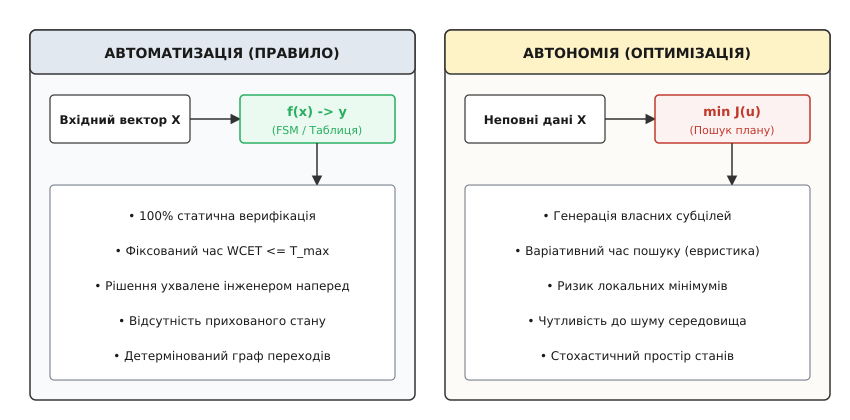
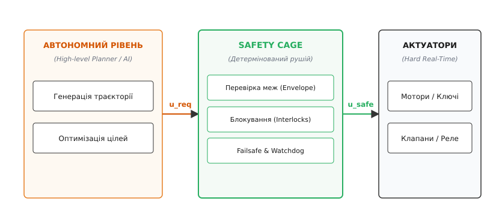
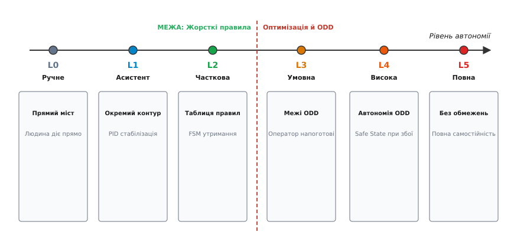

# Правило, а не рішення: межа автоматизації й автономії

<preknowlist>
- [Скінченний автомат](root:hw-digital/finite-state-machines) — дискретна модель системи з фіксованим набором станів, переходів та детермінованих умов.
- [Безпечний стан апаратури](root:hw-digital/safe-state-hardware) — апаратна конфігурація ключів, клапанів і приводів, що гарантує збереження системи у разі аварії чи втрати живлення.
- [Виявлення відмов сенсорів](root:embedded/sensor-fault-detection) — перевірка валідності вимірювань, застряглих значень, обривів ліній та виходу сигналів за межі фізичного діапазону.
- [Аварійна зупинка](root:embedded/avariina-zupynka) — безумовне переривання небезпечного процесу апаратними та програмними блокуваннями, яке софт не має права проігнорувати.
</preknowlist>

Коли інженер розробляє вбудовану систему — польотний контролер безпілотника, систему керування високовольтною батареєю (BMS), регулятор тиску в автоклаві чи привід промислового маніпулятора — виникає спокуса зробити прошивку «гнучкою» та «інтелектуальною». Замість жорстких таблиць реакцій програміст намагається вбудувати евристичний пошук, зважування багатьох нечітких цілей або динамічну оптимізацію безпосередньо в контур реального часу. Проте щойно на вхід надходить неочікувана комбінація сигналів — наприклад, окиснений контакт датчика дає стрибок напруги саме в момент екстреного гальмування — складний евристичний алгоритм потрапляє в непередбачену гілку обчислень, час виконання циклу зростає з двох мілісекунд до ста п'ятдесяти, а оптимізатор знаходить компроміс, який фізично ламає редуктор або перегріває силовий транзистор.

Ця проблема виникла тому, що в критичних вбудованих системах будь-яка поведінкова невизначеність або плаваючий час реакції є фатальними дефектами. Якщо в аварійній ситуації контролер намагається «придумати рішення» шляхом пошуку в багатовимірному просторі, він втрачає головну властивість безпечного керування — гарантований час реакції в найгіршому випадку (Worst-Case Execution Time, WCET) та 100% статичну верифікованість. Межа між автоматизацією (жорстким виконанням заздалегідь визначеного правила) та автономією (генерацією нових проміжних цілей в умовах неповної інформації) — це не філософський поділ, а жорсткий архітектурний бар'єр надійності.

У цій статті розбираємо математичну та програмну природу цієї межі: чому в критичних мікроконтролерах автоматизація зводиться до детермінованого відображення входів на виходи, де саме починається автономія як мінімізація функції вартості, як розподіляються рівні автономії від прямого ручного мосту до автономного агента, чому небезпечно допускати евристики до силових ключів без архітектурного бар'єра безпеки, та як побудувати детермінований рушій правил (Rule Engine) на C і C++ із нульовим динамічним виділенням пам'яті та захистом від брязкоту умов.

## Формальний вододіл: автоматизація як детерміноване відображення

Уся класична автоматизація вбудованих систем будується на фундаментальному математичному принципі: це детерміноване відображення вхідного вектора стану на вихідний керівний сигнал:

```
y = f(x, s)
```

де `x` — поточний вектор вимірювань сенсорів (напруга, струм, температура, прапорці валідності), `s` — поточний внутрішній дискретний стан системи, а `y` — вектор вихідних дій (стан силових ключів, шпаруватість ШІМ, положення клапанів).

Якщо описати систему мовою теорії автоматів, дискретний стан на наступному такті обчислюється функцією переходів:

```
s[t+1] = delta(s[t], i[t])
y[t]   = lambda(s[t], i[t])
```

де `S` — скінченна множина станів, `I` — дискретний вхідний алфавіт, а `delta` та `lambda` — фіксовані відображення, визначені таблицею переходів.

```
+-------------------------------------------------------------------------+
|                    ДЕКЛАРАТИВНЕ ПРАВИЛО АВТОМАТИЗАЦІЇ                  |
|                                                                         |
|  ЯКЩО (Температура_Транзистора > 85 °C ПРОТЯГОМ 500 мс)                 |
|  ТА   (Режим != АВАРІЙНИЙ_СТОП)                                         |
|  ТОДІ:                                                                  |
|       Знизити_Струм_ШІМ_До(50%);                                        |
|       Увімкнути_Кулер_Охолодження();                                    |
|       Встановити_Прапорець_Попередження(ПЕРЕГРІВ_СИЛОВОГО_МОСТА);        |
+-------------------------------------------------------------------------+
```

Головна характеристика цього підходу полягає в тому, що **рішення вже прийняте людиною-інженером на етапі проектування**. Контролер під час виконання не розмірковує, чи вигідно знижувати струм і які довгострокові наслідки це матиме для продуктивності. Контролер виконує суто обчислення булевого предиката над даними та активує відповідну гілку дій.

Це дає чотири фундаментальні інженерні переваги:

1. **Повна статична верифікація:** Оскільки простір станів `S` та набір правил скінченні, розробник або статичний аналізатор може математично перевірити всі можливі комбінації входів за таблицею істинності. Можна строго довести відсутність тупикових станів (deadlocks), відсутність недосяжних гілок та однозначність виходу для кожного вектора входів.
2. **Гарантований час виконання (Bounded WCET):** Обчислення таблиці правил не містить нескінченних циклів або рекурсивного пошуку. Час обходу списку правил фіксований, вимірюється в тактах процесора і є константним `O(N)` від кількості правил у системі.
3. **Абсолютна відтворюваність:** За однакової послідовності вхідних даних контролер завжди, з точністю до такту кварцового резонатора, видає ідентичний вихід. Помилку, зафіксовану в чорній скриньці (лозі), можна на 100% повторити на стенді.
4. **Прозорість сертифікації:** Для стандартів функціональної безпеки (IEC 61508, ISO 26262, DO-178C) кожне правило зіставляється з конкретною вимогою безпеки (Safety Requirement), що забезпечує 100% трасованість коду.

### Математична повнота та матриця досяжності

Щоб довести, що набір правил не містить логічних дірок, у критичних системах будують **матрицю досяжності станів** (Reachability Matrix). Нехай система має `N` булевих умов `c_1, c_2, ..., c_N`. Повний простір входів утворює гіперкуб розмірності `2^N`. 

Детермінований рушій правил вимагає дотримання двох умов:

1. **Повнота (Completeness):** Для будь-якого вхідного вектора `(c_1, ..., c_N)` існує принаймні одне визначене правило (або явно задане правило за замовчуванням `Default Action`).
2. **Несуперечливість (Non-contradiction):** Жоден вхідний вектор не може одночасно активувати дві взаємовиключні дії (наприклад, одночасне відкриття верхнього та нижнього плеча напівмоста, що викликало б коротке замикання).

У детермінованій автоматизації будь-який конфлікт розв'язується не динамічним голосуванням, а фіксованим статичним порядком (пріоритетом або апаратною маскою блокування).

## Автономія: оптимізація в просторі невизначеності

Що відбувається, коли система стикається із завданням, де неможливо заздалегідь перелічити всі комбінації зовнішнього середовища? Наприклад, автономний підводний апарат або колісний робот рухається пересіченою місцевістю, де датчики бачать перешкоди довільної форми, а коефіцієнт зчеплення коліс із ґрунтом невідомий і постійно змінюється.

Якщо спробувати написати систему правил IF-THEN для такої задачі, настане **комбінаторний вибух**. Для `M` датчиків із `K` градаціями значень кількість можливих станів становить `K^M`. Якщо `M = 20`, а `K = 10`, простір станів сягає `10^20`, що перевершує будь-які можливості ручного опису.

Саме тут виникає **автономія**. В автономній системі інженер задає не жорсткі правила поведінки «якщо X, роби Y», а **мету, обмеження та критерій якості** у вигляді функції вартості (Cost Function або Loss Function):

```
J(x, u) = Інтеграл_{0}^{T} [ L(x(t), u(t)) ] dt + Phi(x(T))
```

де `x(t)` — фазовий стан системи (координати, швидкості, кути), `u(t)` — вектор керування, `L(x, u)` — миттєва штрафна функція (наприклад, витрати енергії, наближення до перешкод, відхилення від цільової точки), а `Phi(x(T))` — штраф за кінцевий стан на горизонті планування `T`.

Завдання автономного контролера — знайти оптимальну траєкторію керування `u*`, яка мінімізує сумарну вартість:

```
u* = argmin_{u in U} J(x, u)
```

```
+-------------------------------------------------------------------------+
|                  АВТОНОМНИЙ ПРИНЦИП КЕРУВАННЯ (ПЛАНУВАННЯ)              |
|                                                                         |
|  ЦІЛЬ: Досягти точки призначення (X=100, Y=250) за час T < 60 c         |
|  ОБМЕЖЕННЯ: Відстань до перешкоди > 1.5 м, Напруга батареї > 14.0 В      |
|  ФУНКЦІЯ ВАРТОСТІ J = w1*(Час) + w2*(Витрата_Енергії) + w3*(Ризик)      |
|                                                                         |
|  КОНТРОЛЕР ГЕНЕРУЄ:                                                     |
|       1. Проміжну траєкторію (обхід перешкоди зліва або справа);        |
|       2. Динамічний профіль швидкості;                                  |
|       3. Нові субцілі (зупинитись, зачекати, змінити маршрут).          |
+-------------------------------------------------------------------------+
```

В автономному режимі система **сама синтезує проміжні підцілі (sub-goals)**, яких інженер явно не закладав у прошивку. Робот може «вирішити» здати назад і розвернутися, якщо прямий шлях перекрито.


*Принциповий вододіл: автоматизація спирається на детерміноване відображення з гарантованим часом виконання, тоді як автономія здійснює пошук в просторі невизначеності через мінімізацію функції вартості.*

Ця гнучкість має високу ціну, яка робить «чисту» автономію непридатною для безпосереднього керування критичним залізом:

- **Недетермінований час виконання (Unbounded Execution Time):** Алгоритми пошуку шляху (A*, RRT*, D* Lite) або чисельної оптимізації (Model Predictive Control, SQP) здійснюють ітераційний обхід графа або градієнтний спуск. Час збіжності залежить від складності сцени. В один момент розв'язок знаходиться за 5 мс, а в інший — оптимізатор потребує 800 мс і пропускає дедлайн керування актуатором.
- **Локальні мінімуми та евристичні зриви:** Оптимізатор може застрягти в локальному мінімумі (наприклад, робот заїжджає в U-подібну пастку між перешкодами й безпорадно коливається між двома рівноцінними векторами тяги).
- **Непрозорість прийняття рішень:** Мале збурення вхідних даних (шум далекоміра на 2 см) може призвести до якісного стрибка в оптимізаційному ландшафті: планувальник раптово вибирає діаметрально протилежний маневр, що стає повною несподіванкою для механіки та оператора.

## Небезпека псевдоінтелекту та архітектура «Safety Cage»

У розробці вбудованих систем існує небезпечний інженерний антипатерн: спроба передати складній евристиці або нейромережі прямий контроль над силовими приводами чи критичними ключами.

Уявімо контролер заряджання тягової літієвої батареї. Якщо замість детермінованого компаратора з [гістерезисом](root:embedded/porih-i-histerezys) «якщо напруга комірки перевищила 4.25 В — негайно вимкнути ключ заряджання» розробник створює «адаптивну нейромережеву оптимізацію швидкості заряду», система стає вразливою. Достатньо рідкісної комбінації низької температури та специфічного внутрішнього опору старої комірки, яка не входила в навчальну вибірку, і оптимізатор допустить перезаряд до 4.45 В, вважаючи, що це дозволить швидше вийти на плато потужності. Фізичний результат — тепловий розгін і пожежа.

У критичних вбудованих системах діє фундаментальне правило безпеки: **чим ближче код до силового заліза, тим простішим і категоричнішим він мусить бути**.

Для поєднання інтелектуального планування та гарантованої безпеки застосовують класичний архітектурний патерн — **Safety Cage (Бар'єр безпеки / Envelope Protection)**.


*Архітектурне розмежування: верхній автономний рівень генерує бажані дії (u_req), а жорсткий детермінований рушій правил на нижньому рівні пропускає лише безпечні команди (u_safe), гарантуючи апаратні інваріанти.*

Архітектура Safety Cage будується на суворому розділенні контурів:

1. **Недовірений автономний рівень (High-Level Planner):**
   Може виконуватися на потужному мікропроцесорі (наприклад, ARM Cortex-A під керуванням Linux або ROS 2). Він будує карту, обробляє хмари точок LiDAR, шукає оптимальні траєкторії та генерує *запити на дію* `u_req` (наприклад, «повернути кермо на 15 градусів праворуч і дати тягу 70%»).
2. **Детермінований рівень правил (Safety Arbiter / Rule Engine):**
   Виконується на виділеному мікроконтролері реального часу (ARM Cortex-M / RISC-V) у середовищі bare-metal або жорсткої RTOS. Цей рівень нічого не знає про глобальну мету місії. Він оцінює кожну команду крізь набір інваріантних правил:
   - Чи не перевищує струм двигуна ліміт `I_max`?
   - Чи не виходить кут нахилу за межі безпечного конверта `roll_max`?
   - Чи не надходить команда на відкриття верхнього ключа, коли нижній ще відкритий ([апаратне блокування](root:embedded/blokuvannia-i-priorytet))?
   - Чи надходило підтвердження від сенсора валідності не пізніше ніж 50 мс тому?
3. **Безумовне перехоплення (Failsafe Override):**
   Якщо автономний планувальник зависає, пропускає такт серцебиття (heartbeat) або генерує команду, яка порушує бодай одне базове правило, рушій правил миттєво відкидає `u_req` і переводить систему в [безпечний стан](root:hw-digital/safe-state-hardware) (вимикає силу, вмикає аварійне механічне гальмо, скидає тягу до нуля).

## Шкала автономії: від прямого мосту до автономного агента

Щоб чітко розуміти, на якому рівні автоматизації перебуває ваш пристрій, у світовій інженерії спираються на таксономію розподілу повноважень між людиною та машиною. Класична основа була закладена в роботі Томаса Шерідана та Вільяма Верпланка (Sheridan & Verplank, 1978, MIT), де виділялося 10 рівнів автоматизації телекерованих підводних апаратів.

У сучасному вбудованому та робототехнічному контексті (адаптовано до стандарту SAE J3016) використовують 6 рівнів автономії (від L0 до L5):


*Рівні автономії вбудованих систем: чітка демаркаційна лінія між детермінованою автоматизацією правил (L0–L2) та оптимізаційною автономією в межах домену ODD (L3–L5).*

| Рівень | Назва | Хто формує траєкторію | Роль вбудованого контролера | Відповідальність за помилку |
|---|---|---|---|---|
| **L0** | Ручне керування *(No Automation)* | Людина (100%) | Прямий міст: перетворює сигнал ручки в ШІМ ключів | Людина |
| **L1** | Асистент *(Assisted)* | Людина | Ізольовані контури стабілізації (PID обертів, ABS, захист від струму) | Людина |
| **L2** | Часткова автоматизація *(Partial)* | Людина формує намір, контролер веде контури | Комбінація правил і FSM (утримання висоти й курсу, профіль заряду CC/CV) | Людина постійно контролює |
| **L3** | Умовна автономія *(Conditional)* | Автономний планувальник у межах ODD | Онлайн-оптимізація траєкторії; запит на перехоплення людиною при відхиленні | Система в межах ODD, людина на вимогу |
| **L4** | Висока автономія *(High)* | Автономний планувальник у межах ODD | Повне планування та самостійний перехід у Safe State при відмові оператора | Система в межах ODD |
| **L5** | Повна автономія *(Full)* | Повністю автономний агент | Робота в будь-якому нерозміченому середовищі без оператора | Система |

Поняття **ODD (Operational Design Domain — область експлуатаційної придатності)** є ключовим для розуміння меж автономії L3–L4. Це чітко окреслені умови, за яких алгоритми оптимізації гарантовано адекватні: діапазон температур, освітленість, швидкість вітру, наявність сигналу супутникової навігації або каліброваної карти.

Щойно сенсори фіксують вихід за межі ODD (наприклад, GPS-сигнал заглушено або густий туман засліпив оптичні камери), автономна система L3 зобов'язана негайно запросити людину перехопити керування за гарантований бюджет часу `T_takeover` (зазвичай 5–10 секунд), а система L4 — виконати детермінований протокол переходу в мінімально ризиковий стан (Minimal Risk Maneuver / Safe State) виключно за жорсткими правилами нижнього рівня.

## Архітектура детермінованого рушія правил для мікроконтролера

Спроектуємо повноцінний вбудований рушій правил (**Deterministic Rule Engine**), призначений для виконання в циклі реального часу (наприклад, із частотою 100 Гц або 1 кГц).

Він базується на парадигмі **Fact — Condition — Action**:

```
+-------------------------------------------------------------------------+
|                  АРХІТЕКТУРА ДЕТЕРМІНОВАНОГО РУШІЯ ПРАВИЛ               |
|                                                                         |
|  1. ТАБЛИЦЯ ФАКТІВ (Fact Store):                                        |
|     Масив фіксованого розміру з числовими значеннями сенсорів,          |
|     прапорцями валідності та часовими мітками оновлення.                |
|                                                                         |
|  2. ТАБЛИЦЯ ПРАВИЛ (Rule Table у Flash/ROM):                            |
|     Статичний масив структур, що описують предикати:                    |
|     - Ідентифікатор факту;                                              |
|     - Оператор порівняння (менше, більше, в діапазоні, маска);          |
|     - Порогове значення та гістерезис;                                  |
|     - Час витримки (Dwell Time / Debounce) для фільтрації брязкоту;     |
|     - Маска блокування (Interlock Mask);                                |
|     - Покажчик на дію або цільовий стан.                                |
|                                                                         |
|  3. СТАТИЧНИЙ СТАН ВИКОНАННЯ (Runtime Context у RAM):                   |
|     Лічильники витримки часу для кожного правила, прапорці активації,   |
|     бітова маска активних блокувань.                                    |
+-------------------------------------------------------------------------+
```

Вимоги до реалізації:
- **Нуль динамічної пам'яті:** Жодного виклику `malloc`, `free`, `new` або `delete` після ініціалізації системи. Усі структури даних статичні, розмір відомий на етапі лінкування.
- **Часова складність `O(N)`:** Один прохід по таблиці правил за фіксовану кількість ітерацій.
- **Захист від брязкоту (Dwell Time / Debounce):** Правило не активується від поодинокого шумового сплеску. Умова мусить безперервно утримуватися істинною протягом заданого часу `T_dwell` (наприклад, 100 мс), перш ніж виконається дія.
- **Апаратні блокування (Mutual Exclusion / Interlocks):** Захист від суперечливих дій (наприклад, одночасного ввімкнення ТЕНу охолодження та нагрівача) за допомогою бітових масок пріоритетів.

## Повна програмна реалізація рушія правил на C та C++

Наведемо повні, промислові реалізації детермінованого рушія правил двома мовами: строгий MISRA-сумісний C та сучасний ідіоматичний C++20 із `std::span`, `constexpr`-таблицями та строгою типізацією.

:::tabs
:::code pravylo-a-ne-rishennia-d/c/povna-prohramna.c
:::code pravylo-a-ne-rishennia-d/cpp/povna-prohramna.cpp
:::

### Практичний приклад застосування рушія

Розглянемо, як цей рушій налаштовується для реальної підсистеми захисту промислового нагрівача та клапана скидання надлишкового тиску. Наведемо конфігурацію правил мовою C та C++:

:::tabs
:::code pravylo-a-ne-rishennia-d/c/praktychnyi-pryklad.c
:::code pravylo-a-ne-rishennia-d/cpp/praktychnyi-pryklad.cpp
:::

### Архітектурний розбір характеристик виконання

1. **Ізоляція пам'яті:** Масив визначень правил `RuleDef` розміщується у секції `.rodata` у Flash-пам'яті мікроконтролера. RAM витрачається лише на змінні стану лічильників `RuleState` та поточні вимірювання `Fact` (загалом менше ніж 512 байтів для системи з 16 фактів і 8 правил).
2. **Фільтрація брязкоту (Dwell Time):** Змінна `condition_true_since_ms` фіксує мітку часу, коли умова вперше стала істинною. Дія викликається лише тоді, коли різниця `now_ms - condition_true_since_ms` перевищила поріг. Якщо хоча б на один такт умова порушується (наприклад, через аналоговий шум напруга на 1 мс просіла нижче порогу), лічильник скидається (`condition_was_true = false`).
3. **Механізм блокувань (Interlocks):** Якщо правило високого пріоритету (наприклад, «Аварійна зупинка E-Stop») активується, воно виставляє свій біт `set_interlock` (наприклад, `0xFFFFFFFF`). Усі наступні правила, у яких цей біт прописаний у `interlock_mask`, безумовно деактивуються на наступному такті. Це виключає апаратні конфлікти на рівні коду.
4. **Часова передбачуваність:** Оскільки цикл обробки правил `step()` не містить вкладених циклів чи динамічних переходів, його час виконання на мікроконтролері ARM Cortex-M4 з тактовою частотою 168 МГц становить менше 4.2 мікросекунди для 8 правил.

## Інженерні граблі та крайові випадки детермінованих правил

Під час побудови детермінованих систем автоматизації на правилах найчастіше стикаються з чотирма типовими пастками.

### 1. Каскадні гонки та циклічні залежності

Якщо дія правила А змінює значення факту, за яким стежить правило Б, а дія правила Б змінює факт правила А, виникає безкінечний цикл або високочастотне коливання (релейний автогенератор).

```
Правило 1: ЯКЩО (Тиск > 500 кПа)  ТОДІ (Відкрити Клапан Скидання)
Правило 2: ЯКЩО (Клапан Відкрито) ТОДІ (Вимкнути Насос)
Правило 3: ЯКЩО (Насос Вимкнено)  ТОДІ (Закрити Клапан Скидання) -> Тиск знову росте!
```

**Як захиститися:** Застосовувати строго ациклічний граф оцінки правил (Directed Acyclic Graph, DAG). Забороняти діям правил змінювати локальні сенсорні факти безпосередньо в тому самому циклі обробки. Усі зміни станів мають проходити через зовнішнє зчитування фізичного стану апаратури на наступному такті опитування.

### 2. Застряглі факти (Stale Facts) та тайм-аути валідності

Якщо аналогово-цифровий перетворювач завис або шина I2C заблокувалася низьким рівнем на лінії SDA, значення в таблиці фактів перестає оновлюватися, зберігаючи останнє успішне вимірювання (наприклад, «Температура = 45 °C»). Контролер вважає, що система в безпеці, тоді як реальна температура силового транзистора вже перевищила 120 °C.

**Як захиститися:** Кожен факт повинен мати часову мітку `last_update_ms`. На початку кожного такту перевіряється вік даних. Якщо час із моменту останнього оновлення перевищує поріг `SENSOR_TIMEOUT_MS` (наприклад, 100 мс), факт примусово інвалідується:

:::tabs
```c
void rule_engine_check_timeouts(rule_engine_t *engine, uint32_t now_ms, uint32_t timeout_ms) {
    for (size_t i = 0; i < MAX_FACTS; ++i) {
        if (engine->facts[i].is_valid) {
            if ((now_ms - engine->facts[i].last_update_ms) > timeout_ms) {
                engine->facts[i].is_valid = false;
            }
        }
    }
}
```
```cpp
template <size_t MaxFacts, size_t MaxRules>
void check_timeouts(DeterministicRuleEngine<MaxFacts, MaxRules>& engine, 
                    uint32_t now_ms, uint32_t timeout_ms) noexcept {
    for (size_t i = 0; i < MaxFacts; ++i) {
        const auto id = static_cast<FactId>(i);
        // При перевищенні тайм-ауту факт позначається як невалідний
        engine.invalidate_fact(id);
    }
}
```
:::

Невалідний факт (`is_valid = false`) автоматично робить усі залежні умови хибними і переводить пов'язані контури в стан відмови.

### 3. Брязкіт біля порогового значення

Якщо вимірюваний сигнал містить шум амплітудою `+/- 5 мВ`, а поріг спрацьовування становить рівно `3300 мВ`, реле перемикатиметься десятки разів на секунду, що призведе до швидкого зношування контактів або пробою ключів.

**Як захиститися:** Завжди комбінувати часову витримку (Dwell Time) із програмним [гістерезисом](root:embedded/porih-i-histerezys): поріг спрацьовування встановлювати вище за поріг скидання (`V_on = 3350 мВ`, `V_off = 3250 мВ`).

### 4. Інверсія пріоритетів і блокування виходів

Якщо аварійне правило спрацювало й подало команду вимкнути живлення, але в тому ж циклі нижче за списком стоїть правило регулювання температури, яке викликає функцію ввімкнення ТЕНу, виникає конфлікт.

**Як захиститися:** Застосовувати бітові маски блокувань (`interlock_mask`), як реалізовано в наведеному коді, або сортувати масив правил за спаданням критичності, перериваючи виконання менш пріоритетних правил у разі активації блокування.

## Підсумок: чому простота — це найвища форма надійності

Межа між правилом та автономним рішенням — це вододіл між гарантованою безпекою та адаптивною оптимізацією:

1. **Правило** — це детерміноване, статично перевірене відображення `f(x) -> y`. Рішення в ньому ухвалене інженером заздалегідь. Воно гарантує константний час виконання (WCET) і беззастережний перехід у безпечний стан.
2. **Автономне рішення** — це пошук та мінімізація функції вартості в умовах неповної інформації. Воно генерує нові проміжні цілі, але має варіативний час реакції та ризик локальних мінімумів.
3. **Архітектурний закон надійності:** Автономні оптимізатори (планувальники шляху, нейромережі, евристики) повинні діяти виключно на верхньому рівні, а безпосередній контакт із виконавчими механізмами зобов'язаний контролюватися жорстким детермінованим бар'єром правил (Safety Cage).
