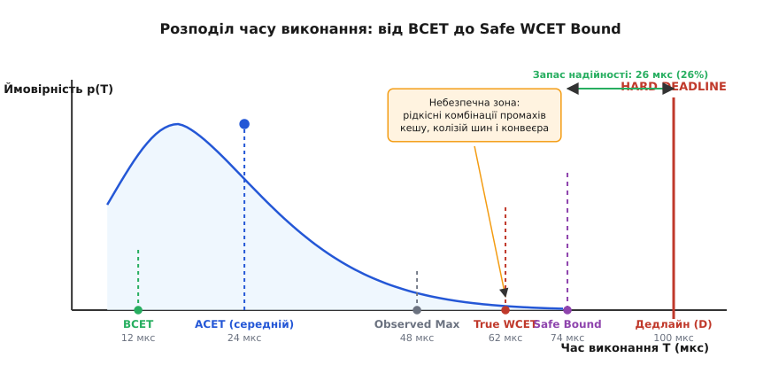
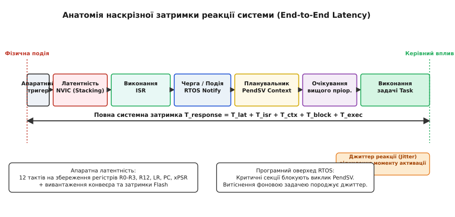
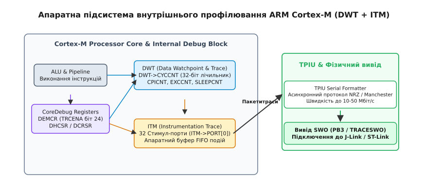
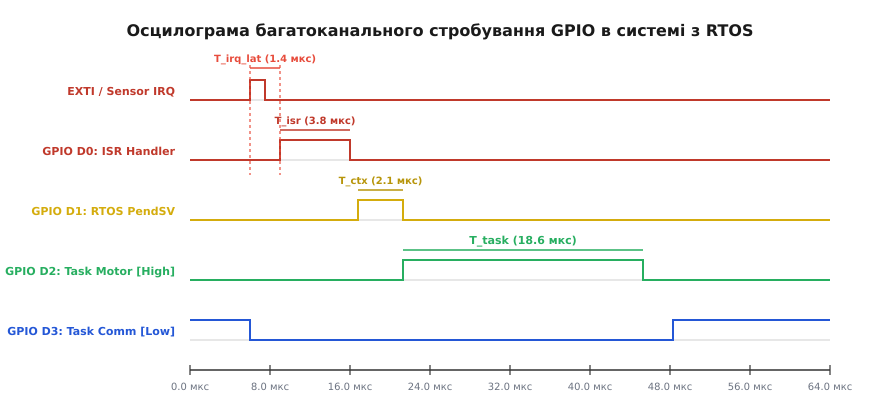

# Профіль часу виконання в системі пристроїв

<preknowlist>
- [Детермінованість і бюджет затримки](root:sf-tasks/realtime-determinism) — поняття жорсткого та м'якого реального часу, дедлайни задач і допустимі затримки реакції.
- [Апаратні переривання](root:hw-arch/interrupts) — фізичний механізм обробки зовнішніх і внутрішніх апаратних подій.
- [Критична секція](root:embedded/krytychna-sektsiia) — блокування витіснення та переривань для захисту спільних ресурсів.
- [Вибір: голий цикл чи RTOS](root:embedded/vybir-holyi-tsykl-freertos-zephyr) — архітектура планувальника операційної системи реального часу та накладні витрати перемикання контексту.
- [Дисципліна обробника](root:embedded/dystsyplina-obrobnyka) — поділ обробки на верхню та нижню половини для зменшення блокування системи.
</preknowlist>

У медичній інфузійній помпі з цифровим керуванням кроковим двигуном обчислювальний контур стабілізації тиску та дозування ліків працює під керуванням операційної системи реального часу (RTOS) із фіксованим періодом у 500 мікросекунд. Під час лабораторного тестування за кімнатної температури та стабільного живлення алгоритм пропорційно-інтегрального регулювання (ПІД) виконується в середньому за 140 мікросекунд, що створює ілюзію комфортного запасу продуктивності процесора у 72 відсотки.

У реальній лікарняній палаті одночасно виникають три незалежні події: мережевий модуль приймає зашифрований кадр телеметрії через Ethernet, заповнюючи буфери DMA; шина I2C блокується через перешкоду на лінії тактування від сусіднього реле; а процесор зазнає промаху кешу інструкцій під час виклику рідкісної гілки аварійної діагностики Flash-пам'яті. Час проходження контуру миттєво зростає зі 140 до 620 мікросекунд. Дедлайн у 500 мікросекунд зірвано: кроковий двигун пропускає фази комутації обмоток, ротор зупиняється з механічним ударом, подача розчину блокується, а система видає критичну помилку зупинки терапії.

Ця аварія демонструє головну закономірність вбудованої розробки: у системах жорсткого реального часу (англ. *Hard Real-Time Systems*) правильність програми визначається не лише математичною точністю обчислених значень, але й **суворим дотриманням часових меж**, у які ці значення передаються на виконавчі органи. Звичайне оцінювання продуктивності за середнім часом виконання створює фальшиву впевненість. Щоб гарантувати надійність, інженер повинен побудувати повний **профіль часу виконання** (англ. *Execution Time Profile*): виміряти найгірший час виконання кожної функції (WCET), латентність переривань, оверхед планувальника та часовий джиттер.

## Часовий детермінізм і пастка середнього часу (WCET проти ACET)

Більшість розробників високорівневого програмного забезпечення оптимізують код під середню пропускну здатність, спираючись на середній час виконання (англ. *Average-Case Execution Time*, ACET). Вони запускають функцію мільйон разів у циклі та ділять загальний час на кількість ітерацій. Для вебсервера чи мобільного додатку, де затримка одного кадру на 5 мілісекунд непомітна для користувача, такий підхід цілком виправданий.

У вбудованих системах керування фізичними об'єктами (інвертори напруги, системи стабілізації дронів, гальмівні контролери ABS) один-єдиний викид затримки руйнує стійкість системи. Для часового аналізу використовують чотири базові величини:

1. **Найкращий час виконання (англ. *Best-Case Execution Time*, BCET):** мінімальна фізична тривалість проходження найкоротшої гілки алгоритму за ідеальних умов (усі операнди в регістрах ядра, конвеєр заповнений, відсутні промахи кешу, нульовий час очікування шин).
2. **Середній час виконання (ACET):** статистичне математичне сподівання часу виконання під час типової тривалої роботи системи.
3. **Спостережуваний максимум (англ. *Observed Maximum Execution Time*):** найбільше значення тривалості, зафіксоване під час тривалого емпіричного тестування.
4. **Найгірший час виконання (англ. *Worst-Case Execution Time*, WCET):** абсолютна верхня фізична межа часу, яка знадобиться процесору для виконання алгоритму за найнесприятливішої комбінації вхідних даних, промахів кешу, затримок вибірки Flash та шинних конфліктів.


*Розподіл часу виконання коду: пік позначає середній час (ACET), проте надійність системи гарантується лише аналітичною оцінкою найгіршого випадку (WCET) відносно жорсткого дедлайну.*

Головна небезпека полягає в тому, що **спостережуваний максимум майже завжди менший за істинний WCET**. Чому так відбувається на рівні мікроархітектури кристала?

### Чинники недетермінізму сучасних мікроконтролерів

* **Стан конвеєра інструкцій (Pipeline Hazards):** сучасні 32-розрядні мікроконтролери (ARM Cortex-M4, Cortex-M7) використовують три- або шестиступеневі конвеєри команд (вибірка, декодування, виконання). Якщо результат умовного переходу (`BNE`, `BEQ`) не збігається з передбаченням статичного або динамічного блоку branch prediction, конвеєр скидається, що призводить до втрати від 3 до 7 тактів.
* **Кеш інструкцій і даних (L1 I-Cache / D-Cache):** потрапляння в кеш (L1 Hit) займає рівно 1 такт процесора. Промах кешу (Cache Miss) змушує ядро звертатися до повільної зовнішньої пам'яті або внутрішньої Flash-пам'яті через шини AXI/AHB, завантажуючи цілу кеш-лінію (32 байти), що блокує ядро на 8–30 тактів затримки.
* **Стани очікування Flash-пам'яті (Flash Wait States / Latency):** кристал енергонезалежної пам'яті Flash фізично не здатний видавати дані на високих тактових частотах (168–480 МГц). Вбудований контролер Flash змушений вставляти від 3 до 8 тактів очікування (англ. *Wait States*) на кожне пряме зчитування. Хоча блок попередньої вибірки (англ. *Prefetch Buffer*) згладжує послідовне читання коду, будь-який стрибок за адресою викликає примусову затримку.
* **Арбітраж шинної матриці (Bus Matrix Contention):** якщо прямий доступ до пам'яті (DMA) передає аудіопотік або мережевий пакет у ту саму секцію внутрішньої оперативної пам'яті SRAM, до якої процесор звертається за локальними змінними, апаратний арбітр шини AHB/AXI чергує доступи, примушуючи ядро чекати завершення транзакції DMA.

> 🔧 **Навіщо це.** Якщо ви виміряли тривалість контуру 100 000 разів і отримали максимальний час 180 мкс при дедлайні 200 мкс, це не означає, що система в безпеці. За одночасного промаху кешу та колізії DMA час підскочить до 240 мкс. Надійність вимагає або математичного розрахунку верхньої межі (Safe Bound), або інструментального вимірювання в умовах штучного стресового навантаження.

Зв'язок між найгіршим часом виконання окремих задач та гарантованим часом реакції всієї системи формалізується за допомогою математичного апарату, детально розібраного в окремому матеріалі [Response Time Analysis (RTA)](root:embedded/profil-chasu-vykonannia-u-systemi/math-response-time-analysis.md).

## Анатомія затримок: латентність переривань, перемикання контексту та джиттер

Коли у фізичному світі виникає подія (наприклад, фронт напруги на виводі екстреного вимикача чи сигнал готовності АЦП), сигнал проходить складний ланцюг затримок до моменту, коли мікроконтролер виконає необхідну керівну дію.


*Повний ланцюг затримки від фізичного фронту на сенсорі до керівного впливу: апаратна латентність NVIC, виконання ISR, обробка події RTOS, перемикання контексту та джиттер витіснення.*

Повна затримка реакції системи `T_response` розкладається на такі складові:

```
T_response = T_detect + T_irq_lat + T_isr + T_kernel + T_ctx + T_block + T_exec
```

Розглянемо кожен компонент детально.

### 1. Апаратна латентність входу в переривання (Interrupt Latency, T_irq_lat)

У процесорах архітектури ARM Cortex-M вхід у переривання виконується апаратним контролером векторних переривань (англ. *Nested Vectored Interrupt Controller*, NVIC). Латентність входу складається з таких фізичних фаз:

* **Завершення поточної неподільної інструкції:** прості команди ALU виконуються за 1 такт, проте операції апаратного ділення `SDIV`/`UDIV` (від 2 до 12 тактів) або інструкції пакетного завантаження регістрів `LDMIA`/`STMIA` мають або завершитися, або бути коректно перерваними з подальшим перезапуском.
* **Апаратне збереження контексту (Stacking):** ядро автоматично зберігає у стек вісім базових 32-розрядних регістрів: `R0`, `R1`, `R2`, `R3`, `R12`, `LR` (Link Register), `PC` (Program Counter) та `xPSR` (Program Status Register). На ядрах Cortex-M3/M4/M7 без плаваючої коми цей процес займає рівно **12 тактів процесора** за умови нульових затримок пам'яті.
* **Збереження регістрів FPU (Lazy Stacking):** якщо в системі активовано апаратний модуль плаваючої коми (FPU), збереження додаткових 16 регістрів `S0-S15` та `FPSCR` збільшило б латентність ще на 17 тактів. Щоб уникнути цього, реалізовано механізм «лінивого збереження» (англ. *Lazy Stacking*): NVIC резервує місце у стеку за 1 такт, а фізичний запис регістрів виконується лише тоді, коли обробник ISR дійсно містить інструкції роботи з дробовими числами.
* **Вибірка адреси обробника з таблиці векторів:** 2–3 такти на зчитування вказівника функції з Flash або SRAM.

Сумарна мінімальна апаратна латентність Cortex-M4 за нульових затримок шини становить 12 тактів (на частоті 168 МГц це 71.4 наносекунди).

### 2. Оптимізації латентності: Tail-Chaining та Late-Arriving

Архітектура Cortex-M містить два апаратні механізми прискорення переривань:

* **Хвостове зв'язування (Tail-Chaining):** якщо після завершення одного переривання в черзі очікує інше, ядро не відновлює старі регістри зі стеку і не зберігає їх наново. Воно пропускає операції Unstacking/Stacking і одразу передає керування наступному обробнику. Затримка між двома ISR скорочується з `12 + 12 = 24` тактів до всього **6 тактів**.
* **Пізнє прибуття (Late-Arriving):** якщо під час збереження контексту (перші 12 тактів) виникає переривання з вищим пріоритетом, NVIC не зупиняє стекінг, а після 12-го такту одразу перемикається на обробник вищого переривання без втрати попередніх кроків.

### 3. Вплив критичних секцій та пріоритетів NVIC на джиттер

Головним ворогом детермінізму є програмне блокування переривань. Коли потік входить у критичну секцію, викликаючи функцію відключення переривань (наприклад `__disable_irq()` через регістр `PRIMASK` або маскування за пріоритетом через `BASEPRI`), процесор ігнорує всі зовнішні події до моменту виходу з критичної секції.

Якщо критична секція низькопріоритетного потоку триває 40 мікросекунд, а зовнішня подія сталася на початку цієї секції, латентність входу в переривання зросте з 70 наносекунд до `40 мкс + 70 нс`.

Різниця між мінімальною та максимальною затримкою активації обробника називається **часовим джиттером** (англ. *Jitter*):

```
Jitter = T_latency_max - T_latency_min
```

У прецизійних вимірювальних приладах або контурах цифрової фільтрації джиттер частоти дискретизації призводить до появи фазового шуму та похибок перетворення величин.

### 4. Накладні витрати планувальника RTOS (T_kernel та T_ctx)

Коли обробник переривання надсилає дані в задачу (наприклад викликає `xQueueSendFromISR()` або `vTaskNotifyGiveFromISR()`), подія не починає оброблятися задачею миттєво:

1. **Функція API RTOS (T_kernel):** оновлення бітових масок готовності задач, переміщення дескриптора TCB (англ. *Task Control Block*) зі списку очікування в список готових задач `ReadyTasksList` (забирає 30–80 тактів).
2. **Запит програмного переривання (PendSV):** перемикання контексту в Cortex-M навмисно виконується через найнижче за пріоритетом системне переривання `PendSV`, щоб не затримувати інші апаратні переривання.
3. **Перемикання контексту (T_ctx):** збереження залишкових регістрів процесора (`R4-R11`), збереження вказівника вершини стеку `PSP` (Process Stack Pointer) у TCB старого процесу, вибір нового TCB, завантаження нового `PSP` та відновлення регістрів `R4-R11` нової задачі (зазвичай 40–120 тактів).

Загальні накладні витрати передачі керування від ISR до коду задачі становлять від 1.5 до 4 мікросекунд на типовому мікроконтролері 168 МГц.

## Апаратні лічильники DWT/CYCCNT для вимірювання тактової тривалості коду

Для отримання достовірного профілю часу функції стандартні бібліотечні виклики `HAL_GetTick()` або `millis()` непридатні: їхня дискретність у 1 мс у тисячу разів грубша за тривалість типової математичної операції (10–50 мкс).

У мікроконтролерах архітектури ARM Cortex-M3/M4/M7/M33 реалізовано апаратний блок моніторингу та трасування даних — **DWT** (англ. *Data Watchpoint and Trace*).


*Архітектура підсистеми CoreDebug, DWT та ITM у мікроконтролерах Cortex-M: захоплення циклів виконання без сповільнення процесора та передача діагностичних пакетів через вивід SWO.*

Центральним елементом блоку DWT є 32-розрядний лічильник тактових циклів процесора — `DWT->CYCCNT` (Cycle Count Register).

### Переваги лічильника CYCCNT:

1. **Однотактова точність:** лічильник інкрементується кожен такт системної шини процесора `HCLK`. На частоті 168 МГц ціна одного тику становить `1 / 168 000 000 ≈ 5.95` нс.
2. **Нульове навантаження на систему:** лічильник працює автономно в кремнії ядра, не генерує переривань і не займає шину доступу до оперативної пам'яті.
3. **Пряме читання за 1 такт:** значення зчитується звичайною інструкцією `LDR` з фіксованої адреси `0xE0001004`.

### Активація та ініціалізація DWT

За замовчуванням після скидання мікроконтролера блок DWT знеструмлений для економії енергії. Щоб увімкнути лічильник циклів, необхідно виконати два послідовні кроки:

1. Дозволити роботу блоку трасування в регістрі керування відладкою ядра `CoreDebug->DEMCR` (встановити біт `TRCENA`, біт 24).
2. Скинути лічильник `DWT->CYCCNT` у нуль та встановити біт `CYCCNTENA` (біт 0) у регістрі керування `DWT->CTRL`.

Нижче наведено базовий драйвер ініціалізації та вимірювання на C та ідіоматичному C++:

:::tabs
:::code profil-chasu-vykonannia-u-systemi-d/c/dwt_timer.h
:::code profil-chasu-vykonannia-u-systemi-d/cpp/dwt_timer.hpp
:::

### Пастка переповнення 32-бітного лічильника

32-розрядний регістр на частоті 168 МГц переповнюється за:

```
T_overflow = 2^32 / 168 000 000 ≈ 25.565 секунди
```

Завдяки властивостям додаткового коду та беззнакової арифметики C/C++ (`uint32_t`), різниця `stop - start` обчислюється математично правильно навіть у тому випадку, коли `stop` перейшов через нуль і став меншим за `start` (наприклад, `start = 0xFFFFFF00`, `stop = 0x00000050` дасть `delta = 0x00000150 = 336` тактів). Жодних умовних операторів перевірки переповнення не потрібно, якщо тривалість досліджуваної ділянки не перевищує 25.5 секунди.

## Інструментальні методи: трасування ITM та профілювання через піни GPIO

Хоча внутрішній таймер DWT незамінний для вимірювання тривалості окремих алгоритмів, він не показує взаємодію прошивки з апаратним оточенням мікроконтролера. Для комплексної верифікації реального часу використовують два апаратні інструментальні методи.

### Метод 1: Багатоканальне стробування пінів GPIO та логічний аналізатор

Стробування виводів (англ. *Pin Toggling*) — це підключення цифрових ліній порту мікроконтролера до високошвидкісного логічного аналізатора або цифрового осцилографа.


*Діаграма стробування пінів GPIO на логічному аналізаторі: одночасний аналіз моменту апаратного переривання, часу роботи ISR, оверхеду планувальника PendSV та інтервалів виконання задач.*

Головна перевага стробування GPIO — **абсолютна неінвазивність щодо пам'яті та кешу**. На відміну від виводу діагностики через `printf`, маніпуляція виводом займає рівно 1 такт і не спотворює стек чи кеш даних.

Для виключення стану гонитви та затримок маніпуляція виводом повинна здійснюватися через регістри атомарного встановлення/скидання бітів: `BSRR` (STM32) або регістри `SET`/`CLR` (ESP32, Microchip). Звичайна операція `PORT ^= PIN` категорично заборонена, оскільки вимагає трьох інструкцій (`LDR`, `EOR`, `STR`) і створює колізію в перериваннях.

:::tabs
:::code profil-chasu-vykonannia-u-systemi-d/c/gpio_profiling.h
:::code profil-chasu-vykonannia-u-systemi-d/cpp/gpio_profiling.hpp
:::

Використання RAII-обгортки `ScopedPin` гарантує, що навіть у разі передчасного виходу з функції через помилку (`return`) чи викидання винятку пін буде гарантовано скинутий у низький стан, не спотворюючи покази логічного аналізатора.

### Метод 2: Трасування ITM через пін SWO

Модуль **ITM** (англ. *Instrumentation Trace Macrocell*) — це спеціалізований апаратний блок усередині ядра Cortex-M3/M4/M7, призначений для передачі діагностичних повідомлень через один вивід `SWO` (Serial Wire Output) або інтерфейс JTAG.

ITM містить 32 незалежні 32-розрядні стимул-порти (`ITM->PORT[0..31]`). Запис числа в порт стимулу займає рівно 1 такт процесора:

* Ядро записує байт або 32-розрядне число в апаратний FIFO-буфер ITM;
* Апаратний серіалізатор TPIU формує пакет трасування та передає його на пін SWO на швидкості від 2 до 50 Мбіт/с без зупинки процесора;
* Зовнішній відладчик (J-Link, ST-Link v3) приймає пакети й передає їх на комп'ютер у реальному часі.

Це повністю усуває класичну проблему "ефекту спостерігача" (англ. *Probe Effect*), коли додавання традиційного виводу через UART (`printf`) сповільнює роботу системи на тисячі мікросекунд і маскує часові баги.

## Архітектура вбудованого профілювальника задач

Для постійного моніторингу прошивки в польових умовах або під час тривалого стрес-тестування створюють вбудований модуль накопичення статистики.

Основні вимоги до модульного профілювальника:

1. **Статичний розподіл пам'яті:** жодної динамічної алокації (`malloc`/`new`), що виключає фрагментацію купи та недетерміновані затримки.
2. **Атомарність оновлення:** безпечний збір даних з контексту переривань і задач RTOS.
3. **Збір агрегованих метрик:** мінімум, максимум, сума часу виконання, кількість викликів та максимальний джиттер періодичності.

Повну виробничу реалізацію модуля профілювання з підтримкою конфігурації через C та C++ винесено в окремий [модуль профілювальника задач та функцій](root:embedded/profil-chasu-vykonannia-u-systemi/proj-rtos-task-profiler.md).

### Інтеграція профілювальника в контур керування

Нижче показано приклад використання модуля для діагностики контуру регулювання швидкості приводу:

:::tabs
:::code profil-chasu-vykonannia-u-systemi-d/c/intehratsiia.c
:::code profil-chasu-vykonannia-u-systemi-d/cpp/task_profiler.hpp
:::

## Практичний аналіз часового профілю та усунення вузьких місць

Після збору профілю часу прошивка генерує звіт, що містить повний зріз поведінки системи:

```text
+---------------- REAL-TIME EXECUTION PROFILE ----------------+
ID  Name            Calls    Min(us)  Avg(us)  Max(us)  Jitter(us)
--------------------------------------------------------------
0   Motor_FOC       100000   18       24       62       8
1   Sensor_Fusion   40000    110      145      380      22
2   Ethernet_TLS    10000    320      850      2450     115
+------------------------------------------------------------+
```

### Як інтерпретувати отримані результати:

1. **Великий розрив між `Avg` та `Max` (наприклад у задачі `Motor_FOC` 24 мкс проти 62 мкс):**
   Ознака наявності прихованих розгалужень, промахів кешу або періодичного виклику довгих операцій (наприклад, калібрування зсуву АЦП). Необхідно розбити алгоритм на підсекції з власними контрольними точками DWT, щоб локалізувати повільну гілку коду.
2. **Високий джиттер (`Jitter(us)` перевищує 10–20% від періоду):**
   Свідчить про те, що задачу блокують тривалі критичні секції інших потоків або витісняють високопріоритетні переривання з неоптимальними пріоритетами NVIC. Рішення — зменшити розмір критичних секцій за допомогою безблокувальних черг (Lock-Free Queues) та перерозподілити рівні пріоритетів.
3. **Зростання `Max` у низькопріоритетній задачі (`Ethernet_TLS` до 2450 мкс):**
   Природний наслідок витіснення вищими задачами `Motor_FOC` та `Sensor_Fusion`. Для перевірки безпеки дедлайну застосовують формули з математичної вставки [Response Time Analysis (RTA)](root:embedded/profil-chasu-vykonannia-u-systemi/math-response-time-analysis.md).

Побудова та постійна автоматизована верифікація часового профілю під час неперервної інтеграції (CI) перетворює стабільність реального часу зі статистичної випадковості на строго доведений інженерний факт.
