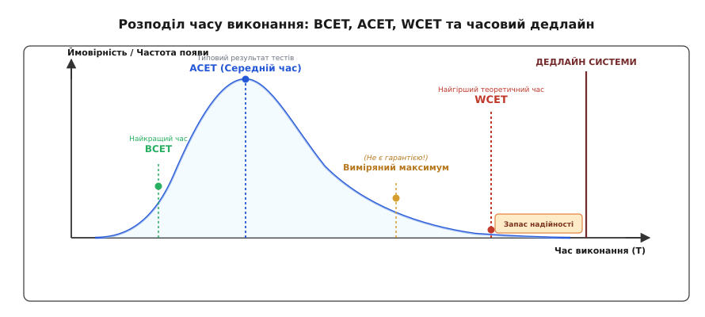
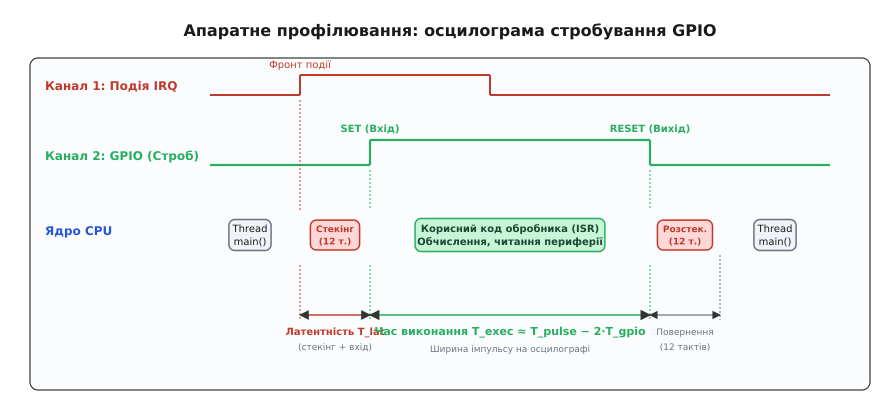
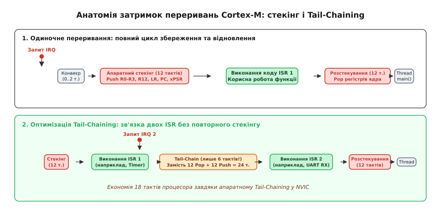
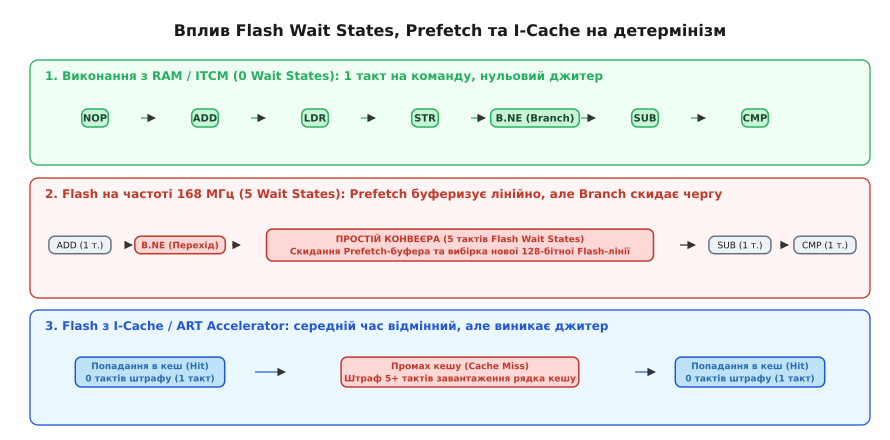

# Профіль часу виконання: цикли, переривання, джитер

<preknowlist>
- [Апаратні переривання](root:hw-arch/interrupts) — фізичний механізм виклику обробників за апаратними подіями.
- [Пріоритети переривань](root:hw-arch/interrupt-priorities) — правила субординації та вкладеного витіснення в контролері переривань.
- [Дисципліна обробника](root:embedded/dystsyplina-obrobnyka) — правила мінімізації часу перебування процесора в контексті ISR.
- [Опитування чи переривання](root:embedded/polling-vs-interrupts) — вибір між періодичним опитуванням прапорців та апаратною подією.
- [Стартовий код і секції пам'яті](root:embedded/startovyi-kod) — розподіл сегментів Flash, SRAM, векторів та таблиць ініціалізації.
- [Межі простого циклу](root:embedded/super-loop-limits) — обмеження архітектури Super-Loop при зростанні вимог до реакції системи.
</preknowlist>

У трифазному інверторі векторного керування безколекторним двигуном (англ. *Field-Oriented Control*, FOC) частота широтно-імпульсної модуляції (ШІМ) становить 20 кГц, що задає жорсткий період дискретизації у 50 мікросекунд. У середині кожного періоду, коли силові ключі перебувають у симетричному стані, за сигналом таймера спрацьовує АЦП. Мікроконтролер має рівно 25 мікросекунд на повний обчислювальний контур: зчитати калібровані струми двох фаз, виконати прямі перетворення Кларк і Парка, прогнати два пропорційно-інтегральні регулятори струмів d і q, виконати зворотне перетворення та оновити регістри порівняння таймера до наступного апаратного перезавантаження лічильника. Якщо затримка виконання цього коду неочікувано зросте з 18 до 27 мікросекунд через промах кешу інструкцій чи випадкове переривання інтерфейсу UART, нові значення затворів запізняться на один ШІМ-такт. Силовий міст виставить інвертований вектор напруги у фази, двигун смикнеться з характерним металевим ударом, а струмовий сплеск перевищить поріг насичення ключів і спалить силові MOSFET-транзистори.

Ця аварійна ситуація показує фундаментальну відмінність вбудованого програмування від розробки високорівневого програмного забезпечення: у системах жорсткого реального часу правильність роботи програми визначається не лише логічною точністю обчислених чисел, а й **точністю моменту часу**, коли ці числа потрапляють у регістри керування периферією. Профіль часу виконання (англ. *Execution Time Profile*) прошивки — це повна часова карта роботи мікроконтролера, що кількісно описує тривалість обчислень, латентність реакції на апаратні події та випадкові відхилення періодичності.

## Пастка середнього часу: чому звичайний таймінг бреше в реальному часі

У прикладних операційних системах продуктивність коду традиційно оцінюють за середнім часом виконання (англ. *Average-Case Execution Time*, ACET), проганяючи алгоритм мільйони разів у циклі та ділячи загальний час на кількість ітерацій. Такий підхід створює небезпечну ілюзію стабільності.

Для вбудованої системи важливі три різні часові величини:

1. **Найкращий час виконання (англ. *Best-Case Execution Time*, BCET):** тривалість проходження найкоротшої гілки алгоритму за ідеальних умов (усі дані вже в регістрах, кеш-пам'ять заповнена потрібними інструкціями, черга вибірки Flash заповнена, жодне переривання не вклинилося в роботу).
2. **Середній час виконання (ACET):** статистичне математичне сподівання тривалості під час тривалого спостереження.
3. **Найгірший час виконання (англ. *Worst-Case Execution Time*, WCET):** максимальний фізично можливий інтервал часу, який знадобиться процесору для завершення ділянки коду за найбільш несприятливої комбінації вхідних параметрів, найдовших гілок розгалуження, серії промахів кешу та затримки шини пам'яті.


*Крива розподілу ймовірностей часу виконання показує, що звичайний бенчмарк вимірює пік розподілу (ACET), тоді як надійність та детермінізм системи реального часу спираються виключно на математичну оцінку найгіршого випадку (WCET).*

Чому функція на зразок `HAL_GetTick()` або `millis()` абсолютно непридатна для аналізу швидких циклів мікроконтролера? По-перше, системний таймер `SysTick` у більшості типових конфігурацій генерує переривання раз на 1 мілісекунду (1000 Гц). Для контуру керування мотором або цифрового аудіофільтра із частотою дискретизації 48 кГц (період 20.8 мкс) крок в 1 мс є нескінченно грубим: ціла сотня обчислювальних циклів поміщається всередині одного дискретного тику таймера.

По-друге, сам виклик системної функції вичитування змінної містить накладні витрати (англ. *overhead*) — інструкції переходу `BL`, збереження регістрів та завантаження з оперативної пам'яті, що забирає від 6 до 20 тактів процесора. Якщо досліджувана функція обчислення синуса займає 30 тактів, спроба виміряти її тривалість невідкаліброваним таймером спотворить результат більше ніж на 50%.

> 🔧 **Головне правило.** Надійність вбудованої системи гарантується виключно тоді, коли **найгірший час виконання (WCET) плюс максимальна латентність переривань строго менші за дедлайн системи**: `T_WCET + T_lat_max < T_deadline`. Будь-який запас на основі середнього часу є статистичною рулеткою.

## Інструменти точного часового профілювання: від GPIO до DWT

Для отримання достовірного часового профілю вбудованого коду інженери використовують два взаємодоповнюючих підходи: апаратний вивід сигналів на ніжки мікроконтролера (для макроаналізу затримок) та внутрішні лічильники тактів процесорного ядра (для мікропрофілювання алгоритмів).

### Метод 1: Стробування виводів GPIO для осцилографа

Найпростіший, найбільш точний і водночас безпечний для пам'яті метод полягає у фізичному перемиканні цифрового виводу GPIO (англ. *Pin Toggling*) на початку та наприкінці досліджуваної ділянки коду або функції обробника.


*Осцилограма дозволяє одночасно спостерігати момент виникнення фізичної події, затримку входу в обробник переривання (латентність), чисту тривалість виконання корисної секції коду та часовий джитер між періодами.*

Головна перевага методу стробування — повна незалежність від програмного середовища. Цифровий запам'ятовувальний осцилограф (DSO) або швидкісний логічний аналізатор вимірює ширину імпульсу `T_pulse` з точністю до одиниць наносекунд. Підключивши перший канал осцилографа до джерела зовнішнього сигналу (наприклад, лінії переривання датчика `EXTI`), а другий канал — до стробового піна GPIO, інженер бачить повну латентність від фізичного фронту напруги до виконання корисного коду.

Для виключення спотворень маніпуляція виводом має виконуватися через прямий запис в апаратні регістри атомарного встановлення/скидання бітів: `BSRR` (англ. *Bit Set/Reset Register*) у мікроконтролерах STM32 або регістри `SET`/`CLR` у чипах Microchip/NXP. Використання класичної операції XOR над вихідним регістром даних (`GPIOB->ODR ^= PIN`) категорично заборонене: вона розгортається компілятором у послідовність «читання — модифікація — запис» (команди `LDR`, `EOR`, `STR`), що займає 3-4 такти і породжує стан гонитви (англ. *Race Condition*), якщо інше переривання спробує змінити сусідній пін того ж порту.

:::tabs
:::code profil-chasu-vykonannia-d/c/metod-1-strobuvannia.c
:::code profil-chasu-vykonannia-d/cpp/metod-1-strobuvannia.hpp
:::

Чистий час виконання розраховується відніманням апаратного часу двох записів у порт: `T_exec = T_pulse - 2 * T_gpio_write`.

### Метод 2: Апаратний лічильник тактів ядра DWT->CYCCNT

Коли потрібно виміряти окремі рядки алгоритму з точністю до одного такту конвеєра або накопичити статистику розкиду без осцилографа, застосовують апаратний блок DWT (англ. *Data Watchpoint and Trace*), вбудований у процесорні ядра Cortex-M3/M4/M7/M33.

Блок DWT містить 32-бітний регістр `CYCCNT` (Cycle Count), який інкрементується на кожному такті процесорної частоти `HCLK`. На частоті 168 МГц один такт лічильника відповідає `1 / (168 * 10^6) = 5.95 нс`.

Щоб лічильник почав рахувати, його необхідно попередньо розблокувати через підсистему налагодження ядра `CoreDebug`, оскільки за замовчуванням після скидання живлення блок трасування вимкнено для економії енергії:

1. У регістрі `CoreDebug->DEMCR` (Debug Exception and Monitor Control Register) встановлюється біт `TRCENA` (біт 24).
2. У регістрі `DWT->CTRL` (DWT Control Register) встановлюється біт `CYCCNTENA` (біт 0).
3. Початкове значення регістра `DWT->CYCCNT` скидається в 0.

:::tabs
:::code profil-chasu-vykonannia-d/c/metod-2-aparatnyi.c
:::code profil-chasu-vykonannia-d/cpp/metod-2-aparatnyi.hpp
:::

У реальних проєктах цей механізм вимагає калібрування власного оверхеду читання, накопичення статистики максимального значення та безпечного перетворення в мікросекунди. Повну модульну реалізацію такого інструменту винесено в окремий [модуль апаратного профілювання DWT](root:embedded/profil-chasu-vykonannia/proj-dwt-profiler.md).

## Анатомія затримок переривань: що відбувається за 12 тактів NVIC

Латентність переривання (англ. *Interrupt Latency*) — це час між появою електричного сигналу на периферійному модулі чи ніжці мікроконтролера і моментом виконання першої корисної інструкції в тілі обробника переривання (ISR).

У класичних 8-бітних і старих 32-бітних архітектурах (ARM7TDMI) збереження регістрів у стек здійснювалося програмно: компілятор генерував довгий пролог функції (`PUSH {r4-r11, lr}`), що займало десятки тактів і залежало від рівня оптимізації. В архітектурі ARM Cortex-M контролер переривань NVIC (англ. *Nested Vectored Interrupt Controller*) інтегрований безпосередньо в конвеєр процесорного ядра, що дозволяє виконувати збереження контексту повністю на апаратному рівні.


*Апаратний стекінг NVIC зберігає базовий набір регістрів за 12 тактів паралельно з вибіркою вектора переривання, а механізм Tail-Chaining скорочує перехід між двома послідовними ISR до 6 тактів.*

Повний ланцюг затримки складається з п'яти послідовних кроків:

1. **Фіксація події периферією (1-2 такти шини APB/AHB):** модуль таймера чи приймача UART виставляє внутрішній прапорець переривання і підіймає лінію запиту до блоку NVIC.
2. **Завершення або скасування поточної інструкції ядра (0-12 тактів):** якщо процесор у момент приходу запиту виконує однотактову операцію (`ADD`, `MOV`), він завершує її за поточний такт. Якщо ж виконується багатотактова інструкція читання або запису кількох регістрів (`LDM` / `STM`) чи апаратне цілочислове ділення (`UDIV` / `SDIV`, що триває від 2 до 12 тактів), ядро або перериває операцію з можливістю подальшого повторного запуску, або чекає завершення циклів шини.
3. **Апаратний стекінг (12 тактів у ядрах Cortex-M3/M4/M7):** процесор автоматично записує базовий кадр стекінгу (англ. *Stack Frame*) з 8 регістрів у стек процесора (MSP або PSP):
   ```
   Стек: [ R0 | R1 | R2 | R3 | R12 | LR (R14) | PC (R15) | xPSR ]
   ```
4. **Вибірка адреси вектора (Vector Fetch):** паралельно зі збереженням регістрів у пам'ять контролер NVIC зчитує 32-бітну адресу обробника з таблиці векторів у Flash/RAM за шиною ICode. Оскільки вибірка вектора відбувається одночасно зі збереженням кадру стека за шиною даних DCode/System, ці операції не додають додаткових затримок у разі відсутності конфліктів шини.
5. **Виконання першої інструкції ISR:** після завершення 12 тактів стекінгу лічильник команд `PC` вказує на початок обробника, а регістр зв'язку `LR` автоматично завантажується спеціальним значенням `EXC_RETURN` (наприклад, `0xFFFFFFF9`), яке повідомляє ядру тип повернення зі стека.

### Додаткова затримка блоку FPU (Lazy Stacking)

Якщо в мікроконтролері активовано модуль плаваючої коми (FPU), апаратний контекст розширюється: окрім 8 цілочислових регістрів необхідно зберігати ще 16 регістрів одинарної точності `S0-S15` та регістр стану `FPSCR`. Це збільшує час стекінгу з 12 до 29 тактів.

Для запобігання цьому штрафу в ядрах Cortex-M4F/M7 реалізовано технологію **ледачого стекінгу (Lazy Stacking)**. За замовчуванням у регістрі `FPU->FPCCR` виставлено біти `ASPEN` та `LSPEN`. Коли виникає переривання, ядро резервує місце в стеку під плаваючі регістри, але **фізично не записує їх у пам'ять**. Якщо всередині обробника переривання не виконується жодної математичної операції з плаваючою комою (FPU не використовується), запис взагалі не відбувається, і час входу в переривання залишається рівним базовим 12 тактам! Фізичне збереження плаваючих регістрів відбувається лише в тому разі, якщо ISR виконає першу інструкцію FPU (наприклад, `VADD.F32`).

### Апаратні оптимізації NVIC: Tail-Chaining та Late-Arriving

Архітектура ARM NVIC містить дві апаратні оптимізації, розроблені для ліквідації зайвих затримок у навантажених системах:

1. **Tail-Chaining (Хвостовий зв'язок):** якщо під час виконання першого обробника переривання надходить запит на друге переривання (однакового або нижчого пріоритету), процесор після завершення першого ISR не виконує повне відновлення регістрів зі стека (`POP`, 12 тактів) з наступним повторним збереженням (`PUSH`, 12 тактів). Замість 24 тактів ядро виконує операцію Tail-Chain **всього за 6 тактів**, миттєво підхоплюючи нову адресу з таблиці векторів і передаючи керування другому обробнику.
2. **Late-Arriving (Пізнє прибуття):** якщо під час виконання 12-тактового стекінгу для низькопріоритетного переривання виникає високопріоритетна подія, NVIC не скидає процес стекінгу. Він завершує збереження кадру стека, але замість вектора початкового переривання передає ядру адресу вектора термінового високопріоритетного обробника. Термінове переривання виконується першим без жодної втрати тактів на повторне збереження контексту.

## Джитер: джерела часового тремтіння та методи його ліквідації

Джитер (англ. *Jitter* — тремтіння) — це статистична варіативність часового інтервалу між послідовними подіями, відхилення реального періоду виконання від ідеального математичного значення:

```
ΔT_jitter = T_max - T_min
```

Якщо періодичний контур керування налаштований на спрацьовування кожні 100 мікросекунд, але через внутрішні процеси процесора інтервал між спрацьовуваннями хаотично коливається від 92 до 108 мкс, джитер становить 16 мкс (16%). У цифрових фільтрах, аудіотрактах та прецизійних генераторах траєкторії джитер еквівалентний внесенню додаткового фазового шуму й спотворенню передавальної функції.

### Чотири джерела внутрішнього джитеру

1. **Асинхронність переривань відносно фази шини:** фізичний сигнал надходить у випадковий момент відносно внутрішнього тактового сигналу процесора. Допоки сигнал не пройде через тригерну схему синхронізації вхідного буфера GPIO, виникає невизначеність тривалістю в 1 такт.
2. **Блокування переривань критичними секціями:** коли основний код або інший обробник виконує команди заборони переривань `__disable_irq()` (`cpsid i`) або маскує пріоритети через регістр `BASEPRI`, будь-яке нове переривання відкладається. Час затримки дорівнює тривалості найдовшої критичної секції в усій прошивці.
3. **Неоднакова довжина гілок коду (Branch Divergence):** конструкції `if-else` та цикли `while` із залежною від вхідних даних кількістю ітерацій створюють різний час виконання від виклику до виклику.
4. **Конфлікти матриці шин (Bus Matrix Contention):** коли ядро процесора звертається до оперативної пам'яті SRAM за інструкціями або даними одночасно з контролером прямого доступу до пам'яті (DMA), арбітр шини призупиняє ядро на 1-3 такти для надання пріоритету периферійному потоку.

### Апаратне усунення джитеру: прямий тригеринг без CPU

Найефективніший спосіб знищити джитер у періодичних задачах (запуск АЦП, генерація імпульсів крокових двигунів) — повністю усунути процесорне ядро з ланцюга запуску.

У класичній наївній схемі таймер викликає переривання, ядро витрачає 12 тактів на вхід, вичитує стек і програмно записує біт старту перетворення в регістр `ADC->CR2 |= ADC_CR2_SWSTART`. Джитер такого запуску становить від 12 до сотень тактів залежно від поточного стану ядра.

В інженерній схемі з нульовим джитером використовують **апаратний внутрішній тригерний зв'язок (Trigger Output, TRGO)**:

```
[ Апаратний Таймер TIM1 ] ──(Сигнал TRGO / Update Event)──> [ АЦП ADC1 EXTSEL ] ──(DMA Request)──> [ SRAM Буфер ]
```

Таймер по переповненню лічильника апаратно формує імпульс TRGO на внутрішній сигнальній магістралі мікроконтролера. Цей імпульс безпосередньо запускає вибірку аналогово-цифрового перетворювача на кремнієвому рівні. По завершенні перетворення модуль АЦП самостійно виставляє запит DMA, і контролер прямого доступу скидає результат у масив пам'яті. Джитер запуску в такій схемі дорівнює **рівно 0 тактів**, оскільки процес повністю синхронізований із тактовою сіткою таймера і не залежить від того, чим зайняте процесорне ядро.

## Вплив Flash Wait States, Prefetch та I-Cache на детермінізм

Фізична природа вбудованої енергонезалежної пам'яті Flash накладає жорсткі обмеження на швидкість її читання. Тоді як сучасні ядра ARM здатні працювати на частотах 168, 216 або 480 МГц, кремнієві комірки масиву Flash не можуть віддавати дані швидше ніж за 30-40 наносекунд (що відповідає максимальній частоті прямого читання близько 25-30 МГц).

### Стани очікування Flash (Wait States / Latency)

Щоб ядро могло працювати на високій тактовій частоті, контролер пам'яті Flash вводить примусові такти очікування шини (англ. *Flash Wait States*, WS або *Flash Latency*), які програмуються в регістрі `FLASH->ACR` під час налаштування тактування системи (`SystemInit`).

Наприклад, для мікроконтролера STM32F4 на частоті 168 МГц при живленні 3.3 В таблиця даташиту вимагає встановлення **5 тактів очікування (5 WS / 6 тактів доступу)**. Це означає, що кожне одиночне звернення до Flash-пам'яті вимагає 6 тактів процесора: 1 такт на передачу адреси та 5 тактів мертвого простою конвеєра в очікуванні готовності даних.


*При лінійному виконанні коду Prefetch згладжує затримку Flash, але будь-який умовний або безумовний перехід скидає чергу вибірки й зупиняє конвеєр на повний час Flash Wait States.*

### Буфер вибірки наперед (Prefetch Buffer)

Для згладжування цієї затримки контролер Flash робить шину пам'яті ширшою за шину процесора (наприклад, 128 бітів замість 32). За одне звернення тривалістю 6 тактів контролер вичитує одразу чотири 32-бітні інструкції (або вісім 16-бітних інструкцій Thumb-2) у внутрішній буфер Prefetch.

Допоки код виконується **лінійно** (інструкція за інструкцією без стрибків), процесор вихоплює команди з буфера без жодних затримок (за 1 такт). За цей час Flash-контролер у фоновому режимі встигає підтягнути наступні 128 бітів.

### Катастрофа переходів (Branch Penalty)

Уся ідилія руйнується, коли в коді зустрічається команда переходу: умовне розгалуження (`BNE`, `BEQ`), виклик підпрограми (`BL`), повернення з функції (`BX LR`) або перехід за таблицею (`TBH`).

Коли процесор змінює адресу лічильника команд `PC`, вміст буфера Prefetch виявляється недійсним і повністю скидається. Процесорне ядро змушене зупинити конвеєр (англ. *Pipeline Stall*) і чекати повні 5 тактів Flash Wait States, поки контролер пам'яті вичитає новий 128-бітний блок за новою адресою переходу. Якщо цикл містить 4 інструкції, з яких одна — перехід на початок циклу, продуктивність коду падає більш ніж удвічі!

### Кеш інструкцій (I-Cache) та акселератор ART: парадокс детермінізму

Для боротьби зі штрафами переходів виробники мікроконтролерів інтегрують апаратні кеші команд: кеш інструкцій L1 (I-Cache) у ядрах Cortex-M7 або адаптивний акселератор реального часу ART Accelerator у чипах STM32.

Кеш розбиває пам'ять на рядки (наприклад, по 16 або 32 байти) і зберігає нещодавно виконані блоки коду в надшвидких комірках SRAM прямо біля ядра.
- **Попадання в кеш (Cache Hit):** потрібна інструкція знайдена в кеші — виконання займає **1 такт** (0 тактів затримки).
- **Промах кешу (Cache Miss):** інструкції в кеші немає — конвеєр заморожується на час завантаження всього рядка кешу з Flash (5-8 тактів штрафу).

У цьому криється головний інженерний парадокс систем реального часу: **I-Cache суттєво покращує середню швидкодію (ACET), але погіршує детермінізм і збільшує джитер!** Коли критична функція фільтрації періодично витісняється з кешу фоновим кодом або перериванням, час її повторного виконання стрибає від 50 тактів (усі потрапляння) до 120 тактів (промахи кешу на кожному переході).

### Бар'єри синхронізації пам'яті (DMB, DSB, ISB)

Під час динамічної конфігурації кешів, увімкнення Prefetch-буфера або ремапінгу таблиці векторів переривань (`SCB->VTOR`) процесорне ядро зобов'язане використовувати апаратні інструкції бар'єрів пам'яті для узгодження стану конвеєра:

1. **DMB (Data Memory Barrier):** гарантує, що всі попередні операції запису та читання пам'яті завершені до того, як розпочнуться наступні звернення до пам'яті.
2. **DSB (Data Synchronization Barrier):** зупиняє виконання будь-яких наступних інструкцій ядра до повного завершення всіх попередніх транзакцій на системних шинах (наприклад, очікує завершення скидання прапорця переривання в регістрі периферії перед виходом з ISR).
3. **ISB (Instruction Synchronization Barrier):** повністю скидає та перезавантажує конвеєр інструкцій процесора, гарантуючи, що всі наступні команди будуть вибиратися з пам'яті з урахуванням нових налаштувань кешу чи адрес векторів.

## Оптимізація критичного коду: винесення в RAM/TCM та векторизація

Коли контур керування або обробник аварійного переривання вимагає абсолютно стабільного часу виконання без джитеру та штрафів Flash Wait States, застосовують три фундаментальні інженерні техніки оптимізації.

### 1. Перенесення критичних функцій в оперативну пам'ять (RAM / TCM)

Оперативна пам'ять SRAM працює на повній частоті процесорного ядра з **нульовими тактами очікування (0 Wait States)**. Якщо розмістити тіло критичної функції в SRAM або в спеціальній пам'яті зі щільним зв'язком ITCM (англ. *Instruction Tightly-Coupled Memory*), будь-які переходи, цикли та виклики виконуватимуться за 1 такт конвеєра, ліквідуючи штрафи Flash.

Для цього в компіляторі GCC використовують спеціальний атрибут розміщення секції `__attribute__((section(".ramfunc"), noinline))`:

:::tabs
:::code profil-chasu-vykonannia-d/c/1-perenesennia-krytychnykh.c
:::code profil-chasu-vykonannia-d/cpp/1-perenesennia-krytychnykh.hpp
:::

Для роботи атрибута `.ramfunc` у файлі конфігурації компонувальника (Linker Script `.ld`) створюється відповідна секція, де адреса завантаження (LMA) вказує на Flash, а адреса виконання (VMA) — на область RAM/ITCM. Під час старту мікроконтролера код стартапу `SystemInit` копіює байти цієї секції з Flash у пам'ять SRAM так само, як копіюються ініціалізовані глобальні змінні секції `.data`:

```ld
/* Фрагмент скрипта компонувальника stm32f4.ld */
.ramfunc :
{
    . = ALIGN(4);
    _sramfunc = .;        /* Початок секції в SRAM */
    *(.ramfunc)           /* Усі функції з атрибутом section(".ramfunc") */
    *(.ramfunc*)
    . = ALIGN(4);
    _eramfunc = .;        /* Кінець секції в SRAM */
} >RAM AT> FLASH          /* VMA в RAM, LMA у Flash */

_siramfunc = LOADADDR(.ramfunc); /* Фізична адреса збереження у Flash */
```

### 2. Розгортання циклів (Loop Unrolling)

Для коротких обчислювальних циклів із фіксованою кількістю ітерацій (наприклад, фільтрація масиву з 4 або 8 відліків) перевірка лічильника і перехід на початок циклу створюють значний відносний оверхед.

Розгортання циклу вручну або через директиву компілятора `#pragma GCC unroll N` повністю ліквідує інструкції розгалуження, перетворюючи цикл на лінійну послідовність арифметичних операцій.

:::tabs
:::code profil-chasu-vykonannia-d/c/2-rozhortannia-tsykliv.c
:::code profil-chasu-vykonannia-d/cpp/2-rozhortannia-tsykliv.hpp
:::

### 3. Векторизація за допомогою інструкцій DSP та SIMD

Процесорні ядра ARM Cortex-M4 та Cortex-M7 містять спеціалізований набір інструкцій цифрової обробки сигналів (DSP SIMD — Single Instruction Multiple Data). Ці інструкції дозволяють за **один такт** виконати операцію над парою 16-бітних чисел, упакованих в один 32-бітний регістр.

Наприклад, інструкція `SMLAD` (Signed Multiply with Accumulate Dual) виконує два множення 16-бітних чисел і додає обидва добутки до 32-бітного акумулятора за один-єдиний такт процесора:

```
Acc = Acc + (Top16(R1) * Top16(R2)) + (Bottom16(R1) * Bottom16(R2))
```

Використання DSP-інструкцій (через вбудовані функції компилятора CMSIS-DSP, такі як `__SMLAD`, `__QADD16`, `__SSAT`) скорочує час виконання цифрових фільтрів FIR та biquad IIR у 3–4 рази, повністю усуваючи умовні переходи й гарантуючи абсолютний часовий детермінізм контуру керування.
