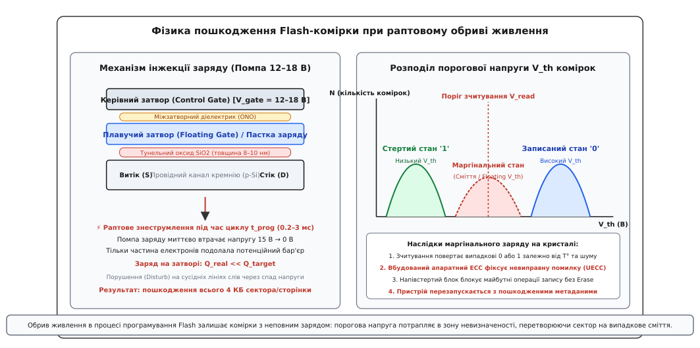
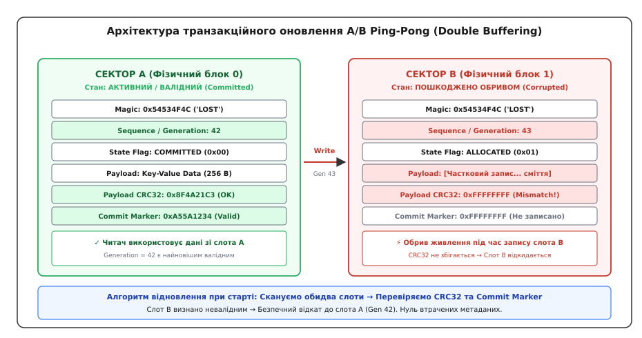
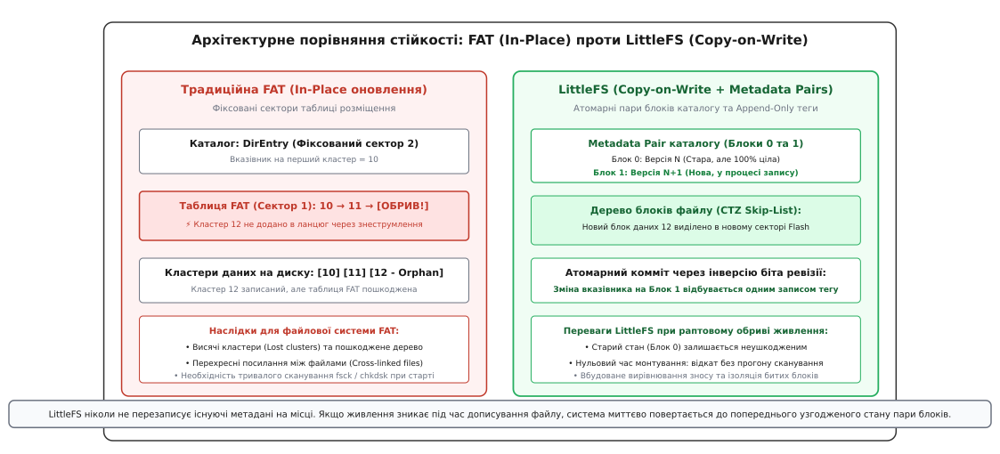
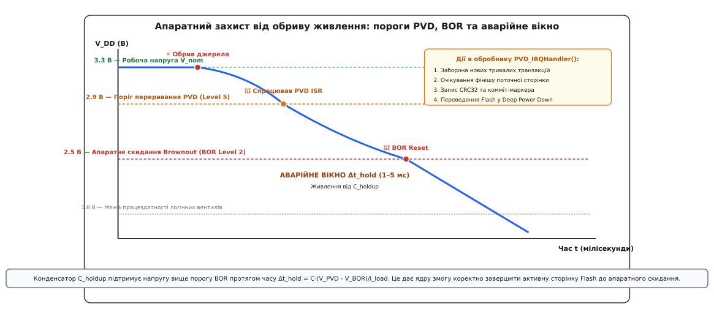

# Пропало живлення під час запису

<preknowlist>
- [Детектор просідання напруги (BOR / Brownout)](root:hw-arch/brownout) — поведінка мікроконтролера та скидання ядра при падінні напруги живлення.
- [NOR проти NAND](root:embedded/nor-vs-nand) — організація сторінок, блоків, фізика тунелювання та час виконання операцій стирання й запису.
- [Послідовність скидання мікроконтролера](root:embedded/reset-sequence) — поведінка шин, тактування та периферійних модулів під час рестарту.
- [Вирівнювання зносу (Wear Leveling)](root:sf-data/wear-leveling) — обмеження на кількість циклів перезапису Flash та рівномірний розподіл навантаження.
- [Інтеграція FatFs](root:embedded/fatfs-integration) — архітектура таблиці розміщення файлів та небезпека пошкодження структур метаданих.
</preknowlist>

Бортовий реєстратор польотного контролера безпілотного апарата оновлює калібрувальні коефіцієнти гіроскопа у внутрішній пам'яті Flash. Оператор від'єднує силовий роз'єм акумулятора XT60 рівно в той момент, коли контролер Flash виконував стирання чотирикілобайтного сектора з конфігурацією. При наступному вмиканні прилад не може зчитати таблицю налаштувань: замість цілісної структури в пам'яті лежить хаотична суміш нулів та одиниць із невідповідною контрольною сумою. Прошивка не проходить верифікацію цілісності сховища, переходить у стан безпечного блокування (Safe Mode) і відмовляється зводити двигуни.

З точки зору програмного коду сталася звичайна аварійна подія, але її наслідки в кремнії є незворотними на рівні поточної операції. Проблема раптового знеструмлення (англ. *power-loss during write / torn write*) криється у фундаментальній фізичній асиметрії енергонезалежної пам'яті: зчитування байта з Flash триває десятки наносекунд, тоді як програмування сторінки вимагає 1–3 мілісекунди, а стирання сектора — від 20 до 400 мілісекунд. Якщо живильна напруга зникає всередині цього багатомілісекундного вікна, сховище не просто втрачає нові дані — воно знищує вже існуючі.

Захист систем від раптового знеструмлення вимагає узгодженої взаємодії на трьох інженерних рівнях: розуміння фізики квантового тунелювання на кристалі Flash, побудови атомарних структур даних (Write-Ahead Logging, Copy-on-Write, подвійна буферизація A/B Ping-Pong) та апаратного резервування енергії за допомогою компаратора PVD і накопичувальних конденсаторів.

## Фізика процесу: що відбувається в кремнії при раптовому обриві живлення

Вбудована та зовнішня [NOR Flash пам'ять](root:embedded/nor-vs-nand) зберігає біти інформації у вигляді електричного заряду на плаваючому затворі (англ. *floating gate*) або в нітридному шарі пастки заряду (англ. *charge trap*).


*Фізика пошкодження Flash-комірки при раптовому знеструмленні. Колапс внутрішньої помпи заряду залишає на плаваючому затворі неповну кількість електронів, через що порогова напруга транзистора потрапляє в заборонену маргінальну зону між логічним нулем та одиницею.*

У стертому стані комірка містить логічну одиницю `1`: плаваючий затвор вільний від надлишкових електронів, а порогова напруга відкриття польового транзистора `V_th` є низькою. Під час читання стандартна напруга `V_read` легко відкриває транзистор, і струм каналу фіксується підсилювачем зчитування (англ. *sense amplifier*).

Щоб записати логічний нуль `0`, у плаваючий затвор необхідно інжектувати електрони. Оскільки напруги живлення ядра мікроконтролера (1.8–3.3 В) недостатньо для подолання потенційного бар'єра діелектрика SiO₂ завтовшки 8–10 нм, внутрішній вузол чипа — **помповий помножувач напруги** (англ. *charge pump*) — формує високу напругу порядку 12–18 В. Під дією потужного електричного поля виникає квантове тунелювання Фаулера-Нордгейма або інжекція гарячих носіїв (Channel Hot Electron Injection).

### Механіка утворення маргінальних станів

Процес інжекції електронів не є миттєвим: він складається з послідовності високовольтних імпульсів, чергованих із контрольними вимірюваннями рівня заряду. Коли живлення раптово зникає:

1. **Колапс помпи заряду.** За відсутності напруги живлення `V_DD` конденсатори помпи заряду розряджаються за мікросекунди, висока напруга 15 В падає до нуля, і потік електронів обривається на півдорозі.
2. **Маргінальний заряд (Marginal State).** На плаваючому затворі осідає лише частина запланованого заряду `Q_real << Q_target`. Порогова напруга транзистора `V_th` зависає в проміжній смузі — точно на рівні напруги зчитування `V_read`.
3. **Метастабільність при читанні.** При наступному старті системи така недозаписана комірка поводиться стохастично: залежно від температури кристала, мікроскопічних коливань живлення та теплового шуму підсилювач зчитування фіксує то `0`, то `1`.
4. **Порушення сусідніх комірок (Program / Erase Disturb).** Неконтрольований спад напруги на лініях слів (Word Lines) усередині масиву Flash може спричинити паразитне перетікання заряду в сусідні комірки того самого рядка, спотворюючи байти, які процесор навіть не намагався змінити.
5. **Апаратна відмова блоку.** Якщо обрив стався під час тривалого циклу стирання сектора (Sector Erase), весь 4-кілобайтний сектор залишається в напівпровідниковому стані, у якому окремі байти неможливо перезаписати без повторного повного циклу стирання.

> ⚠️ **Ілюзія побайтового захисту.** Наївне переконання, що «якщо я пишу 4 байти, то при збої постраждають лише ці 4 байти», повністю руйнується фізикою Flash. Обрив живлення під час оновлення навіть одного байта ставить під загрозу цілісність усього фізичного сектора (4096 байтів).

## Апаратний рівень захисту SPI Flash: засувка WEL та напруга заборони запису

Зовнішні мікросхеми Flash-пам'яті з інтерфейсом SPI/QSPI (Winbond W25Q, Macronix MX25, GigaDevice GD25Q) мають вбудовані апаратні механізми захисту від низьковольтних збоїв на шині:

```
┌────────────────────────────────────────────────────────────────────────────────────────┐
│                     АПАРАТНІ МЕХАНІЗМИ ЗАХИСТУ SPI FLASH ВІД BROWN-OUT                 │
├─────────────────────────┬──────────────────────────┬───────────────────────────────────┤
│ Вузол захисту           │ Принцип дії              │ Захисна функція                   │
├─────────────────────────┼──────────────────────────┼───────────────────────────────────┤
│ 1. Засувка Write Enable │ Біт WEL у Status Register│ Скидається в '0' при старті,      │
│    (WEL Latch)          │ вимагає команди WREN (06h│ після кожного запису та при       │
│                         │ перед кожним Page Program│ падінні напруги нижче V_WI        │
├─────────────────────────┼──────────────────────────┼───────────────────────────────────┤
│ 2. Пороговий компаратор │ Write Inhibit Voltage    │ Повністю блокує логіку керування  │
│    V_WI (Write Inhibit) │ V_WI = 2.1 ... 2.4 В     │ стиранням/записом при V_DD < V_WI │
├─────────────────────────┼──────────────────────────┼───────────────────────────────────┤
│ 3. Апаратний пін WP#    │ Write Protect пін        │ Апаратно блокує модифікацію байтів│
│    (Hardware Protection)│ блокує Status Register   │ конфігурації та захищених секторів│
└─────────────────────────┴──────────────────────────┴───────────────────────────────────┘
```

Коли напруга на шині живлення спадає нижче критичного порогу `V_WI` (Write Inhibit Voltage), внутрішній аналоговий супервізор Flash автоматично деактивує високовольтні ключі й скидає засувку WEL у стан логічного нуля `0`. Будь-які паразитні імпульси чи сміттєві байти, що виникають на лініях `SCK` та `MOSI` внаслідок хаотичної поведінки виходів GPIO мікроконтролера під час скидання, апаратно ігноруються пам'яттю.

## Архітектура атомарності: чому не можна писати «поверх себе»

Головна причина руйнування даних у наївних прошивках — оновлення на місці (англ. *in-place update*). Якщо конфігурація приладу зберігається в єдиному секторі Flash, алгоритм її оновлення виглядає так:

```
[Початок] ──> [Стирання сектора Flash] ──> [Запис нових даних] ──> [Кінець]
                     │                               │
                     └─── ВІКНО ВРАЗЛИВОСТІ (10–50 мс) ┘
```

У проміжку часу між викликом команди стирання та завершенням запису останнього байта в пам'яті фізично немає жодної копії даних. Старий стан уже знищено, а новий ще не створено. Будь-який стрибок напруги, спрацьовування [сторожового таймера watchdog](root:hw-arch/brownout) чи висмикування кабелю в цьому вікні знищує сховище назавжди.

Для забезпечення стійкості до відмов сховище зобов'язане гарантувати властивість **атомарності** (лат. *atomus* — неподільний): операція оновлення повинна або виконатися повністю, або не виконатися взагалі. Проміжного стану для зовнішнього спостерігача існувати не може.

### Подвійна буферизація (A/B Ping-Pong)

Для зберігання монолітних структур фіксованого розміру (калібрування, мережеві сертифікати, глобальні налаштування системи) найпростішим і найнадійнішим рішенням є архітектура двох чергованих секторів — **A/B Ping-Pong**.


*Архітектура подвійної буферизації A/B Ping-Pong. Запис завжди виконується в неактивний слот B зі збереженням недоторканості слота A. Пошкоджений незавершений запис слота B відкидається під час перевірки CRC32 при старті системи.*

Сховище виділяє два окремі фізичні сектори Flash: Сектор A та Сектор B. Кожен сектор містить стандартизований службовий заголовок:

```
┌────────────────────────────────────────────────────────────────────────────────────────┐
│                              СТРУКТУРА СЛОТА PING-PONG                                 │
├───────────────┬─────────────────┬──────────────────────────────────────────────────────┤
│ Поле          │ Розмір          │ Призначення                                          │
├───────────────┼─────────────────┼──────────────────────────────────────────────────────┤
│ Magic Word    │ 4 байти         │ Сигнатура валідності формату (наприклад, 0x54534F4C)  │
├───────────────┼─────────────────┼──────────────────────────────────────────────────────┤
│ Generation    │ 4 байти (uint32)│ Монотонний лічильник поколінь транзакцій (Seq number)│
├───────────────┼─────────────────┼──────────────────────────────────────────────────────┤
│ State Flag    │ 4 байти         │ 0xFFFFFFFF (FREE) → 0x00000000 (COMMITTED)           │
├───────────────┼─────────────────┼──────────────────────────────────────────────────────┤
│ Data Length   │ 2 байти         │ Фактичний розмір корисного навантаження              │
├───────────────┼─────────────────┼──────────────────────────────────────────────────────┤
│ Payload       │ N байтів        │ Корисні дані (структура конфігурації)                │
├───────────────┼─────────────────┼──────────────────────────────────────────────────────┤
│ Payload CRC32 │ 4 байти         │ Контрольна сума CRC32 корисних даних                       │
├───────────────┼─────────────────┼──────────────────────────────────────────────────────┤
│ Commit Marker │ 4 байти         │ Фінальний маркер підтвердження (0xA55A1234)          │
└───────────────┴─────────────────┴──────────────────────────────────────────────────────┘
```

#### Протокол безпечного оновлення (Commit Protocol):

1. **Пошук активного слота.** Під час старту мікроконтролер зчитує обидва сектори, перевіряє сигнатуру Magic, розраховує CRC32 та перевіряє наявність фінального маркера Commit Marker.
2. **Вибір найновішої ревізії.** Якщо обидва слоти валідні, активним вважається слот із більшим значенням `Generation` (з урахуванням можливого переповнення лічильника 32 біти: `(int32_t)(Gen_A - Gen_B) > 0`).
3. **Запис у дзеркальний слот.** Коли програма оновлює налаштування:
   - Активний слот (наприклад, A з `Gen = 42`) **не чіпається**.
   - Неактивний слот B стирається.
   - У слот B записуються: заголовок із `Gen = 43`, нові корисні дані та їхній `CRC32`.
   - **Атомарний комміт.** Найпростіший і останній крок — запис слова `Commit Marker` або скидання біта `State Flag` у `0x00000000`. У Flash-пам'яті зміна бітів з `1` на `0` виконується без стирання.
4. **Поведінка при аварії:** Якщо живлення вимикається під час стирання або запису слота B, слот A залишається цілим і непошкодженим. Під час наступного старту сканер виявить невідповідність CRC32 або відсутність Commit Marker у слоті B, відкине його й продовжить роботу на стабільній версії `Gen = 42`.

### Журналювання з випереджаючим записом (Write-Ahead Logging / WAL)

Коли обсяг даних складається з багатьох незалежних параметрів (Key-Value), стирати цілий 4 КБ сектор заради зміни одного 4-байтового лічильника неефективно: це швидко вичерпує ресурс комірок [вирівнювання зносу (Wear Leveling)](root:sf-data/wear-leveling).

Для дрібних оновлень застосовують підхід **журналу з дописуванням** (англ. *Append-Only Log / WAL*). Сектор Flash заповнюється послідовно транзакційними записами:

```
┌─────────────────┬─────────────────┬─────────────────┬──────────────────────────────┐
│ Record 0 (Key 1)│ Record 1 (Key 2)│ Record 2 (Key 1)│  Вільний простір (0xFF...)   │
│ Gen=1, Val=100  │ Gen=2, Val=250  │ Gen=3, Val=105  │  (Готовий для дописування)   │
│ [CRC: OK]       │ [CRC: OK]       │ [CRC: OK]       │                              │
└─────────────────┴─────────────────┴─────────────────┴──────────────────────────────┘
```

Щоб змінити значення `Key 1`, система не переписує старий блок, а дописує новий запис `Record 2` у вільні стерті комірки (0xFF) праворуч. Під час читання чинним значенням ключа вважається останній успішно верифікований запис із максимальною ревізією `Gen`.

Коли вільне місце в секторі закінчується, запускається процедура **збирання сміття** (англ. *Garbage Collection / Compaction*): актуальні значення всіх унікальних ключів копіюються в сусідній чистий сектор, після чого старий сектор стирається.

## Файлові системи для Flash: чому FAT руйнується, а LittleFS виживає

При переході від простих структур конфігурації до повноцінного збереження файлів (лог-файли польоту, веб-сторінки конфігурації, файли прошивок OTA) розробники часто інтегрують [файлову систему FAT (FatFs)](root:embedded/fatfs-integration). Проте FAT створювалася в 1977 році для магнітних дискет, де сектори перезаписувалися на місці магнітною голівкою без попереднього стирання.


*Порівняння реакції на обрив живлення: FAT руйнує деревоподібну структуру через розсинхронізацію таблиці FAT і каталогу. LittleFS використовує Copy-on-Write парні блоки й атомарно фіксує перехід без ризику втрати цілісності файлової системи.*

### Анатомія катастрофи FAT під час знеструмлення

У файловій системі FAT інформація про розташування фрагментів файлу зберігається в глобальній **Таблиці розміщення файлів** (File Allocation Table), а імена та розміри — у записах каталогів (`DirEntry`).

Коли програма дописує новий кластер даних у файл `flight.log`:
1. Контролер виділяє вільний кластер 12 і записує туди дані.
2. Контролер оновлює сектор таблиці FAT: робить запис, що кластер 11 тепер посилається на кластер 12 (`FAT[11] = 12`).
3. Контролер відкриває сектор каталогу й оновлює розмір файлу в структурі `DirEntry` (наприклад, з 4096 до 4608 байтів).

Якщо живлення обривається між кроком 1 та кроком 2, кластер даних записано, але файлова система про нього не знає: виникає **втрачений кластер** (англ. *lost/orphan cluster*).

Якщо живлення обривається між кроком 2 та кроком 3, таблиця FAT містить ланцюжок на два кластери, але каталог стверджує, що файл має розмір лише одного кластера. При наступному монтуванні FAT вважає дисковий простір пошкодженим, вимагаючи тривалого сканування `fsck / chkdsk`.

Гірше того: стирання та постійний перезапис одних і тих самих перших секторів таблиці FAT швидко пропалюють дірки в кристалі Flash, виводячи носій із ладу.

### Архітектура LittleFS: стійкість за дизайном

Спеціалізована файлова система для вбудованих систем **LittleFS** (розроблена ARM / Embedded Working Group) позбавлена цих вад завдяки трьом фундаментальним архітектурним принципам:

#### 1. Метадані на базі пар блоків (Metadata Pairs)
Кожен каталог у LittleFS представлений не одним сектором, а **парою фізичних блоків** (Block 0 та Block 1). Блоки містять монотонний лічильник ревізій. 

Усі зміни всередині каталогу записуються за принципом **Copy-on-Write (CoW)**:
- Поточний стан читається з Блоку 0 (ревізія `N`).
- Нова версія каталогу формується та записується в Блок 1 (ревізія `N+1`).
- Якщо під час запису Блоку 1 зникає струм, Блок 0 залишається неушкодженим. Під час наступного увімкнення LittleFS миттєво повертається до ревізії `N`. Жодного сканування диска не потрібно — монтування займає `O(1)` часу.

#### 2. Журналювання тегів (Tag-based Delta Logging)
Замість переписування всього блоку метаданих при зміні одного атрибута файлу LittleFS дописує в поточний блок компактний 32-бітний **тег дії** (англ. *tag*):
- `CREATE(file_id)`
- `ATTR_SIZE(file_id, new_size)`
- `DELETE(file_id)`

При зчитуванні каталог динамічно відтворює актуальний стан із послідовності тегів.

#### 3. Дерева блоків даних CTZ Skip-Lists
Дані файлів зберігаються у вигляді зв'язаного списку вказівників, побудованого на базі інверсного двійкового підрахунку нулів (Count Trailing Zeros, CTZ). Це дозволяє дописувати файли в режимі Append-Only у довільні вільні сектори, не модифікуючи попередньо записані блоки даних і забезпечуючи логарифмічний час переходу `O(log N)` до будь-якого зміщення у файлі.

```
┌────────────────────────────────────────────────────────────────────────────────────────┐
│                        ПОРІВНЯННЯ FATFS ТА LITTLEFS ДЛЯ FLASH                          │
├──────────────────────────┬────────────────────────────┬────────────────────────────────┤
│ Критерій                 │ FatFs                      │ LittleFS                       │
├──────────────────────────┼────────────────────────────┼────────────────────────────────┤
│ Стійкість до знеструмлення│ ❌ Низька (ризик псування  │ ✅ Абсолютна (атомарний CoW,   │
│                          │ структур FAT та DirEntry)  │ нульовий час відновлення)      │
├──────────────────────────┼────────────────────────────┼────────────────────────────────┤
│ Механізм оновлення       │ In-Place (перезапис секторів│ Copy-on-Write + Tag Logging    │
├──────────────────────────┼────────────────────────────┼────────────────────────────────┤
│ Вирівнювання зносу       │ ❌ Відсутнє (потрібен FTL)  │ ✅ Вбудоване динамічне         │
├──────────────────────────┼────────────────────────────┼────────────────────────────────┤
│ Обробка збійних блоків   │ ❌ Відсутня                │ ✅ Автоматична ізоляція Bad Blk│
├──────────────────────────┼────────────────────────────┼────────────────────────────────┤
│ ОЗП на відкритий файл    │ 512–4096 байтів            │ 64–256 байтів                  │
└──────────────────────────┴────────────────────────────┴────────────────────────────────┘
```

> 🔧 **Навіщо це.** Якщо ваш пристрій веде журнал подій або зберігає налаштування на мікросхемі SPI NOR Flash (наприклад, Winbond W25Q або GD25Q), вибір LittleFS замість FAT повністю ліквідує звернення в сервісний центр із діагнозом «злетіла файлова система після просідання батареї».

## Апаратний ранній захист: програмований детектор напруги (PVD) та запас енергії

Програмні структури даних гарантують, що незавершений запис не зруйнує старі дані. Проте вони не рятують саму активну транзакцію: якщо живлення зникло під час передачі критичного пакету телеметрії, інформація поточного сеансу буде втрачена.

Щоб зберегти навіть поточну транзакцію, система повинна дізнатися про обрив живлення **завчасно** — до того, як напруга впаде нижче робочої межі цифрової логіки.


*Часова шкала знеструмлення. Поріг PVD спрацьовує вище за рівень апаратного скидання BOR, відкриваючи часове вікно Δt_hold. Накопичений у конденсаторі C_holdup заряд дає ядру змогу завершити цикл програмування Flash і перейти в безпечний стан.*

### Чому Brownout Reset (BOR) не рятує транзакцію

Більшість сучасних мікроконтролерів мають апаратну схему [Brownout Reset (BOR)](root:hw-arch/brownout). Її завдання — захистити логічні вентилі та АЦП від роботи на нестабільних напругах.

Коли напруга `V_DD` падає нижче порогу `V_BOR` (зазвичай 2.1–2.5 В), схема BOR **миттєво вводить ядро процесора в стан апаратного скидання Reset**. Процесорні регістри скидаються, тактування зупиняється, а транзакція Flash на шині SPI обривається саме посеред циклу. BOR рятує чип від виконання сміттєвих інструкцій, але примусово створює пошкоджений запис у пам'яті.

### Детектор напруги PVD (Programmable Voltage Detector)

Для завчасного попередження використовують **програмований детектор напруги PVD**. Це вбудований прецизійний аналоговий компаратор, підключений до внутрішнього джерела опорної напруги (VREF) та живильної шини.

Рівень спрацьовування PVD налаштовується програмно вище за поріг BOR. Наприклад, у мікроконтролерах STM32:
- `V_nom = 3.3 В` (нормальне живлення)
- `V_PVD = 2.9 В` (поріг тривоги PVD Level 5)
- `V_BOR = 2.5 В` (поріг апаратного скидання BOR Level 2)

Коли напруга на виході стабілізатора просідає до 2.9 В, компаратор PVD генерує апаратне переривання `PVD_IRQHandler()` найвищого пріоритету (або немасковане переривання NMI).

#### Алгоритм дій у перериванні PVD:

1. **Миттєве блокування нових операцій:** встановлення атомарного прапорця `power_failing = true`, який забороняє всім потокам RTOS починати нові транзакції.
2. **Очікування фінішу поточної сторінки:** якщо контролер Flash уже виконує `Page Program` (тривалість до 1.5 мс), переривання чекає скидання прапорця зайнятості `BUSY` у статус-регістрі пам'яті.
3. **Фіксація контрольної суми:** якщо дані встигли записатися, відправляється фінальний комміт-байт. Якщо ні — транзакція скасовується без запису маркера.
4. **Гасіння периферії:** вимикаються енергоємні споживачі (радіомодулі, підсвічування, драйвери моторів), а мікросхема Flash переводиться в режим глибокого сну `Deep Power-Down` командою `0xB9`.
5. **Вхід у нескінченний цикл очікування Reset:** процесор виконує інструкцію `WFI` (Wait For Interrupt), знижуючи власне споживання до мікроамперів і спокійно очікуючи спрацьовування BOR.

### Енергетичний бюджет: вибір буферного конденсатора

Щоб система встигла виконати аварійне скидання під час спаду напруги від `V_PVD` до `V_BOR`, на платі повинен бути встановлений накопичувальний конденсатор `C_holdup`.

Мінімально необхідна ємність розраховується за формулою розряду постійним струмом:

```
C_holdup = (I_total · t_hold) / (V_PVD - V_BOR)
```

Де:
- `I_total` — сумарний струм споживання мікроконтролера та Flash під час запису (типово 30–50 мА);
- `t_hold` — максимальний час завершення операції програмування сторінки та обробки переривання (1.5–2.0 мс);
- `(V_PVD - V_BOR)` — робоче вікно напруги (2.9 В - 2.5 В = 0.4 В).

Детальний математичний аналіз моделі розряду з урахуванням ефекту падіння ємності керамічних конденсаторів під постійною напругою (DC Bias derating) та опору ESR наведено в окремому розрахунку [ємності буферного конденсатора](root:embedded/propalo-zhyvlennia-pid-chas-zapysu/math-holdup-capacitor.md).

## Інтеграція сховища з операційною системою реального часу (RTOS)

У багатопотокових вбудованих системах під керуванням FreeRTOS або Zephyr OS неконтрольований прямий доступ до Flash із різних потоків призводить до взаємних блокувань і порушення атомарності транзакцій.

Архітектурний патерн надійного збереження у середовищі RTOS базується на виділенні **Сервісного потоку сховища (Storage Worker Task)**:

```
┌────────────────────────────────────────────────────────────────────────────────────────┐
│                        АРХІТЕКТУРА СХОВИЩА В СЕРЕДОВИЩІ RTOS                           │
│                                                                                        │
│ [Потік Telemetry] ──┐                                                                  │
│                     │  xQueueSendToBack()                                              │
│ [Потік Navigation] ─┼───────────────────> [Черга транзакцій StorageQueue]             │
│                     │                              │                                   │
│ [Потік Settings] ───┘                              ▼                                   │
│                                           [Потік StorageTask]                          │
│                                                    │                                   │
│                                                    ▼                                   │
│                                    [Модуль AtomicStorage (A/B)]                        │
│                                                    │ SPI DMA                           │
│                                                    ▼                                   │
│                                           [Апаратна Flash W25Q]                        │
└────────────────────────────────────────────────────────────────────────────────────────┘
```

1. **Асинхронний запис через чергу:** прикладні потоки не викликають повільні функції запису Flash напряму. Вони формують повідомлення та відправляють його в чергу `StorageQueue`.
2. **Пакетування операцій:** потік `StorageTask` накопичує оновлення параметрів у внутрішньому буфері ОЗП і скидає їх у Flash одним блоком, мінімізуючи кількість циклів стирання.
3. **Реакція на PVD переривання в RTOS:**
   - Обробник переривання `PVD_IRQHandler()` встановлює глобальний бітовий прапорець `portBASE_TYPE xHigherPriorityTaskWoken = pdFALSE;`.
   - Викликається `vTaskNotifyGiveFromISR(xStorageTaskHandle, &xHigherPriorityTaskWoken);`, негайно пробуджуючи потік сховища з найвищим пріоритетом.
   - Якщо напруга продовжує стрімко падати, переривання PVD бере керування на себе й виконує фіксацію останнього відкритого сектора синхронно безпосередньо в контексті ISR.

## Методологія тестування стійкості: інжекція збоїв живлення (Power-Cut Testing)

Неможливо гарантувати надійність сховища теоретичним аналізом без проведення стрес-тестування на фізичному обладнанні. Стенд для перевірки стійкості до раптового знеструмлення (англ. *Power-Cut Fault Injection Test Jig*) включає:

1. **Апаратний комутатор живлення:** швидкодіючий силовий P-MOSFET або твердотільне реле з часом вимкнення менше 500 наносекунд, встановлений у розрив лінії живлення плати.
2. **Генератор випадкових інтервалів:** тестовий мікроконтролер подає імпульси вимкнення живлення з псевдовипадковим зсувом у діапазоні 1–500 мс. Це гарантує, що обрив живлення потрапить на всі фази життєвого циклу Flash: читання заголовка, команду стирання `Sector Erase`, початок запису сторінки, передачу CRC32 та запис фінального Commit Marker.
3. **Процедура валідації:**
   - Кожен тестовий цикл записує монотонно зростаючий тестовий масив даних із перевірочним хешем.
   - Після кожного відновлення живлення плата проводить повний самотест (POST), перевіряє цілісність усіх структур і звітує через UART про стан: `DATA_VALID_LATEST`, `DATA_VALID_ROLLBACK` або `DATA_CORRUPTED`.

Критерій успішного проходження тесту — **нуль випадків `DATA_CORRUPTED` на серії з 50 000 послідовних аварійних вимкнень**.

## Повний робочий модуль транзакційного key-value сховища на Flash

Розгляньмо закінчену інженерну реалізацію енергонезалежного сховища конфігурації. Модуль реалізує подвійну буферизацію A/B Ping-Pong, повну верифікацію цілісності за алгоритмом CRC32, облік поколінь ревізій та апаратну незалежність через шар абстракції Flash HAL.

### Інтерфейс та драйвер сховища на C

У мові C реалізовано структури заголовка з вирівнюванням, обчислення стандартного полінома CRC32 (Ethernet/ZIP `0xEDB88320`) та процедуру відновлення при старті.

:::tabs
:::code propalo-zhyvlennia-pid-chas-zapysu-d/c/atomic_storage.h
:::code propalo-zhyvlennia-pid-chas-zapysu-d/cpp/atomic_storage.hpp
:::

### Реалізація логіки верифікації та атомарного запису

Нижче наведено повну реалізацію алгоритму: швидкий розрахунок CRC32, сканування слотів при старті та захищене оновлення зі збереженням недоторканості попереднього стану.

:::tabs
:::code propalo-zhyvlennia-pid-chas-zapysu-d/c/atomic_storage.c
:::code propalo-zhyvlennia-pid-chas-zapysu-d/cpp/atomic_storage.cpp
:::

## Інженерний чеклист захисту сховища від знеструмлення

Перед відправкою пристрою в серійне виробництво перевірте надійність системи зберігання за такими критеріями:

1. **Відмова від перезапису на місці (No In-Place Write):** жодна структура конфігурації, калібрування чи стану не повинна перезаписувати власний сектор Flash без наявності валідної копії в іншому фізичному блоці.
2. **Контроль цілісності за CRC32:** кожен блок даних у Flash повинен містити контрольну суму, яка розраховується після повного завершення запису корисного навантаження.
3. **Двоетапний комміт (Commit Marker):** статус транзакції повинен фіксуватися окремим записом фінального маркера після успішної верифікації даних.
4. **Вибір LittleFS замість FAT:** для зберігання файлів на сирій Flash-пам'яті використовуйте виключно файлові системи з підтримкою Copy-on-Write та динамічного вирівнювання зносу.
5. **Апаратний поріг PVD:** налаштуйте поріг спрацьовування детектора напруги PVD вище порогу апаратного скидання BOR мінімум на 300–400 мВ.
6. **Розрахунок ємності C_holdup:** переконайтеся, що сумарна ємність буферних конденсаторів на шині живлення забезпечує запас часу не менше 2.0 мс при максимальному струмі споживання під час запису Flash.
