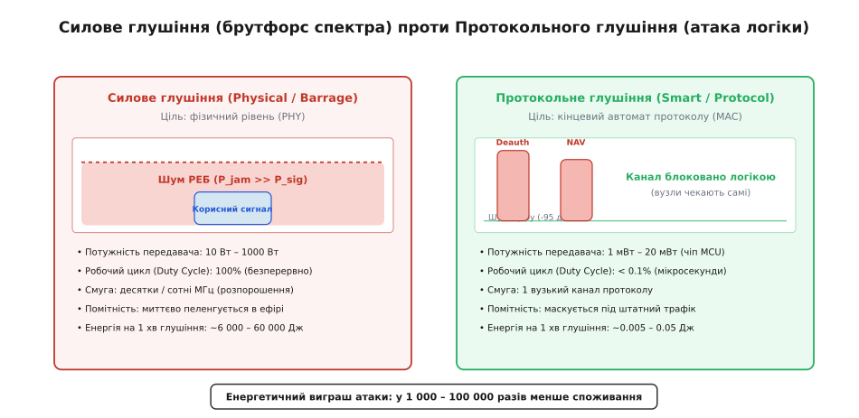
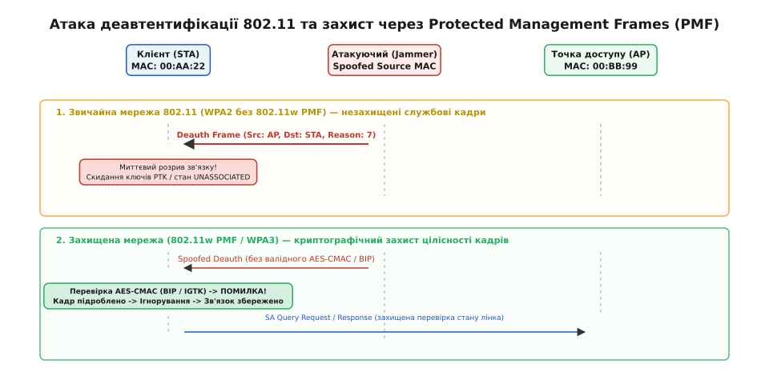
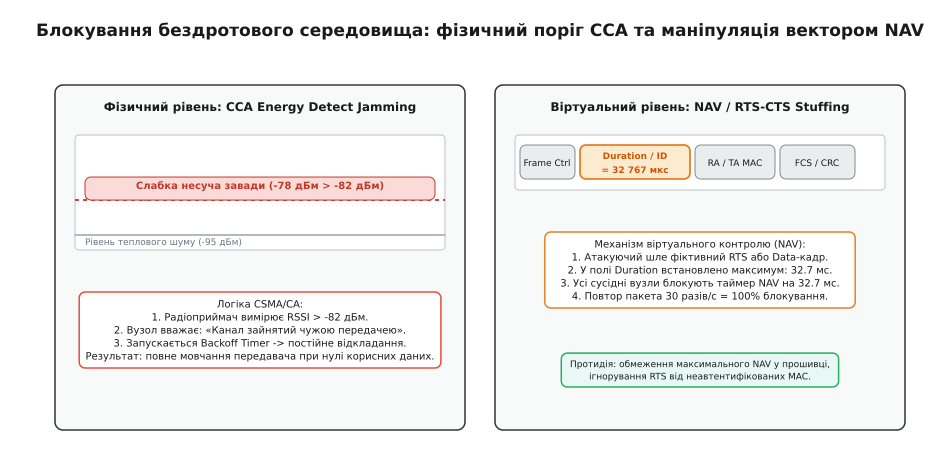
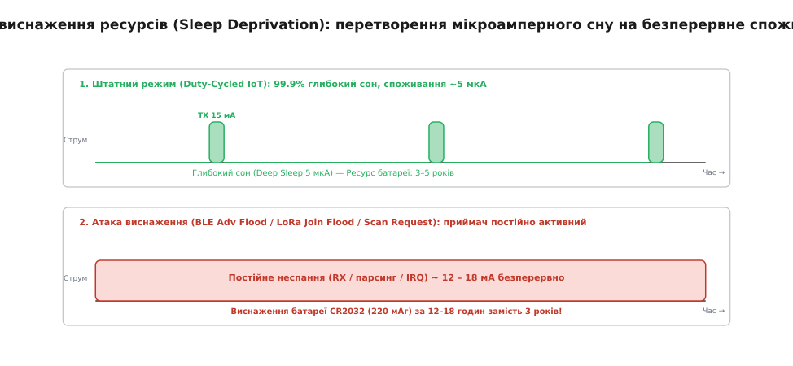

# Протокольне глушіння: deauth, флуд, зайнятий канал

<preknowlist>
- [Методи множинного доступу: CSMA/CA, колізії, таймери](root:embedded/multiple-access-methods)
- [Лінк під глушінням: енергетичний баланс та завади](root:embedded/jamming-fhss)
- [Стандарти 802.11: від b/g/n до Wi-Fi 7](root:embedded/802-11-versions)
- [AEAD: шифрування, що водночас доводить автентичність](root:sf-security/authenticated-encryption)
- [Повтор, nonce й плаваючий код](root:sf-security/replay-protection)
</preknowlist>

Коли радіостанція РЕБ намагається придушити бездротовий зв'язок грубою силою, вона випромінює в ефір десятки або сотні ват широкосмугового шуму, сподіваючись втопити корисний сигнал нижче порогу демодуляції приймача. Але зв'язок можна повністю заблокувати передавачем потужністю всього в кілька міліватів — якщо бити не в аналогову радіохвилю, а в логіку кінцевого автомата канального рівня. Достатньо знати правила, за якими приймач і передавач домовляються про черговість доступу, підтверджують з'єднання та переводять трансивер у режим сну.

Усі стандартизовані бездротові протоколи — від Wi-Fi (IEEE 802.11) і Bluetooth Low Energy до LoRaWAN та Zigbee (802.15.4) — оптимізовані для чесного співіснування в неліцензованому діапазоні. Вони спроєктовані так, щоб вузол обов'язково слухав ефір перед передачею, пропускав сусіда, вірив службовим оголошенням мережі та засинав для збереження заряду батареї. Протокольне глушіння перетворює цю «ввічливість» протоколу на зброю проти нього самого: фальшиві службові команди змушують пристрої безперервно скидати сесії, вічно чекати вільного каналу або спалювати батарею за лічені години.

### Енергетична асиметрія: чому розумне глушіння дешевше за силове

Щоб зрозуміти прірву між силовим та протокольним придушенням, порівняймо їхню фізичну енергетику. У класичному силовому глушінні (barrage jamming) нападник діє на фізичному рівні (PHY). Якщо корисний сигнал займає смугу 20 МГц, а глушник накриває смугу 100 МГц, його потужність розпорошується по всьому спектру. Щоб зірвати прийом кадру з відношенням сигнал/шум (SNR) нижче критичного порогу демодуляції (наприклад, SNR < 4 дБ для QPSK), спектральна густина потужності завади на антені жертви повинна перевищувати густину потужності корисного передавача.

Для придушення віддаленого приймача на відстані 500 метрів силовий генератор змушений випромінювати від 50 до 500 Вт безперервної потужності (P_jam) зі 100% шпаруватістю (Duty Cycle = 1.0). Це означає колосальні тепловтрати, важкі акумулятори та моментальну радіопеленгацію джерела завади будь-яким розвідувальним комплексом.

Протокольний глушник взагалі не бореться з корисною енергією сигналу. Він атакує логіку керування доступом до середовища (Medium Access Control, MAC). Замість суцільного випромінювання нападник формує валідні за структурою протокольні кадри мікросекундної тривалості на потужності звичайного мікроконтролера (від 0 дБм до 14 дБм, тобто 1–25 мВт). 

```
Силове глушіння:      E_jam = P_jam * T_jam = 100 Вт * 60 с = 6 000 Дж
Протокольне глушіння: E_jam = P_jam * T_pulse * N_pulses = 0.01 Вт * (0.0003 с * 200) = 0.0006 Дж
Енергетичний виграш:  Gain = 6 000 / 0.0006 = 10 000 000 разів
```

За 60 секунд блокування мережі силовий передавач витрачає 6 кДж енергії, висаджуючи важку свинцеву або літієву батарею. Протокольний глушник надсилає, наприклад, 200 коротких кадрів тривалістю по 300 мкс кожен — загальний час випромінювання становить лише 0.06 секунди. На потужності 10 мВт сумарні витрати енергії дорівнюють часткам міліджоуля. Маленький чіп розміром з монету, що живиться від годинникової батарейки CR2032, може паралізувати складну систему зв'язку на багато діб, залишаючись майже невидимим для спектроаналізаторів загального призначення.


*Порівняння двох підходів до радіоелектронного придушення: силове заливання спектра шумом вимагає кіловатів і безперервної роботи, тоді як протокольне глушіння б'є короткими мікросекундними імпульсами в логіку канального рівня (MAC), досягаючи того ж результату за в тисячі разів менших енергетичних витрат.*

Розгляньмо чотири головні вразливості канального рівня, на яких тримаються протокольні атаки: службові кадри керування, оцінка вільного каналу, віртуальне резервування часу та виснаження черг.

### Атака деавтентифікації: відсутність цілісності службових кадрів 802.11

Найвідоміша і найбільш руйнівна протокольна атака у світі Wi-Fi — це деавтентифікація (Deauthentication / Disassociation Attack). Щоб зрозуміти, чому вона взагалі можлива, подивімося на поділ кадрів у стандарті [IEEE 802.11](root:embedded/802-11-versions). Кадри поділяються на три великі категорії:
1. **Data Frames** — несуть безпосередньо дані користувача (IP-пакети).
2. **Control Frames** — керують передачею на фізичному стику (RTS, CTS, ACK, BlockACK).
3. **Management Frames** — керують членством станції в бездротовій мережі (Beacon, Probe Request/Response, Association Request/Response, Authentication, Deauthentication, Disassociation).

У стандартах безпеки WPA та WPA2 шифрування (TKIP або CCMP на базі AES-128) застосовується **виключно до Data-кадрів**. Службові кадри управління історично передавалися абсолютно відкритим текстом, без жодного криптографічного підпису або перевірки справжності джерела. Причина такого рішення в кінці 1990-х здавалася логічною: якщо станція втратила зв'язок або вимикається, точка доступу має швидко звільнити ресурси таблиці асоціацій, а клієнт повинен негайно дізнатися про розрив зв'язку, навіть якщо сесійні ключі шифрування ще не встановлені.

Кадр деавтентифікації складається зі стандартного заголовка MAC (24 байти) та тіла кадру, що містить двобайтове поле коду причини (Reason Code):

```
+-------------------+-------------------+-------------------+-------------------+-------------+
| Frame Control (2) | Duration/ID (2B)  | Addr1: Dest MAC   | Addr2: Source MAC | Addr3: BSSID|
| Type=00, Sub=1100 |                   | (Жертва або AP)   | (Підроблена AP/STA)| (MAC точки) |
+-------------------+-------------------+-------------------+-------------------+-------------+
| Seq Control (2B)  | Reason Code (2B)  | FCS / CRC32 (4B)  |
|                   | Наприклад: 0x0007 |                   |
+-------------------+-------------------+-------------------+
```

Атака реалізується елементарно:
1. Нападник переводить свій Wi-Fi інтерфейс у режим моніторингу (`monitor mode`) з можливістю ін'єкції сирих пакетів.
2. Сканує ефір, перехоплює відкритий Beacon або Data-кадр і дізнається MAC-адресу точки доступу (BSSID) та MAC-адресу клієнта (STA).
3. Формує сирий кадр `Deauthentication` (Subtype `0x0C`), у якому в полі `Addr2 (Source MAC)` вказує MAC-адресу точки доступу, а в полі `Addr1 (Dest MAC)` — адресу клієнта (або широкомовну адресу `FF:FF:FF:FF:FF:FF` для відключення всіх пристроїв мережі).
4. Встановлює `Reason Code = 7` (*Class 3 frame received from nonassociated STA*) або `Reason Code = 1` (*Unspecified reason*).
5. Вистрілює цим кадром в ефір.

Щойно клієнтський Wi-Fi чіп (наприклад, у ноутбуці, дроні чи польовому датчику) отримує такий кадр, канальний рівень драйвера бачить валідний CRC32 і MAC-адресу своєї точки доступу. Драйвер не має технічної можливості перевірити, хто насправді згенерував цей сигнал. Кінцевий автомат клієнта негайно переходить зі стану `STATE_ASSOCIATED` у стан `STATE_UNASSOCIATED`.


*Послідовність атаки деавтентифікації та робота механізму захисту PMF: без криптографічного підпису клієнт миттєво рве з'єднання за фальшивою вимогою, тоді як 802.11w верифікує цілісність службових кадрів через AES-CMAC і відкидає підробки.*

Наслідки деавтентифікації:
- Всі встановлені сесійні симетричні ключі (PTK — Pairwise Transient Key) скидаються.
- Поточні черги передачі TCP/UDP скидаються.
- Клієнт змушений заново починати повний цикл: сканування каналів → `Authentication Request/Response` → `Association Request/Response` → 4-стороннє рукостискання WPA (4-Way Handshake).
- Якщо нападник шле всього 5–10 кадрів Deauth на секунду, клієнт перебуває в нескінченній петлі скидання асоціації і не встигає передати жодного байта корисних даних.

#### Захист: стандарт IEEE 802.11w (Protected Management Frames)

Для ліквідації цієї діри у 2009 році було прийнято поправку **IEEE 802.11w**, відому як **PMF (Protected Management Frames)**. У стандарті WPA3 використання PMF стало строго обов'язковим, а у WPA2 воно існує як опція (`PMF Capable` / `PMF Required`).

PMF вводить два механізми захисту:
1. **Індивідуальні (Unicast) службові кадри** шифруються та підписуються тим самим сесійним ключем пари точка-клієнт (PTK) за протоколом CCMP/GCMP, як і звичайні дані. Підробити такий Deauth нападник без знання сесійного ключа не може: приймач перевіряє код цілісності MIC (Message Integrity Code) і відкидає сфабрикований кадр.
2. **Широкомовні (Broadcast/Multicast) службові кадри** (наприклад, розрив для всієї мережі або зміна конфігурації каналу) не можна зашифрувати одним індивідуальним ключем. Для них 802.11w вводить окремий протокол цілісності **BIP (Broadcast Integrity Protocol)** на основі алгоритму **AES-128-CMAC**.
   - Точка доступу під час узгодження зв'язку передає всім авторизованим станціям спільний груповий ключ цілісності **IGTK (Integrity Group Temporal Key)**.
   - До кожного широкомовного Management-кадру додається інформаційний елемент `MMIE (Management MIC Information Element)`, що містить 64-бітний криптографічний хеш AES-CMAC та 48-бітний лічильник послідовності `IPN (IGTK Packet Number)` для [захисту від повторів (Replay Protection)](root:sf-security/replay-protection).
   - Якщо зловмисник генерує широкомовний Deauth, станції перевіряють CMAC за допомогою IGTK. Якщо хеш не сходиться — кадр тихо ігнорується.

```
+-----------------------------------+-----------------------------------+
| Заголовок 802.11 Management       | Тіло службового повідомлення      |
+-----------------------------------+-----------------------------------+
| MMIE: Element ID (0x4C) | Len (16)| Key ID (2B) | IPN Counter (6B)    |
+-----------------------------------+-----------------------------------+
| MIC: AES-128-CMAC(IGTK, Frame) (8 байтів)                            |
+-----------------------------------------------------------------------+
```

Ще один захисний механізм 802.11w — процедура **SA Query (Security Association Query)**. Якщо точка доступу раптово отримує незахищений запит асоціації від станції, з якою вже встановлено з'єднання (що може бути спробою атаки або наслідком раптового перезавантаження клієнта), точка не рве сесію одразу. Вона надсилає клієнту зашифрований тестовий запит `SA Query Request`. Якщо клієнт живий і відповідає валідним `SA Query Response`, фальшивий запит ігнорується, а робочий лінк зберігається.

### Блокування каналу: маніпуляція фізичним CCA та віртуальним NAV

Якщо мережа використовує PMF або закритий протокол без відкритої деавтентифікації, наступною мішенню стає механізм арбітражу ефіру. Більшість бездротових технологій у неліцензованих діапазонах (Wi-Fi, Zigbee, Thread, Bluetooth) використовують алгоритм множинного доступу з контролем несучої та запобіганням колізіям — [CSMA/CA](root:com-transport/csma-ca).

Оскільки радіоприймач не може одночасно передавати сигнал і чути чужі колізії на власній антені (half-duplex обмеження), перед початком будь-якої передачі вузол зобов'язаний виконати перевірку: «Чи вільне радіосередовище прямо зараз?». Ця перевірка реалізується на двох рівнях: фізичному (CCA) та віртуальному (NAV).

#### 1. Атака на фізичний рівень: CCA Energy Detect Jamming

Механізм **Clear Channel Assessment (CCA)** реалізований апаратно в кожному бездротовому трансивері (наприклад, SX1262, CC2500, nRF52840, ESP32). CCA працює у трьох стандартизованих режимах:
- **Energy Detection (CCA-ED):** вимірювання сумарної потужності радіосигналу в смузі каналу (RSSI). Якщо рівень сигналу перевищує заданий поріг (Threshold), канал вважається зайнятим (`Channel BUSY`), незалежно від того, чи це валідний пакет, чи промислова завада.
- **Carrier Sense (CCA-CS):** пошук сигнатури преамбули стандарту (кореляція з відомою послідовністю синхронізації).
- **ED + CS:** комбінація обох методів.

У стандарті 802.11 для смуги 2.4 ГГц поріг CCA-ED становить зазвичай від **-82 дБм до -85 дБм** (для 802.15.4 / Zigbee — близько **-75 дБм**).

```
Логіка передавача при спробі відправити кадр:
1. Зачекати інтервал DIFS (Distributed Inter-Frame Space, наприклад 28-50 мкс).
2. Опитати апаратний блок CCA.
3. Якщо RSSI > -82 дБм:
   - Призупинити лічильник випадкового відкату (Backoff Timer).
   - Залишатися в режимі прийому (RX).
4. Якщо RSSI < -82 дБм протягом DIFS + Backoff:
   - Перейти в режим передачі (TX).
```

Атака полягає в тому, що нападник вмикає генератор немодульованої несучої (Continuous Wave, CW) або передає короткі імпульси шуму з рівнем трохи вище порогу CCA (наприклад, -78 дБм). 

Потужність у -78 дБм настільки мізерна, що не здатна фізично пошкодити радіокадр чи спотворити біти на вході приймача, якщо той уже почав прийом. Але для передавача, який тільки збирається вийти в ефір, цей рівень є абсолютним стоп-сигналом. Його апаратний автомат CSMA/CA бачить, що рівень енергії вищий за поріг, вирішує, що в ефірі йде чужа передача, і заморожує лічильник Backoff. Вузол впадає в стан **термінального голодування передавача (Backoff Starvation)**: буфери заповнюються, пакети відкидаються за таймаутом, але в ефір не вилітає жоден біт.


*Два способи змусити передавач замовкнути за правилами самого протоколу: фізичне перевищення порогу чутливості CCA Energy Detect та віртуальне захоплення ефіру через маніпуляцію значенням Duration/NAV у заголовках 802.11.*

#### 2. Атака на віртуальний рівень: NAV Stuffing / RTS-CTS Flood

Крім фізичного вимірювання енергії, у протоколах родини 802.11 діє механізм **віртуального контролю несучої (Virtual Carrier Sense)**. Він базується на векторі виділення мережі — **NAV (Network Allocation Vector)**.

NAV — це таймер всередині кожного приймача, який показує, скільки мікросекунд ефір буде гарантовано зайнятий поточною транзакцією. Кожен кадр 802.11 (включаючи службові RTS/CTS) містить у заголовку 16-бітне поле `Duration/ID`:

```
Біти 0-14: Значення тривалості в мікросекундах (від 0 до 32 767 мкс = 32.7 мс)
Біт 15:    Прапорець режиму (0 = тривалість NAV)
```

Коли будь-яка станція чує заголовок кадру (навіть якщо цей кадр адресований не їй), вона зобов'язана зчитати поле `Duration` і встановити свій локальний таймер NAV на вказане значення:

```
NAV_local = max(NAV_current, Duration_incoming)
```

Поки лічильник `NAV_local > 0`, вузол вважає середовище зайнятим і не має права починати передачу, навіть якщо фізичний блок CCA показує ідеальну тишу в ефірі (RSSI = -100 дБм).

Атака **NAV Stuffing** використовує це правило:
1. Нападник надсилає фіктивний службовий кадр `RTS (Request to Send)` або `CTS (Clear to Send)`.
2. У полі `Duration` виставляє максимальне значення: `0x7FFF` (32767 мкс ≈ 32.7 мс).
3. Усі станції в радіусі прийому блокують власні передавачі на 32.7 мілісекунди.
4. Нападнику достатньо повторювати цей короткий пакет (тривалістю всього 14 байтів ≈ 40 мкс передачі) кожні 30 мс (близько 33 пакетів на секунду).

Витрачаючи менше 0.13% ефірного часу на випромінювання коротких фальшивих RTS, нападник на 100% блокує весь зв'язок у зоні покриття для всіх клієнтів стандарту.

### Атаки виснаження ресурсів у бездротових мережах IoT

У системах низької потужності (Low-Power IoT) та сенсорних мережах мета глушіння часто полягає не в миттєвому обриві лінка, а в **повному знищенні автономності** живлення або переповненні таблиць маршрутизації.

#### 1. Атака на позбавлення сну (Sleep Deprivation Attack) у BLE

Пристрої Bluetooth Low Energy (наприклад, автономні давачі тиску, радіомаяки, медичні сенсори) розраховані на роботу від однієї батарейки протягом 3–5 років. Ця автономність досягається за рахунок екстремально низького робочого циклу:
- 99.9% часу мікроконтролер перебуває в режимі глибокого сну (Deep Sleep), споживаючи струм 1.5–5 мкА.
- 0.1% часу (раз на 1–2 секунди на 3–5 мс) мікроконтролер прокидається, вмикає радіоприймач або передавач, відправляє пакет і миттєво повертається в сон.


*Порівняння штатного профілю живлення бездротового мікроконтролера та режиму під атакою Sleep Deprivation: шквал невалідних запитів тримає радіотракт і ядро в постійно активному стані, скорочуючи автономність з років до кількох годин.*

Атака реалізується через механізм сканування та з'єднання:
1. **BLE Scan Request Flood:** Якщо периферійний пристрій транслює рекламу (Advertising), що підтримує відповіді на сканування (`ADV_IND` або `ADV_SCAN_IND`), нападник шле неперервний потік `SCAN_REQ` пакетів. Модуль змушений залишатися в режимі прийому/передачі (RX/TX) для формування `SCAN_RSP`, споживаючи 12–18 мА замість 5 мкА.
2. **BLE Connection Request Flood:** Нападник надсилає пакет ініціалізації з'єднання (`CONNECT_IND`) з випадкових адрес. Периферийний вузол переходить у стан підключення (`Connection State`), резервує вікна обміну даними (Connection Events), запускає таймери таут-контролю.
3. Енергетичний результат: Середній струм споживання зростає з 10 мкА до 15 мА (у 1500 разів). Дискова літієва батарейка CR2032 ємністю 220 мАг висаджується в нуль за 14–18 годин замість запланованих трьох років експлуатації.

#### 2. LoRaWAN Join Request Flood та блокування шлюзів

У топологіях великого радіусу дії ([LoRaWAN](root:com-transport/lorawan)) пристрої підключаються до мережі за процедурою OTAA (Over-the-Air Activation). Активація вимагає відправки кадру `Join Request` та отримання у відповідь від базової станції (шлюзу) кадру `Join Accept` у строго фіксованих часових вікнах прийому RX1 (через 5 с) або RX2 (через 6 с).

Вразливість криється в асиметрії ресурсів шлюзу та регуляторних обмеженнях:
1. **Ліміт каналів демодуляції:** Базовий чіпсет шлюзу (наприклад, Semtech SX1301 / SX1302) має 8 паралельних демодуляторів LoRa. Нападник з дешевого модуля SX1262 генерує шквал псевдовипадкових `Join Request` на різних коефіцієнтах розширення спектра (від SF7 до SF12). Шлюз витрачає всі апаратні корелятори на обробку сміттєвого трафіку.
2. **Duty Cycle Exhaustion шлюзу:** За європейськими нормами ETSI (діапазон 868 МГц) кожен передавач має право займати ефір не більше 1% часу на годину (36 секунд на годину для піддіапазону g1). Коли шлюз намагається відповісти пакетами `Join Accept` на лавину фальшивих запитів, він швидко вичерпує свій законний ліміт Duty Cycle. Після цього передавач шлюзу блокується прошивкою на рівні драйвера, позбавляючи легітимні сенсори можливості отримувати підтвердження (ACK) та команди керування.

#### 3. Шторм маршрутизації в Mesh-мережах (RREQ Storm)

У самоорганізованих мережах (Zigbee PRO, Thread, 802.15.4 Mesh) для пошуку шляху до вузла призначення використовується реактивна маршрутизація (алгоритм AODV або RPL). Коли вузлу треба надіслати пакет невідомому адресату, він розсилає широкомовний пакет `Route Request (RREQ)`. Кожен сусідній роутер зберігає запис у таблиці маршрутизації та ретранслює RREQ далі по ланцюжку.

Нападник надсилає пакети RREQ з вимогою знайти маршрут до неіснуючих адрес зі швидкістю 50 пакетів/с.
- **Виснаження RAM:** У кожного мікроконтролера в мережі таблиця маршрутизації (Routing Table) та таблиця виявлення шляхів (Route Discovery Table) мають обмежений розмір (зазвичай 16–64 записи через дефіцит оперативної пам'яті). Вони миттєво переповнюються сміттєвими маршрутами, витісняючи дійсні шляхи до координатора.
- **Шторм колізій (Broadcast Storm):** Ретрансляція сотень широкомовних RREQ всіма вузлами одночасно призводить до тотального колапсу CSMA/CA та повної втрати пропускної здатності.

---

### Інженерні заходи протидії протокольним атакам

Захистити вбудовану систему від розумного глушіння значно складніше, ніж від силового. Якщо проти силового РЕБ допомагають класичні радіотехнічні засоби — спрямовані антени, резонаторні фільтри та [стрибки частоти (FHSS)](root:embedded/jamming-fhss), то проти протокольного глушіння захист має будуватися на стику радіодрайвера та системної архітектури.

#### 1. Модифікація поведінки CCA та примусова передача (Forced TX)

У закритих автономних та військових системах, де немає вимоги цивільної сертифікації на сумісність із загальним Wi-Fi/Bluetooth, драйвер радіоканалу повинен відмовлятися від «сліпої віри» в показники CCA:
- **Адаптивний поріг CCA (Dynamic CCA Threshold):** Якщо фоновий шум піднявся до -75 дБм через наявність слабкої завади, драйвер динамічно піднімає поріг виявлення зайнятого каналу до -70 дБм, ігноруючи слабкий блокуючий тон.
- **Режим примусової передачі (Forced TX / CCA Override):** Якщо лічильник затримок Backoff досягає критичного значення `MAX_RETRIES` або таймер черги спливає, драйвер повністю вимикає перевірку CCA і здійснює прямий постріл пакета в ефір (ALOHA-режим). Якщо корисний сигнал передавача значно потужніший за слабку заваду на антені приймача (наприклад, +20 дБм передавача проти -80 дБм завади), приймач успішно зафіксує преамбулу завдяки ефекту захоплення (Capture Effect).
- **Перехід на жорсткий TDMA:** Замість конкурентного доступу CSMA/CA вузли переходять на роботу за жорсткою синхронізацією часу (Time Division Multiple Access) з псевдовипадковим розподілом часових слотів. У TDMA станції взагалі не опитують стан ефіру: кожна передає строго у свій наносекундний інтервал, що повністю нейтралізує атаки на базі CCA та NAV.

#### 2. Статичні сесії та криптографічна автентифікація нульового рівня

- **Відмова від відкритого динамічного рукостискання:** Вразливі відкриті процедури Join/Association замінюються попередньо розподіленими симетричними ключами (Pre-Shared Keys) або статичними парними сесіями.
- **Zero-Allocation криптографічний фільтр:** Перевірка цілісності кадру (MIC на базі AES-CMAC, HMAC-SHA256 або Poly1305) повинна виконуватися на найнижчому апаратному або переривальному рівні драйвера до виділення пам'яті під буфери повідомлень. Якщо кадр не проходить криптографічну перевірку, він викидається з FIFO-регістра трансивера за один такт, не пробуджуючи основні потоки ОС і не створюючи навантаження на черги.

#### 3. Адаптивний Rate Limiting та карантин джерел

Драйвер повинен вести статистику неавтентифікованого трафіку:
- Якщо з певної адреси надходить понад 5 помилкових запитів за секунду, адреса поміщається в апаратний чорний список (Hardware MAC Filter) трансивера.
- Обмеження часу роботи приймача: якщо за задане вікно сканування не отримано жодного підтвердженого пакета, модуль примусово засинає на експоненційно зростаючий інтервал часу (Exponential Backoff Sleep), захищаючи батарею від повного виснаження.

---

### Практична реалізація: Стійкий канальний драйвер із детекцією атак

Спроєктуємо та реалізуємо завершений драйвер канального рівня (Link Layer Driver) для мікроконтролера. Драйвер містить:
1. **Захищений формат кадру:** 64-бітний заголовок із номером послідовності, ідентифікаторами вузлів, прапорцями та 64-бітним кодом автентичності (HMAC-SHA256 truncated / AES-CMAC).
2. **Захист від повторів (Anti-Replay):** Перевірка монотонності лічильника з ковзним вікном.
3. **Детектор протокольного глушіння (Attack Detector):** Аналіз частоти аномалій (спроби підробки Deauth, застрягання в CCA, флуд невалідними MAC).
4. **Аварійний автомат станів:** Автоматичне перемикання з режиму CSMA/CA у захищений режим примусової передачі (Forced TX) та зміна псевдовипадкового радіоканалу при виявленні тривалої атаки.

Нижче наведено дві повноцінні реалізації: мовою C для апаратного рівня мікроконтролерів без динамічної пам'яті та ідіоматичною мовою C++20 з використанням строгих типів, `std::span` та `std::expected`.

:::tabs

@tab C (C99 / Embedded)

:::code protokolne-hlushinnia-d/c/main.c

@tab C++ (C++20 / Idiomatic)

:::code protokolne-hlushinnia-d/cpp/main.cpp

:::

---

### Підсумковий аналіз стійкості каналу

Протокольне глушіння наочно демонструє головний парадокс бездротової безпеки: чим складніший, оптимізованіший та «ввічливіший» протокол зв'язку, тим більшу поверхню атаки він надає супротивнику.

| Рівень атаки | Механізм експлуатації | Ефект для жертви | Засоби інженерної протидії |
|---|---|---|---|
| **Deauth / Disassociation** | Відкриті службові кадри 802.11, підробка Source MAC | Миттєвий розрив сесії, нескінченна петля реконнекту | 802.11w PMF, криптографічний захист цілісності BIP (AES-CMAC), SA Query |
| **Physical CCA Jamming** | Генерація слабкої несучої вище порогу Energy Detect (-82 дБм) | Заморожування таймера Backoff, повна тиша передавача | Динамічний поріг CCA, примусова передача (Forced TX), перехід на TDMA |
| **Virtual NAV Stuffing** | Ін'єкція фіктивних RTS/CTS з Duration = 32.7 мс | Віртуальне блокування каналу всіма сусідніми станціями | Обмеження максимального NAV у прошивці, ігнорування неавтентифікованих RTS |
| **Sleep Deprivation** | Флуд рекламними та з'єднувальними пакетами у BLE/LoRa | Постійне неспання приймача, виснаження батареї за години | Апаратні білі списки, Zero-Allocation криптофільтри, експоненційний сон |
| **Routing / Join Flood** | Генерація фальшивих RREQ / Join Request у Mesh / LoRaWAN | Виснаження оперативної пам'яті, блокування Duty Cycle шлюзів | Статичні сесійні ключі, лімітування частоти запитів, парна ізоляція |

Побудова захищеного радіоканалу в умовах протидії вимагає відходу від наївних стандартних налаштувань. Відмова від незахищених відкритих транзакцій, перевірка криптографічної автентичності кожного службового повідомлення та здатність драйвера відключати застарілі механізми кооперативного доступу за перших ознак завади перетворюють тендітну споживчу мережу на надійний і живучий інструмент передачі даних.
