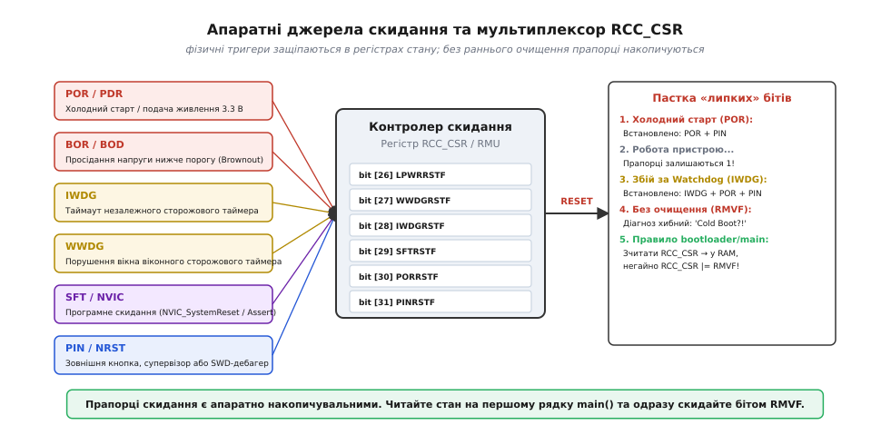
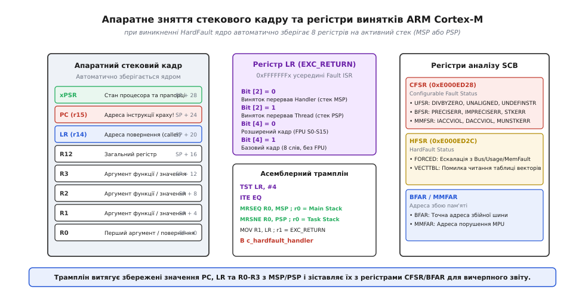
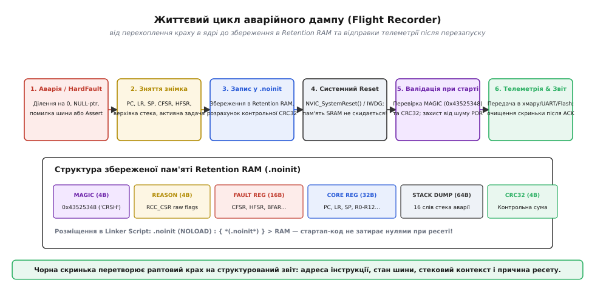

# Причина скидання як діагноз

<preknowlist>
- [Послідовність graceful reset](root:embedded/reset-sequence) — чому впорядковане згортання роботи вимагає збереження діагностичного сліду перед перезапуском
- [Сторожовий таймер (Watchdog)](root:sf-devices/watchdog) — як апаратний сторож захищає систему від тихих зависань і чому його спрацьовування є аварійним симптомом
- [Аналіз адрес аварій через addr2line](root:embedded/addr2line-workflow) — техніка зіставлення збереженого лічильника команд (PC) та адреси повернення (LR) з вихідним кодом прошивки за допомогою ELF-файлу
- [Петля перезапусків: мотор, просадка, скидання](root:embedded/petlia-perezapuskiv) — як фізичні просадки напруги та апаратні перезапуски утворюють нескінченний цикл відмов
- [HAL, LL та робота з регістрами](root:embedded/hal-ll-registers) — прямий доступ до системних контролерів SCB та RCC на рівні апаратних бітів
</preknowlist>

Безпілотний апарат у польоті на мить сіпнувся й перейшов у режим аварійного вимкнення двигунів. Промисловий контролер у шафі керування раптово обірвав сесію зв'язку Modbus і через вісімдесят мілісекунд почав завантажуватися з нуля. Автономний телеметричний давач у полі, який мав надсилати звіти раз на добу, несподівано вийшов на зв'язок посеред ночі з лічильником аптайму в три секунди. У всіх цих випадках сталася одна й та сама подія — мікроконтролер зазнав перезавантаження.

У настільних операційних системах аварійне падіння процесу супроводжується записом core dump, трасуванням стека в системний журнал та кодом завершення. У голому мікроконтролері (bare-metal) або системі під керуванням RTOS перезавантаження за замовчуванням виглядає безслідним: апаратний тригер скидає ядро, лічильник команд стрибає на вектор `Reset_Handler`, стартап-код затирає пам'ять `.bss` нулями, переініціалізує `.data` і викликає `main()`. Для розробника, який не заклав механізмів фіксації аварій, пристрій просто «якось перезавантажився», а спроба відтворити дефект на столі під дебагером нічого не дає.

Проте сам кремній ніколи не скидається «просто так». Апаратні вузли мікроконтролера фіксують точну фізичну причину кожної події скидання в спеціальних регістрах стану (RCC, RMU, RCM, RSTSRC). Коли ж процесорне ядро зазнає фатального краху — ділення на нуль, звернення за нульовим покажчиком, виконання сміття замість інструкцій чи спроби запису у вимкнену периферію — ядро ARM Cortex-M перед входом у HardFault автоматично зберігає повний контекст виконання на стек. Якщо зберегти цей контекст у спеціальній енергонезалежній ділянці оперативної пам'яті (Retention RAM), що не очищується під час перезавантаження, пристрій отримує повноцінну «чорну скриньку» (Flight Recorder). Перезапуск перетворюється з містичної поломки на вичерпний діагностичний звіт.

---

### Класифікація апаратних прапорців скидання MCU

Усі події, здатні скинути мікроконтролер, сходяться в єдиний апаратний блок — контролер скидання та тактування (у STM32 це `RCC`, у Silicon Labs EFM32 — `RMU`, у NXP Kinetis — `RCM`, у ESP32 — `RTC_CNTL`). Цей блок містить регістр статусу (наприклад, `RCC_CSR` або `RCC_RSR`), окремі біти якого є тригерами-защіпками для кожного фізичного джерела скидання.

```
 Джерела скидання              Регістр RCC_CSR                  Стан системи
 ──────────────────            ────────────────                 ────────────
 [ Подача 3.3 В   ] ───► [ bit 30: PORRSTF  ] ───► Холодний старт (Power-On)
 [ Просадка VDD   ] ───► [ bit 25: BORRSTF  ] ───► Аварія живлення (Brownout)
 [ Сторож IWDG    ] ───► [ bit 29: IWDGRSTF ] ───► Зависання задачі (Watchdog)
 [ Сторож WWDG    ] ───► [ bit 30: WWDGRSTF ] ───► Порушення таймінгу вікна
 [ NVIC_System    ] ───► [ bit 28: SFTRSTF  ] ───► Програмний ресет / Assert
 [ Ніжка NRST     ] ───► [ bit 26: PINRSTF  ] ───► Кнопка / SWD / Супервізор
```

Кожен із цих прапорців відповідає за конкретну фізичну чи програмну природу події:

1. **POR / PDR (Power-On Reset / Power-Down Reset)**. Сигналізує про подачу напруги живлення від нуля до робочого рівня або її повне зникнення. Це нормальний «холодний старт» пристрою при вмиканні батареї чи блоку живлення.
2. **BOR (Brown-Out Reset)**. Спрацьовує, коли напруга живлення `VDD` не зникла повністю, але просіла нижче критичного порогу стабільної роботи логіки ядра (типово 2.1–2.7 В залежно від конфігурації Option Bytes). Це діагноз проблем із фізичним живленням: пусковий струм колекторного мотора, увімкнення потужного радіомодуля на слабкій батареї або недостатня ємність блокувальних конденсаторів.
3. **IWDG (Independent Watchdog Reset)**. Фіксує тайм-аут незалежного сторожового таймера, що тактується від окремого низькочастотного генератора (LSI, ~32 кГц). Це свідчення мертвого зависання: код застряг у нескінченному блокуючому циклі, RTOS увійшла в стан взаємного блокування (deadlock), або пріоритетне переривання монополізувало процесорний час і не віддає його фоновим задачам.
4. **WWDG (Window Watchdog Reset)**. Прапорець віконного сторожового таймера. На відміну від IWDG, він вимагає скидання не просто «до вичерпання тайм-ауту», а суворо всередині часового вікна (не зарано й не запізно). Його спрацьовування викриває джиттер часових інтервалів, порушення порядку виконання задач або спробу зловмисного зламу прошивки з прискореним пропуском інструкцій.
5. **SFT / SFTRST (Software Reset)**. Програмне скидання, ініційоване самим ядром через запис у регістр `AIRCR` викликом `NVIC_SystemReset()`. Це наслідок свідомого рішення коду: завершення оновлення по повітрю (OTA), реакція на спрацьовування макросу `ASSERT()`, або вимушене перезавантаження після виявлення фатального винятку HardFault.
6. **PIN / PINRST / NRST**. Скидання через зміну логічного рівня на зовнішньому фізичному виводі NRST. Джерелом може бути ручне натискання кнопки користувачем, зовнішня мікросхема супервізора напруги, дебагер по інтерфейсу SWD/JTAG або електромагнітна завада, наведена на довгий провідник лінії ресету.
7. **LPWRRST (Low-Power Reset)**. Виникає при спробі несанкціонованого переходу в глибокі режими сну (Stop / Standby), коли в Option Bytes активний апаратний захист від засинання.


*Схема мультиплексування тригерів скидання в регістрах MCU. Прапорці є апаратно липкими: якщо не очистити регістр бітом RMVF під час першого запуску, попередні причини ресету накопичуються й спотворюють подальшу діагностику.*

#### Пастка накопичення «липких» прапорців

Головна підводна камінь апаратних регістрів скидання полягає в тому, що їхні біти є **накопичувальними (sticky bits)**. Апаратне скидання процесора не очищує біти попередніх ресетів.

Якщо мікроконтролер увімкнули вперше, у регістрі `RCC_CSR` встановлюються біти `PORRSTF` та `PINRSTF`. Якщо після цього прошивка працюватиме три дні, а потім зависне й буде перезапущена сторожовим таймером IWDG, після перезавантаження регістр міститиме `PORRSTF | PINRSTF | IWDGRSTF`. Якщо прошивка не скине ці прапорці, а пізніше розробник натисне кнопку Reset на платі, у регістрі залишаться всі чотири біти одночасно. Зрозуміти, яка саме подія спричинила *останній* перезапуск, стає неможливо.

Звідси випливає залізне правило архітектури завантаження:

> 💡 **Правило точки входу:** Регістр причин скидання необхідно зчитати в оперативну пам'ять на найпершому кроці функції `main()` (до ініціалізації периферії та запуску ОС) і **негайно очистити апаратний регістр** записом біта `RMVF` (Reset Flag Remove, `RCC->CSR |= RCC_CSR_RMVF`).

Очищення бітом `RMVF` гарантує, що наступний перезапуск принесе в регістр виключно свіжі прапорці, породжені конкретним інцидентом.

---

### Анатомія краху в ядрі ARM Cortex-M

Коли мікроконтролер падає не через зовнішнє живлення чи сторожовий таймер, а через програмну помилку, усередині процесорного ядра ARM Cortex-M розгортається складна послідовність апаратних подій.

Архітектура ARMv7-M (Cortex-M3, M4, M7) та ARMv8-M (Cortex-M23, M33) має багаторівневу систему апаратних винятків (Exceptions):

* **MemManage (Memory Management Fault)** — виникає при порушенні прав доступу, сконфігурованих у модулі захисту пам'яті (MPU), спробі виконання коду з ділянок пам'яті з прапорцем eXecute Never (XN) або зверненні до неіснуючої пам'яті, якщо MPU це відстежує.
* **BusFault** — виникає при апаратній помилці шини AHB/AXI під час вибірки інструкції, читання або запису даних (наприклад, звернення за адресою, де фізично немає пам'яті, або читання регістрів модуля, чиє тактування в RCC не було ввімкнене).
* **UsageFault** — виникає при спробі виконати невизначену інструкцію (Undefined Instruction), переході на адресу з парним LSB (порушення обов'язкового біта Thumb State T у регістрі EPSR), спробі цілочисельного ділення на нуль (якщо ввімкнено біт `DIV_0_TRP`) або несинхронізованому доступі за невирівняною адресою (біт `UNALIGN_TRP`).
* **HardFault** — загальний катастрофічний виняток найвищого пріоритету.

За замовчуванням після скидання MCU окремі обробники `MemManage`, `BusFault` та `UsageFault` **вимкнені** в системному регістрі `SCB->SHCSR` (System Handler Control and State Register). Якщо стається будь-яка з цих помилок, ядро виконує **ескалацію (Fault Escalation)** і перенаправляє виконання в універсальний `HardFault_Handler`. Більше того, якщо помилка стається всередині самого обробника винятку, відбувається подвійний збій (Double Fault), який також безумовно падає в HardFault.

#### Регістри діагностики збоїв System Control Block (SCB)

Щоб з'ясувати причину катастрофи, ядро містить групу спеціалізованих 32-бітних діагностичних регістрів у блоці SCB (базова адреса `0xE000ED00`):

```
       ┌─────────────────────────────────────────────────────────────┐
       │     CFSR (Configurable Fault Status Register, 0xE000ED28)   │
       ├──────────────────────────────┬───────────────┬──────────────┤
       │ UFSR (Bits 31..16)           │ BFSR (15..8)  │ MMFSR (7..0) │
       │ [DIVBYZERO, UNDEFINSTR...]   │ [PRECISERR..] │ [IACCVIOL..] │
       └──────────────────────────────┴───────────────┴──────────────┘
       ┌─────────────────────────────────────────────────────────────┐
       │     HFSR (HardFault Status Register, 0xE000ED2C)            │
       │     [FORCED (ескалація), VECTTBL (помилка вектора)]         │
       └─────────────────────────────────────────────────────────────┘
       ┌─────────────────────────────────────────────────────────────┐
       │     BFAR (BusFault Address Register, 0xE000ED38)            │
       │     Точна 32-бітна адреса шини, де стався збій              │
       └─────────────────────────────────────────────────────────────┘
```

1. **CFSR (Configurable Fault Status Register, `0xE000ED28`)**. Складається з трьох об'єднаних субрегістрів:
   * `UFSR` (UsageFault Status, старші 16 біт): біт `DIVBYZERO` сигналізує про ділення на нуль; `UNALIGNED` — незважаючи на підтримку несинхронного доступу, операція `LDRD`/`STRD` була викликана не по межі 4/8 байт; `UNDEFINSTR` — спроба ядра декодувати сміття (зазвичай через пошкоджений покажчик на функцію або збій Flash); `INVSTATE` — спроба виконати ARM-інструкцію замість Thumb (біт 0 адреси переходу дорівнював `0`).
   * `BFSR` (BusFault Status, біти 15..8): біт `PRECISERR` означає, що точну адресу збою зафіксовано в регістрі `BFAR`; біт `IMPRECISERR` вказує на асинхронний шинний збій; біт `STKERR`/`UNSTKERR` свідчить про те, що стек вийшов за межі пам'яті безпосередньо під час збереження або відновлення контексту переривання.
   * `MMFSR` (MemManage Status, молодші 8 біт): біти `DACCVIOL` та `IACCVIOL` фіксують спроби читання/запису даних або вибірки інструкцій із захищеної ділянки MPU.
2. **HFSR (HardFault Status Register, `0xE000ED2C`)**. Біт `FORCED` (біт 30) свідчить про те, що HardFault виник не сам по собі, а був викликаний ескалацією іншого винятку, обробник якого був неактивний або не зміг обробити ситуацію. Біт `VECTTBL` (біт 1) вказує на фатальне пошкодження самої таблиці векторів переривань у Flash/RAM.
3. **BFAR (`0xE000ED38`) та MMFAR (`0xE000ED34`)**. Якщо в `BFSR` встановлено біт `BFARVALID` (біт 7), 32-бітний регістр `BFAR` містить точну фізичну адресу пам'яті чи периферії, звернення до якої зруйнувало виконання програми.

#### Імпрецизійні шинні помилки (Imprecise Bus Faults)

Найпідступніший різновид апаратного краху в Cortex-M3/M4/M7 — це **імпрецизійний шинний збій (Imprecise BusFault)**.

Ядра Cortex-M оптимізують операції запису за допомогою внутрішнього асинхронного буфера запису (Write Buffer). Коли процесор виконує інструкцію збереження `STR R0, [R1]`, значення передається в буфер запису шини AHB, а лічильник команд `PC` негайно крокує далі, не чекаючи фізичного підтвердження від шини пам'яті. Якщо адреса в `R1` виявилася невалідною (наприклад, звернення до вимкненого блоку SPI або за межі RAM), шина генерує сигнал помилки через 2–5 тактів.

У цей момент ядро вже встигло виконати наступні кілька інструкцій. Коли виникає переривання BusFault, збережений на стеку лічильник команд `PC` вказує **не на інструкцію `STR`, яка спричинила аварію, а на довільну наступну інструкцію**. Біт `BFSR.IMPRECISERR` встановлюється в `1`, а біт `BFARVALID` залишається рівним `0` — регістр `BFAR` не містить адреси збою.

> 🔧 **Інженерний прийом:** Під час налагодження плаваючих HardFault ввімкніть біт `DISDEFWBUF` (біт 1) у системному регістрі `SCB->ACTLR` (`SCB->ACTLR |= SCB_ACTLR_DISDEFWBUF_Msk`). Це вимикає буфер запису AHB. Усі шинні операції стають суворо синхронними (Precise): ядро зупиняється на кожній інструкції запису до отримання відповіді шини, `BFSR.PRECISERR` стає рівним `1`, а `BFAR` завжди фіксує точну винну адресу. Плата платить за це ~5–10% швидкодії, але закриває проблему локалізації асинхронних збоїв.

---

### Апаратний стековий кадр та асемблерний трамплін

У момент виникнення винятку апаратний блок ядра Cortex-M автоматично зберігає 8 регістрів на поточний активний стек:

```
 Адреса пам'яті                Збережений регістр
 ──────────────                ──────────────────
 [SP + 28] ──────────────────► xPSR (Program Status Register)
 [SP + 24] ──────────────────► PC   (Program Counter — адреса збою!)
 [SP + 20] ──────────────────► LR   (Link Register — адреса повернення)
 [SP + 16] ──────────────────► R12  (Intra-Procedure Scratch Register)
 [SP + 12] ──────────────────► R3   (Argument / Scratch Register 3)
 [SP + 8]  ──────────────────► R2   (Argument / Scratch Register 2)
 [SP + 4]  ──────────────────► R1   (Argument / Scratch Register 1)
 [SP + 0]  ──────────────────► R0   (Argument / Scratch Register 0) ◄── Новий SP
```

Якщо в ядрі активний блок апаратної плаваючої коми (FPU, Cortex-M4F/M7) і перерваний код виконував операції з регістрами `S0`–`S15`, апаратний механізм Lazy Stacking додає до цього кадру ще 18 слів (регістри `S0`–`S15`, `FPSCR` та резервне слово вирівнювання).

#### Загадка регістра LR всередині HardFault_Handler

Коли ядро передає керування функції `HardFault_Handler`, вміст регістра `LR` більше не вказує на адресу повернення в коді. Замість цього апаратура записує в `LR` спеціальне магічне значення — **`EXC_RETURN`** (типово `0xFFFFFFFx`).

Аналіз бітів `EXC_RETURN` є критично важливим:

* **Біт 2 (SPSEL)**: `0` — кадр винятку був збережений на **Main Stack Pointer (MSP)**; `1` — кадр був збережений на **Process Stack Pointer (PSP)**. Якщо в проекті використовується FreeRTOS або Zephyr, виняток у задачі завжди складає стек на `PSP`, тоді як виняток усередині переривання — на `MSP`.
* **Біт 4 (FTYPE)**: `0` — було збережено розширений апаратний кадр FPU (26 слів); `1` — базовий стандартний кадр (8 слів).

Через це написати надійний обробник HardFault виключно мовою C неможливо: стандартний пролог C-функції збереже на стек власні змінні, змінить регістр `SP` і зіпсує відносні зміщення кадру до того, як код встигне їх прочитати.

Рішення полягає у створенні **голого асемблерного трампліна (`__attribute__((naked))`)**, який перевіряє `EXC_RETURN`, витягує правильний покажчик стека в регістр `R0` і передає його першим аргументом у діагностичну функцію.


*Анатомія автоматичного збереження стекового кадру ядром Cortex-M під час HardFault. Асемблерний трамплін перевіряє біт 2 регістра LR (EXC_RETURN), витягує покажчик активного стека (MSP або PSP) та передає збережені значення PC, LR і R0-R3 у C-обробник разом із діагностичними регістрами SCB.*

---

### Збереження даних краху: Retention RAM та .noinit секція

Ми отримали всі дані про аварію: регістри SCB, лічильник команд `PC`, адресу виклику `LR`, стан регістрів `R0`–`R12` і прапорці `RCC_CSR`. Але HardFault не дозволяє продовжувати звичайну роботу — ядро зобов'язане перезапуститися через `NVIC_SystemReset()`. Як передати зібраний знімок через перезапуск новому екземпляру прошивки?

Фізична пам'ять SRAM побудована на тригерах із перехресними КМОН-інверторами. Поки напруга `VDD` не падає нижче порогу утримання даних (~1.0–1.2 В), **гарячий перезапуск (Software Reset, Watchdog Reset, Pin Reset) фізично не руйнує стан комірок SRAM**.

Головний ворог збережених даних — це не кремній, а стандартний файл ініціалізації середовища C/C++ (`startup_stm32.s` / `Reset_Handler`). Стандартний стартап після кожного ресету проходить у циклі по адресах секції `.bss` і безумовно заповнює їх нулями `0x00`, а секцію `.data` перезаписує початковими значеннями з Flash.

#### Конфігурація Linker Script (.noinit)

Щоб захистити структуру аварійного дампу від затирання стартапом, у скрипті компонувальника (Linker Script, `.ld`) створюють спеціальну секцію з атрибутом `NOLOAD`:

```ld
/* memory.ld — додавання секції неініціалізованої пам'яті */
MEMORY
{
  FLASH (rx)      : ORIGIN = 0x08000000, LENGTH = 512K
  RAM (xrw)       : ORIGIN = 0x20000000, LENGTH = 128K
}

SECTIONS
{
  /* Стандартні секції .text, .data, .bss ... */

  /* Секція, яку C-стартап НЕ повинен затирати при скиданні */
  .noinit (NOLOAD) :
  {
    . = ALIGN(4);
    _snoinit = .;
    *(.noinit .noinit.*)
    . = ALIGN(4);
    _enoinit = .;
  } > RAM
}
```

У коді C та C++ буфер аварійної скриньки прив'язується до цієї секції за допомогою атрибута компілятора:

:::tabs

@tab C

```c
__attribute__((section(".noinit"))) static crash_dump_t g_crash_dump;
```

@tab C++

```cpp
[[gnu::section(".noinit")]] alignas(4) inline CrashRecord g_crashRecord;
```

:::

#### Захист від шуму холодного старту (Magic & CRC)

Оскільки секція `.noinit` ніколи не затирається стартапом, при першому холодному вмиканні живлення (Power-On Reset) у ній знаходиться випадкове цифрове сміття — хаотичний розподіл нулів та одиниць, зумовлений технологічною асиметрією транзисторів кристала.

Щоб відрізнити валідний аварійний дамп від випадкового шуму холодного старту, структура дампу обов'язково захищається двома полями:
1. **Magic Signature (`0x43525348` — ASCII «CRSH»)** у першому 32-бітному слові.
2. **Контрольна сума CRC32**, що розраховується по всьому тілу структури (апаратним модулем CRC мікроконтролера або швидкою табличною функцією).

При завантаженні прошивка перевіряє: якщо `dump.magic == CRASH_MAGIC` і `calculate_crc32(&dump) == dump.crc32`, у пам'яті лежить справжній знімок аварії, що пережив перезавантаження. Якщо хоча б один біт не сходиться — пам'ять вважається неініціалізованим сміттям, зануляється й готується до запису майбутніх подій.

---

### Організація чорної скриньки (Flight Recorder)

Структура аварійного журналу має бути компактною (щоб вміститися в 128–512 байтів Retention RAM), але вичерпною для повного відновлення ланцюга подій.


*Повний життєвий цикл чорної скриньки: від перехоплення винятку в ядрі та фіксації знімка в Retention RAM (.noinit) до збереження крізь апаратний ресет, валідації за CRC32 та передачі телеметрії при наступному сеансі зв'язку.*

#### Повний життєвий цикл чорної скриньки

1. **Фаза аварії**: Спрацьовує виняток HardFault, сторож IWDG або макрос `ASSERT()`. Обробник перехоплює виконання, забороняє всі інші переривання (`__disable_irq()`), вимикає небезпечні виконавчі механізми (мотори, нагрівачі), формує структуру `crash_dump_t` у секції `.noinit`, розраховує CRC32, виконує бар'єр пам'яті `__DSB()` та викликає `NVIC_SystemReset()`.
2. **Фаза перезавантаження**: Відбувається апаратне скидання. Стартап-код ініціалізує стек і системні змінні, пропускаючи секцію `.noinit`.
3. **Фаза ранньої перевірки**: На перших рядках `main()` викликається функція перевірки причин скидання. Вона зчитує та зберігає сирі прапорці `RCC->CSR`, скидає регістр апаратури бітом `RMVF`, після чого валідує дамп у `.noinit`.
4. **Фаза телеметрії**:
   * Якщо виявлено свіжий аварійний дамп, система формує з нього бінарний або JSON-пакет телеметрії.
   * Пакет записується в постійний лог на Flash-пам'ять або надсилається в пріоритетній черзі відправки (через UART, CAN, LoRaWAN, Cellular або Wi-Fi), щойно підніметься мережевий стек.
5. **Фаза квитування**: Після успішної відправки або запису в постійне сховище сигнатура `magic` у Retention RAM стирається, щоб уникнути повторного відправлення того самого звіту при планових перезапусках.

---

### Реалізація модуля діагностики аварій на C та C++

Розглянемо повну промислову реалізацію модуля: заголовок структури даних, асемблерний трамплін HardFault, обробник зняття знімка та процедуру аналізу причин скидання при старті.

:::tabs

@tab C

:::code prychyna-skydannia-iak-diahnoz-d/c/crash_dump.h

:::code prychyna-skydannia-iak-diahnoz-d/c/crash_dump.c

@tab C++

:::code prychyna-skydannia-iak-diahnoz-d/cpp/CrashDump.hpp

:::code prychyna-skydannia-iak-diahnoz-d/cpp/CrashDump.cpp

:::

---

### Розкодування та аналіз аварій: від дампа до рядка коду

Отримавши з дампу шістнадцяткові значення `PC`, `LR`, `CFSR` та `BFAR`, розробник переходить до локалізації дефекту у вихідному коді прошивки.

Головний інструмент дешифрування адрес — утиліта крос-компілятора **`arm-none-eabi-addr2line`**. Вона зіставляє числову адресу інструкції з налагоджувальними символами ELF-файлу компіляції (`.elf`):

```bash
# Розкодування адреси аварії (PC) та адреси повернення (LR)
arm-none-eabi-addr2line -e build/firmware.elf -a -f -C 0x08001a42 0x08002df8
```

Вивід команди показує точну назву функції, вихідний файл та номер рядка:

```
0x08001a42
sensor_read_pressure
/home/dev/src/drivers/bmp280.c:142
0x08002df8
telemetry_task_step
/home/dev/src/tasks/telemetry.c:89
```

#### Типові діагностичні патерни (Crash Signatures)

Зіставлення значень регістрів дозволяє миттєво визначити клас проблеми:

```
  Симптом у дампах                       Причина в коді
 ──────────────────────────────────      ───────────────────────────────────────
  PC = 0x00000000, UFSR = INVSTATE  ───► Виклик NULL-покажчика на функцію
  CFSR = PRECISERR, BFAR = периферія───► Звернення до модуля без тактування RCC
  CFSR = STKERR / UNSTKERR          ───► Переповнення стека (Stack Overflow)
  UFSR = DIVBYZERO                  ───► Цілочисельне ділення на 0
  HFSR = FORCED, CFSR = IMPRECISERR ───► Асинхронний збій буфера запису шини
```

1. **`PC = 0x00000000` або непарне сміття, `UFSR.INVSTATE = 1`**.
   * *Механізм:* Код спробував викликати функцію через покажчик `p_fn()`, який був рівний `NULL` або містив неініціалізоване сміття. Значення `LR` у дампі вказує на точний рядок, де відбувся небезпечний виклик.
2. **`CFSR.PRECISERR = 1`, `BFAR = 0x40011000`**.
   * *Механізм:* Звернення до пам'яті за адресою `0x40011000` (базова адреса блоку `USART1`). Прошивка спробувала налаштувати регістри передавача до того, як викликала `RCC->APB2ENR |= RCC_APB2ENR_USART1EN`. Шина APB відповіла помилкою шини (Bus Error).
3. **`CFSR.STKERR = 1` або `CFSR.UNSTKERR = 1`**.
   * *Механізм:* Переповнення стека (Stack Overflow). Стек задачі або переривання перетнув нижню межу RAM. Коли виникло чергове переривання, апаратний блок ядра спробував покласти 8 регістрів у неіснуючу пам'ять і звалився в HardFault.
4. **`UFSR.DIVBYZERO = 1`, `PC = 0x08003412`**.
   * *Механізм:* Інструкція `SDIV` або `UDIV` виконала ділення на змінну, значення якої дорівнювало нулю.

---

### Підсумковий інженерний чекліст

1. **Не втрачайте прапорці скидання при старті**: зчитуйте регістр `RCC_CSR` (або еквівалент вашого MCU) на першому рядку функції `main()` і негайно очищуйте апаратний регістр бітом `RMVF`.
2. **Виділіть секцію `.noinit` у Linker Script**: переконайтеся, що буфер чорної скриньки захищений атрибутом `NOLOAD` і не стирається стандартним циклом ініціалізації C-середовища.
3. **Завжди валідуйте дамп через CRC32 та магічну сигнатуру**: це єдиний надійний спосіб відрізнити справжній аварійний знімок від випадкового цифрового шуму в неініціалізованій пам'яті при холодному старті.
4. **Використовуйте асемблерний трамплін для HardFault**: аналізуйте біт 2 у регістрі `LR` (`EXC_RETURN`), щоб коректно обрати покажчик стека (`MSP` чи `PSP`) перед викликом C/C++ обробника.
5. **Вмикайте діагностичні прапорці ядра в `SCB->CCR` та `SCB->SHCSR`**: активуйте окремі обробники `UsageFault`, `BusFault`, `MemManage` та пастки ділення на нуль `DIV_0_TRP`.
6. **Зберігайте артефакти збірки (.elf) для кожного виробничого релізу**: без точного ELF-файлу розкодувати збережені адреси `PC` та `LR` у вихідні рядки коду буде неможливо.
