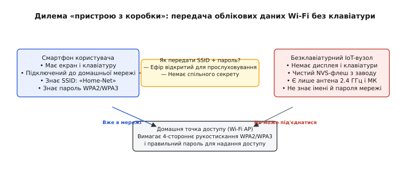
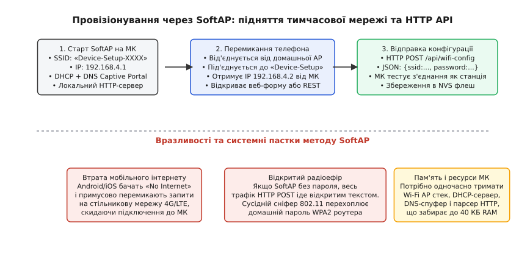
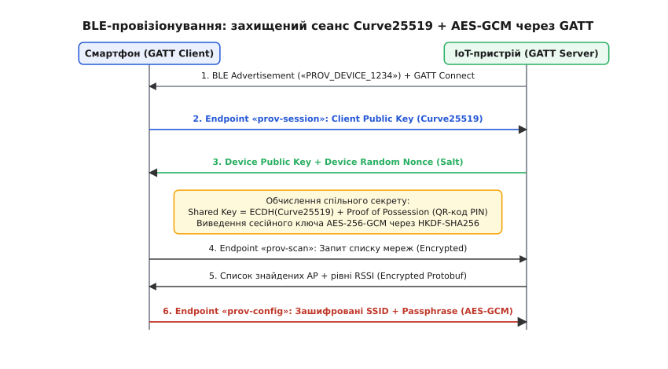
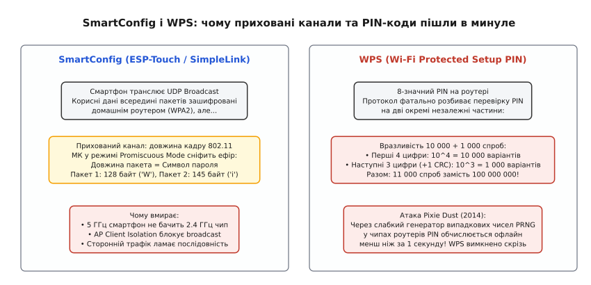
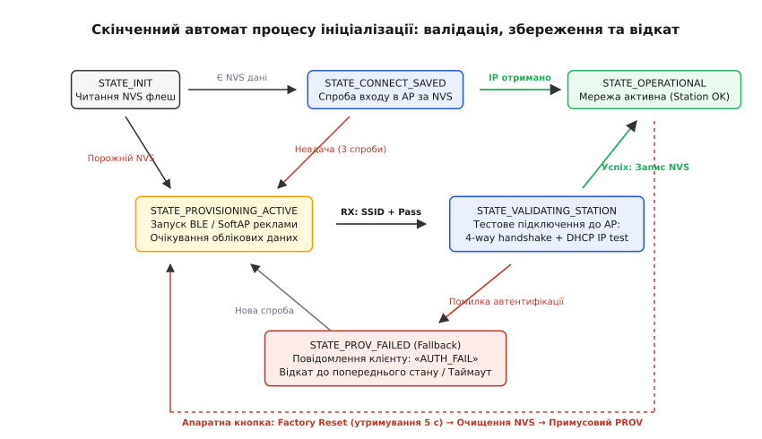

# Пристрій без клавіатури: SoftAP і BLE-провізіонування

<preknowlist>
- [Швидке підключення Wi-Fi: кешування PMK і IP](root:embedded/wifi-fast-connect) — фази підключення станції: маячки (beacon), асоціація, 4-стороннє рукостискання WPA2/WPA3 та отримання адреси через DHCP.
- [Співіснування 2.4 ГГц і власна самоперешкода](root:embedded/spivisnuvannia-2-4-hhts-i-vlasna-samopereshkoda) — спільне використання антени та радіотракту між Wi-Fi і Bluetooth Low Energy (PTA-арбітраж).
- [Автомат станів і черга подій у прошивці](root:embedded/avtomat-staniv-i-cherha-podii-u-proshyvtsi) — неблокуюча архітектура FSM, диспетчеризація подій та обробка системних таймаутів.
</preknowlist>

Бездротове реле, розумна розетка чи автономний датчик температури виходять із заводського конвеєра з чистим чипом флеш-пам'яті. Щоб передавати телеметрію на хмарний сервер або локальний шлюз автоматизації, мікроконтролер мусить приєднатися до домашнього Wi-Fi роутера. Проте захищена мережа вимагає ім'я (SSID) та 20-символьний пароль WPA2 або WPA3. На корпусі пристрою немає ані рідкокристалічного екрана, ані клавіатури, ані сенсорної панелі — лише світлодіод індикації стану та кнопка скидання.

У руках користувача є смартфон із сенсорним дисплеєм і підключенням до потрібного роутера, а в розетці за кілька метрів перебуває мікроконтролер, який про цей роутер нічого не знає. Передати пароль через відкритий радіоефір безпосередньо не можна, оскільки сусідній сніфер перехопить відкритий ключ доступу. Вимагати від користувача підключення через USB-UART перехідник і термінальну програму неможливо в споживчому сегменті, а найменша друкарська помилка в паролі ризикує перетворити пристрій на недосяжну «цеглину».

Задача безпечної початкової конфігурації безклавіатурного пристрою в інженерній практиці отримала назву **провізіонування** (англ. *provisioning* — від латинського *providere*, що означає «передбачати, споряджати, забезпечувати ресурсами»). Це процес передачі мережевих параметрів, автентифікації та перевірки зв'язку між смартфоном користувача та новим вузлом без прямого фізичного інтерфейсу введення.


*Дилема первинного запуску: смартфон знає мережу, але не має прямого дротового з'єднання з мікроконтролером. Потрібен безпечний локальний бездротовий канал передачі конфігурації.*

> 🔧 **Навіщо це.** Ненадійне чи вразливе провізіонування — головна причина повернення IoT-пристроїв покупцями в магазини («не зміг підключити до свого роутера») та найпростіший вектор зламу домашньої мережі, якщо пароль від WPA2 передається в ефір відкритим текстом або через скомпрометовані протоколи на зразок WPS.

---

## 1. Дилема «пристрою з коробки»: передача довіри без інтерфейсу

Коли персональний комп'ютер чи планшет під'єднують до бездротової мережі, людина виступає прямим посередником довіри: операційна система відображає список знайдених точок доступу, користувач обирає потрібний рядок, вводить пароль клавіатурою, бачить повідомлення про помилку й повторює спробу.

У безклавіатурному вузлі (англ. *headless device* — «безголовий пристрій») мікроконтролер позбавлений інтерфейсу введення-виведення (HMI — Human-Machine Interface). Перед розробником постають чотири фундаментальні обмеження:

1. **Відсутність попереднього спільного секрету (No Pre-shared Secret).** Смартфон і щойно куплений контролер бачать один одного вперше в житті. Будь-який симетричний ключ шифрування, зашитий на заводі в загальну прошивку, миттєво стає відомим зловмисникам через реверс-інжиніринг першого ж дампа флеш-пам'яті.
2. **Асиметрія радіосередовища.** Ефір на частоті 2.4 ГГц за своєю природою широкомовний. Кожен байт, надісланий без шифрування, одночасно приймається будь-яким Wi-Fi адаптером у радіусі кількох десятків метрів, переведеним у режим моніторингу (Promiscuous Mode).
3. **Обмеженість обчислювальних ресурсів.** Вбудований мікроконтролер оперує сотнями кілобайтів оперативної пам'яті (RAM) та процесором із тактовою частотою 80–240 МГц. Він не може розгортати важкі багаторівневі інфраструктури відкритих ключів (PKI) з перевіркою масивних ланцюжків сертифікатів X.509 під час першого ж старту.
4. **Необхідність зворотного зв'язку.** Процес не повинен бути «сліпим пострілом». Якщо роутер відхилив пароль (помилка автентифікації WPA), відмовив у видачі IP-адреси через вичерпання пулу DHCP або точка доступу взагалі працює на непідтримуваній частоті 5 ГГц, користувач у мобільному додатку мусить побачити зрозумілу причину збою, а контролер — залишитися доступним для повторного налаштування.

### Розподіл пам'яті: заводський сектор проти користувацького

У надійній архітектурі флеш-пам'ять пристрою розділяють на два незалежні простори імен (NVS namespaces або Flash Partitions):

```
+-------------------------------------------------------------------+
|                   Флеш-пам'ять мікроконтролера                    |
+-------------------------------------------------------------------+
|  Заводський сектор (Factory NVS)  | Користувацький сектор (User)  |
|  • Унікальний MAC-адрес           | • SSID домашнього роутера     |
|  • Серійний номер вузла           | • Зашифрований пароль WPA2    |
|  • Спільний PIN-код (PoP / QR)    | • Кешований PMK та IP-адреса  |
|  • Сертифікат автентичності       | • Токен хмарного брокера MQTT |
+-------------------------------------------------------------------+
```

Заводський сектор заповнюється на конвеєрі під час фінального тестування плати (Factory Provisioning) за допомогою автоматизованих стендів із підпружиненими контактами (Pogo-pins). Туди прошиваються унікальний MAC-адрес, калібрувальні коефіцієнти внутрішнього АЦП і криптографічно стійкий випадковий PIN-код (Proof of Possession, PoP). Цей PIN-код друкується на лазерному маркуванні корпусу у вигляді QR-коду або 8-значного десяткового рядка.

Сектор захищається від випадкового стирання апаратними бітами захисту (Option Bytes або одноразово програмованими перемичками eFuses). Користувацький сектор залишається порожнім доти, доки смартфон не передасть конфігурацію домашньої мережі.

---

## 2. Метод SoftAP: локальний острівець Wi-Fi та веб-сервер

Найстарішим і найбільш універсальним підходом для чипів із єдиним інтерфейсом Wi-Fi (наприклад, ESP8266 або модулів на базі RTL8710) є перемикання радіомодуля в режим програмної точки доступу — **SoftAP** (англ. *Software Access Point*).

### Механізм роботи SoftAP

Мікроконтролер налаштовує Wi-Fi стек як автономну точку доступу. Радіотракт починає періодично випромінювати маякові кадри (Beacon Frames) кожні 100 мс із відкритим SSID на зразок `Device-Setup-A1B2`, де останні символи відповідають молодшим байтам MAC-адреси. Усередині прошивки піднімається компактний мережевий стек:

- **DHCP-сервер:** виділяє смартфону IP-адресу з локального підмережевого простору (наприклад, видає IP `192.168.4.2`, призначаючи собі адресу `192.168.4.1` зі шлюзом `255.255.255.0`);
- **DNS-сервер перехоплення (Captive Portal):** відповідає адресою `192.168.4.1` на абсолютно всі вхідні DNS-запити на UDP-порту 53 (детальніше структуру DNS-спуфінгу розібрано в статті [Captive portal і своя сторінка налаштувань](root:embedded/captive-portal-i-svoia-storinka-nalashtuvan));
- **Вбудований HTTP/REST сервер:** обробляє GET-запити віддачі HTML-форми налаштування або POST-запити з JSON-структурою облікових даних від спеціалізованого додатка.


*Послідовність роботи SoftAP: підняття автономної мережі, перемикання смартфона, відправка HTTP POST із параметрами мережі та системні вразливості відкритого ефіру.*

### Обробка запиту конфігурації

Коли користувач під'єднує смартфон до мережі `Device-Setup-A1B2`, мобільний додаток або браузер відправляє HTTP POST запит на кінцеву точку `/api/wifi-config`. Розглянемо реалізацію обробника такого запиту мовами C та C++.

:::tabs
:::code prystrii-bez-klaviatury-d/c/obrobka-zapytu.c
:::code prystrii-bez-klaviatury-d/cpp/obrobka-zapytu.cpp
:::

### Пастки та вразливості SoftAP

Попри простоту реалізації, метод SoftAP створює серйозні проблеми як для досвіду користувача (UX), так і для безпеки:

1. **Конфлікт мобільної ОС («No Internet Access»).** Сучасні версії Android та iOS мають вбудовану систему захисту від нестабільних мереж — *Captive Network Assistant* (CNA). Коли смартфон підключається до SoftAP, він робить фоновий HTTP-запит до серверів перевірки доступу (наприклад, `connectivitycheck.gstatic.com` для Android або `captive.apple.com` для iOS). Оскільки SoftAP не має виходу в глобальну мережу, ОС вважає це з'єднанням без інтернету. Система або викидає набридливе діалогове вікно з вимогою підтвердження, або взагалі тихо перемикає весь трафік програми назад на мобільний 4G/LTE інтерфейс. У результаті додаток не може достукатися до IP `192.168.4.1`, і користувач бачить нескінченний індикатор завантаження.
2. **Перехоплення відкритого трафіку в ефірі.** Якщо мережа SoftAP працює без пароля (Open Network), HTTP-трафік не шифрується. Зловмисник, що перебуває неподалік, записує пакет `POST /api/wifi-config` і отримує справжній пароль від домашнього роутера у відкритому тексті. Захист через пароль на самій SoftAP вимагає надрукувати унікальний WPA2-пароль на наліпці пристрою, що змушує користувача вручну вводити два паролі поспіль.
3. **Енергетичні та ресурсні витрати.** Режим SoftAP вимагає постійної роботи радіоприймача зі 100% коефіцієнтом заповнення (Duty Cycle) для прийому кадрів Probe Request і випромінювання Beacon. Контролер споживає 80–120 мА безперервно, що робить цей метод непридатним для пристроїв із батарейним живленням. Крім того, утримання буферів TCP-сокета в мережевому стеку LwIP, таблиці клієнтів і DNS-сервера забирає до 35–45 КБ оперативної пам'яті. Якщо прошивка не налаштовує заголовок `Connection: close`, вичерпання пулу блоків керування протоколом (TCP PCB) призводить до зависання веб-сервера.

---

## 3. Провізіонування через BLE: безшовний і захищений канал (Protocomm)

Поява комбінованих мікроконтролерів (ESP32, Realtek Ameba, Nordic nRF5340, Silicon Labs EFR32), що поєднують в одному кристалі Wi-Fi та Bluetooth Low Energy (BLE), повністю усунула недоліки SoftAP. 

Провізіонування через BLE стало стандартом у промислових екосистемах (Apple HomeKit, Matter, Espressif Protocomm).

```
+-------------------------------------------------------------------+
|                        Смартфон користувача                       |
|           (Залишається підключеним до домашнього Wi-Fi)           |
+-------------------------------------------------------------------+
                                  |
                                  | Bluetooth Low Energy (GATT)
                                  | [Зашифрований тунель: Curve25519]
                                  v
+-------------------------------------------------------------------+
|                    Безклавіатурний IoT-вузол                      |
|  [BLE GATT Сервер] <---- Внутрішня шина ----> [Wi-Fi Драйвер STA] |
+-------------------------------------------------------------------+
                                                      |
                                                      | Wi-Fi 802.11 b/g/n
                                                      v
                                        +---------------------------+
                                        |  Домашній роутер (AP)     |
                                        +---------------------------+
```

### Переваги BLE перед SoftAP

- **Смартфон не розриває з'єднання з інтернетом.** Мобільний додаток обмінюється даними з пристроєм через Bluetooth, паралельно підтримуючи зв'язок із хмарою через стільникову мережу чи домашній Wi-Fi.
- **Підтримка сканування ефіру на боці МК.** Додаток надсилає команду мікроконтролеру відсканувати ефір. Контролер повертає перелік реальних точок доступу, знайдених *його власною антеною*, із точними рівнями сигналу (RSSI). Користувач просто вибирає мережу зі списку замість ручного введення назви SSID.
- **Миттєве виявлення (Discovery).** Пристрій випромінює рекламні пакети (BLE Advertisement) з унікальним сервісним UUID. Додаток виявляє його автоматично за частку секунди, без необхідності заходити в системні налаштування смартфона.
- **Компактність бінарних схем.** Замість роздутих JSON-рядків у BLE застосовуються компактні схеми серіалізації Google Protocol Buffers (Protobuf) або простий бінарний формат TLV (Type-Length-Value). Це скорочує розмір кадру на 70%, дозволяючи вмістити всю конфігурацію в один пакет Bluetooth.

### Архітектура GATT та протокол Protocomm

Протокол взаємодії будується поверх стандартного профілю GATT (англ. *Generic Attribute Profile*). У пам'яті BLE-стека реєструється первинний сервіс із фіксованим UUID (наприклад, `0x0001` або вендорний 128-бітний ідентифікатор), що містить три ключові характеристики:

1. `prov-session` (UUID: `0xFF51`, доступ: `Write | Read`) — встановлення криптографічної сесії та обмін відкритими ключами;
2. `prov-config` (UUID: `0xFF52`, доступ: `Write | Notify`) — передача зашифрованих параметрів мережі та асинхронна віддача результатів підключення;
3. `prov-scan` (UUID: `0xFF53`, доступ: `Write | Read`) — ініціалізація та отримання результатів сканування ефіру Wi-Fi.


*Захищене BLE-рукостискання: ефемерні ключі Curve25519, домішування Proof of Possession (PoP) і симетричний шифр AES-256-GCM.*

### Криптографічний тунель (Security 1 / Security 2)

Передавати пароль у відкриту GATT-характеристику неприпустимо: BLE-ефір прослуховується так само легко, як і Wi-Fi. Стандартне спарювання Bluetooth (BLE Pairing Just Works) є вразливим до атак типу «людина посередині» (MITM — Man-in-the-Middle).

Тому фреймворки провізіонування розгортають власний рівень безпеки поверх GATT — протокол **Protocomm Security**:

1. **Генерація ефемерних ключів (ECDH на кривій Curve25519).** Смартфон генерує випадковий закритий ключ `d_client` і обчислює відкритий ключ `Q_client = d_client · G` на кривій Монтгомері. Мікроконтролер генерує свою ефемерну пару: `d_dev` та `Q_dev`.
2. **Обмін відкритими ключами через характеристику `prov-session`.** Сторони обмінюються 32-байтними публічними значеннями. Обидві сторони обчислюють однаковий спільний секрет:
   
   ```
   Shared_Secret = ECDH(d_dev, Q_client) = ECDH(d_client, Q_dev)
   ```

3. **Захист від MITM через Proof of Possession (PoP).** Щоб сторонній спостерігач не підмінив відкриті ключі на етапі обміну, використовується спільний пароль володіння (PoP). Це 4–8 символьний PIN-код або QR-код, надрукований на корпусі пристрою чи на заводській коробці. Додаток зчитує QR-код камерою.
4. **Виведення сесійного ключа (HKDF-SHA256).** Остаточний 256-бітний сесійний ключ `K_session` виводиться через функцію розширення ключів HKDF:
   
   ```
   K_session = HKDF-SHA256(Salt, Shared_Secret, PoP, "prov-session-key", 256)
   ```

5. **Автентифіковане шифрування (AES-256-GCM).** Усі наступні пакети конфігурації (SSID, пароль, BSSID) шифруються алгоритмом AES у режимі лічильника з автентифікацією Галуа (GCM). Для кожного кадру формується унікальний монотонно зростаючий лічильник (Initialization Vector / Nonce), що унеможливлює атаки повторного відтворення (Replay Attacks).
6. **Порівняння зі стандартами Apple HomeKit та Matter.** У протоколі Apple HomeKit (HAP) для первинного спарювання Pair-Setup використовується алгоритм SRP-6a (Secure Remote Password) у поєднанні з симетричним шифром ChaCha20-Poly1305. У новому міжвендорному стандарті Matter застосовується протокол PASE (Password-Authenticated Session Establishment) на базі криптографічної схеми SPAKE2+, яка також спирається на спільний PIN-код із QR-наліпки для захисту від перехоплення в ефірі.

Повну архітектуру GATT-сервера, розв'язання проблеми обмеження розміру ATT MTU, процедуру розпакування TLV/Protobuf та криптографічні перетворення наведено у практичній вставці [Диспетчер BLE-провізіонування та криптографічний канал GATT](root:embedded/prystrii-bez-klaviatury/proj-ble-provisioning-service.md).

### Проблема співіснування радіотракту (Coexistence)

У багатьох недорогих комбо-чипах радіоінтерфейси Wi-Fi та BLE ділять **один фізичний радіотракт (LNA/PA) та одну антену**. Коли мікроконтролер одночасно підтримує активне GATT-з'єднання зі смартфоном і намагається сканувати Wi-Fi канали чи проходити 4-стороннє рукостискання WPA2, виникає радіоконфлікт.

Апаратний арбітр пакетів (PTA — Packet Traffic Arbitration) розбиває час роботи радіомодуля на кванти: пріоритет віддається періодичним подіям з'єднання BLE (Connection Events з інтервалами 15–30 мс), щоб не допустити розриву зв'язку по таймауту (Supervision Timeout), а у проміжках між ними драйвер перемикає радіотракт на частоту Wi-Fi. Докладніше математику радіорозподілу та боротьбу з самоперешкодами розкрито у статті [Співіснування 2.4 ГГц і власна самоперешкода](root:embedded/spivisnuvannia-2-4-hhts-i-vlasna-samopereshkoda).

---

## 4. Чому SmartConfig і WPS виходять з ужитку: ціна прихованих каналів і злам PIN

В історії бездротових вбудованих систем існували спроби спростити налаштування без перемикання Wi-Fi мереж і без залучення Bluetooth. Найвідоміші з них — **SmartConfig** (також відомий як ESP-Touch або Texas Instruments SimpleLink) та стандартизований **WPS**. Сьогодні обидва методи визнані застарілими та небезпечними.


*Приховані канали зв'язку: сніфінг довжин пакетів у SmartConfig проти атаки на розділений PIN-код у WPS.*

### SmartConfig (ESP-Touch): прихований канал довжини пакетів

Ідея SmartConfig базувалася на тому, що смартфон уже підключений до домашнього роутера. Мобільний додаток починає безперервно надсилати широкомовні (Broadcast) або багатоадресні (Multicast) UDP-пакети на локальну мережу.

Корисні дані всередині UDP-пакета зашифровані ключем WPA2 домашньої мережі, якого новий контролер ще не знає. Але за стандартом IEEE 802.11 **заголовок радіокадру та його загальна фізична довжина в байтах залишаються відкритими**.

```
Пакет 1: [802.11 Header] [Encrypted WPA Payload: 128 bytes] ---> МК фіксує довжину 128 -> Символ 'W'
Пакет 2: [802.11 Header] [Encrypted WPA Payload: 145 bytes] ---> МК фіксує довжину 145 -> Символ 'i'
Пакет 3: [802.11 Header] [Encrypted WPA Payload: 210 bytes] ---> МК фіксує довжину 210 -> Символ 'F'
```

Контролер вмикає радіоприймач у режим нерозбірливого прослуховування (**Promiscuous / Sniffer Mode**), перебирає радіоканали, шукає послідовність пакетів характерної довжини й декодує SSID та пароль за допомогою кодування з виправленням помилок (коди Ріда-Соломона).

#### Чому SmartConfig помирає:

1. **Несумісність діапазонів 5 ГГц і 2.4 ГГц.** Сучасні дводіапазонні смартфони підключаються до домашнього роутера на швидкісній частоті 5 ГГц (або 6 ГГц у Wi-Fi 6E). Смартфон транслює UDP-пакети в ефір на частоті 5 ГГц. Більшість мікроконтролерів (ESP8266, базові ESP32, дешеві IoT-модулі) мають лише 2.4 ГГц радіотракт — вони фізично не чують пакети з іншого діапазону.
2. **Ізоляція клієнтів точки доступу (AP Client Isolation).** У корпоративних і багатьох домашніх роутерах увімкнено режим ізоляції станцій, який повністю блокує широкомовний (Broadcast/Multicast) трафік між бездротовими клієнтами заради безпеки. Пакети SmartConfig просто відкидаються комутатором роутера.
3. **Агрегація кадрів у Wi-Fi 4/5/6 (A-MPDU).** Сучасні точки доступу для підвищення пропускної здатності автоматично об'єднують кілька коротких UDP-пакетів в один великий фізичний радіокадр (Aggregate MAC Protocol Data Unit, A-MPDU) розміром до 64 КБ. У результаті індивідуальні довжини пакетів у повітрі спотворюються, повністю руйнуючи прихований канал.
4. **Ненадійність прихованого каналу та Channel Hopping.** Будь-який сторонній фоновий трафік у сусідній квартирі або колізії в зашумленому ефірі генерують хибні довжини. Постійне перемикання приймача по 13 каналах діапазону 2.4 ГГц призводить до втрати понад 85% корисних кадрів під час коротких передавальних спалахів.

### WPS (Wi-Fi Protected Setup): крах розділеного PIN-коду

WPS задумувався консорціумом Wi-Fi Alliance як метод підключення в один дотик (кнопка PBC — Push Button Configuration) або через введення 8-значного цифрового PIN-коду роутера.

1. **Вразливість кнопки PBC (Push Button).** Якщо користувач натискає кнопку на роутері, відкривається двохвилинне вікно, у якому *будь-який* пристрій поблизу може асоціюватися з мережею без пароля. Якщо в цей момент сусід випадково вмикає свій бездротовий пристрій, виникає стан гонки (Race Condition), і до домашньої мережі під'єднується сторонній вузол.
2. **Математичний розкол 8-значного PIN-коду.** Архітектура перевірки PIN-коду WPS 1.0 містила фатальну вразливість: протокол перевіряв спочатку перші 4 цифри, надсилаючи відповідь `EAP-NACK` у разі помилки, а потім наступні 3 цифри (остання, 8-ма цифра була детермінованою контрольною сумою).
   
   Замість перебору 100 мільйонів комбінацій (`10⁸`), кількість спроб скоротилася до:
   
   ```
   10⁴ + 10³ = 10 000 + 1 000 = 11 000 спроб
   ```

3. **Атака Pixie Dust.** У 2014 році було виявлено, що більшість чипсетів маршрутизаторів генерують одноразові криптографічні значення (Nonces) за допомогою слабкого генератора `rand()` із нульовою ентропією. Це дозволило зламувати PIN-код WPS в офлайні менш ніж за 1 секунду після перехоплення всього одного пакету в ефірі.

Історію відкриття цієї критичної вразливості та її вплив на світову інфраструктуру детально описано у вставці [Вразливість WPS і атака Pixie Dust: як зламали кнопку на роутері](root:embedded/prystrii-bez-klaviatury/hist-wps-pixie-dust.md).

Через ці діри мобільні операційні системи (Android 9+ та iOS) повністю вилучили підтримку WPS зі своїх стеків.

---

## 5. Скінченний автомат процесу ініціалізації: валідація, збереження та відкат

Провізіонування — це не статична функція, а складний часовий процес, який у надійній прошивці керується кінцевим автоматом станів (**FSM** — Finite State Machine).

Головне правило стійкої архітектури: **новий пароль ніколи не записується в енергонезалежну пам'ять (NVS/Flash) як активний доти, доки успішність підключення станції не підтверджена фізично**.


*Повний граф переходів автомата провізіонування: від старту з NVS до тестової валідації станції та обробки аварійного скидання.*

### Фази життєвого циклу FSM

1. **`STATE_INIT` (Ініціалізація):** читання енергонезалежного сховища (NVS / EEPROM). Перевіряється цілісність даних за допомогою контрольної суми CRC32. Якщо знайдено збережені валідні облікові дані, автомат переходить до спроби підключення (`STATE_CONNECT_SAVED`). Якщо сховище порожнє — негайний перехід у режим провізіонування (`STATE_PROVISIONING_ACTIVE`).
2. **`STATE_CONNECT_SAVED` (Вхід за збереженими даними):** спроба асоціації станції. Якщо точка доступу не відповідає або пароль змінено власником мережі, контролер робить фіксовану кількість повторів (3 спроби з інтервалами експоненційного відкату 1 с, 2 с, 4 с). Якщо підключення не вдалося — перехід у `STATE_PROVISIONING_ACTIVE`.
3. **`STATE_PROVISIONING_ACTIVE` (Очікування конфігурації):** запуск BLE GATT-сервера або SoftAP. Вмикається таймер бездіяльності (наприклад, 10 хвилин). Якщо за цей час ніхто не надіслав дані, пристрій засинає або повертається до спроб підключення за старим NVS для економії енергії.
4. **`STATE_VALIDATING_STATION` (Тестова валідація):** отримавши нові SSID та пароль, пристрій **не вимикає BLE-з'єднання**. Радіомодуль Wi-Fi запускає процес повноцінного 4-стороннього рукостискання WPA2/WPA3 та запитує IP у роутера через DHCP (докладно фази рукостискання та кешування розібрано в статті [Швидке підключення Wi-Fi: кешування PMK і IP](root:embedded/wifi-fast-connect)).
5. **`STATE_OPERATIONAL` (Успішне завершення):** після отримання IP-адреси мікроконтролер надсилає клієнту статусний пакет `PROV_STATUS_SUCCESS` разом із призначеною IP-адресою, атомарно записує SSID і пароль у NVS, зупиняє BLE-сервіс і переходить до виконання основного корисного циклу.
6. **`STATE_PROV_FAILED` (Аварійний відкат і діагностика):** якщо роутер відхилив пароль (`AUTH_FAIL`), не знайдений SSID (`NO_AP_FOUND`) або DHCP не видав IP (`DHCP_TIMEOUT`), контролер передає клієнту точний числовий код помилки. BLE-сесія залишається активною, дозволяючи користувачеві виправити введені дані без перезавантаження пристрою.

### Програмна реалізація FSM

Нижче наведено модульну неблокуючу реалізацію FSM провізіонування мовами C та C++.

:::tabs
:::code prystrii-bez-klaviatury-d/c/prohramna-realizatsiia-fsm.c
:::code prystrii-bez-klaviatury-d/cpp/prohramna-realizatsiia-fsm.cpp
:::

### Захист від втрати керування (Factory Reset)

Навіть найнадійніший алгоритм автомата не захищає від зовнішніх фізичних змін: роутер замінили, провайдер змінив назву мережі, або пристрій перевезли на іншу локацію. Оскільки збережені в NVS параметри більше недійсні, пристрій після вичерпання ліміту спроб автоматично активує режим провізіонування.

Проте, якщо прошивка зависла або застрягла в циклічному перепідключенні, необхідний апаратний захист — **фізична кнопка заводського скидання (Factory Reset Button)**. 

Обробник апаратного переривання вимірює тривалість утримування кнопки:
- Коротке натискання (`t < 2 с`) — перезавантаження мікроконтролера;
- Довге натискання (`t > 5 с`) — генерація події `FSM_EVT_FACTORY_RESET`: повне стирання сектора NVS із ключами, зупинка Wi-Fi станції, увімкнення синього світлодіода індикації та примусовий запуск рекламних BLE-пакетів провізіонування.
