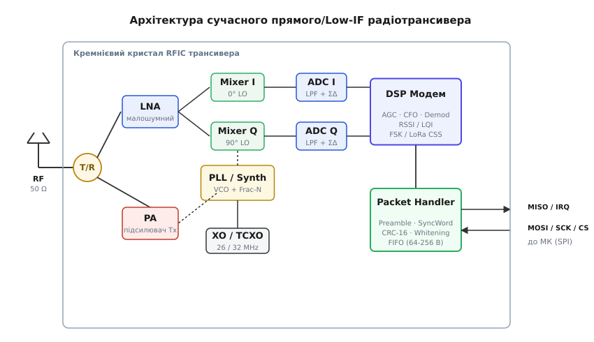
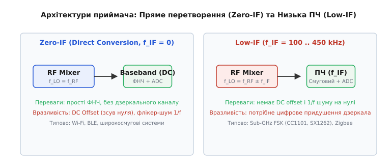
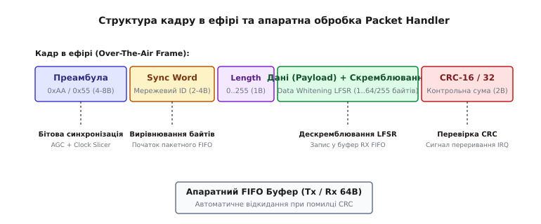
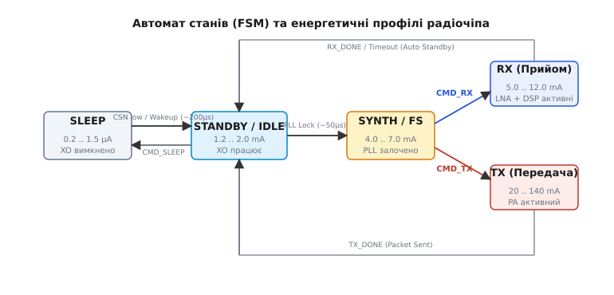

# Радіомодуль: що всередині й що в даташиті

<preknowlist>
- [Бюджет лінії та децибели](root:embedded/link-budget) — що таке dBm, теплове шумове дно та як рівень сигналу згасає з відстанню
- [RF-тракт і каскади підсилення](root:embedded/rf-frontend) — малошумний підсилювач (LNA), підсилювач потужності (PA), формула Фрііса для каскадного шуму та балун
- [Цифрові модуляції FSK та PSK](root:com-modulation/fsk-psk) — частотний зсув, фазові сузір'я та фізична суть I/Q-сигналів
- [Розширений спектр і чирп](root:com-modulation/spread-spectrum) — робота нижче рівня шуму, пряме розширення послідовністю (DSSS) та частотні чирпи LoRa
- [Контрольна сума CRC](root:com-modulation/crc) — алгоритми виявлення бітових помилок і породжувальні поліноми
- [SPI-інтерфейс мікроконтролера](root:embedded/spi-i-i2c-iak-bloky-mikrokontrolera) — повнодуплексні транзакції, регістрові операції та обробка апаратних ліній переривання
</preknowlist>

Спроба передати байти в ефір прямим смиканням ніжки мікроконтролера на частоті 433 МГц або 2.4 ГГц миттєво закінчується провалом. Навіть якщо таймер процесора здатний генерувати мегагерцовий меандр на виводі GPIO, такий сигнал містить нескінченний спектр паразитних гармонік, які глушать сусідні діапазони, а фазовий джиттер цифрових вентилів розмиває несучу на сотні кілогерців. На боці прийому ситуація ще гірша: сигнал, що пролетів 300 метрів, має на антені амплітуду у частки мікровольта — звичайний АЦП мікроконтролера з кроком квантування 800 мкВ навіть не відчує його присутності на тлі власного цифрового шуму шини живлення.

Щоб подолати прірву між світом напруг живлення мікроконтролера (3.3 В) та нановольтними електромагнітними хвилями в ефірі, у схему ставлять **радіочастотний трансивер** (RF Transceiver: CC1101, SX1262, nRF24L01, SX1276 або вбудований RF-блок систем на чипі на зразок nRF52840).

Готовий радіомодуль — це не просто кремнієвий чип: це узгоджена радіочастотна система, що містить кристал трансивера, стабілізований кварцовий генератор, LC-фільтри узгодження імпедансу, комутатор антени та захисний металевий екран. Розгляньмо, що відбувається всередині цього кремнію, якими вузлами сигнал проходить шлях від антени до буфера пам'яті та які рядки даташиту вирішують, чи житиме ваш радіоканал у реальному ефірі.

## Анатомія апаратного радіотрансивера: від антени до цифри

Сучасний інтегрований трансивер поєднує високочастотний аналоговий тракт, прецизійний синтезатор частоти, швидкісні перетворювачі даних та цифровий сигнальний процесор (DSP-модем).


*Шлях проходження сигналу в інтегрованому радіотрансивері. Від антени через T/R перемикач сигнал потрапляє у малошумний LNA, розкладається квадратурними змішувачами на гілки I та Q, оцифровується парою АЦП і обробляється DSP-модемом. Кадровий процесор (Packet Handler) бере на себе перевірку CRC, відбілювання та буферизацію у FIFO для віддачі хост-контролеру по SPI.*

Розберімо кожен внутрішній блок послідовно за рухом сигналу.

### 1. Синтезатор частоти: PLL, VCO та опорний кварц

Серцем будь-якого радіо є **гетеродин (Local Oscillator, LO)** — блок, який генерує чисту синусоїдальну опорну частоту для перенесення спектра. У сучасних чипах його будують на базі схеми фазового автопідстроювання частоти з дробовим коефіцієнтом ділення (Fractional-N PLL) та генератора, керованого напругою (VCO).

Опорну стабільність задає зовнішній кварцовий резонатор (XO, зазвичай 26 МГц або 32 МГц). У звичайного кварцу частотний дрейф від зміни температури становить ±10..20 ppm (частин на мільйон). На частоті 868 МГц похибка 20 ppm дає зміщення несучої на:

```
Δf = 868 · 10^6 · (20 · 10^(-6)) = ±17.36 кГц      [температурний зсув несучої]
```

Якщо приймач налаштовано на вузьку смугу пропускання (наприклад, 15 кГц для далекобійного FSK), такий зсув повністю викине корисний сигнал за межі фільтра. Тому для критичних застосунків замість простого кварцу ставлять **термокомпенсований генератор (TCXO)** із похибкою менше ±0.5..1.0 ppm.

Якість синтезатора визначається його **фазовим шумом (Phase Noise)** — рівнем паразитних флуктуацій фази навколо несучої (вимірюється в dBc/Hz на певному відступі, наприклад −115 dBc/Hz на відступі 100 кГц). Якщо фазовий шум високий, сусідній потужний передавач змішається з «хвостами» гетеродина і заллє шумом корисний слабкий сигнал у власному каналі (явище реципрокного змішування, Reciprocal Mixing).

### 2. Приймальний тракт: LNA, I/Q змішувачі та оцифрування

Слабкий сигнал з антени (потужністю від −130 dBm до −30 dBm) через T/R-комутатор надходить на **малошумний підсилювач (LNA)**. Завдання LNA — дати первинне підсилення на 15..25 dB, додавши якомога менше власного шуму (коефіцієнт шуму NF сучасних LNA становить 1.8..3.5 dB).

Після LNA сигнал розділяється на дві паралельні гілки та подається на **квадратурний змішувач (Quadrature Mixer)**:
- У синфазній гілці **I (In-phase)** вхідний сигнал множиться на опорний сигнал гетеродина `LO(t) = cos(2π · f_LO · t)`;
- У квадратурній гілці **Q (Quadrature)** вхідний сигнал множиться на зсунутий на 90° опорний сигнал `LO(t) = -sin(2π · f_LO · t)`.

Квадратурне розкладання — це обов'язкова умова: один аналоговий сигнал на проміжній частоті не дозволяє розрізнити, чи відхилилася частота вгору (+Δf), чи вниз (−Δf) від несучої. Векторна пара (I, Q) однозначно зберігає миттєву амплітуду `A(t) = √(I² + Q²)` та миттєву фазу `φ(t) = atan2(Q, I)`.

### 3. Архітектури перетворення: Zero-IF проти Low-IF

У сучасній бездротовій мікроелектроніці супергетеродинну схему з громіздкими проміжними ПАХ-фільтрами витіснили дві інтегровані архітектури:


*Архітектурний компроміс побудови тракту. Zero-IF переносить спектр прямо на постійний струм, але страждає від DC-зсуву та флікер-шуму. Low-IF зміщує сигнал на проміжну частоту 100..450 кГц, усуваючи DC-проблеми ціною потреби цифрового придушення дзеркального каналу.*

1. **Пряме перетворення (Direct Conversion / Zero-IF)**: частота гетеродина дорівнює частоті несучої (`f_LO = f_RF`). Сигнал переноситься безпосередньо у базову смугу (Baseband, нульова центральна частота).
   - *Перевага*: немає проблеми дзеркального каналу; фільтрація виконується простими низькочастотними RC-фільтрами на кристалі.
   - *Проблема*: просочування гетеродина назад в антену створює паразитний **постійний зсув напруги (DC Offset)** на виході змішувача, який може загнати АЦП у насичення. Крім того, на низьких частотах домінує **флікер-шум транзисторів (1/f)**, що погіршує чутливість вузькосмугових сигналів.

2. **Низька проміжна частота (Low-IF)**: гетеродин зміщено від несучої на невелику величину `f_IF` (зазвичай 100..450 кГц).
   - *Перевага*: корисний спектр лежить вище зони 1/f шуму та відв'язаний від постійного зсуву змішувача.
   - *Проблема*: з'являється **дзеркальний канал (Image Frequency)** на частоті `f_RF - 2 · f_IF`. Його придушення покладається на точність амплітудного та фазового балансу між I та Q гілками. Комплексна цифрова фільтрація в DSP дозволяє досягти придушення дзеркального каналу на рівні 35..45 dB без зовнішніх фільтрів.

Оцифрування аналогових сигналів I та Q здійснюється парою високошвидкісних сигма-дельта (ΣΔ) АЦП із високим динамічним діапазоном (70..85 dB), що дозволяє перенести основну селективність у цифровий домен.

### 4. Цифровий DSP-модем та оцінка сигналу

Оцифровані потоки I/Q надходять у спеціалізований цифровий сигнальний процесор трансивера, який виконує:
- **Цифрову фільтрацію каналу (Channel Filter)**: круті цифрові FIR/IIR фільтри відсікають сусідні радіоканали, формуючи задану смугу (від 3 кГц до 500 кГц);
- **Автоматичне регулювання підсилення (AGC)**: динамічно керує атенюатором та підсиленням LNA у діапазоні 90..100 dB, запобігаючи перевантаженню АЦП при наближенні передавача впритул;
- **Автопідстроювання частоти (AFC / CFO Estimation)**: оцінює зсув частоти між передавачем і приймачем та компенсує його поворотом вектора I/Q у цифровому вигляді;
- **Обчислення RSSI (Received Signal Strength Indicator)**: вимірює логарифмічну потужність сигналу на вході в dBm;
- **Демодуляцію**: відновлює послідовність бітів із частотної (FSK/GFSK), фазової (PSK) або чирпової (LoRa CSS) траєкторії.

## Що читати в даташиті радіомодуля

Даташит радіотрансивера — це документ на 80–150 сторінок, де оптимістичні рекламні заяви на першій сторінці суттєво коригуються таблицями дрібного шрифту в середині. Виділимо чотири параметри, що безпосередньо визначають межі працездатності пристрою.

### 1. Чутливість (Sensitivity) та її умови

Чутливість — це мінімальний рівень потужності сигналу на вході антени, за якого приймач здатний успішно прийняти пакет із заданою ймовірністю помилки (BER = 0.1% або Packet Error Rate, PER = 1%).

У даташиті чутливість завжди супроводжується жорсткими умовами вимірювання:
- **Тип модуляції та девіація частоти**;
- **Швидкість передачі (Data Rate)**;
- **Смуга приймального фільтра (Channel Filter Bandwidth, BW)**.

Фундаментальний зв'язок між шириною смуги фільтра, коефіцієнтом шуму, швидкістю передачі та фізичною границею чутливості за формулою Джонсона-Найквіста докладно виведено в [математичному аналізі чутливості та теплового шуму](root:embedded/radiomodul/math-sensitivity-bandwidth.md).

Зменшення швидкості передачі даних дозволяє звузити смугу приймального фільтра: наприклад, перехід із 100 кбіт/с на 1.2 кбіт/с у CC1101 покращує чутливість із −104 dBm до −112 dBm (виграш 8 dB), що еквівалентно збільшенню дальності у вільному просторі у 2.5 раза за тієї самої вихідної потужності передавача.

### 2. Вибірковість за сусіднім каналом (Adjacent Channel Rejection, ACR)

У реальному ефірі поруч із вашим слабким корисним сигналом (наприклад, −95 dBm) може працювати чужий передавач на сусідній частоті з рівнем −40 dBm на вході вашої антени.

Параметр **Adjacent Channel Rejection (ACR)** показує, на скільки децибел сигнал завади в сусідньому каналі (наприклад, на відстані +25 кГц або +200 кГц) може перевищувати корисний сигнал, перш ніж чутливість приймача деградує на 3 dB.
- Гарний показник ACR для вузькосмугового трансивера: **35..45 dB**;
- Для альтернативного каналу (Alternate Channel, відступ у два кроки): **45..55 dB**.

Якщо ACR становить лише 25 dB, чужий передавач на сусідньому каналі заглушить ваш пристрій навіть на значній відстані.

### 3. Лінійність: IIP3, точка компресії 1 dB та блокування

Коли на вхід LNA одночасно потрапляють два сильних сигнали на частотах f₁ та f₂, нелінійність вхідних транзисторів породжує паразитні інтермодуляційні продукти третього порядку на частотах `2f₁ - f₂` та `2f₂ - f₁`. Якщо один із цих продуктів потрапляє точно в робочий канал, приймач виявляється «засліпленим» завадою, якої взагалі не існувало в ефірі на цій частоті.

Ключові параметри лінійності в даташиті:
- **IIP3 (Input Third-Order Intercept Point)**: екстрапольована точка вхідної потужності, де рівень інтермодуляції зрівнявся б із корисним сигналом. Чим вище IIP3 (наприклад, −10 dBm проти −22 dBm), тим стійкіший приймач до забитих радіозавадами міських умов;
- **Точка компресії 1 dB (Input P1dB)**: рівень вхідного сигналу (типово −15..−5 dBm), за якого коефіцієнт підсилення LNA падає на 1 dB через насичення каскаду;
- **Блокування (Blocking / Desensitization)**: стійкість до потужної позасмугової завади (віддаленої на 1..10 МГц, наприклад вишки стільникового зв'язку GSM/LTE). Вимірюється рівнем завади в dBm (наприклад, +10 dBm на відступі 10 МГц), за якого прийом слабкого сигналу залишається можливим.

### 4. Струмовий профіль і часові затримки переходів

Автономні батарейні пристрої 99.9% часу перебувають у режимі сну. Тому загальний термін служби батареї визначається не лише робочим струмом передачі, а й струмами сну та затримками пробудження:

| Режим трансивера | Типовий струм (SX1262) | Типовий струм (CC1101) | Що працює всередині |
| :--- | :--- | :--- | :--- |
| **Cold Sleep** | 0.16 мкА | 0.2 мкА | Лише схема захисту та утримання регістрів пам'яті |
| **Warm Sleep** | 1.2 мкА | 1.5 мкА | Працює низькочастотний таймер пробудження RC (32 кГц) |
| **Standby (XO ON)**| 1.2 мА | 1.8 мА | Запущено основний кварц 32 МГц, PLL вимкнено |
| **Synthesizer (FS)**| 4.2 мА | 7.5 мА | PLL залочено на робочій частоті, аналоговий тракт вимкнено |
| **RX (Прийом)** | 4.6..8.2 мА | 15..17 мА | LNA, змішувачі, АЦП та DSP-модем активні |
| **TX (+14 dBm)** | 22 мА | 30 мА | Працює підсилювач потужності (PA) |
| **TX (+22 dBm)** | 118 мА | — (зовнішній PA) | Високопотужний PA (максимальне навантаження) |

Критичний параметр даташиту — **час запуску кварцу (`t_XOSC`)** та **час захоплення PLL (`t_lock`)**. Наприклад, якщо кварцовий генератор прокидається за 300 мкс, а пакет триває 200 мкс, на попереднє пробудження та розігрів витрачається більше енергії батареї, ніж на саму відправку даних у повітря.

## Цифрові модуляції у вбудованих радіоканалах

Вибір модуляції визначає компроміс між швидкістю передачі, складністю схемотехніки, спектральною ефективністю та енергетичним бюджетом каналу.

### 1. 2-FSK проти GFSK: боротьба за спектральну компактність

У класичній частотній маніпуляції (**2-FSK**) біт «0» передається на частоті `f_0 - Δf`, а біт «1» — на частоті `f_0 + Δf`. При миттєвому стрибку частоти на межі бітів виникають гострі фазові злами. У частотній області ці злами породжують широкі бічні пелюстки спектра, які «забризкують» сусідні канали завадами.

У гаусовій частотній маніпуляції (**GFSK**) прямокутний потік бітів перед модулятором пропускається крізь цифровий гаусів фільтр із параметром `BT = 0.5` (де B — смуга фільтра, T — тривалість біта). Фільтр згладжує фронти перемикання частоти. Фаза змінюється плавно і безперервно (Continuous Phase Modulation, CPM).

Спектр сигналу GFSK стискається в кілька разів: рівень позасмугового випромінювання на відступі у два канали падає на 20..30 dB порівняно з чистим FSK. Саме тому GFSK є базовою модуляцією для Bluetooth Low Energy (BLE), Nordic Gazell, Zigbee на Sub-GHz та систем промислової телеметрії.

### 2. OOK та ASK: проста амплітудна маніпуляція

Амплітудна маніпуляція з увімкненням/вимкненням несучої (**OOK, On-Off Keying**) передає логічну одиницю наявністю радіосигналу на повній потужності, а нуль — повним вимкненням передавача (`P_Tx = 0`).

- *Переваги*: гранична простота передавача (можна модулювати живлення простого LC-генератора); низьке середнє споживання енергії на передачі, якщо в даних переважають нулі;
- *Недоліки*: катастрофічна вразливість до амплітудних завад (іскріння колекторних двигунів, реле, імпульсних блоків живлення); складність налаштування порога детектора в приймачі при зміні відстані між вузлами (потрібен складний динамічний AGC-трекер порога).

OOK досі масово використовується у найдешевших бездротових пультах 433 МГц (керування шлагбаумами, бездротові дзвінки, датчики метеостанцій).

### 3. DSSS та CSS (LoRa): робота нижче рівня шуму

Широкосмугові модуляції з розширенням спектра базуються на принципі розмазування енергії вузькосмугового сигналу по широкій смузі частот:

- **Пряме розширення послідовністю (DSSS, IEEE 802.15.4 / Zigbee 2.4 GHz)**: кожен інформаційний біт множиться на швидкісну псевдовипадкову послідовність чіпів (32-чіпові послідовності прямого кодування). Це забезпечує виграш від обробки (Processing Gain) на рівні 9 dB та високу стійкість до багатопроменевого згасання та вузькосмугових завад (Wi-Fi);
- **Лінійно-частотна модуляція (CSS / LoRa)**: сигнал передається радіоімпульсами з безперервною зміною частоти від початку смуги до кінця (чирпами). Коефіцієнт розширення SF (Spreading Factor від 5 до 12) визначає швидкість зміни частоти та тривалість чірпа. Завдяки когерентному перетворенню Фур'є під час дечірпінгу приймач LoRa здатен детектувати сигнал при відношенні сигнал/шум до `SNR = −20 dB`, виділяючи корисні пакети глибоко з-під теплового шуму ефіру.

## Апаратні помічники кадрового рівня (Packet Handler)

Якби мікроконтролеру доводилося вручну обробляти кожен прийнятий біт радіоефіру через GPIO-переривання на швидкості 2 Мбіт/с, процесор витрачав би 100% тактових циклів на рутинне читання ліній, зависаючи від найменшого блокування.

Тому сучасні трансивери містять незалежний апаратний автомат — **кадровий процесор (Packet Engine / Packet Handler)**, який самостійно виконує низькорівневе збирання байтів, валідацію та буферизацію.


*Формат радіокадру в ефірі та ланцюжок апаратної обробки. Кожен блок кадру вирішує окрему фізичну задачу: преамбула стабілізує бітовий генератор, синхрослово фіксує границю байтів, LFSR знімає DC-зсув, а CRC захищає від сміття у буфері FIFO.*

Розгляньмо ключові компоненти апаратного кадру:

### 1. Преамбула (Preamble)
Послідовність чергування бітів `10101010` (`0xAA`) або `01010101` (`0x55`) довжиною від 2 до 8 байтів. Вона не несе корисних даних. Її призначення суто фізичне:
- Надати аналоговому AGC час для встановлення коефіцієнта підсилення тракту;
- Запустити схему відновлення тактової частоти (Clock Slicer / Digital PLL), щоб приймач підлаштував фазу вибірки точно під середину кожного інформаційного біта.

### 2. Синхрослово (Sync Word / Access Code)
Унікальна бінарна послідовність довжиною 2..4 байти (наприклад, `0xD391` або `0x2DD4`).
- Коли апаратний корелятор виявляє задане синхрослово у вхідному бітовому потоці, він генерує внутрішній імпульс байтового вирівнювання: наступний прийнятий біт вважається старшим бітом першого байта корисних даних;
- Синхрослово виконує роль мережевого фільтра (Network ID): радіомодуль ігнорує чужі пакети з іншими синхрофіксаторами, не прокидаючи мікроконтролер по перериванню.

### 3. Апаратний скремблер (Data Whitening)
Усуває застрягання постійної складової (DC offset) у FSK-тракті при передачі довгих послідовностей однакових байтів (наприклад, масивів нулів або буферів заповнення).

Апаратний LFSR-генератор на базі полінома `x^7 + x^4 + 1` побітово підмішує псевдовипадкову послідовність у потік даних передавача і дзеркально відновлює вихідні байти в приймачі. Алгоритм, математичну модель та повну програмну реалізацію кадрового автомата зі скремблером розібрано в [практикумі реалізації апаратного Packet Handler](root:embedded/radiomodul/proj-packet-handler.md).

### 4. Апаратний блок CRC
Трансивер «на льоту» рахує контрольну суму кадру за стандартом CRC-16 (поліном `0x1021` або `0x8005`) або CRC-32.
- Передавач автоматично додає 2 байти CRC у хвіст пакета перед поверненням у режим очікування;
- Приймач обчислює суму під час прийому. Якщо сума не зійшлася, апаратний блок автоматично очищає RX FIFO та не генерує лінію переривання прийому для хост-процесора (функція `AUTOCRC_DISCARD`).

### 5. Буфери FIFO та пороги заповнення (Watermarks)
Трансивер має роздільні апаратні буфери FIFO (зазвичай на 64, 128 або 256 байтів) для прийому (RX FIFO) та передачі (TX FIFO).

Для роботи з пакетами, розмір яких перевищує обсяг FIFO (наприклад, відправка 500 байтів через 64-байтний буфер), використовуються **порогові рівні (FIFO Threshold / Watermark)**:
- Сигнал `FIFO_TX_THRESHOLD`: генерує переривання, коли в TX FIFO залишилося менше 16 вільних байтів, спонукаючи хост довантажити наступну порцію;
- Сигнал `FIFO_RX_THRESHOLD`: генерує переривання, коли в RX FIFO накопичилося більше 32 байтів, дозволяючи вичитувати потік по SPI без очікування кінця довгого пакета.

## Автомат станів трансивера та драйвер по SPI

Керування радіочипом здійснюється через послідовний інтерфейс SPI. Щоб радіотрансивер не споживав струм даремно і коректно виконував перемикання частот, його робота підпорядкована строгому **автомату скінченних станів (Finite State Machine, FSM)**.


*Діаграма станів радіочипа. Переходи між станами вимагають часових затримок на стабілізацію кварцового резонатора та захоплення частоти PLL. Розуміння цих затримок критичне для розрахунку енергоспоживання.*

Детальний довідник команд, часових діаграм транзакцій та карти регістрів конфігурації наведено в [інтерфейсній специфікації SPI радіотрансивера](root:embedded/radiomodul/api-transceiver-spi.md).

Нижче наведено повноцінний драйвер ініціалізації, передачі та апаратного прийому пакетів для типового SPI-трансивера.

:::tabs
:::code radiomodul-d/c/main.c
:::code radiomodul-d/cpp/main.cpp
:::

## Апаратні підводні камені схемотехніки

1. **Просідання живлення при ввімкненні PA (Brownout Spike)**: у момент переходу зі стану очікування (2 мА) у режим передачі +14 dBm (30..45 мА) або +22 dBm (120 мА) струм споживання наростає стрибком за лічені мікросекунди. Якщо поруч із виводом VDD трансивера стоять лише керамічні блокувальні ємності 0.1 мкФ без танталового або керамічного накопичувача на 10..47 мкФ, імпеданс лінії живлення спричиняє імпульсне просідання напруги на 0.5..0.8 В. Це викликає апаратне скидання мікроконтролера через вбудований детектор Brownout Reset (BOR);
2. **Паразитний витік струму через захисні діоди виводів SPI**: у режимі Deep Sleep мікроконтролер переводить свої лінії GPIO у стан High-Z або підтягує до живлення. Якщо вивід CSN залишається підтягнутим до 3.3 В у той час, коли живлення трансивера знято комутаційним ключем, струм тече крізь внутрішній захисний ESD-діод входу CSN трансивера, підживлюючи його знеструмлену шину VDD і викликаючи паразитно високий витік струму (0.5..3 мА) замість очікуваних 0.2 мкА;
3. **Зависання шини SPI під час калібрування PLL (лінія BUSY)**: сучасні трансивери (SX1262/SX1268) мають апаратну лінію `BUSY`. Під час автоматичного автокалібрування внутрішніх RC-генераторів та залочування PLL лінія піднімається у логічну одиницю, а внутрішній контролер шини повністю ігнорує будь-які транзакції SPI. Спроба записати регістр без попереднього опитування спаду сигналу `BUSY` призводить до втрати команд і зависання автомата драйвера.

Розуміння внутрішньої архітектури радіотракту — від аналогового синтезатора та квадратурного розкладання до апаратного дескремблювання та обробки переривань — дає змогу інженеру не просто запускати чужі демонстраційні бібліотеки, а будувати енергоефективні, далекобійні та завадостійкі канали радіозв'язку, які стабільно працюють у найскладніших умовах реального ефіру.
