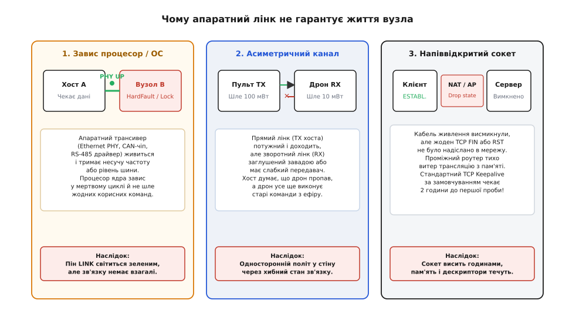
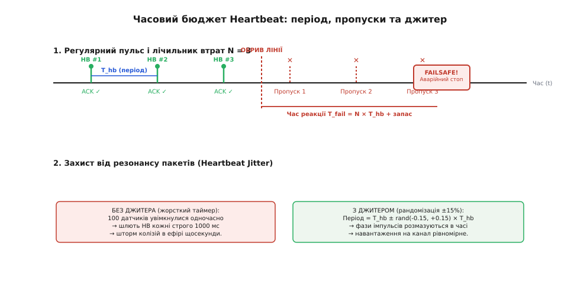
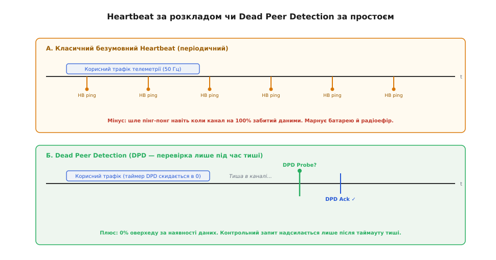
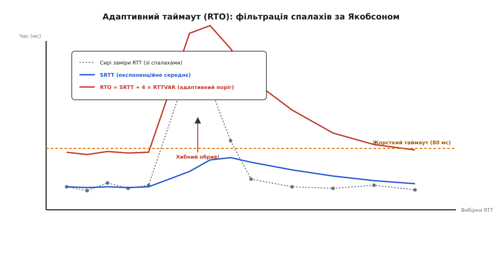
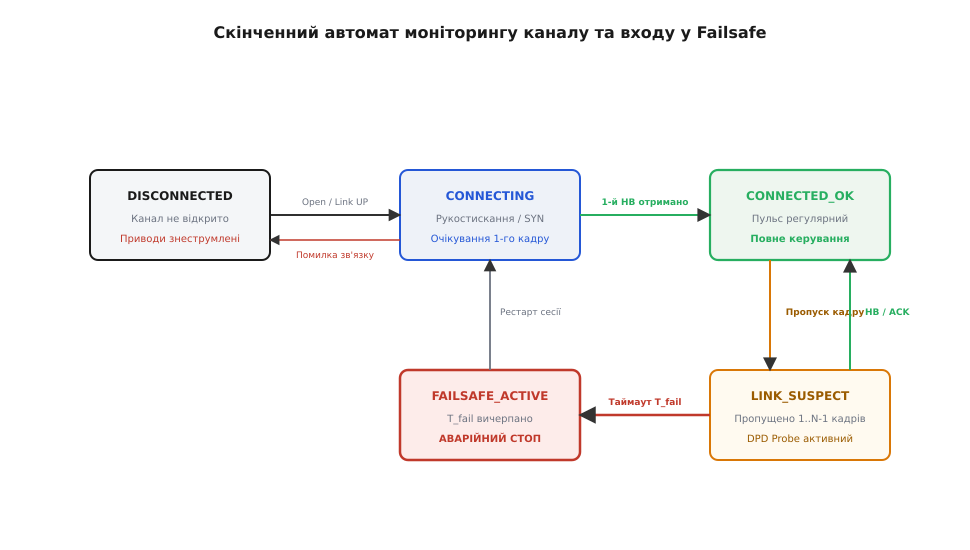

# Серцебиття й виявлення розриву

<preknowlist>
- [Стратегії ARQ](root:embedded/arq-strategies) — підтвердження отримання кадрів (ACK/NACK), віконні механізми та таймери повторної передачі на ненадійному каналі.
- [Автомат станів і черга подій у прошивці](root:embedded/avtomat-staniv-i-cherha-podii-u-proshyvtsi) — моделювання поведінки системи як сукупності детермінованих станів, переходів і обробників таймерів.
- [Апарат, який рушив сам](root:embedded/aparat-iakyi-rushyv-sam) — апаратні та програмні причини неконтрольованого запуску виконавчих механізмів, підтяжки виводів і аварійне знеструмлення.
- [Таймаут, відкат, і чому повтор буває гірший за втрату](root:sf-distributed/timeouts-deadlines) — механіка часових меж у розподілених системах та небезпека ступору при зависанні одного з вузлів.
</preknowlist>

Колісний робот масою двадцять кілограмів рухається цехом зі швидкістю півтора метра на секунду, отримуючи команди від оператора через міст Wi-Fi на польотний контролер. Оператор відпускає джойстик, але в цей самий момент роутер доступу втрачає живлення. Світлодіод на платі приймача продовжує світитися зеленим, операційна система контролера не отримує жодної системної помилки, а в регістрі таймера генерації ШІМ залишається останнє записане значення: заповнення 80% на драйвери безколекторних моторів. Не знаючи, що пульт керування зник назавжди, робот продовжує рух за інерцією останньої команди і через три секунди врізається в металеву колону.

Ця аварія — прямий наслідок відсутності механізму активного виявлення втрати зв'язку. У вбудованих системах стан «даних немає» докорінно відрізняється від стану «лінія вільна». Будь-який інтерфейс зв'язку — від витої пари RS-485 і бездротових трансиверів до стеків TCP/IP поверх Ethernet — схильний до прихованих відмов, за яких канал здається відкритим, але фактичний контроль над системою повністю втрачено. Щоби пристрій міг вчасно перевести приводи в безпечний стан, йому потрібен неперервний доказ життєздатності віддаленої сторони.

### Ілюзія апаратного лінка та пастка мовчазного обриву

Найпоширеніша помилка під час проектування комунікаційних вузлів — довіра до апаратних прапорців наявності сигналу або стандартних сокетних структур. Інженер бачить пін `LINK` на мікросхемі Ethernet PHY або прапорець `Carrier Detect` на радіомодулі й припускає: доки лінія фізично ціла, система працює. На практиці це хибне припущення ламається щонайменше у трьох типових ситуаціях.


*Приховані відмови ліній зв'язку. Ліворуч — апаратний трансивер продовжує утримувати несучу, доки керівний мікроконтролер замкнений у винятку HardFault. Посередині — асиметричний канал, де потужний передавач досягає приймача, але зворотні підтвердження блокуються завадами. Праворуч — напіввідкрите з'єднання через скидання таблиці станів проміжним маршрутизатором.*

Перший випадок — **апаратний лінк за мертвого процесу**. Трансивер фізичного рівня (PHY) живиться від окремого стабілізатора або внутрішнього домену плати і продовжує генерувати тактову частоту, обмінюватися службовими імпульсами автоузгодження (Auto-Negotiation) чи відповідати на апаратному рівні CAN-контролера бітом домінантного підтвердження `ACK`. Проте керівний мікроконтролер вузла міг потрапити в нескінченний цикл обробника `HardFault`, застрягти у дедлоку між двома м'ютексами операційної системи реального часу (RTOS) або заблокувати переривання. З погляду приймача електрична лінія ідеальна, але корисні дані більше ніколи не надійдуть.

Другий випадок — **асиметричний обрив радіоканалу**. Потужність базової станції часто становить 100 мВт або 1 Вт, тоді як автономний датчик чи безпілотник шле відповідь із потужністю 10 мВт заради економії батареї. Коли пристрій потрапляє в зону підвищеного рівня радіозавад або на межу чутливості антени, виникає одностороння чутність: апарат отримує всі пакети зверху, але жодна відповідь не доходить до пульта. Якщо пульт вважає, що зв'язок втрачено, і припиняє передачу, апарат ще довгий час може перебувати під дією останнього прийнятого кадру, не знаючи, що оператор втратив над ним контроль.

Третій випадок — **напіввідкритий сокет і лінивий TCP Keepalive**. Коли вбудована система зв'язується через TCP/IP, розрив кабелю або раптове вимкнення живлення віддаленого сервера не супроводжуються відправкою завершальних пакетів `FIN` або `RST`. Сокет на стороні контролера залишається у стані `ESTABLISHED`. Стандартний механізм контролю з'єднання, закладений у протоколі TCP (TCP Keepalive), за замовчуванням починає надсилати зондувальні пакети лише через 7200 секунд (2 години) повної тиші. Для промислового верстата чи транспортного засобу очікування тривалістю навіть у дві секунди є неприпустимим, не кажучи про години.

Висновок із цих сценаріїв однозначний: надійний контроль зв'язку неможливо побудувати на рівні фізичних пінів чи транспортних абстракцій операційної системи. Підтвердження життя має генеруватися безпосередньо **прикладним процесом**, який керує виконавчою логікою, і перевірятися з періодом, сумірним із допустимим часом аварійної реакції пристрою.

### Періодичний пульс: анатомія Heartbeat-кадру

Найпряміший спосіб активного контролю — регулярне надсилання спеціального короткого повідомлення, яке називають серцебиттям (англ. *Heartbeat*). Кожен вузол періодично відправляє в канал службовий пакет, а протилежна сторона оновлює свій таймер спостереження щоразу, коли такий пакет успішно прийнято й перевірено за контрольною сумою.

Формат кадру серцебиття мусить бути гранично компактним, але нести достатньо інформації для оцінки стану вузла:

```
+---------------+---------------+------------------+---------------+---------------+
| Magic / Type  | Node ID       | Sequence Number  | System Status | CRC-16/32     |
| (1-2 байти)   | (1 байт)      | (2-4 байти)      | (1-2 байти)   | (2-4 байти)   |
+---------------+---------------+------------------+---------------+---------------+
```

Поле порядкового номера (`Sequence Number`) є критично важливим: воно дозволяє відрізнити свіжий кадр від застряглого в буферах повтору або закільцьованого відлуння. Поле стану системи (`System Status`) передає поточний режим вузла: ініціалізація, готовність, робота під навантаженням, перегрів або внутрішня деградація датчиків. Завдяки цьому приймач не просто фіксує фізичне виживання мікроконтролера, а й завчасно дізнається про внутрішні збої партнерського вузла ще до того, як вони призведуть до аварії.


*Часовий бюджет серцебиття. Угорі — нормальний обмін кадрами з періодом T_hb, обрив лінії та накопичення лічильника втрат до порогу N=3, після чого активується стан Failsafe. Унизу — запобігання фазовому резонансу за рахунок внесення псевдовипадкового джитера у вихідний період.*

#### Компроміс між енергією, трафіком і часом виявлення

Частота серцебиття задає жорстку пропорцію між двома протилежними інженерними вимогами: швидкістю реакції на аварію та витратою ресурсів каналу.

Нехай період надсилання кадру становить `T_hb`. Якщо канал схильний до випадкових одиночних перешкод, ми не маємо права оголошувати тривогу після першого ж непочутого кадру — це призведе до хибних аварійних зупинок на кожному випадковому сплеску шуму. Система повинна надати лінії шанс відновитися й зафіксувати аварію лише після втрати `N` послідовних пакетів (зазвичай `N = 3..5`).

Повний час від моменту фізичного обриву до входу в аварійний режим обчислюється як:

```
T_fail = N * T_hb + Jitter_margin
```

Звідси видно прямий конфлікт:
1. Якщо зменшити `T_hb` (наприклад, до 50 мс при `N = 3`), час виявлення становитиме 150 мс. Це ідеально для дрона або маніпулятора, але в каналі генерується 20 пакетів щосекунди. Якщо канал повільний (радіомодем 9600 бод) або багатоабонентський (шина CAN з сотнею пристроїв), такий потік серцебиття з'їсть усю пропускну здатність шини.
2. Якщо збільшити `T_hb` (наприклад, до 2000 мс для економії заряду батареї бездротового датчика), час аварійного виявлення зросте до 6–10 секунд. Якщо цей датчик стежить за тиском у газовій магістралі, затримка у 10 секунд може стати фатальною.

#### Фазовий резонанс і рандомізація джитера

Коли в одній мережі працюють десятки однакових вузлів (наприклад, клієнти бездротової сенсорної мережі або модулі на спільній шині RS-485), виникає явище **фазового резонансу** (англ. *packet synchronization* або *thundering herd problem*).

Якщо всі пристрої увімкнулися одночасно після відновлення живлення і мають однаковий жорстко зашитий таймер `T_hb = 1000 мс`, вони одночасно намагатимуться вийти в ефір щосекунди. Відбувається лавиноподібна колізія: пакети взаємно знищуються, трансивери фіксують зайнятість каналу, відкладають передачу і знову потрапляють у синхронну чергу. Мережа стає паралізованою, хоча середній обсяг трафіку не перевищує допустимих меж.

Щоб розірвати цю синхронізацію, до кожного періоду надсилання додають псевдовипадковий джитер (англ. *jitter*):

```
T_actual = T_hb * (1.0 + random_range(-delta, +delta))
```

де `delta` зазвичай вибирають у діапазоні від 0.10 до 0.25 (±10–25% від номінального періоду). Завдяки цьому фази виходу в ефір рівномірно розмазуються по всій шкалі часу, усуваючи циклічні піки навантаження на радіоефір або спільну шину.

### Економія каналу: Dead Peer Detection (DPD)

Регулярне серцебиття має очевидну надмірність: якщо пристрій і так щомиті передає корисні дані (наприклад, потік телеметрії висоти й кутів орієнтації на частоті 50 Гц), надсилати паралельно окремі службові кадри «я живий» — це марнотратство смуги й заряду акумулятора.

Будь-який валідний прикладний пакет, який успішно пройшов перевірку контрольної суми, вже є незаперечним доказом того, що відправник живий, його процесор функціонує, а канал у повному порядку.

На цьому спостереженні базується алгоритм **виявлення мертвого партнера** (англ. *Dead Peer Detection*, DPD), або серцебиття за подією простою (Traffic-Triggered Keepalive).


*Принцип Dead Peer Detection. Корисний потік даних безперервно скидає таймер очікування. Контрольний запит (DPD Probe) генерується тільки тоді, коли в каналі настає пауза, що перевищує інтервал T_idle.*

Логіка DPD складається з трьох правил:
1. **Скидання таймера за будь-яким трафіком**: Щоразу, коли приймач отримує *будь-який* коректний кадр від вузла (команду, телеметрію, підтвердження ACK), таймер очікування скидається в нуль: `last_rx_timestamp = now()`.
2. **Пасивний режим під час активного обміну**: Доки корисний трафік іде щільним потоком, жоден службовий зондувальний кадр не відправляється взагалі. Оверхед протоколу контролю становить рівно 0%.
3. **Зондування під час тиші**: Якщо з моменту останнього прийнятого кадру минув інтервал очікування `T_idle` (час виявлення бездіяльності), ініціатор переходить у режим перевірки й надсилає адресний запит `DPD_PROBE`. Партнер, отримавши такий запит, зобов'язаний негайно відповісти коротким кадром `DPD_ACK`. Якщо відповідь надходить — зв'язок підтверджено, система залишається в робочому стані. Якщо на `N` повторних запитів поспіль відповіді немає — партнер оголошується мертвим.

Такий підхід поєднує найкраще з двох світів: миттєву реакцію під час нормальної роботи без жодного зайвого байта в каналі й надійне зондування лінії тоді, коли корисний обмін тимчасово затихає.

### Динамічні та адаптивні таймаути за алгоритмом Якобсона

Спроба встановити таймаут очікування `T_timeout` як фіксовану константу в коді — головне джерело прихованих помилок у польових умовах.

Розглянемо типову ситуацію: на столі в лабораторії час оберту пакета (Round Trip Time, RTT) між двома платами становить 15 мс. Інженер ставить у коді жорсткий таймаут `T_timeout = 50 мс` і бачить бездоганну роботу. Проте в реальному виробі зв'язок працює через спрямовані радіоантени або стільниковий модем. Коли апарат віддаляється або на мить потрапляє під дію перешкод, канальний рівень модему вмикає внутрішні повтори (ARQ), і час доставки одного пакета стрибає до 120 мс, після чого лінія знову стабілізується на рівні 20 мс.

Жорсткий таймаут 50 мс у цей момент викличе **хибне спрацьовування** (англ. *false positive*): система вирішить, що зв'язок розірвано назавжди, вимкне мотори й аварійно сяде посеред поля, хоча канал насправді затримався лише на кілька десятків мілісекунд. Якщо ж інженер, намагаючись уникнути хибних спрацьовувань, штучно задере таймаут до 2000 мс, система стане сліпою до справжніх аварій і надто пізно виявить реальний обрив.

Вихід із цієї дилеми — адаптивний розрахунок порогу таймауту на основі динамічної оцінки середнього часу доставки та його дисперсії за класичним алгоритмом Якобсона (розробленим Ван Якобсоном для TCP і адаптованим для вбудованих протоколів).


*Динамічна адаптація порогу RTO за алгоритмом Якобсона. Пунктирний фіксований таймаут викликає хибну аварію на першому ж сплеску затримки. Адаптивний поріг огинає флуктуації каналу, залишаючись чутливим до справжнього обриву.*

Для кожного успішно підтвердженого запиту вимірюється поточний зразок часу оберту `RTT_sample`. Оновлення згладженого середнього значення `SRTT` (Smoothed RTT) та його варіації `RTTVAR` виконується через експоненційно зважене ковзне середнє (EWMA):

```
Err = RTT_sample - SRTT
SRTT = SRTT + alpha * Err
RTTVAR = RTTVAR + beta * (|Err| - RTTVAR)
RTO = SRTT + 4 * RTTVAR
```

де коефіцієнти традиційно дорівнюють `alpha = 1/8 (0.125)` та `beta = 1/4 (0.25)`. Множник `4 * RTTVAR` створює надійний захисний коридор: якщо затримки стабільні, варіація майже нульова, і поріг таймауту `RTO` (Retransmission Timeout) підтискається близько до середнього часу реакції. Щойно в каналі з'являється джитер і затримки починають плавати, варіація зростає, автоматично піднімаючи поріг і захищаючи систему від хибних спрацьовувань.

#### Правило Карна для повторних спроб

При роботі з адаптивними таймаутами діє фундаментальне **правило Філа Карна** (англ. *Karn's Algorithm*): якщо пакет серцебиття чи запиту DPD було надіслано повторно через вичерпання попереднього таймера, отриману після цього відповідь **заборонено використовувати для оновлення вибірки RTT**.

Причина в неоднозначності: неможливо визначити, чи відповідь прийшла на перший (який просто затримався в черзі), чи на другий (повторений) пакет. Якщо порахувати час від моменту відправки другого пакета, занижене значення RTT зіпсує оцінку дисперсії; якщо від першого — завищене значення спричинить штучний розрив. Натомість під час кожної повторної спроби застосовують експоненційне відкочування (Binary Exponential Backoff):

```
RTO_current = RTO_current * 2
```

затискаючи його між наперед визначеними межами `RTO_min` та `RTO_max`.

### Автомат станів та аварійний перехід (Failsafe)

Фіксація втрати зв'язку — це лише половина завдання. Друга, не менш відповідальна частина — те, **що саме робить пристрій**, коли розрив підтверджено.

Простий перехід у нескінченний цикл або скидання процесора через сторожовий таймер (Watchdog) є небезпечними: при перезавантаженні виводи мікроконтролера на кілька мілісекунд переходять у високоімпедансний стан зі слабкими підтяжками, що може спричинити хаотичне спрацьовування ключів і ривок силових приводів.

Поведінка системи повинна керуватися суворим скінченним автоматом моніторингу зв'язку (Connection FSM).


*Автомат станів менеджера зв'язку. Перехід у стан FAILSAFE є термінальним або потребує спеціальної процедури відновлення сесії, що запобігає небезпечним смиканням приводів на межі зони прийому.*

Автомат охоплює п'ять станів:

1. **`DISCONNECTED`**: Початковий стан після скидання. Силові ланцюги знеструмлені, виходи драйверів заблоковані апаратними лініями `ENABLE = LOW`. Прошивка чекає фізичного відкриття каналу.
2. **`CONNECTING`**: Процес рукостискання. Система надсилає запити ініціалізації та очікує першого валідного пакета серцебиття від партнера. Керування приводами все ще заблоковане.
3. **`CONNECTED_OK`**: Робочий режим. Пульс регулярний, час між кадрами не перевищує розрахункового порогу, керуючі команди передаються на виконавчі органи.
4. **`LINK_SUSPECT` (Деградація)**: Пропущено один або кілька контрольних кадрів, але критичний ліміт `T_fail` ще не вичерпано. Система переходить у стан підвищеної готовності: активуються зонди DPD, призупиняється виконання ризикованих маневрів, фіксуються останні безпечні уставки швидкості або вмикається плавне гальмування.
5. **`FAILSAFE_ACTIVE`**: Зв'язок остаточно визнано втраченим. Виконується процедура аварійного переводу системи в безпечний стан (англ. *Safe State*):
   - Повне зняття керуючих ШІМ-сигналів із силових мостів;
   - Замикання електромеханічних гальм або переведення крокових двигунів у режим динамічного утримання;
   - Для безпілотного апарата — активація режиму безальтернативного повернення додому за координатами GPS (RTL) або керованого парашутного спуску;
   - Вмикання аварійної світлової та звукової сигналізації;
   - Запис коду події з міткою часу в енергонезалежний журнал помилок (EEPROM/Flash).

#### Захист від брязкоту на межі зв'язку (Latching & Hysteresis)

Найнебезпечніше явище під час розриву зв'язку — **брязкіт стану лінка**. Коли апарат маневрує на крайньому радіусі дії радіостанції, пакети починають приходити пачками: один дійшов — три загубилися — знову один дійшов.

Якщо вихід із режиму Failsafe буде миттєвим за першим прийнятим кадром, виникне небезпечна поведінка: мотори щосекунди вмикатимуться на повну потужність і знову аварійно вирубуватимуться. Такий режим здатний спалити симулюючі ключі або перекинути рухому платформу.

Щоб запобігти цьому, в алгоритм закладають **гістерезис відновлення** (англ. *recovery latching*):
- Для входу в стан аварії достатньо втратити `N` пакетів підряд (наприклад, 3 пропуски);
- Для виходу з аварійного стану й повернення до штатного керування система вимагає отримати підряд `M` бездоганних пакетів (де `M >= 10..20`), або ж повного ручного скидання аварії оператором (Manual Clearance).

### Реалізація менеджера серцебиття та аварійного захисту

Зведемо описані принципи у закінчений модуль контролю зв'язку. Приклад містить неблокувальний обробник таймерів, адаптивний фільтр RTT, лічильник пропусків та механізм безпечного переводу системи в аварійний стан.

:::tabs
:::code sertsebyttia-i-vyiavlennia-rozryvu-d/c/main.c
:::code sertsebyttia-i-vyiavlennia-rozryvu-d/cpp/main.cpp
:::

У цій реалізації важливо звернути увагу на інваріант: метод `tick()` виконує чисту перевірку таймерів без блокування потоку, що дозволяє безпечно викликати його з системного таймера з періодом 1–10 мс. Зворотний виклик `on_failsafe_enter` негайно виконує апаратне знеструмлення виконавчих вузлів, запобігаючи неконтрольованій поведінці пристрою при раптовому зникненні каналу.

### Підсумок інженерних рішень

Побудова надійної системи виявлення розриву зв'язку зводиться до п'яти чітких правил:

1. **Не довіряти апаратним лінкам**: Наявність несучої або статус сокета кажуть лише про живлення мікросхеми інтерфейсу. Доказом життя є тільки валідний прикладний кадр від керуючого процесу.
2. **Обирати між Heartbeat та DPD за характером трафіку**: Якщо потік даних безперервний — DPD за простоєм економить смугу й батарею. Якщо обмін епізодичний або критично важливий для безпеки — регулярний пульс із фіксованим бюджетом часу гарантує детерміновану реакцію.
3. **Рандомізувати фазу передачі**: Джитер у 10–25% періоду усуває загрозу фазового резонансу й масових колізій при одночасному старті багатьох вузлів на спільній шині чи радіоканалі.
4. **Адаптувати таймаути до дисперсії лінії**: Алгоритм Якобсона та правило Карна захищають від хибних спрацьовувань при сплесках затримок у зашумленому ефірі, утримуючи чутливість на максимально можливому рівні.
5. **Вводити гістерезис відновлення**: Вхід у Failsafe має бути швидким, а вихід — надійним і відкладеним, що унеможливлює небезпечний брязкіт силових приводів на межі зони прийому.
